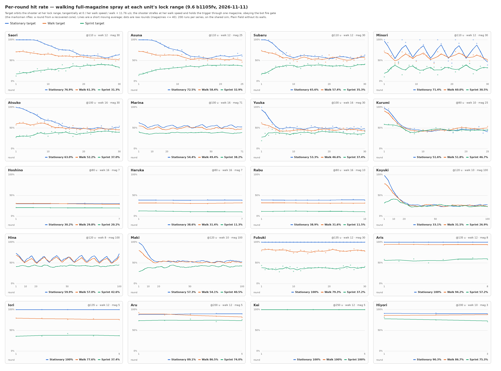

# Gun VS Gun

A fast-paced 1v1 / 2v2 arena prototype with two main modes — **Duel** (single stock) and **Trio** (three-unit rosters). Auto-aim — no manual targeting. The fight is about resource management: when to sprint, when to dodge, when to break line of sight, when to fire.

## Modes

Two main modes, each playable **1v1 or 2v2**, offline and online:

- **Duel** — classic single stock: one unit per fighter; a team loses when all its fighters are down.
- **Trio** — three-unit stock: every slot (human or bot) fields an **ordered roster of three units**, repeats allowed. When a unit dies, the slot's next unit respawns at its original spawn point with the standard 3 s spawn immunity; the killer keeps position / HP / boost — no kill reward. A team loses when every roster on its side is spent. Each fighter's remaining units show as a row of small weapon renders under their side's HP bars (one line per team member; Duel shows its single unit the same way), and a small golden glow-bar marks each Trio line's currently fielded weapon.
- **Spectating (2v2, both modes)**: if you're out for good while your ally fights on, the camera follows the ally with your own-unit visual kit (rear art + through-wall X-ray); the lock reticle stays up and mirrors the ally's actual target (the TARGET button goes inert), and the boost bar and ammo readout follow the ally too (2026-09-29 — they used to stay frozen on your dead unit's numbers).

Orthogonal to all of the above, every player also picks a **view mode** — **Shooter** (the chase camera you pilot directly; named "Classic" until 2026-10-10) or **Command** (a commander's diorama view where your unit fights on its own bot brain and you give it orders). See the **Command mode** section below.

### Offline
- **1v1**: you vs one enemy bot.
- **2v2**: you + an ally bot vs two enemy bots. Friendly fire is off between teammates.
- **Trio picks**: you select your three units in order, then each bot's three — same selection grid, titles count up (1/3 → 3/3).
- Optional "Dummy" mode on the map-select screen — zeroes out damage from every bot (enemies and your ally), so you can practice movement and observe bot behaviour without dying.
- Optional "Spectator" mode beside it — a bot takes over your unit and you watch the match: **TARGET** cycles the camera across every unit on the field (both teams), the HUD (HP / boost / ammo) follows whoever you're watching, the edge arrows stay viewer-relative, and the end banner reads **TEAM 1 WINS / TEAM 2 WINS**. Stacks with Dummy: the bot driving your slot still deals damage exactly as you would, and every other bot's shots are blanks (2026-10-03 — before that the combination zeroed everyone for a no-deaths exhibition).
- The main menu also carries a **Guide** button (a popup summarising controls, mechanics and the command-mode gestures) and a **Server Boot-up** button that opens the online debug panel.

### Online
- **Mode selection**: the host picks **Duel or Trio**, then **1v1 or 2v2**; joiners inherit the lobby's modes.
- **1v1**: the host presses **Start Match** when ready. The opponent slot holds a bot (default **Saori / Unit 1**) until a second human queues in and takes it — start early to play the bot, or wait for a player.
- **2v2**: the host presses **Start Match** when ready; empty player slots fill with bots (2v2 rooms open as Saori / Hoshino / Aru / Atsuko by slot; Trio bots field three copies of that unit unless the host picks otherwise). Up to four humans can play (any split between teams); bots fill any remaining slots.
- **Bot unit selection**: in the lobby, the host can tap any bot slot to pick which unit that bot plays — in Trio, its three units in order (default: three copies of the slot's usual unit). A human joining the slot always overrides the bot.
- **Trio queue room**: every slot's roster is shown in three lines and updates live as picks land.
- **View mode**: each player picks Shooter or Command in the queue room; the pick is final once the match starts and is never shown to the other team (teammates see it as a gold **[CMD]** tag on the roster line). Details in the Command mode section.
- **Slot-colored corner HUD** (online, 2026-08-22): the corner HP bars follow the **server slot** — left column team A (p1 top / p3 bottom), right column team B (p2 top / p4 bottom), each bar tinted its slot color (p1 blue / p2 pink / p3 green / p4 orange), the same picture for every viewer and spectator (1v1: p1 left, p2 right); your own bar wears a thin **white rim**. The command diorama's markers, cards, rings and lock triangles use the same slot colors online (offline keeps the role palette).
- **Host migration**: if the host leaves in the lobby or at the end menu, the longest-waiting player is promoted to host (their unit picks carry over; the lobby keeps its Duel / Trio and 1v1 / 2v2 settings and the new host re-chooses the map).
- Multi-lobby — when an existing lobby is full or running, new joiners spawn their own lobby and become host.
- Team swap in 2v2: any non-host player can `Join` an empty slot to switch teams (e.g. two humans want to co-op on one side against two bots).

### Unit profile card

The first tap on a unit card opens its profile beside the grid (tap the same card again to confirm, anywhere else to cancel): the character art on the left and the **weapon panel** on the right — the gun's real-world name, its render, and since 2026-09-22 a **3×2 stat grid** under the render (owner pick "C" from three in-game samples: a third plate beside the panel and a label/value row list were the other two; the demo line carries the same stats as a row list). The six cells read live from the unit data:

- **Mag**, **RPM** and **Reload** (seconds) as plain numbers.
- **Dmg** shows every tier where a gun has them: Aru's PSG1 `50/35/20` (far / mid / near), Kei's Railgun `30/20` (quick / charged), the shotguns per pellet `3 ×8`.
- **Movement** is the walk-speed tier word (walk speeds retuned 2026-09-24): **Fast** (walk 16 — Atsuko, Marina, Yuuka, Hoshino, Haruka, Rabu), **Medium** (12 — Saori, Asuna, Subaru, Fubuki, Aris, Aru, Kei), **Slow** (Koyuki and Kurumi at 10, Hina at 8).
- The **Spread picture** is a seeded mini-simulation of a **walking spray at a common 60-unit reference** (the shotguns at their own 40): the ring is a standing target's half-width at that distance, the orange dots are up to 30 rounds — magazine-limited — each leaving on the cone the sim gives that round (base + bloom, per-round bloom up to the cap, and the between-round recovery of the no-delay marksman rifles), fading with round order so the first rounds read brightest. The spray stops at the first round whose cone no longer fits the frame (2026-09-22, owner pick from samples — pinning spilled rounds to the frame's edge had piled Fubuki's 27 out-of-frame rounds into a rectangle), so nothing is drawn outside the frame: Saori's whole 30-round spray stays inside the ring, Koyuki's and Hina's pictures end a few rounds short of the magazine with their late rounds at the frame's edge, and Fubuki's and Aris's show their first three quick rounds — one on the ring's centre, two at its edge — because the fourth already flies wider than the frame; the shotguns show their 8-pellet pattern (the Beretta 1301 with its 1.4× horizontal stretch — Hoshino's since the two shotguns swapped patterns on 2026-10-10).
- A unit may carry a **note** (`cardNote`, user 2026-10-24): one line at the card's bottom-left, under the art. Kurumi's reads "This unit has 20% more health." A map may carry one too (`cardNote` in the client's `MAP_DATA`; District's and Compound's read "Unit has more stamina in this map.", user 2026-10-29 and 2026-10-30), shown on its info card the same way, under the picture. (The notes were off for part of 2026-11-01, while every map had their boost, and came back with it; Blockade carried the note from 2026-11-01 until its 5 went on 2026-11-03.)

The grid keeps the same sizes on phones (checked at 390 px: nothing wraps or spills).

### Random & All Random cards

Both offline and online pickers carry them:

- Every unit grid has a gray **Random** card (question-mark thumbnail): it rolls a unit the roster being built doesn't already contain (different players can still land on the same unit). The map picker is two sections, each with a Random card of its own: **Scene Maps** — the maps cut from modelled scenes (Town, Spacecraft) — over **Concept Maps**, the hand-made arenas; a section's Random rolls among that section alone and skips **Shooting Range** and **Plain Field** (`noRandom` in the map table; user 2026-10-19) and, since b1027p, **District** too (user 2026-10-30, "too much of a special map" — a manual pick only, offline and online alike: the roll is the picker's, the host's included). A map's row may say which part of its card picture the wide thumb shows (`thumb: 'top' | 'bottom'`; the thumb box cuts a square picture to a band, the centre by default) — Backrooms and Warehouse show their upper part, Spacecraft its lower; the profile shows the whole picture (user 2026-10-24).
- Every unit grid also carries a golden **All Random** card: one confirm fills every remaining unit slot of the current flow at once and advances it (offline: the rest of your roster, then every bot picker that follows — Duel included; online: the rest of your roster). The map picker deliberately has no All Random.

**The Splat skin** (PT, b1105l, 2026-11-05) — the first pass of the UI rework, the user's pick of seven directions drawn on the "GunVS UI Rework Samples" design canvas (A Tactical, B Arcade, C Signal, D Slash after Persona 5 and Valorant, E Holo after Apex and Overwatch, F Splat after Splatoon and Jet Set Radio, G Ops after Call of Duty: Mobile): direction F. Every menu is an opaque cream sheet with three ink blobs (an inline SVG in `style.css`, pinned while the content scrolls; user: the cream covers the 3D behind), the titles white Titan One stickers with an ink outline and a magenta drop, the buttons and option chips white pills with a 3 px ink border and a hard shadow (the chosen chip magenta; Sudden Death ink with yellow type), each a degree or two off square. The lobby keeps its flow — the first unit pick is made on it — with its four option rows labelled Play as / Teams / Roster / Rules (`showSelectMenu`). The unit grid is 84 px sticker tiles (`unitGridHTML`), seven to a row on a landscape phone so the 17 units and the two Random cards sit in three rows without scrolling; a tile shows the character's name and a weapon-class tag on its corner — AR, RF (rifle), SMG, SG, MG, SN (sniper) — and is coloured by that class (cyan, cyan, lime, yellow, magenta, ink). The map picker's two sections are tabs now, Scene Maps | Concept Maps with their counts (`mapGridHTML`, wired in `wireMapGrid`), one grid shown at a time; a tab's Random card rolls its own tab alone, as the stacked sections did. The profile card of both pickers (`.unit-profile-popup`) is a white sticker with a lime "tap to confirm" tag hanging off its bottom; its contents — the art, the weapon panel, the six stats, a unit's or a map's note — are as before. The match HUD keeps every box the JS mirrors (the corner bars' 180 px, the thumb buttons' `--btn-size`, the joystick's 140, the dio cards' 180x68 / 132x52) and wears the skin inside them: the bars a white rim with an ink outline and the fills lime (you) / magenta (enemy) / cyan (ally) / yellow (enemy 2), the online slot colours still set by the JS; the thumb buttons white, DODGE cyan, SPRINT magenta, TARGET yellow, FIRE's count in Titan One and its reload ring lime; PAUSE a sticker; the commander's cards ink with a white rim. The crosshair is untouched (the CS classic, user). Titan One and Rubik are bundled from `client/src/fonts` (latin and latin-ext, SIL Open Font License — the OFL texts beside them; 72 KB in all) so the PWA has them offline; the stylesheet's `url()`s go through Vite, so the hashed files follow the `./` base. Not in this pass: real ink-splat art in place of the SVG blobs, Chinese type. Online room, pause / guide / settings and the commander's order tray took the same components with no design of their own, as asked.

**The slot lobby and the pickers' page** (PT, b1105m, 2026-11-05; user: "i want that layout previously shown in the artifact" and, of the HUD sample, "i especially love those buttons and the simple arrows inside") — the lobby is the design canvas's: your unit's card on the left (the profile art, the name, the class and the weapon; a Trio roster as three thumbs), the option rows in the middle — Play as / Teams / Roster / Rules / Where (Online hands over to the online lobby, as the old button did) — with the Dummy and Spectator toggles under them (they sat on the map picker's page), the map's card on the right (its picture, its name, its section and its size in metres from the boundary table, its stamina note), and along the foot the summary chip, a Random die (rolls your unit, or your whole Trio roster), All random (rolls you and arms the chain) and GO!!. A card opens its picker and comes back; GO!! fills what is still missing — the pickers for an incomplete roster, then the bot pickers as ever — and starts on the card's map, so the map picker is no longer the chain's last page (`showSelectMenu`, `renderLobbySlots`, `startFromLobby`, `startFromMap`; `state.mapKey` starts at Plain Field). The pickers' page (`showUnitPicker`, `showMapPicker`): a back arrow (to the lobby) and the title on one row, the unit picker's class filter chips beside them (All / AR / SMG / SG / MG / Sniper; the rifles count as AR), the preview card on the left — the art, the name and class pill, five range pips from the lock range, the weapon's name and its six stats (the gun render stays on the floating card), or a map's section, size and tags (manual pick only, offline only, the stamina note) — with a CONFIRM! button; the tapped tile wears a PICK! tag, and tapping it again confirms as before. `spawnProfilePopup` fills the page's side card when the menu has one and floats the old card otherwise (the online pickers); on a portrait phone the side card floats over the grid as the old popup did. The thumb buttons carry arrows over their words — JUMP up, DODGE a sidestep, SPRINT a dash, TARGET a sight (`HUD_BTN_ICON`). The first lobby and the first frame moved to the module's end: the lobby's map card reads `GLB_MAPS`, declared far below the old spot, and the first frame's `updateMapRoof` read it before it stood — the render error logged on every page load since the roof hiding is gone with it.

**The lobby's second pass** (PT, b1105n, 2026-11-05; the user's five notes on b1105m) — the cards' art is the square thumbnail (the face-centred crop the tiles use) shown a little above its middle, where the full profile art cut to a band lost some units' eyes; the picker's side card the same. The two offline toggles are the **Practice** row (Dummy bots, Spectator — each on or off alone, lit yellow) under a new **Bots** row (I choose | Random: who picks the bots' units at GO!!, `state.botPick`). The foot: **Guide** and **Server** on the left (they were a "?" and "SRV" at the top-right, and the lone "?" read as the guide), and on the right **Random unit** and **All random** as dice with their words, then GO!!. **All random** no longer starts the match by itself: it rolls your unit (your Trio roster) and sets the Bots row to Random, so GO!! asks nothing more; the pickers' All Random card does the same and returns to the lobby. A site open lands on Saori (as before) and **Town** (Plain Field until now).

**The lobby's third pass** (PT, b1105o, 2026-11-05; the user's next five notes) — the option rows are taller and further apart (38 px, 10 px between; five of them: Play as / Teams / Roster / Rules / Practice). The Where row is gone: **ONLINE** is a sticker of GO!!'s height beside it ("vs player" under the word; it opens the online lobby as the old button did). The Bots row is gone with it: **All random · GO** rolls your unit (your Trio roster) and every bot and starts the match at once — the pickers' All Random card does the same — while GO!! alone runs the bot pickers as ever. The guide's round **"?"** is back at the top-right; Server stays a small pill at the foot's left. The **Trio** card draws the roster as the user's sketch: three slanted panels side by side, each on its unit's class colour with the face-centred thumbnail, the slashes between them the ink showing through, a slot still to pick a yellow "?" panel; the three names under them, and "n more to pick" while the roster is short (GO!! then opens the pickers for the missing slots alone).

**The lobby's fourth pass** (PT, b1105p, 2026-11-05; the user's next five notes) — the guide's **"?"** sits in the sheet's own top-right corner (a direct child of the sheet, not of the centred head). The **Server** pill is gone from the lobby: **Online** leads to an online connect page — the status chip, a word on the sleeping server, **Server Boot-up** (the debug panel, as before), **Leave** back to the lobby — in place of the bare "Connecting…" overlay, at the first connect and at every reconnect (renderOnlineUi's 'connecting'). **All random** rolls every slot of both cards (you — your Trio roster —, the ally in 2v2, the enemy, the second enemy) and shows them on the cards; it no longer starts the match (b1105o's All random · GO; user: "All random+Go is not ideal"). **GO!!** starts with nothing left to ask when every card is full, else the pickers for the missing picks alone, slot by slot (you, ally, enemy, enemy 2). An **enemy card** stands on the right where the map's card was — the same card as yours: one unit in a Duel 1v1, otherwise a row of slanted panels per slot (two rows in 2v2) and a line of names per slot (YOU / ALLY, ENEMY / ENEMY 2); its Pick / Change runs the enemy's pickers ("Select Enemy Unit", "Select Enemy 2 Unit"). A card's **Pick** fills the missing picks alone while something is missing (Saori, the default, stays as slot 1, so a fresh Trio's pickers start at 2/3); **Change** on a full card asks the roster(s) afresh; the pickers' All Random card fills the rest of that card only and returns to the lobby (in b1105o it started the match from there). The **map** moved to a chip at the foot's left (thumbnail, name, MAP · section · size, Change → the map page); the chip yields width first, so the four buttons never wrap on a landscape phone, and under 760 px the foot wraps (the chip full width, the buttons centred in a row of their own). A single roster's three names may take two lines (never a cut name); a 2v2 card lists its two rosters in Rubik 11.5 px with thin spaces. Verified headless (`ui/ui_shots5.mjs`, 844×390 and 412×915): the corner "?" 9 px from the edges; All random refreshes both cards with no picker and no match; GO!! after it opens the HUD with no picker; the 2v2 Trio cards show two rows of three panels and fill from All random; the Trio card's Pick runs (2/3)(3/3) and returns to the lobby, Change asks (1/3), the enemy card asks "Select Enemy Unit (2/3)", GO!! with the enemy trio missing asks the same; Online shows the connect page (Server Boot-up / Leave) and Leave returns to the lobby with no overlay left.

**The lobby's fifth pass** (PT, b1105q, 2026-11-05; the user's next five notes) — the **enemy and the map swap places**: the map's card is back in the right column and shows its **whole square picture** (`object-fit: contain`, letterboxed on ink, 134 px tall; user: "the full uncropped image, not the further cropped version" — MAP_DATA.thumb stays the picker's wide tile's business), and the enemy side is a **chip at the foot's left**: a strip of its units' faces (small slanted panels, one row per slot; in 2v2 Trio the two rows stacked so the names keep their room), the names with ENEMY / ENEMY 2 pips before them, Pick / Change; the whole chip runs the enemy's pickers. A **2v2 Duel** card is one row split left / right (you | ally) instead of two full-width rows. Every roster panel is now a flex item of its row, overlapping its neighbour by 15 px and clipped to a parallelogram (slanted edges 18 px), so the **face sits in the middle of its own panel** (user: "the face should be in the middle"; the old thirds-of-the-row geometry showed a slice offset from the face), and the single card's wide band is taken lower on the square thumbnail (`center 70%`: the eyes sit at about 62% of its height, so the old 40% band cut them in a short row). The **Random unit** button is gone (All random stays). Small things: the size line uses no-break spaces, the sub line keeps 52 px clear of the Change word, a 2v2 Trio card's sub reads "three each, in turn". Verified headless (`ui/ui_shots6.mjs`): the foot holds in 390 px with no Random unit button; the map card's image is the whole 1024-square, contained; the 2v2 Duel card is one row of two panels; the 2v2 Trio card two rows of three and the chip six faces in two stacked rows; the card's Pick runs (2/3)(3/3); the chip's Pick asks "Select Enemy Unit (2/3)"; the map card opens "Select Map"; GO!! after All random opens the HUD with no picker; portrait wraps the chip full width and the buttons under it.

**Faces, the rifles' colour, the memo tape** (PT, b1105r, 2026-11-05; the user's next notes) — **Face placement**: every picture box of a unit (the lobby card's wide band, every slanted panel, the chip's small faces, the picker's side card) is a `face-box` — a CSS size container — and `UNIT_FACE` (main.js) gives a unit's face centre x and eye line y as fractions of its square thumbnail, read off a contact sheet with a 10% grid (`ui/face_sheet.mjs`; 0.5 / 0.62 unless set: Fubuki 0.43 / 0.63, Haruka 0.47, Atsuko y 0.68, Aris / Asuna / Koyuki / Kurumi x 0.52, Hina 0.48, Rabu 0.53 / 0.63). `object-position` is computed from the box's own width and height in container units so that point sits at the box's horizontal centre and at 44% of its height — a tall box crops the sides, a wide box the top and bottom, and a min()/max() pair makes the other axis 0 so the picture always covers the box (user: the eyes "should be higher" on a single character — the side card's band was cut at 42% from the top, where the eyes of these thumbnails are at about 62% and Atsuko's at 68%, so Fubuki's eyes sat on its bottom edge and Atsuko's below it; and Fubuki "cropped a bit more to the right": her face is at 43% of her thumbnail, so a centred crop showed it left of the panel). The side card's band is 100 px now (88). Browsers without container units leave the picture centred. **Rifle** (RF: Fubuki, Aris) has its own class colour, lavender `#C9B2FF`, no longer AR's cyan (user: "rifle and AR are not the same category"), and the picker's filter row has a **Rifle** chip; AR no longer folds the rifles in. **The memo tape**: a translucent yellow strip, torn at both ends, stuck over the top edge of the pickers' side cards (unit and map), left of centre, a few degrees off (user: "inside the selection menus, i want that yellow memo tape style" — the design canvas's F map card); in portrait, where the card is a scrolling overlay, it sits just inside the edge. Verified headless (`ui/ui_shots7.mjs`, `ui/ui_shots8.mjs`): the computed object-position of the lobby card (−64 px), the side card on Fubuki (−90 px) and Atsuko (−100 px), Fubuki's middle panel (−11 px sideways), the chip's and the 2v2 rows' panels; the Rifle filter shows unit10 and unit7, AR unit1, unit9, unit14; the RF tag is lavender, AR cyan; the tape 96 × 22 px at the top edge of both side cards and inside the portrait overlay.

**HUD colours, the spectator ring, the tape and the map card** (PT, b1105s, 2026-11-05; the user's next notes) — **JUMP** is lime (the stick's old colour) and the **stick's knob red** (`--red #FF4F4F`; user: "give jump button the green tone the joycon has. change joycon green to red"). **Spectator**: the watched unit's corner bar wears a thick yellow ring inside an ink line and a wide halo that pulses yellow / white (1.1 s; still under reduced motion), and the Trio icon row's watched line glows yellow too (user: the white glow "is not obvious enough"; the ring stops 6 px out so the player's bar's ring just meets the ally's bar). **The memo tape in portrait** hangs over the card's top edge as in landscape: the overlay card no longer clips its outside — its inside scrolls instead when it must (user: "the tape shouldn't be cropped on the top"). **The map picker's info card** shows the whole square picture (contain on ink, 164 px tall in landscape, a square box in portrait; user: "the info card is not using the uncropped image"). Verified headless (`ui/ui_shots9.mjs`, `ui/ui_shots8.mjs`): a 2v2 spectator match marks `.health` as watched with the ring; the stick's computed colour is the red and JUMP's the lime; the tape sits at −11 px above both side cards in landscape and above the portrait overlay; the portrait map card's picture box is 327 × 327, contained.

**The folder and the memo** (PT, b1105t–u, 2026-11-05; user: "make the character box on the left file folder style and the map on the right a memo-pinned-on-the-wall style … implement that to all character cards and map cards") — every unit card is a sheet in a **manila file folder** and every map card a **memo on the wall**. The lobby's left column is the **LINE-UP folder** (`.lobby-folder`, manila `#F6D27A`, a 24 px tab reading LINE-UP, a thumb notch on its right edge) holding two sheets: your unit's card (its YOUR UNIT sticker moved to the sheet's right, under the tab) and the enemy's slip (the face strip, the ENEMY / ENEMY 2 pip on its own line over the names, Change / Pick as a magenta sticker on the slip's top-right corner; in 2v2 Trio the strip's two rows stack). The map's card on the right is the **memo**: a white note with cyan ruled lines under the picture, a strip of the yellow tape over its top edge, centred, the whole square picture on ink, MAP · section · size, Change on the name's line. The grid is two rows now: the folder spans both, the option rows and the memo fill the first, the foot's buttons (All random / Online / GO!!) the second. The unit picker's side card is a folder too (tab UNIT FILE, a paper clip on the sheet's corner), the map picker's a memo (the tape over the top edge, no pin — b1105u, user); the floating cards of the online pickers follow (`.pp-folder` / `.pp-memo`). **SR** is the sniper rifle's tag (was SN; user), in the tiles, the filter chip and the class colours. Verified headless (`ui/ui_shots10.mjs`): the 1v1 and the 2v2 Trio lobbies fit 390 px (sheet scroll height 390), the slip opens "Select Enemy Unit", the Sniper filter shows unit3 and unit6 with SR tags and no SN left, the folder card carries the tab and the clip, the memo card the 84 px tape and no pin; portrait keeps the folder and the memo side by side under the rows. (b1105v, user: "make the file slightly longer so the ally box and enemy box do not overlap") the sheet and the slip are 12 px apart on every screen — the slip's Change sticker, 9 px over its top edge, no longer touches the sheet — and on a screen at least 440 px tall (desktop, portrait) the folder is longer: the sheet 208 px, its art 118 px, the two 16 px apart. The slip's text lost its ENEMY pip and its corner sticker names the side instead of saying Change — ENEMY / ENEMY TRIO / ENEMY TEAM (user: "remove the enemy text box; change the change text to enemy text"); a short roster still says "n more to pick" in its small line. The design canvas (artifact 1489ieHXfUJZ3okkbwshBu, round 5) holds the folder-and-memo lobby as built and a **proposal for the match HUD**, not built: the corner HP bars grow into the F sample's chips (an ink pill with the portrait in a ring, the name with YOU / ENEMY, the bar, the number; the Trio row as faces under it; the ally's and the second enemy's chips smaller under the first two; the spectator's watched chip with the b1105s yellow ring), and the bottom boost bar becomes a yellow BOOST sticker in the sample's ammo-chip style (the word, an ink gauge with a white knob, the number; magenta when low).

**The HP chips and the BOOST sticker** (PT, b1105w, 2026-11-05; the design canvas's round 5, built on the user's "implement the HUD on PT") — the match HUD's corner bars and the Trio weapon-icon rows are gone; each slot has an **HP chip** (`.hp-chip`, main.js `hpChipHTML` / `renderHpChip`): an ink pill with a white rim and an ink outline, the portrait of the unit on the field in a ring of the side's colour (the thumbnail at 150% with its UNIT_FACE point at the frame's centre), the name in Titan One, the side word (YOU / ALLY / ENEMY / ENEMY 2) in the colour, and the bar — as long as the unit's HP (`--hp-scale`), a round knob at the fill's head (`--w`) — no number. In **Trio** the roster's other two units sit at the chip's far end as small faces, a fallen one greyed (the reserve, from the slot's roster and cursor offline, the snapshot's roster fields online). Yours top-left, the enemy's mirrored top-right; in 2v2 the ally's and the second enemy's smaller under them (cyan, yellow). Online the chips anchor by server slot as the bars did, in the slot's colour (`--c`); the side word says which is you (the thin white "self" rim is gone). **Spectator**: no side words while the viewer is a spectator — the Practice toggle or an online spectator (user: "if it's spectator mode, remove you/ally/enemy/enemy 2 text; if the spectator mode is triggered by player dying, then these text remains") — and the WATCHED chip (the camera's unit, by the toggle or because the player is out) wears the b1105s yellow ring with a WATCHING tag; a slot out for good dims with a DOWN tag. **Sudden Death** hides the chips' bars alone. The fullscreen button docks right of the left chip by `--left-chip-right`, a ResizeObserver on the chip (the chip is as wide as its name, its bar and its faces). The **BOOST sticker**: yellow, level, at the bottom centre — the word and an ink gauge with a white knob (`--bw`), no number; the fill turns magenta under 30% (`.low`). The DOM of a chip is rebuilt only when its unit, its word or its reserve changes; the bar and the classes move every frame. Verified headless (`ui/ui_shots11.mjs`): a 1v1 Trio match shows both chips with two reserve faces each and the fullscreen button 10 px right of the left chip; a 2v2 Spectator match shows four chips with no side words and the ring on the player's chip, moving to the ally's on TARGET; a 2v2 Sudden Death match shows the chips with the bars hidden (`display: none`) and the words in place; a 1v1 on a 1280 px window. Not exercised headless: the DOWN tag and the after-death WATCHING ring (they need a death). (b1105x, the user's three notes on V472) the chips' far side has 18 px of padding (16 on the small chips) and the reserve faces start 12 px after the track, so the knob — 8 px past the track at full HP — stays 10 px inside the rim ("the HP bar should stay well inside the box"); the BOOST fill is the SPRINT button's magenta at every level, no ink and no low-state colour ("shouldn't be black"); and the round frames show the thumbnail at 125% with the face's middle at the centre, clamped to keep the frame covered, so the whole head fits ("face should be at the center" — 150% with the eyes at 46% cut the hair and the chin). (b1105y–z) the chips were levelled for a build on a misread of "still tilted" and **tilt again** (±1.5°, as the boards had them; the BOOST sticker alone is level) — the user meant the faces, which sat left and high in their browser: the round frames now place the face by an **inline transform computed in JS** (`faceTransform`: the thumbnail at 130%, moved so its UNIT_FACE point meets the frame's centre, clamped to ±15% so the frame stays covered) instead of the CSS calc / clamp / container-unit maths of b1105x, which rendered differently from browser to browser. The design canvas's round 6 (`End_F`, `End_F_2v2`) proposes the end-of-match page — the map memo in the middle, a roster panel each side in the HUD's round frames with the fallen greyed, Select Unit and REMATCH below — not built; after the user's notes on it the panels are wider (280 px, the last frame 24 px in from the edge), the memo carries the picture and the map's name alone (no MAP · section · size line, no rules caption) and its faces use the same transform.

**The memo's die** (PT, b1105aa, 2026-11-05; user: "add a random map dice at the bottom right of the map memo paper that picks randomly from both scene map and concept map pool") — the lobby's map memo has a **die sticker** at its bottom-right on the ruled lines (`.memo-dice`: the All random button's die, magenta, 36 px, tilted −6°): a tap rolls **one draw over both tabs' maps together** (`rollLobbyMap`: every map of MAP_DATA but the noRandom ones — Plain Field, District, the Backrooms, the Shooting Range, the same manual-only set the picker's Random cards skip — and never the map already on the memo), the memo shows the new map at once with a half-second spin of the die, and the picker stays shut; the rest of the memo still opens the picker. The paper does not press down with the die (`:has(.memo-dice:active)`). Verified headless (`ui/ui_shots12.mjs`): on the 844 × 390 lobby the die (36 px, 9 px in from the memo's right, 5 px up from its bottom) sits 8 px under the Change word and the size line's text ends 6 px short of it; six taps gave six maps, each different from the last, from both sections (Spacecraft, Blockade, Backrooms, Airport, Spacecraft, Town), with the lobby still up and no picker; a tap on the name opens Select Map; the portrait and the 1045 px lobbies keep the die on the memo's corner.

**No watched chip in Command mode; four chips of one size on two clear rows** (PT, b1105ab, 2026-11-05; user: "no need WATCHING and glowing HP bar effect in command mode", "no overlapping for HP boxes; make all HP boxes same size — use the current bigger size one as standard") — in Command mode the camera is the tabletop, so no HP chip is the watched one: the yellow ring, its pulse and the WATCHING tag stay off there (`updateHud`: `watching` is false while `dioramaActive()`), whatever drives the player's slot — the Spectator toggle, or the player being out. Shooter mode is as before: the Spectator toggle, an online spectator and the after-death camera still ring the camera's chip. In **2v2** the ally's and the second enemy's chips are no longer the small kind: all four are the first row's chip (54 px, the 40 px face, the 15 px name, the 150 px bar, the 24 px reserve faces), the second row 86 px down and 10 px further in — 22 px under the first row's box, so a WATCHING / DOWN tag (now hanging 9 px under its chip, not 13) and a second-row chip's 7 px ring clear each other with the tilts (the b1105w second row sat 70 px down, 40 px tall: in Trio the first row's wide chips, their ring and their tag overlapped it). Verified headless (`ui/ui_shots13.mjs`): a 2v2 Trio with the Spectator toggle in Command and a 2v2 Duel in Command alone show four chips of one height and no `.spec-watched`; a 2v2 Trio Spectator match in Shooter rings exactly one chip with the WATCHING tag and TARGET moves it to the second row; no two chip boxes overlap in any of them.

**The end-of-match page, the command cards' colours, the reserve's order** (PT, b1105ac, 2026-11-05; user: "implement the ending screen in PT", "use the HP bar color as base, make the color of command card aligned", "the next-up unit should be placed at the uncovered position") — the match's end is the design canvas's round-6 page (main.js `showEndPage`, shared by the offline `showEndMenu` and the online `showOnlineEndMenu`): the verdict as the sticker title (YOU WIN / YOU LOSE; TEAM 1 WINS / TEAM 2 WINS for a spectator; MATCH ENDED on an online tie), a **roster panel** each side — the HUD chip's ink and white rim as a card, TEAM 1 (the viewer's side, left: the player's team, or the camera slot's team for an online spectator) and TEAM 2, the yellow WINNER sticker on the side that won — with a row per slot: the slot's word (YOU / ALLY, ENEMY / ENEMY 2; SLOT 1 / SLOT 2 for a spectator) and the slot's roster in the HUD's round frames with the names: a fallen unit greyed with a slash, the unit on the field alive with the dot, a reserve unit plain (Trio from the roster and its cursor, offline `trioRosters` / `rosterIdx`, online the snapshot's roster fields; Duel the one unit); the **map's memo** in the middle (the lobby's — the tape, the ruled lines, the whole picture on ink and the name alone); **Select Unit** (Leave online) and **REMATCH** below, the lobby's GO!! style. The rows' colours are the chips' (lime / cyan, magenta / yellow). The sheet centres the three; portrait wraps them and scrolls. **Command mode's cards** wear the HP chips' colours now (`DIO_SLOT_META`: lime YOU, cyan ALLY, magenta ENEMY 1, yellow ENEMY 2 — the card's border, its HP fill, its marker square and its line; online the slot palette as before, which the online chips share), and the cards' stamina gauge is white (two yellow bars on ENEMY 2's card read as one). **The chips' reserve faces** are ordered so the NEXT-UP unit is the outermost, last-drawn face — whole, not under its neighbour: the fallen first (inner), then the upcoming from the farthest to the next (`renderHpChip`). Verified headless (`ui/ui_shots14.mjs`, `ui/ui_shots15.mjs`): a 1v1 Trio ended by zeroing HP from the dev state shows YOU WIN with WINNER on TEAM 1, your row one out / one standing / one in reserve against three out, the memo's picture loaded and 172 × 122 inside it, and REMATCH starts a match; a 2v2 Duel under the Spectator toggle shows TEAM 2 WINS with SLOT 1 / SLOT 2 words and Select Unit returns to the lobby; a 1v1 on a 1280 px window and a 2v2 Trio in portrait (the three stacked, the sheet scrolling) render; a 2v2 Trio in Command shows each card's border and fill equal to its chip's ring colour and the chips' last reserve face equal to the slot's next prebuilt unit.

**ArchiveVS; the online room's names; the last kill on the end page; bigger reserve faces; the cards' names** (b1105ad, 2026-11-05; the user's notes on the 0.9.5 line's first online matches) — the game is **ArchiveVS** in the lobby's title, the guide's first line, the page title and the web manifest (was GunVS / Gun VS Gun). **The online queue room** names a player's units by character (Saori, not "Unit 1 / Assault Rifle"), as the bots' rows did, and the host's "tap to change" hint sits LEFT of a bot row's names (`.roster-hint`), so every row's names end on the same right edge. **The end page online** read the mechs, which are mirrored only in the playing frames — the frame that turns the page over mirrors nothing, so the last unit killed still showed alive (user: "the last killed unit is shown as alive"); `endRowUnits` now reads the LAST SNAPSHOT (the server sends the final tick's before `match:end`) and, on a knockout, marks the losing team's every unit out whatever the data says. **The chips' reserve faces** are 34 px, side by side 4 px apart (24 px overlapping by 7 until now; user: "bigger without overlapping with others or changing other existing layouts") — the chip alone grows, by its own width (a Trio chip 320 px, was 289), the rows and the fullscreen button's dock follow as before. **Command mode's cards** name the unit, in capitals, as its chip does (user: "change the YOU / ENEMY 1 / ALLY / ENEMY 2 to unit name as in HP box"); the side is the card's colour. Verified headless: an online Trio 1v1 against the branch's own server (`ui/ui_online1.mjs`, the server on a local port) — the room reads "You — Saori Marina Hoshino" and "tap to change (BOT) Saori Saori Saori" with the hint's right edge left of the names', and after the idle host's three units fall (51 s) the end page reads YOU LOSE with the three out and the bot's unit standing, the last snapshot at hp 0; the Command and HUD checks (`ui_shots15.mjs`, `ui_shots13.mjs`) show the cards named by unit, the chips 320 px wide, two rows 15 px apart and no two boxes overlapping; the offline end page (`ui_shots14.mjs`) as before. One brain, online and offline (the user asked): `shared/src/sim/nbrain.js` drives every bot — the server's `tickBot` and the offline client's `updateEnemy` each host it — and the Sudden Death brain is shared the same way.

**The next-up marker** (b1105ae, 2026-11-05; user: "now user cannot tell who's up next — add a little glowing bar or triangle at the marked areas so user will know the one next to it is the next unit") — in a Trio chip a small **glowing white triangle** (`.chip-next`, 8 × 12 px, a soft yellow halo, breathing) sits between the track and the reserve and points at the **next-up** face, which is now the FIRST of the reserve, right beside it; the upcoming units follow in roster order and the fallen come last, greyed (b1105ac had put the next-up outermost because the faces overlapped then; since b1105ad they stand apart, so the natural order returns). No marker when nothing is left to come. The chip grows by the marker alone (a Trio chip 333 px). PT and the 0.9.5 line alike. Verified headless (`ui/ui_shots15.mjs`, `ui/ui_shots13.mjs`): in a 2v2 Trio every chip's first reserve face is the slot's next prebuilt unit and the marker lies between the track's end and that face on both sides; the rows keep 15 px apart with no two boxes overlapping.

**The memos' red crayon** (b1105af, 2026-11-05; the design canvas's round 7, the user's pick: style B) — District's and Compound's little "· more stamina" leaves the lobby memo's size line and the map card's note line, and Backrooms (Anomaly) reads **Backrooms** on the memos (`MAP_DATA.shortName`); in their place a line of **red crayon** on the memo's ruled lines — "More Stamina!" (any map with a `cardNote`, or its own `crayon`), "Anomaly!" — in **Permanent Marker** (bundled, Apache 2.0, `client/src/fonts`), 17 px, four degrees off, multiplied into the paper so the rules show through the stroke, its edge roughened by an SVG noise filter (`#crayon`, put on the page by main.js before the first lobby). The lobby memo and the end page's memo place it by hand, left of the die (`.memo-crayon`); the picker's side memo and the floating card let it flow under the size line and the tags (`.memo-crayon-flow`). The picker's grid tiles keep the full names. Verified headless (`ui/ui_shots16.mjs`): District and Compound picked from the lobby show the mark 19 px before the die and 19 px above the memo's edge with no "more stamina" in the size line, the side memo shows it under the tags with no note line, Backrooms (Anomaly) reads Backrooms with "Anomaly!" on the lobby memo, the side memo and the end page's memo, Town wears nothing, and the Permanent Marker face reports loaded.

**The narrow landscape phone** (b1105ag, 2026-11-05; user, with pictures of a phone about 640 × 342 CSS px in landscape: "the mobile end layout is off, too much overlapping in game, and i want the main menu layout same as desktop end") — **The lobby** keeps the desktop's three columns on every landscape screen: the wrap (`@media (max-width: 760px)`) is for portrait alone, and a landscape screen narrower than the columns (722 px + the sheet's 32) **zooms the grid** to fit (`showSelectMenu` fitLobby: CSS `zoom`, re-measured on resize — 0.84 at 640 px, 0.93 at 700, 1 from 754 up). **The match HUD**: an HP chip never passes its half of the screen less PAUSE, the fullscreen button and the margins (`max-width: calc(50vw - 112px)`): the bar gives first (down to 56 px), then the name is cut with an ellipsis; the face and the reserve keep their size. The fullscreen button docks right of the left chip but never past PAUSE's left edge (`min(--left-chip-right, 50% - 96px)`). The BOOST sticker is shorter under 720 px (32 px tall, the track `min(150px, 22vw)`). Verified headless (`ui/ui_shots17.mjs`) at 640 × 342, 700 × 360 and 844 × 390: the lobby shows three columns with no sideways scroll (zoom 0.842 / 0.925 / 1) and the folder, the options and the memo side by side; in a 1v1 Spectator match and a 2v2 Trio match no chip overlaps PAUSE, the fullscreen button or the other chip, and the BOOST sticker clears the stick and the ammo dial (at 640 the Trio chips' bars are at their 56 px floor); a 412 × 915 portrait lobby still wraps.

**The narrow phone, second pass** (b1105ah–ai, 2026-11-05; the user's notes on b1105ag's pictures: "no '…', make sure text fit", "the full screen button is overlapping", "HP bar / button / thumbnails / triangle overlapping, cut off text, HP bar too short; if one of YOU / ALLY / ENEMY and the unit name must be omitted for the space, omit the side word") — **The lobby's** middle column asks 320 px at the least (was 250), so every option pill holds its words at the zoomed sizes; the zoom's reference is 792 px. **The chips' name line** wraps instead of cutting: the name never shrinks or takes an ellipsis; when the side word does not fit beside it, the word drops to a second line that the line's height clips — the word goes whole, by the space alone. **Under 720 px** the chips come in a smaller cut (46 px, a 34 px face, a 120 px bar, 26 px reserve faces, a smaller marker), PAUSE is a size down with the **fullscreen button under it** in the middle (between the second row's chips in 2v2), so each first-row chip may run to 58 px short of the middle and the second row to 44 px; the second row sits 70 px down; the thumb buttons and the stick are a size down so the second row clears DODGE. **At 844 × 390** the second row steps in by 108 px and is a little narrower: DODGE's top reaches into the row's band there, so the second enemy's chip must end before the thumb cluster, and the ally's steps in the same for one stagger. The fullscreen button docks 16 px off the left chip (clear of its WATCHING ring) and never past PAUSE. Verified headless (`ui/ui_shots17.mjs`) at 640 × 342, 700 × 360 and 844 × 390: no option pill is cut; in a 1v1 Spectator match and a 2v2 Trio match no chip overlaps PAUSE, the fullscreen button, DODGE, the stick or the other chips, the fullscreen button sits 13 px or more from every chip, every name shows whole, the side words show where they fit and go whole where they do not, and the bars read 120 / 120 (1v1) and 114 / 111 / 120 / 120 (2v2 Trio) at 640, 150 and 128 / 128 / 112 / 112 at 844; the portrait lobby still wraps.

**No HP chips on the Shooting Range** (b1105aj, 2026-11-05; user: "no need hp bars in shooting range") — on the practice map the HUD shows no HP chips (`updateHud` sets `hud-range` on the HUD and on `<html>`; `.touch-hud.hud-range .hp-chip { display: none }`), the fullscreen button sits where the left chip would start, and the BOOST sticker stays. Verified headless (`__startMatch` on the range at 844 × 390 and 640 × 342): both chips hidden, the button at 12 / 10, BOOST shown; Town keeps its two chips.

**Pickers keep the desktop layout on narrow landscape screens** (b1105ak, 2026-11-05; user: "the layout in selection menus are also deformed") — the unit and map pickers' floating card over the grid is for portrait phones alone now (`@media (max-width: 760px) and (orientation: portrait)`); a landscape screen narrower than the pickers' 812 px page keeps the side card beside the six-column grid and zooms the header row and the body to fit (`fitPickerMenu`, as the lobby's `fitLobby`). Verified headless: at 640 × 342 zoom 0.749, the card at 12–197 beside the grid (202–627), CONFIRM at 321 of 342, no sideways scroll, the map picker alike; 844 × 390 unchanged (zoom 1); portrait 412 × 915 still floats the card.

**Smaller, equal HP chips and bigger thumb buttons on a narrow landscape phone; the pickers' card never cut** (b1105al, 2026-11-05; user: "hp boxes too big. buttons way too small. HP boxes sizes not aligned. i can afford smaller hp boxes" and "in selection menu, make the file and memo paper uncropped" — the phone is about 709 × 327 CSS px) — **HUD, every width:** each chip is ONE width now (`.hp-chip { width }`: room for the face, the match's longest bar — `--hp-max`, set by `updateHud` from the slots' units and their reserves — and in Trio the reserve block, `.hud-trio`), so the four boxes are alike whatever their names; both rows share one cap. **The narrow tier (≤ 720 px):** chips 34 px tall (26 px face, 90 px bar, 20 px reserve faces, 11 px name), 141 px wide in a duel and 207 px in Trio, both rows flush at 12 px (top 8 and 48, done by 82); the thumb buttons `clamp(56px, min(10vw, 20vh), 84px)` — 64–69 px on the phone sizes instead of 56 — with the cluster 12 px from the corner, its top always under the second row. **The pickers:** `fitPickerMenu` zooms for the height as well: the header row plus the side card (its layout height, the top margin that makes room for the folder tab or the memo tape, and the tilt; 378 / 341 assumed until a card is shown) must stand inside the screen, so the unit file and the map memo are whole; the grid may scroll under a sticky card. Verified headless (`ui/ui_shots18.mjs`) at 709 × 327, 640 × 342, 667 × 308, 720 × 332, 844 × 390 and 1280 × 720: chip widths equal in every match, left and right edges flush, no overlaps, no cut names, DODGE 10–19 px under the second row at the narrow sizes; the pickers' card WHOLE at every size with the zoom steady across the first tap (709 × 327: 0.706 both before and after); portrait 412 × 915 unchanged.

**The pickers' card a touch smaller, by plain numbers; the fullscreen button in the menus' top-left corner** (b1105am, 2026-11-05; user: "just a little bit smaller so the whole file can be displayed. the full screen button should be in the up left corner") — on the user's phone the b1105al fit still cut the unit file's bottom by about 9 px: that fit read the zoomed header row's `offsetHeight`, and what such a reading means under `zoom` differs between browsers. `fitPickerMenu` measures nothing zoomed now: the header is 40 px (its back button), the card 378 px (unit file) / 341 px (map memo) — the card at zoom 1 with the top margin for the folder tab or the memo tape and the 2° tilt — and the budget is the visible height (the menu's or `innerHeight`, whichever is less) minus the menu's top padding, two flex gaps and 12 px to spare. The fullscreen button in menus sits at 10 / 10 (inside the safe area) instead of 36 px down; the pickers' header keeps its 40 px left padding, so the back arrow clears it. Verified headless (`ui/ui_shots19.mjs`) at 707 × 327, 640 × 342, 667 × 308, 844 × 390, 1280 × 720 and portrait 412 × 915: the card whole with 14–16 px to spare on the phone sizes (zoom 0.687 at 707 × 327, the same before and after the tap), the button at 10 / 10 clear of the back arrow and the lobby title everywhere.

**The lobby memo one height in every mode, the die under its lines; the folder as long; the lobby fits the height too; PRACTICE whole; the thumb buttons by 12vw** (b1105an, 2026-11-05; user: "both the file and the memo can afford to be slightly higher (longer), especially the memo shouldn't shrink itself when the mode is 1v1 and block the dice") — the memo's own height was 235 px (its lines end at 199, the die's 41 px zone began at 194) and the grid row only grew in 2v2 (245), so in 1v1 the die sat on the size line. `.map-slot.memo { min-height: 266px }`: the paper is 266 in 1v1 and 2v2 alike, the die 31–33 px under the lines, and the folder beside it (the same rows) grows as much — 304 px instead of 264 / 284. `fitLobby` now takes the height into account as well (the floor would have overrun a short, wide screen): measured UNZOOMED — the grid's tracks are fixed widths, so its height does not depend on the menu's width and nothing zoomed is read — the zoom is the least of 1, the width fit and (the visible height less what the sheet scrolls beyond the grid at zoom 1) / the grid's height. The option label pill is 72 px with a 0.04em tracking (was 68 / 0.06em, no slack: the user's phone draws text a little wider than this Chromium and spilt PRACTICE's E). The narrow tier's thumb buttons take `min(12vw, 20vh)` (10vw gave 60 px on the user's 600 px page; 65 now). Verified headless (`ui/ui_shots20.mjs`) at 600 × 327 (the user's page), 640 × 342, 707 × 327, 667 × 308, 1280 × 720 and portrait 412 × 915, in 1v1 Duel, 1v1 Trio and 2v2 Trio: the memo 266 everywhere, the die 31–33 px clear, no sheet scrolls (707 × 327 and 667 × 308 zoom to 0.744 / 0.685 by the height), no pill or label cut; the HUD at 600 × 327 and 568 × 320: 65 / 64 px buttons, no overlaps.

**Every lobby pill whole with room; the option label sizes itself** (b1105ao, 2026-11-05) — the 72 px label of b1105an took 4 px that Sudden Death needed (2 px to spare at the 320 px middle column; the 2v2 sheet at 600 × 327 showed "Sudden Dea…"). The middle column's least is 332 px (`minmax(332px, 1fr)`, the zoom reference 804), and the label is a 72 px FLOOR (`min-width`) in a 10 px face with a 0.03em tracking: PRACTICE has 8 px to spare, and a browser that draws it wider widens the pill instead of spilling. Verified headless (`ui/ui_shots20.mjs`, a text-range measure with the tilt taken off): at 600 × 327 Sudden Death has 3.7 px to spare and PRACTICE 8; nothing cut at 640 × 342, 707 × 327, 667 × 308, 1280 × 720 or portrait.

**The memo clears the GO button** (b1105ap, 2026-11-05; user: "the memo even overlaps with the GO button") — the memo's 2.5° tilt drops its lower-right corner 9 px under its box and its shadow 7 px more, so with the grid's 8 px row gap the paper stood 1 px off GO and the shadow 6 px into it, in every mode and at every size. The row gap is 22 px: the paper 15 px off GO, the shadow 8. Verified headless at 600 × 327, 640 × 342, 707 × 327, 667 × 308, 1280 × 720 and portrait 412 × 915, 1v1 and 2v2: paper → GO 15 px everywhere, no sheet scrolls (707 × 327 and 667 × 308 zoom to 0.713 / 0.657 by the height), the memo still 266 with the die 31–35 px under its lines.

**The thumb buttons sized by the room under the chip rows** (b1105aq, 2026-11-05; user: "the in game buttons can be bigger. they can use the marked space" — the space under the chips, down to the bottom, on a 2v2 picture) — on the narrow tier the five buttons stand in three rows anchored at the bottom-right, so their size is what the height between the chips' last row and the bottom allows: `--btn-size: clamp(56px, min(13vw, (100vh − --hud-rows − 12px − 2 gaps) / 3), 84px)` with `--hud-rows` 50 px in 1v1 (one chip row, done by 44) and 90 px in 2v2 (`.hud-rows-2`, set by `setupHUD`; two rows, done by 84), 13vw so the ammo dial clears the BOOST sticker. On the user's 600 × 310 page that is 77 px in 1v1 and 64 px in 2v2 (56 until b1105am; 65 / 60 in b1105an–ap). In 2v2 the marked area's height is the limit — wider buttons would need a different arrangement. Verified headless (`ui/ui_shots21.mjs`) at 600 × 310, 600 × 327, 568 × 320, 640 × 342, 707 × 327, 720 × 332, 667 × 308 (1v1 74–84 px, 2v2 63–75 px, DODGE 5 px under the chips, the dial 14 px or more off BOOST, no overlaps) and 844 × 390 (the big tier, unchanged at 72).

**The in-match fullscreen button under the left chips on narrow phones** (b1105ar, 2026-11-05; user: "move the full screen button to around here" — an arrow from the button under PAUSE to the space under the ally chip) — on the narrow tier the button sits at 16 px from the left, 54 px down in 1v1 (under the one chip row) and 94 px in 2v2 (under both: `html.hud-rows-2`, set by `setupHUD` beside `in-match` and taken off with it — the button is not inside `.touch-hud`, so the HUD's own class could not reach it). It sat under PAUSE in the middle since b1105ai. The big tier keeps its dock right of the left chip; the Shooting Range its corner. Verified headless (`ui/ui_shots21.mjs`) at 600 × 310, 600 × 327, 568 × 320, 640 × 342, 707 × 327, 720 × 332 and 667 × 308 in 1v1 and 2v2 Trio: the button at 16 / 54 and 16 / 94, clear of the chips, PAUSE, the stick and the thumb buttons; 844 × 390 unchanged.

**The lobby memo rides 8 px up** (b1105as, 2026-11-05; user: "i'd call that overlap at the GO button. move the memo a bit up") — a `translateY(-8px)` ahead of the memo's tilt (and in its two pressed states): a look only, the rows, the folder and the GO row stay where they are, so the paper's tilted corner ends 23 px over GO (was 15 since b1105ap) and its shadow 16. Verified headless at 600 × 310, 600 × 327, 640 × 342, 707 × 327, 667 × 308, 1280 × 720 and portrait 412 × 915, 1v1 and 2v2: paper → GO 23 px everywhere, the paper 5–6 px under the help button's box on the phone sizes (its tilted top-right corner lower still), clear of the title, no sheet scrolls.

**The end page fits a narrow landscape screen; the watched chip keeps its edge alone** (b1105at, 2026-11-05; user: "the ending screen is out of format on mobile end" and "no need the whole hp bar glowing effect for spectator anymore; the watching edge alone is enough") — `fitEndPage` zooms the end row (two 280 px team panels, the 200 px memo, two 22 px gaps: 804 px) to the width and to the height left under the title and over the buttons, which stay full size; measured unzoomed and unwrapped (the row wraps on a narrow menu at zoom 1), portrait keeps the wrapped, scrolling page. The end page is a menu now for the fullscreen button too: `in-match` and the narrow tier's HUD marks come off when it shows (the button sat under the title). The watched chip keeps its yellow edge (ink 2 / yellow 5 / ink 7) and its WATCHING tag; the 18 px glow and its pulse are gone (`spec-pulse` removed). Verified headless (`ui/ui_shots22.mjs`) at 600 × 310, 600 × 327, 640 × 342, 707 × 327, 667 × 308, 1280 × 720 and portrait 412 × 915, 1v1 and 2v2: one row everywhere in landscape (zoom 0.675–0.762 on the phone sizes, 1 on desktop), no sheet scrolls, the buttons 54–56 px tall and whole, the fullscreen button at 10 / 10 clear of the TEAM 1 tag; the Spectator chip's shadow three rings, no animation.

**One thumb-button size in every mode, the cluster 10 px further left, the memo die 8 px higher** (b1105au, 2026-11-05; user: "the button group should not go bigger in 1v1 and smaller in 2v2. use the 2v2 button size. and move the button group a bit to the left, slightly" / "move the dice in map memo a bit higher") — the narrow tier's buttons are sized by the room under TWO chip rows whatever the mode (the 90 px line; 64 px on the user's 600 × 310 page in 1v1 and 2v2 alike), the cluster sits 22 px off the right edge (12 until b1105at), and the lobby memo's die sits 13 px off the paper's bottom (5 until now), 23–27 px under the lines. Verified headless (`ui/ui_shots21.mjs`) at 600 × 310, 600 × 327, 568 × 320, 640 × 342, 707 × 327, 720 × 332 and 667 × 308: the same size in 1v1 and 2v2 (63–75 px by the height), the cluster's right edge 20 px in (the tilt), the dial 17 px or more off BOOST, no overlaps; 844 × 390 unchanged.

**The memo die higher still, and a few px left** (b1105av, 2026-11-05; user: "i was asking to move the DICE up! and may be few pixels to the left, too") — the die sits 18 px off the paper's bottom and 14 px off its right edge (5 / 9 until b1105at, 13 / 9 in b1105au), 18–22 px under the lines and clear of the crayon note on District, Compound and Backrooms (Anomaly). The paper itself has not moved since b1105as. Verified headless at 600 × 310 and 1280 × 720 on Town and Compound.

**No "in turn" line under a full Trio roster** (b1105aw, 2026-11-05; user: "remove the 'the three take the field in turn' text globally") — the lobby's unit card and the enemy slip carried "the three take the field in turn" (1v1 Trio) or "three each, in turn" (2v2 Trio) once every pick was made; both are gone, and no small line is rendered in their place. "n more to pick" stays while picks are missing, and the Duel lines (class · weapon, "you and your bot ally", "the two bots against you") are as they were. Verified headless at 600 × 310: 1v1 Trio and 2v2 Trio read "2 more to pick" before All random and no small line after it, on the card and on the slip alike.

**The end row never wraps; the watched chip under its neighbours; SLOT words whole** (b1105ax, 2026-11-05; user: "the two teams box and the map memo are still not on the same line" / "make the yellow watching edge always the one being covered by others when overlapping. don't change the layout") — `fitEndPage` leaves 8 px to spare on the width (at exactly the row's 804 px the user's browser wrapped it) and looks afterwards: still wrapped, 1.5 % smaller, up to four times. The chips carry `z-index: 1` and the watched one `0`, so its yellow edge is always the one covered — online the chips' DOM order follows the server slots, so which chip painted over which used to vary. `.end-w` is `nowrap` (SLOT 2 broke into two lines on the user's phone).

**Duel chips as long as Trio chips; the WATCHING tag on the chip's upper edge** (b1105ay, 2026-11-05; user: "make the hp bar and box longer in duel modes" / "move the watching text box from lower edge of hp box to upper edge. style stays the same") — a Duel chip is the Trio chip's width (182 + 150·hp-max px; 116 + 90·hp-max on the narrow tier) and its bar takes the reserve block's room: 255 px at full scale (150 + 105), 156 on the narrow tier (90 + 66). The WATCHING tag sits on the top edge (`top: -9px`; −8 on the narrow tier, where the row starts 8 px down, so the tag ends at the screen's edge); the DOWN tag stays at the bottom. Verified headless (1v1 Duel, 2v2 Duel, 2v2 Trio) at 600 × 310 (chips 207 / 207, bars 156 Duel / 90 Trio), 844 × 390 (295, bars 217 / 112) and 1280 × 720 (333, bars 255 / 150): every side word shown, nothing cut, no overlaps; Spectator 2v2: the watched chip z 0 under the others' 1, the tag's top at −8; the end page one row at 583 × 310, 600 × 310, 568 × 320 and 1280 × 720 in 2v2 Duel and Trio.

**Lobby rosters wrap, never cut** (b1105az, 2026-11-06; the user's standing rule "No '…'. Make sure text fit", left over since b1105an) — the 2v2 card's two roster lines and the enemy slip's Trio and 2v2 lines were `nowrap` with an ellipsis ("ALLY Atsuko · Haruka · Koy…", "Aris · Kuru…"); a long roster takes two lines now, on the card and on the slip alike, and the lobby's height fit absorbs the taller folder. A Trio card's text block keeps 26 px under its last line, so a wrapped roster stays above the Change word; the slip's text starts 12 px down and the ENEMY sticker hangs 15 px above the slip's top (9 until now), so the first line of names runs under the sticker's rim instead of into it (the sticker used to cover the end of the first line — "Sao" of Saori on the user's phone), and the lines are no longer held short of it. Verified headless with the longest names (Hoshino · Kurumi · Haruka / Marina · Fubuki · Koyuki and the like) at 600 × 310, 640 × 342, 1280 × 720 and portrait 412 × 915 in 1v1 Duel, 1v1 Trio and 2v2 Trio: nothing cut, no line under the Change word or the sticker, no sheet scrolls.

## Sudden Death

Picked as the **rules mode** beside the view mode (**Health Point** is the normal game; the two were named Normal / Classic until 2026-10-10). Everyone fights at **1 HP** — one landed round decides — and Trio respawns arrive at 1 HP too. The two snipers (Aru, Kei) are out of the pickers and the Random cards. The match opens on a full-width **SUDDEN DEATH** banner with the simulation frozen behind it; the 3 s spawn immunity and every bot slot's 650 ms first-shot delay count from the banner's end (the server holds the same way online).

**The Sudden Death bot brain** — one module for both hosts, `shared/src/sim/sdbrain.js`: the server's `tickBot` and the offline client's `updateEnemy` each build a small host and call `sdBrainTick` once a tick, for every bot slot offline and online, 1v1, 2v2, Trio and the spectated player slot; there is no second copy and no switch. Rewritten on 2026-10-16 (b1017a–h) as **one rule in four parts, each written once**, after the earlier brain had grown to 3,000 lines and 144 knobs of special cases: the unit stands only where it is hidden; it is exposed only to buy something — a firing line, a better cell, the way back; every exposure is priced the same way, and the cheapest one that buys the most is taken. 1,000 lines, 44 knobs (`BOT_SD`), nothing per weapon or per map; the enemy's magazine is never read, its shots are.

1. **Hidden** — one test of the body's silhouette (the front of the capsule, both shoulders, the four shoulder corners, the top) against every **eye**: each enemy where it stands, where its run takes it in the next 0.5 s, and where it fired **every round still in the air** (a shot log per enemy, each shot kept for a round's life — a sprinting sprayer has three or four rounds in the air at once, each from a different place). Hidden means no eye reaches any point of the silhouette.
2. **The price** — the chance of dying in an exposure of a given length at a given distance, moving across the line, under the enemy's reaction: none while its stream is on, 250 ms while its gun is aimed (it fired within 2 s), 600 ms when it is not, or the median of its last five measured reactions, whichever is faster; with its live bloom and cadence, the shotguns by their real cloud. Against it, the chance the unit's own rounds land in the same window. An attack is taken when the deaths it costs to land one hit stay under the one cap, **0.15**; a route, when its death chance does.
3. **The plan** — hidden with nothing under way, the unit prices **the Engage Run** (a straight run across the line through a firing point to a hidden end), **the Stand Peek** (a leg to a firing point, the window, the way back: inside **30 u** the leg is the dodge itself, **the Close Peek**, beyond it a sprint with the dodge kept for the way out) and a **relocation** (a hidden cell by a priced route: closer while beyond the unit's reach, a line-capable cell inside it, else any cell nearer), and takes the cheapest under the cap. Every option refused, it asks what it is waiting for, priced once more with what time brings back — the gun gone quiet, the dodge in hand, the tank full: something under the cap then makes the plan **the Wait** (pacing its cell inside a 6 u leash, priced again every 250–500 ms); nothing makes it **the Approach**, the pathfinder's route to the enemy, priced like any route. The cell it waits in is read at the horizon as well: seen by then, **the Escape** — the nearest cell hidden through the horizon, by a priced route, before the line opens. Caught exposed with no plan, **the Reaction**: the dodge across the line on the tick the line opens, then the sprint to the nearest hidden cell.
4. **The legs** — hidden, along the route; exposed, the crossing legs, always across the line, the side flipped only by a wall (physics' note of the face it pushed the body out of). A peek's window runs across the line away from its cover and ends the tick its way out would cost the cap. The brain and the gun keep running through the dodge; only the body's velocity stands down for the step.

**The unit's own reaction** (b1017f–g): the trigger opens **250 ms** after the unit *knew* — an attack's take (the Stand Peek and the Engage Run walk it into sight: a leg longer than the reaction fires the tick its line opens, a shorter one waits out the rest), else the first sighting of its silhouette. The hosts take this trigger as the Sudden Death bot's only trigger — the plain brain's bloom gate does not apply — and the own-hit price counts rounds from the same moment, so a window too short for its first round is refused rather than walked.

**The tank** (b1017d, b1017h): a reserve of **86** (a dodge, 48, and half a second of lateral sprint) times the map's boost scale — **430** on District and Compound, some nine dodges, the dodge and the sprint being costs, which the scale leaves alone — is kept through every planned exposure, which starts only with its own cost on top of it; the body exposed spends to the floor, 8 times the scale (40 on District and Compound). Hidden legs sprint through **the valve** — the tank is spent in one draught and refilled in one: the valve shuts when the gauge is down to the reserve plus the longest peek's sprint and opens again only at a full gauge. (A hidden leg used to sprint a tick every few hundred ms as the gauge refilled, each tick resetting the 500 ms refill pause, so the gauge never rose while the unit walked and attacks went out on a third of a tank.) Defensive spending — the dodge, the crossing legs, the retreat, the escape — does not pass the valve.

**Reach** — the one per-unit number the brain still reads: how far the unit's own gun lands every round on a standing target (the base cone's footprint fits the hit radius; a shotgun's lock range stands in; `sdReach` in the unit data overrides the formula). Attacks are searched inside the reach plus 10 u of slack; beyond it the relocation closes in. The engage floor and the band of the earlier brain are gone: a route's or an attack's safety is its price, not a distance.

| Unit | Reach |
|---|---|
| Saori | 80 (set) |
| Asuna, Koyuki, Subaru | 80 (set) |
| Atsuko, Yuuka, Kurumi | 107 |
| Fubuki | 160 |
| Hina | 80 |
| Aris | 160 |
| Marina | 53 |
| Hoshino, Haruka, Rabu | 40 |

**Measured** (headless, the shared sim driven tick by tick): against the brain it replaced, 63% of decided duels at b1017e and about 50% once the unit's own reaction was in (the old brain reacts in 0 ms); the wall-hugger scan on flashpoint (the human 1.2 u off every obstacle face) 29–30 of 31 kills in 40 s; 10 ms of CPU per bot per second (was 14). The equivalence test (`shared/test/sdbrain_equiv.test.js`) plays the live brain against a frozen copy tick for tick on seeded matches, so a port between lines changes nothing. **F9** in the client prints the Sudden Death report to the console — the plans taken, the pricings refused, the rounds fired, and the last five seconds as a tape — and a bot's death prints the same with the killing round's geometry.

**Open observations** (2026-10-17, from playtest death reports; none changed yet — a single report never justifies a change, and every change must be a rule, not a patch):

- **The Reaction priced, not ordered.** Caught exposed, the unit always dodges and then runs to the nearest hidden cell; it never chooses to stand and fire. Three deaths in narrow corridors came at the turn-around right after the dodge, the body passing back through the point the gun was already on. The run and the stand should be priced by the same function (the route's exposure against the trade, deaths per hit) and the cheaper taken; a fixed order would fight where three steps reach cover.
- **The dodge's side and the run's side.** The dodge takes the side with the longer open run; the escape search then finds the nearest hidden cell, usually back where the unit came from, so the body reverses. Candidate: among the sides with room, the one toward the cell it last stood hidden in.
- **A gun is aimed when it has seen the unit, not only when it has fired.** A hunter who sprints without firing reads as a cold gun (600 ms), so escape routes with exposed stretches price low; he fires the moment the unit lands. The brain already knows when it was last seen.
- **A route under way keeps its first price.** Only the Approach is re-priced at the cadence; a relocation's exposed stretches are priced once, and a sprinting enemy changes them within a second. Candidate: every route re-priced from where the body is, at the cadence, like the Approach.
- **The Approach's route and the price of waiting.** When every option is refused, the Approach prices the shortest path, which crosses the open; the safest path (the exposure-weighted search the relocations already use) would pass more often. If stalemates remain, waiting needs a price of its own — the longer the duel stays undecided, the dearer the wait — compared against the safest route by the same function. Needs a stuck report (F9) first.
- **The crossing legs lean 45° toward their goal** (`reactDriftDeg`), against the rule that every sprint runs across the line. Held on the owner's word.
- **The jump walks the whole route ahead of it** regardless of the tank; a route with a jump link is walked while the gauge is full.
- **The dead-end pocket** on flashpoint, N(112, 81.35): the grid has no cell there and the Approach's straight last leg clips a corner. A map change, held.
- Two guards that cannot fire (`taken ?? now`, `Array.isArray` on the shot log) to be deleted with the next change; one report with a geometry the tape cannot explain (a perpendicular dodge whose ends both sit 1.1 u from the killing round's line).

**The one-brain experiment** (2026-10-17): the Sudden Death brain priced in life — a hit costs damage / HP of a life, so one brain and one price serve both modes — replaced the plain brain, was measured (against the plain brain: 69% wins, a 30.8 s median kill against 16.3 s, five times the CPU) and was shelved the same day: the plain brain is cheap, predictable and the easier game. It is archived on branch `Testing_0.9.0_New-BOT-Brain` (`docs/NEW_BOT_BRAIN.md` there: the principle, the structure, the reports, the pending designs). The plain brain here is that work's first two steps: its dead code deleted and one module for both hosts (`shared/src/sim/nbrain.js`), behaviour unchanged.


### Free pov (Shooter mode, b1027c, user 2026-10-30)

Shooter mode has two points of view, switched any time without the pause menu: `i` on the desktop, two quick taps on the empty screen on a phone (ignored while Command mode stands). **Angled pov** is the classic one: the chase camera frames the unit and its lock, every shot is aimed at the lock. **Free pov** keeps the angled pov's own camera rig (13 behind, 6.8 up, a shoulder to the right, looking at the mid-point to the lock, the field of view by the lock's distance — with the crosshair level the two cameras stand and look alike at every range, b1027i), turned to the aim and swung by its pitch about the unit itself (b1027j: swung about the far look point, a glance down lifted the camera into a bird's view), snapped with no lag, and a **crosshair** at the screen centre says where the rounds go: the shot is the line from the muzzle to the point under the crosshair (the first wall, or the enemy body the camera ray crosses before it), so it holds even up close. The player aims the crosshair. Desktop: the mouse (the pointer lock when the page's frame allows it, otherwise a drag with a button held), left click fires; `Shift` sprints (a double-tap locks it), `Q` dodges, `E` switches the lock, beside the older K / L / U (b1027f). Phone: a swipe on the empty screen, or a drag on the fire button, the sniper's charge included. Sensitivity (`window.__freePov.cfg`, live): 0.25°/px for a swipe or a fire-button drag (a landscape phone's width ≈ 200°), 0.10°/px for the mouse, pitch −50°…+60°. The lock is kept but not fired at: the unit turns to the crosshair while it fires or charges (the crosshair's own direction, not the shot's line, which leaves the muzzle a few degrees off it when the aimed point is near — b1027k) and otherwise faces the way it moves, holding its heading when still (b1027f), there is no red lock and no homing, the lock bracket hides, and the crosshair is Counter-Strike's classic — four lines, 8 px long and 2 px thick with a dark edge (user 2026-11-02, "the traditional counter-strike style crosshair instead of circle crosshair, and keep the bloom expand effect", the first of four samples; a ring until then) — their inner ends on the rounds' cone drawn on the screen (the base spread plus the bloom, as the rounds sample it, so a burst pushes the lines out; a shotgun's cone is fixed at the small base size every gun opens with — b1027h, user 2026-10-30: its rounds are one rigid pattern, not a cone; never under 12 px, the lines 6 px from the centre; b1027e, user 2026-10-30: the camera rig, the facing, the ring and the keys), and one green whatever it sits on (user 2026-11-02, "remove the 'cross hair becomes red when pointing at enemy' effect"; red over an enemy's body from b1027c, the first free pov build, until then). A round hits whichever enemy it meets (each tick its target is the living enemy nearest its flight: the sim's `retargetFreeAim`, the client's mirror); it still carries an *intent target*, the enemy nearest the aim line, for the bookkeeping, and a sniper charge is marked with it. Its glint warns **every** enemy: bots react as if aimed at, online every human enemy sees it. Back in angled pov the lock goes to the enemy nearest the crosshair — the smallest angle off the camera's centre ray; two within half a degree, the nearer one (b1027l, user 2026-10-30; before, the nearest enemy). Online the frame carries `freeAim`, `aimYaw`, `aimPitch` and `lockTarget` (the picked slot; the server takes it only for a living enemy), and the server fires along the aim it is sent. The TARGET button hides while the player's own free pov stands — no lock to switch — and a spectator keeps it to change the watched unit; a spectator's own `i` does nothing — the spectator-mode watcher, a dead player watching a teammate and an online spectator socket alike (b1027o) — and the lock bracket follows the watched unit's pov — shown while it is in angled pov, gone while it free-aims (b1027n, user 2026-10-30); watching a unit in free pov, the spectator sees that unit's crosshair drawn where its aim line lands on the spectator's own screen (the snapshot carries a free-aiming unit's `aimYaw`/`aimPitch`, three decimals, only while it free-aims; b1027m, user 2026-10-30). Universal: every map, every unit, offline and online alike.

## Command mode

The alternative to the classic chase camera (2026-08-21): a tilt-shift **diorama overview** of the whole map where the units fight on the standard bot brain and you play the commander — observe, select, order. The picker is a Shooter / Command chip in the menus; like Duel / 1v1 the choice is session-only — every site open starts Shooter. Offline, `V` or the pause menu also toggles it mid-match, and solo 2v2 play commands **both** of team one's units; online the pick happens in the queue room, is final once the match starts, and commands your own unit **plus a bot-filled teammate slot** (2026-08-22 — human teammates are never commandable; details in Command mode online below).

**Orders** — three kinds, layered on top of the bot rather than replacing it:

- **Move order** — tap your unit (selection glow), then tap anywhere on the map; or drag from the unit and release. Where floors stack (a bridge deck over ground), **hold** the tap to cycle the vertical layer — the stack lists only standable floors, and the preview auto-picks the lowest reachable one. The unit pathfinds to the spot, **fighting along the way but never abandoning the destination** — travel is **pathfinder-guided the whole way** (2026-08-22): the route re-plans from the unit's current position after every combat reflex and on a 1.5 s cadence, and the unit **vaults the route's jump-links** (raised platforms, fence gaps) instead of grinding at the ledge. On arrival it holds the area in an Engage-style orbit anchored on a **radius-12 ring** for **40 s**, then returns to full autonomy; the orbit **turns around at walls** (a ring straddling a fence — Airport's rim glass, say — patrols the reachable arc instead of grinding the pane), and a unit knocked out of the area by a Defense escape **returns as a fresh pathfinder-guided travel leg**, resuming whatever remains of the 40 s window. An unreachable spot draws a red **"Area is not available"** note at the tap and keeps your selection for an immediate retry. The standing ring is also a live handle (2026-08-27, nothing selected): **grab it anywhere on its disc and drag** to move the order (the whole circle plus a finger-sized margin counts at any zoom — a tap inside the area still orders a *selected* unit there, since ring grabs only engage with nothing selected) — the ring brightens in its unit's color the moment you pick it up (overlapping rings resolve to the nearer center; a dead tie hands it to your own unit), the same preview / validation / layer rules apply, and releasing re-issues the order with a **fresh 40 s window** (any drag counts, even released back where it started — there is no in-place cancel; an unreachable release just draws the red note and leaves the old order untouched) — or **double-tap the ring** to withdraw the move order alone (a standing force lock survives).
- **Force lock** — with your unit selected, tap an enemy: the unit locks that target until **either party dies**, then falls back to its own target-finding. The pinned enemy wears corner **triangles in the commanding unit's color** (the X layout; when two allied commanders pin the same enemy, the later lock wears the **+** edge-midpoint layout instead of splitting corners). Tapping the same enemy again cancels the lock; with **nothing selected**, tapping the pinned enemy's marker or card releases **every lock your units hold on it** at once (2026-08-27 — covers the bot teammate without selecting it; a human teammate's lock is never yours to drop).
- **Hide** (2026-09-26) — **select** your unit (tap its marker or its card — the selection glow) and a shield appears centred just above its **info card** (below it at the top edge) for as long as the selection stands; **tap the shield** to hide. It reads lit while the unit already hides. No hold anywhere. **Hide** wipes the unit's move and lock orders; **any new move or lock order releases it** (the order then stands as usual), as does a double-tap on the unit. A manual reload of 3 s or more enters Hide on its own for the reload (see *Reload hide* under the bot brain) — unless a move order stands, in which case it runs a Cover Hide and keeps the order. A hiding unit's first priority is line of sight: every tick it checks whether **both live enemies** can see it; if they can, it walks the shortest route (a walk-only Dijkstra over the nav grid, no distance cap, capped at 600 cells per search, at most one search per 0.5 s per unit and one per tick per match) to the nearest cell hidden from both. Once hidden it never stands still (owner: a statue looks awful): it **paces** its cover at walk speed on short legs that are verified hidden *before* they are taken (a 2.5 u look-ahead eye test against every enemy eye plus the walk rule), on a 6 u leash around the spot, biased away from the nearest enemy, re-picking its heading every 0.35 s. It also **watches the enemies move**: each is projected 0.5 s ahead on its live velocity, and an eye that would see the unit from there — or a nearest enemy inside 26 u closing at more than 2 u/s — triggers a **slip** to a cell hidden from the live *and* predicted eyes (when closing, one at least 6 u farther from that enemy), before the unit is ever seen. Searches run one attempt per tick (the fallback tiers follow on the next ticks) on the same 0.5 s cadence, so the per-tick cost stays at a handful of sight tests. It **does fire back** whenever a shot exists from where it stands, and never moves for a shot. Being hit does **not** trigger Defense while hiding (hit-stun still applies; the anti-glint dodge and the sniper charge rules are untouched) — **unless no spot hidden from both enemies exists within the search budget** (2026-09-27: the nearest-enemy-only fallback is gone — a walking target hidden from one enemy measured worse than Defense): then it fights on its pursue legs, a fresh hit runs the plain Defense escape, and it keeps searching every 0.5 s until such a spot appears. Sprints on the way are latched: a dash arms only above **50 boost** and may spend down to the **8-boost** hard floor (the escape sprint latch — since b1104b the one rule of every escape sprint: Defense's and the cover move's too) (times the map's boost scale — 250 and 40 on District and Compound). Released, the unit is plain autonomy again — no badge. Online the order travels as `order:stance` (same per-unit 0.5 s rate limit), lives in the team-scoped command side-table like the other two, and never reaches the enemy; a landed `order:move` / `order:lock` releases it server-side.
- One command per selection — the glow drops as soon as an order lands. **Double-tap** your unit to clear both orders at once; a slow re-tap just deselects.
- **Cover Hide** (2026-09-26, reload-only since 2026-09-27) — a unit under a move order spends a **long manual reload (3 s+)** in a hide **bound to the order**: it looks for cover from **both** enemies **inside the order's area first** (14 u around the ordered point; a unit still travelling has no area yet and skips that tier), then the nearest such cover anywhere, sprints there like Defense (down to the 8-boost floor — 40 at the scale of 5, District's and Compound's — then a walk until the gauge is back over 50, 250 at that scale: the escape sprint latch, b1104b; until then no arming), paces once hidden, and ends with the reload — after which the order resumes as after any reflex (travel replans, an anchored unit walks back to its ring; the 40 s hold clock keeps running). No cover anywhere: the reload is spent on the order's legs and Cover Hide is not retried for 0.5 s. No badge, the move order stands throughout, and a new move order landing mid-reload takes over at once. **A fresh hit under a move order runs plain Defense** — the hit-triggered Cover Hide measured about half of Defense's survival time in bot duels on Factory, Streets and Airport (the hidden unit paces at walk speed, stops firing back, and two routing enemies re-acquire it within seconds), so it was retired on 2026-09-27.
- **Reflexes always preempt orders**: Defense escapes, the anti-sniper dodge, the reload hide, hit-stun and the rest interrupt exactly as in autonomous play, and the route replans from wherever the unit ends up.

**Commanded travel dashes on the normal stamina economy** — no speed cheat. Dash segments are *latched*: a segment only starts once boost reaches **125** (or the unit's cap if lower), spends down to a **50-boost reserve floor**, then the unit walks until the gauge re-arms. Route jumps fund at the flat **mandated tier — 60 boost** (2026-08-22, shared with the Defense survival hop; the bot's discretionary jumps fund from its 200 travel floor since 2026-09-29 — 250 before — which the 50↔125 dash cycle could never reach), and while a jump lies ahead on the route the dash floor rises to **70** so the unit always arrives at the ledge able to afford the hop. Cap, drain and regen are the human values throughout, and every level here is times the map's boost scale — at District's and Compound's 5: the arm 625, the floor 250, the mandated tier 300, the floor with a jump ahead 350, the bot's travel floor 1,000; combat reflexes keep their own funding rules (Defense may still spend through the floor to survive).

**Status icons** — gold, on both the unit's marker and its info card: **`!`** while a move order stands (en route plus the 40 s anchor), an **eye** while force-locking (pairing with the colored triangles on the enemy); both side by side when both are active, a **shield** while hiding (which by construction has neither; on the marker it sits centred above the square, or above the diamond's top point), no icon when the unit is autonomous. On the info card the icons are 14×12 px (11×9.5 compact) since 2026-09-26 — the 20×17 originals hung below the card frame once the portrait grew the name row.

**Camera & HUD** — free camera: drag empty ground to pan, pinch / wheel to zoom, `Q`/`E` / right-mouse drag / two-finger twist to rotate about the screen centre; the tilt-shift blur keeps the miniature look with a clear pocket around every unit. Info cards dock in fixed corners — your team bottom-left, enemies bottom-right — each carrying HP and a **stamina bar** (the enemy's stamina bar is hidden online). The joystick, action buttons and the bottom-center stamina bar are gone: fire / dodge / jump / sprint are bot decisions, and each unit's stamina lives on its info card. On Factory, Lobby, Station, Airport and Flashpoint the tall airborne dressing (pipes, trusses, signage, ceiling grids) hides while command mode stands and returns in classic — visual only, nothing collidable. **Lighting is the map's own** (b1027b, user 2026-10-30, "the map looks yellowish in command mode"): the diorama used to re-light every map in a warm daylight grade (Lobby and Airport excepted since 2.1g), which turned grey streets and walls yellowish; command mode now keeps each map's normal lights and sets only its pale background, the fog push-out and the camera planes.

### Command mode online

- **Queue-room pick, hidden from opponents.** The Shooter / Command chip sits above the roster in the waiting room; the pick locks when the match starts (no mid-match toggle online) and is never sent to the other team — only teammates see it, as the gold **[CMD]** roster tag. Behavior will still hint it; accepted.
- **Your unit — and your bot teammate (2026-08-22).** A commander drives their own unit and, when the teammate slot was **bot-filled at match start**, that bot too (same tap/drag orders; the bot's lock triangles wear its own slot color; each unit has its own 0.5 s order rate limit). Human teammates are never commandable, and the commandable set freezes at match start — a mid-match disconnect turns that human's unit into a plain bot, but it is not adopted.
- **Server-authoritative orders.** The commander's client sends dedicated order messages; the server re-validates each one against the same pathfind checks (with a 500 ms rate limit per ordered unit — your own unit and the bot teammate throttle separately, and clears are never rate-limited) and answers with an ack the selection glow waits for. Commander clients skip movement prediction entirely — the unit is server-driven like any bot, and command timers run on the server clock.
- **Teammate share (2v2).** A command teammate sees your full annotations (destination ring, icons, lock triangles) in their own diorama. A **classic** teammate gets an in-world render: a ground ring in the commander's slot color standing at your unit's ordered destination, plus your lock triangles framing just outside their own crosshair when they face the pinned enemy. Both indicators die with the commander's unit.
- **Information hiding.** Snapshots are filtered per team: the enemy's boost value, standing orders and bot-intent state never reach your client. Boost-inference tells (overheat, sprint-lock, thruster effects) deliberately stay visible. Spectators watch in classic view with no command overlays.
- **Disconnects.** 1v1 keeps the instant forfeit; in 2v2 a disconnected commander's orders clear and the unit fights on as a plain bot.

## Units

Sixteen pickable units, near-identical base stats (100 HP — Kurumi 120; 250 boost; 11.76 sprint base; the walk speed is per unit since 2026-09-24, in the table):

**Weapons:**

| | Walk | Mag | Damage | Fire rate | Projectile speed | Lock range (1v1 / 2v2) | Reload |
|---|---|---|---|---|---|---|---|
| Unit 1 — Assault Rifle (Saori) | 12 | 30 | 4 / shot | ~700 RPM | 600 | 56 / 60 | 1.5 s |
| Unit 9 — Assault Rifle (Asuna) | 12 | 25 | 4 / shot | ~900 RPM | 600 | 56 / 60 | 1.5 s |
| Unit 14 — Assault Rifle (Subaru) | 12 | 30 | 4 / shot | ~700 RPM | 600 | 56 / 60 | 1.5 s |
| Unit 4 — Submachine Gun (Atsuko) | 16 | 30 | 3.5 / shot | ~1100 RPM | 600 | 50 / 55 | 1.5 s |
| Unit 13 — Submachine Gun (Marina) | 16 | 71 | 2.5 / shot | ~1250 RPM | 600 | 50 / 55 | 2 s |
| Unit 15 — Submachine Gun (Yuuka) | 16 | 30 | 3.5 / shot | ~850 RPM | 600 | 50 / 55 | 1.5 s |
| Unit 17 — Submachine Gun (Kurumi) | 10 | 25 | 3.5 / shot | ~600 RPM | 600 | 40 / 50 | 2 s |
| Unit 2 — Shotgun (Hoshino) | 16 | 7 | 4 × 8 pellets | ~250 RPM | 350 | 40 / 50 | 1.2 s (auto, per round) |
| Unit 11 — Shotgun (Haruka) | 16 | 7 | 4 × 8 pellets | ~250 RPM | 350 | 40 / 50 | 1.2 s (auto, per round) |
| Unit 18 — Shotgun (Rabu) | 16 | 10 | 4 × 8 pellets | ~250 RPM | 350 | 40 / 50 | 2 s (magazine) |
| Unit 12 — Machine Gun (Koyuki) | 10 | 100 | 4.5 / shot | ~600 RPM | 600 | 80 / 65 | 5 s |
| Unit 5 — Machine Gun (Hina) | 8 | 250 | 4 / shot | ~1250 RPM | 600 | 80 / 65 | 7 s |
| Unit 10 — Rifle (Fubuki) | 12 | 30 | 13 / shot | ~180 RPM | 600 | 56 / 65 | 2 s |
| Unit 7 — Rifle (Aris) | 12 (flies) | 8 | 12 / bolt | ~180 RPM | 600 | 56 / 65 | 1.2 s (auto, per round) |
| Unit 3 — Sniper Rifle (Aru) | 12 | 5 | 50 / 35 / 20 by range | 60 RPM | 4000 | 120 / 70 | 2.5 s + 1 s charge |
| Unit 6 — Sniper Rifle (Kei) | 12 | 5 | 30 / beam (charged sweep: 20) | 60 RPM | instant (hitscan) | 120 / 70 | 2.5 s + 1 s charge |

**Theoretical DPS** (every shot landing; cadences are the real 16 ms tick slots, not label RPM):

| Unit | Real cadence | Dmg/shot | Burst DPS | Sustained (incl. reload) |
|---|---|---|---|---|
| Hoshino / Haruka | 4.17 blasts/s | 32 (8×4, point-blank) | **133.3** | ~26.7 (shell-regen limited) |
| Rabu | 4.17 blasts/s | 32 (8×4, point-blank) | **133.3** | ~76.9 (10-shell magazine, 2 s reload) |
| Hina | 20.8/s (48 ms) | 4 | **83.3** | 52.8 |
| Atsuko | 15.6/s (64 ms) | 3.5 | **54.7** | 31.3 |
| Marina | 20.8/s (48 ms) | 2.5 | **52.1** | 33.1 |
| Asuna | 12.5/s (80 ms) | 4 | **50.0** | 29.2 |
| Yuuka | 12.5/s (80 ms) | 3.5 | **43.8** | 27.5 |
| Saori / Subaru | 10.4/s (96 ms) | 4 | **41.7** | 28.0 |
| Koyuki | 8.9/s (112 ms) | 4.5 | **40.2** | 28.0 |
| Fubuki | 2.98/s (336 ms) | 13 | **38.7** | 33.2 |
| Aris | 2.98/s (336 ms) | 12 / bolt | **35.7** | ~10.0 (bolt-regen limited) |
| Aru | 1 per ~1.5 s (snap cycle) | 50 / 35 / 20 by range | **~33.3** (full-damage snaps) | ~33.3 |
| Kei | 1 per ~1.5 s | 30 quick beam | **~20.0** | ~20.0 |
| Kurumi | 8.9/s (112 ms) | 3.5 | **31.3** | 18.7 |

Reading the DPS table: the shotgun row is the most theoretical — all 8 pellets only land point-blank, and the 7-shell magazine burns in ~1.7 s before per-shell regen throttles the long run. Aris's burst is real for his 8-bolt spike (96 damage in ~2.4 s), then collapses to the worst sustained figure in the game. The sniper rows use cycle math (cooldown + floor charge) at full range-tier damage. The tight 40–55 spread across five mid-table guns is deliberate — fights are decided by accuracy curves, uptime, and positioning rather than raw DPS. The two 180 RPM rifles (Aris, Fubuki) sit under that band on purpose: their 336 ms slot trades cadence for the heaviest per-shot chunks among the autos.

**Handling (stun + spread):**

| | Stun | Base SA | Bloom / shot | SA cap | Recovery | Sure-hit base → cap |
|---|---|---|---|---|---|---|
| Unit 1 — Saori | 100 ms @ 0.25 | 0.02 | +0.002 | 0.06 | 0.035/s, 200 ms after the last shot | 160 → 53 |
| Unit 9 — Asuna | 100 ms @ 0.25 | 0.02 | +0.003 | 0.06 | 0.035/s, 200 ms | 160 → 53 |
| Unit 14 — Subaru | 100 ms @ 0.25 | 0.02 | +0.005 | 0.06 | 0.17/s, 200 ms | 160 → 53 |
| Unit 4 — Atsuko | 50 ms @ 0.50 | 0.03 | +0.003 | 0.08 | 0.05/s, 200 ms | 107 → 40 |
| Unit 13 — Marina | 50 ms @ 0.50 | 0.06 | +0.003 | 0.11 | 0.05/s, 200 ms | 53 → 29 |
| Unit 15 — Yuuka | 50 ms @ 0.50 | 0.03 | +0.01 | 0.08 | 0.17/s, 200 ms | 107 → 40 |
| Unit 17 — Kurumi | 100 ms @ 0.25 | 0.03 | +0.015 | 0.11 | 0.17/s, 200 ms | 107 → 29 |
| Unit 2 — Hoshino | 100 ms @ 0.25 | pattern, 1.4× wide (see below) | — | — | — | pattern |
| Unit 11 — Haruka | 100 ms @ 0.25 | pattern (see below) | — | — | — | pattern |
| Unit 18 — Rabu | 100 ms @ 0.25 | pattern (Haruka's) | — | — | — | pattern |
| Unit 12 — Koyuki | 100 ms @ 0.25 | 0.02 | +0.004 | 0.12 | 0.03/s, 200 ms | 160 → 27 |
| Unit 5 — Hina | 50 ms @ 0.85 | 0.04 | +0.003 | 0.14 | 0.03/s, 200 ms | 80 → 23 |
| Unit 10 — Fubuki | 100 ms @ 0.25 | 0.02 | +0.10 | 0.30 | 0.17/s, no delay | 160 → 11 |
| Unit 7 — Aris | 100 ms @ 0.25 | 0.02 | +0.10 | 0.20 | 0.17/s, no delay | 160 → 16 |
| Unit 3 — Aru | 100 ms @ 0.25 | 0.02 | — | — | — | 160 |
| Unit 6 — Kei | 100 ms @ 0.25 | — (beam) | — | — | — | instant |

Unit 13 is the lightest bullet in the game on Hina's cadence: the 48 ms tick slot (20.8 shots/s) in an SMG chassis and a 71-round drum — ~3.4 s of continuous fire (≈178 damage per drum) behind a 2 s reload. Suppression-first: her value is steady chip on the longest trigger in the SMG class, plus the boost her stream forces targets to burn escaping; the kill usually needs cross-fire or a second drum. Since 0.5.9 the SMG spread profiles follow the real guns, and since the 2026-09-22 bloom port they do it through the base cone: the WWII PPSh hoses wide (Marina keeps her 0.06 base and blooms to 0.11), the modern EVO3 shoots tight (Atsuko's base came down to 0.03, blooming to 0.08).

Units 14 and 15 (user 2026-10-22) are Saori's and Atsuko's chassis with guns of their own. Subaru's HK33 is the M4 with 0.005 bloom per shot: the cap at the 9th round where the M4 reaches it at the 21st, recovering at the rifles' 0.17/s from 200 ms after the last round (the M4's 0.035/s until 2026-10-24; standing still adds no bloom, so a planted shooter has the M4's cone exactly). Yuuka's MPX is the evo3 with 850 label RPM and 0.01 bloom per shot: a 70.6 ms cooldown lands on the 80 ms tick slot, Asuna's cadence — 64 and 80 ms are the only slots near — so she fires 12.5/s to Atsuko's 15.6, and her cone reaches the cap at the 6th round where the evo3's takes 18, recovering at the rifles' 0.17/s from 200 ms after the last round (the SMGs' 0.05/s until 2026-10-24). Both sit at the bottom of the picker.

Unit 17 (user 2026-10-23): Kurumi is the shield bearer, the only unit off the 100 HP base — **120 HP** (125 until 2026-10-24), her bars as long as her HP (the corner bar, the overhead pill and the command card are 1.2 of the 100 HP base length: `hpBarScale`, a unit's `hp` over the base; user 2026-10-24), and she is **never stunned** (`stunImmune`, a unit field read by the one hit-stun routine, `applyHitStun`: the hit's damage and momentum cut stand, the slow does not). The price is the UMP45's kit: a walk of 10 (Koyuki's tier), the shotguns' 40 / 50 reach, 600 RPM on the 112 ms slot (8.9 rounds/s) with Atsuko's 3.5 bullet (31.3 burst DPS, 18.7 sustained — still the lowest of the automatics), a 25-round magazine on a 2 s reload, and a cone of 0.03 that opens by 0.015 a round to Marina's 0.11 (sure-hit 107 → 29), recovering at the rifles' 0.17/s from 200 ms after the last round — frozen while she sprays (112 ms a round), back from the cap to the base in 0.47 s after (the SMGs' 0.05/s until 2026-10-24; no delay, and 0.3/s, for an hour the same day). (The **reload hold** — `reloadHolds`, a unit field: no walk and no sprint while the magazine is changed, the dodge and the jump open, the same for a player and for the bot — came and went twice the same day; the field stays for any unit to carry.) Her rounds stun as the rifles' do (100 ms at 0.25). Sudden Death puts her at 1 HP like everyone, so she still dies to the first hit there. (Her HP and bullet were tuned through the day of 2026-10-23 — 150 / 3.5, 100, 150 / 2.5 — on player feedback, "a bloody tank" at 150, and settled at 125 / 3.5: a 30-round rifle magazine, 120 damage, still falls 5 short of her, and she kills a 100 HP target in one magazine with 4 rounds to spare.) Her pictures are the user's. (Unit 16, Rio's M1911, was added and removed the same day; the key is left unused.)

Unit 18 (user 2026-10-23): Rabu's M590 is Haruka's SDASS — the concentrated pattern, the 250 RPM, the 40 / 50 reach — on a **10-shell box magazine** that reloads as one in 2 s where the other shotguns load shell by shell: ten blasts in 2.2 s (320 damage point-blank, 76.9 sustained DPS against the shell-loaders' 26.7), then a 2 s gap with nothing in the gun. The bot empties the magazine in one pull (`botFireCap` 10, as Marina's drum; the shell-loaders fire 4 and rest). The only shotgun on the magazine rule; the key after Kurumi's. Her pictures are the user's.

**Reading the stun column** (`duration @ move-scale`): every landed hit slows the victim's movement to *move-scale* for *duration* — e.g. `100 ms @ 0.25` means crawling at 25% speed for 100 ms. A new hit's stun takes over when none is running or when it is heavier (a lower scale); an equal or lighter hit during a running stun leaves it as it is. The slow is on the unit's whole movement — its own walk or sprint speed and the momentum a sprint banks from it (the hit also cuts what was banked) — so a stunned sprinting unit runs at the move-scale of its sprint, player or bot, offline or online (b1104e, user 2026-11-04). Until then a bot banked the sprint's momentum from its unslowed speed and the stun never reached that part of its speed: online always, offline since b1104d (before that the offline client slowed the summed speed, as a player's). A player and a bot also jump and stop sprinting by the same rules (b1104f, user 2026-11-04, "make player unit aligned with BOT"): a jump banks 0.7 of the speed the body had as the tick began, a sprint's carried part included — a player's had banked only the tick's input speed (a jump out of a sprint launched at 20, a bot's at 32) — and a sprint's end walks on at the walk speed, where a player had walked at 4.55 for 180 ms. Since b1104g a bot's jump also goes off at the speed it moves at that tick, as a player's: the sprint's base when it sprints, the walk when it walks or stands (user 2026-11-04, "make BOT aligned with player unit" — it had launched at the sprint's base whatever it was doing, so its jump from a walk went off at the sprint's base, 11.76, instead of its walk — 10 to 16 by unit, Saori's 12). **In practice the slow itself is a minor stat**: sprinting pays straight through it (written 2026-08-01, while a bot's sprint carried through the stun online; since b1104e a stunned sprint runs at the move-scale too, but a stun lasts only its column's 100 ms or less, so the sprint is back at full speed as soon as the hits stop — and everyone sprints away from fire anyway, stun or not), while a walking target was already highly hittable — so the currencies that actually decide fights are the damage actually landed and the boost the target burns escaping, not the movement penalty.

**Reading the spread columns (2026-09-22, spread bloom — ported from the demo line, owner questionnaire):** every cone angle is in radians and describes the FULL cone — a shot deviates from the aim line by at most half of it. Horizontal spread (HA) is gone from every unit. Instead each shot **blooms** the cone: firing adds *Bloom / shot* to the gun's spread, up to *SA cap*, and once the *Recovery* delay has passed since the last shot the extra spread drains back at the listed rate (the two 180 RPM rifles recover between the shots of a burst too — *no delay* — which is what shapes them: Fubuki's or Aris's second quick shot leaves at 0.063 rather than 0.02). Since angular error grows with distance, a cone has a **sure-hit distance** against a standing target — 3.2 ÷ spread, 3.2 being the hit capsule's width — inside which every shot lands; beyond it, hit chance falls off roughly as sure-hit ÷ distance. The table gives it at the base cone and at the cap: a fresh trigger pull is pin-point, a long spray is not, and tapping keeps a gun near its base numbers. **Standing still is the other way to stay pin-point**: a shooter that has stood on the ground at under 1 unit/s for 200 ms fires without adding bloom, and whatever bloom it carried drains at the gun's recovery rate even while it keeps firing — the price is being a stationary target. **Sprinting is never standing still** (user 2026-11-03): sprint held with no direction keeps the unit where it is, but its shots bloom as a moving unit's do — shot for shot the same bloom as a walk or a sprint with a direction across open ground, one *Bloom / shot* a round and never more (`tickStillness` takes the sprint as one more reason to clear the stamp; before, the unit's zero speed counted it as still and its shots had no bloom). The sprint lasts as long as the gauge does: held in place from a full gauge it runs dry in about 3.6 s on a map at boost scale 1 (18 s on the 5× maps), the sprint ends there, and a unit still holding the key in place counts as standing again, as it always did. So does a sprint pressed into a wall or sliding along one: a wall's push-out zeroes the body's velocity, which used to count a sprinter there as still too. The sprint lock's 180 ms release grace is part of the sprint: after a lock stop the 200 ms standing dwell starts when the grace ends (still about 0.4 s after the stick is let go, about 0.2 s before this change); a held sprint key let go together with the stick glides to a stop and reaches it in about half a second, as before. The shotguns ignore the cones entirely: their pellets fly a fixed 8-point pattern that opens toward ~5.8 wide over the first 70 units of flight — at lock range it is still a tight ~3.3-wide cluster; Hoshino's pattern is additionally stretched 1.4× horizontally (details below).

**Preferred engage distance:** every unit's fighting range is its **lock range ± 7** — the band where bots hold position, orbit, and fire (in 1v1: shotgun 33–47, SMGs 43–57, snipers 113–127). One rule for all weapons: retune a lock range and the combat distance follows. **In 2v2 every bot switches to its 2v2 lock value** (the second number in the weapons table): the team's fighting bands compress into 50–70 so long-lock units stop hanging back — and letting a teammate die alone at the front — while short-lock units step up slightly. 1v1 keeps the classic values, and the change is bot-behavior only: the player-side lock reticle always reads the 1v1 number. Every pickable unit carries a 2v2 value; a unit without one would simply fall back to its 1v1 lock range.

**Measured hit rates** (2026-09-26 — remeasured for the spread bloom; the pre-bloom Shooting Range lanes are retired; remeasured 2026-10-24 for the four units added since and the day's recovery changes — the harness is `shared/tools/hitcurve.mjs`, the chart `shared/tools/hitcurve_png.py`, both in the tree now; the 0.8.4 script was never committed). Once a cone grows with every round, one percentage no longer describes a gun: what matters is **how the hit chance decays across a magazine while the shooter is on the move**. So the new protocol is a walking full-magazine spray, run on the shared sim (the code the server runs) on Plain Field, 200 runs per series:

- **Shooter:** strafes sideways at her own walk speed (16 or 12 u/s; Koyuki 10, Hina 8), reversing every 400 ms so she is never still and every round blooms, and holds the trigger through **one whole magazine** (tap-fired for the shotguns and snipers; a charging sniper is rooted by the sim, as in play), **obeying the bot fire gate** (`botMayFire`): only the marksman rifles' line — the 100% sure-hit line — ever closes inside their own lock range, so Fubuki and Aris fire one round per 0.6 s from a fully recovered cone, exactly as their bots do; every other gun's line sits beyond its lock range even at the cap, and the gate never trips. Every unit fires from **her own lock range** only.
- **Target:** a real unit — the 3.2-wide hit capsule, not the Range's signs — ping-ponging on a ±35° arc at lock range around the shooter, so it always moves across the line of fire, at three speeds: standing, the shooter's own walk speed, and that walk speed + 11.76 (the sprint boost). Reversal at the arc ends is instant, so the speed never dips. Shots aim at the target's current position, exactly as the game does (no lead).
- **Scoring:** every round is a hit or a miss (shotguns: pellets landed ÷ 8 per blast; Kei's beam counts as a round). Each curve is the hit chance of the *n*-th round of the magazine, averaged over the 200 runs; the numbers in the table are the mean over the whole magazine and, in brackets, the mean of its first third → last third.



| @ own lock · magazine | Still target | Walking target | Sprinting target |
|---|---|---|---|
| Saori @56 · 30 rds | 99% (100→99) | 81% (93→72) | 35% (29→41) |
| Asuna @56 · 25 rds | 100% (100→99) | 80% (92→73) | 36% (30→39) |
| Subaru @56 · 30 rds | 99% (100→99) | 78% (86→73) | 37% (32→40) |
| Atsuko @50 · 30 rds | 94% (100→89) | 64% (70→61) | 27% (16→34) |
| Marina @50 · 71 rds | 74% (82→70) | 59% (61→58) | 36% (32→38) |
| Yuuka @50 · 30 rds | 91% (94→90) | 62% (66→60) | 31% (26→35) |
| Kurumi @40 · 25 rds | 87% (94→82) | 80% (87→78) | 58% (62→56) |
| Hoshino @40 · 7 rds | 56% (57→56) | 46% (46→46) | 26% (25→25) |
| Haruka @40 · 7 rds | 78% (79→79) | 46% (45→45) | 18% (16→17) |
| Rabu @40 · 10 rds | 79% (79→78) | 46% (45→46) | 18% (17→18) |
| Koyuki @80 · 100 rds | 49% (66→40) | 44% (52→39) | 30% (24→34) |
| Hina @80 · 250 rds | 38% (45→34) | 36% (42→34) | 31% (30→31) |
| Fubuki @56 · 30 rds | 100% (100→100) | 100% (100→100) | 20% (20→20) |
| Aris @56 · 8 rds | 100% (100→100) | 100% (100→100) | 67% (72→70) |
| Aru @120 · 5 rds | 100% (100→100) | 100% (100→100) | 100% (100→100) |
| Kei @120 · 5 rds | 100% (100→100) | 100% (100→100) | 100% (100→100) |

*Shotgun rows:* Hoshino fires the 1.4× wide fan, Haruka the concentrated cloud (the two swapped patterns on 2026-10-10), and Rabu carries Haruka's pattern on her 10-shell magazine — her row is Haruka's, three shells longer. The picture is current (2026-10-24).

*Reading it:* the first→last gap is the bloom. The 900 RPM rifles open a magazine at 100% on a walking target and close it in the low 70s; Atsuko slips 100→90 even on a standing target: her capped cone's sure-hit line is 40 u, inside her 50 u lock, and a 30-round spray gets there by round 20; Koyuki's 100-round belt and Hina's 250 reach their capped cone inside the first third and sit there (~40% and ~34%), which is why their bots fire ungated. A flat pair means the gun never leaves its resting cone: the shotguns (7 blasts, a fixed pattern), and Hina and Koyuki from round ~40 on. The marksman rifles are flat for the opposite reason: on their 100% gate they never fire bloomed, so every round is a 0.02-cone shot — 100% on anything walking, and against a sprinter only the flight-time drift is left: Fubuki 19%, Aris 62%, her laser bolt hitting with a 0.4 wider radius and its whole 64-long trailing body, which forgives more of the drift than Fubuki's point bullet. (Held down through the magazine instead, ignoring the gate, they spray at their caps — Fubuki 35 / 33 / 28%, Aris 71 / 74 / 56% — which is what the gate is for.) The walk column is no longer one target speed for everyone — the 16 u/s SMG targets are harder than the 12 u/s rifle targets — so compare it as "each unit against her own peer". Sprint is no longer untouchable: crossing the line of fire at 24–28 u/s still gets clipped a quarter to a third of the time, and the assault rifles' sprint curve *rises* through the magazine (28→39) as the widening cone starts to cover the flight-time lead. The snipers are the flat lines at the top: Aru's 4,000 u/s bolt crosses 120 u in 30 ms, so even a sprinter drifts under a unit before impact, and Kei's beam is instant. *The four units of 2026-10-22/23* (remeasured 2026-10-24): Subaru's curves lie on Saori's within three points (99 / 78 / 37 against 99 / 81 / 35) — her cone reaches the cap by the 9th round where the M4's takes 21, but a 0.06 cap's sure-hit line is 53 u, so at her 56 u lock the capped rounds still land 9 in 10, and her faster recovery never shows in a held-trigger spray; Yuuka reaches her 0.08 cap at the 6th round and holds 91 / 62 / 31 to Atsuko's 94 / 64 / 27 (the same chassis at 850 RPM: a little less to lose per round, a little more to lose over the magazine); Kurumi's 0.11 cap is the harshest of the SMGs but her 40 u lock is the shortest, and at that range the walking and sprinting targets drift the least before the round arrives — 87 / 80 / 58, the best moving-target numbers of any automatic, which is her range doing the work, not her cone; Rabu is Haruka's pattern three shells longer, flat as every shotgun.

Projectiles fly straight (homing is zeroed universally). The targeting reticle is an **enemy-firing indicator**, not a range indicator: green by default, it flashes red while your current target is firing and stays red for the whole time a sniper is mid-charge with you as the target (see the sniper section). Being inside lock range is not signalled to players at all — the number only shapes bot behavior (bots hold their engage band around it). A faint in-lock tracer tint that once keyed to it was removed 2026-08-01.

### Units 2 & 11 — the shotgun blast

- A trigger pull fires **one flying pellet cluster** carrying a fixed 8-point pattern (randomly rotated each shot, so no two blasts look alike while the spacing geometry never clumps). Each pellet keeps its **own hitbox** and dies individually on walls or the target; damage = pellets landed × 4 (all 8 point-blank = 32, both shotguns; was × 5 / 40 before 2026-09-24).
- The pattern leaves the muzzle bunched and grows toward full width (~5.8 across) over the first **70 units** of flight. At lock range (40) it is ~57% open (~3.3 across), so locked-fire blasts land as a concentrated cluster rather than a full spread.
- **Hoshino's wide fan (Unit 2):** her pattern is stretched **1.4× horizontally** after the per-shot rotation — the cloud is 1.4× wider and exactly as tall as Haruka's (at lock 40: ~4.6 × 3.3; fully open: ~8.1 × 5.8). More graze coverage along the dodge axis — the dodge-catcher to Haruka's concentrated slug. (The fan was Haruka's from 2026-07-14 until the owner swapped the two patterns on 2026-10-10; nothing else differs between the two shotguns.)
- One blast = one simulated/networked object instead of 8 — the wire-cost half of the old online "shotgun lag" fix; the projectile broadphase (see Implementation notes) removed the other half, the dense-map CPU cost.
- **Reach — `pelletRange`, 100 units (25 m); user 2026-10-25, PT first.** A volley dies once its centre has flown `pelletRange` from the muzzle (despawn reason `range`); before, only the common 2.2 s TTL ended it, 770 units at 350 u/s. And a bot holding a gun that carries the field does not pull the trigger on a target beyond it: the shotguns have no bloom gate (`botMayFire` passes every multi-pellet gun), so until now a shotgun bot with a clear line fired at any distance, and on Compound four of them kept a sky of pellets alive. One field on the three shotgun entries (Units 2, 11, 18), in both unit tables (`shared/src/sim/constants.js` and the client's `UNIT_DATA`); a gun without the field flies and fires as before. The frozen-brain references were re-frozen at b1025a for the hold.
- **The offline mirror on the sim's broadphase (b1025b, user 2026-10-25: "the online SG pellet mechanics, PT offline first").** The shared sim has tested each pellet's step only against the boxes and floors near it since the online shotgun fix; the offline client's volley branch still walked every box and every floor of the map, eight pellets a volley, every frame. On Compound that is 22,666 boxes and 16,878 floors: 1.16 ms per pellet-step measured, about 10 ms a frame with four shotgun bots — the offline "Compound lags with shotguns" report, and why four Aris did not lag (one bolt each). The branch now takes its candidates from `obstaclesNearSegment`, for the walls and for the floors alike; the index returns a superset, and 60,000 random pellet steps on Compound, Town and Dust stopped at the same walls and floors both ways. The single-round branch still scans the whole list (one segment per round, so a third of the cost at most); online play never had the problem, the server runs the shared sim.

### Aris (Unit 7) — flight & laser bolts

- **Flight kit**: a jump tap in the air re-fires the jump impulse (12 boost per pop, no cooldown); *holding* jump sustains a climb at sprint speed; air-sprint flies **level** (dedicated fly art); the air-dodge holds altitude. Boost does not regen while airborne — altitude is a spent resource.
- Sprinting into a jump **carries the sprint momentum** through the air.
- Her shot is a **64-unit-long laser bolt**: the thin cyan cylinder you see *is* the hitbox (both derive from one spec entry). It grows out of the muzzle — the body never reaches behind the spawn point — and hits with its whole length, so a dodge must clear the entire passing beam, not just its nose.

### Sniper charge & sprint-cancel

- Both snipers hold their shot on a **1 s charge** (locked in place). Holding sprint cancels the charge and fires early — but never before a **0.5 s floor** (costs ½ a dodge's boost). So the shooter picks any release point in the **0.5–1 s** window, and the target always gets at least that much glint-to-bullet warning.
- **Online floating unlock:** against a human defender the 0.5 s floor counts from the moment their client *actually rendered* the glint — the defender's client acks the glint's first frame and the server slides the earliest release to that ack + 0.5 s — the defender's half-second of SEEN warning is absolute. If the ack never arrives (defender's tab backgrounded, client stalled; the server waits up to 0.5 s), the earliest release becomes press + 1.0 s — exactly a normal full charge, so the attacker's worst case is simply losing the fast cancel for that shot. Offline play and bot defenders (who see server truth instantly) are unchanged.

**Sniper timing at a glance** (worked example: defender's network delay 0.05 s each way; projectile flight and 16 ms tick rounding excluded). Column definitions — *release time*: server clock, from processing the attacker's FIRE input to creating the projectile; *glint duration*: on each player's own display, from the frame the glint is first drawn to the frame the shot is drawn; *read & decide*: on the defender's side, from the glint's first drawn frame to the latest DODGE press that still reaches the server before the projectile exists.

| Release time | Glint duration (attacker's screen) | Glint duration (defender's screen) | Read & decide time |
|---|---|---|---|
| 0.60 (earliest the server permits) | 0.60 | 0.60 | **0.50** |
| 0.70 | 0.70 | 0.70 | 0.60 |
| 0.80 | 0.80 | 0.80 | 0.70 |
| 0.90 | 0.90 | 0.90 | 0.80 |
| 1.00 (server auto-fires) | 1.00 | 1.00 | **0.90** |

Three properties the table encodes: glint duration equals the release time on **every** screen (both endpoints of the interval shift by the same delivery delay, so its length is preserved for any observer); the defender's read & decide time is always the release time minus their round trip (one delivery lost at each end); and the earliest-release fence sits at ack + 0.5 s precisely so the read & decide column can never fall below 0.50 — the guarantee is produced by *placing the fence*, not by adjusting any clock. The full charge is the one release with no fence involvement: it fires at press + 1.0 s flat, so its read & decide time shrinks with the defender's round trip (lag-taxed like every ordinary attack), while the fast cancel's 0.50 is lag-proof.
- The **dodge** is the counter: a step grants **0.3 s** of i-frame immunity, so a well-timed dodge passes through the shot. Aru's bullet speed is **4000 u/s** (user 2026-10-22, 2500 before: near-hitscan — 0.03 s of flight even at max range, two ticks); Kei's beam is instant.

### Aru (Unit 3) — range zones & the lock reticle

- Damage is tiered by distance, **locked at fire time**: under 15 units → **20**, 15–50 → **35**, beyond 50 → **50**. Rushing a sniper is real counterplay; long range stays lethal.
- The lock reticle shows the current zone — plain brackets (<15), **+ cross ticks** (15–50), **+ inner bars** (50+). It appears both when *you* play Aru (your tier on the target) and when your lock target *is* an Aru (which of her zones you're standing in).
- The reticle turns **red** not just when your target fires, but for the whole time a sniper (Aru **or** Kei) is **mid-charge with you as the target** — a continuous danger signal from glint to shot. Kei's live sweep channel also holds it red for the whole channel, whoever it is aimed at — the beam can hit anyone.

### Kei (Unit 6) — Railgun (照射ビーム beam)

- Fires an instant **hitscan beam** (30 damage, one hit per enemy per beam, blocked by walls, ~0.5 s fade) instead of a bullet. The beam also **deletes projectiles** it touches. The hit volume stops one combined body-width (beam radius + target radius) short of the wall it ends on (2026-09-10), so neither the quick beam nor the sweep channel registers on a unit standing just behind cover — before, the end cap reached up to ~3.2 u (channel ~4 u) through the wall.
- Holding the charge to the full **1 s** fires a **sweep channel**: a 1 s locked, steerable beam (1.5× width, **20 damage**, one hit per enemy for the whole channel). The stick steers it — horizontal and vertical — at ~10°/s; sprint cancels the channel. The fire cooldown is paused during the channel and starts when it ends.
- Her glint grows toward **2×** size as the charge fills, telegraphing a full-charge sweep.

**Bots vs. the sniper.**
- **As the shooter:** both sniper bots flip a **50/50 coin** per shot — release at the **0.5 s floor** (a fast snap; for Kei, the quick beam) or hold to the **full 1 s charge** (for Kei, the sweep channel). No in-between releases.
- **On defense:** when a glint aimed at it appears — from **any** enemy, locked or not (mirroring the human's edge-indicator awareness; earliest active charge wins) — the bot **rolls its reaction per charge**, and the slow roll is charger-aware:
  - **Anti-Aru** (bullet snipers): **50% at 0.4 s** (i-frames open ahead of the earliest possible cancel, covering **every floor snap at any range** — but a full hold sails in after they end) / **50% at 0.8 s** (deliberately late: a snap lands first and cancels the pending dodge, but the i-frames ~0.8–1.1 s sit exactly on the **full hold's** impact). Against the shooter's 50/50 snap/hold flip neither side can be read; equilibrium **~50% of charges convert** (snaps beat slow rolls, holds beat fast rolls).
  - **Anti-Kei** (beam snipers): **50% at 0.4 s** (covers the instant quick beam) / **50% at 0.9 s** — the dodge starts just ahead of the **sweep channel's** aimed opening (i-frames ~0.9–1.2 s blanket it) and the follow-up sprint outruns the beam's steering at normal fighting ranges. (An 0.8 s roll would be dead weight here: the quick beam pre-empts it and the sweep outlives it.)

  Either way it's one dodge (0.3 s i-frames) plus a **1 s** committed sprint (1.5 s from 2026-11-01, 0.52 s before), both perpendicular to that sniper's line of fire, the sprint staying so every tick (it circles the sniper); lock and return fire stay on the current target throughout. Mid-charge hits still cancel a pending dodge, and a cooldown- or boost-blocked defender still eats the shot. After the committed sprint expires the bot has no awareness of a still-live sweep; the 1.5 s sprint (2026-11-01 to 2026-11-04) outlasted the sweep channel, so it mattered only when cover ended the sprint early; the 1 s one since is not measured against it.

**Bot trigger discipline.** A bot fires in continuous bursts of a fixed per-unit length (`botFireCap` — the "fire cap"), resting ~0.8–1.5 s between bursts. This rhythm is the bottom layer; the **bloom gate** (Bot logic below, 2026-09-22) sits on top of it and only shapes the machine guns' and the marksman rifles' fire inside their bands. Shots inside a burst pace at the weapon's own RPM-derived cooldown, so retuning a fire rate retunes the bot with it. Every auto's cap equals its **full magazine** — an auto bot fires until the mag runs dry and rolls straight into the reload; the shotguns are burst-gated at 4 blasts per pull; the snipers run their charge cycle instead of bursting.

| Unit | Fire cap | Meaning |
|---|---|---|
| Saori | 30 | full mag |
| Asuna | 25 | full mag |
| Atsuko | 30 | full mag |
| Marina | 71 | full drum |
| Fubuki | 30 | full mag |
| Koyuki | 100 | full mag |
| Hina | 250 | full drum (~12 s of continuous fire) |
| Hoshino / Haruka | 4 | 4 blasts per trigger pull |
| Aris | 4 | legacy formula (half mag) |
| Aru / Kei | — | charge cycle, no bursts |

A burst ends early if the mag runs dry (straight into the reload), if line of sight breaks (re-checked every 0.22 s; the burst then restarts from full), or if the target is **spawn-immune** — bots hold fire at immune targets and wake the moment immunity lapses. A bot's OWN spawn immunity does **not** hold its fire: a freshly spawned bot shoots from behind its protection window, same as a player would.

### Fubuki (Unit 10) & Aru (Unit 3) — ribbon tracers

Fubuki's Ruger rounds draw a **camera-facing ribbon trail** (2026-09-19, the demo line's marksman-rifle treatment): a real quad of world half-width 0.06 that re-aims at the camera every frame — live and while fading — so it reads as a thicker, smoke-like streak that thins with range like a physical object. Aru's PSG1 rounds carry the same ribbon at the demo line's deliberately fatter sniper width, half-width 0.10, fading over the sniper's 1 s — since 2026-10-15 the rifle's tail stays at the muzzle for 1 s (the whole flight) and fades over 1 s, the snipers' over 1.5 s — (2026-09-22, owner: "use the 0.8.3 trails" — with that the BA line's trails match the demo line gun for gun: the six autos on the 1-pixel line, the rifle on the 0.06 ribbon, the sniper on the 0.10 ribbon). **Both ribbons glow** (2026-09-23, owner pick "C" from four in-game samples): the core at the gun's own width sits over a second quad 3.2× wider and much fainter as a soft edge; the fade scales both quads. The samples were additive amber; the owner then asked for the autos' per-map ink (2026-09-23) and, because additive light can never match an alpha-blended line (it read white on the dark maps and as a pale highlight on the bright ones, where the autos' line is a dark stroke), finally for the same **visual** colour (2026-09-24): both quads now blend normally in the autos' ink — light grey `0xbbbbbb` on the dark maps, dark slate `0x3a3f4a` on Lobby, Airport and the Shooting Range — with the core's alpha set so that core over halo composites to exactly the line's 0.55. The streak reads as the same grey as the autos' line, wider and soft-edged. The cost is one extra quad (one draw call) per ribbon trail and the same per-frame re-aim the ribbon already did — no post-processing, nothing on the network. It runs on every map: the three bright-ground maps (Lobby, Airport, Shooting Range) were first left on the plain slate ribbon because additive light cannot darken, but the owner chose the same additive glow there too (2026-09-23, seen beside four normal-blend alternatives). The six autos carry **no trail at all** since 2026-10-14 (owner: the smoky streak stays on the semi-automatic rifles and the snipers — the unit data's `bulletTrail` flag, set in both the client's and the shared copy because online rounds are built from the shared sim data; 2026-10-15, after Fubuki's online trail went missing with the flag in the client copy only); shotgun pellets have none, Aris's bolt is its own trail and Kei's beam is hitscan. Since the same day **every single-round gun flies the same spindle tracer** — the sniper's, at six times its old length (20.4 u) and a 0.15 u mid radius (was 3.4 / 0.18, with the autos at half size), its body clipped to the distance flown so it grows out of the muzzle and never reaches back over the shooter; the shotgun pellets stay small spheres and the laser bolt its cylinder. Online (2026-10-15, owner: "a circle-like bullet visual near the firing character") the client flies each bullet on along its last snapshot velocity between snapshots (capped at 300 ms), and measures the spindle's body and the trail's start from the shooter's muzzle — the shooter's position in the same snapshot plus the sim's muzzle height, since a normal round's snapshot carries no spawn point — instead of from where the client first saw the round; measured from there the spindle began as a 1 u stub, a 0.3 u disc seen from behind, for one frame on every shot. The first frame now draws the distance already flown, like the offline first frame. The local player's **own rounds go further** (2026-10-15, owner: "the bullet visual spawns away from the firing character, it gives a laggy feel"): the client's prediction already fires them at the muzzle the moment the key goes down, so their spindle and trail are drawn from there at once and fly on, dying on walls and decks like an offline round; the server's copy of the round is never drawn on the shooter's screen: the local round keeps flying its own line to its own end — wall, deck, the drawn enemy's hit capsule, or the copy's going — and, since the **shared spread seed** (2026-10-15, owner: "implement seed"), on the very line the server's round flies: the server draws one random number per match and sends it once in `match:start`, and both the server and the client's prediction sample each round's direction inside its cone from a stream keyed by that seed, the fighter and the shot number (shared `spawnProjectiles`; shotgun volleys the same). The distribution is unchanged and a fresh seed every match keeps matches apart; nothing rides in the snapshots. What remains between the shooter's picture and the judgement is the enemy's movement over one round trip in the aim (0 standing, about 1 u walking, 3 u sprinting), against a hit capsule 1.6 u in radius. A first cut handed the mesh over to the copy and slid it onto the server's line, which read as the bullet swerving mid-flight (owner 2026-10-15). Hits, damage and what the other players see are the server's as before; a local round the server never fired is dropped once the server has run four inputs past it (or after a second); shotgun volleys stay on the server path. Because the prediction's clock is re-based on every snapshot, a late snapshot can make the forward ticks fire a held trigger's round a second time (owner 2026-10-15: "two parallel trails"), so the sim now counts trigger pulls per fighter (`shotsFired`) and stamps each round with its number (`shot`): a predicted round with the number of a local round already drawn is the same shot and is not drawn, the server's copy claims exactly the local round with its number, and a local round whose number the server has fired past without its copy showing is dropped (a plain time window let re-fires through — a protocol model of the prediction showed two to seven ghost rounds per three seconds of held fire at a 100 to 240 ms round trip — and the magazine count cannot serve where autoReload refills it between shots); rounds the replay fires that the forward ticks never did are drawn back-dated. A local round that dies on a wall before the server's copy shows (any wall within a round trip's flight, 60 u at a 100 ms round trip — the tally from the owner's match read 97 copies, 9 claimed, 88 drawn fresh) leaves a record, and the copy bearing its number claims the record and is never drawn, instead of flying the same shot a second time from mid-air. The client prints a tally to the browser console every five seconds while rounds are in flight (`[own-shots <build tag>] …`), and shows its build tag in the tab title. Visual only — hit detection is untouched.

## Bot logic

One bot brain drives every bot — all maps, all modes, offline and online (one module since 2026-10-17, `shared/src/sim/nbrain.js`: the server's `tickBot` and the offline client's `updateEnemy` each build a small host and call `nbBrainTick` once a tick, exactly as the Sudden Death brain is called; every bot slot in 1v1 / 2v2 / Trio / spectator uses the identical body). In **Sudden Death** the cover brain described in that section replaces Pursue / Engage; everything below is the Health Point brain.

**State machine** — `Defense > Maze > Engage > Pursue`, re-evaluated every tick:

- **Pursue** — closes to (or backs off to) the fighting band, **lock range ± 7**. Sprints in **latched legs** (2026-09-29): a leg arms only from a **full tank (250)** and runs down to **200**, then the bot walks until the tank is full again — roughly 0.7 s of sprint per 0.7 s of walk, and Maze routing shares the latch. Both bounds are times the map's boost scale: on District and Compound a leg runs from **1,250** down to **1,000**, about 3.6 s of sprint per 0.7 s of walk. (Both bounds used to sit on the 250 reserve: in Pursue the release won at exactly 250, so it never sprinted; in Maze the dispatch floor let one dash tick through every half second — the flickering sprint pose.) Elevation aids: jump up toward a higher target when close, hop off ledges toward a lower one, and on low ground hop onto any mountable ledge it brushes within jump reach.
- **Engage** — the in-band fight: orbits the target with a range correction toward the sweet spot, flips orbit direction to stay inside sight, and runs the peek-cover rhythm (tuck behind cover while the weapon cycles, drift out exactly when it's ready to fire). Two consecutive ticks of driving into a wall also flip the orbit — the tangent is perpendicular to the aim line, so reversing it always points away from the face just hit, and the bot unsticks itself inside the fight instead of breaking off to re-route. Opportunistically hops onto reachable ledges — high ground is the better vantage.
- **Defense** — triggered by a fresh hit (read off `lastHitAt`, which every landed hit stamps whether or not it stuns — until 2026-10-23 the brain read the stun window rising, so a `stunImmune` unit's bot never knew it was hit, and a hit landing inside a running stun of the same weight went unseen; the references were re-frozen at b1023n): a committed cover-sprint across the locked target's line (may spend boost to the hard floor — survival overrides the reserve — then walks on until the gauge is back over 50 before it sprints again: the escape sprint latch, b1104b), then a tuck-and-peek once cover breaks line of sight. The commit, by trigger (user 2026-11-04, "Change these four from 1500ms to 1000ms." — a knob each in `nbrain.js`, `BOT_DEFENSE_*_MS`; 1,500 ms from 2026-11-01, user: "change these three to 1,500 ms (keep their categories)"; 350, 600 and 520 ms before that): **1,000 ms** after a hit, after a hit while the locked enemy's sniper charges, and on after the anti-glint dodge's step. The hit's 350 ms evade window re-arms the commit every tick, so one hit's Defense runs about **1.35 s** on open ground (1.84 s at 1,500 ms, 0.69 s before that). The run **stays across the line** every tick (user 2026-11-01, "all staying vertical"): perpendicular to the line from the locked target, the same way round as it was running, so the bot circles it at the distance it was hit (within a metre on open ground) instead of flying off along a tangent — straight, the run had drifted up to 28 degrees off and some 13 u out. The old sustained-fire re-align (every 400 ms under fire, with a pull toward the band) gave way to it, so a bot hit far out circles there instead of closing as it weaves; a wall slide keeps its first 400 ms, and then the run turns back across the line the way round that leaves the wall (with both ways blocked it keeps the slide's line — before this, a bot under fire could stay pinned to the wall it had slid off). Bot duels on Plain Field, at its own boost scale of 1, stay about as close as before (mean separation 58 u straight, 54 u circling; Defense 92% and 93% of the time). At five times the boost — Plain Field's too for part of 2026-11-01 — the straight run, on the bigger gauge, had carried them far apart, and circling closed them up: 106 u to 50 u, Defense 78% to 90%. Reaching cover ends it early, through the tuck (300 ms) and the peek (until sight and a ready gun, at most 1 s). **Cover** (b1102o, user 2026-11-03: "the BOT just stood there and take consist damages") is the Sudden Death brain's silhouette test, one function both brains call (`sdbrain.js` `silhouetteSeenFrom`): a spot is cover when the locked target's muzzle reaches none of the capsule's front, shoulders, top and four shoulder corners, centred at the muzzle line's height, along the host's round line. It was the bot's eye line (1.6 over the body, under its own chest at 2.35 and the muzzle at 3.15, through the body's middle only), so low cover and an exposed flank counted as cover while rounds kept landing. **A hit in cover is no cover**: a round landing on a tucked or peeking bot drops the tuck and the rest of that Defense runs as the escape sprint, its cover broken (`botDefenseCoverBroken`, reset with the episode's other fields at the next Defense). Measured in bot matches (5 maps, no snipers, 60 s each): rounds landing on a tucked or peeking bot 2,766 to 407, tucks 1,367 to 735, a bot standing 0.6 s under three or more hits 12 times to once. The dodge's follow-through runs 1 s past the step (1.5 s from 2026-11-01 to 2026-11-04), circling the glint's attacker the same way, with the Sudden Death brain on too (its legs are the plain Defense's for that time), and under a Hide order it ends through the same tuck and peek: or at the full 1 s in the open (about 1 s when the unit dodged from cover was measured at the 1.5 s commit). The reference enemy is one life of it: if it dies and respawns mid-run, the locked target takes over, online and offline alike. A stuck-triggered commit (`BOT_DEFENSE_STUCK_MS`) is vestigial: a stuck bot goes to the Maze, and a stuck entry under fire takes the hit's commit on its first tick. A jumpable ledge lying **dead ahead** on the run's heading (within ~37°) is hopped without breaking stride — never while a sniper dodge is scheduled (airborne can't dodge), and funded at the flat **mandated-jump tier (60 boost**, 2026-08-22 — shared with command-mode route jumps; discretionary travel jumps fund from the 200 travel floor since 2026-09-29, 250 before; both times the map's boost scale, 300 and 1,000 on District and Compound**)**. If the escape wedges anyway, a wider-angle vault, then a direction flip.
- **Maze** — the router. Asks the nav grid for a real walk route (waypoint-followed, cut at the first spot that can already fire) and retries it on every stall signal; when no route exists it keeps moving on a minimal steer biased away from the last spot it got pinned at (a short back-out frees a truly wedged body first). Entered **proactively**: the moment the straight walk toward an out-of-band target is blocked (instantly when sightless; after 0.25 s when the target is visible over a low obstacle), plus the classic stuck detectors (a 1 s wedged/spinning window, a 1.5 s no-progress clock) and a 2 s no-line-of-sight clock. "Wedged" is judged on **net** movement — under 1.7 units in a second is stuck no matter how much wall the bot rubbed getting nowhere, which is what catches a slow slide along a face rather than only a dead stop.
  **Same floor** (b1102s, 2026-11-03; user, of Compound with the bot right under them on the big building's second floor: "the unit cannot break through a back and forth loop to get LOS or re-positioning"): `BOT_SAME_FLOOR_RISE` (2.5, `nbrain.js`) is the one test of "the same floor" — two heights under it apart are one floor (a kerb, a step), more another storey — asked by the vertical stack, the regained sight, the in-band arrival and now the final waypoint's arrival, which had read "within 3 units of the route's end" in the plan alone. The route up the stair to a firing spot on the floor above passes right under that spot, so the bot "arrived" on the ground floor, dropped the route, beelined back under its enemy and planned the same route again, back and forth, then re-planned every tick on the spot; now it arrives only on its destination's floor and walks on up the stair (on the second floor 7.7 s after setting out, in the fight 3 s later).

**Cover Defense — measured and shelved (2026-09-27).** The owner asked whether Defense should take cover into account: a *Cover Defense* that, on a fresh hit, picks a spot hidden from **both** enemies (8 headings × 6 / 12 u rings, straight-walkable, scored cover-from-both > cover-from-whoever-sees-me-now > any, plus crossing the aim line; reach budgeted by boost — 80+ for the 12 u ring, 45+ for 6 u), sprints there committed until arrival (cap 1.2 s, no 400 ms re-perpendicularization on the way), counts as *in cover* only when hidden from every live enemy, keeps Defense's tuck-and-peek, re-picks when the second enemy regains sight and lands a hit, and spends to the same 8-boost floor. It was built on a scratchpad copy of the shared sim and measured against plain Defense in 2v2 bot duels on Factory, Streets and Airport (40 runs per cell, 45 s cap, Saori and Koyuki as the observed unit, both under a standing move order and in full autonomy): **worse in every cell** — mean survival 30.1 → 22.4 s, survived 38% → 12%, wins 38% → 11%, damage dealt down a fifth (enemy HP lost 156 → 125). The mechanism itself worked (most picks were double-cover spots, over 90% reached, no run hit the cap), so the loss is the behaviour: the unit takes about the same 16 hits per life, only faster — the straight run to cover is more predictable than Defense's 400 ms re-perpendicularized strafe, the 300 ms tuck is a standing target, the run points the gun away or out of sight, and two routing enemies turn a re-used cover spot into a flank. Same verdict as the hit-triggered Cover Hide (see Command mode): in this sim, sprinting across the aim line while firing back beats running to cover. Not adopted — nothing shipped, Defense unchanged, the Cover Hide plan left as it stands. Two variants were left untried should it be revisited: the 6 u ring only, and no tuck (peek and fire on arrival).

**Steering** — each tick, a moving bot's direction is the sum of two pulls: "toward where it's going" plus "away from any wall it's about to touch"; the second pull is what makes bots slide around obstacles instead of walking into them. Invisible unit-only fences (the kind bullets fly through) get sorted by height: a fence low enough to jump (Station's / Flashpoint's 4-high platform edges) gives **no push at all**, so the bot can walk right up to it and the hop is fired by the jump reflexes above; a fence too tall to jump (Square's 14-high fountain colonnade, the tall panes flanking Streets' bridge slopes) pushes like any solid wall. And a fence the bot is already standing **above** pushes nothing — it passes over freely.

**What counts as a ledge, and when a hop goes** (user 2026-10-24; one test shared by every perch behaviour): the top has to sit **1.7–4.8** above the bot's floor — lower is walked onto, higher needs a ramp — the lip must be unfenced, and the top must be at least **6 wide** (a body and a half; a jump carries 12–17 units horizontally, so anything thinner gets sailed clean over instead of mounted). Then the hop asks three questions, in every state: is the ledge **the way I am going** (its direction within ~60° of this tick's move — the route's next leg in Maze, the pursuit or orbit line otherwise), **has the enemy not fired at me in the last second** (a body in the air cannot dodge, so a hop under fire hands over a round), and — when the trigger is an enemy standing a jump higher — **is a ledge actually within reach** (1.1 u), not a blind jump at a belt ten units off. The Maze's width-0 exemption of 2026-08-10 (a strip too thin to be a vantage was still a legitimate thing to climb — bought with one Factory belt measurement) is withdrawn: on Warehouse it read the 0.25 m lips of the containers as steps. The Defense **vault** — pressed against a ledge with nowhere else to go — keeps its own gates; it is the way out, not a vantage, and jumping *down* off high ground is untouched. Measured on the shared sim (12 bot-vs-bot matches a map, 60 s each): hops a bot-minute Warehouse 18.5 → 7.5, Station 57 → 24, Town 38 → 19, Factory 2 8.3 → 6.5, Dust 13 → 13.5 (its jumps are descents); same-floor bounces — a hop that landed where it started — Warehouse 42 → 6, Town 82 → 5; Station's 4 m platforms are still climbed (131 → 57 climbs in the sample, the bounces gone). The three questions are three comparisons on numbers the brain already holds: no new scan, the brain's cost is unchanged.

**Sight** — a bot "sees" its target only along lines a bullet could actually fly: the sight ray is blocked by every solid obstacle, and by walkable **ramps and elevated decks** too — a ramp is solid fill, so nothing sees through the wedge; a bridge deck on open pillars blocks only rays that cross the deck plane, so two units both *under* the bridge still see each other. The eye sits **1.6 above the body centre** (`BOT_LOS_EYE_HEIGHT`) on both hosts; until 2026-10-17 the offline client read it from the root + 1.6, 2.35 higher than online, so offline bots saw over cover that online bots did not.

**Seeing vs shooting** — those are two separate questions, asked from two different heights. *Sight* is the eye line, and it drives awareness: target choice, routing, cover, when to break off. *Firing* is gated on the **muzzle** line instead — the exact line the bullet will take, tested with the bullet's own rules. The two are not interchangeable: a bullet leaves the chest, not the eye, so anything sitting in the gap between them (a slope's guard rail, a deck's underside, the slope surface itself) used to let a bot hold a picture-perfect sight line into a shot that died on the geometry. The gate now *is* the shot test, so a bot that pulls the trigger always has a path — and it will also take a shot through an invisible unit-only fence, because bullets genuinely pass through those. Sight treats such a fence as opaque only where it is flagged `blocksBotSight` (Streets' under-slope bars and slope gates — see-through walls the bot must route around); every other unit-only fence is as transparent to sight as it is to bullets.

**Sniper play** — covered in the sniper section above: 50/50 snap-or-hold as the shooter; as the defender, a per-charge dodge roll timed against the charger's kit, one committed perpendicular dodge + sprint (the sprint 1,000 ms since 2026-11-04 — 1,500 ms from 2026-11-01, 520 ms before).

**Bloom gate and suppressing fire** (ported from the demo line 2026-09-22) — a bot fires freely only while its target sits inside the gun's *current* **gate line**, re-checked every tick from the live distance: one closed-form division, run before the obstacle scan so an out-of-range poll costs nothing. The line is a fixed width divided by the bloomed cone: for the **auto weapons it is 8.84 ÷ cone — the distance where the cone still lands one round in three on a standing target** (the 3.2 × 6.4 capsule is a third of the cone's disc at radius 4.42; 2.76× the sure-hit line); for the **marksman rifles (Fubuki, Aris) it is the sure-hit line itself, 3.2 ÷ cone** (`botGateWidth: 3.2`); **the machine guns (Koyuki, Hina) have no line at all** (`botGateWidth: 0`, owner 2026-09-25 — a 0% threshold in both modes: they spray on the burst / rest rhythm alone, and for them a burst is the whole magazine — `botFireCap` equals the mag for every auto — so the reload is the rest). At their caps the other autos' lines sit at 147 (Saori, Asuna), 110 (Atsuko) and 80 (Marina), so inside the rifles' and SMGs' 43–63 bands the gate never trips and what you see there is the plain **burst / rest rhythm** of the trigger discipline above. When a line does close on a target (an auto pushed out past its capped line), the bot **holds until the cone has fully recovered** (200 ms + the bloom ÷ recovery) — the line drifting back out past a standing target does not release the hold, so there is no one-round trickle — and opens up again from the base cone. A target that **closes in** past where the line stood when the hold began releases it at once. Beyond the base cone's line (442 for the 0.02 guns, 295 for Atsuko, 221 for Hina, 147 for Marina) a recovered auto fires a committed **suppress burst** (five rounds for the rifles and machine guns, ten for the SMGs) and repeats. The **marksman rifles** live on the gate: each shot adds 0.10 of bloom and 0.17/s takes 0.59 s to shed it, so at their band they settle at one shot per ~0.6 s; their suppress burst is a single round (`botSuppressBurst: 1`). Shotguns (fixed pattern) and the snipers (their cone out-reaches lock range) are never gated. Offline and online run the same rule (shared `bloom.js`, `botMayFire` / `botGateDistance`). The demo line measured the gate line's effect over 6,336 bot duels (see that branch's README); this line has not been re-measured.

**Bot fire-gate thresholds** — the hit rate on a standing target below which the bot stops firing (the line is *width ÷ current cone*; 33% = width 8.84, 100% = the 3.2 sure-hit width, 0% = no line):

| Unit | 1v1 | 2v2 |
|---|---|---|
| Saori, Asuna, Atsuko, Marina | 33% | 33% |
| Koyuki, Hina | 0% (no gate) | 0% (no gate) |
| Fubuki, Aris | 100% | 100% |
| Hoshino, Haruka, Aru, Kei | never gated | never gated |

**Reload hide** (the 2026-08-08 cover reload, re-based on the Hide stance 2026-09-26) — weapons with a manual reload of 3 s or more (Hina's 7 s drum, Koyuki's 5 s) spend it in the **Hide** stance: the unit enters Hide the tick the reload starts and leaves it the tick the reload completes, with every Hide rule — out of every enemy's sight, pacing its cover, slipping away from a closing enemy, no Defense on a hit, firing back only from where it stands. Every bot does it (enemies too); on your own units in command mode the shield badge shows, entering **wipes a standing force lock**, and a new order during the reload releases the hide for the rest of that reload, exactly as it would any Hide (a Hide you set yourself is not released by the reload ending). **A unit under a move order keeps it**: its reload runs as a *Cover Hide* bound to the order instead (2026-09-26 — cover inside the order's area first, for the whole reload, no badge), and the unit resumes its post when the reload completes; a new move order landing mid-reload takes over at once. Per-shell and auto reloaders (Hoshino, Haruka, Aris) are excluded by design — they're always mid-reload, so they'd never come out. The counterplay is to push: hiding beats a stationary opponent, not a committed one.

**Station's hops, and Factory's belts** (b1024z10–z11, user 2026-10-24) — Station: a bot that had left a platform — walked off its edge while orbiting, or jumped down to close on the enemy — hopped straight back onto it, the platform being the strong ground the low-ground rule reached for, and landed at whatever range that gave. Gone on the user's call (`nbrain.js`): the **low-ground hop** — "on low ground, take any reachable platform, no 'toward player' gate; on Station the decks are the strong positions" — in Pursue, Engage and Defense alike; and with it two things tried the same day and dropped the same day: a fourth question for a hop ("did I not just come down from there?", a 4 s refusal of a hop back to the floor just left) and a gate on the pursuit's deliberate drop (only when the enemy stands lower) — the question read heights, not places, so it also kept a body backing off from hopping onto the other platform, and a hop that keeps the range must stay. What remains climbs for a reason: the pursuit's climb toward an enemy a jump higher, the Maze's hop onto a ledge in its way, a route's vault at its link, Defense's sprint vault and its vault out of a wedge. Measured over six bot-minutes of 1v1: a body left a platform once or twice a minute (six or seven before) and never came straight back up the same side (five or six times before); it spends 9–29 % of a match on a platform, where it was 30–80 % — the platforms are climbed by routes and the pursuit only. And the wedge detectors read the sim's own note of a wall (b1024z12, user 2026-10-24: "the bot got stuck on the railway under fire"): Defense and Engage judged "I am pressed against a wall" from the steering's boxes alone, and the steering leaves jumpable fences out on purpose — Station's 1 m platform fronts among them — so a body pressed against a front stood still, its vault out of a wedge asleep, once the low-ground hop that used to lift it was gone (measured: 1.6–3.3 s a minute still under fire on the tracks, 71–90 % of a match down there). Now moving into the face physics pushed the body out of last tick (`host.wall`, `pushedInto` in `nbrain.js`) counts as wedged too, whatever the thing; Pursue's wedge was always read from movement and needed nothing. Measured after: 0.0–0.3 s a minute still under fire, 7–25 % of a match on the tracks, the platforms climbed again through the vault out of the wedge — so the quick return up the side a body fled from is back, two to five a minute, now as the escape's way out rather than an idle hop. Every jump a bot takes is tagged with its rule (`botHopWhy`: pursue-climb, pursue-descent, pursue-low, maze-perch, maze-route, low-ground, defense-ahead, defense-vault, cover-move) for the headless harness to read. Factory: no bot ever crossed a belt, by two faults of the nav grid (`navgrid.js`). A walk edge's fit at the crossing's midpoint was read at the floor the walk stands on there — past the step up onto the belt top (2.6 units, a step's height) — so the 2.9-unit lips before the step were never met, the belt read as walked onto, and the sim's lips then stopped the body; and a jump link between two walk components needed a rise of at least `JUMP_RISE_MIN`, which the belt's 2.6 falls short of. Now every walk edge is also swept at the lower floor's body height (`walkSegmentBlocked`), and an island link needs no least rise (the components are apart, so no walk joins them; a shortcut within one component keeps it). Factory gains 48 links, ground to belt top, and the bots vault its belts in the headless matches (about one crossing per bot-minute); elsewhere one walkable node changes (Town) and four routes grow by 2 m where a low thing really blocks the walk. The two equivalence tests' references are re-frozen at b1024z12 (`shared/tools/freeze_refs.py`).

**Where a perch is looked for (b1024z15).** The plain brain's two floor searches, `findHighGroundPerch` and the first loop of `findDescentDirection`, used to walk every floor of the map, up to five times a tick per bot; on Compound that is 16,878 floors, and it was the brains' largest cost there. They now ask the sim's point broadphase (`obstaclesNearPoint`) for the floors within the seek radius and test only those. The broadphase hands back a superset of those floors in the list's own order, so the same floor wins as before: the frozen-brain tests pass unchanged against the b1024z12 refs. In the headless harness Compound's mean bot cost fell from 0.65 to 0.29 ms per tick; the spikes, which are grid searches over 20k nodes, are untouched.

**The firing-position search's cost (b1025c, user 2026-10-25: the online lag on Compound).** Maze's first choice, the search for the nearest spot that sees the target from inside the band, was the brains' largest single cost on the big maps: it grew from the bot's feet in every direction with no destination (Dijkstra), and every candidate it reached was tested for sight against every box and every floor of the map — on Compound 22,666 and 16,878 — at two eye heights; three bots could run it in the same tick, and the server's 6 ms search budget covered only the hide search. Four rules now, in `nbrain.js` navPlan and `navgrid.js` findFiringPath: the sight test reads the broadphase like every other sight test (identical answers); the expansion is directed (A*: the key is the walk so far plus a lower bound of the walk still needed to reach the band — the straight-line distance to the band's edge in cells, over 1.5, so it never exceeds the true cost and the spot found is still a cheapest one; 300 random pairs per map: every spot that differed from the old search's tied it exactly in walking cost); the search gets the tick's slice (`host.deadline`) and parks when it runs out, continuing next tick from the same open set while the bot follows an interim route to the target (the walk path, cut at the first spot that fires); one route search per tick per match (`host.searchSlot`, the hide search's turn rule); and a bot farther than `BOT_FIRING_SEARCH_REACH` (2.5) times its band's upper edge walks first and searches only inside the reach — a shotgun beyond 117 u, an SMG beyond 142 u, while a sniper's reach is 317 u, so it keeps crossing the map to its lane. `smoothPath`'s per-chord prefilter, which walked every box of the map, is gone too (the overlap test reads the point index itself). Headless, Compound, four shotgun bots: 0.43 → 0.22 ms per tick, ticks over 16 ms 19 → 5 a minute; the 1v1 harness's worst tick 113 → 22 ms. The references were re-frozen at b1025c (the turn and reach rules change the bots' timing). **The walk route too (b1025e, user 2026-10-25: "the respawn lag is the far route").** The spikes left after b1025c all fell on ticks where a bot stood 200–470 u from its target — after a respawn, typically — and none within half a second of a death or a respawn itself: the walk route across the map (`findPathOnGrid`, the interim and fallback route) still ran whole in one tick. It is resumable now like the firing search (its job on the route record, the tick's slice, parked before a pop so the resumed search is the unbudgeted one step for step — `shared/test/route_budget.test.js`), a call always makes 32 pops of progress so a deadline already past cannot stall it, and navPlan runs one search a tick: the walk route first while the bot has no route at all, the firing search next, its spot replacing the interim route; until any route lands the Maze leg's fallback walks the bot toward the target. A plan still searching when the bot arrives at its route's end is kept rather than dropped. Headless Trio 2v2 with respawns on Compound, 90 s: ticks over 16 ms 7 → 2, the worst 49 → 19 ms, none within half a second of a death or respawn; the 1v1 harness's worst tick 22 ms; the four-shotgun match fires as before (196 shots). References re-frozen at b1025e. **The budget itself (b1025f, user 2026-10-25: "smoothness over the bots' route"):** the server's slice is 2 ms (6 before): with the searches resumable the slice is spent nearly every tick while any bot's search is pending, and on the free instance's tenth of a core 6 ms of wall clock was a third of the tick for a tenth of a fast core's progress — the tick ran late every time and the players' prediction snapped back (the "backtrace" report). A tick that starts half a tick late grants no search at all (`matchState.searchClosed`, `LATE_TICK_GAP_MS`), the bots' order rotates each tick so the one search a tick is shared instead of hogged by the first bot, and the server logs its tick cost and late starts every 30 s (`[tick] 30 s: …`). A cross-map route on Compound is ~90 ms of work on that core, ~45 ticks at 2 ms, ~0.7 s; a firing search from far ~0.85 s; three bots in turn stretch the last one's to about 2 s. The bot walks toward its target meanwhile, and a hit still puts it in Defense: the state machine runs every tick, the route record waits.

**The slide** (b1026k, 2026-10-29; found measuring Town's cost after the lips of b1026j) — the Sudden Death follower (`sdbrain.js`, THE ROUTE) dropped a route the moment the heading to the next waypoint pointed into the wall the body touched, marked the waypoint and searched again. Where the route's first square lay across a thin post's line — Town's stair balusters, a body pressed on one as it came onto the stairs from the side, the way the lips' new links sent it — the search returned the same route, dropped the same tick, every tick to the end of the match: 2,000 searches, 6.5 ms of sim a tick, the body never moving. A heading that only grazes the wall now goes on along it — the heading less its part into the wall, what the push-out leaves of it anyway — with the route kept; the route is dropped as before head-on (less than `SD.slideMin` of the heading, sin 20°, left along the wall) or when the slide at one waypoint has gone on for `SD.slideTicks` ticks (45, 0.7 s). Town's match after: 1.3 ms a tick and 100 searches (6.5 and 2,000 before); District's 1.6 with the slide on or off. The bots' equivalence tests are re-frozen at b1026k: play differs wherever a body brushed a wall on a route.

**Map-agnostic by design.** The bot rules that shipped carry no per-map special cases; a set of Station-only behaviors was built and field-tested, then deleted once repositioning Station's spawns solved the same problem more cleanly.

## Controls

| | |
|---|---|
| **Mobile** | On-screen joystick + buttons |
| **PC** | `WASD` move · `J` fire · `K` sprint · `L` dodge · `Space` jump · `U` switch target (2v2; cycles lanes on the Shooting Range and the watched unit in Spectator mode) · `Space` at a ladder's foot or exit mounts it, on the ladder lets go (see *The ladders* under Maps) |
| **Command mode** | Tap unit → tap map = move order (hold to pick the floor) · drag from unit = move order · tap enemy = force lock · select unit → tap the shield above its card = Hide (any new order releases it) · double-tap unit = clear · nothing selected: tap pinned enemy = drop your locks on it · drag ring = move the order (40 s restarts) · double-tap ring = drop move order · drag pan · pinch / wheel zoom · `Q`/`E` / right-drag / two-finger twist rotate · `V` toggle (offline) |

Double-tap `K` (or the sprint button) while holding a movement direction to lock sprint. The lock releases only after the stick/keys stay **neutral for a sustained 0.18 s** — flipping direction through the joystick center (left→right) or swapping movement keys keeps the locked sprint alive; letting go still stops it almost instantly. Dodge (step) grants 0.3 s of damage immunity (i-frames) — the full duration holds even when the dodge runs into a wall (the unit stops at the wall; the animation and i-frames don't cut short).

## HUD & unit displays

- **Overhead HP bar** above every unit (ported 2026-08-06): bright cyan `#7fe9ff` for the camera unit's team (2026-09-22, owner pick from in-game samples — settled on `#7fe9ff` after an hour on the paler `#a5f1ff`; the 2026-09-19 soft cyan read too dim, the near-white before it read as plain white), orange for its opponents — spectate-relative, so the watched unit's side always reads cyan. **Edged like the edge arrows** (2026-09-22, owner pick "E" from six in-game samples): a dark outline in the arrows' stroke colour `#0b1622`, ~2.9 px on the ~92 × 12 px on-screen bar (the arrow's stroke is ~2.7 px), rings the track pill, and the track is laid over a pill of the team ink so its empty part carries a faint cast of the team colour (its rounded corners keep a hairline of it) — the tint that set sample E apart from the plain-outline sample. The outline sits outside the pill, so the fill and track keep their old size; the old 2 px steel hairline is gone. **Portrait** (2026-09-26): the unit's picker thumbnail sits left of the bar in the same dark rounded frame (44 texture px, ~25 px on screen, the bar's outline width as its border), and the whole "portrait + bar" group stays centred over the unit's head with the bar at its old height — the portrait overhangs the bar evenly above and below, with a clear gap between its frame and the bar's outline. Constant on-screen size at any distance (compensated by true view depth) and visible through cover; teammates' bars ride the head at a fixed screen gap, the **locked** enemy's group sits just above the crosshair **as drawn right now** (2026-09-26, was a fixed 3 rs above the reticle's centre and read far too high): above the bracket square, or above Aru's mid / far tier marks when her reticle shows them, at the bracket's current bloom-grown size, and above the sniper-charge glint while one is showing — a screen-constant ~5–10 px gap, floored at the head anchor. Hidden while the command diorama runs (its info cards carry HP and stamina), and on the **Shooting Range** (owner 2026-09-28: no portrait, no bar on the lanes or the player).
- **Team indicators (2v2)**: screen-edge arrows only — the friendly-bar cyan (the same `#7fe9ff`) pointing at the teammate, orange at the **unlocked enemy** — whenever that unit is off-frame; the floating chevrons that used to hover over both units in frame were removed on 2026-09-19 because they sat right on top of the overhead HP bars. Both edge arrows carry a glint halo while that unit is a sniper mid-charge.
- **Lock bracket bloom** (2026-09-22): the crosshair brackets around your target are drawn at half their former base size (owner call, matching the demo line) and grow with your *own* current spread bloom on **one universal scale** — ×1 with no bloom, growing at the same rate on every unit up to a ceiling of ×4.5, reached at 0.19 of bloom (the reference is 0.38, the demo SVD's full cap, with the growth run at twice that rate). Saori at her 0.06 cap shows about ×1.74, Marina ×1.92, Koyuki at 0.12 ×2.84, Aris ×4.32, Fubuki pins at ×4.5 from her 4th quick shot on. The commander's lock-share triangles and the command-mode markers keep their size.
- **Corner HUD**: HP bars per team member with the Trio weapon rows underneath (the fielded weapon marked in gold); a bar is as long as its unit's HP over the 100 HP base (Kurumi's 1.2×; the overhead pill and the command card the same, 2026-10-24). Online the bars follow the server slot with a white rim on your own — see the Online section. In spectator mode the watched unit's corner bar wears a white glow rim.
- **Command mode** hides the joystick, the action buttons and the bottom-center stamina bar; the diorama's info cards show each unit's HP and stamina instead.
- **The ladders** (b1105a): while the player climbs, the Target / Fire / Dodge / Sprint buttons hide (the jump button stays — it lets go), the lock bracket hides, and a screen-edge arrow rides every live enemy, the locked one included, its glint as ever; the camera looks from the climber's back along the ladder. A spectator's buttons stay. In command mode a move order whose route climbs a ladder draws the climb solid amber on the dashed route preview, and holding the finger down cycles to the way without a ladder when there is one (b1105b).

## Maps

Nineteen arenas: Plain Field, Streets, Factory, Scrapyard, Square, Lobby, Station, Flashpoint, Airport, Town, Spacecraft, Dust, Warehouse, Compound, Hospital, District, Blockade, Backrooms, Backrooms (Anomaly). Every one of them is online; only the Shooting Range is offline (`offlineOnly` in the client's MAP_DATA hides it from the online picker — until 2026-10-22 a hand-kept list said which maps were online, and Dust and Warehouse had been left off it). Each has its own cover layout and elevation; Station has raised platforms players jump up onto, and Airport centers on a raised security plateau — glass-fenced rims, four ramp entrances, and a metal-detector checkpoint as the only way across the middle. On Streets, the storefront towers are solid to their full height (they block movement, fire, and bot sight) and their **rooftops are standable** — only flight gets up there, making them Aris's high ground. Streets' footbridge is **double width** and has two distinct spaces underneath, which behave differently: the lane under the **deck** is open ground — the deck stands on pillars, so you walk and shoot through it freely — while the wedge under each **slope** is solid. Nothing crosses a slope from below: no walking, no bot sight, no bullets. The four bridge approaches are screened by full-height **bastion hoardings** (8-tall panels on the deck at z ±16..±28 on both rail lines — true cover for the whole unit) that fade in step with the bridge itself. Each ramp foot is **road-blocked** (2026-10-02): one scaled-up concrete Jersey barrier 10 u out from the mouth on the street, 20 long, covering 20 of the 32-wide approach with a 2 u overlap past the centre line and a 12 u lane left open on the other side, so a unit coming straight at the ramp steps round it. The north barrier is the south one rotated 180° about the map centre. It stands to the vending machines' top (y 8, full cover: it blocks movement, fire and bot sight) and fades like the bridge when it comes between the camera and a unit. A second barrier at the plaza lip, making the pair a chicane, shipped first and was removed the same day: it blocked part of the ramp mouth itself. Chosen through sample rounds: a staggered pair over a side-by-side gate, cover height over a hop-able low barrier, and a plain barrier over striped, railed or two-tier dressings. The offline map list also carries the **Shooting Range** — the no-opponent practice map (target sliders, per-lane score screens) behind the pre-bloom hit-rate tables; the current tables above are measured in the shared sim; the map Random card never rolls it. On Streets the footbridge group (deck, slopes, rails, gates, pillars) fades whenever it hides **any living unit** from the camera — your ally included (2026-09-11), which is what keeps a teammate ordered under the deck visible in the command view.

**Town** (2026-10-18) — the first modelled map, cut from a glTF scene: *Invasion Map - miniroyale.io* by zct_33 on Sketchfab, licensed CC Attribution ([the model](https://sketchfab.com/3d-models/invasion-map-miniroyaleio)), served as `client/public/maps/invasion.glb` (13 MB, downloaded once per session from the map card's first tap). The scene is a town in a valley in metres; the characters are human-sized, so it is placed at **4 units per metre** (a 6.4-unit body is 1.6 m), and only the flat town is playable: **Town** is the block around the central square and its three-storey building, 135 × 100 m (540 × 400 units), with the ring of buildings and the streets, the raised terrace to the west and the plateau to the east. The spinning UFO is left out. The collision is generated, not modelled, by one rule: **what a body can stand on is floor; what stands in its way is a box on it.** `shared/tools/glb_collision.mjs` rasterises the scene's triangles into 0.25 m columns. A column may hold several floors: every stack of surfaces (surfaces within a step of each other are one floor: a kerb, a slab) with 2 m of surface-free air above it, so doorways, garages and the underpass are floor and their roofs are ceiling boxes; a floor sloping down from the street is read to 3 m below it (a sunken road or yard is a floor, the rims around it are its walls), while the model's hidden underside (terrain plates more than 0.12 m under the street) is not read at all. Which floor a body walks is decided by the flood: a road under a bridge and the bridge are two floors of one column, and where both are walked the upper one is a **slab** — a surface with a body reaching down only to the passage's roof — while a lone plane over a walked space (the plate under a raised yard) is the model's hidden interior and stands on the ground. What stands on a floor (a wall, a fence, a car's side — with whatever is above it that a body cannot fit under, so a car's sides and its roof are one thing) is a box on it; what hangs over it low enough to hit a body and has an edge to it (a gate arm, a bench) is a box in the air that a body hops; a lone plane hanging there is a ceiling. From the street the floor is flooded over steps of 0.65 m (the sim's step height, raised from 0.4 m to the model's tallest kerb, so a kerb is no obstacle and needs no collision of its own) and 45-degree rises, through columns a body passes: a **slope** is a sloped stretch in any direction (3–25°, the model's roads and ramps), at least three cells long and rising at least 0.15 m, one fitted plane — a `plane` surface, so a diagonal ramp is one surface and not a staircase of decks — skirted where its side stands more than a step above the floor beside it; a stretch steeper than that, up to 50°, is a **flight of steps**, and a plane too: a body climbs it smoothly, where treads at their own heights stepped it (a column's floor is the highest walked floor over it with no headroom beneath — a stair's treads over the hidden plate under them, a raised bed's top over its plate — so stairs and beds are floors, not things standing on the plate); a **deck** is any other raised or sunken floor, each stretch of cells within 6 cm of its first cell one region written at its own mean height — the terrace at 2.35–2.40 m is one floor, not a patchwork of 0.25 m classes with one-unit steps between them (a flat surface, a box beneath it); **low cover** is a thing a body hops onto from what it stands on beside it — the floor, or low cover it already hopped onto, so a car is climbed bonnet first, then roof — no more than 1.5 m per hop and 3 m in all (a thing wider than 3 m both ways, a plaza or a roof, is stepped onto from a floor only); everything else that stands is a **wall**, in 1 m height classes up to the 7 m flight ceiling so a merged box stands at most 1 m above the model's — except a thick thing no more than 6 m above the floor beside it (a kiosk, a garage, a truck, a tree's crown), which is **standable**: a floor on top at the thing's own height, for a body that lands on it from the air; buildings are taller, and nothing stands on a building. Any step between two walked floors up to 1.5 m (a kerb, a raised pavement's edge, a platform's) is climbed on the step itself: the high floor's first cell at the line is a ramp from the low floor to the high, and the high floor's body starts a cell further in, so a body below is never lifted before the line and a body above sinks into the floor only within the cell at its edge (a 45-degree ramp laid on the low floor, as long as the step was tall, stretched the walk beside a 1.5 m edge through the air) — the edges between the roads and the pavements are visual only; ground beyond such a step, a flat floor 2 m across and more than 9 m² (a raised pavement, a platform), is walked too, where an object's top that narrow (a car's bonnet, a hedge, a planter) is hopped, never walked. A kerb's own face is its floor's edge, not a thing standing on the road; a thing on a raised floor stands from that floor, so its box starts there and its height is its own; a post under a tree's crown is the post, not the crown. A thing no thicker than 0.35 m and no taller than 2 m over the floor beside it (a fence, a railing, a post) stops a body and passes rounds and sight; a slim thing taller than that (a bus's side, a wall's plane) is a wall. A slim run no taller than 3 m that rises from under the floor beside it with that same floor on both of its sides is a seam of the model's terrain tiles (their edges meeting under a street) and nothing stands there. A column no floor of which a body reaches, with nothing standing in it, is outside the model: narrower than 1.5 m it is a gap between the model's tiles (a 25 cm slot across the west terrace, which used to be a 2.35 m hole) and takes the floor beside it; wider, it is no floor and a 25 m wall — the world's edge, so a body on the terrace's north rim or the town's slab meets a wall where the model has nothing (it used to read as the street, and a body walked off into nothing). A flat face more than 12 cm under the street is the model's hidden plate — the ground plane around the town's slab, the plate under the whole map, the tiles' bottoms — and is not read, but a sloped face there is a ramp going down and is read however deep: the garage ramps beside the south buildings, which start 13 cm under the street and run 2 m down to the garage floors, used to be cut off by depth, so a body stood on air over them and then met the void's wall. A box with a floor on top lets a body pass once its feet are within a step of that top — the ground rule steps it onto the floor — so a half-metre step onto a deck is a step and not a wall. Equal-height columns merge into boxes, and only what touches the crop is written: Town 7278 boxes and 6554 floors. **Spawn places** (user 2026-10-18): six set by hand on the generator's json (`spawn_pick.mjs`, each on a metre of walkable floor each way at its own height — the grid's node already fits the body, and a ship's corridor is 3.5 m wide) — the homes on the west terrace (2.35 m) and the east terrace (3.9 m), and four more (the north-west terrace, the north street, the south-west street, the south-east terrace). A Trio respawn picks among all six (`shared/src/sim/spawn.js`, the one call the server and the offline client both make): with a living teammate, a place the teammate sees, the nearest to it; without one, a place no living enemy sees, the farthest from the nearest enemy — sight by the bots' own rule at eye height; a place within 8 units of a living body is passed over. Maps without `more` places keep the slot's own start. The served model is the original minus the billboards' logo (`glb_delogo.mjs`: the one material that carried it, flattened to the board's blue). In command mode the stand's plate and plinth sit under the map's lowest floor, as the model's streets run a few centimetres under its reference and its garages metres under. Whatever stands taller than a body beyond the arena's edge — the wall along the south edge (8.3 m) and the buildings beyond it, the houses past the west, north and east limits — goes translucent while it hides a unit from the camera: a body at an edge has the camera outside the arena, behind whatever stands there (the Streets buildings' rule on each thing's own hull, a rule of every modelled map; a hand-set box used to name the south-edge wall and a stretch of the buildings behind it, and the buildings east and west of the box still hid a body on the garage roofs — user 2026-10-19). Known costs: a round trip for the model on the first play; things hanging above head height (signs, awnings, tree canopies) are not boxes, so rounds and a flying Aris pass them as before. The flood starts from **the street** — the one connected street-level floor that is largest — not from every street-level plane the model has (2026-10-24): the plate inside the west pavement's kerb skin was a street-level floor too, so the sealed 0.9 m slot between the pavement's edge wall and its skin counted as a walked passage, the slab over it was left hollow, and a body that hopped the 0.4 m wall beside the pavement ramp fell 2.4 m in with no way out; the plaza's slot of 2026-10-22 was the same cavity, lidded by hand then. The lid is gone, the one rule covers both, and what the flood does not reach is solid; with it, a guard reads an edge by the sim's own box window — a thing whose top is less than 0.41 m over the floor and carries no top to stand on is walked over onto air, so the drop beyond it is to whatever lies under the thing (the slab's end over the filled slot read as level ground until then) — and a thing over columns no body walks stands from the ground (every modelled map regenerated; what a body can reach from its spawn is unchanged on Backrooms and Warehouse, Dust gains 11 m² of its east basin's floor, and Spacecraft's two sunken engine bays — 1.85 m pits a hop over their rim dropped a body into — are solid too). **Its collision remade (2026-10-29, the third day; user: "remake the Town c-boxes, the same simplified procedure District has, and don't change any visual")** — the model untouched, the boxes and floors read by District's parts generator in its PIECES mode (`glb_parts_collision.mjs`): the Invasion Map's 52 meshes are whole buildings, so each is split into its separable pieces (triangles joined by shared vertices, welded by position), a wall, a roof slab, a car's body each a box with its lid; the ground nodes (`gbase_`, `ground_`, the police station's) read face by face — a level face a floor with a lidded block under it to the street, a standing face a thin wall, a sloping one a plane, so the terraces are solid, their banks ramps, the kerbs steps; a ramp's level faces are its landings; the backdrop grass tiles and the UFO left out. 5,485 boxes and 6,161 surfaces (7,271 and 4,602 from the cell reading, 2,430 of those boxes under half a metre), 15,970 nodes in the grid (9,778) — and, the same day, the pieces that are no bricks read by their faces (THE SHAPES, tools README): the police station's garage open, the housing plot's yard and its cellar ramps where one box 2.75 m deep lay over all of it, the stairs' cheeks and handrails at their own heights, every flight of treads one slope (the doorstep of Building 06, the station's steps), the standing faces by quarter-metre columns so a facade's door stays open, the ground's level faces by half-metre cells so a yard's floor ends at its ramp, and ONE ROOF, ONE FLOOR for everything else — a shape's level faces that touch are one rectangle, the box around them, nothing cut or filtered inside it, so a body on a deck cannot fall through it (four falls in a day from the rules that cut: user, "how hard is it to make an un-fallable roof with simple cbox geometry"), nothing over 9 m, and the model's own audit (`box_audit.mjs`: the boxes that fill a place the model shows room in, 272 before, 119 after, most of them 8 m up or a porch) — user 2026-10-29, seven spots, "keep the cbox geometry simple, but they gotta match the visuals" — every spawn place and both homes on the one walked region, the homes 652 u apart by the grid (604 before), the small building's roof reached from its stair's landing by a jump as before (the roof the model's own 6.15 m top; the hand edits of 2026-10-28 are not re-applied, there being no slots to mend). A match of two Sudden Death bots 1.4 ms a tick (1.3 before). Read at the user's report that a bot at its home could not track the enemy at the other home: on the cell reading and on this one alike the route between the homes exists, and a bot at the east home walks it rather than sprints — the Sudden Death follower banks its boost while a jump lies ahead on the route, and the east home's routes carry two or three (the drops off its plot) — so it takes half a minute to cross; the plain brain sprints and arrives in twenty seconds. **The fourth pass (b1026t, the same day; user, after six rounds shipped without a look at the model: "remake the whole TOWN map again, with very simple geometry cboxes that MATCH THE VISUAL")** — THE SPLIT in the generator (tools README): a piece with walls and a roof is a box to its eave and its roof's slopes as planes over it, so a house's box stops where its roof begins, a body walks a dormer or a lean-to as the model shows it, and a flat box to the ridge (the annex of Building 02) is gone; a crown over a trunk is one box in the air (trees, lamps); a roof shape lies on its bottom and a ramp starts at its foot, so a car is one box and not planes over its hood; a wedge keeps the walls under its roof (the shed by Building 02, walked into from the side); a wall's single columns under a slope stay; a face set diagonally is cut into lengths (the billboard over the police yard was a 6 by 5 m block). And looked at before publishing, every region and every reported spot, with `box_view.cjs`: the model and the model with the data over it side by side — twenty regions, sixteen close-ups, the sheets given to the user — plus the audit's OVERSHOOT and MISSING WALLS checks (37 standing faces without a box, 4 after), walk probes at every reported spot (the shed's roof climbed from the front and its sides held, the stoops and the station's steps climbed in 6 cm steps, the garage passage walked through, the terrace and the north street without a drop), the tests (129 of 130; the one failing is Plain Field's sprint-latch test, failing before this work), the grid (15,917 nodes, both homes' routes, every spawn's), the cost (two Sudden Death bots 1.11 ms a tick mean, p99 13.5). 7,604 boxes and 8,389 surfaces (5,485 and 6,161 before: the walls by column under sloped roofs are many short boxes). **The skylight (b1026u, 2026-10-30; user: "it's a two way slopes … one thing to change and one thing only")** — the glass gable on Building 02's roof was one plane across its whole width (its RAMP spec); the spec's new form `^x` makes it two slopes from the eaves to the ridge, nothing else changed; looked at from four sides first, walked over the ridge both ways after. Then (b1026v, user: "the sides are not blocked so the unit walks into the cboxes") the gable's two ends as walls — thin boxes by quarter-metre columns up to the roof's height there, the triangle — so a body on the roof is held at the ends and still steps off the slope over them (the lips pass lids them); walked into both ends (held at the ridge, stepped over the 0.2 m corner by the eave), along the slope by the end and off it. **No fade on Town** (b1026x, 2026-10-30; user: "remove all transparent effect in Town") — `fade: false` on its GLB_MAPS line, a switch every modelled map can set: nothing on Town goes translucent, the three north objects' fade of b1026s–v included (with the fade keys merely gone, the cells' things were still registered — 245 of them — hence the switch). **The taxi (b1027a, 2026-10-30; user: "this taxi does not have a CB for its main body")** — the yellow taxi's body by the police station, 1,812 faces with skirt bevels down to its bottom, passed the pieces' roof-shape test and came out as two floors and no walls; `BOX=Object_77#3` in the map's recipe reads it as one box, as the other cars are. One part named, nothing else of Town's data changed. Then (b1027d, user 2026-10-30, "the first spot's CB does not reflect the underground slope visual"): Building 12's entrance ramp into the underground was the street floor; by map data alone (a RAMP plane, a HOLE in the street floor over it, two thin side walls — the generator's new WALL spec and HOLE's optional upper bound; no reading rule touched) it is now read like Building 11's, the user's sample: a slope from −0.63 to −2.55 with its sides, down to the doorway's block at its foot, verified from four angles and walked down, across (held by the sides) and back up. Since b1104i its two side kerbs are flush with the street and its side walls' tops are at −0.55 m (user 2026-11-04, "Lower the heights of these cboxes so the unit can walk over them into the underground slope."): a unit walks off the street over either side and drops onto the slope, and one on the slope is still held by the walls. The yellow tanker truck in the street (model x 2.67..12.71 z −27.61..−24.59) is solid since b1104a (user 2026-11-04: "Make the whole cboxes of this vehicle un-walkable for units. Currently bullets and unit can go through some of its cboxes. No need adjusting the shape of cboxes for this one.", then the bottoms brought down too): its 110 boxes are walls from the street — their plans as the reading made them, no top a body stands on, their bottoms down to the street — and the 106 floors and 4 slopes on it are gone, so no unit stands on it, steps into its slices or walks under its belly, and a round stops at it (`data_solid.mjs`, tools README). The car on the raised deck (model x 52.69..58.54 z 15.79..18.33, the deck 3.88 m over the street) is two boxes since b1104h, as Compound's car (user 2026-11-04, "Rework this vehicle with this kind of simple design."): its body to 5.20 m and its cabin to 5.90 m, both standing from the deck with lids a body stands on, in place of the reading's 6 boxes, 9 floors and 9 slopes (`data_boxes.mjs` with a base, tools README). Six street cars and vans the same way since b1104i (user 2026-11-04, "Apply this style to below other vehicles."), each a body box over the model's extent to its bonnet's height and a cabin box over its roof's span, both from the street: model x 28.17..30.80 z 26.96..31.53 (1.15 / 1.81 m), x 1.91..4.37 z 14.93..20.12 (1.30 / 1.85), the two police cars at x -13.39..-8.51 z -16.65..-14.17 (1.30 / 2.00) and x -13.35..-8.61 z -11.40..-8.92 (1.15 / 1.70), the police van at x -2.02..1.42 z -15.70..-9.87 (1.50 / 2.90) and x 18.76..21.18 z -15.41..-9.61 (1.20 / 1.90), in place of their 70 boxes, 66 floors and 16 slopes (wheels, bumpers and lamps among them).

**Spacecraft** (2026-10-19) — the second modelled map: *Among Us - Map "The Skeld"* by Pablopcb on Sketchfab, licensed CC-BY-4.0 ([the model](https://sketchfab.com/3d-models/among-us-map-the-skeld-59a93886f9e74ff6836dff0c269da45f)), served as `client/public/maps/spacecraft.glb` (11.8 MB: the vertex normals dropped, `glb_strip.mjs`, so three shades it flat; the whole scene scaled by 14 in the copy, `glb_rescale.mjs`). The model's own unit is tiny (the ship 8.4 × 5 units, its walls 0.16 tall), so the scale is set by its chairs: at **14 m per model unit** a chair is 1.75 m tall and 1.1 m wide, the walls 2.0–2.2 m, the corridors 3.5 m, the ship 118 × 69 m (472 × 277 units); the chairs alone would say 9, below 11 the walls fall under the body's hop height (1.5 m) and the ship stops being corridors, and 14 was chosen so the characters read smaller in it (user 2026-10-19). The same generator reads it with two parameters that are the map's own data, not rules: `UNDER_STREET` 3 (only space lies under its floors, where Town's terrain plates lie 12 cm under the street) and `CEIL` 1.3 — the map's ceiling: no face at or above it is read as a floor and nothing's top at or above it is stood on (the wall tops used to be walked as platforms, the crates climbed), a slim thing reaching it is a wall, not a fence (the ship's thin partitions are under the 2 m fence height), and the sim caps every body's feet at it (the ceiling rule), so nothing jumps onto or over a wall, Aris included; and a thing whose top is at or over the ceiling is a wall, not a standable thing — no hop passes over it (a body at the top of its hop used to sail over the 1.4–1.8 m parts of a machine and come down wedged among them). The two engine pits (2 m down, no ramp in the model) and a few floored slivers between walls stay unreachable. The crate the model left floating over Storage is culled from the served copy (`glb_strip.mjs --cull`). Whatever stands taller than its walls — over 2.4 m (`fadeTall` in `GLB_MAPS`): the two engines, the reactor core, Storage's crate pile, a post by Shields — goes translucent only while it hides a unit from the camera, the Streets buildings' rule (`updateWallFade`) run on the pieces' own hulls: touching metre cells with geometry that high are one thing, split off the model at load, a stack counted by its top and faded whole (user 2026-10-19). The shooter view's scene is the daylight tone, as Warehouse's — the pale sky and fog, the white key light (user 2026-11-01; from 2026-10-19 to then it took Factory's night tone, `tone` in `GLB_MAPS`); command mode stays black (`cmdDark`). **Spawn places** (user 2026-10-19): nine set by hand from the user's marked render — the homes in navigation (p1) and the reactor room (p2), and seven more (the central junction, the room beside MedBay, the small room west of it, admin, MedBay's floor, communications, the shields corridor). After the first spawn every Trio respawn, 1v1 and 2v2 alike, is a random pick among the nine (`pick: 'random'` in the map's spawns), where Town picks by sight; a place with a living body on it is still passed over. The ship's hull confines the map, so it draws no red edge line (`edge: false`; the boundary walls stay). In command mode the scene around the ship is pure black, the stand included (`cmd_dark`: the plate's grid flickered against the hull; user 2026-10-19).

**Backrooms** (2026-10-19) — the fourth modelled map, the first indoors: *Original Backrooms* by Huuxloc on Sketchfab, licensed CC-BY-4.0 ([the model](https://sketchfab.com/3d-models/original-backrooms-e5c6b30995ff442d9852a1dd697aaef1)), served as `client/public/maps/backrooms.glb` (4.5 MB, as modelled; its materials are unlit, the light baked in). The model is in metres — a hall 27 m across under a 2.7 m ceiling, a few partition walls — and small for a match, so it is served at **2 m per model unit** (`glb_rescale.mjs`; a guess, until the user tries the PT site's map scale test): a 55 × 57 m hall (219 × 229 units) under a 5.4 m ceiling. The generator reads it with `CEIL` 3.8 — the ceiling less a body's height: nothing stands at or over it, and the sim caps every body's feet there, so a jumping head stays under the tiles. Indoors the camera stands behind a wall most of the time, so every wall fades while it hides the player's own character (`fade_tall` 'body', `fade_own`); as every wall touches every other, a thing is a straight wall (`fade_walls`: the run of touching cells whose faces face the same way — the model's long faces cut into two-cell pieces first, so a 27 m wall is seeded along its whole length), and a wall crossed by the line from the camera to the character fades whole, the walls around it not; the ceiling tiles, lights and vents never fade (`never_fade`: the camera stays under them, and they would join every wall into one thing). The hall's own walls confine the map (`edge: false`). The hall is two cards (user 2026-10-19): **Backrooms**, with the usual HUD and rules, and **Backrooms (Anomaly)**, the same hall and data under the anomaly rules (`anomaly` in its row): no lock bracket, no edge arrows, no portraits and no other unit's bars — only the player's own, the floating one a pill alone, centred over the head — and the invincibility glow hidden by the walls, where elsewhere it shows through them; command mode untouched. Backrooms is listed first; the Anomaly is never a Random card's roll (`noRandom`). In command mode the roof hides (`roof`: the ceiling nodes) and the scene around the map is pure black, the stand included (`cmd_dark`). **Spawn places** (user 2026-10-19, marked on the plan): the homes at the north-west and south-east corners, two more — north of the closed room, the west aisle — and respawns at random among the four, as Spacecraft's. Known cost: the ceiling reads as one box over the hall, and the feet cap holds every body under 3.8 m — nothing flies higher, Aris included; the raised room at the south-west and the closed room at the centre are sealed by the model's own walls.

**Dust** (2026-10-19) — the fifth modelled map: *Dust2-short* by frostychaos144 on Sketchfab, licensed CC-BY-4.0 ([the model](https://sketchfab.com/3d-models/dust2-short-211b9b2535e144fb9d1021228cc93d53)), served as `client/public/maps/dust.glb` (4.3 MB: the piece cut to its own box and 12 m around it — a few stray props lie far off in the model — and its ten 2 MB textures re-encoded at 1024 px as JPEG; 19 MB → under 5). The model is a thumbnail — the piece 0.7 × 1.1 units, its walls 0.11–0.14 tall — so it is served at **142.23 m per model unit** (the user's pick with the PT site's map scale test, 2026-10-19): the walls 16–20 m, the piece 114 × 178 m (455 × 711 units), its floor at y 0.59 (`ground` 83.92 m). The generator reads it with Town's parameters but `UNDER_STREET` 3.6 (a floor lies 1.4 m under the main one). The model is a game rip: every material is double-sided and its gates are shut — the long path to the north and the yard to the south-west lie behind closed gates, walls to a body, so the arena is the middle (the site on its plateau, the pit, the roofed hall, the lower yards); the rest stands as background. Reading it taught the generator rules it now applies to every model (2026-10-19): a one-sided face seen only from below (a roof's underside, a lintel) is a ceiling, never a floor, while a double-sided material's face is seen from both sides; the model's own sloped faces (1 degree or more, 3 m² or more) are read as ramps with their exact plane, so a street's long gentle grade is one slope and not a stair of 5 cm bands; the void's wall stands from the street whatever floor lies beside it; a slope's skirt stands only where a walked floor lies more than a step under its edge; and a ceiling nothing stands on merges by its own height class alone. A maze of walls like the Backrooms, it takes the same fade rules: every wall fades while it hides the player's own character, a straight wall at a time (`fade_tall` 'body', `fade_own`, `fade_walls`). The piece's own walls confine the map (`edge: false`). Listed before Backrooms in the picker (user 2026-10-19). **Spawn places**: the user's eight (2026-10-19) — the homes at the long path's gate and the lower yard's south end, six more around the middle; a Trio respawn picks among them by sight, as Town's. **Hand edits** (user 2026-10-24, each spot picked in the game with the PT site's collision inspector — F4 shows the player's place in the model's metres, a click in the F8 view names the box): six places the generator got wrong are fixed in the data itself, each under a `//` line in `arena.js` that says what and why, and listed in `shared/tools/maps/README.md` so a regeneration re-applies them — the guard along the deck's north edge lowered (a body walks off the 3.2 m drop), two "invisible pillars" removed and the slots they left closed (a shelf at the deck's height; a crate-high seam, the crate stack given a floor on its top), a thin slot and a pocket among the crates filled solid (a body jumped into both and the push-out parked it there), the 1.3 m crate and the 1.8 m ledge beside the deck given floors on their tops (topless things a body slid off).

**Warehouse** (2026-10-22) — the sixth modelled map: *Map 79 (Void)* by Elite Big Speakerman on Sketchfab, licensed CC-BY-4.0 ([the model](https://sketchfab.com/3d-models/map-79-void-9faa9374c3794950994ab5dee79c42db)): the container cluster at the middle of its empty plain, cut 38 × 38 m, and a copy of it turned 180° about the yard's middle and set end to end, 38 × 62 m, after the user's sketch (the single cluster was the map for a day, then the doubled yard took its name). The model is the cluster's file with the copy's objects added as nodes that share its meshes and textures (`shared/tools/maps/glb_clone.mjs`; the textures to 1024 px by `glb_slim.cjs`, 11.6 MB), served as `client/public/maps/warehouse.glb`; the collision data is read off the joined model by the generator; the fade is by the model's objects (`fadeNodes`), each container, machine or crate fading whole when it hides the player's own unit. The homes at the yard's south-west and north-east corners and eight more places from the user's marked plan. Six of the containers — the three on the ground at each cluster's inner row, the plan's red lines (user 2026-10-22, "C: both ends") — are open at both ends (`glb_open_ends.mjs`): 7.5 m tunnels 1.5 m wide, the floor slab 0.2 m up, the roof a lid as before; each cluster's lengthwise container stands across the two diagonal ones' inner mouths, so a route through a diagonal turns once into the pocket beside it. The data was regenerated from the opened model (798 boxes, 676 floors).

**Compound** (2026-10-24) — the seventh modelled map, from the user's *cs_compound* glTF (44 MB, fetched from the repository's `raw-map-1` release; its source and licence are still to be noted): a fenced compound in a field, modelled in metres, served as `client/public/maps/compound.glb` (12.3 MB: the textures at 1024 px, the vertex normals dropped so three shades it flat, the indices 16-bit — `glb_slim.cjs`, `glb_strip.mjs`). Served at **1.34 m per model unit** (the user's pick with the map scale test, 2026-10-24: the containers, the cars and the fences read right against a body at it; `glb_rescale.mjs` puts a root scale node in the served copy, so the file's units are the game's metres) and placed at **4 units per metre**; the crop is 150 × 174 m (600 × 697 units) around the compound, the user's red outline widened west to the loading strip's wall and north to the fence corner: the yard inside its 2.4 m fence with its two buildings, the round tank and the chimney, the road that crosses the yard from the west gate to the north-east gate, the open shed north of the road, and the loading strip with its containers along the west edge between two barriers. The model's own fences and gates confine the play: the gate across the north-east road is shut and so are the strip's two barriers, so the grass, the big shed to the east and the two long sheds to the south-east stand as background — the generator's walk never reaches them and they read as solid (a 25 m wall where the ground is bare, the sheds and the things on the grass at their own heights); the arena's edge is the crop's box on the east and the south, and the west and north sides are **open** (`open` in the map's `MAP_BOUNDARY` row, read by the shared arena and the client alike): no boundary slab and no red line there — the strip's concrete wall and the fence corner at the north, inside the crop and read by the generator as every other thing, are the edge themselves (a slab a metre or two inside the wall was an invisible wall the visual did not add up to, user 2026-10-24); the generator's walk reaches no cell of the crop's edge on any side. The street is the yard's grass (`GROUND` -0.094 m, its height at the middle: the paved road lies 9 cm over it, and the grass rolls ±0.27 m, so the yard carries hundreds of small kerbs and slopes the body walks without noticing; read at 0 the yard was void). Three more parameters are the map's own: `UNDER_STREET` 0.45 (the grass dips that far under the street and is floor, not the model's hidden plate); `WINDING` 1 — the model's faces are wound consistently, so a face is a floor only when it faces up by its winding, double-sided material or not (Dust's and the Skeld's faces are seen from both sides, as before): without it a closed shell's underside — a tank hovering half a metre over the yard with 2.5 m of air inside — read as a floor a step up, its sloped edge as a kerb ramp, and a body walked into the tank and stood inside it (user 2026-10-24; the same reading had opened the insides of three cars and two crates, 75 m² in all, now solid); and `STREET_BAND` 0.3 — the band about the street a floor must lie in to seed the flood (0.1 on every other map): at 0.1 the rolling yard fell into hundreds of street-level islands, the loading strip was the largest of them, and the flood started outside the yard, which then read as solid. The bushes (the model's `Object_83`, black leaf cards up to 1.8 m, dotted over the yard) are left out of the read (the generator's `EXCLUDE`), so a body walks through them where they used to stand as low cover (user 2026-10-24). Floors are read up to **8 m** (`WALK_MAX`; 6 elsewhere): the big building's second floor lies at 6.9 m, up a switchback stair, and a body walks it. Generated with Town's parameters otherwise: 22,664 boxes and 16,878 floors, the heaviest data of the maps. Reading it taught the generator eight rules it now applies to every model (2026-10-24, the user's walk): a **parapet's hop side is a wide walked floor** — ground a body walks, the terrace — and not a thing's top the flood climbed (a car's bonnet read as a slope), a crate under the next in a stack, or a flight of steps a body's width wide: read as parapets, the car's roof and the stack's top lost their tops and a body that hopped onto them fell into the boxes, and the upper flight stopped short of the second floor; a **flight of steps is one plane**: a flat walked cell with a stair-steep cell of one direction within two cells on both sides is the tread between risers and joins the stretch, and a flight is fitted with half a riser of tolerance (`STAIR_TOL` 0.3 m; 0.15 for a slope), where a 32-degree flight used to fall apart into one-cell planes and flat cells and was walked as a sawtooth; **a slope under a slab** is a slope too: the passage floor under a walked floor above it (the first flight under the second floor it climbs to, a road under a bridge) is read for stretches with its own regions, and its planes are written in place of the passage decks (no skirts: what stands beside a flight under a slab is the model's own); and a **column climbs every level**: with the ground, a flight's tread and the second floor over both in one column, the topmost walkable level is the column's floor and the highest reached floor under it the passage (the ground under a flight's high end is given up: a body there stands on the street); a **thing stands from its own floor**: its box never reaches below its floor stack's bottom, however low the floor beside it lies — read from the ground floor beside the building, three 8 m walls stood on the ground floor under the second floor's edges, where the model has only air; and **a slab's edge is a passage too**: a lone plane within a slab's thickness of the passage roof beside it is the slab's edge beam, not the model's hidden plate, so the passage runs under it (one cell in from a real passage only: a plate under a yard stays solid behind its edge); and the **steep-face bands reach the walkable height**: the heights a column's vertical faces span are kept in 0.1 m bands up to the highest walkable floor plus a body's headroom and some (it was a fixed 8 m, and a face above the range was folded into the top band — the roof trusses at 12–14 m became a bar hanging a metre over the 6.9 m second floor, 44 boxes a body could not pass); and **cracks are filled**: a walked cell, or two, whose floor lies more than a step below the walked floors on both sides along an axis, those two within a step of each other, is a seam between two of the model's floor meshes the raster fell through — the landing's edge against the flight's last tread, a panel joint in the second floor — and no floor a body stands in, so it takes the lower floor beside it; read as drops, 58 such cells grew guard rails across the stair's foot and along the second floor's walkway, and a body whose centre crossed one fell to the ground floor (a seam's own cells need not be walked). Beyond the rules, one **cap raised**: a column holds up to eight floors, where it held four — a stack of four crates under the other building's catwalk used every slot, so the catwalk over them was no floor there, a body no longer fit beside the stack's cells, and the dead catwalk cells became two posts to the roof with a shaft around each, at the mouth of the covered bridge between the buildings: a body on the catwalk fell 7 m through a shaft (user 2026-10-24), and the model has no post there. And one more parameter that is the map's own data, **`FILL`**: rectangles of the model's metres set to a floor at a height, where the model leaves a hole by design that the game does not want — the big building's mezzanine stops half a metre short of the north wall's inner face, and a body on it fell through the slot to the ground floor (user 2026-10-24); the slot (x −17..−14 m, z 15.0..15.4 m) is filled to the mezzanine's 6.89 m, as a slab, so the doorway under it stays a passage. The same slot runs on west of x −17 behind a guard rail, as the model has it. And one more rule for every model, **treads** (2026-10-24): a slim strip of a thing — a quarter of a metre wide, which carries no top as a rule, since nothing stands on a fence — carries one when a body cannot fall off it (on both sides across its thin way, within a body's reach, stands a thing or a floor no lower than a step below its top; the void's wall counts as nothing) and a lidded strip or a thick thing's lid lies beside it within a step, read again and again until no such strip is left. The tarp sloping off the crate stack by the shed in the south yard was three such strips at 2.85, 2.62 and 2.40 m between the stack's top and the shed's eave; read once in the rectangles' order, the lower two were judged before the one beside the stack had its lid, and a body that walked north off the stack fell 3 m through the lidless strips into the solid slot under the eave and stood on the ground inside it (user 2026-10-24, at (−27.1, 52.7)); now it steps down them and the eave's slot holds it. 688 such tops over the map, each a strip between higher things; a strip with a drop beside it — the 174 m west wall's top, a fence's — carries none, as before (a pass that let every slim strip chain a lid put tops on both, 1,597 of them, and was dropped the same day). **Spawn places** (user 2026-10-24, the marked plan): the homes in the north shed and the south yard, and the user's eight more places — the north-west yard by the parked cars (−40, −45 m), the yard north of the big building's tank (−35, −25), the north-east road (22, −22), the yard road north of the big building (−34, 5), the loading strip at the road's west gate (−60, 5) and its south half (−59, 36), the yard east of the big building (1, 22), the south yard east of the shed (−8, 40); a Trio respawn picks among all ten by sight, as Town's and Dust's (until then six places set on the walked floor without the user's marks). Known costs: 12 MB downloaded once per session from the card's first tap; rounds and flight stop at the invisible wall just outside every fence and barrier; nothing beyond the fences can be entered; the client bundle carries 2.4 MB more data than before the map. The map's card is the user's own render of the compound from the south-east (2026-10-24; `client/public/maps/compound.png`, 1024 px at 256 colours): the profile shows it whole, the picker's wide thumb its middle — the two buildings and the bridge between them.

**The car, the flatbed and the trailer** (2026-11-03, b1102p; user, of the PT site's collision view with the pile circled beside Town's car: "how about just make those cboxes clean and simple like they are in Town reference? I'm talking this pile of stuff only", then of two layouts — each thing one box as Town's car is, or the car's body and its cabin apart — "I like option B"; of the trailer behind the wall: "use the same simple cbox logic") — the yellow car and the blue flatbed truck parked by the curved wall (model x −44.65..−37.85, z −39.3..−32.95) are seven boxes with lids, not the reading's 141 boxes, 123 floors and 30 slopes: the car's body to 1.49 m over the street in two boxes along its turn and its cabin to 2.09 m, the truck's cab to 2.89 m and its bed to its boards' top, 2.34 m, in three boxes along its turn; the cab and the bed reach into the wall behind them, so no crack is left between (`data_boxes.mjs`, tools README; the route grid file regenerated with it). Among the reading's slopes was one behind the car rising 0.8 m over a quarter of a metre — a ramp to the route grid's walk rule, which steps a body's centre line, up onto the car's roof where no body climbs: a bot sent past the pile toward the south spawn from the user's spot (model −35.98, −37.41) stood against the car's end for good. Now each step of the way is one a body takes: the car's body is a jump from the grass (about a metre), its cabin a step from the bonnet, the truck a jump from the car, and the wall's top a step from the cab and a jump from the bed; the grid's route past the pile goes over it and the wall, and a bot takes it. That way led bots onto the farm trailer behind the wall (model x −42.1..−37.45, z −33.01..−28.2), which the reading had made 65 boxes, 36 floors and 17 slopes with two slots in its bed down to the ground: a bot that jumped the wall from the truck landed on the bed and dropped into one, held there by the boards for good (15 of 116 runs with the enemy moved mid-crossing, in the change's first check). The trailer is five boxes now, in steps along its 45° turn, solid to its boards' top (2.39 m), one of them reaching the wall's foot where a post of the reading stood; a bot comes down the wall onto it and off it to the ground. Known costs: the truck's bed and the trailer are solid to their boards (a body stands at their height, not in a bed); the boxes stand out up to 0.8 m where the car (6.6°) and the truck (15°) are turned, the cab's up to a metre before the windscreen at the roof's height (its mirrors and bumper), the trailer's up to 0.64 m along its sides; a crossing waits out the bots' 1.5 s jump cooldown; and the wall can be climbed here, by a bot as by a player. Since b1102r (user, of the gap circled between the car and the truck: "Leave a walkable path there to match the visual gap there. Keep the cboxes simple so the BOT is unlikely to be stuck. No need exact precision.") the car's body and the bed's east half are two boxes each along their turn, and the gap between them is open from the west: a path 1.35 m wide and as deep with the grass for its floor, where the model's gap is 1.4–1.9 m; nearer the cab, where the gap narrows under a metre — a slot a body could wedge in — it stays filled.

**The two trailers by the fence** (2026-11-03, b1102q; user, of the collision view with the pair circled beside the first trailer's boxes: "modify the cboxes of these two as well. And fill the gap with cboxes as well so the unit won't fall into that pit") — the two farm trailers parked side by side by the curved wall and the black fence (model x −34.7..−27.55, z −33.05..−26.55), turned −75° and −52°, are one staircase of ten boxes with lids along x, solid to their boards' tops (2.47 and 2.31 m), in place of the reading's 129 boxes, 73 floors and 41 slopes. The gap between them is filled, and so is the pocket between them and the wall, which the reading had left as 2.8 by 4.3 m of open ground walled in by the trailers and the wall — a pit a body that came down into it could not leave (and a smaller one, 0.85 m across, in the nearer trailer's bed); the boxes on that side reach into the wall, and no ground in the area is walled in now. Known costs as the first trailer's: the boxes stand out up to about 0.65 m along the trailers' turned sides.

**Hospital** (2026-10-28) — the eighth modelled map, from the user's *animal_hospital_map_optimized__textured* glTF (Sketchfab, 20.5 MB: eight meshes merged by material, 179k triangles, three 1024 px textures): a single-storey animal hospital, mostly indoors — a 67 m corridor with wards either side, the lobby and the waiting room, a hydrotherapy room at the south end, a lawn to the east behind a fence with a gate, the road beyond. The served copy (`client/public/maps/hospital`): the six objects the user crossed out on the plan removed (a block west of the building, a bench, a planter by the lobby, a sign and a box east of the road), and after the first walk a chair by the lobby and a pistol prop on the waiting room's floor (user 2026-10-28), and the gate's centre post — a 0.26 m mullion at the leaves' meeting line, 3.9 m tall, that stood in the open gateway with two collision boxes of its own (user 2026-10-29, "no need the collision box and visual of this door-ish thing"), and the 3D lettering of the waiting room's wall sign — 900 triangles, 5 m of letters at 3.4 m, the cross beside them kept (two boxes clipped the ends, leaving AN, a dash and then the A; user 2026-10-29) (user 2026-10-29, "remove the 'animal hospital' text on the wall"; the map is named Hospital since) — `glb_delete_boxes.mjs <in> <out> "x0,x1,z0,z1,y0,y1;..."` drops every triangle whose corners all lie in a box, the way a thing in a merged mesh is taken out; every door open (user 2026-10-28, and 2026-10-29: "not removed but rotated as opened by 90 degrees"): the twelve door leaves — boxes of 1.67 x 2.04 m in their casings, each with a window, a kick plate and a handle — found by shape with `glb_doors.mjs <glb> <unitsPerMetre> [w h thickness bottom]` and swung 90° into their rooms about the jamb away from the handle with `glb_swing.mjs` (the triangles inside a leaf's boxes turned about a vertical hinge; `glb_handles.mjs` tells the hinge side), the lawn's two glass gate leaves swung onto the road the same way, so the road is walked (the south leaf's pull handle lay across the leaves' meeting line inside the north leaf's handle box, went with the north leaf and hung in the air past its end — user 2026-10-29, "this door knob belongs to the gate door at the other side"; turned back about the north hinge and out again with the south leaf, two more `glb_swing.mjs` entries on the open copy); the twenty leaves — the twelve doors', the gate's two and the six glass leaves the model has standing open on its own (the corridor's double doors, 2.3 × 3.9 m) — then moved into nodes of their own, one per leaf per source mesh (`glb_extract_node.mjs <in> <out> "DoorD1:box;DoorD2:box;…"` — the attributes shared, the index buffers new), named by the map's `fadeWhole: ['Door']`: each leaf is a thing of its own that fades whole, alone, when it hides a body — in the wall fade's pieces a leaf faded by the piece and showed torn (user 2026-10-29, "part of the main gate door is transparent"), and kept out of the fade altogether for a day (`neverFade`) a leaf hid a body (user 2026-10-29, "those doors NEED to go transparent when blocking sight … not only the bottom part"); the leaves' glass then given an opaque copy of its material (`glb_opaque_mesh.mjs <in> <out> "*_Object_4"`), since a pane outside the fade is drawn as the model's 16% glass while every other pane is drawn opaque (two more doorways had frames and no leaf, the entrance is open, the two frames by the vending machines at the corridor's south end are behind solid wall); the six glass leaves given the opaque copy too (`glb_opaque_mesh.mjs <in> <out> "*_Object_4"`, a * matching any run): left in the walls' mesh their lower pieces had faded between the camera and the body, and each leaf showed a see-through, jagged bottom (user 2026-10-29, "indoor doors are still transparent at the bottom"); then scaled to metres (`glb_rescale.mjs` by 0.37 — the user's pick with the map scale test, ×1.477 on the first cut at 0.25: doors 3.0 m, ceiling 5.7 m), textures to JPEG (`glb_slim.cjs`), normals dropped, the indices 16-bit and every primitive given its own vertices (`glb_strip.mjs`): 11.5 MB. The map loaded in eleven seconds against Compound's two (user 2026-10-29, "Hospital loads longer in game"): the leaf nodes shared their source chunks' whole attribute sets — 4.2 million vertex references for 380 thousand vertices — and the client copies a mesh's attributes whole for the fade, so eighty leaf meshes each carried a 65k-vertex copy (JS heap 364 MB); and each of the wall fade's 1,179 pieces indexed its source's 200k-vertex split set, over which three measured its bounding sphere at the first frame. Now the strip step writes a primitive that uses part of its set with just those vertices, and a fade piece's geometry holds its own vertices (main.js splitFadeParts `part`): the scene holds 1.0 million vertices in place of 4.8 (the pieces no longer index their sources' 236 million), the pieces are culled as pieces, and the map is ready in 3.7 seconds against 11.5 before, headless (Compound 1.5). Then the pieces merged (user 2026-10-29, "merge the wall pieces"): the model's merged meshes come in 65k-vertex chunks cut by vertex count, not by place, so one wall lay in three of them and took three meshes, three materials and three hull tests a frame; a thing's pieces of one material, one transform and one attribute layout are one mesh now (splitFadeParts partMulti, mergedFadeMesh — the door leaves' too), 662 pieces for 382 things in place of 1,179 (339 of the walls' material, 182 of the trims', 105 of the plants' and chairs', 36 glass), 3.0 seconds. What is left over Compound's 108 is the walls themselves: a room's four walls and its doorway's jambs are things of their own, so that one wall fades alone. The plan the user marked was `glb_section.cjs` (the model photographed from above with everything over a height cut away, so a roofed building shows its rooms) and `glb_slice.mjs` (the walls' section at a height, as lines). Collision: `DUMP=1 SCALE=4 GROUND=0.185 CELL=0.25 EXCLUDE= MARGIN=2 LOW_MAX=1.5 WALK_MAX=6 HEADROOM=2 UNDER_STREET=0.12 CEIL=5.5 FILL="-26.5,-22.4,-38.0,-15.0,-0.335;-33.9,-30.5,-38.1,-15.0,-0.335;-30.0,-26.5,-24.0,-15.0,-0.335;-27.6,-22.3,8.5,13.0,-0.335;-34.1,-27.8,8.5,13.2,-0.335" CLEAR="-7.215,-1.369,-16.39,-11.14,0.6,11.1;-7.215,-1.369,-0.666,4.588,0.6,11.1;-34.0,-21.5,8.4,14.6,-0.5,11.1;-27.8,-25.1,4.3,5.1,-0.5,3;-65.5,-63.3,-13.75,-13.3,0.1,1.1;-65.5,-63.3,-14.9,-13.3,1.0,1.3" CAP="-31.7,-25.2,-10.2,-9.0,0.55;-32.0,-25.0,-0.1,5.3,0.55" node glb_collision.mjs client/public/maps/hospital.glb hospital -82.35 24.5 -49.8 46.0 <out>` — the street is the building's floor (0.185 m; the middle lawn steps up 0.9 m, a kerb the flood climbs; the road lies 0.185 m under the floor and is walked through the gate; the parking beyond the road's wall is never reached and stands as background), CEIL 5.5 under the 5.7 m ceiling (no face of the roof is read; at the first cut's 0.25 m the door lintels stood 1.9 m over the floor and HEADROOM had to be 1.8 — at 0.37 they stand 2.8 m and the default 2 holds). FILL (user 2026-10-29, "this lawn should be standable"): the lawn north of the gate — the strips either side of the tall green hedge block and the strip along the building — and the lawn south of the fence, in five patches (the last ones after the user's second and third walks), are the site's base plate 0.34 m under the floor — under the street by more than UNDER_STREET, so unread as a hidden plate (reading deeper put a crawlspace under the whole building) — filled to that level. The strip along the building first ran on to z −10, over the floor of the closed room south of the waiting room, 0.3 m above the plate: a body walked in through the wall the fill had erased, stood sunk to its knees and saw daylight under every wall (user 2026-10-29, "an unnecessary leaking gap on the wall"); the strip stops at the building's edge, z −15, and the room is void again. The rectangle by the lobby's windows ran from z 4.4 across the lobby's south wall and its east wall: a fill touching a wall's cells erases the wall, so the window sill at x −27.6..−22.3 and the east wall at x −22.3 (z 4.4..7.7) had no box, and a body walked through the window (user 2026-10-29, "a collision wall is missing here"); it starts at z 8.5 now, the lawn's side of the wall. Door D8 by the west corridor (x −67.3..−65.2, z 0.3) is shut again: a frame fixed on a solid wall with nothing behind it, its leaf swung open stood 1.8 m out into a void room — turned back about its hinge with `glb_swing.mjs` on the door's own nodes (`"DoorD8::-176.18,0.85:0,-1:-1,0"` on hospital_open.glb before the rescale, the empty box list naming the nodes; user 2026-10-29, "close this door, it's visual only anyway"). CAP (new with this round, 2026-10-29: boxes of the model's metres in which a thing's top is read no higher than a height): the lobby's chairs — three rows of five facing the windows and the five along the sign wall; seats 0.72 m over the floor, backs 1.2 m, a jump — are read as 0.55 m blocks, one per row, stepped onto and walked along, the backs walked through, the aisles between the rows walked (user 2026-10-29, "make those chairs walk-on-able, without jumping needed"; a first cap took the five by the wall only and left the backs' tops hanging as beam boxes over the row — a capped cell hangs nothing under a body's headroom now, and a seat the flood had climbed as a kerb is floor at the cap). The rows then still stopped a body offline (user 2026-10-29, "well i'm unable to do that"): the offline client's own collision mirror (main.js unitOverlapsObstacle, resolveUnitObstacleCollisions) lacked the shared sim's floorTop clause (physics.js boxHoldsAt — a box whose top is a floor lets a body within a step of that top come) and pushed the body off the row's side before the ground rule could step it up; the mirror now asks the shared window, so offline steps as online does (b1025v). CLEAR (user 2026-10-29, "leaves don't need collision boxes"): the canopies of the two trees by the road from 0.6 m up (their trunks' bases stay posts), and the two trees on the south lawn and the hedge along it whole, from the ground, in one box over both (user 2026-10-29, the trunks blocked the way; a box must hold a tree whole — a branch crossing its edge is read and marks the cells inside), and the desk slab that runs through the west corridor's wall at (−64.4, −14.2) — 1.67 m wide, 1.29 m deep, its top at 1.17 m, 13 cm of it on the corridor's side — with the 1 m panel under that front: together a ledge box along the wall a body ran into (user 2026-10-29, "remove this collision box"; the slab is cleared whole, as its end faces left stubs, and the chair and cabinet behind the wall keep a box) — 5,034 triangles are not read. The two north fill rectangles stop a cell short of the 7.6 m concrete wall at x −30.26 between them: a filled cell is floor and drops what stood in it, and the wall had gone (user 2026-10-29, "a concrete wall with no collision box"). 1,746 boxes, 694 floors, 3,523 walkable nav points; the spawns are the user's marked plan (2026-10-29, the Backrooms' rule: a respawn where no living enemy sees it): the homes on the road's near stretch and in the ward at the corridor's far end, eight more places — the hydrotherapy room, three wards, the waiting room, the small room off the corridor, the lawn by the gate and the road's far stretch (before them the generator's own twelve of 2026-10-28). In 2v2 the enemy's mate stood in the ward's north wall, 3 m from the far home by the fixed offset every map used (user 2026-10-29); a mate's spawn is now the first clear side of its home — the map's own offset first, then the other sides at 3 m, then at 2 m, on the home's floor before anything walked up to — one rule for the server's match and the offline client (spawn.js mateSpawnFor); on every other map the mate stands where it did. Command mode cuts the model 4.6 m over the floor (the map's `cmdCeil`, user 2026-10-29, "remove the ceiling in command mode": the ceiling is one mesh with the walls, so no roof node could hide as the Backrooms' do; a clipping plane on the map's materials alone, the bodies and shots untouched — the cut runs under the lower ceiling's fixtures at 5.1 m and over the doors, 3.0 m). The card is the user's own photo of a ward, taken in the game's photo mode (2026-10-29); the picker's wide thumb shows its upper part (`thumb: 'top'`). Beds (0.85 m) and cabinets (1.0–1.2 m) carry floors on their tops: a body jumps onto them from their open sides (the 1.34 m jump clears them; a bed's 1.5 m foot rail does not).

**District** (2026-10-29) — the ninth modelled map, from the *jujutsu shenanigans map* glTF (Sketchfab, amogusstrikesback2, CC-BY-4.0, 30 MB: a Roblox map, 27,000 nodes — one per brick — 174k triangles, 68 small textures): a walled city block, 197 x 195 m — streets on a grid, the square at the middle, buildings of two to fifteen storeys, a plaza of dead trees — and the station plaza south of it, open to the city's south street, with the train platforms 8.7 m under it (the arena 197 x 274 m; user 2026-10-29, "the underground train station area should be available" — the first crop stopped at the city's wall, and the arena's perimeter stood across the plaza's mouth); the dark beside the plaza is walled by the map's VOID data. The plaza a body reaches is the forecourt in front of the station building (under its canopy, with the grand stair down to the platforms): the plates behind the building and east of the 7 m wall beside the forecourt are the model's backdrop, walled from the city, the forecourt and the platforms alike — a spawn of the first set stood on one for a day, and the bot spawned there never came out (moved 2026-10-29, the second day). The model's unit is 100 Roblox studs (its bowling balls are 2 studs across, its leaderboards 10 by 15 — the stud 0.28 m), so the served copy is scaled by 28 (glb_rescale.mjs); the street is the roads' top, y 0.55, the base plate 0.33 m under it (UNDER_STREET 0.4, so the plate's patches between the roads are not pits). What the model carried as pictures went before the rescale (glb_drop_nodes.mjs, user 2026-10-29, "remove those images", "remove this doll"): 50 of its 68 images were posters, billboards and signs — manga pages, memes, photos, stickers, shop signs and ads on little quads in front of the walls: 36 in the city, and 14 more in the station's halls and the bowling alley on the second day (user: "there are un-scrapped image textures in B2 and B3 levels") — and the quads went with the images; 15 pictures on solid things — the wallpaper tiled over the bowling alley's walls, its floor and the base plate, the bowling balls and the lane, the vending machines' fronts, the sweets banners' boards — are a plain grey instead (blank=), and three stay: a control panel's face on a roof, the station's name over its door, a menu board; the Reimu doll on the platform is gone. Two black boxes the model carried as sound regions — Speaker11 and Speaker12, 69 by 112 m and 17 by 134 m, 11 m tall, over half the city — are gone too. They never showed in play — their faces point inward, so from outside they are culled and from inside the fade dims a thing that holds the camera to a tenth — and the first note here said they stood as black walls, an assumption written before a photo was taken (the user asked for the before and after, 2026-10-29, and the two photos matched); what they did was collide: a body starting inside one was thrown 6 m. The 1,361 window panes — the one glass material, Part588Mtl — are gone too, from the model and from the collision: they filled openings with no wall behind them, so the windows stand open, seen through, shot through, walked through (user 2026-10-29, "that's what I want"). The game's copy is the 12,171 bricks merged into 1,366 things (glb_merge_parts.mjs: parts whose boxes touch are one thing, cut at 40 m across; the ground, the streets and the long walls things of their own), 5.5 MB from 30, and each thing fades whole when it hides the player's own unit (fadeNodes, as Warehouse's). The collision is read part by part (glb_parts_collision.mjs; user 2026-10-29, "use simple c boxes in this map, simple geometries"): each brick one box, its world bounds however it is turned; the box's top a floor where it is 0.6 m wide and long (a thing's lid under 20 m², a floor over) and where the box is no taller than a step (a kerb, a tread — the sim holds a body against any box without a lid, however low); a brick tilted to lie as a ramp, or a wedge, one plane surface over its sloped face's own footprint and no box (the second day: the plane lay over the brick's whole box at first, and a thick brick's face falls short of its box's ends by half the thickness, so the plane ran on past the face — 1.3 m over the top landing of the B1→B2 escalator, from the 3.8 m thick body under its steps; the step rule lifted a body onto nothing there and dropped it, the grid's walk from the landing arrived a storey too high, no edge joined the lanes to the landing, and B2 and B3, joined to the rest by that escalator alone, were pruned as a sealed void: user, "pathfinder seems to be unable to track the enemy through the deep slopes connecting B1 and B2, and B2 to B3"); a face steeper than 56 degrees (MAX_GRADE 1.5) is no ramp, the brick a box like any other; so the car park's ramps, the stairwells' flights, the station's stairs and the escalators down to its deepest halls are walked and the space under a ramp is passed — storeys stack, the sim standing a body on the highest surface within a step of its feet; a block of earth a metre thick and 200 m² or more, topping at the street or under it, is its top alone (the station and the cellars are built inside such blocks); an invisible part collides with nothing. A wall whose top meets a floor is stepped onto, not held against: the sim holds a body against a lidless box until the body's centre is a metre over its top, so a wall ending at a floor's level — the wall under a balcony, a tunnel's wall topping 20 cm under the road, the second tread of a stair whose boxes all rise from one base — stood as an invisible lip (user 2026-10-29, three spots); a lidless box whose top lies within a step under, or up to a metre under, a surface touching its footprint gets a lid and the lid's buffer, pass after pass, so a stair's treads lift one another. A stair the user wants as one slope is RAMP data (x −32.0..33.2 and 33.5..34.9 by the balcony at z 26..29.5: the treads go, one plane rises in their place). Every other flight the tool reads itself: a run of three or more boxes side by side along one axis, each no deeper than 1.6 m, their tops rising a tenth to a step from one to the next, is a flight: its top tread stays a step, and the other treads become one plane from the lowest tread's top up to the top tread's edge (the first cut ran the plane to the top tread's far side, and the step from it onto the landing grew past a body's step) (7 flights of 39 treads: the station's trench stair in three runs, the plaza's 29 m stair down to the platforms, the lower flight by the balcony, two small ones); a surface lying within 1.5 m over a flight's top — the block of earth a stair is cut down into, the base sheet — is cut away over the flight, so every stair's opening is open (user 2026-10-29, "conduct the simplified procedure to the underground facility; make stairs slope, make cboxes simple"). A hole is cut in the surfaces over the station's stair (HOLE, the map's own data: x −18.6..−4.8, z −44.2..−33.1, every surface topping over 0.15 m): the block of earth the stair is cut into topped it at 0.22 m, and a body walked over the trench. The copy it reads has no tree crowns (the Leaf nodes) and no branches (the brown parts not standing on the ground, 283 of them): a trunk is one box, the leaves have none (user 2026-10-29, "tree trunks can have simple collision box, leaves need no C-boxes"). Left out: parts under 0.5 m every way (MIN_SIZE 0.5; 0.3 at first — a bolt, a knob, a sign's bracket), flat sheets under 10 cm (road markings), nothing under the street (BELOW 30 — it was 7, then 13, until the user went down a second time: a hall 14.6 m under the north-east quarter, long halls at 17.7 m, the bowling alley at 22 to 26 m; a body walking off the 13 m cut's last floor was lifted to the street, the sim's ground where no surface lies), parts outside the crop. The cell generator (glb_collision.mjs) was tried first: it reads one floor per cell, so a storey over a storey cannot be — it shut every 7-stud doorway (1.96 m, under its 2 m headroom), chose a fourth storey over a ground-floor ramp, and with its floors capped at 6 m blocked every stair there (user 2026-10-29, three reports). 9,326 boxes, 8,701 surfaces (276 ramps), 78,779 walkable nav points on the grid's fifteen layers, 11,000 of them under the street (the trench and B1 6,400, B2 1,700, B3 3,000 — none of B2 and B3 before the second day's cut) and 3,600 over 20 m (the towers' upper storeys and roofs — none before the cap rose to sixteen); the spawns a first set on the ring road's corners and mid-sides, an inner street and the station forecourt; team 1 starts at the south-east corner and team 2 at the north-west (swapped 2026-11-02, user: "swap the initial spawn spot for Team1 and Team2"). No red edge: the city's wall is the edge (user 2026-10-29). The card's picture is the plan from straight above (glb_section.cjs). **The stair's handrails (b1026y, 2026-10-30; user: "these two are extending too long, blocking the way on the ground floor")** — the two boards along the wide stair down to the underground (x −19.4..−0.9, each a tilted board falling 9.8 m, a metre over the steps) were a box each 9.8 m tall over their whole length, so the street east of the stair's parapet was walled off where the boards run under the deck; a TRIM rectangle in the map's recipe cuts the two boxes back to the parapet's end (x −4.4). Looked at from six sides first; the street walked across where it was blocked, the stair walked down after. **The counter at the window (b1026z, 2026-10-30; user: "this CB is blocking unit's way walking to the window")** — a 1 m counter set at 45 degrees in a third-floor room was one box the size of its bounding square, 3.8 by 3.6 m, and held a body two metres from the window; the recipe's `CUT=Part9241` reads it in half-metre lengths along the diagonal, eight small boxes a body walks up to. **The station's hall (b1105i, 2026-11-05; the user's District instructions, worked in PT)** — (1) Two stair slopes completed (user: "The slope for the stairs here is not complete", x −74.47 z −70.75; "This side as well", x −73.52 z −24.62): each flight was two planes with a flat tread between them, the second plane running out short, so a body stood on a step in the middle of the flight; the three planes are one plane from the top tread to the bottom (0.5765 rise per metre), the box at the top of the second flight lowered to the slope (`district_data.json`, hand-edited). (2) Two hidden doors (user: "Keep the visual here, but trim the cboxes so it works as a hidden door here", "And here too"): the wall boxes #3011 (the hall's east wall, x 7.23..7.59, z 42.28..44.54) and #5265 (its south wall, x −52.54..−49.86, z 129.23..129.55) start at −6.90 m instead of −8.35, a 2.4 m opening over the floor, and the six posts under them are gone; the wall is drawn as it was, so the door is hidden. Over each opening, on the far side (the east face of the first, the south face of the second), a copy of the pillar plaque #3442 (0.84 × 0.49 m, 0.46 m proud, its bottom 0.2 m over the opening; `glb_piece_clone.mjs` on the served model) is the hint (user: "Add one of this object as a door lintel on the other side so the player is hinted"). (3) The two ladders out of the pit under the street (U1, U2 — the ladders paragraph; user: "Add these two ladders"). (4) The hall was no part of the bots' grid at all — its floor slabs are a 0.65 m kerb over the hall floor that the step rule does not climb, so they were a sealed void to the prune: THE WAYS IN and THE HEADROOM (the paragraph below) — 13,300 nodes more on District, the hall's slabs at −9.30, the pit floor at −18.16 and the cellars at −16..−11 among them, 131 phantom nodes under thin sheets gone (user: "BOT does not know the area over this area, let them know"). **b1105j, the same day** — (5) The five climbable walls (THE WALLS, the ladders paragraph): W1 the west platform's wall over the track bed (the face x 28.33, the bed −11.42, the platform −9.30, 202 m) and the terraces' retaining walls W2–W5 (the faces x −63.20 and −77.63, from −18.16 onto −15.40 and from −15.40 onto −12.39; the 7 m gap between each tier's two walls left alone). (6) The hidden doors' edges (user: "add a pure visual darker lines as door edges implying the entrance on both sides of the walls"): on both faces of each door wall a dark frame — two jambs and a head, 6 cm wide, 1.5 cm proud, from the visible floor to the opening's top — in the served model (`glb_add_boxes.mjs`), no collision. (7) The second floor's balcony strip at x 33.92..34.39, z 31.1..50.7 (user: "there's a gap at the second floor of this spot, causing unit to fall off", standing under it at x 34.13 z 39.78): the model's 3 cm sheet between the slab's west edge and its balustrade is a flat sheet under 10 cm, which the collision reader leaves out, so a body stepping off the slab fell 6 m to the street; a box and a floor at the sheet's top (6.28 m) are hand-added, and the balustrade (0.84 m, its own box) holds the body there.

**Blockade** (2026-10-31; named Neon until 2026-11-03, user: "change map name “Neon” to “Blockade” in codes and in game displays." — its key `blockade`, its files `blockade.*`) — the tenth modelled map: *Downtown Echo - miniroyale.io* by zct_33 on Sketchfab (the author of Town's model), licensed CC-BY-4.0 ([the model](https://sketchfab.com/3d-models/downtown-echo-miniroyaleio-79a2c6382cbe4e39905e0653d19dec57)), served as uploaded less sixteen things (`client/public/maps/blockade.glb`, 10.9 MB: 224 meshes, 136k triangles, 40 small textures — 11.1 MB and 264 meshes on 276 objects with the scaffold's copy and its edits — a clone shares its original's mesh — below — the two wooden signposts, the three 3 m pads on the main street's north sidewalk with their three holograms, the two 1.6 m pads, the two drain covers and the 3.4 m disc in the north-west back lot, user 2026-11-01, "remove these objects visually and physically"; and two panels of the railing on the east edge of the 8.6 m deck, model x 1.25 z 25.7..33.6, the panel north of them and the deck's north rail kept, user 2026-11-02, "remove the visual and cboxes of the red-circled fences. It's a partial section, not the whole fence" — dropped with `glb_drop_nodes.mjs`, out of sight and out of the collision alike: the collision read again off the trimmed model, the deck open to the street below along those two panels) at 1 m per model unit (the user's pick, 2026-10-31 — a shop door 2.7 m; the map scale test, F7 on the PT site, tries others): a neon city block on a 32 m tile grid, 192 x 96 m — a main street along x and a cross street along z in a T, the back lots behind the shops with containers and fire-escape stairs, five lobby buildings with cross-shaped halls and a doorway on each side, a two-level mesh cage in the main street (and its mirrored copy beside it since 2026-11-02), a skybridge 20 m over it, towers up to 255 m over the blocks. The street is the road's top, 4.2927 in the model. A ceiling 26 m over the street (`MAP_BOUNDARY` `ceil: 104`; the user's pick, the skybridge's roof at 25.6 m the highest place to stand) caps every body's feet, and nothing over it carries a box (user 2026-10-31, "for the angles/locations that units cannot reach, you can skip building the c-boxes there"). In the Random card's pool; the walls fade as District's (both the user's picks). The card is the user's own picture down the main street over the scaffolds (2026-11-02, b1102i); the picker's wide thumb shows its middle, the default ("Crop the middle part for the thumbnail"). Its boost scale is the default, 1 (it had District's and Compound's 5 from 2026-11-01 until 2026-11-03, user: "remove the 5 times boost feature in Blockade").

Its collision is **the solid reading** (`shared/tools/maps/glb_solid_collision.mjs`, new with this map). The first readings — the parts generator with a box per part, then per piece — boxed whatever air lay inside a part's bounds (user 2026-10-31: "the red marked areas are not accurate enough; C-boxes are taking redundant spaces" — an air duct's box holding the air inside its bend, a slanted sign's box standing over the sidewalk — "and note that there's a tunnel inside" — a building's box over its hall). The solid reading boxes the model's solid instead: the triangles drawn into 0.25 m cells, a body 0.75 m square and 2 m tall flooded through the open air from the ceiling down, every cell no body reaches solid — a sealed building's inside, a slot narrower than a body, the corner behind the duct — and the solid covered by boxes, each grown as large as the solid allows, the thickest parts first, a box the others cover dropped. The floors: the slopes (the fire escapes as one plane each) and the ground's floors come from the parts generator, kept where a flooded body's feet rest on them; every other floor is a box's own top where a body stands, at the model's height there. A ground slab under a floor no higher than a step (the sidewalks, the lots' paving) carries no box. The columns with no ground under them (the crop's two corners west of the west building, where the model has nothing) are walled to the ceiling, as District's VOID. The south-east podium's lobby is a cross of two 4 m arms 2.26 m under their ceiling (the floor 0.54 m over the street) with a door corridor at each end of the east-west arm; at 1 m a unit its `LOW` rectangle lets a 1.5 m body through (user 2026-10-31, "open it up, I'll adjust the unit scale later in play test"), and a unit's head passes the ceiling there. Its layout is the simplest (user 2026-11-01, "unit will stuck in some kind of layer when jump in this tunnel ... I want very simple cbox layout for the tunnel ... no weird layers inside" — a jump landed a unit on a raised block across the south arm, 1.25 m, and on the ceiling slab's own floor, 2.30 m, inside the shell): `CLEAR` leaves the arms and the corridors unread from 0.56 m to 3.2 m, over a jump's reach, so a unit walks through the block, the kerbs and a beam's V at the east door ("tunnel entrance blocked", 2026-10-31), and `FILL` makes the four corners and the shell above the arms one solid to the roof (the corners were empty shell the flood had got into, the arms' side walls now 0.1 m behind the model's faces). Two more walls the same evening (user 2026-11-01, "add c-box here as well, i want this wall gap sealed" / "add an invisible c-box to block this little gap"): the model's wall across the south arm just past the east-west arm — a counter with its sill 1.4 m up and the wall over it to the ceiling, 0.75 m thick, which the CLEAR had left a unit walking through — is `FILL`ed from its floor to the shell, so the arm's end behind it, the vestibule inside the south door, is entered from that door alone; and the 1.4 m slot between the podium's plinth and the south building east of the south door's forecourt carries an invisible wall, one cell (0.25 m) thick and 3.2 m high. The pit between the two big containers by the cross street — 0.75 to 2.25 m wide, 6.25 m long, walled by their 5.19 m sides and closed at both ends, so a unit that dropped in never got out — is `FILL`ed to their roofs (user 2026-11-02, "seal this gap with cbox so the unit won't fall into the gap ... Unit should be able to walk between this gap on the top of two containers"): an invisible floor level with both roofs, a unit walking straight across at 5.19 m; the gap still shows. The forecourt and the vestibule are so a pocket off the street — a unit dropped into the forecourt off a roof leaves it by the south door only (said to the user). The south building's base plate, which the generator read as one 0.48 m floor over its whole rectangle and so over that alley and the street north of the building's face (a unit stood a third of a metre over the street there, "feet 0.48 m"), is cut back to the face: `FLOORCUT`, a generator floor's part inside a box dropped. The stairs are slopes ("use slope for stairs", the first playtest): `RAMP` lays one plane over each fire escape and each of the scaffold's mesh ramps, measured off the model, and the boxes under it end at it — a body walked up each, the largest rise in a tick 0.33 m. The audits' fixes (2026-10-31 and 11-01, pictures and the engine's own walks over every region): a slope the model does not draw over three quarters of its rectangle is left out (a chamfer along a container turned 45 degrees, read as a plane over its whole axis-aligned rectangle, stood a floor in the air over the sidewalk); no box holds a slope's cell together with another top's (the lobby halls' tiled floor lay a tenth of a metre under the tiles); a box under a slope's foot, a floor it does not carry, or a bar narrower than a floor is stepped over, as is a wall a floor lies on (the boxes under the tower's 16 m ledge pushed a body off it); a top narrower than a floor joins its neighbours' into one (a roof strip turned 40 degrees dropped a body to the street); a floor inside another of its height goes; and the boxes are trimmed to the parts each alone covers (`TRIM=1`: grown largest-first through one block, they overlapped — their cells seventeen times the solid, "huge clustered cboxes", user 2026-11-01 — and the collision is the same with them trimmed). The two round lobby buildings' cross halls stay solid: the model walls them off the street. 6,677 boxes and 3,124 floors; the route grid 19,579 walkable nodes. Spawns: five places the user stood and named (2026-11-01) — team 1 at model (−33.3, 52.2) and team 2 at (35.5, 11.5), three more on the street — each at the floor the user stood on: `spawn_set.mjs` takes `x,z,y` now, the walked floor nearest y, for a place under a deck the grid also walks (a sixth, at the junction under the 12.9 m deck, came out the same day: "remove spot 3").

**The scaffold's copy** (2026-11-02, b1102f; user: "I want to copy this cluster and place another one of it on the main road", "roughly place it there, the slope facing the right side of the map", then of two layouts the left-right mirror and, of a 2.9 m gap between the two, none): the main street's scaffold — 44 objects, 5,980 triangles: the ramp cage from the street up to the 5.8 m deck, the deck's two cages, the upper ramp to the upper cage's top at 8.6 m, the walkway north at 8.6 m and the ramp up to the top platform at 12.6 m — copied mirrored onto the road's south half: x' = 7.12 − x, z' = z + 8.01 (model x 3.56..26.99, z 29.85..48.39). Its ramp's foot is at its east end, facing east by the junction; its deck runs beside the original's along the road's middle and the two touch at one corner, so the road is closed at the street — a unit goes round by the sidewalks or over a scaffold; its top platform hangs over the road's north half with nothing under it (the original's leans on a shop's awning; kept so, the user's call). A mirror is no node matrix the client or the collision tools read right — the faces turn inside out — so the copy's meshes are new geometry baked from the original's (`glb_clone.mjs --mirror`: the positions and normals carried through, each triangle's winding reversed). Its collision is read off the model with the copy by the same recipe, the copy's five ramps mirrored into `RAMP`, and only the copy's rectangle of that reading goes into the data (`data_region.mjs`): read whole, the touching copy had re-cut the original's corner boxes and floors — the boxes are grown largest-first over the whole map and the flood fills the joint — and opened a 14 cm slot along the foot of its walls; the rest of the map, the original scaffold too, keeps its data exactly. Bodies walk the copy's ramps and walkway as the original's, and none passes the joint at the street.

**The scaffold's edits** (2026-11-02, b1102g; user, of marked pictures: "delete this one and add a connected one as catwalk", "extend the length of the new one and delete that one from the old ones", "change the opening to the other side", then "The extension length should only be one fence long. The red line part will be sealed." and "the yellow side wall on the ground level should be removed after the extension"): the two walkways joined at 8.6 m by one more 4 m walkway piece, a clone of the original's (model x 1.57..5.57, z 29.37..33.37; no railings, as the walkway's middle has none), the copy's railing on that side of its walkway gone; the copy's deck one cage longer to the west (x −4.43..3.57: its deck and south wall cloned from the copy's west cage, its west wall moved to the new end) beside the original's east cage, with no wall between the two at the street — the original's south wall there gone and the extension given none — so the original's under-deck, the extension and the copy's under-deck are one room; the original's west cage closed on the south by that wall, moved 7.5 m west (8 m left its end post half a metre short of the corner, and a body slipped between it and the extension's post), and opened on the north, its north wall gone: the room's ways in are that north side and, as before, the copy's open south side. The old joint, where the copy touches the original, is now the room's corner: the slot between the two posts there, kept as it was (the user's call), is filled by a `FILL` box, as the reading had filled it before. Collision read by the same recipe, and only the edited places taken from that reading — the catwalk's rectangle from 7.5 m up, the extension's and the west cage's below 6 m (`data_region.mjs`'s height band): read whole, it had re-cut the original's walls beside them (the 14 cm slot at their feet, as before); the rest of the map keeps its data. Bodies cross the catwalk both ways, go in by the north side and out by the copy's south, and pass neither corner of the room; the bots' grid routes all three.

**Then** (b1102h; user, of marked pictures: "Add floors at these two 2nd floor places. Seems like 1 fence area on one side and 2 fences area on the other side to me.", "bullets should be able to go through these gaps" of the room's two corners, and of the boxes over the green container: "These few cboxes should be as high as the container instead of being higher than container."): two decks at the second floor, 5.8 m, clones of the copy's deck — one cage west of the extension (model x −12.43..−4.43, z 40.38..48.38: a piece of it moved 16 m west) and two cages north of the copy's deck (x 3.57..19.57, z 32.37..40.37: two pieces moved 8 m north) — walked onto from the decks beside them, the street under them open. The slits at the room's two corners (the inner one at x −4.44 and the old joint at x 3.56, both at z 40.38) were filled by the reading, as it fills any gap narrower than a body, and stopped rounds too: the boxes between the posts there, 0.9 to 5.4 m up, are flagged `noProjectile` (`data_flag.mjs`), so a round flies down 89% and 93% of the lines the eye sees through them (52% and 0% before) and down 2 of the 556 lines one of the model's faces stops (a post's, or a cage's mesh); a body is still held, and a bot at a slit shoots through it as a player would. The boxes over the green container (model x 21.9..23.95, z 17.5..23.7), which rose with its sign to 7 m, are cut at its roof, 5.2 m, so a body walks the roof through the sign. The rest of the map keeps its data.

**The ramp tops** (b1102j; user 2026-11-03, of pictures with the beam at the top of each lower ramp circled either side of its hazard-striped middle: "currently the unit would be blocked by the red-circled spots at the top of the steep slopes. Make the unit walk-passable."): the reading had laid a 3 cm plate at h 5.75–5.78 over the deck-edge beam at the top of both 45° ramps from the street (model x −12.69..−12.44 on the original, x 19.56..19.81 on the copy), with a floor on it, across each ramp's width but its middle, 0.5–0.75 m over the ramp, so a body walking up beside the middle was held 0.6 m short of the top (x −12.98 and x 20.10, feet 4.73 m, where the user stood). The plates and their floors are gone (`data_region.mjs` with `none`), and every lane across both ramps now walks up onto the deck and down again, as the middle did; the upper ramps and the top platforms' were already open. 7,510 boxes and 3,645 floors.

**What the modelled map brought to the sim** (b1021b–z) — rules written for Town's glTF geometry, in force on every map:

**Broadphase everywhere** (b1021b–c, i–j) — the plain brain's perch search, every segment and point test against the map's boxes and floors (sight, projectiles, steering), the ground lookups (`groundHeightAt`, `surfaceHeightAtXZ`) and the body's own box tests (`unitOverlapsObstacle`, `resolveUnitObstacleCollisions`, the nav grid's floors at a point) read only the boxes whose cells the query touches. The broadphase hands back a superset and the exact test decides, so every answer is the same as the full scan's; a dense modelled map (7,000 boxes) costs what a hand-made one did.

**Bounded wall field** (b1021g) — the steering's boxes around a body push at most as hard as the nearest one would alone, so a wall cut into twenty boxes weighs what one wall weighs. The offline client's perimeter is its boundary boxes alone; the fixed cannon walls at 138 units are gone.

**The ground under a point** (b1021h) — the highest surface a body can step onto under the point, the street (0) only where no surface covers it: a floor below the street (a sunken yard, a garage ramp) is the ground there. The sim and the offline client's mirror.

**The void's edge** (b1026j, user 2026-10-29, "the unit got transported above to ground floor from B3 at this spot") — `voidUnder` in `physics.js`: the street (0) is the ground where no surface covers a point only while it is within a step of the body's feet, or below them; a body deeper than that with nothing under it stands over a void — the end of a cellar's floor where the model has nothing: District's bowling lanes end behind the pins at z −37.3, and the pit beyond, under the pinsetter deck, has no floor — and the old rule lifted it 26 m to the road. The tick (`tickMatch`, after the walls' push-out) holds a grounded body at the edge, its move into the void undone and its velocity dropped as at a wall; a body in the air over a void lands on the floor it left (`integrateVertical`, `floorY`), and from there walks back. The offline client mirrors both (`voidUnder`, `getGroundLevelY`, the hold after `resolveUnitObstacleCollisions`). Nothing changes where the street is within a step: every map before District stands its bodies there. Tests: `shared/test/void.test.js`.

**Step height 0.65 m** (b1021o) — `SURFACE_STEP_HEIGHT` moved to `constants.js` and raised from 1.6 to 2.6 units: a body walks onto any floor no more than 0.65 m higher, the modelled maps' tallest kerb, so a pavement's edge is purely visual. The nav grid's `MAX_STEP` and the bots' `BOT_CLIMB_MIN_RISE` are that constant plus the old 0.1 of slack; the offline client's mirror of `groundHeightAt` imports it. Boxes are untouched: a low wall, a crate or a car's side still stops a body at its old height (`topBuffer`), so only floors without a box beneath them — pavements, low decks, ramps — change. Known cost: on the older maps a surface between 1.6 and 2.6 units above its neighbour with no box under it is now stepped onto; none was found that mattered.

**The ladders** (b1105a, user 2026-11-04/05, "yeah i need a ladder") — `shared/src/sim/ladder.js`, one rule for the server's tick, the online prediction and the offline client: a ladder is a record of the arena (`arena.js` `ARENA_LADDERS`, hand-set rows as the spawns are — the climb line a body's width off the rungs, its facing, its grab width, the feet at the foot and at the lip, and the EXIT on the platform it serves); the collision data is not touched, the rule carries the body. **Space is the ladder key** (user: the jump button, its look unchanged): standing at the foot (within a metre in front of the line, half a metre beside its width, or pressed on the wall — b1105g; until then half a metre out and not against the wall, where a run at the ladder stops, so the press worked only a step back) or on the platform within a metre of the exit, the press mounts — no jump; a press while running at the foot from up to 2.5 m out is kept 600 ms and mounts the body as it arrives, no jump going off (b1105g, user: "very hard to trigger ... when I'm rush at the ladder"); on the ladder the press lets go and the body drops where it is (no boost, no arc); the press that mounted or let go is spent until the button is let go; a body passing or jumping through a ladder is never caught. A human steers by the stick along the ladder's facing — toward the wall climbs, away descends, anything else holds (sideways never lets go); at the top the body is carried over the lip onto the exit and released standing, at the foot it stands. The climb is the sprint's steady speed, 29.4 units/s (7.35 m/s; the user's choice), every leg, a pure function of the ticks on every host (offline on a 16 ms clock of its own, as the boost gauge); no gravity, no momentum, no stun (a hit does its damage, the stun is skipped, a running one is dropped at the mount), no boost drained or refilled, no shot, dodge or sprint; dying on the ladder lets go. The camera looks from the climber's back along the ladder — 19 units behind and 10 above the body since b1105g (the user's pick of four samples; 13 and 6.8 before), `CLIMB_CAM` in `main.js` — and the free pov comes back as it was; the climb motion is Vital_Retreat — each unit's own, in every file since the user's new files of 2026-11-05 (b1105d/e/f: twelve files replaced, the same skeletons, the full clip sets; Hoshino's is `01_Vital_Retreat`); a file without one would borrow Kurumi's through `client/public/models/climb_clip.json`, kept as the fallback; the clip turns the body about (it is a retreat), so the model is turned the other way on the ladder and the camera sees the climber's back (b1105c; `CLIMB_CLIP_TURNED` in `main.js`). Compound's one ladder (the hall's east wall, up through the hatch between the catwalks at 6.9 m, the exit on the north catwalk — the one that goes on) and District's ten (eight from the sidewalk up the towers' north and south faces to the parapet's top at 45.37 m, two from the bridge roof at 40.75 m; the exits on the roofs at 44.67 m behind the 0.70 m parapet, the short ones' on the inner ramps at 42.32 m) are live; the two under District's street are not. **Bots** (b1105b): a ladder is a link on the route grid (`navgrid.js` *THE LADDERS*, attached to every grid the hosts hand out, the grid files unchanged) between the node at its grab point and the node at its exit, both ways, costing the climb's length in cells — taken when it is the quicker way, left alone when the stairs are; the climb down costs the same, and a drop link off an edge (2.5) wins where one exists (user: "有邊可跳就跳下，沒有才爬下"). Only the searches that ASK climb: the plain brain's route and firing-spot searches (its travel — Pursue / Maze) and the command layer's orders; the hide-spot search (Defense, the Hide stance) and the Sudden Death brain never do. The route follower (`nbrain.js`, the Maze leg) and the order driver (`command.js` / the offline `applyMoveOrder`) walk the bot to the grab point (or the exit), set its goal (`botLadderGoal` — one tick's, renewed each tick they head there, so a dropped route leaves no goal behind; an order owns it over the brain) and `ladderBotStep` mounts the body in the zone; the ride is the rule's, the brain sleeps for it, and the bot wakes standing on the landing, where its waypoint is reached. A move order's **hold-cycle** (keep the finger down) offers, when the picked route climbs a ladder, the same spot by the way without one (when there is one — shown as the next pick; the route's ladder legs are drawn solid amber over the dashed preview); the choice rides the order (`noLadder`, online too), so its replans plan the same way. `shared/test/ladder.test.js`, `ladder_bots.test.js`. **The walls** (b1105j, user 2026-11-05: "It's a wall of the train's passenger home platform ... let unit be able to climb back, or they'll stuck forever"; "Make these climbable as well"; the five points confirmed) — a record with `span: true` is a whole wall face climbed at ANY point along it: District's platform wall over the track bed (W1, 202 m: a body that falls onto the tracks runs at the wall and presses jump anywhere along it) and the four retaining walls of the terraces under the street (W2–W5, 6–7 m each, two tiers). The row is the same row with the width the wall's whole run; the mount keeps where along the wall the body took it (`ladderS`, clamped half a metre inside the ends), the column and the exit are moved along by it, so the body climbs straight up where it stood and steps off straight behind. UP ONLY: a wall has no top zone — a press on the platform's edge or a terrace is a jump as ever, so no one is caught by a 200 m wall top; on the wall the stick away from it climbs back down. Nothing is drawn on a wall (user: the face stays). The grid links a wall every 8 m along it, up only; the way down is the drop off the edge. A ladder's `ladderS` is 0 and every form is the ladder's own, bit for bit.

**Nav grid ground rule** (b1021p) — `candidateFloors` in `navgrid.js` lists the street (0) only where no surface lies within `SURFACE_STEP_HEIGHT` of it, as `groundHeightAt` does; before, 0 was always a candidate, and at a ramp's foot dipping under the street the grid's level (0) and the sim's ground (the ramp) disagreed by more than the edge test's 0.05, so the cell had no edges and the bots could not enter the region beyond (Town's west terrace). A floor over a passage keeps the street beneath it as a level (a slab above the step is no floor for a body on the street).

**Plane surfaces** (b1021p) — a surface of type `plane` (`y0`, `gx`, `gz`: the height at the rectangle's (minX, minZ) corner and the rise per unit along x and z) is a sloped floor in any direction; `materializeSurface` gives it its `heightAt`, and `sightHitsSurface` treats it as a ramp (linear along the ray). The glTF generator writes every slope and kerb as a plane, so a diagonal ramp is one surface instead of a staircase of decks. The axis `ramp` stays for the hand-made maps.

**Box lid follows the step** (b1021q) — `boxHoldsAt(o, y)` in `physics.js` is the one vertical window for a box (the movement's push-out, `unitOverlapsObstacle`, `walkSegmentBlocked` and the bots' steering all use it). A box whose top is a floor — a surface lies on it, marked once per arena as `floorTop` in `arena.js` — no longer holds a body whose feet are within `SURFACE_STEP_HEIGHT` of that top: the ground rule will step the body onto the floor, so the box lets it come. Before, `topBuffer 0.8` held the body until its feet were within 1.65 units of the top, so a half-metre step onto a deck's body was a wall. Walls, fences and belts (no floor on top) hold as before.

**One jump threshold** (b1021r) — `JUMP_RISE_MIN` (`constants.js`, `SURFACE_STEP_HEIGHT + 0.1`) is the rise above which a body needs a jump; the nav grid's walkable step and jump links, the path smoother and both bot brains read it. They used to carry the old step as a literal 1.7 in five places, so after the step grew to 2.6 the bots jumped at kerbs the body walks.

**Landing plant** (2026-10-22, user: "make the containers standable") — a body that lands on a thing's lid (the generator marks a crate's, a container's, a roof's top `lid`) at another level than the floor it left — up onto it, or down onto it from a taller thing — is planted there: its momentum is dropped and the stick it still holds is ignored until it is let go or `LAND_PLANT_MS` (600 ms) pass; `LAND_PLANT_LEVEL` (0.1 m) is how much the level must change. A sprint-jump from Warehouse's 3.2 m crate onto a 2.5 m container's 2.4 m roof crossed it in a third of a second and fell off the far side while the player still held the stick. A landing on the street or a plateau, a hop along the same roof, a step down to the street plant nothing. The rule lives in the shared sim (`integrateVertical` raises the flag and drops the momentum, `applyInput` holds the body) and is mirrored in the client's `updateTransforms` / `updatePlayer` for the local player; `physics.js groundSurfaceAt` names the surface a body stands on. Tests: `shared/test/plant.test.js`.

**Walk rule** (b1021s) — `walkFloorTo` in `physics.js` walks a segment with the step rule every unit, as movement does every tick, and returns the floor the body arrives on. The nav grid's walk edges ask it (both ways must arrive on each other's floor), the path builders flag a node reached by a jump link (`jump`), and the bots (`nbrain.js`, `sdbrain.js`) vault at a flagged waypoint only. Before, edges and vaults went by the floor difference between two nodes four units apart (`JUMP_RISE_MIN`), so a kerb's 45-degree ramp or a flight of steps — which the body walks — was a jump link, and the bot hopped and hovered over every such edge.

**The ways in and the headroom** (b1105i, 2026-11-05; user, District: "BOT does not know the area over this area, let them know") — two rules of the grid's builder (`navgrid.js`), every nav file rebuilt. THE WAYS IN: the sealed-void prune dropped every covered walk component that touched no node with nothing overhead — the space inside a solid platform, rightly, but with it every underground floor a body reaches only by a hop or a ladder: District's station hall (its floor slabs 0.65 m over the hall floor, a kerb the step rule does not climb), the pit the two ladders climb out of (25 by 24 m, not one node), the cellars under the user's spot. The links are built before the prune now, and a covered component that a TWO-WAY jump link or a ladder joins to an open one is open too, on until nothing changes; a drop alone opens nothing (a pit a body falls into and cannot leave is no place for a route). The ladders are part of the data signature (`navDataSignature(obstacles, surfaces, ladders)`): a row added is a file to regenerate, and the loader refuses the old one. THE HEADROOM: a level whose next floor lies less than a body's height over it — GROUND_BASE_Y + 2 units, 1.1 m, the height physics.js boxHoldsAt gives a body — is no level. A big slab carries no box (a block of 200 m² or more is its top alone), so the space inside one "fits" a body, and the ways-in reached 6,600 such phantom levels on District and 1,100 on Town before the rule (the first rebuild, measured: the hall floor inside its own slabs, 0.65 m under their tops). Read on the shipped grids: District 78,772 → 91,979 nodes (13,338 added, 131 gone; jump links 303 → 2,758), Town 15,864 → 16,107 (+579, −336: a deck 1.1 m over a floor was walked INSIDE before and on top now), Blockade +529/−8, the five others a few each way. `shared/test/navgrid_prune.test.js` is the yard that holds the four cases: the shelf a body hops onto stays, the shelf it can only fall onto goes, the ladder keeps it, the sheet 0.9 m up drops the level under it.

**Levels, slopes and drops** (b1026f, user 2026-10-29, "pathfinder seems to have issue planning the route over slopes and levels; I also want the bot to know how to jump off to get to the enemy faster") — three changes to the grid's builder (`navgrid.js`), all maps' nav files rebuilt (NAV_DATA_VERSION 2). (1) A cell keeps sixteen levels (eight on the first day, four before), and over the cap the LOWEST stay: the cut fell on the lowest, so a stairwell of six flights stacked in one column kept its top four and no bot walked its ground floor (District); and the tallest building's column stands fifteen — floors every 4 m to its roof — so with eight kept no bot climbed past its eighth storey (user, the second day: "I'm standing on the rooftop of the highest building, and enemy BOT cannot find me; it's lingering at the ground floor"). (2) A walk edge's clearance is read along the walk, the body standing where the walk stands it at each unit of the way, instead of once at the lower floor's body height: a steep ramp was called blocked by the landing it climbs to, and no bot took District's stairs; the lip before a step (Factory's belts) is still met, the body standing on the ground there. (3) Drop links: a fall past the jump window, up to 50 m (15 until the second day: District's towers are 45 m, the sim has no fall damage, and the user wants the bot off their roofs), from a higher node to a lower one within two cells — one way, where a body walking off the higher node lands on the lower node's floor (a deck over the deck beneath it is no fall), the edge clear at the higher floor's body height or crossed by LIPS alone — a parapet, a sill, a rail that the jump's arc clears with nothing over the body's head (`onlyLipsAcross`, b1026j: a parapet was a wall to the links, and the bots took the stairs; user, the second day: "BOT doesn't seem to know it can jump out from windows or rooftop") — and within one walk component only where the walk round is 10 m or more; the follower vaults toward the waypoint a link leads to, so the bot jumps off and falls. A jump link between islands hops the same lips (a balcony's railing and the terrace behind it). District 3,933 drop links, Compound 1,594, Town 592, Dust 322, Warehouse 338, Hospital 102, Spacecraft 23. Routes read on District after: street to the balcony by its stair 141 m (none before), street to the stairwell's first floor 39 m (none before), the car park's top deck to the street beside it 58 m over three drops (72 m round the ramps before), the balcony to the street below 37 m with a drop (none before). The grid's dense arrays grew with the square of the layers a map needs — District's at fifteen were 35 MB in memory, and every search allocated 7 MB more — so since the second day the grid the searches read is THE NODES AS A LIST (`compactNavGrid`, b1026k): the walkable nodes alone, numbered by cell then by level, each cell's run of them, each node's cell, floor, point and clearance, and the walk and link neighbours as runs in two adjacency arrays; the builder still works in the dense form and compacts it at the end, the neighbours keep the dense walk's order, so every route is the same route (300 routes a map on five maps, searched again from their own ends: the same waypoints). The file is that list form verbatim (NAV_DATA_VERSION 4, `serializeNavGrid`; version 3 the same morning listed the dense form's nodes and filled the arrays back in at load): District's 3 MB in memory and on disk (12.6 MB on disk and 35 in memory at version 2), Compound's 0.5 (2.3 before); `navdata.test.js` reads every array back to the bit. See "The cost of District" below.

**The cap and the slice** (b1026h, user 2026-10-29, "I want the pathfinder to find the enemy when it needs — no matter how many levels there are, as long as the map connects; if the finding costs much, maybe expand the searching scale gradually as time goes") — two things in `navgrid.js` and the brains. THE CAP: a route or firing search gave up after a flat 30,000 pops; District's grid (78,779 nodes over fifteen layers) needs up to 44,000 for a route from the plaza to the bowling alley three storeys down, and 60,000 to learn that no route exists, so one route in four across the map ended as "no path" (80 random pairs measured) and a bot above never came down for an enemy in the cellars. A search now gives up after `SEARCH_POPS_PER_NODE` (2) pops per walkable node of its grid, 30,000 at the least — District 158,000 — so every route the map joins is found; `opts.maxPops` overrides. THE SLICE: a search that long runs whole in one tick nowhere now. `opts.popsPerCall` parks a search with a job after that many pops in one call, as the server's per-tick deadline did; the Sudden Death brain's approach route (`sdApproachRoute`, `me.botSDRouteJob`) runs 3,000 pops a tick (`SD.routePopsPerTick`, about 4 ms) and starts afresh when the enemy has moved 12 units from where it was aimed (`SD.routeRestartU`), keeping its plan while the search goes on — District's longest route takes 14 ticks, most a tick or two; the plain brain's route and firing searches slice the same way where the host sets no deadline (`BOT_SEARCH_POPS_PER_TICK`). Read on District after, with the escalator's phantom plane gone from the data (the District paragraph): the street's north-west corner to the bowling alley 292 m, the car park's top deck to the alley 306 m over one drop, B1 to B2 to B3 and back by the escalator and the twin ramps; of 80 random pairs of nodes, every pair the map joins is found. What stays apart is apart in the map: roofs with no stair (reached by drop links only, so a bot up there comes down and none goes up), and the station plaza's backdrop plates (the terrace behind the balcony's 0.84 m railing was apart too, until the lips of b1026j). The bots' equivalence tests are re-frozen at b1026h (`freeze_refs.py`): a search of more than one slice hands its route a tick or more later than the whole search did, and the frozen brains played the whole search.

**The cost of District** (b1026i, user 2026-10-29, "what's the cost running games in District?") — measured headless in node on the second day's build. To load: the model 4.5 MB (1,366 things, 2,026 draw calls, 147,000 triangles; 5.5 MB until its vertex positions became 16-bit integers over each thing's box — `glb_quantize.mjs`, KHR_mesh_quantization, the finest step 2 mm, b1026k; the client turns them back into floats as the model is cached, `dequantizeMapModel` in `main.js`, since the fade's piece builder reads a position buffer by index and the loader's interleaved shorts came up as a thicket of spikes in the first photo — the download is the smaller file, the rest of the client sees the float model), the collision data 1.9 MB in its own file, fetched with the model (`district_data.json`, b1026k — 9,326 boxes, 8,701 floors; Town's 1.0 MB; inside the bundle until then, which was 8.3 MB and is 1.4), the nav file 3 MB read back in a millisecond into 3 MB of arrays (the list form, b1026k; 0.15 s into 35 MB in the dense form the morning before), the data's signature — computed to check the file is this map's — 0.05 s. A route search allocates 0.7 MB of arrays (7 in the dense form) and runs whole in up to 93 ms (the street to a tower roof, 44,000 pops; the plaza to the bowling alley 41,000) or in slices of 4 ms a tick (the first slice 12 ms); a search that finds no route costs 60 to 70 ms whole; the firing search 68 ms. The first bot tick of a match took 6.8 s — the cover-distance pass over every node and every box, 735 M box distances — and takes 0.5 s now that it reads the boxes within 2 m of each node (`coverDistFor`; Town 0.1 s). A 1v1 of two Sudden Death bots: 1.6 ms of sim a tick on average (Town 1.3), the median 0.9 (0.45), one tick in a hundred over 21 ms (Town 17) — read on b1026k; the peaks are the brain's own route pricing and hide searches, the same on both maps, against the 16 ms tick, and the same reading varies by half between runs on the shared machine. Not measured: the client's frame — the fade tests 1,366 hulls a frame and the GPU draws 2,026 primitives, both about twice Town's.

**The maps' data as files** (b1026k, user 2026-10-29, "anyway we can cost down the run in District?") — the seven modelled maps' collision data (Hospital, District, Compound, Warehouse, Dust, Town, Spacecraft: `FILE_DATA_MAPS` in `arena.js`) left `arena.js` (96,790 lines to 10,532) for `client/public/maps/<mapKey>_data.json`, the boxes and floors alone; the spawn rows and the bounds stay in the table. The bundle went from 8.3 MB to 1.4 (gzipped 1.2 to 0.4), and a map's data is fetched with its model when the map is picked (`warmMapData` in `main.js`: District's 1.9 MB, Compound's 3.8, Town's 1.0, the browser caching it like the model) and registered (`registerGeneratedData`; `hasGeneratedData`, `generatedDataFile`); the match waits for it, so a modelled map's first match starts after one fetch more. The server's warm-up reads the file before building the arena; the tools and the tests load the files through `shared/tools/maps/arena_files.mjs`; `getArena` builds a map's arena the first time it is asked for, and throws a clear error for a modelled map whose data is not registered. `data_install.mjs <tree> <mapKey> <json>` installs a generator's reading as the file. Nothing in play changed: the same boxes and floors, the same nav files (their signatures are the data's), every sim test passing with the loader.

**A map's boost scale** (b1026m, user 2026-10-29, "for District only, 5 times every unit's boost gauge amount and 5 times the refill speed; also adjust the bots' cost gates accordingly") — `MAP_DATA.<map>.boostScale` in `constants.js` (`boostScaleOf`): on that map every unit's gauge volume and refill, and every boost threshold the bots and the command mode hold, are multiplied by it; the costs — a dash tick, a jump, a dodge, the sniper's cancel — stay. District: 5, so 1,250 of gauge and 23 a tick back, five dashes' worth of running on a 197 x 274 m block. The fighter carries the scale from its match's map (`state.js` `createFighter`, the respawns too), `tickBoost` in `movement.js` scales the cap and the regen, the plain brain its travel latch (250 and 200), hide-dash arm and drop (50 and 8), jump bank and sprint floors, the survival and commanded tiers (60), the Sudden Death brain its reserve (86), dash floor (8) and the full tank THE VALVE opens at, `command.js` and the client's command preview their floor, bank and arm, the client its own gauge and the HUD bar's maximum. Offline, online and the server alike: one rule, read off the map. Compound: 5 too (b1027a, user 2026-10-30, "same as District"), its card carrying the same note. Blockade had 5 too, and the note, from 2026-11-01 until 2026-11-03 (user: "remove the 5 times boost feature in Blockade"): it plays at 1 again. Every other map — every concept map, every other scene map, and the Shooting Range (the client's alone, it has no row) — plays at `DEFAULT_BOOST_SCALE`, 1: its gauge and every gate are the unit's own numbers. (Every map took 5 for part of 2026-11-01 — user: "make all maps (scene and concept) grant units 5 times boost" — and went back the same day — user: "revert the boost amount and the BOT boost management gates to 1 time in other maps"; the three maps' notes came back with it. What the day left: the HUD bar and the command card's stamina bar read the gauge at the unit's scale — the card had read 250 as full, so on the three maps it sat full through the top four fifths of the gauge; online the client copies the server's scale off the snapshot, its mechs being built before the match's map is known.) The tests: `boost_scale.test.js` reads every map's scale, the cap and the refill, a Trio respawn's gauge, the travel leg, the Sudden Death valve and the commanded-travel latch at 5 against 1; `travel_sprint.test.js` the Pursue latch at both.

**Where a node stands** (b1024z8) — in the nav grid (`navgrid.js`): a node sits at its cell's centre when a body fits there, else a quarter cell (one unit) to one of the four sides, the first that fits (`standAt`; the point is kept per node in `posX`/`posZ` and read by every path builder through `nodeCenterX/Z`). The cells are a metre and the body 0.58 m across, so a lane narrower than two cells between two things holds a body while both rows of cell centres miss its clear band: Compound's 1.5 m catwalk between a kerb and a wall (the band 0.69 m wide, the two centres 4 and 27 cm outside it) and its 1.75 m mezzanine between a guard rail and a balustrade (0.88 m, missed by 9 and 3 cm). Both lanes were no floor to the bots, the covered bridge between the two buildings was an island of the grid, `findPathOnGrid` found no route to a player on it and the Sudden Death brain took the wait (user 2026-10-24: the bot that had tracked the player along the west walkway stood idle once the player crossed onto the bridge). The walk edges are read between the two nodes' own points — both arrivals and the fit at the midpoint — and the midpoint's fit stays the strict one: a variant that loosened it too (any of five points about the midpoint clear) was measured and dropped the same day, as it let 76 edges slip past Station's half-unit platform faces into the hollow platforms and halved the route between its homes. Measured over the twelve maps: every spawn-to-spawn route the same length or shorter (Factory 106 → 102 m, Warehouse 65 → 59 m), none longer; walkable nodes +1 to +14 % (Compound 18,502 → 19,703); the build 40–50 % slower (Compound 1.8 → 2.6 s, Town 0.6 → 0.85 s — once per match on the offline client, at boot on the server), a path search about a millisecond as before, 0.8 MB more grid on Compound. Half-metre cells would have opened the same lanes for 2.5 times the build time and four times the memory. Two more readings of b1024z10 — every walk edge swept at the lower floor's body height, and an island link with no least rise — are under Bot logic (Factory's belts).

**Spawn places** (b1021x) — a map's spawn places are its data: the homes `p1`/`p2` and, on a map that names them, `more` places (Town: six, user 2026-10-18; Dust, Backrooms and Warehouse: ten each from the user's marked plans, 2026-10-22). `pickRespawnSpawn` in `spawn.js` is the one rule for where a Trio respawn stands, asked by the server's Trio step and the offline client's `respawnSlotMech` alike (user 2026-10-22, "keep the respawned unit's contact with the enemy as late as possible"): a place no living enemy sees — sight by the bots' own test at a metre over the floor, the enemies where they stand at the moment of the death — drawn at random; none unseen, the farthest from the nearest enemy (a first tier of unseen places 12 m or more away was tried and dropped the same day: it left places never drawn). Teammates count for nothing (until 2026-10-22 a respawn joined a living teammate). A place within 8 units of a living body is passed over while another remains. A map may instead draw at random among its places (`pick: 'random'` in its spawns — Spacecraft alone, user 2026-10-19), a place with a living body on it still passed over. A map without `more` places keeps the slot's own start.

**What the second modelled map brought** (b1022a–g) — rules written for Spacecraft's geometry, in force on every map:

**Dead floor** (b1022e) — in the generator (`shared/tools/glb_collision.mjs`): a slot a body cannot stand in is not floor. A body centred in a cell covers the cells around it; a cell is stood in when none of those holds a thing more than a step over the floor, and a floor cell no stood-in cell covers is dead — a slot between two parts of a machine, the strip behind a railing set against a wall — and joins the tallest thing beside it (the railing against the wall is the wall), so no body comes down into it from the air to be pushed from one thing into the other. Town regenerated under it: 7192 → 7425 boxes, 7323 → 7415 floors (then 7278 and 6554 under the narrow-floor and parapet rules); Spacecraft's walk components 120 → 28. Known cost: such a slot blocks rounds and sight too. The same for a floor the narrow-floor rule took back with nothing standing on it (b1022r): the ledge outside the south-east terrace's parapet, a cell wide between the parapet and the rim's drop, stayed a thing at its own height, its box standing from the terrace floor beside it (higher than its top), and a body walked onto it from the terrace's corner, fell into the slot and hung between the rim and the parapet (user 2026-10-19); joined to the parapet, the slot is parapet. And a thing no higher than the lowest walked floor beside it stands from the ground, never from that floor: no box whose bottom is over its top.

**Narrow floor, parapet** (b1022n) — in the generator too: a floor a body cannot stand on is not floor. Town's east terrace has a parapet along its south and west edges (a metre thick, 0.9 m up, a 3.5 m drop beyond); the flood stepped onto its corner block by a 0.6 m lip and along the parapet's top, the kerb rule laid ramps onto it, and a body walked up and off the terrace. Now a reached floor cell is stood in only when every cell a body's radius around it has a reached floor within a step of its height, and one no stood-in cell covers gives its reach back (a railing's top, a ledge a hand wide: what stands there is a thing again). And a **parapet** — a reached floor cell no cell GROUND_MIN/2 (0.75 m) wide around it at its height covers, standing a hop over a walked floor within 1.5 m on one side and over a drop of more than 1.5 m on another — gives its reach back and is low cover without a top: a body walking stops at it, a hop crosses it (a low wall is jumped, user 2026-10-19), nothing stands on it, so no one walks off the terrace by it and no bot perches on it. The same for a parapet the flood never reached — a thick low thing a hop up (the south-east terrace's rim), which used to carry a top a body hopped onto and walked off: a thing narrower than GROUND_MIN, with a walked floor a hop under it within GROUND_MIN on one side and a floor more than KERB_MAX under it on another, carries no top. A planter a step up on every side and a catwalk over drops on both sides are what they were. Both maps regenerated.

**A roof's slab over a passage** (b1022q) — in the generator: a ceiling over a walked passage whose top lies within SLAB of a standable top or a deck beside it is that roof's slab over the passage — the model's height (a ceiling box used to top out a metre class above it: an invisible lip to a body on the roof beside it), a floor on it (there was none: a hole), hopped like the roof, the passage walked under it. Town's south-edge garages: open ground floors under roofs a body hops onto from the terrace beside them (user 2026-10-19).

**A slope's body** (b1022s) — in the generator: a slope (a road's ramp, a flight of steps, a kerb's ramp, a pitched roof) has a body beneath it as a deck has, from the ground — or the roof of a walked passage under it — up to the plane's lowest corner, when that is a step or more. A slope used to be a surface in the air with its skirts the only solid under it; the model's houses are hollow shells, and a body that walked under a hip roof's eave from the ledge beside it (the south-edge garages' house) fell into the house and hung there (user 2026-10-19). A skirt now reads the plane on the rectangle's edge, not a cell beyond it, where a steep eave read a step shorter than it was and went unskirted. Town 7330 → 8804 boxes, Spacecraft 3341 → 3373.

**A parapet's two sides, a slim thing's seam** (b1022x) — in the generator: a parapet stands between the floor and the drop, so the hop is on one side and the drop on the side opposite (both the cell rule and the thing rule; the thing rule reads the drop from what stands beside the thing — a neighbouring thing's top, else the walked floor — a roof's top being no layer of the raster). A strip of the west terrace's pavilion roof, with the stair's landing a hop under it on one side and the terrace far below beyond its end, read as a parapet and lost its top; a body crossing the roof fell through it to the ground under the pavilion (user 2026-10-19). And a slim thing whose top lies within a step of a floor beside it — a roof's ridge, the step between two roof slopes, a quarter of a metre wide — is that floor's seam and carries the floor across at its own top; it used to carry none, as a railing's top carries none (a railing stands beside no floor at its height: still no top). Town 6595 → 7499 floors.

**The map's ceiling** (b1022b) — a modelled map may carry a ceiling (`ceil` in `MAP_BOUNDARY`, from the generator's `CEIL`): `integrateFighter` caps a body's feet at it — a jump stops there and Aris's flight holds there — in the shared sim and the offline client's mirror alike, so nothing lands on or crosses a wall taller than the ceiling. Spacecraft's is 1.3 m (the walls are 1.6–1.76 m); Town and the hand-made maps have none and are untouched. Known cost: a jump on Spacecraft peaks at 1.3 m instead of 1.4 m.

**A body never rests in a box** (b1022e) — `resolveUnitObstacleCollisions` (physics.js, and the offline client's mirror) puts a body back where the tick began when its pushes leave it still overlapping a box by more than a twentieth of a unit: in a slot narrower than the body (two parts of a machine a hand apart, the strip behind a railing set against a wall) the pushes used to conflict, land the body inside a thin box, and the push to that box's nearest face flung it on through the next — a body wedged in a wall. Now it hangs at the slot's lip until its input takes it elsewhere. Where the tick began must have been clear itself (a body already in a box keeps the old pushes). `shared/test/rest.test.js` drops a body into a slot.

**The floor after the walls** (b1022x) — in the shared tick (`shared/src/sim/tick.js`): the horizontal move, the walls' push-out, then the vertical step — gravity, landing, the floor under the body (`integrateHorizontal` / `integrateVertical`, `movement.js`). Read before the walls, the floor was looked up where the body tried to go: a body walking into the wall at a roof's edge stood with its centre a hair inside the wall's footprint, where no floor lies, was marked airborne and fell a little, the wall pushed it back, and the next tick the same again — it sank through the roof while standing still (user 2026-10-19). The offline client has always stepped the physics, resolved the walls, then read the floor; the tick now agrees.

**Spawns:** Station spawns sit in the platforms' far corners (±128, ±112 on the decks — the old track-corridor spawns anchored every fight to the railway axis), and Streets spawns sit at the diagonal corners (±126, ±82). Airport spawns sit on the ground at the mouth of a corner ramp (±130, ±56 — ramp feet at |z| 50), close enough that every bot climbs to the security plateau within seconds and the fight happens up top. 2v2 teammates offset along **X** on Station, Airport and Flashpoint so both members start side by side and equidistant from the objective; Streets and Factory offset along Z toward the map centre (a plain +Z would bury the teammate in the boundary wall). Keeping the pair equidistant is what matters: an offset that leaves one team nearer the objective hands that team the opening and pins the loser on the ground for the match. Lobby spawns sit against the side walls (±83, 38; teammates +12 along Z), each pair screened by its own **spawn counter** — a 9.4-tall check-in island 13u toward the centre that blocks every cross-map spawn sightline, so engagements start with an approach around either end instead of an instant stare-down.

**Scrapyard** (the scrapyard retheme of Factory 2 — internal key stays `factory2`) keeps the industrial remake's bones on Airport's design philosophy: one central organizing anchor — a raised **scrap-plank terrace** with four walk-up ramps plus jump-through fence openings (two 16-wide mid-side gaps and four corner notches) that bots use too, via the pathfinder's shortcut links — surrounded by dense, trustworthy cover (shanty huts, lived-in containers, upright cargo hulks, sheet-metal fences, market stalls) that passes the sizing rules everywhere: true cover is 8+ tall with real depth, vault clutter stays under 2.5. Two low walkable shack-row roofs (a jump up — no ramp) flank the terrace; the terrace itself is ramp-accessible from all four sides and nothing on the map is flight-only. The layout is point-symmetric, the retheme is visual-only (collision boxes are byte-identical to Factory 2, checksum-verified against the shared export), and its online collision data is exported from the offline builder with the `__exportArenaCollision('factory2')` console hook (re-run after any geometry change) so both modes stay identical.

## Project layout

- `client/` — Three.js + cannon-es + Vite frontend. Both offline match runtime and online client live here (`src/online/` holds the socket connection and the debug panel).
- `server/` — Node + Socket.IO authoritative game server. Multi-lobby, runs the shared simulation per match.
- `shared/` — pure-JS game logic that the server (and the online prediction layer in the client) consumes. State, physics, AI, projectile system.
- `render.yaml` — Render blueprint (free-tier deploy of both services).
- `PLAN.md` — implementation history / phased roadmap.
- `DIORAMA_PLAN.md` — design record for the diorama / command mode (offline phases and the online migration).
- `docs/img/` — the lock-range and weapon renders embedded above.
- `shared/test/` — the `node --test` suites CI runs.
- `.github/workflows/ci.yml` — `npm ci` + `npm test` on every push / PR.

## Local development

Install workspace dependencies from the repo root:

```
npm install
```

Run the server (terminal 1):

```
npm run dev:server
```

Run the client (terminal 2):

```
npm run dev:client
```

Run the shared-sim tests (what CI runs on every push / PR):

```
npm test
```

Open <http://localhost:5173>. The offline menu lets you pick a unit and play immediately. **Online (vs Player)** connects to the server you started in terminal 1.

## Deployment (Render)

The repo ships with `render.yaml` defining two free-tier services:

- `gvg-server` — Node web service (the Socket.IO server)
- `gvg-client` — static site (the Vite-built client)

After the first deploy, set the client's `VITE_SERVER_URL` environment variable in the Render dashboard to your server's public URL (e.g. `https://gvg-server-xxxx.onrender.com`) and redeploy the client. Both services are `autoDeploy: true`, the server exposes `/health` for Render's health check, and `render.yaml` bakes a placeholder `VITE_SERVER_URL` into the static build — the dashboard value overrides it.

> Free-tier services spin down after ~15 min idle. First connection to a cold server takes 30–60 s. Acceptable for prototype testing, not for production. The warm-up reads each modelled map's grid file (see *The route grid as data* below) instead of building it — until b1025c it built every grid at boot, Compound's ~3.4 s on a fast core and a minute on the free instance, and neither the health check nor a handshake was answered meanwhile; the log says `grid <map>: file, N ms` per map.
>
> **The client waits it out (2026-10-25, the user's "web socket error").** Until then the client tried five times 600 ms apart and gave up, leaving "Connection error: websocket error" on the screen for anyone who arrived while the server was waking. `client/src/online/connection.js` now retries without limit, 1–5 s apart with jitter (`reconnectionAttempts: Infinity`, `reconnectionDelay` 1000 → `reconnectionDelayMax` 5000), and counts the attempts; the online overlay reads "Waking the server up… Ns — attempt N" for the first two minutes and names the last error after that, still retrying. Nothing changed on the server: the wait is as long as it was, only no longer fatal. Shortening it is the route-grid precompute on the Compound list.

## Implementation notes

- **Server authoritative.** Shared sim runs on the server at ~62.5 Hz; clients predict their own local fighter and reconcile against snapshots.
- **The input queue (user 2026-10-25, "the backtrace while sprinting").** The server used to keep one frame per player — each arriving frame overwrote the last and was acknowledged on arrival — and apply whatever it held once a tick; two frames arriving within one tick meant a step the client had predicted and the server never took, and the next snapshot pulled the player back by it (0.44 u at a sprint). On a server whose ticks come late and bunched (the free instance's CPU quota is pulsed) that was most frames, most of the time. The frames now queue per player (`shared/src/sim/inputqueue.js`) and the tick takes one, in order, acknowledging only what it took: a late server means a step applied late, not a step lost. Two bounds: past 4 waiting frames a tick takes two, merged (the later frame's movement, every tap of both — a skipped step, but only while the server is that far behind); past 16 the oldest are dropped as taken. An empty tick leaves the last frame standing with its taps cleared, as before; a start hold drains the queues unapplied. The client is unchanged — the acknowledgement means what it always meant, only now it is true.
- **Lag compensation (2026-10-17).** A human's shot is judged in the world their screen showed. Every input frame carries `viewAt`, the `serverTime` of the snapshot the client had drawn when the frame was made; the server turns it into the shooter's lag (0–100 ms, `LAG_COMP_MAX_MS`; 200 for its first day, 100 on the owner's call) and keeps the last 144 ms of every body — position and the two immunity clocks — in `shared/src/sim/history.js`, recorded each tick after the bodies move. A round, pellet, beam or sweep fired with a lag aims at and is tested against the target's body of that many milliseconds ago, over its whole flight; the damage lands on the live body. Bots, offline and older clients carry no `viewAt` and read the live body, unchanged (the Health Point and Sudden Death equivalence tests still pass tick for tick). The cost is the usual one — favor the shooter: a hit can land up to 100 ms after the target reached cover on its own screen, and bots, who see the present, give a laggy human that much. Before this the server judged every shot in its present while the shooter's own round was drawn against the enemy as last seen, one network leg behind, so a round seen to land could do nothing and a round seen to miss could hit. The line as it stood before this change is commit f5c2755 (2026-10-17).
- **Bot AI** has one logical state machine (Defense > Maze > Engage > Pursue) in one module, `shared/src/sim/nbrain.js`. The online server (`tickBot` in `shared/src/sim/ai.js`) and the offline client (`updateEnemy` in `client/src/main.js`) are its two hosts: each supplies the enemy views and the command entry, and pays out the momentum and runs the gauge itself. The body rules after the brain — the reload hold and the hit-stun on the velocity the brain set — are one shared function (`botBodyRules` in `ai.js`, b1104d, user 2026-11-04, "Implement option B"), which both hosts run before the momentum is paid out, and both hold the payout back while a dodge's step runs. Until then the offline client kept its own copy in the other order (a sprinting bot it stunned lost the sprint's carried speed as well, which the server's kept) and paid the momentum out mid-step (a Sudden Death dodge started inside the brain carried the sprint through its lerp, which the server's held). Since b1104e the brain banks a sprint's momentum at the stun's move-scale (`hitStunMoveScale` in `movement.js`), so a stunned sprinting bot is slowed in full on both hosts, as a player.
- **Universal pathfinder.** Maze is route-first: a nav grid is derived from each map's collision data (4-unit cells, A* plus a firing-position search), with jump-links bridging separated walk islands (e.g. Station's raised platforms) so bots climb instead of grinding walls. The old heuristic wall-following was retired once the grid covered every map; no-route ticks now run a minimal steer with a stuck-memory bias, re-planned on every stall signal. The grid is **multi-layer**: a cell can carry several stacked floors (the Streets bridge deck and the road beneath it are different nodes), so bots route under an overpass instead of treating the whole column as one surface. Cells are graded by how much room a body actually has, and A* pays extra to enter a tight one — a price, never a ban, so a genuinely narrow chokepoint costs more and still gets used. Planned routes are then **smoothed into diagonals** where it's provably safe: a run of grid legs collapses into one straight leg only when a swept corridor test passes. Doorways, ramps, jump-links and clutter alleys fail that test by design and keep their grid legs; open-field staircases become the diagonal you'd expect. Bots hold a per-weapon range band centered on their lock range (sweet spot ±7) — one rule for every weapon; in 2v2 the band derives from the compressed `lockRange2v2` value instead.
- **Bullets vs decks and ramps** (humans and bots alike). A walkable surface stops any round that **crosses** it — a shot fired under a bridge deck stays under it, and one fired into a slope dies on the slope. The test is exact: the segment is clipped to the surface's footprint and its height compared against the surface's at the two clipped ends, which is complete because both vary linearly along the ray. It replaced an 8-sample sign-flip walk that was blind to any crossing falling between samples — and a round covers ~34 units in a single tick at 2000 u/s, so fast shots used to pass straight through the Streets bridge slope and hit whoever stood on it. Surfaces are still judged one at a time over their own footprint, so a level shot passing OVER a sidewalk and UNDER the bridge deck cannot "flip" across two unrelated slabs.
- **Stamina economy** is shared by humans and bots — same cap (250), drain (1.1/tick), regen (4.59/tick), and empty-recovery lockout. On a map with a `boostScale` — District and Compound: 5 — the cap, the regen and every bot threshold below are that many times the numbers given here — 1,250 of gauge, 23 a tick back — while the costs stay; every other map plays at 1. See **A map's boost scale** under Maps. Bot decisions layer a **travel sprint latch** on top (2026-09-29): a Pursue / Maze sprint leg **arms only from a full tank (250)** and **runs down to 200**, then the bot walks until the tank is full again; discretionary jumps (the pursue elevation aids, Maze route jumps) fund from the same 200 line, so at least 200 stays banked for the survival reflexes. Until then the arm and the release both sat on the 250 reserve, which in practice meant a one-tick dash every half second in Maze (the flickering sprint pose) and no travel sprint at all in Pursue. Two survival exemptions spend through the reserve — Defense escapes under live fire (down to the hard floor of 8, then a walk until the gauge is back over **50** before it sprints again — the **escape sprint latch**, b1104b, user 2026-11-04, one rule with the Hide stance's dash and the cover move's) and the anti-glint dodge (gated only by the unit's raw step cost — 48 by default; step cost/duration/cooldown/distance are per-unit tunable like the jump family). **Mandated jumps** — the Defense hop/vault and command-mode route jumps — fire from a flat **60 boost** (2026-08-22) rather than the reserve; every other jump keeps the 200 gate. The latch is purely a decision threshold; the mechanics underneath stay human-identical.
- **Friendly fire** in 2v2 is off — bullets pass through teammates.
- **Per-team snapshot filtering (2026-08-21).** The server builds each snapshot in two team variants (plus a spectator view) and emits per socket: enemy fighters ship with the boost value redacted and every bot-intent field stripped, and each team's variant carries only its **own** commanders' standing orders for teammate rendering. Command state lives in a side-table off the fighter objects, so it cannot leak into a snapshot by construction.
- **Command layer (shared).** The order validation, latched dash travel, anchor orbit and force-lock rules live once in `shared/src/sim/command.js` with their tunables in `shared/src/sim/constants.js` (`CMD_*`) — the offline client and the server authority read the same source, and the client uses the same pathfind checks for its instant order preview/deny. Orders travel on dedicated messages (`order:move` / `order:lock` / `order:stance` / `order:clear`) that the server re-validates and acks, rate-limited to one per 500 ms per ordered unit (a commander driving a bot teammate can order both units back-to-back); `order:clear` is exempt. Travel is pathfinder-guided end to end (2026-08-22): the route re-plans from the current position at every reflex exit and on a 1.5 s cadence (each refresh re-passing the full order validation), and the driver executes the path's jump-links itself — vaulting at the mandated 60-boost tier (300 at the boost scale of 5, District's and Compound's), banking dash spend to 70 (350) when a jump lies ahead, and steering its own jump arcs toward the waypoint until landing.
- **Map collision data** for the online server is exported from the offline arena builder by hand — `__exportArenaCollision('<mapKey>')` in the browser console, pasted over that map's entry in `GENERATED_ARENA_COLLISION_DATA` (`shared/src/sim/arena.js`) — and must be re-run after any geometry change. Visual mesh is always rendered by the offline arena-build code on the client.
- **Pre-game loading.** Every unit visible in a pick (offline pickers) or in the lobby config (online queue room) starts its sprite-art downloads immediately — menu dead time absorbs the network wait — and GPU uploads are drip-fed one texture per frame. At match load, each Trio slot's 2nd/3rd roster units are additionally pre-built as complete (hidden) mechs, so a mid-match respawn is a pure swap-in: no construction, no decode, no upload during the fight.
- **Projectile broadphase (online sim).** Each map's obstacle boxes are indexed once into a 24-unit ground grid; every tick, each projectile (bullets, sniper rounds, laser bolts, every shotgun pellet) tests only the obstacles near its own flight segment for that tick instead of the whole map. The precise sweep test stays the final authority, so hit results are bit-identical to a full scan (differential-verified on all maps) — but dense maps (Factory: 400 boxes, 404 with the boundary walls) now cost the same as open ones, which removed the server-side lag during shotgun / high-RPM fights. Kei's hitscan beams and all non-weapon scans (bot sight, pathfinding, movement) deliberately keep the plain full scan.

- **The route grid as data (b1025c, user 2026-10-25).** A modelled map's nav grid is built once by `shared/tools/maps/navgrid_build.mjs` and served beside its model as `maps/<mapKey>_nav` (`NAV_FILE_EXT`: `.nav` on the release lines, `.wasm` on the PT site); the server's warm-up (`server/src/warmup.js`) and the client (`ensureOfflineNavGrid`, fetched at the map pick) read it instead of building — Compound's build was 3.4 s on a fast core and a minute on the free instance, a freeze no handshake survived (the "websocket error" at boot) and the offline match-start stall. The file carries a signature of the collision data it was built from (every box's and floor's fields), and a file whose signature is not the arena's is refused and the grid built; `shared/test/navdata.test.js` rebuilds every shipped file and compares it field for field, so a regenerated map or a changed builder fails the tests until the files are regenerated. Sizes: Compound 2.33 MB, Dust 0.75, Town 0.51, Spacecraft 0.32, Warehouse 0.09; a client downloads the one map it plays. For the file to be the client's grid too, the offline client's modelled arena now plays the shared obstacle list box for box — the server's perimeter slabs (`makeBoundaryObstacles`: 2 thick, 32 high, `topBuffer` 32) and the generated boxes with their floor tops marked — where it used to raise its own 28-high walls over the generated boxes (the two sims differed along the edges, a divergence noted in arena.js on 2026-10-09); the red edge line is drawn as before. `markFloorTops`, the arena's first-use pass that marks the boxes a floor lies on, asks the point index for the floors near each box instead of walking all of them: 811 → 133 ms on Compound, the same boxes marked (the count and the set checked on four maps).
- **Snapshots without unit tables (user 2026-10-25, the 5 GB month).** Every fighter in every snapshot carried its whole unit table (582 bytes, a quarter of a 2v2 snapshot); `buildSnapshotFor` now sends `unitKey` only and the client re-attaches the shared table on arrival (`connection.js`), as its prediction clone always did. 9,970 → 7,300 bytes per own-team 2v2 snapshot, 609 → 446 KB/s per client. The bot-intent fields and the rate are unchanged.
- **The lock moves to the living enemy (user 2026-10-25).** When the enemy a player is locked on dies and its Trio slot respawns, the lock moves to the other living enemy instead of following the slot to the fresh spawn. `applyInput`'s auto-retarget (2026-08-12) meant to do this on the death, but the server refills the slot in the very tick the unit dies, so by the player's next frame the slot held a living unit again and the lock went, silently, to the respawn behind its immunity; `respawnFighterNext` now moves every opponent's lock off the refilled slot when another living enemy exists (`shared/test/respawn_lock.test.js`). With none — Trio-1v1, a dead teammate — the lock keeps the slot as before. The offline client's `respawnSlotMech` already did this.

## Status

Prototype. Phases 0–3 from `PLAN.md` are landed in code (boot, sim extraction, networking, prediction & interpolation — PLAN.md's own status lines for phases 2–4 were never updated); Phase 4's robustness checklist is still open. 2v2 mode and the Duel / Trio main-mode split (Trio = three-unit stock rosters with in-place respawns) have been added on top of the original 1v1 scope, both offline and online. The Command view mode (see its section above) is playable offline and online per `DIORAMA_PLAN.md`.
