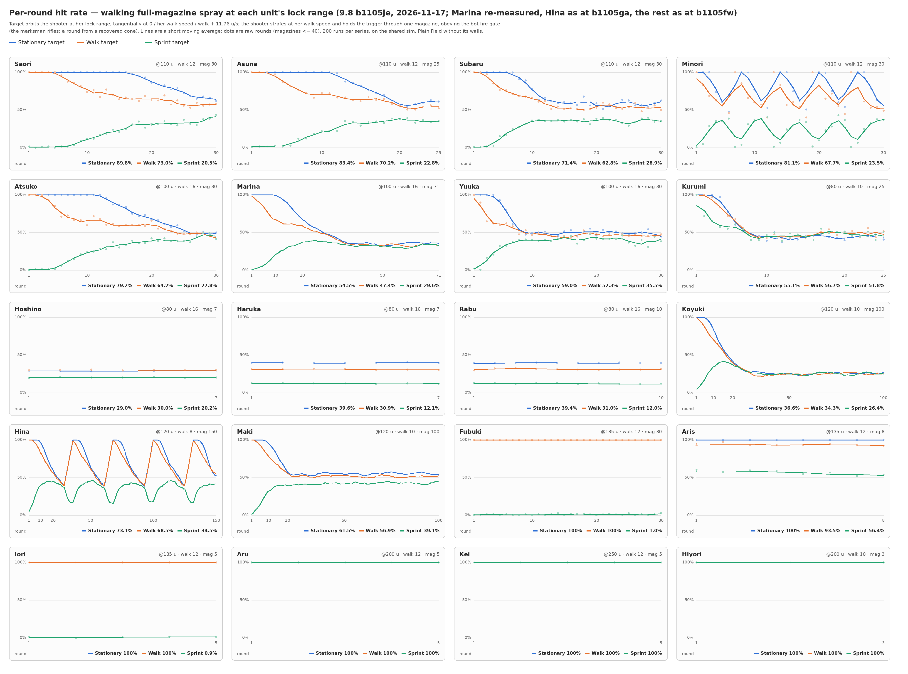

# ArchiveVS

A fast-paced 1v1 / 2v2 arena prototype with two main modes — **Duel** (single stock) and **Trio** (three-unit rosters). (The game is ArchiveVS since b1105ad; Gun VS Gun was the project's working name, and the package and service names, `gvg-…`, still carry it.) In the **angled** point of view the unit aims by itself, every shot at the locked enemy; in the **free** one the player aims a crosshair (see *Free pov*). The fight is about resource management: when to sprint, when to dodge, when to break line of sight, when to fire.

## Modes

Two main modes, each playable **1v1 or 2v2**, offline and online:

- **Duel** — classic single stock: one unit per fighter; a team loses when all its fighters are down.
- **Trio** — three-unit stock: every slot (human or bot) fields an **ordered roster of three units**, repeats allowed. When a unit dies, the slot's next unit respawns with the standard 3 s spawn immunity — at the slot's own start, or, on the ten maps that name more spawn places (Town, Neon, Compound, Dust, Warehouse, Hospital, Spacecraft, District and the two Backrooms), at one of those: a place no living enemy sees, drawn at random, on Spacecraft any free place (see *Spawn places* under Maps); the killer keeps position / HP / boost — no kill reward. A team loses when every roster on its side is spent. Each fighter's remaining units show as a row of small weapon renders under their side's HP bars (one line per team member; Duel shows its single unit the same way), and a small golden glow-bar marks each Trio line's currently fielded weapon.
- **Spectating (2v2, both modes)**: if you're out for good while your ally fights on, the camera follows the ally with your own-unit visual kit (rear art + through-wall X-ray); the lock reticle stays up and mirrors the ally's actual target (the TARGET button goes inert), and the boost bar and ammo readout follow the ally too (2026-09-29 — they used to stay frozen on your dead unit's numbers).

Orthogonal to all of the above, every player also picks a **view mode** — **Shooter** (the chase camera you pilot directly; named "Classic" until 2026-10-10) or **Command** (a commander's diorama view where your unit fights on its own bot brain and you give it orders). See the **Command mode** section below.

**A match's course** (every mode, offline and online). A start goes through the **loading screen** (b1105hd), up until everything the match needs is in — online until every player's page has it, 30 s at the most (b1105hh). Then the **game-start intro** (b1105gz; every match but the Shooting Range's): team 1's shot and team 2's under GET READY, then the viewer's own view under START — 3.8 s in all, the match held meanwhile, PAUSE the only HUD, nobody able to skip it; under Sudden Death its banner follows. No unit is immune at the start. The match ends on the **ending cameras** (b1105gb on): **K.O.** over the losing side's last unit down as it falls, one flight to the unit that dealt the final blow, and **FINAL BLOW** over that unit as it reloads once and then holds its stance — or **WINNER** over the unit of its side that stands, where the final blow's unit fell too (its roster's next unit, b1105gh; its teammate, b1105in). A tap, a click or a key goes to the end page once 1 s has run (TAP TO SKIP); left alone, the last shot stays up until one. A forfeit goes straight to the end page. Online the end page then offers Leave, RESELECT and REMATCH (b1105is: *After a match*, under Online). Each part has its own entry under *Random & All Random cards* below.

### Offline
- **1v1**: you vs one enemy bot.
- **2v2**: you + an ally bot vs two enemy bots. Friendly fire is off between teammates.
- **Trio picks**: you select your three units in order, then each bot's three — same selection grid, titles count up (1/3 → 3/3).
- Optional "Dummy" mode, in the main menu's **Practice** row — zeroes out damage from every bot (enemies and your ally), so you can practice movement and observe bot behaviour without dying.
- Optional "Spectator" mode beside it — a bot takes over your unit and you watch the match: **TARGET** cycles the camera across every unit on the field (both teams), the HUD (HP / boost / ammo) follows whoever you're watching, you hear that unit as its own player does — its steps, dodge, jump and landing, its bolt, its gun's metal sound, its reload, the round going in and its scope (b1105id, b1105if, b1105ig, b1105ih) — the edge arrows stay viewer-relative, and the end banner reads **TEAM 1 WINS / TEAM 2 WINS**. Stacks with Dummy: the bot driving your slot still deals damage exactly as you would, and every other bot's shots are blanks (2026-10-03 — before that the combination zeroed everyone for a no-deaths exhibition).
- The main menu also carries a **Guide** button, the `?` in its corner: a popup on the rules, the menu, the controls, the two points of view, fighting, the ladders and transporters, the weapon types and the command-mode gestures (b1105hj), and at its foot the disclaimer in small gray print (b1105jw); its header carries the **Music: On / Off** button, which the Pause menu has too (b1105hk, see *Sounds & music*). **Server Boot-up**, which opens the online debug panel, left the main menu at b1105o and stands on the online connecting page.

### Online
- **Mode selection**: the host picks **Duel or Trio**, then **1v1 or 2v2**; joiners inherit the lobby's modes.
- **1v1**: the host presses **Start Match** when ready. The opponent slot holds a bot (default **Saori / Unit 1**) until a second human queues in and takes it — start early to play the bot, or wait for a player.
- **2v2**: the host presses **Start Match** when ready; empty player slots fill with bots (2v2 rooms open as Saori / Hoshino / Aru / Atsuko by slot; Trio bots field three copies of that unit unless the host picks otherwise). Up to four humans can play (any split between teams); bots fill any remaining slots.
- **Match start** (b1105hh): when the host starts, every player's page shows the loading screen until all the players' pages have loaded the match — 30 s at the most — and then everyone sees the game-start intro together and the match begins for all at once. A player who leaves, a bot and a spectator are not waited for.
- **Bot unit selection**: in the lobby, the host can tap any bot slot to pick which unit that bot plays — in Trio, its three units in order (default: three copies of the slot's usual unit). A human joining the slot always overrides the bot.
- **Trio queue room**: every slot's roster is shown in three lines and updates live as picks land.
- **View mode**: each player picks Shooter or Command in the queue room; the pick is final once the match starts and is never shown to the other team (teammates see it as a gold **[CMD]** tag on the roster line). Details in the Command mode section.
- **Slot-colored corner HUD** (online, 2026-08-22): the corner HP chips (bars until b1105w) follow the **server slot** — left column team A (p1 top / p3 bottom), right column team B (p2 top / p4 bottom), each in its slot color (p1 blue / p2 pink / p3 mint / p4 orange), the same picture for every viewer and spectator (1v1: p1 left, p2 right); the chip's side word, **YOU**, says which one is yours (b1105w; a thin white rim on the bar until then). The command diorama's markers, cards, rings and lock triangles use the same slot colors online (offline keeps the role palette).
- **After a match** (b1105is): the end page has **Leave**, **RESELECT** and **REMATCH**. Every seated player chooses — the choice stays pressed on the page and may be changed until the room moves — and beside each other seat the page says what its player did: REMATCH, RESELECT, CHOOSING…, or **LEFT · BOT NEXT** for a player who has gone. The room moves when everyone still seated has chosen. All REMATCH: the match again, the same map, units and seats, an empty seat a bot's. One RESELECT: the room is a waiting room again, where everyone picks a unit anew and the host a map — the last picks tagged **LAST** — while the mode (Duel / Trio, 1v1 / 2v2, the rules) stays as it was; that waiting room is open like a new one, so a new player may take a free seat, a 2v2's players may change sides, and the host starts the match.
- **A player who leaves is named** (b1105is): in a 2v2 match a line says whose unit a bot took over; a 1v1 left in mid-match ends at once and its end page says why; at the end page the seat reads LEFT · BOT NEXT, and the room waits 3 s after such a leaving before it moves, so that the others see it; in a waiting room or a picker a line says a player left.
- **Host migration**: if the host leaves a waiting room, the longest-waiting player is promoted to host (their unit picks carry over; the lobby keeps its Duel / Trio and 1v1 / 2v2 settings and the new host re-chooses the map). At the end page nobody is moved (b1105is): a REMATCH needs no host, and a RESELECT makes the longest-waiting player the host as the room goes back to waiting.
- **A dropped connection** (b1105it): a page whose connection comes back is put into a room anew — its old seat is gone, and the units and the map are picked again, the last picks tagged **LAST**. A host who comes back as a host gets the mode and the rules it chose again without being asked; a player who comes back as the host for the first time is asked them; a player who comes back into somebody else's room plays that room's mode.
- **The unit picker follows the room** (b1105it): a player who comes into a room while its host is still choosing the mode sees the picker of the room as it stands — Duel, 1v1, Health Point — and the picker is drawn anew when the host's choice lands.
- Multi-lobby — when an existing lobby is full or running, new joiners spawn their own lobby and become host.
- Team swap in 2v2: any non-host player can `Join` an empty slot to switch teams (e.g. two humans want to co-op on one side against two bots).

### Unit profile card

The first tap on a unit card opens its profile beside the grid (tap the same card again to confirm, anywhere else to cancel): the character art on the left and the **weapon panel** on the right — the gun's real-world name, its render, and since 2026-09-22 a **3×2 stat grid** under the render (owner pick "C" from three in-game samples: a third plate beside the panel and a label/value row list were the other two; the demo line carries the same stats as a row list). The six cells read live from the unit data:

- **Mag**, **RPM** and **Reload** (seconds) as plain numbers.
- **Dmg** shows every tier where a gun has them: Aru's PSG1 `50/35/20` (far / mid / near), Kei's Railgun `30/20` (quick / charged), the shotguns per pellet `4 ×8`.
- **Movement** is the walk-speed tier word (walk speeds retuned 2026-09-24): **Fast** (walk 16 — Atsuko, Marina, Yuuka, Hoshino, Haruka, Rabu), **Medium** (12 — Saori, Asuna, Subaru, Minori, Fubuki, Aris, Iori, Aru, Kei), **Slow** (Koyuki, Kurumi, Maki and Hiyori at 10, Hina at 8).
- The **Spread picture** is a seeded mini-simulation of a **walking spray at a common 60-unit reference** (the shotguns at their own lock range, 80; 40 until b1105eg): the ring is a standing target's half-width at that distance, the orange dots are up to 30 rounds — magazine-limited — each leaving on the cone the sim gives that round (base + bloom, per-round bloom up to the cap, and the between-round recovery of the no-delay marksman rifles), fading with round order so the first rounds read brightest. The spray stops at the first round whose cone no longer fits the frame (2026-09-22, owner pick from samples — pinning spilled rounds to the frame's edge had piled Fubuki's 27 out-of-frame rounds into a rectangle), so nothing is drawn outside the frame: Saori's whole 30-round spray stays inside the ring, Koyuki's and Hina's pictures end a few rounds short of the magazine with their late rounds at the frame's edge, and Fubuki's and Aris's show their first three quick rounds — one on the ring's centre, two at its edge — because the fourth already flies wider than the frame; the shotguns show their 8-pellet pattern (the Beretta 1301 with its 1.4× horizontal stretch — Hoshino's since the two shotguns swapped patterns on 2026-10-10).
- A unit may carry a **note** (`cardNote`, user 2026-10-24): one line at the card's bottom-left, under the art. Kurumi's reads "This unit has 20% more health." A map may carry one too (`cardNote` in the client's `MAP_DATA`; District's and Compound's read "Unit has more stamina in this map.", user 2026-10-29 and 2026-10-30), shown on its info card the same way, under the picture. (The notes were off for part of 2026-11-01, while every map had their boost, and came back with it; Neon carried the note from 2026-11-01 until its 5 went on 2026-11-03.)

The grid keeps the same sizes on phones (checked at 390 px: nothing wraps or spills).

### Random & All Random cards

Both offline and online pickers carry them:

- Every unit grid has a gray **Random** card (question-mark thumbnail): it rolls a unit the roster being built doesn't already contain (different players can still land on the same unit). The map picker is two sections, each with a Random card of its own: **Scene Maps** — the maps cut from modelled scenes (Town, Spacecraft) — over **Concept Maps**, the hand-made arenas; a section's Random rolls among that section alone and skips **Shooting Range** and **Plain Field** (`noRandom` in the map table; user 2026-10-19) and, since b1027p, **District** too (user 2026-10-30, "too much of a special map" — a manual pick only, offline and online alike: the roll is the picker's, the host's included). A map's row may say which part of its card picture the wide thumb shows (`thumb: 'top' | 'bottom'`; the thumb box cuts a square picture to a band, the centre by default) — Backrooms and Warehouse show their upper part, Spacecraft its lower; the profile shows the whole picture (user 2026-10-24).
- Every unit grid also carries a golden **All Random** card: one confirm fills every remaining unit slot of the current flow at once and advances it (offline: the rest of your roster, then every bot picker that follows — Duel included; online: the rest of your roster). The map picker deliberately has no All Random.

**The Splat skin** (PT, b1105l, 2026-11-05) — the first pass of the UI rework, the user's pick of seven directions drawn on the "GunVS UI Rework Samples" design canvas (A Tactical, B Arcade, C Signal, D Slash after Persona 5 and Valorant, E Holo after Apex and Overwatch, F Splat after Splatoon and Jet Set Radio, G Ops after Call of Duty: Mobile): direction F. Every menu is an opaque cream sheet with three ink blobs (an inline SVG in `style.css`, pinned while the content scrolls; user: the cream covers the 3D behind), the titles white Titan One stickers with an ink outline and a magenta drop, the buttons and option chips white pills with a 3 px ink border and a hard shadow (the chosen chip magenta; Sudden Death ink with yellow type), each a degree or two off square. The lobby keeps its flow — the first unit pick is made on it — with its four option rows labelled Play as / Teams / Roster / Rules (`showSelectMenu`). The unit grid is 84 px sticker tiles (`unitGridHTML`), seven to a row on a landscape phone so the 17 units and the two Random cards sit in three rows without scrolling; a tile shows the character's name and a weapon-class tag on its corner — AR, RF (rifle), SMG, SG, MG, SN (sniper) — and is coloured by that class (cyan, cyan, lime, yellow, magenta, ink). The map picker's two sections are tabs now, Scene Maps | Concept Maps with their counts (`mapGridHTML`, wired in `wireMapGrid`), one grid shown at a time; a tab's Random card rolls its own tab alone, as the stacked sections did. The profile card of both pickers (`.unit-profile-popup`) is a white sticker with a lime "tap to confirm" tag hanging off its bottom; its contents — the art, the weapon panel, the six stats, a unit's or a map's note — are as before. The match HUD keeps every box the JS mirrors (the corner bars' 180 px, the thumb buttons' `--btn-size`, the joystick's 140, the dio cards' 180x68 / 132x52) and wears the skin inside them: the bars a white rim with an ink outline and the fills lime (you) / magenta (enemy) / cyan (ally) / yellow (enemy 2), the online slot colours still set by the JS; the thumb buttons white, DODGE cyan, SPRINT magenta, TARGET yellow, FIRE's count in Titan One and its reload ring lime; PAUSE a sticker; the commander's cards ink with a white rim. The crosshair is untouched (the CS classic, user). Titan One and Rubik are bundled from `client/src/fonts` (latin and latin-ext, SIL Open Font License — the OFL texts beside them; 72 KB in all) so the PWA has them offline; the stylesheet's `url()`s go through Vite, so the hashed files follow the `./` base. Not in this pass: real ink-splat art in place of the SVG blobs, Chinese type. Online room, pause / guide / settings and the commander's order tray took the same components with no design of their own, as asked.

**The slot lobby and the pickers' page** (PT, b1105m, 2026-11-05; user: "i want that layout previously shown in the artifact" and, of the HUD sample, "i especially love those buttons and the simple arrows inside") — the lobby is the design canvas's: your unit's card on the left (the profile art, the name, the class and the weapon; a Trio roster as three thumbs), the option rows in the middle — Play as / Teams / Roster / Rules / Where (Online hands over to the online lobby, as the old button did) — with the Dummy and Spectator toggles under them (they sat on the map picker's page), the map's card on the right (its picture, its name, its section and its size in metres from the boundary table, its stamina note), and along the foot the summary chip, a Random die (rolls your unit, or your whole Trio roster), All random (rolls you and arms the chain) and GO!!. A card opens its picker and comes back; GO!! fills what is still missing — the pickers for an incomplete roster, then the bot pickers as ever — and starts on the card's map, so the map picker is no longer the chain's last page (`showSelectMenu`, `renderLobbySlots`, `startFromLobby`, `startFromMap`; `state.mapKey` starts at Plain Field). The pickers' page (`showUnitPicker`, `showMapPicker`): a back arrow (to the lobby) and the title on one row, the unit picker's class filter chips beside them (All / AR / SMG / SG / MG / Sniper; the rifles count as AR), the preview card on the left — the art, the name and class pill, five range pips from the lock range, the weapon's name and its six stats (the gun render stays on the floating card), or a map's section, size and tags (manual pick only, offline only, the stamina note) — with a CONFIRM! button; the tapped tile wears a PICK! tag, and tapping it again confirms as before. `spawnProfilePopup` fills the page's side card when the menu has one and floats the old card otherwise (the online pickers); on a portrait phone the side card floats over the grid as the old popup did. The thumb buttons carry arrows over their words — JUMP up, DODGE a sidestep, SPRINT a dash, TARGET a sight (`HUD_BTN_ICON`). The first lobby and the first frame moved to the module's end: the lobby's map card reads `GLB_MAPS`, declared far below the old spot, and the first frame's `updateMapRoof` read it before it stood — the render error logged on every page load since the roof hiding is gone with it.

**The lobby's second pass** (PT, b1105n, 2026-11-05; the user's five notes on b1105m) — the cards' art is the square thumbnail (the face-centred crop the tiles use) shown a little above its middle, where the full profile art cut to a band lost some units' eyes; the picker's side card the same. The two offline toggles are the **Practice** row (Dummy bots, Spectator — each on or off alone, lit yellow) under a new **Bots** row (I choose | Random: who picks the bots' units at GO!!, `state.botPick`). The foot: **Guide** and **Server** on the left (they were a "?" and "SRV" at the top-right, and the lone "?" read as the guide), and on the right **Random unit** and **All random** as dice with their words, then GO!!. **All random** no longer starts the match by itself: it rolls your unit (your Trio roster) and sets the Bots row to Random, so GO!! asks nothing more; the pickers' All Random card does the same and returns to the lobby. A site open lands on Saori (as before) and **Town** (Plain Field until now).

**The lobby's third pass** (PT, b1105o, 2026-11-05; the user's next five notes) — the option rows are taller and further apart (38 px, 10 px between; five of them: Play as / Teams / Roster / Rules / Practice). The Where row is gone: **ONLINE** is a sticker of GO!!'s height beside it ("vs player" under the word; it opens the online lobby as the old button did). The Bots row is gone with it: **All random · GO** rolls your unit (your Trio roster) and every bot and starts the match at once — the pickers' All Random card does the same — while GO!! alone runs the bot pickers as ever. The guide's round **"?"** is back at the top-right; Server stays a small pill at the foot's left. The **Trio** card draws the roster as the user's sketch: three slanted panels side by side, each on its unit's class colour with the face-centred thumbnail, the slashes between them the ink showing through, a slot still to pick a yellow "?" panel; the three names under them, and "n more to pick" while the roster is short (GO!! then opens the pickers for the missing slots alone).

**The lobby's fourth pass** (PT, b1105p, 2026-11-05; the user's next five notes) — the guide's **"?"** sits in the sheet's own top-right corner (a direct child of the sheet, not of the centred head). The **Server** pill is gone from the lobby: **Online** leads to an online connect page — the status chip, a word on the sleeping server, **Server Boot-up** (the debug panel, as before), **Leave** back to the lobby — in place of the bare "Connecting…" overlay, at the first connect and at every reconnect (renderOnlineUi's 'connecting'). **All random** rolls every slot of both cards (you — your Trio roster —, the ally in 2v2, the enemy, the second enemy) and shows them on the cards; it no longer starts the match (b1105o's All random · GO; user: "All random+Go is not ideal"). **GO!!** starts with nothing left to ask when every card is full, else the pickers for the missing picks alone, slot by slot (you, ally, enemy, enemy 2). An **enemy card** stands on the right where the map's card was — the same card as yours: one unit in a Duel 1v1, otherwise a row of slanted panels per slot (two rows in 2v2) and a line of names per slot (YOU / ALLY, ENEMY / ENEMY 2); its Pick / Change runs the enemy's pickers ("Select Enemy Unit", "Select Enemy 2 Unit"). A card's **Pick** fills the missing picks alone while something is missing (Saori, the default, stays as slot 1, so a fresh Trio's pickers start at 2/3); **Change** on a full card asks the roster(s) afresh; the pickers' All Random card fills the rest of that card only and returns to the lobby (in b1105o it started the match from there). The **map** moved to a chip at the foot's left (thumbnail, name, MAP · section · size, Change → the map page); the chip yields width first, so the four buttons never wrap on a landscape phone, and under 760 px the foot wraps (the chip full width, the buttons centred in a row of their own). A single roster's three names may take two lines (never a cut name); a 2v2 card lists its two rosters in Rubik 11.5 px with thin spaces. Verified headless (`ui/ui_shots5.mjs`, 844×390 and 412×915): the corner "?" 9 px from the edges; All random refreshes both cards with no picker and no match; GO!! after it opens the HUD with no picker; the 2v2 Trio cards show two rows of three panels and fill from All random; the Trio card's Pick runs (2/3)(3/3) and returns to the lobby, Change asks (1/3), the enemy card asks "Select Enemy Unit (2/3)", GO!! with the enemy trio missing asks the same; Online shows the connect page (Server Boot-up / Leave) and Leave returns to the lobby with no overlay left.

**The lobby's fifth pass** (PT, b1105q, 2026-11-05; the user's next five notes) — the **enemy and the map swap places**: the map's card is back in the right column and shows its **whole square picture** (`object-fit: contain`, letterboxed on ink, 134 px tall; user: "the full uncropped image, not the further cropped version" — MAP_DATA.thumb stays the picker's wide tile's business), and the enemy side is a **chip at the foot's left**: a strip of its units' faces (small slanted panels, one row per slot; in 2v2 Trio the two rows stacked so the names keep their room), the names with ENEMY / ENEMY 2 pips before them, Pick / Change; the whole chip runs the enemy's pickers. A **2v2 Duel** card is one row split left / right (you | ally) instead of two full-width rows. Every roster panel is now a flex item of its row, overlapping its neighbour by 15 px and clipped to a parallelogram (slanted edges 18 px), so the **face sits in the middle of its own panel** (user: "the face should be in the middle"; the old thirds-of-the-row geometry showed a slice offset from the face), and the single card's wide band is taken lower on the square thumbnail (`center 70%`: the eyes sit at about 62% of its height, so the old 40% band cut them in a short row). The **Random unit** button is gone (All random stays). Small things: the size line uses no-break spaces, the sub line keeps 52 px clear of the Change word, a 2v2 Trio card's sub reads "three each, in turn". Verified headless (`ui/ui_shots6.mjs`): the foot holds in 390 px with no Random unit button; the map card's image is the whole 1024-square, contained; the 2v2 Duel card is one row of two panels; the 2v2 Trio card two rows of three and the chip six faces in two stacked rows; the card's Pick runs (2/3)(3/3); the chip's Pick asks "Select Enemy Unit (2/3)"; the map card opens "Select Map"; GO!! after All random opens the HUD with no picker; portrait wraps the chip full width and the buttons under it.

**Faces, the rifles' colour, the memo tape** (PT, b1105r, 2026-11-05; the user's next notes) — **Face placement**: every picture box of a unit (the lobby card's wide band, every slanted panel, the chip's small faces, the picker's side card) is a `face-box` — a CSS size container — and `UNIT_FACE` (main.js) gives a unit's face centre x and eye line y as fractions of its square thumbnail, read off a contact sheet with a 10% grid (`ui/face_sheet.mjs`; 0.5 / 0.62 unless set: Fubuki 0.43 / 0.63, Haruka 0.47, Atsuko y 0.68, Aris / Asuna / Koyuki / Kurumi x 0.52, Hina 0.48, Rabu 0.53 / 0.63). `object-position` is computed from the box's own width and height in container units so that point sits at the box's horizontal centre and at 44% of its height — a tall box crops the sides, a wide box the top and bottom, and a min()/max() pair makes the other axis 0 so the picture always covers the box (user: the eyes "should be higher" on a single character — the side card's band was cut at 42% from the top, where the eyes of these thumbnails are at about 62% and Atsuko's at 68%, so Fubuki's eyes sat on its bottom edge and Atsuko's below it; and Fubuki "cropped a bit more to the right": her face is at 43% of her thumbnail, so a centred crop showed it left of the panel). The side card's band is 100 px now (88). Browsers without container units leave the picture centred. **Rifle** (RF: Fubuki, Aris) has its own class colour, lavender `#C9B2FF`, no longer AR's cyan (user: "rifle and AR are not the same category"), and the picker's filter row has a **Rifle** chip; AR no longer folds the rifles in. **The memo tape**: a translucent yellow strip, torn at both ends, stuck over the top edge of the pickers' side cards (unit and map), left of centre, a few degrees off (user: "inside the selection menus, i want that yellow memo tape style" — the design canvas's F map card); in portrait, where the card is a scrolling overlay, it sits just inside the edge. Verified headless (`ui/ui_shots7.mjs`, `ui/ui_shots8.mjs`): the computed object-position of the lobby card (−64 px), the side card on Fubuki (−90 px) and Atsuko (−100 px), Fubuki's middle panel (−11 px sideways), the chip's and the 2v2 rows' panels; the Rifle filter shows unit10 and unit7, AR unit1, unit9, unit14; the RF tag is lavender, AR cyan; the tape 96 × 22 px at the top edge of both side cards and inside the portrait overlay.

**HUD colours, the spectator ring, the tape and the map card** (PT, b1105s, 2026-11-05; the user's next notes) — **JUMP** is lime (the stick's old colour) and the **stick's knob red** (`--red #FF4F4F`; user: "give jump button the green tone the joycon has. change joycon green to red"). **Spectator**: the watched unit's corner bar wears a thick yellow ring inside an ink line and a wide halo that pulses yellow / white (1.1 s; still under reduced motion), and the Trio icon row's watched line glows yellow too (user: the white glow "is not obvious enough"; the ring stops 6 px out so the player's bar's ring just meets the ally's bar). **The memo tape in portrait** hangs over the card's top edge as in landscape: the overlay card no longer clips its outside — its inside scrolls instead when it must (user: "the tape shouldn't be cropped on the top"). **The map picker's info card** shows the whole square picture (contain on ink, 164 px tall in landscape, a square box in portrait; user: "the info card is not using the uncropped image"). Verified headless (`ui/ui_shots9.mjs`, `ui/ui_shots8.mjs`): a 2v2 spectator match marks `.health` as watched with the ring; the stick's computed colour is the red and JUMP's the lime; the tape sits at −11 px above both side cards in landscape and above the portrait overlay; the portrait map card's picture box is 327 × 327, contained.

**The folder and the memo** (PT, b1105t–u, 2026-11-05; user: "make the character box on the left file folder style and the map on the right a memo-pinned-on-the-wall style … implement that to all character cards and map cards") — every unit card is a sheet in a **manila file folder** and every map card a **memo on the wall**. The lobby's left column is the **LINE-UP folder** (`.lobby-folder`, manila `#F6D27A`, a 24 px tab reading LINE-UP, a thumb notch on its right edge) holding two sheets: your unit's card (its YOUR UNIT sticker moved to the sheet's right, under the tab) and the enemy's slip (the face strip, the ENEMY / ENEMY 2 pip on its own line over the names, Change / Pick as a magenta sticker on the slip's top-right corner; in 2v2 Trio the strip's two rows stack). The map's card on the right is the **memo**: a white note with cyan ruled lines under the picture, a strip of the yellow tape over its top edge, centred, the whole square picture on ink, MAP · section · size, Change on the name's line. The grid is two rows now: the folder spans both, the option rows and the memo fill the first, the foot's buttons (All random / Online / GO!!) the second. The unit picker's side card is a folder too (tab UNIT FILE, a paper clip on the sheet's corner), the map picker's a memo (the tape over the top edge, no pin — b1105u, user); the floating cards of the online pickers follow (`.pp-folder` / `.pp-memo`). **SR** is the sniper rifle's tag (was SN; user), in the tiles, the filter chip and the class colours. Verified headless (`ui/ui_shots10.mjs`): the 1v1 and the 2v2 Trio lobbies fit 390 px (sheet scroll height 390), the slip opens "Select Enemy Unit", the Sniper filter shows unit3 and unit6 with SR tags and no SN left, the folder card carries the tab and the clip, the memo card the 84 px tape and no pin; portrait keeps the folder and the memo side by side under the rows. (b1105v, user: "make the file slightly longer so the ally box and enemy box do not overlap") the sheet and the slip are 12 px apart on every screen — the slip's Change sticker, 9 px over its top edge, no longer touches the sheet — and on a screen at least 440 px tall (desktop, portrait) the folder is longer: the sheet 208 px, its art 118 px, the two 16 px apart. The slip's text lost its ENEMY pip and its corner sticker names the side instead of saying Change — ENEMY / ENEMY TRIO / ENEMY TEAM (user: "remove the enemy text box; change the change text to enemy text"); a short roster still says "n more to pick" in its small line. The design canvas (artifact 1489ieHXfUJZ3okkbwshBu, round 5) holds the folder-and-memo lobby as built and a **proposal for the match HUD**, not built: the corner HP bars grow into the F sample's chips (an ink pill with the portrait in a ring, the name with YOU / ENEMY, the bar, the number; the Trio row as faces under it; the ally's and the second enemy's chips smaller under the first two; the spectator's watched chip with the b1105s yellow ring), and the bottom boost bar becomes a yellow BOOST sticker in the sample's ammo-chip style (the word, an ink gauge with a white knob, the number; magenta when low).

**The HP chips and the BOOST sticker** (PT, b1105w, 2026-11-05; the design canvas's round 5, built on the user's "implement the HUD on PT") — the match HUD's corner bars and the Trio weapon-icon rows are gone; each slot has an **HP chip** (`.hp-chip`, main.js `hpChipHTML` / `renderHpChip`): an ink pill with a white rim and an ink outline, the portrait of the unit on the field in a ring of the side's colour (the thumbnail at 150% with its UNIT_FACE point at the frame's centre), the name in Titan One, the side word (YOU / ALLY / ENEMY / ENEMY 2) in the colour, and the bar — as long as the unit's HP (`--hp-scale`), a round knob at the fill's head (`--w`) — no number. In **Trio** the roster's other two units sit at the chip's far end as small faces, a fallen one greyed (the reserve, from the slot's roster and cursor offline, the snapshot's roster fields online). Yours top-left, the enemy's mirrored top-right; in 2v2 the ally's and the second enemy's smaller under them (cyan, yellow). Online the chips anchor by server slot as the bars did, in the slot's colour (`--c`); the side word says which is you (the thin white "self" rim is gone). **Spectator**: no side words while the viewer is a spectator — the Practice toggle or an online spectator (user: "if it's spectator mode, remove you/ally/enemy/enemy 2 text; if the spectator mode is triggered by player dying, then these text remains") — and the WATCHED chip (the camera's unit, by the toggle or because the player is out) wears the b1105s yellow ring with a WATCHING tag; a slot out for good dims with a DOWN tag. **Sudden Death** hides the chips' bars alone. The fullscreen button docks right of the left chip by `--left-chip-right`, a ResizeObserver on the chip (the chip is as wide as its name, its bar and its faces). The **BOOST sticker**: yellow, level, at the bottom centre — the word and an ink gauge with a white knob (`--bw`), no number; the fill turns magenta under 30% (`.low`). The DOM of a chip is rebuilt only when its unit, its word or its reserve changes; the bar and the classes move every frame. Verified headless (`ui/ui_shots11.mjs`): a 1v1 Trio match shows both chips with two reserve faces each and the fullscreen button 10 px right of the left chip; a 2v2 Spectator match shows four chips with no side words and the ring on the player's chip, moving to the ally's on TARGET; a 2v2 Sudden Death match shows the chips with the bars hidden (`display: none`) and the words in place; a 1v1 on a 1280 px window. Not exercised headless: the DOWN tag and the after-death WATCHING ring (they need a death). (b1105x, the user's three notes on V472) the chips' far side has 18 px of padding (16 on the small chips) and the reserve faces start 12 px after the track, so the knob — 8 px past the track at full HP — stays 10 px inside the rim ("the HP bar should stay well inside the box"); the BOOST fill is the SPRINT button's magenta at every level, no ink and no low-state colour ("shouldn't be black"); and the round frames show the thumbnail at 125% with the face's middle at the centre, clamped to keep the frame covered, so the whole head fits ("face should be at the center" — 150% with the eyes at 46% cut the hair and the chin). (b1105y–z) the chips were levelled for a build on a misread of "still tilted" and **tilt again** (±1.5°, as the boards had them; the BOOST sticker alone is level) — the user meant the faces, which sat left and high in their browser: the round frames now place the face by an **inline transform computed in JS** (`faceTransform`: the thumbnail at 130%, moved so its UNIT_FACE point meets the frame's centre, clamped to ±15% so the frame stays covered) instead of the CSS calc / clamp / container-unit maths of b1105x, which rendered differently from browser to browser. The design canvas's round 6 (`End_F`, `End_F_2v2`) proposes the end-of-match page — the map memo in the middle, a roster panel each side in the HUD's round frames with the fallen greyed, Select Unit and REMATCH below — not built; after the user's notes on it the panels are wider (280 px, the last frame 24 px in from the edge), the memo carries the picture and the map's name alone (no MAP · section · size line, no rules caption) and its faces use the same transform.

**The memo's die** (PT, b1105aa, 2026-11-05; user: "add a random map dice at the bottom right of the map memo paper that picks randomly from both scene map and concept map pool") — the lobby's map memo has a **die sticker** at its bottom-right on the ruled lines (`.memo-dice`: the All random button's die, magenta, 36 px, tilted −6°): a tap rolls **one draw over both tabs' maps together** (`rollLobbyMap`: every map of MAP_DATA but the noRandom ones — Plain Field, District, the Backrooms, the Shooting Range, the same manual-only set the picker's Random cards skip — and never the map already on the memo), the memo shows the new map at once with a half-second spin of the die, and the picker stays shut; the rest of the memo still opens the picker. The paper does not press down with the die (`:has(.memo-dice:active)`). Verified headless (`ui/ui_shots12.mjs`): on the 844 × 390 lobby the die (36 px, 9 px in from the memo's right, 5 px up from its bottom) sits 8 px under the Change word and the size line's text ends 6 px short of it; six taps gave six maps, each different from the last, from both sections (Spacecraft, Neon, Backrooms, Airport, Spacecraft, Town), with the lobby still up and no picker; a tap on the name opens Select Map; the portrait and the 1045 px lobbies keep the die on the memo's corner.

**No watched chip in Command mode; four chips of one size on two clear rows** (PT, b1105ab, 2026-11-05; user: "no need WATCHING and glowing HP bar effect in command mode", "no overlapping for HP boxes; make all HP boxes same size — use the current bigger size one as standard") — in Command mode the camera is the tabletop, so no HP chip is the watched one: the yellow ring, its pulse and the WATCHING tag stay off there (`updateHud`: `watching` is false while `dioramaActive()`), whatever drives the player's slot — the Spectator toggle, or the player being out. Shooter mode is as before: the Spectator toggle, an online spectator and the after-death camera still ring the camera's chip. In **2v2** the ally's and the second enemy's chips are no longer the small kind: all four are the first row's chip (54 px, the 40 px face, the 15 px name, the 150 px bar, the 24 px reserve faces), the second row 86 px down and 10 px further in — 22 px under the first row's box, so a WATCHING / DOWN tag (now hanging 9 px under its chip, not 13) and a second-row chip's 7 px ring clear each other with the tilts (the b1105w second row sat 70 px down, 40 px tall: in Trio the first row's wide chips, their ring and their tag overlapped it). Verified headless (`ui/ui_shots13.mjs`): a 2v2 Trio with the Spectator toggle in Command and a 2v2 Duel in Command alone show four chips of one height and no `.spec-watched`; a 2v2 Trio Spectator match in Shooter rings exactly one chip with the WATCHING tag and TARGET moves it to the second row; no two chip boxes overlap in any of them.

**The end-of-match page, the command cards' colours, the reserve's order** (PT, b1105ac, 2026-11-05; user: "implement the ending screen in PT", "use the HP bar color as base, make the color of command card aligned", "the next-up unit should be placed at the uncovered position") — the match's end is the design canvas's round-6 page (main.js `showEndPage`, shared by the offline `showEndMenu` and the online `showOnlineEndMenu`): the verdict as the sticker title (YOU WIN / YOU LOSE; TEAM 1 WINS / TEAM 2 WINS for a spectator; MATCH ENDED on an online tie), a **roster panel** each side — the HUD chip's ink and white rim as a card, TEAM 1 (the viewer's side, left: the player's team, or the camera slot's team for an online spectator) and TEAM 2, the yellow WINNER sticker on the side that won — with a row per slot: the slot's word (YOU / ALLY, ENEMY / ENEMY 2; SLOT 1 / SLOT 2 for a spectator) and the slot's roster in the HUD's round frames with the names: a fallen unit greyed with a slash, the unit on the field alive with the dot, a reserve unit plain (Trio from the roster and its cursor, offline `trioRosters` / `rosterIdx`, online the snapshot's roster fields; Duel the one unit); the **map's memo** in the middle (the lobby's — the tape, the ruled lines, the whole picture on ink and the name alone); **Select Unit** (Leave online) and **REMATCH** below, the lobby's GO!! style. The rows' colours are the chips' (lime / cyan, magenta / yellow). The sheet centres the three; portrait wraps them and scrolls. **Command mode's cards** wear the HP chips' colours now (`DIO_SLOT_META`: lime YOU, cyan ALLY, magenta ENEMY 1, yellow ENEMY 2 — the card's border, its HP fill, its marker square and its line; online the slot palette as before, which the online chips share), and the cards' stamina gauge is white (two yellow bars on ENEMY 2's card read as one). **The chips' reserve faces** are ordered so the NEXT-UP unit is the outermost, last-drawn face — whole, not under its neighbour: the fallen first (inner), then the upcoming from the farthest to the next (`renderHpChip`). Verified headless (`ui/ui_shots14.mjs`, `ui/ui_shots15.mjs`): a 1v1 Trio ended by zeroing HP from the dev state shows YOU WIN with WINNER on TEAM 1, your row one out / one standing / one in reserve against three out, the memo's picture loaded and 172 × 122 inside it, and REMATCH starts a match; a 2v2 Duel under the Spectator toggle shows TEAM 2 WINS with SLOT 1 / SLOT 2 words and Select Unit returns to the lobby; a 1v1 on a 1280 px window and a 2v2 Trio in portrait (the three stacked, the sheet scrolling) render; a 2v2 Trio in Command shows each card's border and fill equal to its chip's ring colour and the chips' last reserve face equal to the slot's next prebuilt unit.

**ArchiveVS; the online room's names; the last kill on the end page; bigger reserve faces; the cards' names** (b1105ad, 2026-11-05; the user's notes on the 0.9.5 line's first online matches) — the game is **ArchiveVS** in the lobby's title, the guide's first line, the page title and the web manifest (was GunVS / Gun VS Gun). **The online queue room** names a player's units by character (Saori, not "Unit 1 / Assault Rifle"), as the bots' rows did, and the host's "tap to change" hint sits LEFT of a bot row's names (`.roster-hint`), so every row's names end on the same right edge. **The end page online** read the mechs, which are mirrored only in the playing frames — the frame that turns the page over mirrors nothing, so the last unit killed still showed alive (user: "the last killed unit is shown as alive"); `endRowUnits` now reads the LAST SNAPSHOT (the server sends the final tick's before `match:end`) and, on a knockout, marks the losing team's every unit out whatever the data says. **The chips' reserve faces** are 34 px, side by side 4 px apart (24 px overlapping by 7 until now; user: "bigger without overlapping with others or changing other existing layouts") — the chip alone grows, by its own width (a Trio chip 320 px, was 289), the rows and the fullscreen button's dock follow as before. **Command mode's cards** name the unit, in capitals, as its chip does (user: "change the YOU / ENEMY 1 / ALLY / ENEMY 2 to unit name as in HP box"); the side is the card's colour. Verified headless: an online Trio 1v1 against the branch's own server (`ui/ui_online1.mjs`, the server on a local port) — the room reads "You — Saori Marina Hoshino" and "tap to change (BOT) Saori Saori Saori" with the hint's right edge left of the names', and after the idle host's three units fall (51 s) the end page reads YOU LOSE with the three out and the bot's unit standing, the last snapshot at hp 0; the Command and HUD checks (`ui_shots15.mjs`, `ui_shots13.mjs`) show the cards named by unit, the chips 320 px wide, two rows 15 px apart and no two boxes overlapping; the offline end page (`ui_shots14.mjs`) as before. One brain, online and offline (the user asked): `shared/src/sim/nbrain.js` drives every bot — the server's `tickBot` and the offline client's `updateEnemy` each host it — and the Sudden Death brain is shared the same way.

**The next-up marker** (b1105ae, 2026-11-05; user: "now user cannot tell who's up next — add a little glowing bar or triangle at the marked areas so user will know the one next to it is the next unit") — in a Trio chip a small **glowing white triangle** (`.chip-next`, 8 × 12 px, a soft yellow halo, breathing) sits between the track and the reserve and points at the **next-up** face, which is now the FIRST of the reserve, right beside it; the upcoming units follow in roster order and the fallen come last, greyed (b1105ac had put the next-up outermost because the faces overlapped then; since b1105ad they stand apart, so the natural order returns). No marker when nothing is left to come. The chip grows by the marker alone (a Trio chip 333 px). PT and the 0.9.5 line alike. Verified headless (`ui/ui_shots15.mjs`, `ui/ui_shots13.mjs`): in a 2v2 Trio every chip's first reserve face is the slot's next prebuilt unit and the marker lies between the track's end and that face on both sides; the rows keep 15 px apart with no two boxes overlapping.

**The memos' red crayon** (b1105af, 2026-11-05; the design canvas's round 7, the user's pick: style B) — District's and Compound's little "· more stamina" leaves the lobby memo's size line and the map card's note line, and Backrooms (Anomaly) reads **Backrooms** on the memos (`MAP_DATA.shortName`); in their place a line of **red crayon** on the memo's ruled lines — "More Stamina!" (any map with a `cardNote`, or its own `crayon`), "Anomaly!" — in **Permanent Marker** (bundled, Apache 2.0, `client/src/fonts`), 17 px, four degrees off, multiplied into the paper so the rules show through the stroke, its edge roughened by an SVG noise filter (`#crayon`, put on the page by main.js before the first lobby). The lobby memo and the end page's memo place it by hand, left of the die (`.memo-crayon`); the picker's side memo and the floating card let it flow under the size line and the tags (`.memo-crayon-flow`). The picker's grid tiles keep the full names. Verified headless (`ui/ui_shots16.mjs`): District and Compound picked from the lobby show the mark 19 px before the die and 19 px above the memo's edge with no "more stamina" in the size line, the side memo shows it under the tags with no note line, Backrooms (Anomaly) reads Backrooms with "Anomaly!" on the lobby memo, the side memo and the end page's memo, Town wears nothing, and the Permanent Marker face reports loaded.

**The narrow landscape phone** (b1105ag, 2026-11-05; user, with pictures of a phone about 640 × 342 CSS px in landscape: "the mobile end layout is off, too much overlapping in game, and i want the main menu layout same as desktop end") — **The lobby** keeps the desktop's three columns on every landscape screen: the wrap (`@media (max-width: 760px)`) is for portrait alone, and a landscape screen narrower than the columns (722 px + the sheet's 32) **zooms the grid** to fit (`showSelectMenu` fitLobby: CSS `zoom`, re-measured on resize — 0.84 at 640 px, 0.93 at 700, 1 from 754 up). **The match HUD**: an HP chip never passes its half of the screen less PAUSE, the fullscreen button and the margins (`max-width: calc(50vw - 112px)`): the bar gives first (down to 56 px), then the name is cut with an ellipsis; the face and the reserve keep their size. The fullscreen button docks right of the left chip but never past PAUSE's left edge (`min(--left-chip-right, 50% - 96px)`). The BOOST sticker is shorter under 720 px (32 px tall, the track `min(150px, 22vw)`). Verified headless (`ui/ui_shots17.mjs`) at 640 × 342, 700 × 360 and 844 × 390: the lobby shows three columns with no sideways scroll (zoom 0.842 / 0.925 / 1) and the folder, the options and the memo side by side; in a 1v1 Spectator match and a 2v2 Trio match no chip overlaps PAUSE, the fullscreen button or the other chip, and the BOOST sticker clears the stick and the ammo dial (at 640 the Trio chips' bars are at their 56 px floor); a 412 × 915 portrait lobby still wraps.

**The narrow phone, second pass** (b1105ah–ai, 2026-11-05; the user's notes on b1105ag's pictures: "no '…', make sure text fit", "the full screen button is overlapping", "HP bar / button / thumbnails / triangle overlapping, cut off text, HP bar too short; if one of YOU / ALLY / ENEMY and the unit name must be omitted for the space, omit the side word") — **The lobby's** middle column asks 320 px at the least (was 250), so every option pill holds its words at the zoomed sizes; the zoom's reference is 792 px. **The chips' name line** wraps instead of cutting: the name never shrinks or takes an ellipsis; when the side word does not fit beside it, the word drops to a second line that the line's height clips — the word goes whole, by the space alone. **Under 720 px** the chips come in a smaller cut (46 px, a 34 px face, a 120 px bar, 26 px reserve faces, a smaller marker), PAUSE is a size down with the **fullscreen button under it** in the middle (between the second row's chips in 2v2), so each first-row chip may run to 58 px short of the middle and the second row to 44 px; the second row sits 70 px down; the thumb buttons and the stick are a size down so the second row clears DODGE. **At 844 × 390** the second row steps in by 108 px and is a little narrower: DODGE's top reaches into the row's band there, so the second enemy's chip must end before the thumb cluster, and the ally's steps in the same for one stagger. The fullscreen button docks 16 px off the left chip (clear of its WATCHING ring) and never past PAUSE. Verified headless (`ui/ui_shots17.mjs`) at 640 × 342, 700 × 360 and 844 × 390: no option pill is cut; in a 1v1 Spectator match and a 2v2 Trio match no chip overlaps PAUSE, the fullscreen button, DODGE, the stick or the other chips, the fullscreen button sits 13 px or more from every chip, every name shows whole, the side words show where they fit and go whole where they do not, and the bars read 120 / 120 (1v1) and 114 / 111 / 120 / 120 (2v2 Trio) at 640, 150 and 128 / 128 / 112 / 112 at 844; the portrait lobby still wraps.

**No HP chips on the Shooting Range** (b1105aj, 2026-11-05; user: "no need hp bars in shooting range") — on the practice map the HUD shows no HP chips (`updateHud` sets `hud-range` on the HUD and on `<html>`; `.touch-hud.hud-range .hp-chip { display: none }`), the fullscreen button sits where the left chip would start, and the BOOST sticker stays. Verified headless (`__startMatch` on the range at 844 × 390 and 640 × 342): both chips hidden, the button at 12 / 10, BOOST shown; Town keeps its two chips.

**Pickers keep the desktop layout on narrow landscape screens** (b1105ak, 2026-11-05; user: "the layout in selection menus are also deformed") — the unit and map pickers' floating card over the grid is for portrait phones alone now (`@media (max-width: 760px) and (orientation: portrait)`); a landscape screen narrower than the pickers' 812 px page keeps the side card beside the six-column grid and zooms the header row and the body to fit (`fitPickerMenu`, as the lobby's `fitLobby`). Verified headless: at 640 × 342 zoom 0.749, the card at 12–197 beside the grid (202–627), CONFIRM at 321 of 342, no sideways scroll, the map picker alike; 844 × 390 unchanged (zoom 1); portrait 412 × 915 still floats the card.

**Smaller, equal HP chips and bigger thumb buttons on a narrow landscape phone; the pickers' card never cut** (b1105al, 2026-11-05; user: "hp boxes too big. buttons way too small. HP boxes sizes not aligned. i can afford smaller hp boxes" and "in selection menu, make the file and memo paper uncropped" — the phone is about 709 × 327 CSS px) — **HUD, every width:** each chip is ONE width now (`.hp-chip { width }`: room for the face, the match's longest bar — `--hp-max`, set by `updateHud` from the slots' units and their reserves — and in Trio the reserve block, `.hud-trio`), so the four boxes are alike whatever their names; both rows share one cap. **The narrow tier (≤ 720 px):** chips 34 px tall (26 px face, 90 px bar, 20 px reserve faces, 11 px name), 141 px wide in a duel and 207 px in Trio, both rows flush at 12 px (top 8 and 48, done by 82); the thumb buttons `clamp(56px, min(10vw, 20vh), 84px)` — 64–69 px on the phone sizes instead of 56 — with the cluster 12 px from the corner, its top always under the second row. **The pickers:** `fitPickerMenu` zooms for the height as well: the header row plus the side card (its layout height, the top margin that makes room for the folder tab or the memo tape, and the tilt; 378 / 341 assumed until a card is shown) must stand inside the screen, so the unit file and the map memo are whole; the grid may scroll under a sticky card. Verified headless (`ui/ui_shots18.mjs`) at 709 × 327, 640 × 342, 667 × 308, 720 × 332, 844 × 390 and 1280 × 720: chip widths equal in every match, left and right edges flush, no overlaps, no cut names, DODGE 10–19 px under the second row at the narrow sizes; the pickers' card WHOLE at every size with the zoom steady across the first tap (709 × 327: 0.706 both before and after); portrait 412 × 915 unchanged.

**The pickers' card a touch smaller, by plain numbers; the fullscreen button in the menus' top-left corner** (b1105am, 2026-11-05; user: "just a little bit smaller so the whole file can be displayed. the full screen button should be in the up left corner") — on the user's phone the b1105al fit still cut the unit file's bottom by about 9 px: that fit read the zoomed header row's `offsetHeight`, and what such a reading means under `zoom` differs between browsers. `fitPickerMenu` measures nothing zoomed now: the header is 40 px (its back button), the card 378 px (unit file) / 341 px (map memo) — the card at zoom 1 with the top margin for the folder tab or the memo tape and the 2° tilt — and the budget is the visible height (the menu's or `innerHeight`, whichever is less) minus the menu's top padding, two flex gaps and 12 px to spare. The fullscreen button in menus sits at 10 / 10 (inside the safe area) instead of 36 px down; the pickers' header keeps its 40 px left padding, so the back arrow clears it. Verified headless (`ui/ui_shots19.mjs`) at 707 × 327, 640 × 342, 667 × 308, 844 × 390, 1280 × 720 and portrait 412 × 915: the card whole with 14–16 px to spare on the phone sizes (zoom 0.687 at 707 × 327, the same before and after the tap), the button at 10 / 10 clear of the back arrow and the lobby title everywhere.

**The lobby memo one height in every mode, the die under its lines; the folder as long; the lobby fits the height too; PRACTICE whole; the thumb buttons by 12vw** (b1105an, 2026-11-05; user: "both the file and the memo can afford to be slightly higher (longer), especially the memo shouldn't shrink itself when the mode is 1v1 and block the dice") — the memo's own height was 235 px (its lines end at 199, the die's 41 px zone began at 194) and the grid row only grew in 2v2 (245), so in 1v1 the die sat on the size line. `.map-slot.memo { min-height: 266px }`: the paper is 266 in 1v1 and 2v2 alike, the die 31–33 px under the lines, and the folder beside it (the same rows) grows as much — 304 px instead of 264 / 284. `fitLobby` now takes the height into account as well (the floor would have overrun a short, wide screen): measured UNZOOMED — the grid's tracks are fixed widths, so its height does not depend on the menu's width and nothing zoomed is read — the zoom is the least of 1, the width fit and (the visible height less what the sheet scrolls beyond the grid at zoom 1) / the grid's height. The option label pill is 72 px with a 0.04em tracking (was 68 / 0.06em, no slack: the user's phone draws text a little wider than this Chromium and spilt PRACTICE's E). The narrow tier's thumb buttons take `min(12vw, 20vh)` (10vw gave 60 px on the user's 600 px page; 65 now). Verified headless (`ui/ui_shots20.mjs`) at 600 × 327 (the user's page), 640 × 342, 707 × 327, 667 × 308, 1280 × 720 and portrait 412 × 915, in 1v1 Duel, 1v1 Trio and 2v2 Trio: the memo 266 everywhere, the die 31–33 px clear, no sheet scrolls (707 × 327 and 667 × 308 zoom to 0.744 / 0.685 by the height), no pill or label cut; the HUD at 600 × 327 and 568 × 320: 65 / 64 px buttons, no overlaps.

**Every lobby pill whole with room; the option label sizes itself** (b1105ao, 2026-11-05) — the 72 px label of b1105an took 4 px that Sudden Death needed (2 px to spare at the 320 px middle column; the 2v2 sheet at 600 × 327 showed "Sudden Dea…"). The middle column's least is 332 px (`minmax(332px, 1fr)`, the zoom reference 804), and the label is a 72 px FLOOR (`min-width`) in a 10 px face with a 0.03em tracking: PRACTICE has 8 px to spare, and a browser that draws it wider widens the pill instead of spilling. Verified headless (`ui/ui_shots20.mjs`, a text-range measure with the tilt taken off): at 600 × 327 Sudden Death has 3.7 px to spare and PRACTICE 8; nothing cut at 640 × 342, 707 × 327, 667 × 308, 1280 × 720 or portrait.

**The memo clears the GO button** (b1105ap, 2026-11-05; user: "the memo even overlaps with the GO button") — the memo's 2.5° tilt drops its lower-right corner 9 px under its box and its shadow 7 px more, so with the grid's 8 px row gap the paper stood 1 px off GO and the shadow 6 px into it, in every mode and at every size. The row gap is 22 px: the paper 15 px off GO, the shadow 8. Verified headless at 600 × 327, 640 × 342, 707 × 327, 667 × 308, 1280 × 720 and portrait 412 × 915, 1v1 and 2v2: paper → GO 15 px everywhere, no sheet scrolls (707 × 327 and 667 × 308 zoom to 0.713 / 0.657 by the height), the memo still 266 with the die 31–35 px under its lines.

**The thumb buttons sized by the room under the chip rows** (b1105aq, 2026-11-05; user: "the in game buttons can be bigger. they can use the marked space" — the space under the chips, down to the bottom, on a 2v2 picture) — on the narrow tier the five buttons stand in three rows anchored at the bottom-right, so their size is what the height between the chips' last row and the bottom allows: `--btn-size: clamp(56px, min(13vw, (100vh − --hud-rows − 12px − 2 gaps) / 3), 84px)` with `--hud-rows` 50 px in 1v1 (one chip row, done by 44) and 90 px in 2v2 (`.hud-rows-2`, set by `setupHUD`; two rows, done by 84), 13vw so the ammo dial clears the BOOST sticker. On the user's 600 × 310 page that is 77 px in 1v1 and 64 px in 2v2 (56 until b1105am; 65 / 60 in b1105an–ap). In 2v2 the marked area's height is the limit — wider buttons would need a different arrangement. Verified headless (`ui/ui_shots21.mjs`) at 600 × 310, 600 × 327, 568 × 320, 640 × 342, 707 × 327, 720 × 332, 667 × 308 (1v1 74–84 px, 2v2 63–75 px, DODGE 5 px under the chips, the dial 14 px or more off BOOST, no overlaps) and 844 × 390 (the big tier, unchanged at 72).

**The in-match fullscreen button under the left chips on narrow phones** (b1105ar, 2026-11-05; user: "move the full screen button to around here" — an arrow from the button under PAUSE to the space under the ally chip) — on the narrow tier the button sits at 16 px from the left, 54 px down in 1v1 (under the one chip row) and 94 px in 2v2 (under both: `html.hud-rows-2`, set by `setupHUD` beside `in-match` and taken off with it — the button is not inside `.touch-hud`, so the HUD's own class could not reach it). It sat under PAUSE in the middle since b1105ai. The big tier keeps its dock right of the left chip; the Shooting Range its corner. Verified headless (`ui/ui_shots21.mjs`) at 600 × 310, 600 × 327, 568 × 320, 640 × 342, 707 × 327, 720 × 332 and 667 × 308 in 1v1 and 2v2 Trio: the button at 16 / 54 and 16 / 94, clear of the chips, PAUSE, the stick and the thumb buttons; 844 × 390 unchanged.

**The lobby memo rides 8 px up** (b1105as, 2026-11-05; user: "i'd call that overlap at the GO button. move the memo a bit up") — a `translateY(-8px)` ahead of the memo's tilt (and in its two pressed states): a look only, the rows, the folder and the GO row stay where they are, so the paper's tilted corner ends 23 px over GO (was 15 since b1105ap) and its shadow 16. Verified headless at 600 × 310, 600 × 327, 640 × 342, 707 × 327, 667 × 308, 1280 × 720 and portrait 412 × 915, 1v1 and 2v2: paper → GO 23 px everywhere, the paper 5–6 px under the help button's box on the phone sizes (its tilted top-right corner lower still), clear of the title, no sheet scrolls.

**The end page fits a narrow landscape screen; the watched chip keeps its edge alone** (b1105at, 2026-11-05; user: "the ending screen is out of format on mobile end" and "no need the whole hp bar glowing effect for spectator anymore; the watching edge alone is enough") — `fitEndPage` zooms the end row (two 280 px team panels, the 200 px memo, two 22 px gaps: 804 px) to the width and to the height left under the title and over the buttons, which stay full size; measured unzoomed and unwrapped (the row wraps on a narrow menu at zoom 1), portrait keeps the wrapped, scrolling page. The end page is a menu now for the fullscreen button too: `in-match` and the narrow tier's HUD marks come off when it shows (the button sat under the title). The watched chip keeps its yellow edge (ink 2 / yellow 5 / ink 7) and its WATCHING tag; the 18 px glow and its pulse are gone (`spec-pulse` removed). Verified headless (`ui/ui_shots22.mjs`) at 600 × 310, 600 × 327, 640 × 342, 707 × 327, 667 × 308, 1280 × 720 and portrait 412 × 915, 1v1 and 2v2: one row everywhere in landscape (zoom 0.675–0.762 on the phone sizes, 1 on desktop), no sheet scrolls, the buttons 54–56 px tall and whole, the fullscreen button at 10 / 10 clear of the TEAM 1 tag; the Spectator chip's shadow three rings, no animation.

**One thumb-button size in every mode, the cluster 10 px further left, the memo die 8 px higher** (b1105au, 2026-11-05; user: "the button group should not go bigger in 1v1 and smaller in 2v2. use the 2v2 button size. and move the button group a bit to the left, slightly" / "move the dice in map memo a bit higher") — the narrow tier's buttons are sized by the room under TWO chip rows whatever the mode (the 90 px line; 64 px on the user's 600 × 310 page in 1v1 and 2v2 alike), the cluster sits 22 px off the right edge (12 until b1105at), and the lobby memo's die sits 13 px off the paper's bottom (5 until now), 23–27 px under the lines. Verified headless (`ui/ui_shots21.mjs`) at 600 × 310, 600 × 327, 568 × 320, 640 × 342, 707 × 327, 720 × 332 and 667 × 308: the same size in 1v1 and 2v2 (63–75 px by the height), the cluster's right edge 20 px in (the tilt), the dial 17 px or more off BOOST, no overlaps; 844 × 390 unchanged.

**The memo die higher still, and a few px left** (b1105av, 2026-11-05; user: "i was asking to move the DICE up! and may be few pixels to the left, too") — the die sits 18 px off the paper's bottom and 14 px off its right edge (5 / 9 until b1105at, 13 / 9 in b1105au), 18–22 px under the lines and clear of the crayon note on District, Compound and Backrooms (Anomaly). The paper itself has not moved since b1105as. Verified headless at 600 × 310 and 1280 × 720 on Town and Compound.

**No "in turn" line under a full Trio roster** (b1105aw, 2026-11-05; user: "remove the 'the three take the field in turn' text globally") — the lobby's unit card and the enemy slip carried "the three take the field in turn" (1v1 Trio) or "three each, in turn" (2v2 Trio) once every pick was made; both are gone, and no small line is rendered in their place. "n more to pick" stays while picks are missing, and the Duel lines (class · weapon, "you and your bot ally", "the two bots against you") are as they were. Verified headless at 600 × 310: 1v1 Trio and 2v2 Trio read "2 more to pick" before All random and no small line after it, on the card and on the slip alike.

**The end row never wraps; the watched chip under its neighbours; SLOT words whole** (b1105ax, 2026-11-05; user: "the two teams box and the map memo are still not on the same line" / "make the yellow watching edge always the one being covered by others when overlapping. don't change the layout") — `fitEndPage` leaves 8 px to spare on the width (at exactly the row's 804 px the user's browser wrapped it) and looks afterwards: still wrapped, 1.5 % smaller, up to four times. The chips carry `z-index: 1` and the watched one `0`, so its yellow edge is always the one covered — online the chips' DOM order follows the server slots, so which chip painted over which used to vary. `.end-w` is `nowrap` (SLOT 2 broke into two lines on the user's phone).

**Duel chips as long as Trio chips; the WATCHING tag on the chip's upper edge** (b1105ay, 2026-11-05; user: "make the hp bar and box longer in duel modes" / "move the watching text box from lower edge of hp box to upper edge. style stays the same") — a Duel chip is the Trio chip's width (182 + 150·hp-max px; 116 + 90·hp-max on the narrow tier) and its bar takes the reserve block's room: 255 px at full scale (150 + 105), 156 on the narrow tier (90 + 66). The WATCHING tag sits on the top edge (`top: -9px`; −8 on the narrow tier, where the row starts 8 px down, so the tag ends at the screen's edge); the DOWN tag stays at the bottom. Verified headless (1v1 Duel, 2v2 Duel, 2v2 Trio) at 600 × 310 (chips 207 / 207, bars 156 Duel / 90 Trio), 844 × 390 (295, bars 217 / 112) and 1280 × 720 (333, bars 255 / 150): every side word shown, nothing cut, no overlaps; Spectator 2v2: the watched chip z 0 under the others' 1, the tag's top at −8; the end page one row at 583 × 310, 600 × 310, 568 × 320 and 1280 × 720 in 2v2 Duel and Trio.

**Lobby rosters wrap, never cut** (b1105az, 2026-11-06; the user's standing rule "No '…'. Make sure text fit", left over since b1105an) — the 2v2 card's two roster lines and the enemy slip's Trio and 2v2 lines were `nowrap` with an ellipsis ("ALLY Atsuko · Haruka · Koy…", "Aris · Kuru…"); a long roster takes two lines now, on the card and on the slip alike, and the lobby's height fit absorbs the taller folder. A Trio card's text block keeps 26 px under its last line, so a wrapped roster stays above the Change word; the slip's text starts 12 px down and the ENEMY sticker hangs 15 px above the slip's top (9 until now), so the first line of names runs under the sticker's rim instead of into it (the sticker used to cover the end of the first line — "Sao" of Saori on the user's phone), and the lines are no longer held short of it. Verified headless with the longest names (Hoshino · Kurumi · Haruka / Marina · Fubuki · Koyuki and the like) at 600 × 310, 640 × 342, 1280 × 720 and portrait 412 × 915 in 1v1 Duel, 1v1 Trio and 2v2 Trio: nothing cut, no line under the Change word or the sticker, no sheet scrolls.

**The Duel bar clear of the chip's rim on narrow phones** (b1105ba, 2026-11-06; user: "the hp bar is overlapping with the hp box in Duel") — b1105ay let the narrow tier's Duel bar take the whole reserve block (90 + 66 px), so its knob, 5.5 px past the track at full HP, ended 4.5 px short of the rim and read as touching it. The bar takes 54 of the 66 (144 px at full scale) and the knob keeps 16 px to the rim, as the big tier's 10 by design. Verified headless: knob → rim 19.6 px at 600 × 310 in 1v1 and 2v2 Duel (Trio unchanged, 74–77), 13.2 px at 844 × 390 and 1280 × 720 as before.

**The end page's rows aligned and clear of the panel's edge** (b1105bb, 2026-11-06; user: "the thumbnail and names are too close to the box edge, even overlapping" / "the thumbnail and names are not aligned at the left, probably due to the slot name length differences") — the slot word's column was 48 px and a row filled the 280 px panel to its padding (48 + 12 + three 52 px units and two 12 px gaps = 240 of 242); on the user's phone ENEMY 2 ran past the 48, its column grew and pushed that row's units right, and the last name sat on the rim. The column is 56 px and the panel 300 px, so every row's units start at one x and the row ends 14 px short of the padding; `fitEndPage` reckons with the wider row (844 px). Verified headless at 600 × 310, 583 × 310, 640 × 342 and 1280 × 720 in 2v2 Trio (YOU LOSE) and 2v2 Duel (YOU WIN): the units start at the same x in both rows of a panel (±2 px, the panel's tilt), the last name 13–27 px before the padding, one row, no scroll; the page's zoom on the phone 0.664 (0.684).

**The second row's chips flush with the first on desktop widths** (b1105bc, 2026-11-06; user: "move the lower hp boxes nearer to the left/right; they are too horizontally distant away from the above hp boxes right now. Leave the mobile end layout untouched for this one") — the big tier's second row (the ally's and the second enemy's chips in 2v2) started 108 px in from the screen's edge, a stagger set for the 844 × 390 phone; on a desktop the lower chips floated far from the upper ones. From 1100 px wide the second row sits at the first row's 12 px; below that (1024 × 768, 844 × 390) the stagger stays, and the narrow tier (≤ 720 px, the user's phone) was flush already. Verified headless in 2v2: ally left 12 / second enemy right 12 at 1920 × 900, 1280 × 720 and 1100 × 600 (spectating too — the WATCHING tag on a second-row chip keeps 6 px to the first row), 108 kept at 1024 × 768 and 844 × 390, 600 × 310 as before, no chip over another or over PAUSE or the fullscreen button anywhere.

**The weapon print on the unit file** (b1105bd, 2026-11-06; user: "at the unit selection menu, at that paper clip, include a photo of that unit's weapon, i also want a corner flip effect of that photo" — design rounds 8 and 8b on the canvas; the user picked A, then "option 1, corner clip") — the picker's side card (the unit file) carries a 112 × 64 print at the sheet's top-right, over the folder's edge and 6° off: a white matte with the ink rim, the gun's render on a pale wash of the class colour, and its free bottom-left corner curled over (the print cut away there, the folded-back face showing). The paper clip moved from the sheet's corner to the print's top-right corner, half off the print, pinching it. The renders (`weapons/<key>.png`, 958 × 246) carry wide empty margins, so each gun's own box was measured once (`WEAPON_BOX`, main.js) and the picture is scaled so the gun itself spans the 102 × 54 window — nothing cut, nothing stretched (Fubuki's Ruger fills the width, Yuuka's stubby MPX the height). The side card alone: the floating card of the online pickers, the Random tiles and the map picker carry no print. Verified headless at 600 × 310 (zoom 0.65), 1280 × 720 and portrait 412 × 915 on Fubuki, Hina, Yuuka and Asuna: the print whole, the gun loaded and inside the window, the clip on the print's corner, the UNIT FILE tab's text clear; no print on the Random tile or in the map picker.

**The box fade back — the walls go see-through again** (b1105be, 2026-11-06; user: "the transparent effect in concept maps seems to be gone, try to bring them back") — since 9f9dabe (Oct 23, Prison) a registered box is `transparent` only while it fades: the flag flips on as the opacity leaves 1 and off as it comes back, so that a solid box is drawn in the opaque pass. three.js (r152 and later; 0.179 here) bakes that flag into the shader — an opaque material's program forces alpha 1 (its `OPAQUE` define) — and re-picks a material's program only on `needsUpdate`; flipped bare, a fading box kept its opaque program and drew SOLID at opacity 0.25 (the number read 0.25; the pixels did not). Every box fade had gone: the concept maps' boxes and the modelled maps' merged fade copies alike. The flip now sets `needsUpdate`, so the right program is picked — flips happen only at a fade's two ends and each program compiles once — and a fresh box stays transparent through its first two passes (`fadeWarm`), so its blended program compiles with the match's first frame (the intro) rather than as a hitch at its first fade. Verified headless on arena2: the mechanism reproduced on the built page (a big building at opacity 0.25 with the flag alone → solid; with `needsUpdate` → the building behind shows through), and with the fix the building between the camera and the watched unit fades to 0.25 and the unit shows through it (the before/after pictures in the session's report).

**The lobby's side stickers as tape, the end page's team labels as sticky flags** (b1105bf, 2026-11-06; user: "For this 'Your Unit/Enemy/Your Trio/Enemy Trio' box. Make them a tape or memo bookmark style. Their colors stay the same" — design round 9; the user picked A for the lobby and B for the end page's TEAM 1 / TEAM 2) — the lobby card's YOUR UNIT / YOUR TRIO / YOUR TEAM and the enemy slip's ENEMY / ENEMY TRIO / ENEMY TEAM were tilted pills with the ink rim and the hard shadow; they are strips of washi tape now — the side's colour at 86–88 %, so the sheet's rim and the manila show through, torn ends, the word printed on it — straddling the sheet's top edge where the pill sat and tilted as it was (the memo already hangs from the yellow tape). The end page's TEAM 1 / TEAM 2 are flat memo index flags: the side's colour, square corners, no rim, standing up from the panel's top edge, the top-right corner folded back, a crease where the flag meets the panel, a soft shadow; WINNER stays the pill. The colours are unchanged (lime, magenta; white letters on the magenta). Verified headless at 600 × 310 and 1280 × 720: the tapes clear of the LINE-UP tab and the fullscreen button in 1v1, Trio and 2v2 Trio, the slip's tape 1–3 px above the first name line (its foot 5 px into the slip, as the pill's was) and inside the folder; the flags inside their panels and clear of WINNER on TEAM 1 WINS (spectator) and YOU LOSE.

**A thin line under the LINE-UP tab; the end page's flags rimmed** (b1105bg, 2026-11-06; user: "Add a thin line below the 'LINE-UP' tab" / "the upper part of Team 1 in ending screen is not obvious enough, as if it merged into the background") — the lobby folder's tab covered the folder's 4 px rim and ran into the body, manila on manila; it is 22 px instead of 28 now and stops 2 px short of the rim's inner edge, so the rim's inner 2 px run under it as a thin line (the rim thins from 4 to 2 under the tab; the UNIT FILE tab of the picker is untouched). The end page's TEAM 1 flag, lime, stood over the page's lime blob and vanished into it; both flags wear a thin ink rim now, 1.5 px — half the pill's — following the flag's cut corner: the shape moved onto an `<i>` inside the tag (its colour, crease and cut on `::before`, the fold on `::after`) and the rim is four hard drop shadows on that `<i>`, so the letters stay rimless; the soft shadow comes last. Verified headless at 600 × 310 and 1280 × 720: the pixel row 3 px under the folder's edge is ink at the tab's middle and manila 7 px under (the line is there, the body beyond it), the flags' `<i>` carries the five shadows, and the crops show the rim on both flags over the blob and over the cream.

**The LINE-UP tab's line shortened, its sides trimmed** (b1105bh, 2026-11-06; user: "Don't fill all the gap" → option 1 of four samples, then "trim the marked extension part") — b1105bg's line was the rim running under the tab from corner to corner; the tab is 24 px now (28 before b1105bg, 22 in it): it ends at the rim's inner edge, so its sides no longer poke 4 px into the folder, it covers the rim under it as before, and the thin line is its own — 2 px of ink at the rim's height, 8 px short of each side, never reaching the corners; LINE-UP sits centred above the line. Verified headless at 600 × 310 and 1280 × 720 by pixel samples at 1280 (ink at the tab's middle at the rim's height; manila just under and above it, in the 8 px gap beside the line's end, and where the stubs were) and by crops at both.

**The LINE-UP line to the word's length; the end page's flaps inside the cut, the rim thinner** (b1105bi, 2026-11-06; user: "shorten the length of this underline on both rear sides. make it slightly longer than the text only" → sample 2; "remove the shade outside the box, the little shade inside the box can be kept ... slightly thinner the black edge" → sample B) — the tab's line is 66 px, centred: LINE-UP runs 53 px here and about 58 on the user's phone, so the line passes the letters by 4 to 6 px at either end (tried as the word's own underline, which would follow the text's width, but under the lobby's zoom Chromium drew it a pixel and a half too high and thinner, so the fixed strip stays). On the end page the flag's folded corner was drawn on the wrong diagonal — the bottom border of a 10 × 10 corner box — so half the dark flap poked out past the cut; it is the left border now, the triangle the cut keeps, inside the flag. The rim is 1 px (1.5 before) and the soft shadow is gone; both flags alike. Verified headless at 600 × 310 and 1280 × 720: the line 66 px at the rim's height under the tab's middle (pixel scan at 1280, crops at both); the flags' `<i>` carries the four 1 px shadows and the flap's border is the top-left pair; crops of TEAM 1 over the lime blob and TEAM 2 over the cream.

**The end page's team flag as one SVG** (b1105bj, 2026-11-06; the user's Safari drew the flag without its rim and with the flap adrift above the flag — "the box styles between mobile and desktop are not aligned"; "A. it's safari") — the flag's rim was four hard `drop-shadow` filters and its cut corner a `clip-path` on a negative-z pseudo-element, which Chromium renders as meant and WebKit does not. The flag is one inline SVG now (`END_FLAG_SVG`, main.js): a 72 × 27 picture with the body and its 1 px ink stroke, the cut top-right corner, the crease a third of the way up and the folded flap inside the cut; the word sits on top in its own span. No filter, no clip-path, no negative z-index — the same picture on every engine; the tag is 72 px wide, fixed (TEAM 1 / TEAM 2 run 44–48 px). In Chromium it looks as it did. Verified headless at 600 × 310 and 1280 × 720 on TEAM 1 WINS (spectator) and YOU LOSE: the SVG present with the side's fill and the ink stroke, the word centred (14 px each side at zoom 1), the old `<i>` gone; Safari itself could not be run here (the WebKit download is blocked), so the user checks it on the phone.

**Neon's scaffold made right — the review's findings** (b1105bk, 2026-11-06; user: "fix Blockade as you suggested. To PT and 9.5" — the V429/V430 review's confirmed findings, re-checked that morning on the current files and all still there but the tooling one) — the collision data, the model, the client and one sight rule each took a part; the data is the README recipe's reading with four patch steps on top (`slits`, `decks`, the extension joint, the deck flag), 7765 boxes and 3650 floors. *The corner slits (data):* the room-side pocket of the inner-corner slit at (−4.44, 40.38) let a plain jump carry the body through the corner onto the road (436 of 504 jumps) — above the 0.858 m bases the airborne body drifted into the slit's mouth, which had no box over the bases, and the push-out of six faceless "air" boxes over the pocket flung it on; one `noProjectile` box in the mouth (h 0.858..5.253) and the six air boxes gone: 0 of 503 plain, 0 of 704 sprint jumps, 0 of 3040 room-side runs of each kind, 0 of 864 jumps at every heading, the street side held as before, the pocket still a place to stand in and walk out of. Rounds stopped on invisible boxes along lines the eye sees clear through both slits (13.4 % / 6.4 % of such lines; 2 of 9 game-tick cases flew): 29 boxes at the slits re-partitioned from the model's faces — solid only where a post section, a brace stub (a four-step stair along its wedge) or a base footing is, the rest `noProjectile` — 9 of 9 cases fly, 0.96 % / 0.45 % of clear lines still stop at the slit (post corners grazed under 4 cm, or low shots on a base), no round through a post face. The 0.858–1.002 m foot band under 60 % of the scaffold's wall columns, through which shotgun pellets crossed see-through fences (937 / 767 shots): 43 boxes, one per wall run, close it — 0 of 12,282 wall columns open, 0 pellets through any fence, rifles unchanged, 72 street walks along the fills unchanged, the east wall's last metre closed with them. The jamb at the west cage's north opening: seven boxes trimmed from x −4.300 to the post face −4.183 (an 11.7 cm invisible wall gone; rounds along it 150 of 150 stopped → 0). *Floor B (data):* one floor at 5.7775 m — the model's frame-rim top — over the whole deck and both joints, in place of a 5.737 floor, a 5.787 lid strip and 5.918 / 5.973 strips that stood a unit 14–20 cm in the air (the cages' toe boards spread over the deck by the solid reading's 0.25 m cells); the original deck's and the copy's last metre toward floor B slope down to it. The landing plant at the north-west corner (a hidden 19 cm drop onto the lid, then 0.60 s frozen; 95 of 475 starts) → 0; walk lines airborne over the joints (123 of 158 and 45 of 76, up to 208 ms) → 0; 32 beam boxes' bottoms raised from 8.2525 to 8.431 m, the frames' visible underside, so a jump under the walkway no longer throws the body sideways (0.54 m in one frame → 0 of 7083 standing points); a 2 m hole in floor B's east rim (x 19.31..19.56, z 35.37..37.37 — the model has the rim) filled. The extension's east rim strip, where it meets the original deck's sloped last metre (x 2.81..3.25, z 41.12..41.87), is one slope from the slope's own height up to 5.918 m, so walking north there drops nothing (it had dropped 15–20 cm off the 5.973 m strip, 3 lines airborne 128–144 ms). *The deck slopes and bot sight (shared code):* `sightHitsSurface` (physics.js) reads a plane as a solid mass down to the street — right for a ramp on the ground, wrong for a slope in a deck on an open frame: the ten new slopes made the bots blind at eye level under them (the old joint slit: 1362 of 4641 eye pairs → 0). A plane the data marks `deck` is now read like the flat deck beside it — only crossing it blocks — (`materializeSurface` in arena.js keeps the flag; every slope of the fixes carries it, no other map has one): 1362 of 4641 again, rounds and walking untouched. *The catwalk (model):* it stood 0.48 m north of the copied walkway's end piece, so a body walking east along its north strip walked off the end and fell 8.5 m. Moving it south was no good — the cage's top ring and Object_441 are in the way of its south-west corner — so Node_204_204_cw / Node_205_205_cw are trimmed to z 29.88..33.365 (scaled 0.871 along z about their south end; the ends set a few millimetres inside the solid reading's rows, so no row reads as bars with a hole between), and the walkway's south band, which had no floor west of x 5.57, is closed by a 0.735 m piece of the scaffold's own fence panel (Node_216_216_copy_stub / Node_217_217_copy_stub) standing on the walkway's west edge from the catwalk's south-east corner. The data regenerated with the README's recipe (12 boxes and 10 floors out, 13 and 8 in, all inside the catwalk rectangle), the route grids rebuilt (20,630 walkable nodes). Joint falls 77 of 300 walks → 0 of 282; no new standing place. The original deck's east edge north of the catwalk — open, the model has no railing along it — now runs 0.5 m further south, to the catwalk's new north end. *The decks' fade (client):* the extension's deck, the two b1102h decks and the catwalk's grating were never fade things — the tallness rule saw 0.47 m of them over the solid reading's 5.30 m floor strips — so a unit under them vanished behind an opaque grating; `fadeForce` on the neon GLB_MAPS entry names the nine nodes that are fade things whatever the rule finds (`buildGlbArena`): Neon's fade meshes 229 → 240, the other modelled maps unchanged, the grating over a unit at opacity 0.10 like its neighbours. Verified headless on the installed files: the three fix suites (the slits 19 of 19, floor B 6 of 6, the catwalk 6 of 6 against the data before the fixes), both trees' 185 shared tests, the bots' sight at both slit corners (726 / 1362 pairs; 686 / 1338 before — the re-partitioned slits let a few more through), and the morning's re-check scripts run again. Left as found: the old decks' own floors stay 14 cm over their frames, and floor A's and the extension's joints with the original deck carry the same phantom strips (short hops, up to 192 ms, as before); the copy's hand-set ramp-top plane sits up to 24 cm under the model and floor B's edge drops 0.26 m onto it at x 18.8..19.4, and a 1 cm crack at z 40.87 there leads to a 5.02 m ledge; a body steered toward an open side still slides off it — the catwalk's north edge with the stick turned north, the copied walkway's west edge south of the rail stub with the stick turned south.

**Neon's decks at the frame top, both ramp tops met** (b1105bl, 2026-11-06; user: "complete these in 30min most" — the b1105bk report's two data leftovers) — every scaffold second-floor deck now stands at the model's frame-rim top, 5.7775 m, as floor B has since b1105bk: the original deck's 5.918 m floor and its 5.973 / 5.982 m strips, floor A's and the extension's 5.737 / 5.745 / 5.753 / 5.787 m strips, the copy deck's 5.918 m and its 5.707 m east module — 43 floors set to 5.7775 m, 14 lids gone (a lid on a deck could fire the landing plant), b1105bk's ten deck slopes flat again (both their ends are 5.7775 m now), 88 slab boxes' tops lowered to the floor so none turns into an invisible wall on it, 43 posts and rails that stood on the deck from the reading's 6.0 m row taken down to the floor so no slot opens under them (`decksall/apply.mjs`; east of x 18.39 the floors are split and left to the ramp top). Two 0.5 m strips of the original deck with no deck floor, at its south and north ends (x −11.19..−9.44, z 39.10..39.62 and z 33.12..33.70 — the model's grating runs on over them; a body dropped 16 cm there), are filled. Both hand-set ramp tops (V432) now meet the deck beside them: the copy's, east of the copy deck, began 1 cm past the deck strips' end (a crack down to the 5.02 m ledge) and floor B's south strip dropped 18–42 cm onto it; the original's, at floor A's north-west corner, dropped up to 45 cm from floor A; each one's last 0.63 m toward the deck is ten 11 cm columns sloping from the plane's own height to the deck's (`ramptop/apply.mjs`, `floora/apply.mjs`). Joint sweeps across every deck joint: 0 lines airborne over 32 ms (20, 36, 33, 25 and 7 lines before, up to 208 ms); the decks are one connected walking area and no standing place is lost; the stairs up to the 8.64 m walkway climb as before — a 0.7 m tread beside them, which the 14–20 cm phantom floor let a body step onto straight from the deck, now takes a jump, as the model's heights say. Verified headless: the slits suite 19 of 19, floor B's 6 of 6, the catwalk's 6 of 6 against the data before the fixes, the bots' sight at both slit corners unchanged (726 / 1362 pairs), both trees' 185 shared tests; the real client's corner fuzz at 60 fps on the b1105bk build — the run that had died mid-way — 0 of 224 runs from the room and 0 of 226 from the street got across.

**Neon's cover partitions and open cages from PT in 9.6** (b1105fs, 2026-11-11; user: "Update map Blockade to 9.6.") — 9.6 takes PT's Neon as of b1105fs: the model (`neon.glb`: the bridge's three cover partitions, W50 at z 50.40; the two cage gates out), the collision data and the nav (rebuilt here, byte for byte PT's), and `main.js`'s notes on the model; nothing in the shared sim changed on PT since b1105fp, so no code comes over. The three entries are PT's, added to the two paragraphs below (the cages: **The gates out**; the bridge: **The cover partitions** and **W50 moved north**). The shared suite 196 of 196. Build tag b1105fs.

**Neon and Town from PT in 9.6** (b1105fp, 2026-11-10; user: "Fix in PT, then update map Blockade and Town to 9.6.") — 9.6 takes PT's Neon as of b1105fo and Town as of b1105fp, the four entries below: the model (`neon.glb`: the tunnel, its doorways, the turned cages, the bridge's cube out), the collision data and the nav for both maps (rebuilt here, byte for byte PT's), and the transporters — `shared/src/sim/pads.js` and its hooks in the shared sim (`tick.js`, `actions.js`, `state.js`, `inputqueue.js`, `arena.js` `ARENA_PADS`, `navgrid.js` the pad links, `ai.js`, `nbrain.js`, `command.js`), the client's mirror and look (`main.js`, `style.css`) and `pads.test.js`. Only the transporters' lines came over: 9.6's own (the dodge facing, b1105cx, and the rest) stand as they were, and PT's site-only switches (the map scale test, the collision view, photo mode, the endless boost) stay on PT. The shared suite 196 of 196. Build tag b1105fp.

**Neon's tunnel, its doorways, and the two cages turned round** (PT b1105fi and b1105fj, 2026-11-10; user: "open a tunnel that connects below three locations ... Use this tunnel as reference", then "remove the visual of the half opened door of this kind at the entrances of the tunnels", "Seal the piece of this wall visually" and, of the scaffold's two cages, "move the marked gate to this position, make the opening at the other side") — b1105fi: the south tower's east, west and south corridors joined as one T-shaped tunnel in the reference tube's look (`build_tunnel.mjs` and `coll_tunnel.py` in the session's scratch: the old floor and ledges out, Tunnel_ABC in, floor 0.54 m, ceiling 2.257 m; the tower's three blocks gone, the north one kept; the collision cut and floored inside the plan; nav rebuilt). b1105fj: the panels over the three doorways (2.257 to 4.25 m, in the ceiling's texture) are not made; the old north corridor's mouth over the tube's north wall is closed by a quad on the old corridor's north wall plane (a second primitive of Object_59, so it fades with it, the west wall's texture mirrored; visual only, the collision was closed already); the copy's east cage's north wall (Object_141_copy, Object_143_copy) moves 6.815 m south onto the cage's open south side, beside the cage west of it, and the original's west cage's south wall (Object_145_w75, Object_147_w75, b1102g's) moves back into the place its north wall had before b1102g (−0.506, −6.815): each cage now opens where its wall stood (`gate_move.mjs`). The collision (`gates_coll.mjs`) is edited on the installed data, so b1105bk's and b1105bl's patches stay: the copy's back strip is copied to its front (the two lines are the same sections moved by Δz, the foot band with them); the original's front strip comes from the data installed before the scaffold's edits (backup_v428), read round that very wall; at both back openings the room between the posts' faces is cleared row by row (the faces the model's own; the posts' boxes and their patches untouched; the slit fills at the original's old corner gone with the slit). Verified headless: bodies walk through both new openings across their width (x 11.62 to 18.0, −10.5 to −4.75) and along the old wall lines, the moved walls hold them from both sides, every fence column along the new lines is closed from 0.30 to 5.0 m and the posts beside the openings are as closed as before; the bots leave each cage by its new side (28 m to 8 m, 27 m to 7 m); the 186 shared tests pass. **The gates out** (b1105fr; user, at x −8.79, z 32.33 and at x 15.47, z 48.47, of the two walls b1105fj had moved: "Remove these 2 piece of gate"): the two 8 m fence sections, the original's west cage's north wall (Object_145_w75, its frame, and Object_147_w75, its mesh; x −12.455..−4.449) and the copy's east cage's south wall (Object_141_copy and Object_143_copy; x 11.569..19.575), are out of the model (`glb_drop_nodes.mjs`, then `glb_strip.mjs --keep-normals`), their own end posts with them; the corners keep the neighbours' posts and hazard pads (Object_149's, Object_153's, Object_145_copy's, Object_153_copy's). Each cage now opens on both sides. The collision (`gates_undo_coll.mjs` in the session's scratch, on the installed data): both lines were open before b1105fj moved a wall onto each, so b1105fj's own changes at those two lines are undone (its run reproduced byte for byte on the data it was run on, `gates_trace.mjs`): its additions there removed, 59 boxes and 12 floors at the copy's line and the 28 boxes and 13 floors from v428 at the original's, and the 46 boxes and 20 floors it had cut put back, every one matched exactly; the back openings b1105fj made stay open. That state still had boxes standing up to 25 cm into each opening beside the jamb posts, 2.25 to 5.25 m up (the reading's cells round a post's hazard pad), so from the bases' top (0.858 m) to the top ring's boxes (5.2525 m) each opening is cleared between the side structures' own collision faces (the W fence's −11.69 and the post's −4.183; the post's 11.303 and the E fence's 18.81), and each jamb post's pad, the one piece of the model there, gets one box of its own (its outer face 0.266 m off the post, 2.34 to 3.43 m up). Nav rebuilt (20,743 walkable nodes, 15 more). Verified: walks through each line, both ways, go through (they stopped at the gate before, at the user's spot z 32.33); along each line a body stops at the jamb post (x −4.47, 11.60) and at the side fence's foot, and a jump at the jamb does not pass it; real rounds through each line hit 19 of 20 both ways (0 of 20 before) and the W fence still stops 20 of 20; the routes from the street into each cage go straight through the opening, 7 m (23 and 29 m round by the back before); the bots' runs to the bridge are as before; the shared suite 196 of 196; nothing else in the data changed.

**Neon's transporters** (PT b1105fk, b1105fl and b1105fo, 2026-11-10; user: "make a golden glowing circle area at this wall ... Within the wall there would be golden text showing \"Hold Jump to Transport\". When unit near to the wall holds jump button, a golden half-transparent circle timer will start running with same style text \"TRANSPORTING\" showing up. The timer takes 1 sec to complete the circle. When the timer is done, the unit will be transported to this position ... The position also has a golden circle area on the ground, but no text. The transportation can be done from this spot as well. Bot should know this as part of the path", and "Transporting unit's own crosshair indicator is enough") — two pads, a new kind of arena record (`shared/src/sim/pads.js`, rows in arena.js `ARENA_PADS`, as the ladders are): A at the tunnel's T junction, a golden ring on its floor that is the zone itself (0.54 m, r 1.1 m round model x −3.30, z 8.00, the middle of the junction's 2.7 m square, 0.25 m clear of the north wall), and the words alone on the north wall over the tube (b1105fj's seal, 3.36 m up; a `sign`, no zone) — b1105fl, user: "Move the transporting circle and its detection on the floor instead of on the wall. The text stays on the wall though, without detection"; b1105fk had drawn the circle round the words on the wall and set the zone 0.9 m in front of it; B on the south tower's walled walkway (21.24 m, r 1.0 m round x −3.31, z 19.76), a ring on its floor. Standing in a zone, a fresh press of jump starts the charge instead of a jump; while the button is held the unit stands (no move, shot, dodge or jump), and 1 s after the press it stands on the other pad's arrival point (a spot beside it if another body is there). Letting go or leaving the zone drops the charge; a hit does not; a unit that jumped in holding the button is not caught; after the move (or a charge dropped with the button held) the held button is spent until let go, so an arrival never sends a unit straight back; no cooldown. Online the hold is the frame's new `jumpDown` (the button's own state; `jump` stays a tap for a unit that does not fly), so the server runs the second and the client's prediction agrees; offline the client runs the same rule. The charging player alone sees a golden ring round its crosshair (the screen's centre in the angled view) filling in the second, TRANSPORTING under it. Bots: each pad is a link on the route grid (`attachLadderLinks`' third argument; cost the second at the climb's speed, never under the cells it spans), taken where the ladders are — travel, Pursue / Maze and command orders, not Defense, the Hide search or Sudden Death; the follower walks to the zone with the goal set (`botPadGoal`), the pad charges and moves it, the brain sleeps for the second. B was reachable by no one but Aris before; every spawn now routes to it through A, and a drop link still takes a bot off B. Verified: `pads.test.js` (8: the records on their floors, the hold, the let-go, the jump-in, the latch, no shot or dodge meanwhile, the second arrival beside the first, the route from every spawn, a bot's trip to a target on B, the snapshot), the shared suite 194 of 194; headless offline both ways, the ring, a jump off the pads still a jump, an offline bot's trip; on the real server with a client's frames, A to B, the held button spent, back to A, a 300 ms press dropped. b1105fl: each pad's ring lies whole on its floor and clear of every wall (a test), the shots from the stem and the real server's run again. **The silver pair** (b1105fo; user: "Add another pair of transport points as well. use silver instead of golden this time"): C on the ground floor south of the bridge, in front of the framed door with the diamond sign (0.54 m, r 1.0 m round model x 4.24, z 67.45, where the user stood; the same floor and nothing in the way 2.65 m round), and D in the covered bridge near its south end (20.24 m, r 1.0 m round x 4.07, z 56.40, where the user stood; the walls 3.3 and 4.0 m off), each sending to the other, no sign. A record's `color` (padRow, 'gold' unless set) is its look alone: the client draws a silver ring and halo (main.js `PAD_LOOKS`) and the charging player's ring and TRANSPORTING in silver (style.css `#pad-ring.pr-silver`); the rule, the hold, the latch and the bots' links are the same for every pad. Routes now take whichever pair is shorter: from the spawns nearest C to the bridge through C, from the others through A, B and the strip. Verified: `pads.test.js` 10 (the records with both pairs and their colours, the user's spots in the zones, C to D and back, a bot's goal on D, the route grid's four links, routes to B and to D from every spawn up through A or C and no other way), the shared suite 196 of 196; headless offline C to D, the held button spent, D to C, the silver ring at the crosshair, the gold A unchanged; on the real server C to D, held on, back to C, a 300 ms press dropped; bots from the five spawns to a player at the bridge's south end, two by the silver pair (there in 3.9 and 8.3 s), three by the gold; the offline client's bot from the ground floor walks to C, charges and arrives on D.

**Neon's transporters, the look again** (b1105fu, 2026-11-11; user: "1. make the portal circle on the ground slightly bigger. 2. change the glowing text on the wall "Hold Jump to Transport" to "Hold Jump". 3. Add the "Hold Jump" text on the wall at the ground level silver portal as well, change this one's color from golden to silver. neon x 4.24 z 69.83 feet 0.54 m (model) cam S 182° ... 4. Change the loading text "TRANSPORTING" to "TELEPORTING". 5. Implement in PT and 9.6.") — the floor circle's ring had been drawn at 0.84 of the circle's half-width, inside the zone's edge; now its line falls on the edge (main.js `PAD_RING_AT`), so the circle and its halo are 1/0.84, about 1.19, times the size: A's ring 0.92 m round before and 1.10 m now, B's, C's and D's 0.84 m and 1.00 m. The zone itself, the arrival spots and the rule are unchanged. A's words read "Hold Jump", one line, as wide as "to Transport" was. C has the same words in silver, its pad's own look, on the wall the user walked up to south of it: the model's face there at z 70.026, in the plain stretch between its two light panels (x 2.5 to 6.6) from the ledge's top (1.35 m) to the hall's ceiling (2.261 m); the words' middle 1.81 m up over the pad's x, facing north (arena.js, the record's `sign`). The charging player's label reads TELEPORTING. Verified: `pads.test.js` 10 (both signs' words, each sign facing its pad), the shared suite 196 of 196; headless: the rings 1.19 times as wide in the same views, C's words in silver on that wall, A's in one line, TELEPORTING under the charge's ring.

**Neon's portals one size, and the enemy triangles in free pov** (b1105fv, 2026-11-11; user, told the circles were not all one size — A 1.1 m, B, C and D 1.0 m: "全部改成 1.10 公尺：B、C、D 變大一點。"; then "in free pov mode, the triangle edge indicator seems to disappear. they should still work in free pov mode", "the triangle edge indicator do work in free pov; it just doesn't have one for ENEMY-1 slot" and "it's not always the enemy-1 slot that's missing; if the player aims at enemy-2 then switch to free pov, enemy-1's triangle does appear while the enemy-2's gone missing") — B, C and D are 1.1 m round as A, their zones and so their circles (arena.js `ARENA_PADS`); each ring still lies whole on its floor and clear of the walls, and the arrival spots stay inside the zones. The screen-edge triangles ride the enemy that is not locked, the locked one staying in the angled view's frame under its bracket, and every enemy while the viewer climbs; free pov has no lock and its camera follows the crosshair, so the enemy locked before the switch, ENEMY-1 or ENEMY 2, had no triangle once it left the screen, nor had a 1v1's one enemy. Now in free pov every live enemy has its triangle off the screen (main.js `updateEnemyArrow`, the viewer free-aiming as `updateLocksAndReticle` reads it); the angled view is as it was. Verified: `pads.test.js` 10 (the four pads 1.1 m round), the shared suite 196 of 196; headless offline, the crosshair turned to eight headings, 2v2 locked on ENEMY-1, 2v2 locked on ENEMY 2, and 1v1: before, 5 of the 8 headings each with an enemy off the screen and no triangle for it; now none; online on the 9.6 server, a 2v2 locked on ENEMY-1 and both enemies off the screen in free pov: two triangles.

**Neon's bridge: the cube out, the windows open to shots, the sign without boxes, a wall at a ledge's end, the bots' way on** (PT b1105fm and b1105fn, 2026-11-10; user: "remove this weird cube at the end of the catwalk visually and physically", "make sure the projectiles can go through the windows of the catwalk, currently it feels like only unit can pass through, but not bullets", "The neon sign attached to the catwalk needs no cboxes at all", and at x −18.19, z 5.20, 6.48 m, "Add a cbox wall ahead since unit can fall into below area from here") — the covered bridge at 20.25 m between the south tower's top and the south building (model x −0.11..8.89, z 23.38..59.38; four 9 m pieces, Object_241/243/245/247, eight windows a side). The cube at its south end, Object_253 (a 4 m block, half of it through the building's wall), is out of the model: `glb_drop_nodes.mjs <b1105fj's model> <out> "names=Object_253"` then `glb_strip.mjs --keep-normals`; its four boxes go (the block, its back half behind the wall, the two slabs its faces left), the bridge's floor runs on under it to the wall. The collision edit (`bridge_coll.mjs` in the session's scratch, on the installed data, so every earlier patch stays): each window's opening is read off the model (`window_open.mjs`: the open z span at mid-height, the open height span at mid-width — 21.87..24.25 m, 2.8 m wide) and every box loses what lies in it through the wall's thickness, so the posts' and lintels' boxes, which the 0.25 m reading had let up to 0.4 m into the sides and 0.25 m into the tops, stop at the frame; the neon sign (Object_95, on the west face, z 37.81..44.26) keeps no box — every box loses what lies outside the bridge's west face (x −0.11) there, the boxes that ran from the sign into the wall keeping the wall's part; the walkable strip on the roof slab at 6.48 m (x −19.19..−16.75) ends at z 2.62 over the street, and a wall stands across that end (x −19.44..−16.25, z 2.37..2.62, 6.0 to 10.48 m — 4 m over the strip, a jump tops 1.4 m; noProjectile, so shots and the bots' sight pass it; the 14 m building west of the end and the 9.5 m block east of it close the sides). Nav rebuilt. Verified: of 3,000 random shot lines from the bridge's inside (a standing gun, 21.69 m, to the top of a jump) out through its walls, 712 are open in the model; a box stopped 345 of them, now 48, every one grazing an opening's edge within a centimetre or two or a structure outside the bridge; real rounds through the windows behind the sign, 0 of 20 before, 20 of 20 now; a unit walks to the bridge's end wall (it stopped at the cube, z 56.58, before) and along the strip to the new wall, where it stands at 6.48 m (it fell to the street before), the street under the wall walked as before; the shared suite 194 of 194. Still: a standing unit's gun is 0.2 m under the windows' sills, so a shot at a target lower than the window hits the wall under it, as the model has it. **The bots' way on** (b1105fn, the same day; user, at x 4.73, z 56.31, 20.23 m: "When player unit stands here, BOT doesn't seem to know how to get to player"): a walker gets onto the bridge from B's walkway — east along the strip at its north end (21.24 m), between the slanted glass panel that leans over the strip (Object_475: its face at z 21.32 by the floor, 22.24 at 23.0 m, the same all along x −1.19..8.06) and the bridge's north-west post (z 23.37), then a 1 m step down onto the bridge (b1105fm's note that only a flying unit got there was wrong). But the boxes under the panel stood out to z 22.62 at every height, so the way past the post was 0.75 m: a body (0.575 m) went through, the route grid's nodes (a cell's centre or a quarter cell beside it) did not, and no bot had a route. Under the panel every box now loses what lies south of its face, in quarter-metre steps from 21.25 to 23.0 m (step 5 of `bridge_coll.mjs`, each step cut from the face at its top), so the way past the post is 1.2 m and the strip along the panel 0.63 m wider, as the model shows it; nothing else is touched. Nav rebuilt (20,728 nodes, one more). Verified: a route from B's tower top and from every spawn (by the transporter) to the user's spot, none before; bots started at each of the five spawns, on B and on B's walkway reach the bridge in 6.5 to 14 s and fire from about 27 m (220 to 270 rounds in 45 s), where on b1105fm's data none got there and none fired; a walker stops at the panel's face at z 22.28 (22.91 before) and a jump does not carry it through; the shared suite 194 of 194. A bot on B's walkway that sees its target on the bridge may still hop off the walkway's south end to the street in its chase (the brain's descent hop takes any edge toward a lower target) and come back up by the transporter. **The corner box** (b1105fo; user, of #6186 at the bridge's south-west corner, x −0.19..1.06, z 58.62..59.37, 19.75..20.75 m: "This cbox seems unnecessary. no object visual here"): the corner post's box and the end floor's block already held all of it but a strip 0.25 m into the bridge over the end floor, with no face of the model in it, and a sliver under the post shut in by the structure, where Object_241 has faces; the box is cut to that sliver (step 6 of `bridge_coll.mjs`), so a unit walks into the corner to the post (x 1.10, where it stopped at 1.35), as the model shows; nav rebuilt. **The cover partitions** (b1105fq; user, of Factory's partition at x −94.06, z 62.90, #66, #70 and #71: "Add this partition at below locations to serve as covers in catwalk", at x 1.26, z 50.54, 20.50 m; x 7.52, z 41.46, 20.50 m; x 1.35, z 32.27, 20.29 m): Factory's partition (main.js `buildFactoryArena`, `drawPartition(-93, 54, 'x', 8)`) is a sheet-metal panel 8 by 8 by 0.6 units with three seams, a top trim and a caution stripe on the floor; Factory is built in arena units, so on Neon it is the same size: 2 m across, 2 m tall (2.08 m with the trim), 0.15 m thick. One stands at each of the user's spots, across the bridge from the side wall nearest the spot (the inner faces at x 0.81 west and 7.81 east), centred on the spot's z, on the floor there: west at z 50.54 (x 0.81..2.81, 20.50 m), east at z 41.46 (x 5.81..7.81, 20.50 m), west at z 32.27 (x 0.81..2.81, 20.29 m). They alternate west, east, west, and a lane 3 m wide (x 2.81..5.81) runs the bridge's whole length. The model gets the 18 boxes (six a partition, meshes `Partition_W50_panel` and so on) in Factory's colours and finishes (the panel #37547a, metalness 0.4, roughness 0.55; the seams #d9a028; the trim #8b3a36; the stripe #e6a630), by 9.6's `glb_add_boxes.mjs` with a metalness and roughness per box; the collision gets the same 18 as blocking boxes (step 7 of `bridge_coll.mjs`, the boxes from `part_defs.mjs` in the session's scratch), not noProjectile, so they stop shots and the bots' sight; nav rebuilt. Verified: walking north from z 57, the west lane stops at z 50.95 and the east lane at 41.87, the middle lane runs on; walking south from z 29.5, the west lane stops at 31.86 and the east lane at 41.05; a jump at a panel stops at its face (a jump tops 1.4 m); real rounds through each panel, 19 of 20 hit before, none now (all 20 stop on it), and beside it in the middle lane 19 of 20 still; the bots' sight across each panel is blocked and beside it in the middle lane open; the bots from the five starts do as on b1105fo's data (by the pads to the bridge, then fire from its north end), and one run from D to the north end goes down the middle lane past all three in the same 6 s (it ran at x 2.1, where two panels now stand); the shared suite 196 of 196. **W50 moved north** (b1105fs, 2026-11-11; user, at x 1.10, z 50.95, of a bot at x 1.10, z 50.13: "when player unit is at this position, BOT sometimes get stuck at below position", then, of the three ways out assessed, "C"): at z 50.54 the route grid's cell in the corner south of W50 (x 0.56..1.56, z 50.37..51.37, against the west wall) held no node: the panel's south face, its floor stripe and the wall's foot box (x 0.81..1.06, 0.25 m high) left no spot a body fits at the cell's centre or a quarter cell beside it. A route to a player standing there ended at the node the goal search meets first (navgrid.js `nearestWalkable`, called for the goal without the start's reach check: ring by ring, the north row first), (1.31, 49.87), behind the panel; the bot walked there, still had no sight, planned again to the same node, dropped the route and ran straight at the player into the panel, the stuck detector backing it off every 2 s. Bots coming from the north (eight of twelve starts) stood there pressing 79% of the time; those coming by the silver pair from the south saw the player and fought. The panel is moved 0.14 m north, to z 50.40 (`part_defs.mjs`; the model and the collision rebuilt by the same steps, `glb_add_boxes2.mjs` on b1105fm's model then b1105fr's node drop and strip, `bridge_coll.mjs` then `gates_undo_coll.mjs`, both chains first shown to reproduce the installed files byte for byte), so the corner cell holds a node at (1.31, 50.87), joined to the north only round the panel's end (10.5 m); only W50's six boxes and six meshes moved. Nav rebuilt (20,744 walkable nodes, one more). Verified: round the three partitions no standing spot pins its route's goal behind a wall (80 of 7,775 at W50 before); with the player at the user's spot, bots from the eight starts that stuck no longer press into the panel (0% of the time, 79% before) and see the player over half the time (0% before); with the player against the moved panel's south face (z 50.81) they still press its north face now and then, 8 to 15% of the time in stands of 1.7 to 1.9 s (the Maze's beeline after an arrival without sight, nbrain.js, not touched); the west lane now stops at z 50.81 from the south, sight and real rounds across W50 are blocked (0 of 20), the middle lane is clear (19 of 20); the bridge bot runs are as before; the shared suite 196 of 196.

**Town: the east plateau's floor where its grass runs on** (PT b1105fp, 2026-11-10; user, at x 48.19, z −12.31, standing at 0.00 m beside #1413, #1920 and #3361: "there are few big gap causing unit to fall into pit") — the model's grass on the east plateau (its top at 3.85–3.95 m, open sky over it) runs north of the collision's floor: the strip in front of the brick building between the plateau's deck (#1413, z −12) and the terrain tiles' edge (#1920, z −16.13), the lawn east of the building up to where the grass starts down the hill (z −28.4), and a sliver along the arena's east edge (x 66.5..67, z 4..22). The generator had written no floor at that height there, so a body stepped off the deck and fell into the pit under the terrain, 4 to 5 m down (the street level, or the plates at −1.09 m), and stayed there. The fill (`town_fill.mjs` in the session's scratch, on the installed data): every such cell a body reaches from the plateau (a flood at 0.25 m through grass-level cells with no box at body height, from the model's faces and the collision's floors), widened by up to two cells over the grass beside it under something low (a ledge, an awning), is floor at the plateau's own height — 32 flat surfaces at 3.885 m with a box under each to 3.88 m (topBuffer 0.8), as the plateau's own deck — 309 m² in all; and where the new floor's edge meets neither floor nor wall — the hill's top, and the brick building's east face, which had no box at body height — an invisible wall 0.25 m thick from the floor to the flight ceiling (noProjectile, so shots and sight pass). The things on the lawn (the sign #3361, the posts, the trees) already had their boxes. Nav rebuilt. Verified: the flood from the plateau reaches no grass the collision lacks (309 m² before, none now); walks north off the deck at x 43 to 50 stay at 3.88 m (they fell to −1.09 m before), along the lawn to the hill's edge and jumping at it stop at the wall, the east edge at z 8 stays (it fell before); a body set at the user's spot stands at 3.88 m; Town's tests 26 of 26.

**Town: the row houses' basement windows, and the wall over two door awnings, closed to a body** (b1105gj, 2026-11-12, PT then 9.7, online and offline; user, at x −37.25, z 21.06, feet 1.49 m, inside the red row house on the west street: "there's a breach around here. A quick fix will do.", then "Update cameras and Town to 9.7.") — a row house's front is read as thin walls: its base 4 cm in front of the wall and 0.84 m tall (#1986, #1988: x −36.89..−36.85), the wall itself from 1.50 m up (#1961: x −36.95..−36.91, z 18.50..23.25, to 4.65 m). Under a basement window the base is the sill alone, 0.27 m (#1987, z 20.75..22.25), and the window over it — 1.5 m wide, 0.27 to 1.50 m — had no box. A box holds a body only while the body's centre is no more than 2 units (0.5 m) under its bottom (`boxHoldsAt`, physics.js): a body on the street, its centre at 0.61 m, is 0.89 m under the wall and steps over the sill as over a kerb, so it walked in through the window. The house is hollow behind its front (the street's floor runs on under it), and a jump inside put the body on the floor behind the front door, 1.49 m: the user's spot. **13 boxes added to `town_data.json`**, the rest of the file untouched (the old text with the boxes spliced in after its last obstacle): each on its wall's own line and as thin, from the floor up to the wall's bottom, over the stretch a body passed and half a metre either side, `topBuffer` 0.8 as the walls about it. A body, a round and a bot's sight stop there as at the wall beside the window. The opening was looked for map-wide, not at the one window (`breach_fix.mjs` in the session's scratch, on the installed data: every thin wall 1.5 m tall or more with an opening under it lower than a unit, 1.6 m, and a floor either side within a step; each stretch then walked by the sim itself, both ways): 15 stretches, 13 of them crossed — 11 basement windows of this kind, and 2 stretches of wall over a door awning, where a body standing on the awning (4.2 m) passed under a wall that begins 1.34 m over it. The boxes, in model metres — the west street, x −36.95..−36.91: z 20.31..22.44 (the user's) and z 25.06..27.19, −0.05..1.50 m; the awning two doors south, x −36.92..−36.88, z 12.53..15.28, 4.19..5.53 m. The north row, z −40.10..−40.06, −0.05..1.50 m: x 0.31..2.44, 3.56..5.69, 8.31..10.44, 19.56..21.69, 24.31..26.44, 27.56..29.69, 32.31..34.44. The south house, z 31.80..31.84: x −32.44..−30.32 and x −27.69..−25.56, −0.05..1.50 m, and its awning, x −30.24..−27.74, 4.21..5.55 m. The two stretches a body did not cross (#5151, #5152, the centre building's two doors at the top of their stairs, x 6.5..8.8, z −1.4 and 2.1: it is held 0.3 to 0.5 m in) are as they were. Wall pieces under 1.5 m tall are outside the scan; a wider run of it (0.5 m or more) lists 34 more short pieces that a body set beside them passes under — over the centre building's barred windows and beside its south stair, a stop sign's plate, the fire truck's ladder over its roof — and by the walks made none is a way in: at the barred windows, from either street, 0 of 246 starts end inside; from the strip beside the stair 0 of 96 end under its landing. They are as they were. The route grid rebuilt: 15,822 → 15,521 nodes, the 301 gone all behind the north row's and the south house's fronts, where a bot could route (the user's house had none); 675 → 672 jump links, no node new. Verified on the old data and the new. The sim's own walks at the three fronts, every 0.125 m along each from the street (walking, jumping, sprinting): 101, 110 and 101 of 509 starts ended behind a front before, none now; standing on the two awnings (311 starts, 0.30 to 0.70 m off the wall): 36 ended behind the wall before, none now; from the recess beside each front's end, 32 walks each, none ends inside the house. The scan again on the new data: the 2 held stretches, none crossed. In the PT site's built page (headless, offline, free pov, the forward key held from the street): at the user's window the unit went on to x −43.2, 6.3 m inside, and now stops at x −36.62, its radius off the front; the house's second window, a north-row window and a south-house window the same (x −42.7 → −36.62; z −46.1 → −39.77; z 33.31 → 31.51). Shared suite 200 of 200; no page errors. Here the data file is the PT site's byte for byte, and the route grid this tree's builder makes of it (`town_nav.nav`) equals the site's. The server reads the same two files at its warm-up (`server/src/warmup.js`), so an online match is closed with them. On this tree's build the unit stops at the three windows walked: the user's at x −36.62, a north-row window at z −39.77, a south-house window at z 31.51. No page errors; 200 of 200.

**Town: the hedges solid, and three places where the east terraces' ground was missing** (b1105hu, 2026-11-14, PT and 9.7, online and offline; user, with five readouts of Town — x 35.40, z 1.70, feet 3.88 m; and x 34.08 at z 2.98, 9.65, −4.96 and −11.25, feet −0.05 m: "units got stuck at these locations.") — **The five places are hedges.** A hedge is one block to the eye; the reading made thin boxes of its faces and nothing of its inside, so to a body it is a shell. Four are the low hedges at the foot of the east terrace's west wall (x 33.79..34.42, 2.1 m long, 1.13 m high): their faces have no top buffer, so each holds a body up to a metre over its top, and a body that comes down into one from the terrace above stands inside it where neither a walk nor a jump takes it out. The fifth is in the hedge along the terrace's west edge: the hedge's top is a floor at 4.83 m with no box under it, its faces are rails to 4.63 m, and between the top's edge and the outer rail lies a strip 17 cm wide whose only floor is the terrace's own, 0.95 m lower — a body over it comes down into a trough under the hedge's top. **The hedges are solid** — 69 blocks, each from the thing's floor to its rim, a body's to stand on (top buffer 0.8, a floor on its top), and the 38 boxes of their shells given the same top buffer: 28 at street level (the four reported, the rows along z −36.5, z 28 and z −19), 26 on the two east terraces (the troughs along their edges), 15 on the west plateau (the planters, a dumpster, a crate). They were found by a scan of the whole map on the sim's own collision — every pocket a body set down in cannot walk out of, then a body let fall on a 0.15 m grid over each and round it: 84 places a body falls into and cannot walk out of — and filled by rule where a unit can get over the place in play (a standing place the spawns reach, near and high enough) and the block that comes out is hedge-sized (1.3 m high and 2.2 by 4.7 m at the most), in rounds until a round added nothing; four pieces by hand (two of the north trough, whose cross walls run on under the next building; the hedge that runs north at the terrace's north-east corner, which had no ground under it at all and is filled from the model's lower ground at −1.13 m; and its corner). Of the 84, 20 remain: 15 inside buildings' double walls, behind door leaves, on roofs and inside a truck, where no unit comes, and 5 shallow places a jump leaves. **Two floor seams at the east terrace's north edge** (x 49.7..62.2; z −16.09..−16.02 and −16.22..−16.17, 7 and 6 cm): the terrace's floors and the floors of the b1105fp fills did not meet, and a body whose centre stayed over a seam fell 5 m to the model's lower ground, inside the solid boxes. One floor over both. **The south-east terrace's lawn south of z 36** had two triangles of its ground missing (x 42.0..42.5 widening south to 39.0..42.5; x 50.0..50.5 widening to 46.5..50.5: the reading made stepped boxes of one triangle of each of two rectangles): a body walking south on the lawn fell 3.86 m to the arena's bare ground under the map and could not come back. 16 boxes of the terrace's own make, a floor on each. Town's data: 7,709 boxes (85 added; none moved or removed) and 8,335 surfaces (86 added); the nav file rebuilt (15,500 nodes). **In play** a hedge can now be stood on and, at street level (1.1 m), jumped onto and crossed; before, it was a wall no jump cleared. Checked on the sim: bodies let fall at the five places and over the strip beside the fifth — 5 of 6 could not walk 5 m off before (the four hedges at most 1.5 m, the trough 3.4 m), none now, each resting on the hedge's top. Bodies let fall every 2 cm across the terrace's north edge: 3,885 of 13,546 fell under the terrace before, none now. A body walked south at every 0.1 m of the south-east terrace, plain and jumping: it fell at 58 places before, at none now. The nav grid's nodes the spawns reach from which no route leads back: 2,039 before, 439 now (those behind ten links at the west plateau's north edge that no walk or jump follows: the plateau's floor runs on over the node each names). Bot duels, 24 of 120 s from the spawns with both kept alive: 4 of 48 bots spent time inside a trap before (358 s in all — the terrace's trough twice for 118 s, a street hedge for 61 s), none now; the longest stay in one place out of the other's sight went from 11 s to 3 s. Tests 212 pass. `client/public/maps/town_data.json`, the map's nav file, `client/src/main.js` (the tag).

**Neon: the ramp's side frames trimmed to step over** (b1105bm, 2026-11-06; user, on the picture of the ramp on the original deck: "trim it so unit can just walk over it") — the collision reading makes each side frame of the ramp (x −9.21..−3.28; frames z 33.37..33.87 and 39.12..39.62) a stair of steps, and with the deck at the frame top (b1105bl) step 2 stood 0.71 m over it and step 3 0.95 m, over the 0.65 m a body steps: a unit beside the ramp was stopped at the frame. Now the low end steps over: x −8.94..−8.44 stays 6.135 m, x −8.44..−7.94 is 6.24 m, x −7.94..−7.44 6.35 m (0.36 / 0.46 / 0.57 m over the deck), each trimmed box solid from the deck up, floors and boxes split at x −7.94 / −7.44; from x −7.44 on the frame keeps its steps — the ramp itself stands more than a step over the deck there (`rampside/apply.mjs`). From the deck on either side a unit walks over the frame onto the ramp anywhere along x −8.8..−7.5; up the ramp from its foot as before (7.72 m mid-ramp, the 8.64 m walkway along the north frame). No standing place lost, 70 beside the frame freed, joint sweeps within 32 ms, the three suites and both trees' 185 tests pass, bot sight unchanged.

**The unit picker's folder: PROFILE, the weapon print over the tab** (b1105bn, 2026-11-06; user: "change the "UNIT FILE" text in unit selection menu to "PROFILE"" and "the weapon box is slightly covered a little on the left side by the file. Move the weapon box on top of the file so it won't be covered. the paper clip part should be untouched visually") — the folder's tab and the profile popup's tab read PROFILE. The weapon print's left edge sat under the tab: the tab is the folder's `::before` at z-index 2, and the card that holds the print turns (rotate 0.8°), so it is a layer of its own at the folder's base level and the print's own z-index could not lift it past the tab; the card now stands at z-index 3 (`.menu .picker-folder .picker-card`), the print and the clip it holds with it. Headless at 1280×720 and 600×310: the pixels that changed are the tab's word and the strip where tab and print meet; the clip's are identical.

**Hina's MG42: a 100-round drum, a 5 s reload** (b1105bo, 2026-11-06; user: "change Hina magazine size from 250 to 100, reload time from 7sec to 5sec. PT and 9.5.") — unit5's `magCapacity` 250 → 100 and `reloadMs` 7000 → 5000, in both copies of her numbers: the shared sim's (`shared/src/sim/constants.js`) and the client's own (`client/src/main.js` UNIT_DATA, which the picker card reads). Her `botFireCap` goes to 100 with the magazine: 250 meant "the whole drum per trigger pull", and an empty magazine already ends a bot's burst (the empty-mag branch of the bot's firing clears the count), so one pull still empties the drum — now ~4.8 s of fire at her 48 ms cadence where it was ~12 s. She still spends the reload in the Hide stance (5 s is over `BOT_RELOAD_HIDE_MIN_MS`, 3 s), and the reload animation, fitted to `reloadMs`, now plays over 5 s. Fire rate, damage, spread, bloom, HP and movement are as they were. The unit table, the fire-cap table and the reload-hide line carry the new numbers; Hina's hit-rate row is re-measured with `shared/tools/hitcurve.mjs` at 100 rounds (200 runs a series, as before; the other fifteen rows stay the 2026-10-24 measurement) and her panel in the chart is redrawn from it. The bot-vs-bot duels of the same day (Hina against each of the other sixteen on the seven maps, 10 a pairing a map: 1,120 duels a setting, the same seeds) put her 1v1 win rate at 89.4% with the 250-round drum and the 7 s reload, 70.4% with 100 rounds on the 7 s reload, and 77.4% with 100 rounds on the 5 s reload (95% interval 74.9–79.8%).

**The lobby's option rows in three groups, a red crayon line between them, the pills straight** (b1105bp, 2026-11-07; user: "make the menu order as "TEAMS>ROSTER>PLAY AS>RULES>PRACTICE"", "Slightly add a gap between "teams/roster" and "play as/rules" and "practice", three groups", "Add a red crayon dotted line between each group"; then, on the design canvas's round 10b, "Style G. implement in PT, make the options buttons untilted also" and "implement in 9.5 also") — the rows run Teams, Roster | Play as, Rules | Practice: 10 px apart inside a group, 22 px between groups, and in the middle of each group gap a red crayon line, style G: one unbroken stroke, a little wavy, thinner where it starts and ends, the memos' red (#E0382C) with the paper's grain streaked along it. `lobbyCrayonLine` (main.js) draws it as a filled outline on a 388 × 12 box that stretches to the column (332 px at the least, the whole width in portrait); the page's hidden SVG carries its wax, the `#crayon-line` filter, beside the memos' `#crayon`. The column grows from 230 to 254 px, still under the map memo's 275, so the folder, the memo and the buttons stay where they were; a short landscape phone zooms the grid as before (640 × 300: zoom 0.633 either way, nothing overflows), and a 390 × 844 portrait phone, where the lobby stacks, now scrolls 3 px. The option pills stand straight in the lobby (`.menu.lobby .mode-chip button { transform: none }`); the row labels keep their −2° and the menus elsewhere keep their tilt. Headless at 1280 × 720: the order, the 10 / 22 px gaps, no tilt on any pill, all ten option buttons still toggle, no page errors.

**The unit file's photo opens the full picture: a stack of instant photos with a binder clip** (b1105bq, 2026-11-07; user: "when user taps on the character profile image shown in the file, make it show a pop-up of the character's full image. in a stacked photo style"; then, on the design canvas's rounds 11 and 11b, "style A. But change the tape to smth stationery stuff; like a paper clip or smth" and "Type A2. implement in PT and 9.5") — in the unit picker a tap on the side card's photo band opens `showFullPicture`: over the dimmed picker, three instant photos stacked, two blank ones behind tilted −9° and 6°, and on the top one the unit's whole profile art (`units/<spriteKey>_profile.png`, the full body; the band shows the thumbnail's face crop) over its class colour, the name in marker on its foot with the weapon and class beside it, a black binder clip on the top edge. A tap anywhere closes it, the round × included. The band's tap stops there, so it neither confirms the pick nor reaches the menu's cancel, and a tap on the rest of the card still confirms. The stack is laid out at its design size, a 228 × 282 print in a 300 × 330 box, and scaled to the screen from 0.5 to 1.35 (844 × 390: 0.97, 1280 × 720: 1.35, 740 × 340: 0.82). Headless: the band opens it with the full picture loaded, the backdrop and the × close it with the preview kept, the card's name then confirms (2/3 to 3/3); the ground follows the class (SG yellow, MG magenta, SR ink); no page errors.

**Bots keep a shotgun at arm's length** (b1105br, 2026-11-07, PT first and then 9.5; user: "if there's a SG unit in play (on the field) on enemy site, all friendly unit locking on SG unit get +40 engage range", "Effect does not stack up or inherit", "Effect does not apply on SG units themselves", then "change the engage range to 110, if the engage range is already longer than 110, then ignore this rule" and "implement in 9.5") — the plain brain (nbrain.js `BOT_SHOTGUN_ENGAGE_RANGE`): a bot whose current target is an enemy shotgun fights on a band centred on 110, 103 to 117, outside the shotguns' 100 reach (`pelletRange`); a longer band of its own stays (the snipers' 120 in 1v1), a shotgun bot keeps its own, and in 2v2, where every band but the shotguns' is 70 or less, all go to 110. It is read off the target every tick, so it never adds up across two shotguns and never outlives the lock; it stands down in Sudden Death. Setting the constant to 0 turns it off exactly: checked on PT, the brain then plays tick for tick as the b1105b references, both equivalence tests. Assessed before the build on the bot-vs-bot round robin (16 units, seven maps, 3,360 duels, the same seeds): the shotguns' mean win rate 59.7% to 53.1% (Hoshino 65.4 to 56.0, Haruka 53.8 to 52.3, Rabu 59.9 to 51.1), against the rifles and assault rifles 69.8% to 54.6%, the machine guns 36.0% to 23.5%, the SMGs and the snipers as they were; duels against a shotgun 3 to 7 s longer, no timeouts; the brain's time a tick no longer (Neon about 0.103 to 0.098 ms a bot). An SMG walks as fast as a shotgun, so it seldom opens the gap: Atsuko on Hoshino spends 0 to 35% of the time beyond 100 depending on the map. Against the b1105b references one equivalence match with a shotgun parted, the other and the five without one played equal; the Sudden Death seven played equal; re-frozen at b1105br.

**The in-game Guide rewritten in plain words** (b1105bs, 2026-11-07, PT first and then 9.5; user: "Time to upgrade the in game Guide. Some yellow text needs their text color changed. Try to cover the info needed to play the game in easy plain words." and "implement in 9.5") — `showGuidePopup` now runs: how to win (HP, Sudden Death's 1 HP, Duel and Trio with the 3 s spawn protection), the main menu row by row, the controls (the phone's stick and buttons; on a PC W A S D or the arrows, J fire, K or Shift sprint, L or Q dodge, Space jump, U or E target, V Shooter or Command, I free camera), fighting (the auto lock and the red lock's homing — a line corrected at b1105ip, below: the icon is red while its target fires, and nothing homes —, the spread that grows with held fire, the reload when empty, the hit slow, stamina, the sprint lock, the dodge's protection, cover), the six weapon types, and Command mode in shorter words. The yellow text, the double-tap sprint line written in #ffe14d on the white card, and the dodge line read in ink over a yellow highlighter stroke (style.css `.guide-hl`).

**Hoshino's borrowed motions on 9.5** (b1105ce to b1105ci, 2026-11-08; user: "Update Hoshino motion to 9.5") — the five PT entries below, ported as they are: the extractor's CUBICSPLINE sampler, the two clip files (subaru_dodge_clip.json, saori_jump_clip.json, the same bytes; the unit files are the same on both lines), `borrowClip` with its `base` and its eased way in and out, Hoshino's `dodge` and `jump`.
**Hiyori walks at 10** (b1105db, 2026-11-08, PT and 9.5; user: "Change Hiyori walking speed from 12 to 10. PT and 9.5(online and offline).") — unit19's `walkSpeed` 12 to 10 in both unit tables, Koyuki's and Kurumi's speed; her card's MOVEMENT reads Slow (movementTier: under 12).

**The edge arrows' glint drawn on top of the triangle** (b1105dc, 2026-11-08, PT and 9.5; user: "Currently for the triangle edge indicator, the sniper glint(normal one and kei's) is shown beneath the triangle. Make them shown above the triangle.") — the glint layer inside both screen-edge arrows, the teammate's and each enemy's, gets `z-index:1`, so the plain flash and Kei's shard paint over the chevron instead of under it; one markup for offline and online. While a glint shows, its bright middle now covers most of the chevron.

**No shot sooner than the cooldown offline** (b1105df, 2026-11-08, PT and 9.5; user: "by spamming sprinting or firing the unit can skip/shorten the cooldown. Found this on 9.5 Aru and Kei as well") — the offline fire gate (`fireGatePass`) stamped a shot at its scheduled 16 ms slot whenever it came less than a whole cooldown late, so the lateness went to the next shot: a sniper's next charge could start a moment after a charged or sprint-cancelled shot, a late tap let the next round follow at once. The slot is now kept only for a shot the gate refused within the last 50 ms (`FIRE_HELD_GAP_MS`: the trigger held through the cooldown); any other shot is stamped at its own tick. The server always stamped the real tick, so online play never had it.

**Iori, and Fubuki at 10 damage, in 9.5** (b1105dg, 2026-11-08, from PT b1105dd and b1105de; user: "Update iori unit and fubuki's 10 damage to 9.5.") — unit20 in both unit tables as PT has her: Fubuki's rifle with a 750 ms forced cooldown per shot (`firePerMinute` 80), a magazine of 5, 13 damage, a 2 s reload, walk 12, Fubuki's spread, bloom, trail and spindle; `forcedCooldown`: the snipers' between-shot ring on the fire button; UNIT_MODELS iori (models/iori.glb, her own motions, Saori's jump, Subaru's Move_Jump as her dodge, Normal_Attack_Delay across each cooldown, restarted by every shot: `rig.coolShot`); the user's three pictures, UNIT_FACE and WEAPON_BOX rows. The server takes her as any unit in the shared table. Fubuki's `damage` 13 to 10 in both tables.

**Hiyori's thumbnail at the others' size** (b1105dh, 2026-11-08, PT and 9.5; user: "Hiyori's preview image here is bigger than others. Fix in PT first.", then "update to 9.5") — units/hiyori_profile_thumbnail.png was a 323 px square of her profile at full size, her face a third larger than the rest; it is now the profile's 367 px square around the same face (0.88 of the old size: her eye-to-mouth height was 8.5% of the picture, the others' 7.6%), the face centre at 0.50 and the eye line at 0.60 like most units (UNIT_FACE). Every place the thumbnail shows follows: the picker, the line-up card's panes, the lobby cards, the HP chips.

**The unit cards grouped by category** (b1105di, 2026-11-08, PT and 9.5; user: "Time to reorder the unit cards. I want to group them by categories. Keep current layout. Implement in PT first.", then "update to 9.5") — UNIT_GRID_ORDER lists all 18 units in the grid's own category order, AR, SMG, SG, MG, Rifle, Sniper: Saori, Asuna, Subaru / Atsuko, Marina, Yuuka, Kurumi / Hoshino, Haruka, Rabu / Koyuki, Hina / Fubuki, Aris, Iori / Aru, Kei, Hiyori; the six newer units no longer trail at the end. The grid, the cards and Random / All Random are unchanged.

**Maki** (b1105dj, 2026-11-08, PT and 9.5, then "update Maki to 9.5"; user: "Add another character in PT. Name: Maki / Category: MG / Weapon Name: RM338 / Damage: 5 / Mag: 100 / RPM: 500 / Reload: 5sec ..." with her spread and bloom, her motions, the attack's opening and the 2/3 hitbox) — unit21 in both unit tables, the user's numbers and Koyuki's for the rest (walk 10, lock 80 / 65, no bot gate, a full-magazine bot burst); UNIT_MODELS maki: her own motions, Saori's jump, Subaru's dodge, and `shootStart`, Normal_Attack_ReadyStart, which updateUnitModelState plays once and whole at the start of every attack before Normal_Attack_Ing, cut as the shooting clip is; `crouchHit` lists the opening, the shooting clip and the reload (hitCapsule; the bots and the aim points keep the standing capsule; 9.5 online: her shared row lists them too, and the server's hitCapOf crouches her while she fires, the opening and the loop alike, or reloads). Her thumbnail is the user's, re-framed from her profile at 0.89 as Hiyori's (eye-to-mouth 8.5% of the picture against the others' 7.6%); she sits in the MG row of the picker after Hina. Her weapon picture is the user's (weapons/maki.png, WEAPON_BOX).

**MG teal, SR oxblood, the chips in the grid's order** (b1105dm, 2026-11-08, PT and 9.5, then "update to 9.5"; user: "1. Use Teal for MG class and Oxblood for SR instead. 2. Make the category selection button's order as \"ALL>AR>SMG>SG>MG>RF>SR\" 3. Implement in PT") — style.css `--teal: #14B8A6` for MG with ink tag text, in place of magenta with white, and `--oxblood: #9E0008` for SR with white tag text, in place of ink; both from the candidates on PT's design canvases, where PT tried cobalt (b1105dk) and leaf green (b1105dl) first, neither ported. Teal: OKLab 32 / 24 / 26 from Maki's, Koyuki's and Hina's hair (magenta 14 / 25 / 35), 17% / 20% / 19% of their outlines within OKLab 20 of the card, 15 from the AR cyan. Oxblood: 13% / 3% / 3% of Aru's, Kei's and Hiyori's outlines (ink 15% / 5% / 50%), 28 from the skin's magenta. The unit picker's class chips now read All, AR, SMG, SG, MG, Rifle, Sniper, the grid's own group order (b1105di), in place of All, AR, Rifle, SMG, SG, MG, Sniper; the labels stay.

**Minori, in 9.5** (b1105dn to b1105ds, 2026-11-08, PT then 9.5; user: "update Minori to 9.5") — unit22 'Unit 22 / Assault Rifle' in both unit tables: Saori's numbers with the user's AKM differences (damage 5, 600 rpm on the 112 ms tick slot, bloom 0.015 a shot to a 0.11 cap, back 0.17 a second after 200 ms; user: "Apply these AKM stats differences to Minori. The unmentioned stays the same with Saori M4, including the 33% hit rate gating."), the bots' 33%-hit gate and the rest Saori's. Her model, client/public/models/minori.glb: the user's file from its bind pose without the skill props (cone, megaphone, flag, crate, barricades, placard), her AKM kept, Saori's seven battle clips put on her rig by bone name (her hair and what Saori lacks stay as the bind pose); UNIT_MODELS minori is Saori's map, Subaru's dodge with it. Pictures: units/minori_profile.png as given; units/minori_profile_thumbnail.png, the profile's 389 px square around her face, for the side card and the 1v1 lobby card; units/minori_grid_thumbnail_v2.png, the user's later picture, for the picker grid's tile, the lobby line-up's panes and every in-game portrait (UNIT_ALT_THUMB and thumbFile: the HP chips, the bars over the units, command mode's cards, the round's end screen), its face point 0.50 / 0.525; weapons/minori.png as given. In the picker's AR row after Subaru; online too, the server sim reading her from the shared table.

**Maki and Minori at 4.5 damage** (b1105dt, 2026-11-08, PT and 9.5, online and offline; user: "change maki and minori damage to 4.5. Apply to PT and 9.5 (online and offline).") — unit21 and unit22 in both unit tables (the client's for offline, the shared one for the server): damage 4.5 for both, Koyuki's, 23 rounds to a full-HP kill where 5 took 20; nothing else changed. The day's sims: Maki at 4.5 won 57.3% of her 1v1s against the whole roster (68.5% at 5, Koyuki 65.3%) and broke even with Koyuki head to head.

**SR slate grey, Saori's line-up picture a little higher** (b1105du, 2026-11-09, PT and 9.5; user: "oxblood is too strong as a color for weapon class background. Provide few more visual samples for SR class. Try light grey also", then "Saori in this specific photo style should be cropped a bit more higher. All her other photos stays the same. And the layout should be untouched", then, of the samples, "Slate grey for SR class. And the marked style for Saori's specific photo") — style.css `--slate: #8A93A6` for SR with ink tag text, in place of oxblood with white (chosen from oxblood, light grey, silver grey, slate grey, brick, mulberry, mauve and ochre laid over the picker; the light greys melted Kei's white hair into the card). The 1v1 lobby line-up card shows Saori's picture with its face point at 0.55 (UNIT_CARD_FACE, cardFaceStyle: the picture 13 px lower in its 193 x 123 box, her cap's top in view), every other place keeping her 0.62; the card itself unchanged.

**Saori's line-up picture, halfway** (b1105dv, 2026-11-09, PT and 9.5; user: "For that specific Saori photo, crop it in the height between these yellow marked versions. All other photos and layouts stay untouched.", marking the old crop and b1105du's) — UNIT_CARD_FACE saori at 0.585, halfway between 0.62 and 0.55: the picture 7 px lower than the old crop in the 1v1 lobby line-up card's 193 x 123 box; her other pictures and the card unchanged.

**Saori's line-up picture, her own crop** (b1105dw, 2026-11-09, PT and 9.5; user: "Still not satisfied with that specific Saori photo. Make a quick tool for me to crop that photo from Saori profile image", then, from the tool, "Saori card crop, saori_profile.png 531x531: x 120, y 117, w 339, h 210") — the 1v1 lobby line-up card shows units/saori_card.png, that 339 x 210 cut of her profile art as it is, in place of her thumbnail's band (main.js UNIT_CARD_ART, style.css .card-art); UNIT_CARD_FACE and cardFaceStyle (b1105du, b1105dv) are gone. The cut has the shape of the card's picture box, 190 x 118, and fills it; a screen under 440 px tall draws the box 190 x 108 and loses the 10 px 44% above, 56% below, as the face-box does. Her picture is 0.79 times the size it had in this card. Her other pictures, the other units' cards and the card itself are unchanged. (The b1105du and b1105dv notes gave the box as 193 x 123: that was its outline, tilted 1.5 degrees.)

**Yuuka's line-up picture, her own crop** (b1105dx, 2026-11-09, PT and 9.5; user: "I also want to recrop some other unit", Yuuka, in the same 1v1 line-up card, then, from the Line-up Card Crop tool, "Yuuka card crop, yuuka_profile.png 532x532: x 50, y 91, w 429, h 266") — UNIT_CARD_ART yuuka: the 1v1 lobby line-up card shows units/yuuka_card.png, that 429 x 266 cut of her profile art as it is, as Saori's (b1105dw): it fills the card's 190 x 118 picture box, and a screen under 440 px tall loses the 10 px 44% above, 56% below. Her picture is 0.86 times the size it had in this card, where her thumbnail, the profile's 369 px square at (86, 0), stood at face point 0.62. Her other pictures, the other units' cards and the card itself are unchanged.

**District's command mode: a closer opening, no fade** (b1105dy, 2026-11-09, PT and 9.5; user, shown that the opening command view was almost empty and that locking every object translucent would cost more, not less: "Make the initial camera closer. Turn off the transparent effect in District command mode.") — the command camera opens at the whole-map overview, 2.7 times the board's half-length off; District's board is so large (547 units half-length) that the overview stood the camera 1940 units from its centre and its far corner 2487 off, past command mode's far plane of 1600, so the match opened on an almost empty plate. `DIORAMA_MAP_VIEW.district.startDist` 700: the camera opens there, the whole city in view, its farthest corner 1493 units off; the zoom's range and the default yaw and tilt are unchanged. And GLB_MAPS `cmdNoFade` on District: in command mode nothing of it fades (`updateWallFade` treats no thing as blocking there, runs no occlusion test, and a faded thing eases back to solid); the shooter view fades as before, and every other map's command mode is unchanged. Measured before the change (headless, the city in view): every thing locked translucent drew 24–26% more and took 12–15% longer a frame than the fade.

**ENEMY 2 orange; the bars over the units in each unit's colour** (b1105dz, 2026-11-09, PT and 9.5, online and offline; user, of a 2v2 Trio command match: "The friendly green and hostile yellow are too similar", then, of four samples on that picture, "Go for option A orange. Also make the HP bar in top of unit head in shooter mode show the color accordingly.") — ENEMY 2's colour is orange, #FF8A2A (style.css `--orange`), where it was yellow, #FFE45C: its HP chip, its command card, marker and line (main.js `DIO_SLOT_META`) and its end-screen row. The yellow was OKLab 9 from YOU's lime, 2 under the deuteranope and protanope simulations; the orange is 26 and 14, and 23 from ENEMY's magenta (violet, the online orange, red and white were the other samples; red stood 3 from the magenta for a tritanope, white 10 from the cyan for a protanope). And the bar over each unit's head in the shooter view takes that unit's own HUD colour, its chip's and its card's: offline the role palette (lime YOU, cyan ALLY, magenta ENEMY, orange ENEMY 2), online the unit's server-slot colour as the online chips wear it (`dioSlotColor`); it was cyan for the camera unit's side and orange-red for the other, a pair that stays for a unit holding none of the four roles. The yellow token and its other uses (the shotgun class, the watched-chip ring, the guide) are unchanged.

**YOU and ALLY trade colours offline; the teammate's edge triangle in the unit's colour** (b1105ea, 2026-11-09, PT and 9.5; user: "currently, player is green and ally is blue. switch the color. Implement in PT and 9.5 (online and offline)."; asked about online, where the colours are the server seats', the pick was "A. 線上不動，只改離線", online unchanged; asked whether the teammate's edge arrow should follow: "Yes, make edge triangle indicator's color matches the unit's slot color. This one should work for online") — offline, YOU is cyan #3EE0FF and ALLY lime #C6F24A, where YOU was lime and ALLY cyan: the HP chips (style.css `.hp-chip.health` / `.ally-health`), the command cards, markers and lines (main.js `DIO_SLOT_META`), the bars over the heads (they follow the palette since b1105dz) and the end page (the TEAM 1 flag and first row cyan, the second row lime). Online keeps its seat colours (p1 blue, p3 mint, p2 pink, p4 orange) on the chips, cards and bars, and its end page keeps YOU lime and ALLY cyan (`showEndPage` marks it `end-online`). And the screen-edge triangle that points to an off-screen teammate wears that unit's own colour, its chip's and its bar's — `dioSlotColor(roleOfMech(mate))`: offline ALLY's lime (spectating, the watched unit's partner's colour), online the teammate's seat colour; it was a fixed light cyan #7fe9ff. `roleOfMech` is the role test the bars used inline since b1105dz.

**The enemies' edge triangles in their own colours** (b1105eb, 2026-11-09, PT and 9.5, online and offline; user: "the edge triangle indicator should use according color for enemy units too.") — the screen-edge triangle that points to an off-screen enemy (the one not locked; every live enemy while the viewer climbs a ladder) wears that unit's own colour, its chip's and its bar's, as the teammate's has since b1105ea: `dioSlotColor(roleOfMech(f))` per arrow, re-read each frame because the lock decides which enemy an arrow rides. Offline ENEMY magenta #FF3EA5 and ENEMY 2 orange #FF8A2A (spectating an enemy: YOU's cyan and ALLY's lime); online the enemy's seat colour (for p1 and p3, p2 pink and p4 orange). It was a fixed red-orange, #ff6a2c.

**Saori's line-up picture, a new crop** (b1105ec, 2026-11-09, PT and 9.5; user, from the Line-up Card Crop tool: "Saori card crop, saori_profile.png 531x531: x 171, y 118, w 251, h 156. Change Saori 1V1 photo preview with this. All other layouts and photos stay the same.") — units/saori_card.png, the 1v1 lobby line-up card's picture of her (main.js UNIT_CARD_ART), is now that 251 x 156 cut of her profile art as it is, in place of b1105dw's 339 x 210 one: the same shape as the card's 190 x 118 picture box, her picture 1.35 times the size b1105dw's cut gave it. Nothing else changes: the box, the card, her other pictures, the other units' cards.

**Faster rounds, doubled lock ranges, no 2v2 lock ranges, the shotguns' rounds at 500; Minori's damage 5** (b1105eg, 2026-11-09, 9.6, online and offline; from PT's b1105ed to b1105ef; user: "Change all AR/SMG/MG/Rifle bullet speed to 1100", "remove all 2V2 lock range settings. multiply all existing LR settings by 2 times. Change Shotgun bullet speed to 500", "change SG pellet effective range from 150 back to 100", then "change minori damage from 4.5 to 5. Implement these changes to 9.6, offline and online" — these changes being PT's latest with the damage, and PT too) — in the shared table (the server's sim, online) and the client's (offline) alike: `projectileSpeed` 1100 for the fifteen units whose rounds flew at 600 (the four ARs, the five SMGs, the three MGs, the three rifles); every unit's `lockRange` twice what it was (the ARs and rifles 112, the SMGs 100 and Kurumi 80, the MGs 160, the shotguns 80, the snipers 240) and `lockRange2v2` gone from all twenty units that had it, so 2v2 bots centre their range band on `lockRange` as 1v1 bots do; the shotguns' `projectileSpeed` 500 (350), their `pelletRange` 100 as it was; Minori's `damage` 5 (4.5 since b1105dt). The picker's range pips doubled their steps, so each unit shows the pips it showed. Why the rounds: homing being off, a round is aimed where its target is when fired, and at 600 a sprinting target had moved past the body's half-width by about 33 units, so a tight cone always missed it beyond that and a wide one hit more; at 1100 the order follows the cones out to about 80 (the user's sims of 2026-11-09: a sprinting target at 50, Saori 3% at 600 and 77% at 1100, Minori 31% and 66%). The bot sims of the same day on PT's build (1v1 round robins on Plain Field, Factory and Compound): fights about twice as far apart, the low-bloom guns up and the high-bloom ones down, the snipers and rifles up, the shotguns down to a quarter of their fights.

**The spindle 1.5 times as thick and 1.8 times as long** (b1105ek, 2026-11-09, 9.6, offline and online; from PT's b1105eh to b1105ek; user: "粗 2 倍、長 1.8 倍. Apply to PT first.", then "2 倍粗 is a bit too much. change it to 1.5 times instead", "change 1.8 倍長 to 1.5 times as well", then "revert the length from 1.5 times to 1.8 times. Implement in 9.6 as well, offline and online") — the one spindle every single-round gun flies (the autos, the rifles and the snipers; the shotgun pellets and Aris's bolt keep their own): `SNIPER_TRACER_MID_RADIUS` 0.225 (0.15), `SNIPER_TRACER_LENGTH` 36.72 (20.4). Visual only, and the same offline and online: both draw it with buildProjectileMesh, and the hit test, the client's offline one and the server's alike, sweeps the round's point (the spindle's front tip) along its path, never the mesh. It still grows out of the muzzle, its length the distance flown up to the full 36.72, so at 1100 u/s its tail leaves the muzzle after 33 ms, as a 600 u/s round's did with 20.4. Why: with the rounds at 1100 and the fights twice as far (b1105eg), an AR round seen from the chase camera at 1920 x 1080 stood out for one 60 fps frame instead of three and was about 5 pixels just before the hit; at this size it shows about 253 pixels instead of 104 in the frame after it clears the shooter's own body, and about 15 just before the hit.

**Hina's spread cap 0.20** (b1105er, 2026-11-09, 9.6, offline and online; from PT's b1105el to b1105er, which tried 0.30 with other bloom settings and settled on this cap with her own; user: "Implement Hina's SA cap 0.2 in 9.6 as well") — unit5's `bloomCap` 0.20 (0.14) in the shared table (the server's sim, online) and the client's (offline); her base cone 0.04, her 0.003 a round and her recovery of 0.03 a second 200 ms behind her last round as they were. Firing on the move her MG42's cone now opens on to 0.20, reached after 54 rounds (2.6 s) where 0.14 came after 34; the sure-hit distance at the cap 16 instead of 23. A Hina standing still fires without bloom by the game's rule, so a still MG42 is as it was; her spray picture on the picker is unchanged (its 26 rounds stop inside the frame before either cap).

**The machine guns' lock range 126, the marksman rifles' 160** (b1105es, 2026-11-10, PT and 9.6, online and offline; user: "1. change Maki/Hina/Koyuki Lockrange to 126 2. change Iori/Aris/Fubuki Lockrange to 160 3. Implement in PT and 9.6 (online and offline).") — `lockRange` 126 for Koyuki, Hina and Maki (unit12, unit5, unit21; 160 since b1105eg) and 160 for Fubuki, Aris and Iori (unit10, unit7, unit20; 112 since b1105eg), in the shared table (the server's sim, online) and the client's (offline). The lock range steers the bots: their band, lock range ± 7, is 119–133 for the machine guns (153–167 until now) and 153–167 for the marksman rifles (105–119), and the firing-position search's reach, 2.5 times the band's upper edge, moves with it (333 and 418 u); a bot against a target that stands still on an open field holds at 119–126 with a machine gun and at 160 with a rifle. The RANGE pips on the picker's side card follow the lock range: four for the rifles (three until now), four still for the machine guns. Unchanged: the band against a shotgun (at least 110, which both classes pass), Sudden Death (its reach is the cone's), the red-lock flag (it only feeds the homing, which is off), the cones and the bot fire gate: the rifles' gate line, their base cone's sure-hit line, is 160, so a rifle bot still fires every round from a fully recovered cone, past the line as its one-round suppress burst. The six were re-measured for the Units chapter's hit-rate table (still / walking / sprinting target, mean over a magazine): Koyuki 31 / 29 / 25 at 126 (24 / 22 / 18 at 160), Hina 22 / 21 / 19 (16 / 16 / 14), Maki 55 / 51 / 35 (44 / 41 / 29); Fubuki 100 / 46 / 1 at 160 (100 / 75 / 15 at 112), Aris 100 / 63 / 5 (100 / 93 / 37), Iori 100 / 44 / 1 (100 / 74 / 14) — at 160 a round flies 0.15 s, in which a walking target moves about the capsule's half-width and a sprinter twice that. And the harness's shot count is fixed (shared/tools/hitcurve.mjs): it counted a round when the magazine went down, and Aris's 1.2 s refill lands on every other shot of her ~0.6 s gate rhythm, so the count missed those shots and gave their bolts to the round before (her b1105er row read 95 / 39 on the walking and sprinting targets for 93 / 37) and, past her gate line, never spent her one-round suppress burst, so her next round left bloomed; a gun that refills a round at a time now also counts a round when a projectile leaves without the count going down. The other nineteen were never affected: none missed a shot in a check of 20 runs a series.

**The lock-range table; the shotguns' reach 150; the band against a shotgun at 160** (b1105et, 2026-11-10, PT and 9.6, online and offline; user: a table of lock ranges (assault rifles 110, SMGs 100, Kurumi 80, shotguns 80, machine guns 120, rifles 135, Aru and Hiyori 200, Kei 250), then "Also, change shotgun pellet effective range from 100 to 150. Change the range gating for SG encounter rule from 110 to 160. Implement in PT and 9.6.") — `lockRange` in the shared table (the server's sim, online) and the client's (offline): the assault rifles 110 (112), the machine guns 120 (126), the marksman rifles 135 (160), Aru and Hiyori 200 (240), Kei 250 (240); the SMGs 100, Kurumi and the shotguns 80 as they were. The bots' bands, lock range ± 7, follow: 103–117, 113–127, 128–142, 193–207 and 243–257. The shotguns' `pelletRange` 150 (100): a volley flies on to 150 before it dies, and a shotgun bot, which holds fire on a target beyond its reach, now opens fire from 150 (shared/test/pellet_range.test.js reads the new reach and holds its target at 220). `BOT_SHOTGUN_ENGAGE_RANGE` 160 (110): a bot whose target is an enemy shotgun centres its band on at least 160, so every class but the snipers fights a shotgun at 153–167; a shotgun bot keeps its own band and Sudden Death is untouched. The picker's RANGE pips: the machine guns three (four), the rest as they were. Kei's beam reaches 400, past her 257. The Units chapter's hit-rate table and chart were measured before this build and keep the ranges they were measured at.

**Dust: the wall by the ramp blocks rounds** (b1105eu, 2026-11-10, PT and 9.6, online and offline; user, with a picture of the stone wall beside the ramp: "This wall by the ramp is not blocking bullets correctly. Fix in PT and 9.6.") — client/public/maps/dust_data.json: the five boxes along the ramp's west edge (x 61.4, z 204.4 to 278.4: #2998 the wall, #3171 its run on, #3163, #3303 and #3321 the pillar and the buildings beside it) began at y 0, while the ramp beside them falls from -2.34 to -20.1: a round fired from the ramp at a target behind the wall flew under the box, through the drawn wall. Each now reaches down to the ramp's lowest point along it, less 0.1 (-12.74, -13.36, -18.66, -19.6, -20.22); their tops are as they were, and no floor lies under any of them. The nav grid rebuilt. Checked with straight lines from the ramp to targets behind the wall: clear before, stopped by the wall now.

**Dust: the rubble by the yard's broken rim laid flat** (b1105ev, 2026-11-10, PT and 9.6, online and offline; user, of three circled patches on a box view of the raised yard: "Ignore very little objects without giving them cboxes ... i want those little cboxes in the image removed anyway") — client/public/maps/dust_data.json: twelve small floors the generator laid on the loose bricks by the yard's broken south rim (model x about 59.6 to 62.4, z -28.7 to -25.4), none over 3 units across, stood 0.4 to 0.8 units over the ground around them: four inside the yard (#1600, #1604, #1606, #2919, over its 12.12) and eight outside on the street (#2928 to #2955, over its 1.4). Each is now a flat floor at the ground around it, so the bricks are drawn but carry nothing a body steps on or bumps, and the ground has no hole. The rim's own top and its boxes are as they were. The nav grid rebuilt: 4041 walkable nodes, 659 jump links and 387 drop links, as before.

**Dust: the ramp and the wall's top as simple slopes; the cage crate as one box** (b1105ew, 2026-11-10, PT and 9.6, online and offline; user, with pictures of the ramp east of the raised yard: "The ramp floor and the tilt on the wall should be simple slopes. Unit should be able to walk on wall edge without getting blocked." and "the crate cboxes are too complicated; a simple square there would do.") — client/public/maps/dust_data.json: the ramp (arena x 60.4 to 87.4, z -38.6 to -5.6, falling from 13.9 to 3.8) was some 55 one-unit strips of slopes over a staircase of row and column boxes that left a hollow under most of it; it is now two planes of one slope (gx 0.0046, gz -0.3065, within 0.12 of the old corners) over eleven solid steps that stay under the slope. The wall's top beside it (x 59.4 to 60.4, z -38.6 to -24.6) was fourteen steep one-unit planes, a bevel from the yard's lip down to the ramp, over stepped boxes; it is now one plane from 14.32 to 13.52 on two boxes, so the wall meets the ramp with a plain face and a body walks the ramp along it, or the wall's top, without catching. The cage crate against the wall (x 61.4 to 70.21, z 2.55 to 12.4) was thirteen boxes and thirteen lids; it is one box to 10.93 with one lid. 81 boxes and 81 floors became 15 and 4. The nav grid rebuilt: 4041 walkable nodes and 387 drop links as before, 675 jump links (659).

**Dust, simple collision map-wide: slopes, things, rubble, hanging slabs; the yard rim's corner as one slope** (b1105ex, 2026-11-10, PT and 9.6, online and offline; user: "照今天斜坡和箱子的做法，把整張 Dust 一區一區對照外觀改成簡單的碰撞方塊", then, of two pass-through slabs at the yard rim's corner, "I don't understand why these two have to be there" and "here where i stand should be a slope on the wall edge") — shared/tools/maps/dust_clean.py, run once over client/public/maps/dust_data.json, finds three patterns the generator left and rebuilds them as b1105ew rebuilt the ramp and the cage crate: (A) a slope cut into strips, 26 of them, 411 strips, is one plane per rectangle of its own cells, fitted within 0.2, 308 planes, and its staircase of boxes gives way to solid steps under the slope where they are fewer (13 staircases kept); a slope with a floor under it keeps its boxes; (B) a thing made of many boxes standing on the ground, 9 of them, is its outline as one box or a body and a top as Town's cars, 29 boxes to 10, only where the outline fills 75% of itself and leaves no body-sized gap; (C) rubble, 99 small floors standing 0.2 to 1 unit over the ground around them with no box under them, is laid flat at that ground. And the 33 thin pass-through (noProjectile) slabs that hang 6 units and more over the floor below them, a sign's or a frame's reading that stopped a body at a wall's edge or in a jump, are gone, the two at the yard rim's corner among them. The corner itself (arena x 58.4 to 61.4, z -24.6 to -16.6), eight boxes of four heights, four of them pass-through, is now the wall's top as one slope from 13.52 up to 16.0 on five steps, where the model's top rises from the low rim to the tall one: a body walks the wall's edge up it. Boxes 4551 to 4498, floors 3069 to 2969. The nav grid rebuilt: 4059 walkable nodes (4041), 667 jump links, 415 drop links (387).

**Dust: the yard's east wall as one parapet one walks along** (b1105ey, 2026-11-10, PT and 9.6, online and offline; user, stuck on the wall at arena x 59.5 z -10.8: "stuck. unit should be able to walk on wall edge. This shouldn't be that hard. Look at the visual from multiple angle, do not just use numbers.") — seen from the ramp, from along its top and from the yard, the model's wall is one rounded parapet about a metre thick, its top level at about 16.8, rising from the low rim at its south corner; the reading had left a pit in its top (z -14.6 to -9.6, down to the yard's 12.12, walled on four sides by the wall's own pieces), slivers on its inner face standing on the yard floor, and steps. client/public/maps/dust_data.json: nineteen boxes and ten floors between x 57.4 and 61.4, z -24.6 to 18.4, are now the corner as one slope from 13.52 up to 16.8 on five steps (it rose to 16.0 since b1105ex) and the straight wall as one box, x 57.6 to 61.4, to 16.8, with one level lid to the south corner. The nav grid rebuilt: 4063 walkable nodes, 671 jump links, 417 drop links.

**Dust: the yard's south rim, its break as slopes** (b1105ez, 2026-11-10, PT and 9.6; user: "moving on. rework the whole Dust map. Some other parts of the same wall have issue too, don't miss them.", then "update in PT only.") — seen from the street, from above, along it and from the yard, the south rim is one rounded wall about 0.65 m thick, its top about 16.8 at both ends and broken down in its west half in a U to just over the yard (12.92), bricks on it. client/public/maps/dust_data.json: the rim's 26 boxes and 17 floors between arena x 29.4 and 57.6, z 15.4 to 17.96 (pieces of a dozen heights, pass-through slivers on its street face, small slopes in the break) are now the west end and the east end as one box each to 16.8 with a level lid, and the break as a slope down (x 33.4 to 39.4), a floor (to 43.4) and a slope up (to 48.4) on steps two units long; the east end meets b1105ey's east wall at its corner. The rubble boxes left on the yard beside the break by b1105ev (it laid only their floors flat; the boxes still stood 0.4 over the yard) are gone. The north side, a retaining wall whose top is the higher ground, has no gap; the west side is a building's wall. The nav grid rebuilt: 4063 walkable nodes, 671 jump links, 417 drop links.

**Dust: wall tops one walks along, the stairs as slopes** (b1105fa, 2026-11-10, PT and 9.6; user, of the yard's west wall: "these two make the unit falls. Moving on, expand the fix scale.", then "make stairs slopes") — the east yard's west wall (arena x 27.4 to 30.4, z 3.4 to 15.4; #1524) had no floor on its top: a body walking onto it off the south rim fell through it and was pushed off (b1105ez's entry called that side a building's wall; it is this wall, its crown 16.56 in the model). It is one box with a level lid, the south-west corner one box to the rim's 16.8 (the 0.4 m sliver #1615 gone). A scan for the same fault map-wide (a standable box with no floor on its top, beside a floor that play reaches by walking, jumping or dropping, with a clear walk onto it) found 36 more; the batch covers them all. The model has two staircases of four steps and more besides the south-east one already a slope: the west stair (x -35.2 to -7.6, 17 steps from the west yard's raised top step 13.03 to the street -4.94) and the north-west stair (x -63.6 to -49, 12 steps from 12.12 to -0.59), each now one plane over steps two units long (the west stair's block with its walls had been 104 boxes and 89 floors, the north-west stair's 48 and 57). The walls beside them are rebuilt from the model's top surface (sampled every 0.1 m): the west stair's north wall, which runs on east to the east yard (16.4, a break down to 12.5 over the stair, then its top falling to 15.73 and rising to 16.56; slabs of 15.9 to 16.8 had stood in three strips), and its south parapet falling with the steps (13.09 to -3.12); the west yard's east wall, the mirror of the east yard's south rim (15.8, a break to 12.7 between z 24.5 and 33, 16.15 to its north end; the arched door in its street face keeps its recess, the walls the reading stood over it to 20 and 40 gone); the north-west stair's east parapet (12.35 to 1.98), the invisible slivers along its outer face gone. Also: the wooden crate on the east yard one box with a lid (its middle had none), the walkway edge over the yard's north side given lids and closed to the yard (a 0.23-unit crack between them), lids on the low crate by the east yard's west wall and on the south-east walkway's edges, and the pocket between the crate stack and that wall (the reading had filled it with two boxes to 16.4) filled to the crates' top, 10. A body walked along every rebuilt top and both stairs with the sim's ground and wall rules: before, it fell off the west wall at its corner and stuck in it, dropped a step at each stair's step and was stopped along the north wall and the west yard's wall; after, no fall and no stop. Boxes 4468 to 4335, floors 2949 to 2796; validate: spawns unchanged, 1.2% of 3000 standing points inside a box (old step strips and wall-top bevels under the new boxes), sight lines 1 newly open and 1 newly blocked of 600. The nav grid rebuilt: 4075 walkable nodes, 622 jump links (the stairs walked now), 417 drop links.

**Dust: the boxes outside play gone, four spots that blocked the way opened** (b1105fb, 2026-11-10, PT and 9.6; user, of two walls by the west stair: "blocking the way."; at the south-east walkway: "The cboxes are way too much for a thin pole."; of two pillars: "blocking the way when there's nothing there."; then "there seem to be a huge amount of unnecessary cboxes outside the map.") — outside play, 2426 boxes and 1202 floors are gone: four runs (the bots' reach from the spawns, and a reach widened by every jump a wall does not stop; two seeds each, 2,000,000 shot lines a run) found no body that could touch them (6 units across, -3 to +12 up) and no line between two reached places on which they are the first thing hit; a floor likewise (stood on). Where such a box held a body at the street, the sim's default street (0) would have lain bare and open, so 113 flat plugs from the street to 0.5, with no top, cover exactly those places (the old footprints' own edges; they may also cover the inside of a box still standing, where nobody stands) and nothing else: a place bare before stays bare, and a body deeper than a step under the street is held at the edge by the void rule as before. The plugs reach the old data's outer edge, so the nav grid's cells stay where they were. The two walls with no top over the west stair's north wall (#3787, #3788: to 20 and 16, 0.45 into the stair) are gone; b1105fa's stair rebuild kept every wall with no top and should have taken them. The south-east walkway's pole (arena x 94.83 to 96.91, z 199.07 to 201.25, the model's 0.52 by 0.55 m post) is one box from the street to its crossbars, where 13 stood (five round it, six columns from the walkway to 42 under its crossbars and wires); the walkway's start (x 98.4 to 103.4, z 198.4 to 203.4), which had no top of its own, is one box to 7.19 with a lid, and the street round the post, which had no floor (the boxes stood on it), a floor sloping -1.44 to -1.05 as its neighbours do. The five pillars by the south walkway (x 56.4 to 61.4, z 236.4 to 241.4, to 37.3 to 37.7 under wires 9.3 m up, nothing else of the model there) are gone, and the raised pavement they stood on (x 56.4 to 61.4, z 204.4 to 255.4), whose boxes had no floor (a body stood at the street's 0 inside it), has one at 1.59. At the walkway's far end the columns on its last two units are gone, and the building's face along the whole walkway (x 61.4 to 103.4) stands where the model has it, one straight line at z 258.15, where the reading had it 0.75 out at 257.4, the walkway's floor carried to it. Inside play, four boxes where the model has nothing (#1912, #2476, #2786, #3676) are gone; #1695 stays (the north-west yard's floor stops a unit short of its wall there, and without it a body would drop into the gap). Of the 2643 nav nodes the spawns reached before, 2628 are reached unchanged; the others moved by a cell beside a change, and new are the pavement at 1.59 (it was 0), the walkway's start, the stair's north edge, the street round the post and the alley west of the building at x -30 (always walkable; the grid had dropped it as sealed under the high boxes over it). Links between reached nodes 685 to 703, all at the changes. A body walked with the sim's ground and wall rules along the north wall's top, the stair's north edge, round the post, the walkway to the post, the pavement and along the building's face: before, stopped at each; after, through, stopping at the post and at the face. Bare tops reachable: none. Sight lines between reached places, 20000: 57 newly open (through the pillars and columns removed), 3 newly blocked (by the post's foot at the street, where the old boxes started at 0). Boxes 4335 to 2004 (113 of them plugs), floors 2796 to 1600; the nav grid rebuilt: 2887 walkable nodes (the outside rooftops' gone), 361 jump links, 183 drop links, 0.19 MB from 0.23.

**Dust: the stones on a building's corner gone, the model only** (b1105fc, 2026-11-10, PT and 9.6; user, standing at model x 62.99 z 6.73: "Nothing wrong with the cboxes. But i don't like those brick visual at the corner. can you remove those bricks visual only?") — the eight quoin stones standing out of the south-east corner of the building just north of that spot (model x 62.96 to 63.88, z 4.49 to 5.15, 0.73 to 4.59 m over the street; each a box of 12 triangles in the merged mesh Object_15) are cut out of client/public/maps/dust.glb (dust.wasm on the PT site, the same file): shared/tools/maps/glb_delete_boxes.mjs with a box round each stone (each took its 12 triangles and nothing else), then glb_strip.mjs --keep-normals to drop the old index list (run on the old file it gives the same data back). 96 triangles and 192 vertices fewer, 4,333,448 to 4,326,728 bytes; every other triangle, texture and material is the same. The wall behind the stones is whole on both faces, seen from four sides and in the game. A search of the whole model for stacks of such stones found no other corner. The collision data is not touched.

**Aru and Hiyori at 4500, the rifles at 2000** (b1105fd, 2026-11-10, PT and 9.6, online and offline; user: "Change Aru/Hiyori bullet speed from 4000 to 4500. Change Iori/Aris/Fubuki bullet speed from 1100 to 2000.") — `projectileSpeed` in the sim's unit table (shared/src/sim/constants.js, online) and the client's (client/src/main.js, offline): the two sniper rifles, unit3 (Aru) and unit19 (Hiyori), 4000 to 4500 (72 units a tick: their 200 lock range crossed in under three ticks, 0.044 s); the three rifles, unit7 (Aris), unit10 (Fubuki) and unit20 (Iori), 1100 to 2000 (32 units a tick: the 135 lock range in 0.07 s, where it took 0.12 s). Kei's sniper (unit6) stays at 2000, the AR, SMG and MG rounds at 1100 and the shotguns at 500. Rounds live 2.2 s as before, so a missed rifle round now flies 4400 units, a sniper's 9900, until something stops it.

**Hina gates on the autos' 33% line** (b1105fe, 2026-11-10, PT and 9.6, online and offline; user: "Give Hina the same 33% hit rate gating other auto-weapons have. That would make Koyuki and Maki the only two auto-weapons that don't use the 33% hit rate gating, correct?") — Hina (unit5) loses her `botGateWidth: 0` in the sim's unit table (shared/src/sim/constants.js, online) and the client's (client/src/main.js, offline), so her bot rides the default `BOT_GATE_WIDTH_AUTO` (8.84 ÷ cone, the distance where her current cone still lands one round in three on a standing target), as the assault rifles and the submachine guns do: past that line it holds until the cone has recovered, then fires a suppressing burst. Among the auto weapons only Koyuki (unit12) and Maki (unit21) are ungated now (`botGateWidth: 0`); the marksman rifles keep the sure-hit line (3.2), and the shotguns and sniper rifles are never gated. shared/test/bloom.test.js: the ungated test is Koyuki and Maki's; a new one holds Hina to the default line.

**The hit X: a red X pops on what your rounds hit** (b1105ff, b1105fg, 2026-11-10, PT and 9.6, online and offline; user: "Whenever a unit's own bullet hits the target, a small thin X crosshair shortly appears around the target, within the lock icon. The X crosshair can be overwritten for high RPM weapons", then "use white", "shown in spectating mode, no showing in command mode", "move the X crosshair a bit more outside, leaving a bit more space in the middle. change x crosshair color to red", sample G and free pov's option 2 picked, then "For high RPM weapons, i want an fast over-writing pop-of of the XC", "kinda like the already-had blue effect when player unit got hit", the ring's 0.18 s picked, for every weapon and for free pov's X too) — client/src/main.js: when the viewed unit's own round (the player's, or the unit the camera watches) hits an enemy, locked or not, a red X (#e61b1b, the user's mockup's red: four thin strokes with a dark rim, 16 to 40 of the bracket's 192 canvas) appears on that enemy where the bracket sits, at the bracket's base size (its bloom growth left out, so the X stays on the target while the bracket swells with a spray). Each hit restarts it at that size and full colour; over 0.18 s, the life of `spawnHitEffect`'s ring, it grows to 1.5 times (fast, then slowing) while it fades out evenly, and the next hit overwrites it, so a high-RPM weapon pops it at its rate of fire (1250 RPM: every 48 ms). One X per enemy. In free pov, which has no bracket, the X pops round the crosshair instead, 4 px out from the crosshair's lines. Command mode shows none. Offline the four hit sites (the round, the volley, the beam, the charged sweep) call `noteHitX`; online the snapshots' hit events, which the server already sent, are queued in client/src/online/connection.js (`drainHits`), so the events of a snapshot the render loop skips are no longer lost, and the X follows the server's confirmation. No server or sim change: nothing new on the wire. Tunables: `HIT_X_COLOR`, `HIT_X_LIFE_MS`, `HIT_X_POP_SCALE`, `hitXPop`.

**Iori, Aris and Fubuki at 1500** (b1105fh, 2026-11-10, PT and 9.6, online and offline; user: "reduce Iori/Aris/Fubuki bullet speed from 2000 to 1500.") — `projectileSpeed` in the sim's unit table (shared/src/sim/constants.js, online) and the client's (client/src/main.js, offline): the three rifles, unit7 (Aris), unit10 (Fubuki) and unit20 (Iori), 2000 to 1500 (24 units a tick: their 135 lock range crossed in 0.09 s, where it took 0.07 s since b1105fd; 1100 before that). Kei's sniper (unit6) stays at 2000, Aru and Hiyori at 4500, the AR, SMG and MG rounds at 1100 and the shotguns at 500. Rounds live 2.2 s as before, so a missed rifle round now flies 3300 units.

**Every base spread 0 but Aris's** (b1105fw, 2026-11-11, PT and 9.7, online and offline; user, after the hit-rate run with every spread at 0: "Change every units accuracy from 0.02 to 0. Except Aris, Aris accuracy stays the same", then "Even for those who are not 0.02, change theirs to 0 as well") — `spreadAngle`, the base cone (the *Base SA* column), is 0 for every unit in the sim's unit table (shared/src/sim/constants.js, online) and the client's (client/src/main.js, offline): the 0.02 guns, Atsuko's, Yuuka's and Kurumi's 0.03, Hina's and the hidden Mika's 0.04, Marina's 0.06 and the shotguns' 16°; Aris (unit7) keeps her 0.02. The bloom per shot, the caps and the recovery are as they were, so a fresh trigger pull, or a cone recovered, puts its round on the aim line, and a spray opens from 0 to the same cap: the whole cap is bloom now, and a sure-hit base reads ∞. What follows from it: the bot fire gate's line at a recovered cone has no end, so an auto pushed past its capped line still holds until its cone has recovered, but none fires a suppress burst any more (Aris, her base kept, still fires her one round past 160); the gated guns' rhythms move with the cone — at their lock ranges Minori fires six rounds between holds of about 0.75 s (five and 0.66 s before), Marina thirty and 2.0 s (ten and 0.82 s), Hina twenty-five and 2.7 s (twelve and 1.4 s) — and Fubuki with a target at 56 u fires in pairs: her second round's cone, 0.043, still lands every round there (its line at 74), where the 0.063 of the 0.02 base did not (51); a Sudden Death bot that carries no `sdReach` reads its reach as 200 where its base cone set it (Atsuko, Yuuka and Kurumi 107, Marina 53, Hina 80, Fubuki, Iori, Aru, Kei and Hiyori 160), while Aris stays at 160, the shotguns at their lock range and the six with an `sdReach` at 80; a shotgun volley's centre no longer wanders off the aim point (it jittered by up to 0.08 of the spread, 0.64° at 16°); and the free pov crosshair of a recovered cone draws at its 12 px floor. Measured again (the Units chapter's hit-rate table and chart): a standing or a walking target takes more rounds from every automatic (Saori 77 / 61 then, 90 / 73 now; Marina 54 / 49, 82 / 67; Hina 60 / 57, 80 / 75), Aru and Hiyori land every round, and Fubuki and Iori every round on a walker; a sprinter takes fewer from most automatics (Saori 31 then, 20 now) and almost none from Fubuki and Iori (37 then, 1 now): a round aimed where the target is misses a body that moves more than the capsule's half-width during its flight, and only a cone wide enough to throw some rounds ahead of the body landed those. Tests: the bloom and gate tests carry the new numbers (Aris carries the suppress-burst cases now), a new one pins every base cone, and the shotgun reach test stands its shooter at x −100: from the spawn the boundary stood 144 u off, short of the 150 reach, and the volley had passed it only on its centre's jitter.

**Bloom in every firing condition: standing still no longer keeps a gun pin-point** (b1105fx, 2026-11-11, PT and 9.7, online and offline; user: "Currently, when unit fires while standing still, the bloom wouldn't take effect. Make bloom take effect in any firing condition.") — every shot adds its unit's `bloomPerShot`, standing, walking or sprinting, and the recovery waits out `bloomRecoverDelayMs` after the last shot in every case. Until now a fighter that had stood on the ground at under 1 u/s for 200 ms (`BLOOM_STILL_SPEED`, `BLOOM_STILL_DWELL_MS`) added no bloom per shot and recovered with no delay, even mid-burst (owner 2026-09-21; a sprint, even in place, never counted as standing since 2026-11-03), so a planted shooter kept its base cone through a whole magazine. The rule's machinery had no other reader and went with it: the `stillSince` stamp and `tickStillness` / `isStill` (shared/src/sim/bloom.js, tick.js, state.js, index.js), the shot's bloom skip and the no-delay recovery in the sim (projectiles.js, actions.js: online, and the client's prediction) and in the offline client (client/src/main.js: both fire paths, `tickBloomOffline`, the per-frame stamp). What follows from it: a player or a bot standing still while it sprays opens its cone exactly as when moving — Saori's M4 reaches its 0.06 cap with the magazine's last round, Hina's MG42 her 0.20 at the 68th — so standing still buys the gun nothing any more, and the bots' fire gates (the autos' 33% line, the marksman rifles' 100%) close on a standing shooter as on a moving one. The hit-rate measurement is untouched: its shooter strafes, so every round bloomed already. Tests: bloom.test.js's standing-still test is turned round (a standing shooter blooms shot for shot as a walking one, nothing drains inside the 200 ms after the last shot, then the bloom drains as fast as after a walk), and the sprint test's last part has the standing shots keep adding one bloom each; both fail against the old rule.

**Hina's cone: cap 0.16, recovery 0.06/s** (b1105fz, 2026-11-11, PT and 9.7, online and offline; user: "change hina bloom to 0.16 CAP, recovery 0.06/s, 200 ms. implement in PT and 9.7. Update 9.7 readme (including hit rate charts).") — unit5's `bloomCap` from 0.20 to 0.16 and `bloomRecoverPerSec` from 0.03 to 0.06, in the sim's table (online) and the client's (offline); her 0.003 a round, her 0 base and the 200 ms delay as they were (PT tried 0.17 and 0.05 the same day, as b1105fy). Her spray reaches the cap at the 55th round, 2.6 s in (the 0.20 came at the 68th, 3.2 s), its sure-hit line 20 u (16 at 0.20), and the cap drains to 0 in 2.7 s after the delay (6.7 s at 0.03/s). Her bot at its 120 lock still fires in bursts of 25 rounds from cones of 0 to 0.072 — its cone never reaches the cap behind the 33% gate — so its hit rate stays 80 / 75 / 34 (re-measured, the Units chapter's table and chart), but each hold now lasts 1.5 s where it lasted 2.7 s, and its magazine empties in 9.0 s instead of 12.8 s. Measured on the hit-rate field over 120 s with the trigger held and the 5 s reloads (200 runs a series): a 100 HP target standing goes down in 2.9 s where it took 4.2, a sprinting one in 6.3 s where it took 8.9, and her long-run damage rises from 17.8 to 22.7 a second on a standing target, 16.8 to 21.2 on a walking one and 7.8 to 9.9 on a sprinter. With the gate off, as the gun would fire with no bot discipline, the magazine's tail now leaves at the 0.16 cap and the drum's cone is fully back before the 5 s reload ends (at 0.03/s it still carried about 0.06 into the next drum), so her ungated long-run damage rises from 8.0 to 14.7 a second standing — still under the gated 22.7.

**Hina: a 150-round drum, her own 20% bot gate** (b1105ga, 2026-11-11, PT and 9.7, online and offline; user: "1. change hina mag size from 100 to 150 2. change hina hit rate gating from 33% to 20% 3. Implement in PT and 9.7.") — unit5's `magCapacity` from 100 to 150 and her `botFireCap` with it (every auto's bot empties its whole magazine in one pull), and a gate line of her own, `botGateWidth: 11.42`: her bot fires while her current cone still lands one round in five on a standing target (the 3.2 × 6.4 capsule a fifth of the cone's disc at radius 5.71), where the autos' 8.84 line asks one in three; both unit tables (the sim's, online; the client's, offline). The drum fires for 7.2 s (4.8 s at 100) and its sustained DPS, the reload counted, rises from 41.0 to 49.4. At her 120 lock the 20% line passes her at a 0.095 cone, so her bot fires bursts of thirty-two rounds from cones of 0 to 0.093 (twenty-five to 0.072 on the 33% line) with holds of 1.8 s (1.5 s), the drum in 14.2 s; its hit rate falls to 73 / 69 / 35 (80 / 75 / 34), the wider line spending more rounds from wider cones. Measured over 120 s on the hit-rate field (200 runs a series, the trigger held, the 5 s reloads): its long-run damage stays where it was on a standing and a walking target (22.6 and 21.4 a second; 22.7 and 21.2 before) and rises on a sprinter (10.8; 9.9), each drum dealing more (436 on a standing target; 319); but a 100 HP target goes down later (standing 3.4 s where it took 2.9, sprinting 7.1 where it took 6.3) — the first burst's seven extra rounds leave it a few points short, and the longer hold delays the next — while a 120 HP one sprinting goes down sooner (7.7 s; 8.6). Tests: bloom.test.js's Hina gate test rides her own line (the width, its fifth-of-the-disc geometry, the 0.095 cone at 120, the hold far past it) and checks the drum and the fire cap.

**A bot under its enemy's floor: the route cut stands on the floor the route walks** (b1105ge, PT 2026-11-11; 9.7 2026-11-12 with build b1105gf, online and offline, every map; user, with their unit on the upper deck of Compound's stair building: "When player unit is at the position, BOT got stuck beneath it. Assess the cause and provide suggestion.", "Implement in PT.", then "update the BOT and the ending cameras to 9.7") — the plain brain cuts its walk route at the first sample that sees the enemy (Maze, under Bot logic), and read that sample's height as the topmost surface over it. The stair building stands a deck and a walkway (27.64) over its ground floor: a route in at the door runs under the walkway to the stairs, the test stood its samples ON the walkway, saw the player along the upper floor, and cut the route 43 units short of them, on the ground floor (waypoint 12 of 17; from there the true line stops at the first flight). Arrived, the bot saw nothing; every plan from then on was cut at its first sample, so it held no route, and the routeless steer took it to the spot under the player — 77% of a 40 s run there, blind. Of the building's 804 ground-floor points 799 read as a level above and 430 gave that false sight of the reported place. **Now** a sample stands where the route does (`nbrain.js` WHERE A SAMPLE STANDS): `walkFloorTo` along the leg, the waypoint's own floor at a waypoint — the function the nav grid's walk edges are proved with, so the cut and the grid agree on what a leg's floor is. **The report, on this tree's sim**: from its spawn the bot sees the player after 8.2 s and stands on the deck after 8.5; from the ground floor under the walkway 2.1 and 2.4 s; from right under the player 3.4 and 3.8 s; it stays up there, in sight three quarters of the time. In the built page, offline, the player's unit held on the deck: the bot climbs both flights and fights from the upper floor, at no time under the player. **Wider** (measured on the PT tree with the boost gauge in play; the same brain): a standing enemy on 160 places of Compound, Town, Neon and District (20 on an upper level and 20 under one a map, drawn from the nav grid; the bot from its spawn, 40 s each) — 122 runs ending alike to the last figure, the enemy seen within 40 s on 141 before and 141 after, time in sight 45.0% to 45.5%, time under or over the enemy without sight 1.6% to 0.7%; and 40 bot-against-bot duels on Compound, Town, Neon, Lobby and District, every one ending alike. **One place worse**: an enemy in the upper corridor west of that deck. The route from the deck is now cut on the deck itself, at the first spot that sees into the corridor through the gap beside its parapet's end; the follower stops within 3 units of that spot, on the gap's blind side, and plans from there are cut at their first sample, so the bot works the gap's edge (in sight 43 to 75% of the last 20 s over eight places along the corridor) where the misread roof over the deck used to send it on into the corridor (78 to 96% on seven of them, 43% on the eighth). It fights; it does not stack. The cut's first sighted sample being a spot the follower's stop-short loses is the cut's own rule, older than this change. **Cost**: the cut follows its leg a unit at a time, so one cut takes up to 1.0 ms on Town and Neon where it took 0.2 (the longest seen 3.3 ms, 1.0 before), about once in 5 s a bot; over the 40 duels the brains' whole time was 7.15 s before and 7.27 after, inside the spread between two runs of one build. **Tests**: `route_cut_floor.test.js` — the report from the spawn, from the ground floor and from under the player, each on the deck and in sight within a limit (never, on the build before); the bots' frozen references re-frozen at b1105ge — against the b1105bt ones the equivalence test's Streets match parted at 7.63 s, its sniper's route running under the bridge, where the old reading stood a sample on the deck and saw the enemy the street could not; the six others and the seven Sudden Death matches played equal; 200 of 200.

**The finale: the deciding knockout on camera before the end page** (b1105gb to b1105gf, PT 2026-11-11 and 12; 9.7 2026-11-12 with build b1105gf, online and offline; user, on a player's feedback that the ending and the end page come too suddenly: "how about a sudden camera hijack for every player, which taken from the third person view (three-quarter view, high angle) to watch the last killed unit's death motion in 0.5times speed? After that the camera hijack shows the victory motion of the unit who delivers the final blow (if all units are dead, skip this one) in normal speed?", "Use reload motion for victory motion for now."; of the cut between the two shots: "can you zoom out from the defeated one and zoom in to the winning one like it one take? the transition should be done in 0.3 to 1 sec depending on their relatively distance"; of a blocked take: "make the camera go through the wall/object."; of the hold after the death motion: "there was a 停留? no need that."; of its speed: "Im thinking playing the death motion in 0.5 times speed is too slow, make it 0.6 times."; then "update the BOT and the ending cameras to 9.7") — the knockout that decides the match (Duel: the first death; 2v2: the team wipe; Trio: the last roster unit) no longer turns straight to the end page. The match freezes where it stands, the HUD goes (`html.finale-on`), and so do the battle's leftovers, each of which fades or moves in an update the frozen match no longer runs (the lock, the edge triangles, the hit X, the laser sights, the glints, the dash puffs, the rounds in the air and their trails, the beams; the last hit's stagger tilt is cleared); the camera cuts, for every viewer and in every view (Shooter, Command, Free pov; online both players, and the spectators through the same end-of-match path, which no check has watched yet). **Shot 1**: the fallen unit from its front diagonal, high — 12 out along its facing turned 35°, 12.8 above level ground, looking at its chest — its death motion from the first frame at 0.6 of its speed (`FINALE.deathRate`; 0.5 as first asked), nothing held after it: Atsuko's shot 2.5 s, Saori's 3.5. **The take**: the camera flies to shot 2 in one move, 0.3 s with the two units 20 apart or less, 1.0 s at 120 or more, in proportion between (bot duels on 14 maps put them a median 87 apart at the knockout, so about 0.8 s as a rule), along a curve that swells to one side by 0.6 of their distance, kept within 12 and 25 — up to about 40 apart both units share the frame half-way, beyond that it is a low sweep over the floor; a close pair is circled, never crossed. Its height runs straight from shot 1's to shot 2's, and the view pans evenly from the one unit to the other. Each side of the curve is rated — clear; the way free but a unit hidden at some point; a step through a box or a deck — and the better side is flown, the smaller turn on a tie: where both are blocked the camera passes through what stands in its way (it flashes by: a thing's faces are not drawn from inside it), and it never cuts. **Shot 2**: the unit that dealt the last hit, from the front (30° round to its right since b1105gg, below), a little above its head, its victory motion at normal speed — for now its reload motion — capped at 4.5 s and held 0.6 s after; skipped, the take with it, when that unit is down too (a double knockout, or its round still in the air when it fell; since b1105gg, below, shown as it lies when every unit is down). Each shot tries its angles in turn (shot 1: ±35°, ±70°, 0°, ±110°, 180°; shot 2: 0°, ±20°, ±40°, ±65°, ±90°, 180°), each at 1, 0.8 and 0.6 of the distance, for the first whose line to the unit is clear; with every line blocked, the first angle at 0.6 and the wall fade. A tap or a key press skips to the end page, through the shots and the take alike: not in the first 0.5 s (the TAP TO SKIP chip shows from then on, bottom right), not a held key's repeat, and the half second of clicks after it is swallowed, so the tap does not land on the end page now under it. A forfeit or a disconnect goes straight to the end page as before. Online the client alone runs it: the server sends what it sent before (its last snapshot, whose hit events name the lethal hit's owner and target, then `match:end`), the connection keeps that last lethal hit (`getLastKill`), and the finale shows its two units itself, whatever the last snapshot drawn had hidden — nothing new rides the network and the server's tick is untouched. The camera's near plane is 1 through the finale (0.1 in play, put back after), against the floor's thin layers flickering under the low sweep. The numbers sit together in main.js's `FINALE` for tuning. It is the PT site's finale as that site has it at b1105gf, less the site's photo mode, which this tree does not carry. Checked headless on this tree's build: offline on Factory a Duel (Atsuko down: shot 1 2.5 s, the take 1.0 s at 134 apart, the end page 6.7 s after the finale began), a skip in shot 1, 2v2, Command, and Free pov (Saori down: 3.5 s); knockouts staged 94, 44 and 3 apart (the take from 2.5 s into the finale; 0.815, 0.471 and 0.3 s planned, 0.83, 0.48 and 0.32 flown at the test's frame rate, the camera within 0.03 of its curve, the fallen unit shown every frame), a wall put between the units (flown through), a tap at 0.41 of a take (the end page at once) and a knockout on Town; online on Plain Field against a bot, two players (both pages ran it, then YOU LOSE and YOU WIN), a forfeit (the end page at once, no finale) and `match:end` held back 0.3 s (the fallen unit shown throughout); no page errors.

**The winner's camera 30° round to the unit's right; with every unit down, the take to the winner all the same** (b1105gg, 2026-11-12, PT then 9.7, online and offline; user: "1. Make the camera angle of the winner camera rotate 30 degree to the left, so the winner unit can be seen better from its right side. 2. Currently when all units die at the ending, the camera skips the winner side take. Make it the camera still do the take on winner, and use the last frame of the death motion for winner. The winner side camera take duration is same as the normal version, just that the winner is a fixed defeated visual as well. 3. Implement in PT.", then "Update to 9.7.") — **The angle**: shot 2 stands 30° round from the unit's facing toward its right — the camera's left as it faces the unit (`FINALE.shot2.yaws` from −30; blocked, the angles fan out from there, the right side first: −50, −10, −70, 10, −95, 35, −120, 60, 150; it was 0, ±20, ±40, ±65, ±90, 180). A unit stands bladed behind its rifle, its chest turned to its right of where it aims, so from straight along the aim the camera looked at its left shoulder; 30° round it is square on to the body. The take ends on the new place, its pan some 30° shorter. **Every unit down**: a double knockout, or the final blow's round still in the air when its shooter fell, ended after shot 1 with nobody to show. Now the take flies and shot 2 holds for its usual length — the unit's reload motion's, capped, and the 0.6 s after: Saori's 2.4 s as ever — on the final blow's unit as it lies: its death motion's last frame, set the frame the finale begins (no blend into it, no motion; `finale.killerDown`, the pose's `end`), so it lies there through shot 1 and the take as well where they have it in view. Shot 2 looks at the body then, 1.5 over the floor (`FINALE.shot2.lookUpDown`), where the aim at a standing unit's face left the body on the frame's bottom edge, the rifle cut off; the camera stands where it always does. The rule is every unit of the match down: the final blow's unit down with a teammate still standing (its side won) has no shot 2, as first settled (the teammate takes the shot since b1105in, below). Checked headless on this tree's build: the normal ending on Factory (the camera −30° round the unit, 3.2 over its root, the reload motion playing); a double knockout written into an offline Duel with the two 94 apart (shot 2 on Saori lying, her death clip at its end and paused, 2.4 s, the end page after) and 3.4 apart (the −30° line blocked there, −50° taken); 2v2 with the final blow's unit down and its ally standing (no shot 2, the end page after shot 1) and with all four down (shot 2 on it lying); online against a bot, the snapshots rewritten on their way to the page as a double knockout has them (the hit's owner at 0 HP from the lethal hit's snapshot on): the bot's unit lying from the finale's first frame through shot 2, the end page; and the round of b1105gf's checks again — offline a Duel, a skip in shot 1, 2v2, Command, Free pov, the staged takes 94, 44 and 3 apart, the wall flown through, a tap at 0.40 of a take; online a bot, two players, a forfeit, a late `match:end` — no page errors; 200 of 200.

**The finale's call, K.O. and FINAL BLOW; the winner's camera on the next roster unit** (b1105gh, 2026-11-12, PT; 9.7 the same day with build b1105gj, online and offline; user: "I want some visual HUD during the ending camera. Ask claude design to provide few samples.", then, of the four on the design canvas's round 12 — the HP chips kept on A, one big word a shot B, cinema bars C, a taped photo D — "Option B. Also found an issue; when a team is eliminated, but the enemy unit who kills it also dies, and there's another roster spawning, there's no winner camera. suggestions without making online/offline games more lag? Implement in PT.", then "Update cameras and Town to 9.7.") — **The call**: each shot of the finale wears one big word in the end page's title lettering — white, an ink outline, a hard drop in the colour of the unit in view (its HP chip's: cyan YOU, lime ALLY, magenta ENEMY, orange ENEMY 2; online the slot's own) — and under it a small chip of the HP chips' make with that unit's face, name and side word (no side word for a spectator, as the chips). **K.O.** over the fallen unit in shot 1; **FINAL BLOW**, on two lines, over the final blow's unit in shot 2, lying too where every unit is down. It stands on the left, tilted 6° as the title is, its middle 42.5% down the screen, clear of the unit the shot centres; at the sample's 844 × 390 the word is 108 px (FINAL BLOW 74) and the name 17. It is sized by the screen and by the room beside the unit: a unit is as wide on the screen as the screen is tall, so on a squarer screen the word shrinks to the strip left of it (`clamp(56px, min(12.8vw, 27.7vh, (45.7vw − 30vh) / 2.3), 150px)`: 150 px at 1280 × 720, 103 at 1024 × 768, 82 at 640 × 342), and a screen less than 5:4 wide has no strip — there the call goes over the unit, near the top. It pops in with its shot (0.18 s, from 1.4 times its size) and fades in 0.12 s as the take starts; a still under reduced motion. `main.js finaleCall`, `FINALE.call` (the words), `style.css .finale-call`. The TAP TO SKIP chip is as it was. **The next roster unit**: in Trio the game refills a slot the frame its unit falls — offline before the win check, on the server before its end check. So where the unit that fired the final blow was itself down by the time it landed (the same frame, or its round still in the air), that unit was a mech no longer on the field, with its slot's next roster unit alive in its place: not every unit was down, and shot 2 was dropped (offline). Online the slot's mech stood for it — the fallen unit's own model, on its feet again, when the last snapshot's swap had not been drawn yet (Saori standing for Asuna in the check on the build before) — and where the tick's last lethal hit was the one on that unit the finale did not run at all; offline the same order opened shot 1 on an empty floor, the fallen unit already off the field, and went from there to the end page. Now **the unit standing in the final blow's slot takes shot 2** — the winning side's unit on the field, its victory motion as ever — and the call over it reads **WINNER** (one word, 60 px at the sample's size), the blow having been its predecessor's; a unit that came on and then dealt the blow itself reads FINAL BLOW. The finale opens on the last knockout whose unit still lies on the field. Offline the fallen mech points at the one that replaced it (`respawnSlotMech`, `heir`). Online the last snapshot's roster swaps are drawn before the shots are set (`startOnlineFinale`: the mech built at match load swapped in and stood where the snapshot has it; a roster that fields the same unit again keeps its mech and is stood there too), the connection keeps the last eight lethal hits with the moment each arrived (`getKills`), and a unit that came on within 2.5 s of the lethal hit counts as standing in (`FINALE.heirWindowMs`: a round lives 2.2 s). The spawn glow of a unit in its first three seconds is hidden with the battle's other leftovers. **No lag in it**: the next unit is the mech built at match load that any respawn swaps in, the call is two small pieces of page written twice a finale after the match has stopped, and nothing is sent to the server or asked of it — the server's code is untouched. 2v2 is as it was: the final blow's unit down with no roster unit to follow and a teammate standing has no shot 2 (the teammate takes it since b1105in, below). Checked headless on the PT site's build, offline on Town at 844 × 390, the knockouts written into the match as real hits leave them: a win (K.O. over Hoshino in magenta, FINAL BLOW over Saori in cyan, the call's box 20 px clear of the unit's in both shots, gone through the take, YOU WIN after), a loss (the roles' colours swapped, YOU LOSE), every unit down (FINAL BLOW over Saori lying); Trio with the enemy on its last unit — both down in one frame in either order, and the player's unit down 0.6 s before its round lands: shot 1 on the enemy's unit, shot 2 on Fubuki, the player's next, WINNER, YOU WIN — the next unit's own blow 4 s after it came on (FINAL BLOW over Fubuki), and the player on its last unit with the enemy's next standing (K.O. over Saori, WINNER over Aru in magenta, YOU LOSE); the win again at 1280 × 720, 1024 × 768, 640 × 342 and upright at 390 × 844. Online against a bot on Plain Field, the knockouts staged on a test copy of the server (HP 0 and the tick's hit event; its tick, respawn and end check the real ones): a Duel (K.O. in the host's slot colour, FINAL BLOW in the bot's, YOU LOSE); Trio — both down in one tick in either order (before this the finale did not run where the hit on the host came last), the host's unit down 0.6 s before the bot's last, both WINNER over Asuna, the host's next; 4 s before, FINAL BLOW over her; and the host on its last unit with the bot fielding the same unit again (WINNER over it at its spawn place, YOU LOSE). No page errors; the shared suite 200 of 200. On this tree's build (b1105gj): offline on Town a Duel win (K.O. over Hoshino in magenta, FINAL BLOW over Saori in cyan, the call gone through the take, YOU WIN) and Trio with both down in one frame (WINNER over Fubuki, the player's next); online against a bot on Plain Field a Duel (K.O. in the host's slot colour, FINAL BLOW in the bot's, YOU LOSE) and Trio with both down in one tick, staged on a test copy of this tree's server (WINNER over Asuna, the host's next, YOU WIN). No page errors; 200 of 200.

**The finale's victory motion once on a shell-by-shell gun** (b1105gi, 2026-11-12, PT; 9.7 the same day with build b1105gj, online and offline; user: "When the winner camera is on auto reload unit (haruka, hoshino, aris), they would do their reload motion repeatedly. Make them only do once. Implement in PT.", then "Update cameras and Town to 9.7.") — the victory motion is the unit's reload clip for now, and a shell-by-shell gun (`autoReload`: Hoshino, Haruka, Aris) loops that clip in play, one pass a round, where a magazine gun plays it once. Shot 2 lasts the clip and 0.6 s more, so their clip started over in that hold. Now the finale's victory pose asks for one pass (`finalePoseFor`'s `once`): the clip plays once from its first frame and holds its last, as a magazine gun's does, and the loop is put back the next time play starts the clip (`updateUnitModelState`, the rig entry's `loops`). Shot 2's length is as it was: Hoshino 2.13 s, Haruka 2.6 s, Aris 2.8 s. Checked headless on the PT site's build with shot 2 held for 3.4 clip lengths and the clip watched every frame. Offline on Plain Field: Hoshino (her gun full, and three rounds short so that she is in her reload loop until the final blow), Haruka and Aris each make the one pass and stand still on the last frame, where the build before made three more in the same hold; Saori, a magazine gun, as before; in play before the knockout the three guns' reload still loops (four passes counted each). Online against a bot, the knockout staged on a test copy of the server: Hoshino and Haruka the one pass (Hoshino three more on the build before). No page errors. On this tree's build: Hoshino, three rounds short and in her reload loop until the final blow (three passes counted in play), makes the one pass in shot 2 and stands still on its last frame; no page errors.

**The finale's victory motion at 0.6 of its speed** (b1105gk, 2026-11-12, PT; 9.7 the same day with build b1105gl, online and offline; user: "play the winner reload motion in 0.6 times speed. implement in PT.", then, with b1105gl, "Then update to 9.7.") — the final blow's unit's victory motion (its reload clip for now) runs at 0.6 of its speed in shot 2, as the fallen unit's death motion does in shot 1 (`FINALE.victoryRate`, beside `deathRate`; `finalePoseFor`). Shot 2 lasts the slowed motion and its 0.6 s hold, so the motion still plays whole: the clip's length over 0.6, and 0.6 s more — Marina 3.1 s (2.1 before), Hoshino 3.16 (2.13), Saori 3.6 (2.4), Haruka 3.93 (2.6), Aris 4.27 (2.8), Hina 5.04 (3.27), Kurumi, the longest reload, 5.27 (3.4). One pass held on its last frame, as before (b1105gi). With every unit down shot 2 keeps the normal ending's length, as asked for it (b1105gg), so it is that much longer too, the unit lying still through it. Shot 1, the take and the call are as they were. Checked headless on the PT site's build, shot 2 held and the clip watched every frame, the seconds its mixer is advanced counted until it ends (the page runs under 30 frames a second, where the game's frame step is capped at 1/30 s and a clip runs slower than the clock): Saori's 1.8 s clip ends after 2.97 s at a time scale of 0.6 (after 1.77 s on the build before), shot 2 3.6 s; Hoshino, in her reload loop until the final blow, one pass, 1.53 s in 2.55 s, shot 2 3.16 s; Kurumi 2.8 s in 4.64 s, shot 2 5.27 s; both down in one frame, shot 2 3.6 s on Saori as she lies; nothing held, shot 2 lasted 3.68 s by the clock and the end page followed. Online against a bot, a Duel: shot 2 3.6 s on the bot's Saori, YOU LOSE. No page errors. On this tree's build (b1105gl): Saori's clip ends after 2.98 s at a time scale of 0.6, shot 2 3.6 s; no page errors; the shared suite 200 of 200.

**Iori's winning camera at normal speed** (b1105gl, 2026-11-12, PT then 9.7, online and offline; user: "For Iori specifically, show her winning camera in normal speed. Then update to 9.7.") — a model may name its own rate for its victory motion in the finale's shot 2 (`UNIT_MODELS` `victoryRate`, read by `finaleVictoryRate`), and Iori's is 1: her reload clip (2.5 s) plays at its own speed, where every other unit's runs at `FINALE.victoryRate`, 0.6 (b1105gk), and her shot 2 lasts 3.1 s again, the clip and the 0.6 s hold (4.77 s on b1105gk). Her death motion in shot 1, when she is the one fallen, stays at 0.6 as every unit's. With every unit down and hers the final blow, shot 2 keeps her own normal length, 3.1 s. Checked headless on the PT site's build as b1105gk's were (the clip watched every frame, its mixer's seconds counted): offline, Iori's clip ends after 2.49 s at a time scale of 1, shot 2 3.1 s (after 4.14 s at 0.6, 4.77 s, on the build before); Saori still 0.6, 2.99 s, 3.6 s; both down with Iori's the final blow, shot 2 3.1 s on her as she lies. Online against a bot, the host's unit knocking the bot's out (staged on a test copy of the server): on Iori a time scale of 1 and 3.1 s, on Saori 0.6 and 3.6 s, YOU WIN both. No page errors. On this tree's build: offline, Iori's clip ends after 2.49 s at a time scale of 1, shot 2 3.1 s; online against a bot, the host on Iori, a time scale of 1 and 3.1 s, YOU WIN. No page errors; 200 of 200.

**The kill feed: who knocked out whom, under PAUSE** (b1105gm, 2026-11-12, PT; 9.7 the same day with build b1105go, online and offline; user: "I want a killing HUD. It would visually be smth like \"O>O\", where O is the thumbnail and > refers to elimination", with two places marked under PAUSE and the pace set out; of the design canvas's rounds 13 and 13b, "Try type D, but make the black background blank", then "D1" and, for a mid-size 2v2 screen, "M3") — when a unit is knocked out the HUD shows the final blow's unit's face, its weapon with the muzzle toward the fallen unit, and the fallen unit's face greyed, each face ringed in its side's colour as the HP chips are (the seat's own online). Nothing stands behind them: every face carries an ink line round its ring and the weapon a white edge with an ink line, so a dark gun reads on a dark wall and a white one on a bright sky. An entry is 96 × 26 px with 20 px faces whose middles stand 70 px apart whatever the weapon, which is fitted to the 40 × 17 px between them; it leans 1.5° as the chips do. **Where.** Two places under PAUSE, one under the other: on a screen up to 720 px wide at 55 and 90 px from the top (the places marked on the user's 606 × 327 screen); wider, where the chips are bigger, the entry is a third bigger (125 × 34) at 66 and 110. Where the second row of HP chips stands under PAUSE, 2v2 on a screen 721 to 1099 px wide, the two places lie side by side under that row at the plain size (M3): an entry alone in the middle, a second to its right while the first steps left. One under the other there, the pair closed on the lock bracket at the screen's middle; side by side both stay 3 px above it at 844 × 390. A 2v2 screen under 576 px wide, where the second row's chips leave less than an entry's width beside PAUSE, uses the same side-by-side places under that row (not asked for: without it the entry lay over the chips there). **The pace** (`KILL_FEED`, `updateKillFeed`). A knockout takes the upper place when nothing shows, the lower beside one, and waits behind two. The upper entry leaves a second after it took that place, sliding up and fading over 0.25 s; the lower then moves up and stays a second of its own. While a knockout waits, the feed steps 0.3 s after its last change instead (never later than the plain second), and each step lets the next one in; once none waits, the two that show keep their second each. The clock is real time while the HUD is updated, so a paused match holds it. **What is shown.** Every knockout but the one that ends the match, in every view: shooter, command mode, a spectator's. Offline the feed is fed where the finale's kill log is (`finaleNoteKill`: the round's own shooter, so a unit that fell before its round landed is still the one drawn), and the win check, later in the same frame, clears it before a frame is drawn. Online it reads the lethal hits off the snapshots the page gets anyway (`connection.js` `noteKills`, `drainKills`; nothing more is sent): the fallen unit is the one its seat held in the snapshot before, since the server refills a Trio seat in the tick its unit falls; the shooter's unit is its seat's unless the seat's roster moved after the round was fired, which is told from when each round first appeared; and the knockout is the match's last when the snapshot says so by the server's own rule. **Its cost.** The three pictures of an entry are drawn ahead, when a unit's HP chip is first drawn (`warmKillArt`): the face as the round frames show it, the same greyed, and the weapon as a sticker with its edge, each kept as a small picture. An entry clones three of them; nothing is fetched, decoded or filtered when a unit falls. The first build drew the weapon's edge and the grey with CSS filters, and in the software renderer the checks run on each new entry stalled a frame for 0.85 to 1.06 s; with the pictures drawn ahead the median frame is 54 ms with an entry showing against 55 ms without. Checked headless on the built PT. The pace, knockouts pushed into the feed of a frozen match at about 20 frames a second: one knockout shows 1.03 s; two 0.4 s apart, the first leaves 1.00 s after it came and the second 1.04 s after it moved up; four at once, steps after 0.33 s and 0.30 s, then 1.04 s and 1.01 s; a third arriving with two showing steps at once, then 1.03 s and 1.00 s. The places, measured: 606 × 327, 96 × 26 at 55 and 90, the faces' middles 70 px apart; 844 × 390 2v2, one entry centred at 146, two at x 321 to 417 and 427 to 523; 844 × 390 1v1 and 1280 × 720, 125 × 34 at 66 and 110; 560 × 320 2v2, side by side at 88; command mode and the Practice spectator, the same places. A real offline match, 2v2 Trio with every seat bot-driven and every unit cut to 12 HP: 11 knockouts, 10 entries, each with the kill log's two units and their seats' colours; the 11th ended the match and drew none, the feed empty at the finale's first frame. Online against bots, knockouts staged on a test copy of the server: Trio 1v1, an entry for the bot's first unit, a second under it for the host's, two at once when both fall in one tick, each with the unit that stood there before the refill, and none for the match's last; Trio 2v2, the four seats' colours, a seat's last unit drawn while its side still fields one, the match's last not drawn. The working-out in `connection.js` passes 12 cases on made-up snapshots. No page errors. The shared suite was not run again: `main.js`, `style.css` and `online/connection.js` alone changed. In 9.7 (build b1105go; the three files merged, the change they take is PT's own to the line): checked headless on the built client. Offline, the pace's four cases, and a real 2v2 Trio bot match of 11 knockouts — two before the recorder started, eight drawn, each with the kill log's two units and their seats' colours, the last, which ended the match, not drawn, the feed empty at the finale's first frame. Online against a bot on this tree's own server (a test copy, knockouts staged), Trio 1v1: an entry for the bot's first unit, a second under it for the host's, none for the knockout that ended the match. No page errors.

**An ordered unit does not vault at a transporter's leg, offline** (9.7 build b1105go, 2026-11-12; found comparing this tree with PT file by file, user: "what else am i missing?") — the offline game's copy of the move order (`applyMoveOrder` in `main.js`) vaults toward a waypoint on a ledge over the unit's floor; the shared sim's (`command.js`) and PT's copy leave that out on a leg that is a ladder or a transporter (`!viaLink`), and this tree's copy still left it out on a ladder alone (`!ladderLeg`). One word; the online game, which runs the shared copy, was right already.

**The ending cameras' stops: what covers the unit goes see-through** (b1105gn, 2026-11-12, PT; 9.7 the same day with build b1105go, online and offline; user: "In ending cameras, make the object go transparent if they block the units.", then, of a first build that also opened along the camera's flight: "I don't need and don't want a clean hole on the path where the camera switches position. What i want is simply when the camera stops and focuses on the units, the objects blocking units during that time should be transparent", and of the two looks offered, the whole thing translucent or "只有蓋住單位的那一塊變透明，物件其他部分不變": the latter) — at the finale's two stops, shot 1 on the fallen unit and shot 2 on the final blow's unit, whatever of the map covers the unit is not drawn where it covers it: a window as wide and as tall as the unit's body, clear in its middle and thinning back to the whole thing at its rim, open from the camera to the unit. The rest of the thing stands as it was. **When.** Only while the camera stands at a stop, and only when something is in the way: the sight rule the shots' places are picked by (`botHasLineOfSight`, the collision boxes) is asked from the camera to up to 12 of the unit's bones, and one line blocked opens the stop's window over 0.15 s (`seeHidden`, `seeUpdate`). A stop whose unit is in plain view is drawn exactly as before. Through the take between the two stops nothing changes: the window shuts over the last 0.15 s of shot 1 and opens again only once the camera stands at shot 2. **What is cut** (`SEE`, the shader patch `SEE_FRAG`). A pixel of a map mesh is left out when the camera sees it inside the unit's ellipse (the box of its bones on the screen and 1.2 more), it stands nearer the camera than the unit's middle on the level (an upright plane, so the wall at the unit's back stays whole), it is over the unit's floor, and it is above the camera's line to the unit's feet (the ground between them, a kerb, stay). **How, and its cost.** Play's own fade turns a whole registered thing translucent, and Town, where the user saw a unit blocked, has none (off since b1026x); the window needs nothing registered. It is a `discard` in the shader, and a shader that may discard is taken out of a phone GPU's hidden-surface pass, so play's materials are not touched: each map material gets a twin carrying the window (`seeTwinOf`), made and compiled ahead one at a time in the match's first seconds (`seeWarmTick`), and a mesh wears its twin only at a stop whose window has opened. The fade of the maps that have one still runs through the finale as before. `SEE.on = false` turns the window off, `SEE.gate = false` opens it at every stop. **Where.** Town alone for now (b1105go; user: "turn this effect on in town only, for now."): `SEE.maps` is `['town']`, and on every other map nothing of it runs — no twin is made, no mesh listed, no gate asked; `null` puts it on every map. Checked headless on the built PT (b1105gn, the window then on every map), Town, at 20 knockouts taken from recorded bot duels, 9 of them with the final blow's unit stood behind the nearest low cover: of 60 stops with the unit in the picture, 5 had bones hidden (10 of 101 bones) and the window left 1; the gate opened it at 4 of those 5 (the fifth: one bone of 19 hidden for a moment early in shot 1) and at 4 of the 55 with nothing hidden; of the 37 stops with nothing hidden whose picture was compared, window on against off, one differed, by 30 of 230,400 pixels; at the stops it uncovered a unit it changed 2,091 to 3,350. In the take, half-way, the window was shut in 20 of 20, and the picture compared at 9 differed from the window-off one by at most 12 pixels, under its own frame-to-frame noise there. Neon, which has the fade: 3 knockouts, one stop with 3 of 19 bones hidden, none with the window. Cost, the build before and this one side by side in one headless run (both pages slow there, about two frames a second, so this shows no difference and not a speed): play a median 552 ms a frame against 554, the finale's frames no longer; the renderer held 19 shader programs before the knockout and 19 after the finale (14 and 14 before: the twins' five more, none compiled at a stop); Town's 10 twins were made in the match's first seconds. Online against a bot (Trio 1v1 on Plain Field, the knockout staged on a test copy of the server): shot 1, the take, shot 2 and the end page as before, the gate asked at both stops and, nothing in the way on that field, nothing opened. Not tried on a phone. No page errors. The shared suite was not run again: `main.js` alone changed.

**The second row of HP boxes flush on a mid-size screen** (b1105go, 2026-11-12, PT then 9.7; user, of a 955 × 488 screen: "for smaller screen, move the lower HP boxes to the side more. The current mobile phone version and the big screen layout are fine, leave those alone") — between the phone's tier (720 px wide and under) and the desktop's (1100 and over) the ally's and the second enemy's boxes stood 108 px in from the first row's, so that the second enemy's ends before the thumb buttons on a landscape phone (b1105ah). On such a screen 460 px tall or more the thumb cluster starts under the row, and the second row now stands flush under the first, 12 px from the edge, as on a desktop (a media rule in `style.css`, 721 to 1099 px wide and 460 px tall or more): at 955 × 488 the two boxes moved from 108 px in to 12, the second enemy's box ends 143 px down and DODGE starts at 219; 1099 × 460 and 721 × 500 the same 12. A shorter screen of that width keeps the stagger (844 × 390 and 900 × 459: 108 still), where DODGE reaches into the row's band. The phone's tier and the desktop's are as they were (606 × 327 and 709 × 327: 12, the row 48 px down; 1100 × 600 and 1280 × 720: 12). Measured headless on the built PT in a 2v2 Trio match. `style.css` alone.

**The kill feed's entries stay 1.5 s; the winner's camera 40° round** (b1105gp, 2026-11-12, PT then 9.7, online and offline; user: "make the kill HUD duration from 1sec to 1.5sec", "rotate the winner camera 10 more degrees to the left (so the user see the winner from the right side more)") — `KILL_FEED.stayMs` 1000 to 1500: an entry stays a second and a half in the upper place before it slides up and fades, and the one under it the same once it has moved up; the 0.3 s step while knockouts wait and the 0.25 s leave are as they were. `FINALE.shot2.yaws`: the final blow's unit is shown from 40° round to its right (30° since b1105gg), and the angles tried when that line is blocked move with it, the same fan about -40: -40, -60, -20, -80, 0, -105, 25, -130, 50, 140. Checked headless on the built PT, knockouts pushed into the feed of a frozen match (the page ran at 5 to 11 frames a second, and a step waits for the next frame): one knockout shows 1.57 s (1.03 on b1105gm); two 0.4 s apart, the first leaves 1.58 s after it came and the second 1.54 s after it moved up; four at once, steps after 0.38 and 0.41 s, then 1.53 and 1.58 s; a third arriving with two showing steps at once, then 1.53 and 1.56 s. The winner's camera, three staged knockouts on Plain Field: 40° to the unit's right each time, 13 out and 3.2 up as before. No page errors. `main.js` alone. In 9.7 (build b1105gp; `main.js` takes PT's own change to the line), checked headless on the built client the same way: one knockout shows 1.61 s; two 0.4 s apart, 1.52 s and 1.58 s; four at once, steps after 0.53 and 0.42 s at 6 to 9 frames a second, then 1.55 and 1.53 s; the winner's camera 40° to the unit's right in three knockouts of three, 13 out and 3.2 up. No page errors.

**The ally tactic: FORWARD and BACK OFF, called to the bot teammate from a button by the stick** (b1105gq and b1105gr, 2026-11-12, PT then 9.7 with build b1105gr, online and offline; user: "i want to make a in-game command that makes ally BOT moving forward/backward. The idea is a small button at the up left corner of the joystick. By tapping it, 2 pop up buttons will appear, one would say smth like 'forward' and the other would say smth like 'back off'. The goal is to ask ally BOT to stay close or away from enemies.", then: 'change the effect to "hide 10 sec" and "lockrange -30 for 10sec"', "Remove these command buttons in command mode", "If the screen is big, place it nearer to the joystick", and "when there is either command in effect, make the command button itself glowing as well") — a 30 px button over the stick's left edge opens two pills, FORWARD and BACK OFF; a pick is a call to the bot on the player's side and stands 10 s (`ALLY_TACTIC_MS`; 20 s since b1105io, 40 s since b1105jm, and no time limit since b1105jn, below). **FORWARD** moves the bot's range band — the distance it keeps to its target, centred on its lock range with edges ±7 — 30 nearer (`ALLY_TACTIC_PUSH`), taken off after the shotgun rule so the call always moves the unit in from where it stood. Only where the bot wants to stand moves: the unit's lock range itself, which the red lock reads, is not touched (the homing it used to feed is off: both of its rates are 0), so a pushed bot stands inside its lock. **BACK OFF** is command mode's Hide stance for those 10 s: out of every enemy's sight, firing back only at what it can see from where it stands. While a call stands the button itself is lit — yellow, with a pulsing halo — and so is the call's pill the next time the two are opened; a tap on the lit pill takes the call back at once, a tap on the other replaces it at once; the pills close on a pick, on a second tap of the button, or 3 s after they opened. The button shows in the shooter view of a 2v2 whose teammate is a bot (offline always; online a seat a bot plays — one that was a bot at the match's start, until b1105iq; at any moment since, below) and stands — not in 1v1, not beside a human teammate, not in Sudden Death (that brain takes no tactic), not on the Shooting Range, and not in command mode, where it hides with the stick. In spectator mode (the Practice toggle, an online spectator) it shows and does not answer. With the player's own unit down and the teammate fighting on, the calls still work. How: `shared/src/sim/tactic.js` keeps the call on the unit's command entry (`tactic` { kind, until }, never on the fighter, which is serialized into every snapshot); the brain (`nbrain.js`) reads it each tick, moves the band for a push and treats a hide as the stance without writing the entry's own hide flag, so a commander's or a reload's hide and the call never undo each other. The band is the one Pursue, Engage and the Maze's firing-position search already read, and a route under way is planned again the tick a call lands, is taken back or runs out. A call dies with the unit it was made to. Online the page sends `ally:tactic` { slot, kind | null } — what the player meant, so a call that ran out on the way is not set anew by its own take-back; the server takes it from a seated player who is not in command mode, for a seat of the same side that was a bot at the match's start and still is (any seat of the same side that a bot plays, since b1105iq, below), outside Sudden Death, two calls to one unit at least 500 ms apart (a take-back is never held up), and answers nothing: what stands reaches the side with its snapshots (`commands[slot].tactic`, the end in the server's clock), so the lit button and the lit pill are the server's word. Placement: everything is measured off the stick (left 28, bottom 28; 140 across, 120 on a screen up to 720 px wide), the button 18 px over the stick's box and the lower pill 4 px over its ring, the same on a 606 × 327 phone and a 1920 × 1080 screen; a screen too short for the two rows (under 322 px high, under 380 on a wide one) lays button, FORWARD and BACK OFF in one row over the stick. In 9.7 every file takes PT's own change to the line (a three-way merge with no conflict). Checked here. The shared tests: six new (`shared/test/tactic.test.js` — the call on the table; FORWARD on Plain Field held at 73 to 87 with the lock on and back at the band after; the take-back; BACK OFF on Streets hidden from both enemies to the call's end; a standing Hide order outliving a call; a Maze route on Compound planned again on a call and on its take-back) and the 200 there were, the brain's equivalence references among them, unchanged: 206 of 206. The built page, offline, headless at 13 frames a second, the two enemies' bodies held still by the check: the teammate's distance to the nearer one 101.7 to 109.0 before a FORWARD, 64.5 to 75.5 under it, 99.5 to 107.9 after it ran out; under a BACK OFF on Streets its hide scratch set on every second of the call and cleared after; the taps — open, a call, the lit pill on re-opening, the take-back, the other call over the standing one, the 3 s close; the button lit under FORWARD with the two closed and open, under BACK OFF from the next frame drawn, and not lit with no call, after the take-back and after a call ran out; shown and answering in 2v2 and Trio 2v2, shown and not answering in spectator mode, absent in 1v1, hidden in Sudden Death, in the command view (a standing call ending there) and with the teammate down; a Trio teammate that fell with a call standing came back with none. Online, a 2v2 Duel against a test copy of this tree's server with the two enemies pinned: the teammate (lock 200) 195.2 to 199.6 from its target before the call, 163.7 to 169.4 under it, 194.5 to 200.0 after; the button lit and the lit pill from the echo, 5,894 ms left; the take-back; BACK OFF with the hide scratch on all 34 samples; FORWARD over a standing BACK OFF; calls to an enemy seat, to the caller's own, of an unknown kind and with no seat left nothing standing, and of two calls 120 ms apart the second was not taken. The button's box against the fullscreen button, the chips, the BOOST sticker and the stick's ring at 702 × 373, 606 × 327, 780 × 360, 844 × 390, 955 × 488, 1280 × 720 and 1920 × 1080: nothing touches. No page errors. Not tried on a phone. `shared/src/sim/tactic.js` (new), `constants.js`, `command.js`, `nbrain.js`, `index.js`; `shared/test/tactic.test.js` (new); `server/src/index.js`; `client/src/main.js`, `style.css`, `online/connection.js`.

**The tactic button beside the fullscreen button, at its size** (b1105gs, 2026-11-12, PT then 9.7; user, on a picture of a 624 × 330 phone with an arrow from the button to the right of the fullscreen button: "Layout change, move the command button to the right of full screen button, make Command Button's size same as FC button") — the button is 26 px now, the fullscreen button's size (30 until then), its icon 15 px. On a narrow screen (up to 720 px wide), where the fullscreen button sits under the left chips, the button sits right of it on its row, 8 px off (left 50, top 94), and the two calls open in a column right of the button from that row down: FORWARD on the row, BACK OFF under it, both over the stick. On a wider screen the fullscreen button sits by the top chip against PAUSE, with no room for a second button beside it up to about 920 px of width, and the tactic button stays by the stick at the new size, as "If the screen is big, place it nearer to the joystick" had it. In 9.7 `style.css` and `main.js` take PT's own change to the line. Checked headless on this tree's built page at 624 × 330, 702 × 373, 606 × 327, 568 × 320 and 720 × 400: the button 26 × 26 as the fullscreen button, 8 px right of it, the same top; the calls 10 px under the second chip and 20 px or more over the stick's ring; nothing touches the chips, the stick or the BOOST sticker. At 780 × 360, 844 × 390, 955 × 488 and 1280 × 720: by the stick, nothing touching. The taps — open, a call, the lit pill, the take-back, the other call over the standing one, the 3 s close — as before. No page errors. Not tried on a phone. `client/src/style.css`, `main.js` (a comment, the build tag).

**The tactic button on a wide screen: next to the fullscreen button, or at its mirror place right of PAUSE** (b1105gt, 2026-11-12, PT then 9.7; user, on two pictures: "for big screen, place it next to the FC button", "for small screen, place it at the symmetrical position at the right side of pause as the FC button is on the left") — on a screen wider than 720 px the button leaves the stick for the top row, by where the fullscreen button sits. **Big** (1100 px wide and more — the fullscreen button by the top chip, PAUSE far off): the button right of the fullscreen button, 8 px off it on its row; the two calls in a column under the button, kept clear of the middle's PAUSE and kill feed. **Small** (721 to 1099 px — the fullscreen button squeezed between the top chip and PAUSE, 27 px from PAUSE at 780 to 878 px of width, no room for a second button): the button at the fullscreen button's mirror place, as far right of PAUSE as the fullscreen button is left of it; the two calls in one row under PAUSE, in the screen's middle — the only free room there, the chips' second row coming up to 20 px off the middle on either side (24 px pills where it does, under 460 px of height). A screen up to 720 px wide keeps b1105gs's place, right of the fullscreen button under the left chips. All of it reads the fullscreen button's own left (`--left-chip-right`), so the two move together however long the chips are. In 9.7 `style.css` and `main.js` take PT's own change to the line. Checked headless on this tree's built page, an offline 2v2: at 780 × 360, 844 × 390, 878 × 447, 932 × 430, 955 × 488, 1000 × 600 and 1099 × 600 the button the fullscreen button's mirror about the middle, to the pixel, on its row; at 1100 × 600, 1280 × 720 and 1920 × 1080 8 px right of it on its row; at 624 × 330 and 702 × 373 as before; 26 × 26 everywhere. The button and the open pills touch nothing at any of them — PAUSE, the four chips, the kill feed's places, the stick, the BOOST sticker, the screen's edge — and nothing again with a 120 HP unit lengthening the chips (780 × 360 to 1280 × 720, nine sizes). The taps at the mirror place — open, a call, the lit pill, the take-back, the other call over the standing one, the 3 s close — as before. No page errors. Not tried on a phone. `client/src/style.css`, `main.js` (a comment, the build tag).

**The winner's camera: 0.6 s on the unit standing, its reload motion at its own speed, 0.6 s on its last frame** (b1105gu, 2026-11-12, PT then 9.7, online and offline; user, told that shot 2 lasted the motion's length over its rate and a closing hold: "Make it as below universally, including iori. starting 0.6 秒 + normal speed reload motion + ending 0.6 秒") — the finale's shot 2 runs in three parts, every unit by the one rule. The camera arrives on the final blow's unit standing at ease, as it stood through the take, and that holds for 0.6 s (`FINALE.holdBeforeVictoryS`, new; the motion used to begin the frame the camera arrived). The victory motion (the reload clip for now) then plays once from its first frame at its own speed (`FINALE.victoryRate` 1; 0.6 since b1105gk). Its last frame is held for 0.6 s (`holdAfterVictoryS`, as before). Shot 2 lasts the three together: Marina 2.7 s (3.1 before), Hoshino 2.73 (3.16), Saori 3.0 (3.6), Haruka 3.2 (3.93), Aris 3.4 (4.27), Iori 3.7 (3.1), Hina 3.87 (5.04), Kurumi, the longest reload, 4.0 (5.27). Iori's own rate (b1105gl) is gone with her exception, the model setting `victoryRate` and its reader `finaleVictoryRate` with it: her clip ran at its own speed already, and her shot 2 is 0.6 s longer for the opening hold. With every unit down (b1105gg) shot 2 keeps the normal ending's length, the two holds and the motion's, the unit lying still through it. The call's word comes in with the shot as before, over the unit still standing. Shot 1, the take and the skip are as they were. In 9.7 `main.js` takes PT's own change (a three-way merge; one conflict, in the finale's header comment, where this tree keeps its own lines on when each part came over). Checked headless on this tree's built page as PT's was, an offline Duel, the page's clock stepped 1/60 s for every frame drawn so the lengths read are those of a device at 60 frames a second, shot 2 left to run and every frame of it noted (each part reads a frame long or short): Saori stands 0.62 s, her 1.8 s clip then plays once in 1.78 s at a time scale of 1, its last frame holds 0.62 s, 3.02 s in all against 3.0 set; Iori 0.62, 2.48 of 2.5, 0.62, 3.72 against 3.7; Kurumi 0.62, 2.78 of 2.8, 0.62, 4.02 against 4.0; both down in one frame with Iori's the final blow, shot 2 3.72 s on her as she lies, against 3.7. On the PT site, the same lines: Marina 2.72 against 2.7; Hoshino, a shell-by-shell gun, one pass, 2.75 against 2.73; and online against a bot, the host's Saori knocking the bot's out (staged on a test copy of the server), 0.6 s standing, 1.78 s of motion at a time scale of 1, 0.63 s on its last frame, 3.02 s in all against 3.0, YOU WIN and the end page. No page errors. The shared suite was not run again: main.js alone changed. `client/src/main.js`.

**The winner's camera: the opening hold 0.3 s** (b1105gv, 2026-11-12, PT then 9.7, online and offline; user, of b1105gu's two readings of the first message — the unit standing through the opening hold, not held on the motion's first frame, and Iori's own setting gone: "These are correct.", then: "Make the beginning 0.6sec before the motion 0.3sec instead universally. The ending 0.6sec stays the same.") — the final blow's unit stands 0.3 s before its victory motion starts (`FINALE.holdBeforeVictoryS`; 0.6 at b1105gu). The motion at its own speed and the 0.6 s on its last frame are as they were, so shot 2 is 0.3 s shorter for every unit: Marina 2.4 s, Hoshino 2.43, Saori 2.7, Haruka 2.9, Aris 3.1, Iori 3.4, Hina 3.57, Kurumi, the longest reload, 3.7. In 9.7 `main.js` takes PT's own change (a three-way merge with no conflict). Checked headless on this tree's built page as b1105gu's was, an offline Duel with the page's clock stepped 1/60 s for every frame drawn (each part reads a frame long or short): Saori stands 0.32 s, her 1.8 s clip then plays once in 1.78 s at a time scale of 1, its last frame holds 0.62 s, 2.72 s in all against 2.7 set; Iori 0.32, 2.48 of 2.5, 0.62, 3.42 against 3.4; both down in one frame with Saori's the final blow, shot 2 2.72 s on her as she lies, against 2.7. On the PT site, the same lines: Kurumi 0.32, 2.78 of 2.8, 0.62, 3.72 against 3.7. No page errors. No online run for it (b1105gu's, on PT, stands for that path: the one number changed), and no run of the shared suite: main.js alone changed. `client/src/main.js`.

**The winner's camera: the opening hold 0.1 s** (b1105gw, 2026-11-12, PT then 9.7, online and offline; user: "Changing that 0.3sec to 0.1sec universally. PT and 9.7. Make it fast this time.") — the final blow's unit stands 0.1 s before its victory motion starts (`FINALE.holdBeforeVictoryS`; 0.3 at b1105gv, 0.6 at b1105gu). The motion at its own speed and the 0.6 s on its last frame are as they were, so shot 2 is 0.2 s shorter again for every unit: Marina 2.2 s, Hoshino 2.23, Saori 2.5, Haruka 2.7, Aris 2.9, Iori 3.2, Hina 3.37, Kurumi, the longest reload, 3.5. In 9.7 `main.js` takes PT's own change (a three-way merge with no conflict), and the page builds. The one check was PT's, on the same lines, an offline Duel with the page's clock stepped 1/60 s for every frame drawn (each part reads a frame long or short): Saori stands 0.12 s, her 1.8 s clip then plays once in 1.78 s at a time scale of 1, its last frame holds 0.62 s, 2.52 s in all against 2.5 set. No page errors. Nothing was run on this tree's page, the user asking for speed: the one number changed. `client/src/main.js`.

**The ending camera skippable 1 s after it starts** (b1105gx, 2026-11-12, PT then 9.7, online and offline; user: "Make the ending camera skippable only after 1sec the ending camera starts.") — a tap or a key press skips the finale to the end page only once 1 s of it has run, counted from its first frame (`FINALE.skipArmMs` 1000; 500 before). The TAP TO SKIP hint comes in when the skip is armed, so it comes in at 1 s too. In 9.7 `main.js` takes PT's own change (a three-way merge with no conflict). Checked headless on this tree's built page as PT's was, an offline Duel with the page's clock stepped 1/60 s for every frame drawn, three taps sent by the frame loop as a finger's (a pointerdown on the window): at 0.72 s and 0.97 s of the finale nothing happens, the shot runs on and the hint is not up; the hint is up at 1.02 s; at 1.07 s the tap ends the finale and the end page is up, YOU WIN. No page errors. No online run and no key press for it: the one number changed, read by the one handler. `client/src/main.js`.

**The ending camera waits for a tap at its end** (b1105gy, 2026-11-12, PT then 9.7, online and offline; user: "if the player doesn't skip, make the screen stops at the end of winner camera. It won't move on to the team ending screen unless player taps again. If the player taps skips anytime before the end of winner camera, the screen skips to the team ending screen.") — the end page no longer comes by itself. When the last shot has run its length everything stays as it is — the camera, the unit on its motion's last frame, the call, the TAP TO SKIP hint — until a tap or a key press, which goes to the end page as a skip does (`finale.held`, `updateFinale`). A tap or a key press at any moment before, once the skip is armed (1 s, b1105gx), goes there too, as before. The last shot is the winner camera; where there is none (no shooter known; until b1105in, below, the final blow's unit down with a teammate standing too) the K.O. shot holds on the fallen unit the same way — this side's reading, the message naming the winner camera alone: one rule for every ending, and no end page arriving under a finger that meant to end the hold. Online the lobby moving on still ends the finale (a rematch begun, the room left), and the end page a held player comes to is drawn from the lobby's state of that moment; while a player holds, the end page is not up for them, so the other side's rematch request is not seen until they tap. The hint's words are unchanged. In 9.7 `main.js` takes PT's own change (a three-way merge with no conflict). Checked headless on this tree's built page as PT's was, the page's clock stepped 1/60 s for every frame drawn. An offline Duel, nobody tapping: the winner camera runs its 2.5 s (Saori), and 3 s later the finale is still up — her reload clip on its last frame, FINAL BLOW and the hint up, no end page; one tap then (a pointerdown on the window, as a finger's) and the end page is up, YOU WIN. A 2v2 with no winner camera (the final blow's unit down, its teammate standing): the K.O. shot runs its 3.5 s and holds the same way, no end page 3 s later; one tap, and the end page. On the PT site, the same lines: the camera read in its place through the hold (the probe's hook for it is the site's), a tap 1 s into the winner camera going to the end page at once, and online against a bot the same hold and the same tap. No page errors. A key press was not tried (the one handler takes both), nor a rematch begun by the other side during a hold. The shared suite was not run again: main.js alone changed. `client/src/main.js`.

**The game-start intro** (b1105gz, 2026-11-12, PT; 9.7 2026-11-13 with build b1105hg, online and offline; user: "I want to make a game start intro. … When the game starts, the camera zooms in to the slightly high angle, three-quarter view of team1, sticks for a very very short period of time, then does the same to team2, then the player sees the normal playing pov (either shooter or command). … Either 1V1 or 2V2, the camera should be able to include all members in the team. … a HUD "Get Ready" … a HUD "Start" … After this HUD disappear, the normal HUD finally appears. … Only the "Pause" HUD will be shown and functioning during these beginning cameras. … Beginning cameras will be unskipable, online and offline. … Remove the invincibility for all unit during their first spawn in the game", then "in sudden death mode, the SD banner shows up after the "START" disappear. Also, for "START" HUD, i want it has a cap-and-bottom-line feel and swipes out instead of simply disappear."; the looks picked from the design canvas's round 14: GET READY its band B, START its lettering A between two bars) — every match but the Shooting Range's opens on it. **The sequence**: team 1's shot (the camera pushes in on the team from its front three-quarter, a little above, 0.5 s, and stands 0.5 s), a cut, team 2's shot the same, a cut to the viewer's own view (the chase camera, the free pov, the command view, a spectator's), START over it for 0.8 s, then the match's HUD and the match: 2.8 s. Team 1 then team 2 on every screen (online the server's seats p1 and p3, then p2 and p4; offline the player's side is team 1); a cut between the teams, no flight; Trio shows the first units; every match and rematch. **Its lengths are three shared constants**, `INTRO_PUSH_MS`, `INTRO_STAND_MS`, `INTRO_START_MS` in `shared/src/sim/constants.js` — the one place to tune them (user: "you need to make fast response when we start tuning the timing duration later"): the client's sequence and the server's hold both read them. **GET READY** rides the two team shots as a band along the screen's foot: the team's sticker (TEAM 1 / TEAM 2), the words, and the team's units as chips — face, name and the side word the HP chips give them, in their colours (the seat's own online; no side word for a spectator); a band too long for the screen is set a size smaller, never a cut name. **START** is the ending camera's lettering between a bar over its caps and a bar under its foot; it pops in, stands, and leaves in a swipe over its last 0.26 s — the bars part, one to each side, and the word is wiped away between them. Both are moved by the intro's own clock (`updateIntro`), so a paused intro holds them still. **The match waits for it** ("START 顯示時角色能不能動？… 我建議比賽在 START 掃出、HUD 出現的那一刻才開始。" — "As you suggested."): through the whole of it nobody moves, fires, thinks or can be hit. Offline the sim is not run (`state.running` false; the frame loop's intro branch keeps the picture live) and the opening stamps — the guns' clocks, every bot's first round 650 ms on — are set again as it ends (`stampMatchOpen`). Online the server holds every match for the intro's length (`introUntil`, sent in `match:start` and every snapshot; `holdUntil` is that plus Sudden Death's banner), the clients mute their input frames as they did for the banner's hold, and each client fits the sequence to what is left of the server's time: on time it plays at its own pace; after a stall — its map still building, a long first frame — a little faster (1.6 times at most), and past that it is joined further on, so START leaves as the hold ends on every screen (THE CLOCK ONLINE; later snapshots can only tighten the estimate of that moment, never loosen it). A server that sends no `introUntil` — one older than this build — gets no intro and plays as before. In **Sudden Death** the banner now comes after START (its own 2.3 s, the HUD in behind it), then the match. **Only PAUSE**: the match's HUD — the chips, the stick, the buttons, the boost, the kill feed, the crosshair — the command layer, the fullscreen button, the bars over the heads, the lock, the arrows and the edge triangles stay away until START is gone (`html.intro-on`, style.css); PAUSE alone shows and works, offline, where there is one: its menu opens over the intro and the intro's clock stands while it is up; New Game from there ends the intro with its match. Online there is no PAUSE, so nothing but the band and START is on the screen. Nothing skips the intro. **No spawn protection at the start**: the white light and its three immune seconds are gone from every unit's first spawn — `createMatchState` (the shared sim), the server's Sudden Death stamp, `startMatch` and the banner's end here; a Trio roster unit coming on mid-match keeps its own (`respawnFighterNext`, `respawnSlotMech`). A first-life unit's `invulnerableUntil` is 0, which still tells the bots' reference a first life from a later one. With the match held through the intro nobody can be hit before it is released; after it, units in sight of each other can be hit from the first moment — on Plain Field the teams stand 48 apart in the open, and in Sudden Death there the Sudden Death brain, which used to hold its fire on an immune target for three seconds, now fires as soon as its own reaction allows. **A team's shot** (`introTeamShot`): the camera 16 out (11 for a lone unit) from the middle of the team along the line to the other team's middle turned 35° — or the first of a fan of angles from which every unit of the team is in sight (the ending cameras' own sight rule) and stands whole in the picture, its feet clear of the band; none such, the first that sees them all; then nearer —, 6.5 above the units' roots, the whole moved along the camera's right so the team stands right of the middle, as the canvas's frames had it. The push in is along the camera's own line from 1.5 times as far (nearer where that start is blocked; the lens alone where all are). Over the 19 maps, 2v2 and duel, every team's shot found an angle that sees its whole team. The units are turned to the other team's middle and held at ease. **What stands in the way**: play's own fade keeps EVERY unit of the team in view through the shot, and goes to its ends at once on a cut (`wallFadeSnap`) instead of easing; on Town, where play fades nothing, the ending cameras' see-through window opens over each unit of the team that something hides — the window is now TWO windows (a second set of uniforms; one each, not one wide one: each is cut before its own unit's upright plane and above its own floor), and the twins a shot will need are made as the shot is set, for hidden units alone (`seeWarmFor`), since the slow walk that makes them has not run yet in a match's first second. At Town's own spawns nothing hides a team from its shot, so the window stays shut there. Also: a rematch online no longer starts with the own unit's slide of a unit or so (the smoothing offset left from the last match's last correction is cleared with the rest of the prediction's bookkeeping; the intro's camera is on the unit from the first frame). Two tests follow the new opening: the sniper's charge test accepts the round landing in the tick it is fired (its target is no longer immune), and the Sudden Death brain's equivalence run on Plain Field sets the three immune seconds itself (without them the two 1 HP bots end the match in 23 ticks). Checked headless on the built PT. The shared suite: 206 of 206. Offline, the page's clock stepped 1/60 s for every frame drawn, on Plain Field: a 2v2 — team 1's shot from 0 to 1.0 s (the camera 8.2 units in over the first 0.5 s, then not a millimetre), team 2's from 1.0 to 2.0 s, START from 2.0 to 2.8 s with its swipe from 2.55 s, the sim running and the HUD up in the frame after 2.8 s; through all of it the HP chips, the stick and the fullscreen button hidden and PAUSE shown, no bar over a head, no lock, no arrow, no spawn light and `invulnerableUntil` 0 on every unit, every unit on its standing clip and turned exactly to the other team, nobody moved, both units of each team inside the frame, every bot's first round 650 ms after the release; a duel the same with one unit a shot; Sudden Death the same and then the banner, the match after it; command mode the same, START over the command view and its cards after; PAUSE tapped 0.6 s in: its menu up, the intro's clock still for the 1.5 s it was up, Resume, and the intro ran its remaining 2.2 s; New Game from that menu: the lobby, nothing of the intro left, and a new match's intro from its start; Trio as the 2v2; the Shooting Range no intro, running at once, no light. On all 19 maps, 2v2 and duel, each team's shot found an angle that sees its whole team (the first angle, or another of the fan where that one is blocked or would stand a unit under the band), and in the 2v2 pictures of all 19 every unit stands whole above the band. Town's window: with team 2 stood behind a hedge and the shot forced to its far side, both windows opened (two units, two cuts in the hedge, the pair of pictures with the window off showing them hidden to the waist), eleven twins made as the shot was set and no shader error; a finale stop with the gate off still opened its one window. Online against a bot, on a test copy of this tree's server, a forward key held from before the start: the unit did not move through the intro and moved once it was over, the HUD away meanwhile and back after, no light, the intro ending within a frame of the server's release (37 ms before it in the last run; a page that came to the match 0.2 s late played every stage in the time that was left, and one that stalled a second and a half on its first picture was joined on at team 2's shot); Sudden Death online: the banner for the two seconds of hold that remained, no movement under it; a rematch: the intro again, whole, and the unit still through it. Not tried: two human players at once, a phone's own timing, the free pov, a spectator, and the command view online. `shared/src/sim/constants.js`, `shared/src/sim/state.js`, `server/src/index.js`, `client/src/main.js`, `client/src/style.css`; tests `shared/test/sim.test.js`, `shared/test/sdbrain_equiv.test.js`.

**The map loaded before the intro's camera runs; the push in 1 s** (b1105ha, 2026-11-12, and b1105hb, 2026-11-13, PT; 9.7 2026-11-13 with build b1105hg; user: "can you make sure the map is loaded before the camera starts running? currently there are sometimes where player only sees units but no background map (still loading). I can live with longer stating time before game. We might add a loading screen in the future." and "The zoom in is too fast, make zoon in 1sec."; a third ask, START half a second longer, was withdrawn in the same breath: "oh wait don't change the START HUD", "just the first two") — **The map first.** A match used to be set up as soon as its map's data file was in, and the map's model — megabytes, fetched from the map's pick on — came into the scene whenever it landed: a quick GO, or All random's, opened the game-start intro on units standing in an empty scene. Now `startMatch` waits for the model too (`mapReadyFor`: a hand-made map is always ready; a modelled one once its data file is in and its model has loaded): it puts itself off and comes back when the model is here. Meanwhile the screen is covered — the online page's own "Match starting…" card on a solid ground (`matchStartCover`, `.online-overlay.solid`): the menus are gone by then and the scene behind holds the last match's leftovers; this is the place a loading screen would take, and since b1105hd THE LOADING SCREEN, below, has taken it — and the cover stays up until the match's first frame has been drawn, the frame that uploads the model, so nothing shows between the menu and the intro's first shot with its map. However long the model takes, the match waits: the start is later by the load's length and no more. A model that FAILS to load is not waited for (`loadMapModel` now tells of a failure): the match starts without it, as it always could, and the next arena build asks again; a data file that fails puts the lobby back (it used to leave an empty screen). A later start, or one that goes through, voids a start still waiting. Online the server's clock runs whatever a page has loaded, so there the intro is not begun, and the picture stays covered, until the map is here — then the intro is fitted to what is left of the server's time (THE CLOCK ONLINE: a little faster, or joined further on) — or until that time has run out, when play begins as it used to on whatever has loaded. The server does not wait for a page's map; making it wait would be a step of its own. **The push in is 1 s** (`INTRO_PUSH_MS` 1000, 500 until now): each team's shot is 1.5 s — the push, then the 0.5 s stand as before — and the intro 3.8 s (2.8 until now; in Sudden Death the banner's 2.3 s follows as before). The push's easing is unchanged (out: quick off the cut, slowing into the stand), START's 0.8 s and its swipe too. The server's hold follows the same constant. Checked headless on the built PT. Offline, the model of Town held back by the page's own server until 6 s after the match was asked for from the lobby: the cover — "Match starting…" on a solid ground — from the first frame to the model's arrival, no unit of the match in the scene meanwhile, the intro's first frame 6.6 s in with all 55 of the map's meshes in the scene and the cover gone in that same frame; not one frame with the intro running, or the match's units shown, before the model was in. The model's request made to fail instead (after 3 s): the cover off and the match started without the model, its intro and all, the next build asking once more and no loop. The lengths, the page's clock stepped 1/60 s a frame drawn, on Plain Field: a 2v2 — team 1's shot from 0 to 1.5 s (the camera 8.6 units in over the first 1.0 s, then still), team 2's from 1.5 to 3.0 s, START from 3.0 to 3.8 s with its swipe from 3.55 s, the sim and the HUD in the frame after 3.8 s, the HUD away but for PAUSE until then, no light, nobody moved; PAUSE 0.6 s in held the clock for the 1.5 s it was up; Sudden Death the same and then the banner. Online against a bot on a test copy of this tree's server, Town's model released 1.5 s after the start: the picture covered until the model was in (2.3 s on that page), the intro begun then with 1.4 s of the server's time left and joined at team 1's stand, ended 93 ms before the server's release, the unit not moved through it; no frame with the intro running before the map, none with a unit shown uncovered before it. The shared suite: 206 of 206. Not tried: a phone's own load and frame times, two human players at once, a data file that fails (the lobby put back), and a model that arrives after the server's intro time online. **A start that waits clears the menus itself** (b1105hb, 2026-11-13, found in the hand-over's own check): the lobby's GO!! and the unit pickers clear the page before they ask for the match, but the end page's REMATCH and the fallback map picker ask with their page still up, and `startMatch` cleared it only when it set the match up — a start that waited for its map left that page standing OVER the cover (a menu is the upper layer), its buttons live, for the whole wait: nothing seemed to happen, and Select Unit tapped meanwhile opened the lobby with the start still to come. The wait now clears the menus as it puts the cover up, as the set-up would a moment later. A REMATCH meets it only when its map's model is not in — a load that failed and was asked for again. Checked headless: the match asked for with the lobby still on the screen and Town's model held 4 s — no menu in any frame after, the cover from the first frame to the model's arrival, no unit of the match in the scene meanwhile, the intro's first frame with all 55 meshes; the 2v2's lengths unchanged (0 to 1.5 s, 1.5 to 3.0 s, START to 3.8 s). Not tried: the end page's own REMATCH with its model still on the way. `shared/src/sim/constants.js`, `client/src/main.js`, `client/src/style.css`.

**The intro's team shots show the units' faces** (b1105hc, 2026-11-13, PT; 9.7 the same day with build b1105hg; user, with a picture of Dust's 2v2 where team 1's shot looked at Haruka's back: "show the unit's face in the cameras"). Through the whole intro every unit stood turned to the middle of the other team, and a team's shot took the first angle of its fan from which the whole team is in sight and whole in the picture: 35 degrees off the team's line at best. That showed a face only when things went well. A spawn with a wall before it leaves the shot no angle but one beside or behind the team (Dust at the user's screen, Station on any), and the units then showed the camera a side or a back; and from the first angle too the further of a team's two units, 12 apart, saw the camera from 40 to 65 degrees round. Now a unit in its OWN team's shot turns toward where that shot's camera stands, the short way round, until the camera is within `INTRO.faceMax` of its heading (15 degrees), and no further; a unit the camera already sees from inside that keeps the other team's line exactly. Each unit turns by its own line to the camera, so a team's two units end turned in toward it together. The turn belongs to the shot: it is set on the cut's own frame (`introFaceNow`, from `introEnter`, before the see-through window reads where the bodies are) and held by the model's frame (`introFacing`, read in `updateUnitModelState`); in the other team's shot and under START every unit is back on the other team's line, and since the shots are cuts no unit is ever seen turning. The camera is not moved: the pick of its angle, its distance, the push in and the frame's fit are as they were, and the heading is the model's alone (the sim's own yaw is not touched), so the server knows nothing of it and online needs no new message. 15 and not more: the shot looks down on the units from a little above, and at 40, as first tried, a unit under a helmet or a cap still showed a profile and one eye. Checked headless on the built PT. Every map, 2v2 and duel, each team's shot held at its stand (19 maps, 38 matches, 76 shots, 114 units): before this build 2 of the units showed the camera their backs (over 90 degrees round: Station's 2v2), 20 stood side on (60 to 90) and 17 more between 40 and 60; now every one of the 114 is within 15 degrees of the camera, 95 of them turned for it (the largest turn 109 degrees), the other 19 on the other team's line untouched; in the other team's shot and under START not one unit is off the other team's line; every shot sees its whole team and holds it whole above the band, as it did. The user's own picture again, Dust's 2v2 with Minori and Haruka at their screen's shape: before, team 1's shot on Haruka's back and Minori's side, team 2's on two profiles; now all four faces. The limit itself, the same Dust shot at 40, 30, 20, 10 and 0 degrees: at 40 a unit under a helmet or a cap still showed a profile and one eye from the shot's height, from 20 down both eyes; a change of the number in the console reaches the units the next frame. The intro's lengths, the page's clock stepped 1/60 s a frame: a 2v2 as before (0 to 1.5 s, 1.5 to 3.0 s, START to 3.8 s, the sim and the HUD the frame after, nobody moved, every unit on its standing clip); Sudden Death the same and then its banner. Online against a bot on a test copy of this tree's server, a Duel on Plain Field: the unit in view turned 6.7 degrees in its own shot and stood on the other team's line in the other's and under START, the intro ended 39 ms before the server's release, the unit not moved through it. Town's windows, team 2 stood behind each of three low hedges in turn and the shot forced to the hedge's far side, this build and the one before side by side: no shader error in either, and a window opens in every case — but at the two hedges where the team now turns round to the camera it opens over one unit of the two, where the build before opened both (at the third, where the units keep the other team's line, one of two in both builds). The hedge reaches the units' knees; the gate asks only after bones 0.8 or more over the floor, one hidden bone opening the window, and a unit turned round carries the low bones of its back and hair to the side away from the hedge, clear of it. The gate's rule is as it was; nothing hides a team at Town's own spawns. Not tried: a phone, two human players at once, Trio, the command view, a spectator. `client/src/main.js`.

**The loading screen; everything a match needs loaded under it** (b1105hd, 2026-11-13, PT; 9.7 the same day with build b1105hg; user, of the design canvas's round 15: "Use option A and the shown moving path. But make the image hovers from right to left at first instead of left to right."; of a white rim about the pair on the dark ground: "Yes."; and: "While we make this loading screen, might as well use this time to load everything the game would need, the weapon image for killing HUD, BOT pathfinder etc."; then, shown that a long map name reaches under the pair's flight and asked which goes over which: "Use 字在Q版上面") — **Every start goes through it.** `startMatch` puts the screen up first and only then gathers the match and sets it up (`startMatchNow`, the old `startMatch`'s body); the match's first frame is drawn under the screen, and the screen comes off with that picture. Until this build a match waited for its map alone (b1105ha) under the online page's "Match starting…" card, and the set-up itself ran on the menu's last picture: the page stood frozen on the lobby for as long as the arena, the route grid and the first frame's upload took. **What is waited for** (`matchLoadBegin`; `matchNeeds`, `matchNeedsOnline`): the map's data file, its model, and its route grid's file — the bots' pathfinder: with the file in hand the grid is read at the set-up, under the screen, where a young fetch used to leave it to the frame the bots first thought in; every unit the match fields, a Trio roster whole — its model, the clip files it borrows (the climb, a dodge, a jump), the kill feed's pictures of it (its weapon's sticker and its face, drawn ahead: `warmKillArt` returns a promise now) and the portrait of the bar over its head; and the frame that puts all of it on the graphics card — the match's first frame is drawn once with nothing culled (`matchWarmDraw`), so what stands outside the first shot is uploaded too and the intro's later cuts find it there. Until this build the units' models, their clips, the grid's file and the kill feed's pictures were asked for while the match was already on the screen: the intro could open on a unit's stand-in card, and the kill feed's pictures were drawn in the frame the HUD came in, the frame play began. A file that fails is not waited for twice: the match starts without it, as it always could (`loadUnitModel` tells of a failure now, as `loadMapModel` has since b1105ha); the map's data file alone is needed, and its failure puts the lobby back as before. **The screen** (`showLoadingScreen`; `style.css` `.ld`): round 15's sample A — the ink ground with its three blobs, the MAP sticker and the map's name in the ending camera's lettering, NOW LOADING and a thin bar along the foot — and the pair cut out of the user's picture, Aris holding Kei (`client/public/ui/loading_pair.png`, 134 KB, the white rim baked in; asked for as the page boots), flying a figure of eight over the rest of the screen, 8 s a round, three squares of the halo's mint after them. The path is the sample's, begun at its right end: the pair flies from the right to the left first. The name, the words and the bar are the layer above the pair: any name longer than TOWN reaches under the flight's lower left turn, and there the pair passes behind the letters (the user's pick of the two orders), the name always whole. A long name is set smaller, to six tenths of the screen's width (SHOOTING RANGE 55 px tall where TOWN is 84, on an 844 x 390 screen); a screen held upright sizes the whole by its width. Every motion is a CSS animation of transform or opacity, so it does not wait on the page's own work. The bar is the files' own progress — each thing a weight (`LOADING.weights`), a model's share by its bytes where the browser tells the file's size — standing at nine tenths when every file is in and running on through the set-up. The ground is up on the frame after the tap; the content comes in 150 ms later (`LOADING.showAfterMs`) and, once it has begun to show, stays 450 ms at the least (`minMs`): a start with everything in hand on a quick machine is a cut through ink, and no start shows the screen for a blink. The screen takes every tap, PAUSE's menu does not open under it, and the fullscreen button is hidden while it is up. **The match under it.** Offline the intro enters its first shot — the camera placed, the picture drawn under the screen — and its clock stands until the screen is off (`updateIntro`), so the intro is seen from its first moment and is as long as it was. While files are on their way nothing is drawn under the screen. The lobby (`showSelectMenu`), or a later start, voids a start still waiting; a start asked for with a match still running stops that match at once. **Online** (`runOnlineMatchFrame`) the server's clock runs whatever this page has loaded: the screen stays up, and the intro is not begun, until the same things are in — then the intro is fitted to what is left of the server's time, as since b1105ha — or until that time has run out, when play begins on whatever has loaded. No message is added and the server is untouched. Known costs: a start is later by its loads' length, the units' now as the map's since b1105ha; a start with everything in hand whose set-up takes longer than 150 ms shows the screen for 0.6 s at the least, where it used to freeze on the menu for the set-up's own length; the one frame drawn with nothing culled is longer than a plain first frame; online, a page whose units arrive after the server's 3.8 s has seen the screen in the intro's place, where it used to see the intro with stand-in cards. Checked headless on the PT site's build at b1105hd (a software renderer: its frame times are not a device's, the order of things is). Town 2v2 from a lobby that had loaded nothing of it, every file 400 ms late: the screen from the frame after the ask (17 ms) to the match's first drawn frame; under it 17 requests — the map's three files, four models, the three clip files, four weapon pictures, three portraits (the fourth was the lobby's) — and none after it; at the first frame without it the intro at its first moment (0 ms), 4 of 4 units on their models, the map's 55 meshes, the grid read from its file (50 ms), the four units' kill feed pictures drawn; then the intro's stages by the clock, 0 to 1.5 s, 1.5 to 3.0 s, START to 3.8 s. The build before, the same way: the intro's first frame with 0 of 4 models and 16 of its frames before all four stood, and 8 of its 16 requests after the cover was off — two portraits, two clip files, and the four weapon pictures 7.1 s in, as the HUD came. The same start again, everything cached: no request, the screen for the set-up's length. PAUSE's key and button under the screen: no menu. A unit's model failing, the map's model failing: the match starts without it; the data file failing: the lobby back. Trio 1v1 with two rosters of three: six models and six units' pictures under the screen, 24 requests, none after. The Shooting Range (no intro): the screen off with the first frame. Streets, a hand-made map: as Town, less the map's files. Online against a bot on a test copy of the server: Town with its model held 1.5 s — the screen from 0.17 to 1.69 s, the intro begun with 1.86 s of the server's time left, its three stages, START gone 0.1 s before the release; Plain Field with both units' model held 1.5 s — the screen to 1.68 s, the intro begun with 1.99 s left, no frame of it without the models. The pair's place sampled over 9 s on an 844 x 390 screen: from the right end (its middle at x 765) to the left end (x 374) in the first 4.5 s, down then up on the way, and back the same way mirrored — the sample's figure of eight. Looked at on 844 x 390, 667 x 375, 1024 x 768, 1600 x 900 and 390 x 844, with six map names. Not tried: a phone or any real graphics card (whether the pair keeps flying through the set-up's own frames there), two human players online, a spectator, the command view. `client/src/main.js`, `client/src/style.css`, `client/public/ui/loading_pair.png`.

**The winner camera: the unit at ease after its motion** (b1105he, 2026-11-13, PT; 9.7 the same day with build b1105hg; user: "In the winner camera, after the reload motion is completed, loop the idle motion every unit uses for their stand motions. I will provide special motion for ARIS/HARUKA/HOSHINO to use in this situation, but for now use their standing motion as well.") — The final blow's unit played its victory motion, its reload clip, once and then stood frozen on that motion's last frame: through the closing hold and, since the frame stays up until a tap (b1105gy), for as long as the player looked. Now, the pass over, the unit goes back to its STAND clip, looping, until the tap (`finalePoseFor`): at ease as it stood through the opening hold, and as every other living unit stands through the finale. The change of clip is the one play makes whenever a reload ends: the model's own 0.12 s blend, a cut for the model that cuts (Hoshino). The pass is over when the rig's own clip says so — started by this finale and stopped on its last frame — not by the clock: on a device slower than 30 frames a second the clips run behind the clock (the frame loop's step is capped at 1/30 s), and the motion still plays whole. Every unit by the one rule; Aris, Haruka and Hoshino stand on their stand clip too until their own motion for this moment comes. Nothing of the timing moves: the opening hold (0.1 s), the motion at its own speed, shot 2's length, the moment the skip is armed; a unit that lies fallen through shot 2 (EVERY UNIT DOWN) lies still, and shot 1 is untouched. The pose is this page's alone: online needs no new message, and the server is untouched. Checked headless on the PT site's build at b1105he on a 60 fps clock, 8 s of shot 2 with nobody tapping: Saori — at ease 0.12 s, the reload once (1.80 s, to its last frame), then the stand clip from 1.92 s, its time running at its own speed and going round (three times in 6.1 s; a 1.6 s clip), the blend over in 7 frames; Haruka — once (2.00 s), then the stand clip from 2.12 s; Aris — once (2.20 s), then from 2.32 s; Hoshino — once (1.53 s), then the stand clip at once, no blend; in each the finale still up and held, the call and the hint in place, and one tap brings the end page. On a 10 fps clock (Saori, Haruka): the motion to its last frame before the stand clip begins, 5.5 and 6.1 s after the camera arrived. Iori on the final build: once (2.50 s), then the stand clip from 2.62 s. Online against a bot on a test copy of the server (Saori): the stand clip already going round as the hold begins (0.62 s into it, 2.52 s after the camera arrived) and 3 s on (the clip's time 3 s further round its 1.6 s), the camera unmoved, the call and the hint in place, no end page; one tap, the end page. Not tried: a phone, the roster unit standing in (WINNER), the command view. `client/src/main.js`.

**A map's objects found again where pieces were set beside its root: Neon's and District's things fade one at a time** (b1105hf, 2026-11-13, PT; 9.7 the same day with build b1105hg; user, at Neon's x -21.19 z 55.74 with the paved walkway outlined in a screenshot: "the walkway in Neon should not go transparent.") — On a map that fades by object (`fadeNodes`: Neon, District, Warehouse, Compound) a thing is one of the model's own objects, and it alone goes translucent while it hides the player's unit from the camera. An object was found as "the highest ancestor of the mesh that has siblings": right while a model had one top node, wrapped in its chain of single-child nodes. Then pieces were set BESIDE that top node — Neon's three bridge partitions, 18 meshes (b1105fq, 2026-11-10), District's two door frames, 14 — and the model's root had siblings: the root itself became the one object, and the whole map a single thing. From then on, whenever any face of the map stood between the camera and the player, EVERYTHING faded together to a tenth: every building, and with them the raised pavements of the ground's own tiles (the faces over 0.1 m; the road, lower, stayed) — the walkway going transparent under the player's feet. Now an object is found inside each of the scene's top nodes on its own (`splitFadeParts` `objOf`): down from the top node through the single-child wrappers, the first node with several children is the one whose children are the objects; a top node that never branches, a piece set beside the model, is an object itself. Over the served models' own node trees the old rule made Neon 19 objects, one of them 271 of its 289 meshes, and District 15, one of them 1366 of 1380; the new rule makes them 289 and 1380, one mesh each. The seven other modelled maps have a single top node and group exactly as before (Warehouse 45 objects, Compound 116, Spacecraft 92, Town 2, Dust 9, Hospital 4, the Backrooms 6). In a match: Neon registered 278 fade meshes in 16 groups, one group holding 263 of them, and now registers 248 in 247 groups (the largest 2); District 695 in ONE group, now 633 in 348 (the largest 12); Warehouse (66 in 42) and Compound (108 in 108) are unchanged. Neon's ground tiles are no things at all again (0.32 m at their highest): they are not registered and never fade. Neon's `fadeForce` objects — the scaffold decks, the catwalk's grating — are found by their names again, and fade alone as b1105bk meant. District's command view fades nothing either way (`cmdNoFade`, b1105dy). Checked headless on the PT site's build at the user's spot on Neon, free pov, the camera turned round the compass in 15 degree steps: at the headings where the building south of the walkway stands between the camera and the player (315 to 75 degrees) the build before it faded 263 meshes of 262 objects, the four ground tiles about the spot among them; b1105hf fades 2 — that building and the object against it — and the walkway stays solid; at the other headings neither build fades anything. Not tried: a District spot with a building in the camera's way (two picked by guesswork had none), the command view, online. `client/src/main.js`. This tree carried the old rule and the same two models until build b1105hg.

**The winner camera: Aris and Hoshino hold their battle stance after the motion** (b1105hg, 2026-11-13, PT then 9.7; user, with the two units' model files: "these are the files to use to update the winner camera ending loop. Only Aris and Hoshino need update. Use "01_Normal_Idle" from Hoshino glb and "Normal_Idle" from Aris glb as their ending loops after the reload motion in winner camera.") — The motion b1105he said was to come, for two of its three units. A model may name the loop its unit holds once its victory motion is over (`UNIT_MODELS` `victoryIdle`): Aris's is `Normal_Idle` and Hoshino's `01_Normal_Idle`, each at its own speed. `finalePoseFor` asks for it for the final blow's unit in shot 2, from the end of the motion's one pass for as long as the frame stays up; a model that names none is given its stand clip there, as at b1105he (Haruka, whose stand clip is her Normal_Idle already, and every other unit). Only that unit and only then: through the take and the opening hold it stands on its stand clip as before, and a teammate in the frame, Aris or Hoshino too, keeps the stand clip. **No file is added or changed**: the two files sent are, byte for byte, the models both trees already serve (`client/public/models/aris.glb`, 10,569,384 bytes; `hoshino.glb`, 12,494,116), and the clips were in them — Aris's ground walk holds the same clip at half speed, one mixer action under two keys. **What changes to the eye**: these two stand on Formation_Idle, which lowers the weapon, so the unit left its firing stance the moment its reload ended; now it stays in it, the weapon up. Hoshino's model cuts between clips (`fade: 0`): the cut to Formation_Idle turned her right hand 99 degrees and moved her gun 0.21 of the model's units in one frame; the cut to 01_Normal_Idle turns no part more than 5 degrees (a skirt bone) and moves none more than 0.008. Aris's model blends over 7 frames: the largest turn of a part in one frame of the blend was 11 degrees (her right hand), and is 0.5. The loops' seams, each time round: 0.2 degrees at the most for Hoshino (2.0 s a round), 1.2 on Aris's necktie (1.73 s a round). Nothing of the timing moves: the opening hold, the motion at its own speed, shot 2's length, the moment the skip is armed, THE HOLD AT THE END. Checked headless on the PT site's build at b1105hg, offline Duel on Plain Field, a 60 fps clock, 8 s of shot 2 with nobody tapping: Hoshino — at ease 0.1 s, her reload once to its last frame (1.53 s), then 01_Normal_Idle from 1.63 s, three times round in the 6.4 s watched; Aris — at ease 0.1 s, her reload once (2.2 s), then Normal_Idle from 2.3 s, three times round in 5.7 s; both with the finale up and held (from 2.25 s and 2.92 s), then one tap and the end page. Saori and Haruka go back to their stand clip, as before. On a 10 fps clock (the clips run behind it, the frame's step being capped) the reload still finishes before the loop begins: Hoshino's at 4.6 s, Aris's at 6.6 s. In a 2v2 with Hoshino's the final blow and Aris beside her, Hoshino stands, reloads once and loops 01_Normal_Idle from 1.65 s while Aris stays on her stand clip through all 300 frames watched; with Aris's the final blow she loops Normal_Idle from 2.32 s and her teammate stands. Online, on the 9.7 build of the same lines against a test copy of its server, Hoshino the host against a bot: as the hold begins (2.25 s after the camera arrived) she is on 01_Normal_Idle, 0.63 s into its 2 s, and 3 s later 1.63 s into it — three seconds further round — the call and the hint in place and no end page; one tap, the end page. Not tried: a phone, the roster unit standing in (WINNER), the command view. `client/src/main.js`.

**The game-start intro, the loading screen, the winner camera's idle and the fade by object, here from PT** (9.7 build b1105hg, 2026-11-13; user: "After this. Update all new added/fixed features to 9.7.") — The eight builds above (b1105gz to b1105hg) reached this tree in one step. Seven files were merged three ways against PT at b1105gy — `client/src/main.js`, `client/src/style.css`, `server/src/index.js`, `shared/src/sim/constants.js`, `shared/src/sim/state.js`, `shared/test/sim.test.js`, `shared/test/sdbrain_equiv.test.js` — and one was added, `client/public/ui/loading_pair.png`; the server and the built style sheet come out equal to PT's. Five places in `main.js` were settled by hand, each for what this tree does not carry: the PT site's two imports and its photo mode (its block, its branch in the frame loop, its test in the draw) are left out, and this tree's own note on the finale stays beside PT's two new ones. One name was rewritten: the loading screen asks whether a unit is drawn as a 3D character by this tree's own test (PT's `unitHasModel` belongs to a change this tree does not have). The models are asked for as `.glb`, as before. **One thing differs from PT under the loading screen**: this tree still asks for the 2D pose art of a unit that has a 3D character (PT does not), where the unit is built; the screen does not wait for those pictures — the model is up, they are never shown — so a start may send requests for them after the screen is off (8 in the check below, two units' four poses, Iori's four answered 404 as before this build). Checked headless on this tree's build (a software renderer: the order of things, not a device's times). Offline, Town 2v2 from a lobby that had loaded nothing of it, every file 400 ms late: the loading screen from the frame after the ask to the match's first drawn frame, no menu under it; at the first frame without it the intro at its first moment (0 ms), 4 of 4 units on their models, the map's 55 meshes, the route grid read from its file, the four units' kill feed pictures; the intro's stages by the clock, 0 to 1.5 s, 1.5 to 3.0 s, START to 3.7 s; the same start again, everything cached: nothing asked for but Iori's four missing poses, and nothing after the screen. Sudden Death on Plain Field, Kei against Aru: the screen, the intro whole, nothing asked for after the screen. The winner camera on a 60 fps clock, 7 s of shot 2 with nobody tapping: Hoshino stands 0.1 s, reloads once (1.53 s) and loops 01_Normal_Idle from 1.65 s; Aris reloads once (2.2 s) and loops Normal_Idle from 2.32 s; Saori goes back to her stand clip; in a 2v2 Hoshino's final blow loops while Aris beside her keeps the stand clip; each held, then one tap and the end page. Neon at the reported spot (x -21.19, z 55.74), free pov, the camera turned round the compass in 15 degree steps: 2 things faded at the most — the building south of the walkway and the object against it — at the headings where the building stands in the way, none from 150 to 300 degrees, never the map; the fade things a match registers — Neon 248 in 247 groups, District 633 in 348, Warehouse 66 in 42, Compound 108 in 108 — equal PT's. Online against a bot on a test copy of this tree's server: Town with its model held 1.5 s — the screen from 0.30 to 1.71 s, the intro begun with 1.86 s of the server's time left, its three stages and START, the unit still through the hold and free after it; Sudden Death the same way — the intro begun with 1.89 s left, then the banner for 1.6 s with the unit still, then play; Hoshino's final blow — on 01_Normal_Idle as the hold begins and three seconds further round it 3 s later, no end page until the one tap. No page errors in any run. The suite: 206 tests pass. Not tried: a phone, two human players at once, a spectator, the command view, Trio. `client/src/main.js`, `client/src/style.css`, `client/public/ui/loading_pair.png`, `server/src/index.js`, `shared/src/sim/constants.js`, `shared/src/sim/state.js`, `shared/test/sim.test.js`, `shared/test/sdbrain_equiv.test.js`.

**The loading wait: online, a match's clock starts when every player has loaded** (b1105hh, 2026-11-13, PT and 9.7, online; user, asked whether the online server should wait for every player's files before it starts its clock: "Yes."; of how long at the most: "up to 30 sec (player would standby in loading screen, correct?)"; of where: "PT and 9.7") — Until this build the server began a match's hold — the game-start intro — the moment the host started the match, whatever the players' pages had loaded. A page still loading saw its loading screen in the intro's place, and one that needed longer than the hold came into a match already under way: its unit stood on its spawn to be shot at, and its page went on fetching and decoding files through its first seconds of play. **Now the hold begins when every player's page has said its match's things are in hand, and 30 s after the start at the latest** (`constants.js` `LOAD_WAIT_MAX_MS`, the one place to tune it). Until then every page stays on its loading screen — the pages that are done too — and no intro begins; then every screen plays the whole intro together and the match starts for all at once. **The rule** is `shared/src/sim/loadwait.js`, and the server keeps one wait a match (`index.js` `startMatchFor`). Waited for: the seats whose pages said, as they connected, that they report their loading (the handshake's `auth.loadWait`, `connection.js`). Not waited for: a bot's seat, a spectator, and a page older than this build — it would never report, and every match with it in the room would wait the whole 30 s. A page says `match:loaded` once a match (`main.js` `runOnlineMatchFrame`, `connection.js` `sendLoaded`) when every file is in or has failed and the match's picture has been drawn once under the screen with nothing culled, so its upload to the graphics card is done before it reports and not in the intro's first frame; the word carries the match's start time, so one about the match before cannot count for a rematch. A player who leaves is no longer waited for. When the wait is over (`tickLobby`, `releaseLoadWait`) the server stamps the hold from that moment — `introUntil`, `holdUntil`, every bot's first round 650 ms past it — and the pages read it off their next snapshot; `loadUntil`, new in `match:start` and in every snapshot, is the wait's latest end while it runs and 0 after. With the time run out the match starts on whatever each page has, as every match did until this build. **An older build on either side keeps working**: a page of this build against an older server hears no `loadUntil`, says nothing and plays as before; an older page against this server is not waited for, and while others still load it stands on its intro's first frame until the clock starts. Known costs: every online start is later by a round trip to the server and the one frame drawn before the report; a match starts as late as its slowest player, 30 s at the most — a player whose tab is in the background at the start loads nothing and holds the room for all of it; the screen's words stay NOW LOADING while a page that is done waits for the others. Checked headless on the PT site's build, two pages in one room on a test copy of the server, each page's files held back by its own file server (a software renderer on one machine: no network delay, and the order of things rather than a device's times). The second player's unit models 6 s late: the first page had its files at 2.0 s and stood by on its loading screen for 4.5 s; the server's wait was over 6.45 s after the start; both intros began 4 ms apart, each at its first moment with 3.78 s of the hold left, and ended 32 ms apart; neither unit moved while held (a forward key down throughout) and both ran after it. The wait's time running out (a test server set to 5 s, the second page needing 12): over at 5.01 s, the first page's intro whole, the second on its loading screen until the hold ran out and then in the match without an intro, as before this build. A 2v2 with the second player gone 2.5 s into the wait: over as soon as the first page had loaded (4.3 s), its intro whole, the leaver's unit a bot. An older page in the room, slow: the server waited for the other seat alone (2.9 s) and that page's intro was whole; the older page came in as it did before. An older page in the room, fast, beside a page of this build 6 s late: the older page stood on its intro's first frame for 5.6 s and the two intros ended 52 ms apart. One page against a bot, Town's model held 1.5 s: the intro from its first moment with 3.76 s left, where the build before joined it 0.43 s in with 1.86 s left; Sudden Death the same, the banner after it for 2.1 s, the unit still. A page of this build against the server of the build before: as before, the intro joined 0.35 s in with 1.88 s left, nothing waited for. The ending camera online: unchanged. No page errors in any run. Tests: `shared/test/loadwait.test.js`, six; the suite, 212, passes. On this tree's build and its own server, the two main checks again: two pages in one room with the second's unit models 6 s late — the first stood by on its loading screen for 4.4 s, the wait was over after 6.38 s, both intros began 21 ms apart, each at its first moment with 3.78 s left; one page against a bot with Town's model held 1.5 s — the intro whole, 3.76 s left. The suite here, 212, passes. Not tried: a phone, a real network's delay, more than two human players, a spectator, the command view, Trio. `shared/src/sim/loadwait.js`, `shared/src/sim/constants.js`, `server/src/index.js`, `client/src/online/connection.js`, `client/src/main.js`; test `shared/test/loadwait.test.js`.

**The winner camera: Kurumi holds her battle stance after the motion** (b1105hi, 2026-11-13, PT and 9.7; user, with her model file: "Use motion "Normal01_Idle" as the looping motion after the winner reload motion for Kurumi."; "PT and 9.7") — THE ENDING LOOP (b1105hg) for a third unit. Kurumi's model names it (`UNIT_MODELS` `victoryIdle`: `Normal01_Idle`, at its own speed), and once her reload motion's one pass is over in the winner camera she loops it — her shield up before her — where she went back to her stand clip, Formation_Idle, and stood the shield at her side with her gun lowered. Normal01_Idle is her first motion set's battle stance, and her reload is that set's (Normal01_Reload) and ends in it. Nothing else moves: the loop is for the final blow's unit alone and only after the motion; through the take and the opening hold she stands on her stand clip; a teammate in the frame keeps the stand clip; the timing is as it was. **No file is added or changed**: the file sent is, byte for byte, the model both trees already serve (`client/public/models/kurumi`, 8,513,620 bytes), and the clip was in it. Her model blends between clips (7 frames): the largest turn of a part in one frame of the blend was 13 degrees (her weapon, which also moved 0.04 of the model's units a frame) and is 1 degree (a skirt bone). The loop is 2.0 s a round; its seam turns no part more than 0.5 degrees. Checked headless on the PT site's build at b1105hi, offline Duel on Plain Field, a 60 fps clock, 8 s of shot 2 with nobody tapping: Kurumi — at ease 0.1 s, her reload once to its last frame (2.8 s), then Normal01_Idle from 2.9 s, twice round in the 5.1 s watched, the finale up and held from 3.52 s, then one tap and the end page. Saori goes back to her stand clip and Hoshino to her own loop, as before. On a 10 fps clock her reload still finishes (8.4 s) before the loop begins. In a 2v2 with Kurumi's the final blow and Aris beside her, Kurumi loops from 2.92 s and Aris stays on her stand clip through all 300 frames watched. On this tree's build: offline, Kurumi reloads once (2.8 s) and loops Normal01_Idle from 2.92 s, the finale held from 3.52 s, one tap and the end page; online against a bot on a test copy of this tree's server, Kurumi the host — on Normal01_Idle as the hold begins, 0.62 s into its 2 s, and three seconds further round it 3 s later, no end page until the one tap. The suite here, 212, passes. Not tried: a phone, the roster unit standing in (WINNER), the command view. `client/src/main.js`.

**The Guide: the point of view switch and the other basics; this README's stale lines** (b1105hj, 2026-11-13, PT and 9.7; user, after a check of this README against the code: "update readme. Also update the in game Guide for basic features (pov switch etc.). But keep the guide very easy and concise to read.") — **The Guide** (the main menu's `?`, `showGuidePopup`) gains eight lines and two headings — 40 lines under eight headings where it had 32 under six. *Point of view*, after Controls: switch any time by two quick taps on the empty screen or `I`; Angled, the shots aim at the locked enemy by themselves; Free, the player aims the crosshair and the shots go where it points — a swipe on the empty screen or a drag on the fire button, on a PC the mouse and its left button. *On some maps*, after Fighting: a ladder (jump at it to get on, up or down, jump again to let go) and a transporter (stand in the glowing circle, hold jump a second). Under *Fighting*: the triangle on the screen's edge, and the ally tactic — the small arrows button at the top of the screen (it stands by the fullscreen button or, on a small wide screen, right of PAUSE), FORWARD or BACK OFF, 10 seconds (20 since b1105io, 40 since b1105jm, and no length since b1105jn, below). Under *How to win*: the ending camera, and that a tap moves on. The PC keys' line calls `I` the point of view (the free camera before). One line was wrong and is put right: a Trio's next unit "starts at the spawn point" — ten maps pick the place — reads "comes in". No other line of the Guide is touched and no style: the card, its headings and its two highlighted lines are as they were. **This README**, the places the check found: under Modes, where a Trio's next unit stands, and a new paragraph, *A match's course* (the loading screen, the intro, the ending cameras and their tap); under Offline, the Guide's line — Server Boot-up left the main menu at b1105o; under Sudden Death, the sniper rifles — three, Hiyori among them, left out of the Random cards and the online bots' defaults alone, where the line had two out of the pickers; the Controls table — the arrow keys, `Shift`, `Q`, `E`, `I` and `V`, the phone's pov switch and the ally tactic, the transporter's hold, and a row for the ending cameras; four bullets under HUD & unit displays — the kill feed, the intro, the ending cameras, the loading screen; under Maps, the ten maps that name spawn places; and the Pre-game loading note under Implementation notes. Each was read against the code as it stands (`main.js`'s key handler and pickers, `server/src/index.js` `sdUnitKey`, `arena.js` `ARENA_SPAWNS`, `spawn.js`, `pads.js`, `constants.js`), not against the older entries. Checked headless on this tree's built page at b1105hj: the Guide opened from the main menu on an 844 x 390 screen and a 1280 x 720 one — the card whole inside the screen, scrolling down and not sideways, the new headings and lines in their places, the close button closing it, no page error; the whole card photographed at 560 px wide. The suite here, 212, passes. Not tried: a phone. `client/src/main.js`; this file.

**The game's sounds and its music** (b1105hk, 2026-11-13, PT and 9.7; user, after the series of recordings set by ear on the listening site: "Implement in PT and 9.7"; then "the end game bgm and the main menu bgm need the soft switch too" and, of the game-start intro, "play the killing HUD effect at each team's beginning ... and when the "START" HUD shows up, play the previously removed "head shot killing HUD"") — The game had no sound; now every sound settled on the listening site plays at the level it has there and the ten tracks of music play by place: the chapter *Sounds & music* says what plays when. New: `client/src/sfx.js` (the engine and the music player), `client/src/sfx_data.js` (the table: 51 sounds in 40 files and 10 tracks, with their levels, written by the site's tool), `client/public/sfx` (842 kB) and `client/public/bgm` (30.2 MB, the tracks as uploaded). `main.js` gains the hooks: each unit's sounds on its row as `sfx`; a pull at `spawnProjectiles`, at the own predicted round online and at the server's `fired` reports; a reload's start in `tickAmmo` and off the mirrored state online; what a unit's state tells read every frame (`updateUnitSfx`: a charge's start and end, the full beam, the round's wait, a unit down); the player's own steps, dodge, jump and landing (`updateMoveSfx`, with `strideFootfalls` reading the model's stride); the hit hint and the being-hit sound where the HIT X is noted; the kill sound with the kill feed's entries; the intro's sounds; one listener for every button's sound and the Music button; the music's place said where each page and each part of a match begins. `connection.js` queues the `fired` events as it does the hits; `style.css` has the Guide's Music button. The server and the shared rules are as they were. Decisions taken here and open to change: the movement sounds are the player's own unit's alone, in the shooter's view; a gun is heard at one level wherever its unit stands; Aris, hovering, has no steps; the steps are evenly spaced on each unit's stride and do not follow an uneven pair of feet exactly. Checked headless on this line's build: the first press opens the audio with all 51 sounds decoded and a menu track playing round its own first and last sound, every file fetched under its own extension with no 404; buttons, cards and small controls each sound their own; the character menu and back cross-fade; the Guide's Music button turns the music off and on and the choice is kept; a duel on Plain Field: the loading screen keeps the menu's music with the battle's track ready, the track cuts in as the screen lifts with the intro's three sounds 1.5 s apart, a jump and its landing, a dodge, 30 own shots with the reload sound 0.5 s into the reload, the enemy's shots and rounds, the hit hint and the being-hit sound, no kill sound for the knockout that ended the match, the ending's track with the ending camera and a cross-fade back to a menu track; no page error. Online, two pages in one room on a test copy of this line's server (removed after): Saori's 74 shots heard on her own page at the trigger and 74 on the other about 50 ms after, Hiyori's 4 and 4 with her bolt after the three that left a round, each side's reload once on both pages, the scope on her own page only, the music of each place through the menus, no kill sound for the staged knockout that ended the match and the ending's track on both pages. The steps' timing, each unit's guns in play, the 2v2 knockouts and the Pause menu were checked on the PT build of the same code (its README has the figures). `npm test`: 212 of 212. Not tried: a phone; nothing was judged by ear here. `client/src/sfx.js`, `client/src/sfx_data.js`, `client/src/main.js`, `client/src/online/connection.js`, `client/src/style.css`, `client/public/sfx`, `client/public/bgm`.

**A unit's bolt, reload and scope are heard by its own player alone** (b1105hl, 2026-11-14, PT and 9.7; user: "only the user unit itself should hear its own bolt sound/reload/scope sound; other unit would only hear gunshot sound from others.") — Since b1105hk every unit sounded every sound of its gun for everyone. Now a unit that is not the player's own is heard by its shots and its beams and by nothing else: no bolt (Hiyori's, Iori's), no reload (a magazine's, a machine gun's three passes, Kei's recharge), no round going in (Hoshino, Haruka, Aris) and no charge of Kei's; the scope was the player's alone already. One test says whose unit it is (`sfxOwn` in `main.js`): the unit this player plays. A teammate's and an enemy's are not it; a commander's own unit is; a viewer who plays no unit, in either spectator view, has none, and hears shots and beams only. The movement sounds, the player's own unit's from the start, ask the same test now: a spectator heard the watched match's first seat walk, whoever was watched, and no longer does. What the player's own unit sounds is as it was, and so are the hit hint, the being-hit sound, the kill sound and the music; the server and the shared rules are not touched. Checked headless on the PT build. Eight offline duels against a fighting bot, the two units of each with no gun sound in common so that every sound says whose it is, both kept on their feet with magazines of three rounds for 18 s: the bot's shots and beams sounded every time (8 to 48 a duel), and of its 27 reloads, its 30 rounds going in, its 26 charges and its bolts not one sounded; the player's own unit sounded all of its own (Iori's 14 bolts and 4 reloads, Hiyori's 6 scopes, 4 bolts and 2 reloads, Hina's 4 reloads of three passes, Kei's 5 charges and her recharge, Hoshino's and Aris's 17 rounds each). The same probe on b1105hk heard the bot's bolt 7 times, its reloads 6, Kei's charge 10 and the round going in 20 in three of those duels, so it does tell the two builds apart. The spectator's view, two duels: shots alone from both units, and no step in 12 s while the first seat ran 237 u; the player's own unit walking, sprinting and jumping still sounds its steps, its jump and its landing. Online, two pages in one room on a test copy of the server (removed after): Iori against Hiyori, each page heard its own bolts and reloads (8 and 2; 3 and 1, with 4 scopes) and of the other unit its shots alone, the same count on both pages (10 and 4); Kei against Hoshino, Kei's charge on Kei's page alone (4), the round going in on Hoshino's alone (7), the beams and the shots on both. `client/src/main.js`.

**Kei's charge is heard by everyone again** (b1105hm, 2026-11-14, PT and 9.7; user, of b1105hl: "kei is an exception, others can hear her charging sound, but still can't hear her reload sound.") — b1105hl made every sound of a gun but its shots and beams the unit's own player's alone, and Kei's charge with them. The charge is the one exception now: it sounds for whoever holds Kei — the player, a bot, another player — and in a spectator's view too, from the charge's start, cut when a sprint cancels the charge, as before b1105hl. Her recharge stays her own player's alone, as every reload, and nothing else of b1105hl changes. Checked headless on the PT build: Saori against a bot Kei, the bot's 7 charges all heard and its 2 recharges not; Kei as the player's own unit, her 5 charges and her recharge heard; the spectator's view, Kei's 7 charges heard and her 2 recharges not. Online, two pages in one room on a test copy of the server (removed after), Kei against Hoshino: Kei's 7 charges on both pages (the other page about 60 ms after her own), her recharge on her own page alone, the round going in on Hoshino's page alone (14), the beams (7) and the shots (14) on both. `client/src/main.js`.

**Seven units' gunshots are recordings of their own guns** (b1105hn, 2026-11-14, PT and 9.7; user, with eight more recordings — MPX, AK, M4, HK, FAMAS, PPSh-41, M14, UMP-45: "These are the new sounds to be update. Each shot has its gunshot and reload sound. Crop them and list them out in sound test site.", "if you're not sure which one is the correct sound. list them out and i'll pick it later."; then, a row circled in each of eight screenshots of the site: "here. keep these options on sound test site, we might need them later.") — Saori (M4), Asuna (FAMAS), Subaru (HK), Minori (AK), Marina (PPSh-41), Yuuka (MPX) and Kurumi (UMP-45) fire the gunshot cut from the recording of their own gun and picked on the listening site, each a file of its own. The made rifles and SMGs they had (one rifle sound for three of them) are off the game's table and stay on the site with every other candidate. Each recording was first set on the site to sound as loud as what the unit had — the unit's burst at its own rate, the loudest 400 ms as the ear weighs it — and Kurumi's then raised by the user to 120. The table (`client/src/sfx_data.js`, written by the site's tool) and the files changed (`client/public/sfx`: seven in, five out, 42 files, 850 kB); `main.js` has a note and the tag. Not changed: the reloads (no new reload is picked, the magazine reload sounds as before) and Fubuki (the M14 recording is picked for no unit yet). Checked headless on the PT build: all 51 sounds of the table fetched and decoded, in 42 files, none missing; each of the seven units, firing a held burst and then a magazine's end, plays its own new shot and the magazine reload 0.5 s into the reload. The engine's limit of eight voices of one file fades the oldest tail in a long burst of Saori's, Subaru's and Marina's shots: that takes under 0.25 % of the burst's energy and changes its loudest 400 ms by 0.01 dB at the most against the site, which plays every tail to its end. `client/src/sfx_data.js`, `client/public/sfx`, `client/src/main.js`.

**Fubuki's gunshot is the M14 recording's** (b1105ho, 2026-11-14, PT and 9.7; user, asked whose the picked M14 gunshot is and what the HK's reload should be: "M14 for Fubuki, use M4 reload sound for HK.") — Fubuki's Ruger Mini-14 fires the gunshot cut from the M14 recording, picked on the listening site with the seven of b1105hn, in place of the Mini-14 recording's, which stays on the site. Its level was set on the site to sound as loud as what she had (her burst at her own rate, the loudest 400 ms as the ear weighs it). The table and the files changed (`client/src/sfx_data.js`; `client/public/sfx`: one in, one out, 42 files, 867 kB). On the site the HK group, whose recording holds no reload, lists the M4's reload candidates as its own. No new reload is in the game yet: which of a reload's two forms, shortened to the game's reload time or as recorded, is still to be said. Checked headless on the PT build: all 51 sounds fetched and decoded, in 42 files; Fubuki, firing a held burst and then a magazine's end, plays the new shot (2.4 s long; at her 336 ms a shot no more than eight sound at once, so none is cut) and the magazine reload 0.5 s into the reload. `client/src/sfx_data.js`, `client/public/sfx`, `client/src/main.js`.

**Hina's gunshot is an MG42 recording's, with the site's echo** (b1105hp, 2026-11-14, PT and 9.7; user, with the upload "MG42._ASMR.mp3": "Crop this for MG42 gunshot. List it in sound test site"; then, a screenshot of the cut's two echo levers at 1.00 and medium: "Use A with these settings for Hina MG42") — Hina's MG42 fires one shot cut from an MG42 recording with the listening site's echo baked into it at amount 1.0, medium length, the setting her made rifle had; the made rifle stays on the site. The recording holds no shot fired alone and a very loud echo two to three seconds long after every burst, so the shot is the last of a three-shot burst, the 80 ms before the first reflection comes back, and its echo is the site's, not the recording's. It plays at the level the site played it at with the echo up, which in a burst is about 5 dB louder than her made rifle was (the echoes of twenty shots add up). The table and the files changed (`client/src/sfx_data.js`; `client/public/sfx`: one in, one out, 42 files, 866 kB). Checked headless on the PT build: all 51 sounds fetched and decoded, in 42 files; Hina, firing a held burst and then a magazine's end, plays the new shot (1.0 s long with its echo) and the machine gun reload's three passes; the engine's limit of eight voices of one file changes the burst's loudest 400 ms by 0.01 dB against the site. `client/src/sfx_data.js`, `client/public/sfx`, `client/src/main.js`.

**Hina's gunshot is a Negev recording's, Koyuki's an M249 recording's, and the machine guns reload with that recording's sounds** (b1105hq, 2026-11-14, PT and 9.7; user, with the upload "Negev_Heavy_-_Sound_Effect_CSGO_Game_SFX.mp3": "Crop this for MG42 again. We'll update MG42 with this one. sound site first.", then, a screenshot of that cut's two echo levers at 1.00 and medium with the cut circled: "use this for new mg42"; and with the upload "Counter_Strike_2_-_M249_All_Sound_Effect.mp3": "Crop this for M60 Koyuki gunshot and reload sound. Put them on sound test site.", then, a screenshot with its gunshot A and its reload circled, both sliders at 100: "use this for M60 koyuki (i know the mp3 file says M249, ignore that). And apply this reload sound for all MG unit.") — Three sounds changed, each picked on the listening site. Hina's MG42 fires the first shot of the Negev recording's one long burst — the only shot in it that stands alone, for 94 ms until the second lands — with the site's echo baked into it at amount 1.0, medium length; it takes the place of the MG42 recording's cut of b1105hp and is as loud in a burst as that was. Koyuki's M60 fires the gunshot of an M249 sound pack as it is, 1.6 s with its own tail, in place of her made rifle and as loud in a burst as that was. The machine guns' reload — Koyuki's, Hina's and Maki's — is that pack's seven mechanical sounds in the pack's own order and with its pauses, one piece 4.78 s long that starts 0.14 s into the 5 s reload and ends just before the gun fires again, in place of the three passes of the Machine Gun Reload recording. It is the first reload of the new recordings to go in; the other guns' reloads stay. Whether the pack's order is a reload's order cannot be told from the file. A baked sound's level is taken from its MP3 from here on: the encoder plays a file 0.46 dB under the WAV it was given, so the MG42 cut of b1105hp played that much under what was chosen. What the units had before stays on the site. The table and the files changed (`client/src/sfx_data.js`; `client/public/sfx`: three in, three out, 42 files, 937 kB). Checked headless on the PT build: all 51 sounds fetched and decoded, in 42 files; Hina, Koyuki and Maki, each firing a held burst and then a magazine's end, play their own shot and the one reload 140 ms in, and Saori's magazine reload is where it was; the engine's limit of eight voices of one file changes Koyuki's burst's loudest 400 ms by 0.00 dB and Hina's by 0.02 dB against the site. `client/src/sfx_data.js`, `client/public/sfx`, `client/src/main.js`.

**Hina's gunshot the Negev recording's other cut, Asuna's the FAMAS recording's first shot, the two hit sounds twice as loud, and no edge triangles on the Shooting Range** (b1105hr, 2026-11-14, PT and 9.7; user: "update MG42 gunshot sound in game with chosen NEGEV sound in image, also provide the echo levers for it in sound test site.", with a picture of the site's row Negev B at 100; "increase hit and being-hit sound", with a picture of the site's numbers, both at 200; "in the shooting range, the edge triangle indicators show up in free pov, no need them in shooting range."; and, a moment later, with a picture of the site's row FAMAS A at 100: "and use this for FAMAS") — **Sounds.** Hina's MG42 fires the Negev recording's B: the burst's first shot joined to what rings after the burst's last, 0.42 s, with no echo added, in place of the first shot with a made echo that b1105hq gave her; on the site B has echo levers of its own now, at none. Asuna's FAMAS fires the recording's first shot, 1.45 s with its tail, in place of the recording's last and very short sound (b1105hn). Each plays at the level the site played it at. The hit hint and the being-hit sound play at twice their level (0.264 and 0.48; the site's fold 6). The table and the files changed (`client/src/sfx_data.js`; `client/public/sfx`: two in, two out, 42 files, 946 kB). **The Shooting Range has no screen-edge triangles.** Free pov gives every live enemy a triangle when it is off the frame (b1105fv), and on the range the targets are the enemies: one to four triangles stood on the screen's edge at every heading. `updateEnemyArrow` and `updateAllyArrow` park themselves on the range as they do in Command mode; every other map is as it was. Checked headless on the PT build: all 51 sounds fetched and decoded, in 42 files; Hina and Asuna, each firing a held burst and a magazine's end, play the new shots; the engine's limit of eight voices of one file changes Hina's burst's loudest 400 ms by 0.00 dB and Asuna's by 0.01 dB against the site. On the range in free pov, the aim turned through a full circle in twelve steps: 1 to 4 triangles at every step on b1105hq, none at any step now; on a duel map the enemy's triangle shows off the frame as before, at the same eight steps of the twelve. `client/src/sfx_data.js`, `client/public/sfx`, `client/src/main.js`.

**Atsuko's gunshot a UMP-45 recording's cut** (b1105hs, 2026-11-14, PT and 9.7; user, with a picture of the site's row UMP B at 100, after the EVO3 recording's own sounds were listed for her: "Use this for Atsuko evo3 gunshot instead.") — Atsuko's EVO3 fires the UMP-45 recording's B: its first shot's start joined to its last shot's tail, 0.43 s, the cut that sounds like the recording's first twenty shots. It is another cut of the recording Kurumi's gunshot is from (hers is A, the magazine's last shot), in place of the made SMG with an echo that Atsuko had since b1105hk; the two gunshots of the EVO3 recording stay candidates on the site and are not in the game. It plays at the level the site played it at: Atsuko's burst at her own rate is 1.2 dB louder than it was, one shot alone 1.0 dB. The table and the files changed (`client/src/sfx_data.js`; `client/public/sfx`: one in, one out, 42 files, 937 kB). Checked headless on the PT build: all 51 sounds fetched and decoded, in 42 files; Atsuko, firing a held burst and a magazine's end, plays the new shot thirty times and her reload as before; a shot of hers ends before the engine's limit of eight voices of one file would cut it (0.43 s, a shot every 64 ms), so her burst is the site's to 0.00 dB. `client/src/sfx_data.js`, `client/public/sfx`, `client/src/main.js`.

**Hina's gunshot at half its level** (b1105ht, 2026-11-14, PT and 9.7; user: "I can't adjust the volume of current in-game MG42 gunshot sound in sound test site. Anyway make MG42 50% lesser volume in game.") — Hina's MG42 plays at half the level it had (0.32254, was 0.64508: 6 dB down; the site's fold 7), the same file. The table alone changed (`client/src/sfx_data.js`). On the listening site the row of a picked sound, marked as the game's, had no slider: a line said the unit's slider was in the gunshots' block, some 9,000 px further down a phone's page. Each such row now carries its unit's own slider (the machine guns' reload its class's), and the page keeps the two inputs of one number in step. Checked headless on the PT build: all 51 sounds fetched and decoded, in 42 files; Hina, firing a held burst and a magazine's end, plays her shot at the new level and her reload as before. `client/src/sfx_data.js`, `client/src/main.js`.

**Minori's gunshot a second AK recording's cut** (b1105hv, 2026-11-14, PT and 9.7; user, with a picture of the site's row AK-47 C at 100, after a second AK recording — "AK-47 - Counter Strike 2 - Sound Effect" — was cut and listed for her: "Use this as minori AK sound.") — Minori's AKM fires the last shot of that recording's one long burst with what rings after it, as recorded, 0.60 s; the shots before it still ring under its start. It takes the place of the first AK recording's first shot, which she had since b1105hn. That one stays a candidate on the site, as do the new recording's other cuts, its reload and its small sounds, none of them in the game: her reload is the magazine reload as before. It plays at the level the site played it at: Minori's burst at her own rate is as loud as it was (0.00 dB), one shot alone 0.4 dB quieter. The table and the files changed (`client/src/sfx_data.js`; `client/public/sfx`: one in, one out, 42 files, 941 kB). Checked headless on the PT build: all 51 sounds fetched and decoded, in 42 files; Minori, firing a held burst and a magazine's end, plays the new shot twenty-one times and her reload as before; a shot of hers ends before the engine's limit of eight voices of one file would cut it (0.60 s, a shot every 112 ms), so her burst is the site's to 0.00 dB. `client/src/sfx_data.js`, `client/public/sfx`, `client/src/main.js`.

**Fubuki's gunshot in two parts: her gun's metal sound is her own player's alone** (b1105hw, 2026-11-14, PT and 9.7, online and offline; user: "There's a high pitch metal sound in Fubuki gun shot sound. Can you make that metal sound only be heard by Fubuki itself, others would only hear its gunshot without metal sound.") — The M14 recording that is Fubuki's shot has her gun's action in it, 0.15 s after the shot starts: a few clicks and a ring of narrow tones, the loudest at 9.1 kHz and 24 dB over the sound round it, gone by 0.3 s. The recording is two files now that add up to it sample for sample: the shot without the action's sound, which everyone hears, and the action's sound alone, which is added for the player whose unit Fubuki is — the rule a bolt, a reload and a scope have (a bot's Fubuki, a teammate's, another player's and a spectator's view have the shot alone). Her own player hears the recording as it was. The split is made on the sound's spectrum between 0.14 and 0.32 s, over 0.8 kHz: whatever stands over the level the shot alone would have there — the line through its level before the action and after it — is taken out, and what is taken out is the second file; under 0.8 kHz the action cannot be told from the shot and nothing is touched. `sfx.js` adds the two into one voice for the own player (two voices can start a block of the audio apart, and the halves out of step lose up to 2.5 dB where they overlap); the unit's row of the table names the second (`shotOwn`). On the listening site the metal sound has a slider of its own, and Fubuki has a row for what the others hear. Checked headless on the PT build: 52 sounds in 43 files fetched and decoded; the pair's voice is the shot's buffer plus the metal sound's to the last figure, the metal sound 0.13 to 0.33 s after the play's start; in offline duels Fubuki the player's fired every shot with the metal sound (21 of 21), Fubuki the bot's and Fubuki watched by a spectator none (0 of 19 each); online, two players in one room, her own page had it on all 17 of her shots and the other page on none. `client/src/sfx.js`, `client/src/main.js`, `client/src/sfx_data.js`, `client/public/sfx` (two in, one out: 43 files, 949 kB).

**Aris's gunshot an Impact Laser recording's sound, its bright middle softened** (b1105hx, 2026-11-15, PT and 9.7, online and offline; user, after an Impact Laser recording was cut and listed for her: "the middle part of the impact laser sound is a bit too sharp. soften that part. keep the original version in ST site", then, with a picture of the site's softened row at its lever's 100 and its volume slider at 200: "Use this for ARIS gunshot") — Aris's laser rifle fires that recording's one sound, 1.41 s: a deep hit, 0.14 s later a bright rush, then a quiet ring. The rush is noise with falling tones in it, most of it over 4 kHz, far brighter than any shot picked before; over the rush alone (from 0.13 s to 0.6 s of the sound) everything over 3.5 kHz is turned down by a 20 dB high shelf, which leaves the rush's highs 17 dB lower and the hit before it and the ring after it as recorded. It is one file, made by the tool the site's lever is checked against (the page's softened row and the file play 0.02 dB apart), and it plays at twice the level it was listed at, the slider's 200: Aris's burst at her own rate is 3.2 dB louder than it was. It takes the place of the laser shot she had since b1105hk. Kei's cancelled-charge shot, "same as Aris gunshot sound" by the user's word of 2026-11-13, did not follow: Aris alone was named, and the same day a recording came for that very shot, so it stays the laser shot it was (the table's `kei_quick` names that file itself). The table and the files changed (`client/src/sfx_data.js`; `client/public/sfx`: one in, none out, 44 files, 978 kB). Checked headless on the PT build: all 52 sounds fetched and decoded, in 44 files; Aris's shot is the new file at level 0.397, Kei's three sounds the files and levels they were; in offline duels Aris the player's unit plays her shot with the round going in after it, Aris the bot's unit her shot alone, and Kei's cancelled-charge shot and full beam sound as before; online with two players Aris's shot is heard on both pages, shot for shot. `client/src/sfx_data.js`, `client/public/sfx`, `client/src/main.js`.

**Kei's two shots cut from a beam recording** (b1105hy, 2026-11-15, PT and 9.7, online and offline; user, with a recording of 4.2 s whose name was lost in the upload: "crop and list this one for Kei's cancel/full charge shot", then, with pictures of the site's rows 新取消集氣 B and 新長光束 B, both at 100: "Use these for Kei") — The recording holds one sound: half a second of a charging whine, then a blast that holds for two seconds and falls away; the file ends before the sound does. The whine is left out (Kei has her charge's own sound, and a shot must sound at once); the blast is the shot of a cancelled charge at 1.34 s and the full charge's shot at 1.75 s, each from 3 ms before the blast and with its last 0.6 s faded out — the lengths of the two sounds they take the place of, the laser shot that was Aris's until b1105hx and the beam made of it, which are out of the game. Each plays at the level the site played it at, as loud as the sound it replaces (0.03 dB and 0.04 dB under it, a shot alone: Kei fires one shot to a charge). Her charge's sound, her recharge and who hears what are as they were. The table and the files changed (`client/src/sfx_data.js`; `client/public/sfx`: two in, two out, 44 files, 979 kB). Checked headless on the PT build: all 52 sounds fetched and decoded, in 44 files; `kei_quick` and `kei_full` are the new files at levels 0.226 and 0.209; in offline duels Kei the player's unit and Kei the bot's unit play the charge, the cancelled charge's shot and the full beam as before; online with two players both pages hear her charge and both shots, shot for shot. `client/src/sfx_data.js`, `client/public/sfx`, `client/src/main.js`.

**Kei's two shots softened and twice as loud; steps, the sprint and the dodge louder** (b1105hz, 2026-11-15, PT and 9.7, online and offline; user, after Kei's two cuts went in: "Provide soften version like what you did to Aris gunshot in ST site", then, with two pictures of the site — the Kei group's two softened rows circled, their sliders at 200 and the softness lever at 100; the other sounds' 腳步 200, 衝刺 200, 閃避 150: "Apply these") — Kei's cancelled-charge shot and her full charge's shot are the beam recording's two cuts of b1105hy with everything over 3.5 kHz turned down by a 20 dB high shelf, the softening Aris's gunshot has, here over the whole sound (the blast has no part of its own to leave out). Each is one file, made by the tool the site's lever is checked against (the page's softened row and the file play 0.01 dB apart), at twice the level it was listed at, the sliders' 200: a shot of hers is 3.3 dB louder than it was. The unsoftened cuts are out of the game and stay on the site. Steps and the sprint's steps play at twice their level and the dodge at one and a half (the mixer's fold 9; they stood at 1.3 of their first levels since the fold of 2026-11-13, so 2.6 and 1.95 now). The table and the files changed (`client/src/sfx_data.js`; `client/public/sfx`: two in, two out, 44 files, 979 kB). Checked headless on the PT build: all 52 sounds fetched and decoded, in 44 files; `kei_quick` and `kei_full` are the new files at levels 0.452 and 0.419, the ten step sounds at 0.364, the dodge at 0.351, the jump and the landing as they were; in offline duels Kei the player's unit and Kei the bot's unit play the charge, the cancelled charge's shot and the full beam as before; online with two players both pages hear her charge and both shots, shot for shot. `client/src/sfx_data.js`, `client/public/sfx`, `client/src/main.js`.

**Kei's two shots, the hit hint and the being-hit sound half again as loud** (b1105ia, 2026-11-15, PT and 9.7, online and offline; user, with a picture of the site's numbers box — Kei 取消集氣 150, Kei 長光束 150, 命中提示 150, 被打中 150: "Apply these") — the four sliders' factors are in the levels (the mixer's fold 10): Kei's cancelled-charge shot and her full beam at 1.5 of their levels of b1105hz, the hit hint and the being-hit sound at 1.5 of theirs (they stood at 1.2 of their first levels, so 1.8 now) — each 3.5 dB louder. No file changed; the table alone (`client/src/sfx_data.js`). Checked headless on the PT build: all 52 sounds fetched and decoded, in 44 files; `kei_quick` 0.678, `kei_full` 0.628, the hit hint 0.396, the being-hit sound 0.72, every other level as it was; offline duels with Kei on either side play her sounds, the hit hint and the being-hit sound as before. `client/src/sfx_data.js`, `client/src/main.js`.

**Hoshino's profile picture has its white sleeves again** (b1105ib and b1105ic, 2026-11-15, PT and 9.7; user, with a picture of the unit picker's full photo of her, the upper arms circled: "Hoshino Profile image's arms/sleeves are overcropped that they become transparent. Should have been white clothes.") — the cut-out that made `units/hoshino_profile.png` (a render of her model, 596 x 596) had taken four white parts of her for background: her two sleeves, which lie in front of the dark backpack (1815 and 537 pixels, clear in their middles with a soft rim), the end of her left sleeve at the figure's right edge and a small white piece under the gun's stock (each bitten in its middle). The photo's class colour showed through them. The file is repaired, not drawn anew: in those four places the alpha is raised (the sleeves' closed-in patches to full; the two bites by a 9 x 9 closing, which leaves the figure's own soft edge as it runs beside them) and white is put behind what was left, so a pixel that kept most of itself keeps its colour and a cleared one is the flat white the render gives her collar and socks. 2,573 of 355,216 pixels changed, none outside those places; the halo's open middle stays open. Her thumbnail is another render and had its sleeves. Checked: no closed-in transparent patch is left in her arms; headless on the PT build the picker's photo shows both sleeves white. From b1105ic the repaired file has a name of its own, `client/public/units/hoshino_profile_v2.png`, so no browser keeps the picture it had under the old name (the game asks for these pictures by name alone): `UNIT_PROFILE_ART` and `profileFile` in `client/src/main.js` name it for the picker's full photo and the floating profile card; every other unit's art is `units/<key>_profile.png` as before, and the old file is gone. `client/public/units/hoshino_profile_v2.png`, `client/src/main.js` (the name table, the note and the tag).

**A spectator hears the steps of the unit they watch** (b1105id, 2026-11-15, PT and 9.7; user: "and i don't think i can hear the footsteps in spectator mode, which i should have could.") — b1105hl made every sound that is a unit's own its player's alone and, along with the gun's sounds the user had named, silenced a unit's steps for a viewer who plays no unit; before it a spectator heard the watched match's first seat walking, whoever was watched. Now a viewer who plays no unit — the Practice row's Spectator, whose **TARGET** picks the unit, and an online room's spectator, whose view is the match's first seat and its teammate once that seat is down — hears the steps, walking and sprinting, of the unit the camera follows, as a player hears their own unit's, and they change with the watched unit (`updateMoveSfx` reads `cameraFocusMech()` for such a viewer). Nothing else that is a unit's own sounds for a spectator: not its dodge, its jump or its landing, and of its gun the shots alone, as before. A player's own sounds are as they were. Checked headless on the PT build and the 9.7 build, offline, two bots in a 1v1, one that walks (Saori) and one that hovers and has no steps (Aris), in either seat: watching Saori, 13 to 17 steps in 8 s; watching Aris, none, though Saori walked on; a leap made to happen on the watched unit sounded no jump and no landing, where the same on a player's own unit sounded both and that unit's dodge by the keys sounded its dodge. The build before it, in the same view: no steps in 6 s with Saori on her feet for 5.6. A played match's steps, sprint, jump, landing and dodge sound as before. No bot dodges, and a bot jumps in Sudden Death alone, so of a watched bot's movement the steps are what there is to hear. The online spectator's view was not run. `client/src/main.js`.

**Maki's profile picture has her gun's white parts and her temple again** (b1105ie, 2026-11-15, PT and 9.7; user, shown the half-clear panel of the gun in her full photo: "Fix maki profile image crop as well.") — the cut-out that made `units/maki_profile.png` (a render of her model, 601 x 601) had taken four parts of her for background: her gun's white receiver panel (1,873 pixels, half of it clear, the photo's class colour showing through), the top band and the end of the gun's slotted white plate (394), the white pin of the bipod's bracket (68), and a patch of her temple's skin between two locks of hair above her far eye (138). The file is repaired as Hoshino's was (b1105ib): in those four places the alpha is raised to full and the part's own colour is put behind what was left of each pixel — white for the gun's parts, whose remains are neutral, and the face's flat skin colour (255, 224, 220) for the temple, whose remains are that colour. 2,473 of 361,201 pixels changed, none outside those places; the open space between the barrel and the bipod is a real gap and stays open. The panel's cleared half is flat white: the rivets it had there are not drawn again. Her thumbnail (`maki_profile_thumbnail.png`) is that picture's own 400 px square at (110, -6), pixel for pixel, and showed the panel and the temple the same wherever it is used (the picker's side card and tile, the lobby's cards, the portraits in a match): it is cut again from the repaired picture, 2,011 of 160,000 pixels changed. Both files have names of their own, `units/maki_profile_v2.png` and `units/maki_profile_thumbnail_v2.png`, so no browser keeps the pictures it had (as b1105ic for Hoshino): `UNIT_PROFILE_ART` names the first; a like table, `UNIT_PROFILE_THUMB`, with `profileThumbFile`, names the second for the 1v1 Duel's lobby card, the profile folder's side card and, through `thumbFile`, every other user of a thumbnail; the old files are gone. Checked: no hole is left in either picture but the real gap by the bipod; headless on the PT build and the 9.7 build the picker's full photo, its side card and its tile hold the new files, the panel white, and a match played as Maki draws her portrait from the new thumbnail with no request failing. `client/public/units/maki_profile_v2.png`, `client/public/units/maki_profile_thumbnail_v2.png`, `client/src/main.js`.

**A spectator hears the watched unit's dodge, jump and landing too** (b1105if, 2026-11-15, PT and 9.7; user, asked in b1105id's report whether the dodge, the jump and the landing should follow the watched unit as its steps do: "yes") — b1105id gave a viewer who plays no unit the steps of the unit their camera follows and left that unit's dodge, jump and landing unheard. They sound now as well, as a player hears their own unit's, and change with the watched unit; no other unit's movement is heard, and of a gun the shots alone, as before (`updateMoveSfx`: the three gates b1105id had set are gone). Checked headless on the PT build and the 9.7 build, offline: in a spectated Sudden Death duel on Factory every dodge of the watched bot sounded and none of the other bot's (PT build: 14 of the watched bot's, 14 heard, the other bot's 14 unheard, in 40 s; 9.7 build: 10, 10 and 10); a dodge and a leap staged on the unit in view sounded the dodge, the jump and the landing, and the same staged on the unit not in view sounded nothing, in either seat; the steps as in b1105id; in a played match the player's own unit's sounds as before and the bot's movement unheard. The online spectator's view was not run. b1105id's entry says no bot dodges: that was wrong, the bots dodge in Sudden Death. `client/src/main.js`.

**A spectator hears the watched unit's bolt and the metal part of its shot** (b1105ig, 2026-11-15, PT and 9.7; user: "spectator cannot hear the bolt sound and metal sound when the spectating target is iori and fubuki, which they should have could.") — for a viewer who plays no unit, the unit their camera follows sounds its shot whole, as its own player hears it: the bolt after a shot that leaves rounds (Iori's, Hiyori's) and the part of the shot's recording that is its own player's (the metal sound of Fubuki's gun, b1105hw). No other unit's bolt or metal part is heard, and a bolt begun for a unit is stopped when the view leaves it. A reload, the round going in and the scope stay the player's own unit's alone, as b1105hl has it. `sfxShotWhole` says whose shot is whole; the watched unit is the one the frame's HUD pass found (`sfxViewMech`), because a bot's shot is sounded inside the bot's turn, where `runBotAIForMech` has `state.player` and `state.enemy` standing in for the bot's target and the bot: asked there, the first seat's bot had its bolt while the second seat was watched. Checked headless on the PT build and the 9.7 build, offline, spectated duels: Iori against Fubuki — watching Iori, a bolt after each of her shots that left rounds (13 in 16 s) and Fubuki's shots bare; watching Fubuki, every shot of hers with its metal part (23 of 23 on the PT build, 24 of 24 on 9.7's) and no bolt of Iori's; the view moved off Iori right after a shot, her bolt on its way was gone. Hiyori against Saori — her bolt when she is watched (5 in 16 s), none when Saori is. No reload, scope or round sounded for the spectator. A played match as before: the player's own unit's bolt, reload, scope and metal part, the bot's shots bare. The online spectator's view was not run. `client/src/main.js`.

**A spectator hears the watched unit's reload, round, scope and Kei's recharge too** (b1105ih, 2026-11-15, PT and 9.7; user, asked in b1105ig's report whether the reload, the round going in (Hoshino, Haruka, Aris), the scope (Aru, Hiyori) and Kei's recharge should follow the watched unit as well: "YES") — with this a viewer who plays no unit hears the unit their camera follows as its own player does: every sound of a gun that is its own player's alone (b1105hl) sounds for the watched unit, and for no other. `sfxShotWhole` of b1105ig is `sfxAsOwn` and gates the reload, the scope and the round as it did the bolt and the metal part; a reload or a round's sound begun for a unit is stopped when the view leaves it, as its bolt is. A view that comes to a unit in the middle of its reload does not take that reload's sound up part-way. Checked headless on the PT build and the 9.7 build, offline, four spectated duels whose two units' own-player sounds have different names, each seat watched in turn for 18 s: Iori against Hiyori (watching Iori, her bolt and every reload of hers and nothing of Hiyori's; watching Hiyori, her bolt, every reload and a scope for each of her 7 charges, and nothing of Iori's); Hoshino against Kei (the round going in when Hoshino is watched; Kei's recharge when she is, 2 of 2); Fubuki against Maki (her metal part on every shot and her reload; Maki's machine gun reload when she is watched, 3 of 3); Aru against Aris (her scope and her reload; Aris's round). The view moved off Maki during her reload: the reload's sound was gone. A played match as before: the player's own unit's sounds all there, the bot's shots bare. The online spectator's view was not run. `client/src/main.js`.

**Dust lit as the other daylight maps: its materials are no longer full metal** (b1105ii, 2026-11-15, PT and 9.7; user: "does the Dust map has its own light source?", and, shown the map as it stood beside the same view with its materials' metal value at 0 and asked whether to make it so: "yes. PT and 9.7.") — Dust has no light of its own: every map is lit by the scene's two lights, an ambient light and one directional light that never moves, and a map only names the tone they take (`applyMapAmbience`); Dust takes the daylight tone, the same numbers as Airport's and Warehouse's. Its model carries no lamp, no glowing material and no stored light either. What made it dark was its materials: the file names no metal value for its nine materials, and glTF's own default is 1, full metal. A full-metal surface has no diffuse part, so the ambient light — most of a daylight map's light, and the scene has no environment map to stand in for it — never reached it; all it showed was the sheen of the one directional light. Every face turned from that light was pure black and the rest dim, shifting as the camera turned. It had been so since the map came in (2026-10-19): the card's photo shows it. A modelled map may now name the metal value its model's materials take, GLB_MAPS `metal`, and Dust names 0: `buildGlbArena` sets it on the model's materials as it makes an arena from it, before the fade splits its pieces off, so every piece wears it. The model's file is untouched. No other modelled map is full metal throughout, and none of them names the value. Checked headless on the PT build and the 9.7 build: all 775 of the map's meshes wear metal 0 (they wore 1); from the first spawn, through the game's own camera, the picture's mean brightness goes from 41 to 106 of 255 and its pure black from 15% to none; from four sides around that spawn 36–49 becomes 106–123, the numbers of the experiment the user was shown, to the digit; the scene's lights are the same two at the same strengths; Warehouse, Town and Spacecraft keep their own values. The card's picture (`maps/dust.png`) is still the old dark photo: six samples with the new look were taken for the user to pick from. `client/src/main.js`.

**Dust's card: the picture the user picked, under a new name** (b1105ij, 2026-11-15, PT and 9.7; user, with b1105ii's go-ahead: "And take some map info card image samples.", and, shown six of them, each in the real info card and the picker's tile: "option C for map info card image.") — Dust's card showed the map as it stood dark before b1105ii. Its picture is now sample C: the paved plateau at eye level, its crates and the houses beyond. It was taken on the b1105ii build as a card photo is (photo mode: the fog dropped, the units hidden, every faded wall solid, one 1024-px square frame), from a camera of its own at arena (46, 30, -50) looking to (40, 18, 20), its field 65 degrees, with the map's model and the lights alone in the frame — the first take of another sample had caught the cyan dots a unit's boost leaves on the ground, which hiding the units does not hide. It is stored without the renderer's alpha channel, which was opaque throughout: the same pixels, 1.23 MB for 1.92 (the photo before it was 1.43). The file has a new name, `maps/dust_v2.png`, so no browser keeps the old picture, and `maps/dust.png` is gone: a map's card may now stand under a file name of its own, `MAP_CARD_ART` with `mapCardFile`, as a unit's art does (`UNIT_PROFILE_ART`). The four places that named `maps/<key>.png` themselves — the lobby's map slot, the map's info card, the picker's tile, the end page's memo — ask `mapCardFile`; every other map's card is `maps/<key>.png` as before. Checked headless on the PT build and the 9.7 build: the picker's tile, the info card, the lobby's slot after CONFIRM and the end page's memo after a match on Dust each name `maps/dust_v2.png` and show it, 1024 x 1024; all 20 tiles of the picker load; nothing asks for `maps/dust.png`. `client/public/maps/dust_v2.png` (new), `client/public/maps/dust.png` (removed), `client/src/main.js`.

**A shot is heard from where it is fired: quieter with distance, louder in the ear on its side** (b1105ik, 2026-11-15, PT and 9.7, offline and online; user: "do we have the spatial gun fire feature that adjusts how the gun shots hear like according to units relative locations? i don't feel like. can we make it happen with out making online/offline games more lag?", and, of the way put to them — quieter with distance but never silent, louder in the ear on the shooter's side of the screen, one's own shots as they are, a spectator's and the command view's by the unit the camera follows, walls and front/back left for later: "As you suggested. PT and 9.7") — there was none: every shot played at its one level, the same in both ears, wherever it was fired. Now a unit's sounds that everyone hears — its shot, Kei's charge and her two beams — are heard from where the unit stands, by THE EAR: the unit the camera follows (`cameraFocusMech`: the player's own; a spectator's watched unit; the teammate while the player's unit is down; in the command view the player's own still). How far: full level out to 6 m, then down as (6 m / distance) to the power 0.6 — 3.6 dB for each doubling, gentler than open air's 6, so the ranges a match is fought at are told apart — and never under a quarter: 10 m 0.74, 20 m 0.49, 40 m 0.32, 60 m and beyond 0.25. Which side: the ear on the shooter's side of the screen keeps that level; the other is 10 dB under it for a shooter straight to the side, less by the sine of the bearing off the camera's line (5 dB at 30 degrees); nearer than 2 m the bearing counts for less, so a unit brushing past does not flip from ear to ear. Ahead and behind are not told apart and a wall between changes nothing: both were left for later. The ear's own unit's sounds play as they always did, and so do the sounds that are a unit's own player's alone (bolt, reload, round, scope), which only ever sound for it. The numbers are `SFX_SPACE` in `main.js`. How: `sfx.js` lets a play be given a PLACE, each ear's level; the game keeps one on each unit (`sfxAt`), tells it every frame from the HUD's pass and reads it when a sound of the unit starts, so a sound already ringing follows its unit and the camera. A place's voices go through five small nodes of its own (stereo input, splitter, a gain an ear, merger): the recording is never summed to one channel — most of the shots are two channels that differ, and their sum is up to 1.6 dB under either — so a shot from near and straight ahead is the recording as it was set on the listening site. A camera that locks onto its target keeps a duel's opponent near the middle of the screen, so in a 1v1 it is mostly the distance that is heard; the sides tell in a 2v2 and off the lock. Cost: nothing is sent or asked over the network for it and the server is as it was — a client knows where every unit is. Each frame the rule is worked out once for each unit, about a tenth of a millionth of a second each (measured: 77 to 94 billionths); the mixing is the browser's audio thread's, as every voice's is, where the engine's own graph worked out offline with 48 voices at once — the engine's cap — takes 15.2 ms for each second of sound before and 18.7 ms after, 1.5% and 1.9% of that thread's time. The time between frames in a 2v2 with three machine guns, in the headless browser's software drawing, was 84.7 and 76.5 ms before and 85.8 and 81.5 ms after: the two builds are no further apart than two runs of one build. Checked headless on the PT build and the 9.7 build. The rule's numbers off the game's own function. The engine's real output, read off the sounds' bus in each ear: a place told 1 and 0.316 leaves one ear as it was and the other 10.0 dB down, a place told 0.25 both ears 12.0 dB down, for a mono recording and for a two-channel one whose channels differ (the sniper's shot), to 0.2 dB. A spectated 2v2 of four bots, everyone kept on their feet, each of two seats watched for 14 s: every frame each unit's place against the rule worked out from where the units stood and how the camera lay — none off (a few a frame behind, where a unit or the camera jumped in one frame); a unit clearly to one side of the screen some 190 to 320 times a watch, the wrong ear louder never; the watched unit's sounds direct, every other unit's through its place (94 to 157 sounds a watch, none without). A played duel: the player's own shots direct (64 and 68), the bot's all through its place. The command view: the player's own unit the ear, the bot's shots through its place. Online, two pages in one room: each page hears its own shots as they are and the other player's through that unit's place (6 of 6, and 68 or 69 of as many). The played duels of the earlier sound checks as before, 0 wrong. Nobody listened: how it sounds is the user's to judge. `client/src/sfx.js`, `client/src/main.js`.

**The music at four fifths, Aris's shot a quarter louder, Town's homes swapped, and Dust's building with the painted door closed** (b1105il, 2026-11-15, PT and 9.7, online and offline; user: "1. decrease all BGM sounds by 20% (80% current volume) 2. dust x 48.28 z -19.19 feet -1.17 m (model) cam S 174° [arena x -6.1 y -2.25 z 51.2] build b1105ik 11-15 This is not an enterable area, the door at \"dust x 47.80 z -19.69 feet -1.14 m (model) cam SE 139° [arena x -8.0 y -2.13 z 49.3] build b1105ik 11-15\" is merely a decoration. 3. PT and 9.7", and, while that was in hand: "implement below also: 1. switch the initial spawn position between team1 and team2 in map Town. 2. increase Aris gunshot sound by 25%") — **The sounds.** Each of the ten tracks plays at 0.8 of the level it had, 1.9 dB down (the listening site's fold 11: its slider of all the music at 80, taken in — the menu's three at 0.15, 0.1932 and 0.13064, the character menu's at 0.12328, 0.1432 and 0.08832, the battle's at 0.12328, 0.1368 and 0.12472, the ending's at 0.10496), and Aris's gunshot at 1.25 of its level, 1.9 dB up (fold 12: her own slider at 125 — 0.39696 to 0.4962). Kei's cancelled-charge shot, which is the sound Aris had before her pick, is as it was. The table alone changed (`client/src/sfx_data.js`, written by the site's tool); no file did. **Town.** The two homes are swapped in the map's spawn row (`arena.js` `ARENA_SPAWNS`): team 1 — the offline player's side, the online host's — starts on the east terrace (units 168, 22; its floor 3.9 m up) and team 2 on the west terrace (−208, 10; 2.35 m up). A 2v2 mate stands beside its own home as before (`mateSpawnFor` asks the home, not the slot), and the six places of the Trio respawns' pool are the same six. The server and both clients read the one row; the intro's team shots and the ending's cameras take the units where they stand. **Dust.** The user's place is inside the building on the sloped west street, behind its arched double door. In the model the door is a picture on the building's street face (z −19.93, from x 41.30 to 53.46, down to −2.93 m), set 36 cm into it; the building is a shell with nothing behind the face. The reading had a wall over the door alone (three boxes from 1.5 and 2.0 m up) and east of it, none west of it, and the building's body behind (0.6 to 1.0 m back) stands from the street's zero — while the street here slopes from 2.8 m under that zero at its west end up to 0.1 m under it at its east. A box holds a body only while the body's centre is no more than 2 units under its bottom (`boxHoldsAt`), so on this street the body's centre is under every bottom there: it walked in under the door's lintel and along the hollow between the face and the body, where only the floor's end held it (the void's edge — the user's z −19.19), and jumping or sprinting, which that edge does not hold, it went on under the whole building and out the far side. **Eight boxes added to `dust_data.json`, twelve floors out and two cut**, the rest of the file's text as it was: the face as a wall from 3 m under the street, and the hollow behind it solid. In model metres — west of the door, x 41.40..44.65, z −19.90..−19.343, to the body's 9.5 m, and x 44.65..46.15, z −19.90..−19.15, to its 18 m; the door under its lintel, on the lintel's own line (z −19.90..−19.65), x 46.15..46.65 to 1.5 m and x 46.65..48.40 to 2.0 m; the 25 cm slit between the lintel and the wall east of it, x 48.40..48.655, to 18 m; behind the door, x 46.15..48.655, z −19.65..−19.15, to 18 m; the corridor behind the wall east of the door, z −19.90..−18.90, x 48.655..50.40 to 18 m and x 50.40..53.15 to that wall's 8 m with its top buffer. The floors that lay in there are out — the door sill's seven steep pieces and five strips of the street's plane — and the two strips that ran in from the street end at the face. A body, a round and a bot's sight stop at the face as at any wall. `shared/tools/maps/dust_door_fix.mjs` is the edit (a run on its own output changes nothing; `shared/tools/maps/README.md` lists it with the other hand edits, to be run again after a regeneration). The route grid rebuilt: 2,887 to 2,876 nodes, the 11 gone a row inside the wall (z −19.40, x 42.4 to 52.4, a metre apart: a bot could route there), 361 to 354 jump links, no node new. Checked on the old data and the new, on the PT build and the 9.7 build. The sim's own body walked south at the face from the street at every 5 cm of it (229 places, each plain, sprinting and jumping, 4 s): 420 of the 687 ended past the face before — a plain walk at the door 10 m into the building, a sprint 27 m on, out under its far side — none now, each held a radius off the face (z −20.19; at the wall east of the door −20.44, as before). The sim's reach flooded from a spawn over the whole map, walking and jumping: 102 cells (6.4 m²) no longer reached, one strip along the face, none gained, the map's three small pits as they were. In the built page (headless, offline, free pov, the forward key held from the street 1.6 m north of the door): the unit stopped at z −19.20 walking and −19.30 sprinting before, inside; at −20.19 both ways now, in both builds. Town in the built page, read during the intro: a 2v2 has the player at (168, 22), its mate at (168, 34), the enemy at (−208, 10) and its mate at (−208, 22), a 1v1 the same two homes; two pages in one room against a test copy of the server (1v1 on both builds, 2v2 on PT): the host at (168, 22), the guest at (−208, 10), each page seeing the other there. The sounds in the built page: the menu's track and the battle's track playing at the new levels read off the player (0.15 and 0.12328 in one run, 0.13064 and 0.12472 in the other, by the track drawn), Aris's shot at 0.4962 in the table and fired. The listening site's page with each fold: its 380 buttons tapped, none wrong; a browser holding the folded slider's old number shows it at 100 and keeps its other numbers. Shared suite 212 of 212 in both trees; no page errors. `client/src/sfx_data.js`, `shared/src/sim/arena.js`, `client/public/maps/dust_data.json`, `client/public/maps/dust_nav` (`.wasm` on PT, `.nav` on 9.7), `shared/tools/maps/dust_door_fix.mjs`, `shared/tools/maps/README.md`, `client/src/main.js` (the tag).

**A match's weight: one map in hand, the match's units alone, unit files with only the motions the game plays, and the loading screen doing the graphics card's work** (b1105im, 2026-11-15, PT and 9.8, online and offline; user, of a phone whose page died starting an offline 2v2 Trio in spectator mode after several maps had been looked at in the map picker: "選地圖時不預先載模型，確定後才載 / 刪掉角色模型裡沒用到的動作 / Implement these. BTW, we already made the loading screen, so try to make the best use out of it to make the games (online games especially) more light weight and less lag. I don't mind a longer waiting time in loading screen.") — Until this build nothing a page had loaded was ever let go: every map looked at in the picker and every unit ever picked stayed in memory and on the graphics card for as long as the page lived. **One map in hand** (`holdMap`, `trimMaps`, `mapModelKept` in `main.js`; `dropGeneratedData` in `arena.js`): a tap on a card in the map picker fetches nothing — it fetched the map's model, data and route grid, 30 to 160 MB of memory for a look — and the map confirmed in the picker, named by an online room or started is the one the page gets ready; every other map's model, data and route grid are let go, the graphics card's copies and the decoded pictures with them (`disposeModel`), a model that lands after its map was given up included. An arena goes with its match (the lobby takes it down: every start builds its own), and an arena of another map goes before the new map's files are asked for. Online the room gets its map ready for the host and the guests alike: a guest's used to wait for the match's start, and its page threw "arena data … not loaded" frame after frame until the data file landed. **The match's units** (`trimUnitModels`, `unitModelsOnField`): a unit's model is kept while a unit on the field wears it or a pick names it, and let go otherwise — when a roster is picked (every roll of the die used to leave its units' models in memory), when the lobby comes up, at a start, and online in the room and at each match's start. An offline start takes the last match down first, under the loading screen, before the new one's files are asked for (`startMatch`), so two matches' units never stand in memory together. **A model in hand** is its scene, its clips and its bounds: the loader's own record of the file — the file's bytes over again, its JSON, every picture as it came — is dropped once the model is made. **The units' files carry only the animations the game plays**: `shared/tools/anim/unit_anims.mjs` reads the names off `UNIT_MODELS` (each clip's `name`, or its `base` where the clip itself is borrowed from another unit's file) and `glb_keep_anims.mjs` writes a file with those alone — 24 to 57 animations a file before, seven to nine now, 131.8 MB of model files to 46.4; three's loader built a track for every channel of every animation, 2,900 to 8,300 a file. Nineteen files, under new names (`<name>_v2.glb`, `hiyori_v3.glb`; Minori's held nothing else); the meshes, the skins, the pictures and every kept animation are byte for byte what they were, checked accessor by accessor, and every unit's actions in the built game — clip, length, tracks, loop — are the same before and after. **The loading screen does the graphics card's work** (`matchWarmDraw`, `matchWarmSamples`, `pinPrograms`, `sharedGeo`): the frame drawn under the screen now also draws the roster units built ahead, one of each kind of round, trail and hit ring the match's units fire, and what the scene holds hidden — a unit's see-through outline, the bars and arrows over the units — and sends up every picture still queued; each of these used to reach the graphics card in the middle of play, a roster's second unit in the frame it spawned. The renderer threw a shader away when the last material using it went and compiled it again at the next shot (a round's five times and a hit ring's seven in a two and a half minute match): every program is now kept for the page's life. And a round, a pellet, a laser bolt and a hit ring wear one geometry a kind, where every shot built its own and sent it up, 1,200 to 1,300 of them in that match. **On the release line** (9.8) a unit with a 3D character also stops fetching its 2D pose art unless its model fails to load (`makeUnitSprite`, `warmUnitArt`): four to nine pictures a unit, 40 to 76 MB decoded for each of the twelve units with the full set, for a billboard nobody has seen since the loading screen has the model in hand first; the playtest site has loaded none since b1105k, and the files stay in the repository. **Measured** (headless, a phone-shaped page; the memory of all the browser's processes over the main menu's): six maps looked at and then a 2v2 Trio on Town in spectator mode, eight seconds in — +1,265 MB before and +549 MB now on the playtest build, +1,515 MB and +582 MB on 9.8; the script heap 357 MB to 105 (395 to 122). In 150 s of a 2v2 Trio of bots after the loading screen came off: 18 to 20 shader programs made before, none now; 10 to 24 textures sent up, 3 now; 1,229 to 1,335 geometries first drawn, 5 now; a frame's drawing at the 99th percentile 20 to 22 ms before and 6 ms now, the longest 32 to 40 ms and 7 ms (software rendering: the ratio, not the numbers). Online, two pages in a room: nothing made after the screen in a 2v2 on Compound, two textures at the most across a 2v2 Trio on Town with its respawns. **Known costs**: a start with other units reads their files again under the loading screen (from the browser's cache), and so does a map played earlier; the loading screen's last frame compiles some twenty shaders and sends every roster unit up — a third of a second on the test machine, as before, longer on a phone; a motion the table does not name is no longer in a unit's file (the full models are in the 9.7 branch); a shader, once compiled, is kept for the page's life, a few dozen in all. Checks: 214 tests, two new (`arena_drop.test.js`: a file map's data let go and read again builds the arena it built before; a map whose data is not a file is never let go); on both builds the page's own flows with what it holds read after each (`window.__mapLoad.held()`) — maps confirmed one after another, one while the last was still on its way; a match, the lobby, another match with other units, a knockout, the ending, REMATCH, a Trio on another map straight from a match — and online a 2v2 and a 2v2 Trio with staged knockouts and a REMATCH, no error in any.

**The winner camera on the teammate; the K.O. camera on the side that lost** (b1105in, 2026-11-15, PT and 9.8, online and offline; user: "in 2V2, when the last unit of losing team and the attacker from winning team die at the same time while there is other unit alive in winning team, the "WINNER" camera (not the "FINAL BLOW" camera doesn't seem to work.") — Two faults met in that ending. **No winner camera.** Shot 2 was for the final blow's unit standing, for the roster unit come on in its slot (Trio, b1105gh), or for that unit as it lies with every unit of the match down (b1105gg); with it down, nothing come on in its slot — a 2v2 without rosters, or its roster spent — and its teammate standing, the finale stopped on the K.O. shot, the rule the proto was given (b1105gb: the final blow's unit dead though its side won, skip it). A unit of its side that stands now takes shot 2 as the roster unit does: the take, its victory motion, the call **WINNER** (`finale.mate`, `startFinale` in `main.js`). Shot 2's unit, the first of these that applies: the final blow's unit standing (FINAL BLOW); the roster unit standing in its slot (WINNER); a unit of its side standing — the unit in its teammate's slot, that roster's next where the teammate fell in the same frame (WINNER); with every unit down, the final blow's unit as it lies (FINAL BLOW). **The K.O. camera on the winner's own unit.** The finale opened on the last knockout noted whose unit still lies on the field, and two units down in one frame are noted in the order their hits landed: with the winner's unit noted last, shot 1 read K.O. over a unit of the side that won, its shooter's side had nobody standing to show, and the end page then said YOU WIN. The knockout taken is now the losing side's — offline the win check's side (`endWithFinale`), online `match:end`'s winner, a team's letter in a 2v2 and a slot's id in a duel (`startOnlineFinale`) — and the last of all, as before, where that one is not found. An ending that leaves nobody standing is read the same way: the unit shot 1 shows is of the side the end page names the loser (a duel's double knockout, noted in either order, is K.O. over the enemy's unit and FINAL BLOW over the player's as it lies, under YOU WIN; it went by the order before). Client-side and after the match has stopped: nothing is sent to the server or asked of it, the server's code is untouched, and a match in play runs nothing new. Checked headless on both builds, the knockouts written into the match as real hits leave them (offline the kill log and HP 0; online HP 0 and the tick's hit event, on a test copy of the server). Before, on b1105im: offline a 2v2 with the player's unit down 0.6 s before its round ended the match and the ally standing — K.O. over the enemy, no shot 2; the two down in one frame, the enemy noted first — K.O. over the player's own unit, no shot 2, then YOU WIN; Trio with the player on its last unit, the same; online, two pages in a room, the two down in one tick — K.O. over the host's own unit on both pages, no shot 2, YOU WIN for the host. Now, offline on Plain Field, eleven 2v2 endings on each build: the ordinary win (FINAL BLOW over the player's unit, as it was); the round in the air and the one frame in either order (K.O. over the enemy, WINNER over the ally, YOU WIN); the one frame seen from the side that loses (K.O. over the player's unit, WINNER over ENEMY 2, YOU LOSE); every unit down in one frame (K.O. over the enemy, FINAL BLOW over the player's unit as it lies); Trio with the final blow's slot bringing on its next unit (WINNER over that unit, as b1105gh has it), with its roster spent (WINNER over the ally; with the round in the air too), with the ally down in the same frame and its next unit on (WINNER over that unit), and with the slot's last unit down after its predecessor's round was fired (WINNER over the ally). Six duel endings on each build, to see them stand: a win, a loss, both down in one frame in either order, and Trio with either side's next unit coming on (WINNER over it). Online, two pages in a room, the host and the guest reading the same two units under their own side words: nine 2v2 endings on the PT build — the win, the round in the air, the one tick in either order, the loss, every unit down, and Trio's three — and five of them on 9.8's. No page error and no server error in any. 214 tests pass, none new: the finale is the page's own code, which the suite does not load.

**The ally tactic stands 20 s** (b1105io, 2026-11-16, PT and 9.8, online and offline; user: "make the effeteness duration of "forward/back off" command from 10sec to 20sec. PT and 9.8") — FORWARD (the bot teammate's range band 30 nearer its target) and BACK OFF (the Hide stance) each stood 10 s from the call (b1105gq: 'change the effect to "hide 10 sec" and "lockrange -30 for 10sec"'); they stand 20 s (40 s since b1105jm, no time limit since b1105jn, below). The one number is `ALLY_TACTIC_MS` in `shared/src/sim/constants.js`, 10000 to 20000: the brain, the server and the page read it from there, so the call's end, the lit pill and the lit button move with it and no other code changed. Everything else about a call is as it was: the standing one tapped again is taken back at once, the other one replaces it at once and its own 20 s run from then, a call goes with the unit it was made to, and two calls to one unit stand 0.5 s apart at least. The Guide's line reads "The teammate does it for 20 seconds." **Online the length is the server's**: the server sets the call's end and the pages light what it echoes, so a match is on 20 s once its server runs this commit — whatever the page's build — and stays on 10 s until then. The tests held the 10 s by hand in six places (`shared/test/tactic.test.js`); they are written off the constant now, its value pinned once, with one line more: the call still stands at the moment the 10 s used to end. FORWARD on Plain Field keeps the bot within 70 to 90 of its target (the pushed band is 73 to 87) from 4 s after the call to the call's end at 20 s, inside the unit's lock, and back within 100 to 120 (its own band) from 5 s after; BACK OFF on Streets breaks both enemies' lines within 8 s of the call and is seen on no tick from then to the call's end. 214 tests pass. Checked headless on both builds. Offline, a 2v2 on Plain Field, the first call by the HUD's own taps: before (b1105in) FORWARD and BACK OFF were gone after 9.9 to 10.0 s; now after 19.9 s each, the call standing and the button lit 10.5 s in, the button unlit the frame the call ends, a call taken back 2 s in gone at once. Online, two pages in a room against a test copy of the server, the host calling FORWARD to its bot and the guest BACK OFF to its own: the echo within 0.2 s, 19.8 to 19.9 s left on it, the call and the lit button gone after 19.8 to 20.0 s, the other side's page told nothing of it — on the PT build and on 9.8's. And across versions, on 9.8's builds: this page against the server as it was before, 9.9 s — the server's word; the page of before against this server, 19.9 s. No page error and no server error in any.

**The Guide's line on the lock: red when that enemy fires, and no word of homing** (b1105ip, 2026-11-16, PT and 9.8; user: "and i notice that there are wrong descriptions in in-game Guide. Lock icon goes red when enemy fires at you, and there's no homing effect in game (all tuned to 0 degree). No need mentioning homing effect in Guide either.") — The Fighting list's first line read "Your unit locks on to an enemy by itself. When the enemy is close enough, the lock turns red and your shots follow them. From farther away, shots fly straight and miss more." Neither half is the game. The lock icon is green and turns red while its target fires — for 0.2 s after each of its shots, so a burst holds it red (`updateLocksAndReticle`, `RETICLE_FIRING_FLASH_MS` in `main.js`); a sniper's aim at the viewed unit and Kei's sweep hold it red too; the distance has no part in its colour. And no round is steered: both homing rates are 0 in the rules and in the page's own copy (`HOMING_MAX_DEG_PER_FRAME`, `HOMING_SOFTEN_DEG_PER_FRAME`), so a round flies straight from the muzzle at every range. The line reads "Your unit locks on to an enemy by itself. The lock icon turns red when that enemy fires." — nothing of homing left in the Guide, as asked, and "at you" left out, the icon reading the locked enemy's fire whoever it is aimed at (a teammate, in a 2v2). Text only: no rule, number or behaviour moved. Checked headless on both builds: the Guide opened from the main menu shows the line and no word of homing in its 40 lines; and in a duel on Plain Field with the enemy stood 20 from the player, inside the 110 lock range on every frame, the icon was green on every frame while the enemy held its fire (36 and 38 frames) and red on 36 of 87 and 34 of 88 frames while it fired 11 shots, every red frame within 0.2 s of a shot; of the player's rounds at a target moved sideways 100 away, 30 were watched on each build and none turned (0.0000°).

**The ally tactic button goes by whose seat it is now** (b1105iq, 2026-11-16, PT and 9.8, online; user: "Hide the "Forward/Back off" command button in online game when both player in the same team are not BOT. Still shows and functions when one of the player is BOT. Still not functioning in spectating mode.") — Online the button is there exactly while a bot plays the teammate's seat, and a call made with it is taken. Two players on one side had no button already, and have none. Two cases did not follow the rule. **A rematch.** The page read whether its teammate is a bot once, with the match's set-up (`ensureOnlineMatchSetup`), and that set-up is skipped while the map, the seat and the mode stay the same — so a REMATCH kept the first match's answer: with the teammate gone before the rematch began, a bot played the seat from that match's start, the server took calls for it, and the page showed no button to make them with. **A teammate who leaves in mid-match** leaves a bot too; the server refused calls for it (it took the match-start bots alone, the rule the commander's orders have) and the page showed no button. Now the page reads the seat off each snapshot (`botSlots`, the seats the server drives — `onlineAllyIsBot` in `main.js`), and the server takes a call to any seat of the caller's side that a bot plays (`ally:tactic` in `server/src/index.js`; the commander's orders keep their rule, `startBotSlots`). **A call to a seat with no entry.** A seat left in mid-match has no command entry until the first call made to it — a match-start bot has one from the start — and the brain keeps a reload hide on the fighter alone where there is no entry, reading the entry alone once there is one: the entry the first call made would have let the unit out of a reload hide under way (the machine guns', whose 5 s reload a bot spends out of sight). `setAllyTactic` (`shared/src/sim/command.js`) puts a hide under way onto the entry it makes, as the brain would have at the reload's start, to be released when the reload ends. As they were: offline (the teammate is always a bot); 1v1, Sudden Death, command mode and the Shooting Range, which have no button; spectator mode — the Practice toggle, an online spectator — where it shows and does not answer; the call's 20 s, its take-back, and that it goes with the unit it was made to. No message changed. Across versions: the page of before against this server is as it was; this page against a server of before shows the button over a seat left in mid-match and nothing comes of a tap, that server refusing the call, until the server is this one. Checked headless on both builds, two pages in a room on Plain Field against a test copy of the server, the button read by the HUD's class and its own box and a call made by the HUD's function. Before (b1105ip): two players on one side, no button on either page; the teammate gone 6 s into the match, a bot in its seat, still no button, and a call sent past the HUD refused; the rematch begun without the teammate, no button, and the same call taken by the server. Now: each player beside a bot (the two on opposite sides), the button on both pages, FORWARD standing and the button lit 1.2 s after the call; two players on one side, no button on either page and no call sent; the teammate gone in mid-match, the button up on the page that stays, FORWARD standing; the rematch begun without the teammate, the same. Offline on both builds: a 2v2 played by the player, the button shown and its taps answering; the same match under the Practice toggle's Spectator, shown, the two pills not opening and no call taken. No page error and no server error in any. The reload hide in the sim (Streets, Hina's bot 16 ms into its reload when FORWARD is called): made the old way the entry had the unit out of the stance on all 311 ticks of the reload's rest; now on none, the hide released when the reload ends and the call standing on — a test of its own (`shared/test/tactic.test.js`: a seat with its entry from the start and one without, and no hide carried where none is under way), failing on the function as it was. 215 tests pass.

**A commander's page learns at every match's start whom it may order, and in which view it plays** (b1105ir, 2026-11-16, PT and 9.8, online; user: "In online 2v2 command mode, the commander's page must know at every match start whether its teammate's seat can be ordered. Today it reads this once and keeps a stale answer through a REMATCH.") — Online a commander orders their own unit and, in a 2v2, the teammate's seat when a bot played it at the match's start; a seat its player leaves in mid-match is never the commander's (owner 2026-08-22). The server fixes that set anew at every start (`startBotSlots`, `startMatchFor` in `server/src/index.js`) and takes orders by it. The page worked its own answer out once, with the match's set-up (`ensureOnlineMatchSetup` in `main.js`), and that set-up is skipped while the map, the seat and the mode stay the same — the fault b1105iq mended for the FORWARD / BACK OFF button. **A rematch kept the first match's answer**: with the teammate gone before the rematch began — at the end page, or in the middle of the match before — a bot played the seat from the rematch's start, the server took the commander's orders for it, and the page would not select the unit. **Now** the server sends its frozen set with the snapshots (`startBotSlots`, beside `botSlots`: 28 bytes with two bots listed, on a 2v2 snapshot of some 7,100), and the page takes its answer from that list once a match, at the match's first snapshot (THE MATCH'S OWN ANSWERS, at the head of `ensureOnlineMatchSetup`; each `match:start` is its own, the way the intro and the loading screen already tell one match from the next). The rule has not moved: the match-start bots alone and never the live `botSlots`, so a teammate who leaves in mid-match still leaves a bot the commander cannot order. **The view had the same fault.** The page's own Shooter | Command answer (`onl.commandMode`) was taken in the same skipped set-up, while the server reads the picks anew at every start (`commandSlots`). Whether a pick can differ between two matches that the set-up takes for one was checked. In one room the page's own controls cannot change it: the chip is in the queue room, and the end page has Leave and REMATCH alone. But the server takes a changed pick while a room stands ended (`match:configure`), and a page whose connection drops comes back by itself into a new room — within two seconds of the server's return, in the check — whose pick stands at Shooter, the last match's set-up still standing. On b1105iq, a 1v1 on Plain Field against a bot, the server restarted in mid-match and the same unit and map picked again: after a Command match the server ran the seat as a shooter's, and the page stayed in the command view and sent no input frame for it; after a Shooter match, with Command picked in the new room, the server ran the seat as a bot's under orders, and the page stayed in the shooter view, sending 38 input frames in 0.6 s that the server drops for such a seat. Now the view is taken at each match's start with the other answer, and it is part of what the set-up is built for: a pick other than the standing set-up's builds the set-up anew — the diorama's stand and background on or off, the HUD — as another seat does; the same pick builds nothing, as before. **Across versions.** This page against a server of before: no list comes with the snapshots, and the page reads `botSlots` itself as it did, now at each match's start too — the rematch is right there as well. The page of before against this server is as it was: it does not read the list. **As they were**: the orders, their messages and the server's own gate; a Shooter player's page and the FORWARD / BACK OFF button (its own rule, the seat's player now — b1105iq); a 1v1; a rematch with the same pick, which builds nothing — the units and the HUD of the first match are those of the second. **Checked headless** on this build's page and b1105iq's, two pages in a room on Plain Field against test copies of both servers (a match ended by a staged knockout), the teammate's unit tried by the commander's own gestures — a tap on its card, a tap on the shield, a tap on the ground — and by an order sent past the HUD. Before (b1105iq): match 1, the teammate a player — the tap selects nothing and the order past the HUD is not answered; the rematch begun without the teammate — the tap still selects nothing, and the same order is answered `{ kind: 'stance', ok: true, hide: true }`, the teammate echoed hiding. Now: match 1 the same — nothing selected, no order answered, no entry made on the server; the rematch — the tap selects the teammate and the shield shows, the shield's tap is answered `ok` and the unit hides, and a tap on the ground is answered `{ kind: 'move', ok: true }`, the order standing on the unit in the server's echo and on the page. The teammate gone 3 s into a match: `botSlots` holds the seat and `startBotSlots` does not, the tap selects nothing, the order past the HUD is not answered, and the commander's own unit takes its orders; in the rematch after it the teammate is selected and ordered. A commander beside a bot from the first match on, and two Shooter players in a 1v1: both rematches build nothing and play on. The pick changed in the ended window (sent from the page's own connection), both ways, and the two reconnects above: the page in the server's view each time, a commander's orders answered and a shooter's frames acknowledged; after the change in the ended window the picture is that of a first match in that view. This page against the server of before: the same answers in match 1, in the rematch and after the mid-match leave. The page of before against this server: as before. No server error; no page error but one, once — "Cannot decode detached ArrayBuffer", the music loader's (`sfx.js`, untouched here: a track asked for again while still on its way is decoded twice), made to happen the same way on the build of before. 215 tests pass, none new: the suite loads neither the page's code nor the server's. **Seen on the way and left as they are**: after a reconnect the host is not asked the mode and the rules again — the new room is a Duel 1v1 under Health Point — and the Sudden Death HUD is read in the same skipped set-up, so after a Sudden Death match the page shows that HUD over the new room's Health Point match on the same map; and a host who leaves a 2v2 in mid-match leaves a room in which REMATCH waits for ever, nobody sitting in p1 (the last is mended in b1105is, the first two in b1105it, both below). **In PT too** (the same day): the change was made on 9.8 in a session of its own and brought into PT line for line. Checked headless on PT's build against PT's server and again on 9.8's, two pages in a room on Plain Field, the host in the Command view and the second player in the teammate's seat: match 1, the page holds that its teammate cannot be ordered and a Hide order for that seat sent past the HUD is not answered; the rematch begun without the teammate, the page holds that it can and the same order is answered ok, the teammate shown hiding. The FORWARD / BACK OFF button's four cases of b1105iq run again on both builds: as they were. `server/src/index.js`, `client/src/main.js`.

**The end of a match online: REMATCH, RESELECT or Leave, and a player who leaves is named** (b1105is, 2026-11-16, PT and 9.8, online; user: "Revamp the current online rematches flow. Currently there are only rematch and leave options, any player's wouldn't know if opponents have left. I want there be rematch/reselect/leave options, where reselect will let host to reselect the map and both sides to reselect their units. The mode could not be changed though. And player should be notified that other human player has left and be replaced by BOT."; and, of the ways put to them: "等所有人都選完，只要有一人選 RESELECT 就重選。" — everyone chooses first and one RESELECT is enough — everyone picks a unit again and the host the map with the last pick marked, and the waiting room open as a new room's is) — **What it was.** The end page had Leave and REMATCH. A REMATCH turned the page into a bare "Waiting for opponent…" with no button on it, and nothing anywhere said that a player had gone. Measured on b1105ir before the change: the other player gone from the end page, the page showed nothing and a REMATCH began at once against a bot; REMATCH pressed first and the other gone after it, the wait stood for ever; a 1v1 left in mid-match ended on YOU WIN with no reason given; a 2v2's leaver went unremarked while a bot played the unit on; and a 2v2 whose host left in mid-match left a room in which REMATCH waited for ever, nobody sitting in p1 (the leftover b1105ir named). **The end page now** has three buttons, Leave | RESELECT | REMATCH. A player's choice is sent, its button stays pressed with a tick, and it may be changed until the room moves; the page stands the while, Leave with it. Beside every other seat's row a tag says what its player has done: REMATCH, RESELECT, CHOOSING…, **LEFT · BOT NEXT** for a player who has gone — in mid-match or at this page — or BOT for a seat a bot played from the start. The line under the title says why a match ended early ("The other player left the match"), or whom the room still waits for. **The rule** (`shared/src/sim/rematch.js`, `endVerdict`): the room moves when everyone who still sits has chosen; one RESELECT among them is enough for the room to pick again; a player who left is not waited for. **REMATCH** is the match again — the same map, units and seats, a seat nobody sits in a bot's. It needs no host: the room keeps the last match's map itself (`lobby.mapKey`), so the room a host left goes on. **RESELECT** takes the room back to its waiting room (`beginReselect` in `server/src/index.js`): every player's unit — a Trio roster — and the host's map are cleared, and the pages follow the room's state as they do in a new room: the unit picker, then the host's map picker, then the waiting room and the host's Start. The card picked for the last match wears a yellow **LAST** tag — a Trio roster's cards their places, LAST 1·3 — under a line "Last time: …", and the map picker opens on the last map's tab; a mark alone, the card is picked by its two taps as any other. The mode stands: Duel or Trio, 1v1 or 2v2 and the rules are the room's once it has played (`modeLocked`; the server refuses `match:set-mode` there and the host's page does not ask). The bot units the host chose and each player's Shooter | Command pick stay as they were, to be changed in the waiting room as ever — a view changed there is the next match's (b1105ir's answer, taken at every start). And the waiting room is open as a new one is: a player who presses Online is put into a free seat of it, a 2v2's players may change sides, the host starts. **Seats do not change hands while a room stands ended.** The end page names its rows by the match's seats. Until now a host who left the end page was replaced there at once, the player who stayed moved into p1 — and that page, working its own side out from the seat it now held, turned YOU LOSE into YOU WIN. A host is made where one is needed, in a waiting room: at once when the host leaves one, and as the room goes back to waiting on a RESELECT. The page takes its side from the seat it played the match in (`slotMap.cameraId`). **A player who leaves is named, wherever the others are.** In a 2v2 match one line stands for 4.5 s — "ENEMY HOSHINO LEFT · BOT TOOK OVER", the seat by the words of the reader's own HUD — on the left above the stick: the top of the middle column is the kill feed's and the lock bracket's. It is said when the match is on the screen: a leaving under the loading screen or the game-start intro waits for them to be over (`sayLeftNotices`). A 1v1 left in mid-match is a forfeit as before, and its end page says so. At the end page the seat's row reads LEFT · BOT NEXT. In a waiting room or a picker a line at the top middle says "A PLAYER LEFT THE ROOM" — over the page's own title for its 4.5 s, which the user, shown it, took as it is: "I'm fine with that if that's temporary; it is supposed to be visually obvious." **And the room does not move in the same breath as a leaving** (`END_LEAVE_NOTICE_MS`, 3 s, `endHoldLeft`): where the player who leaves the end page was the last the room waited for, the next match would begin at that instant, a bot in the seat and no word of it. The room holds for 3 s from a leaving at the end page; the pages show the seat as left and the line "The other player left · starting with a BOT…" ("back to the room…" where a RESELECT stands); a choice made or changed meanwhile is taken and waits with the rest; a second leaving starts the hold again. A leaving in mid-match holds nothing — the others were told then. **The messages.** `match:end-choice { choice }` is new; a REMATCH is sent in the old `match:rematch-request` as well. The room's `lobby:config` carries `endChoice`, `leftSlots`, `modeLocked` and `reselects` — some 100 characters on a message sent when the room changes, and now at a match's end too. Nothing is added to the snapshots: a match's own traffic is as it was. **Across versions.** A page of before on this server: its REMATCH counts (the old message is a REMATCH, and the old field is still filled); it has no RESELECT and shows no tags; where the other player asks for a RESELECT it is taken to its unit picker with the room, and plays on. This page on a server of before: no RESELECT button — that server knows none — and REMATCH by the old message; that server names no leavers, so a seat left reads BOT, and its old fault stands until it is updated: REMATCH pressed first and the other gone after it, nothing starts (Leave is on the page now). **Checked.** `npm test`: 220 pass, 5 of them new (`shared/test/rematch.test.js`: the verdict, the seats left, the hold). At the wire against a test copy of the server, 21 cases: both REMATCH; one RESELECT with the other still choosing; a changed choice; the old message alone and both messages together; a leaving before and after a choice, with the hold timed (3.0 s); a second leaving in the hold; everyone gone in the hold; a 1v1 forfeit and a 2v2 leaver, neither holding the room; the host gone at the end page and in mid-match; three players of a 2v2; a newcomer taking the free seat of a RESELECT's waiting room and none put into an ended room; the mode refused against the host; Trio rosters. On the pages, two and three in a room headless, 15 cases on each build, read off the DOM and photographed: the three buttons and the tags in Duel, 2v2 and Trio; a choice changed and changed back; the pickers' LAST tags and the map's tab; the next match on the new map with the new units; the leaver's line in a match, and held back under the loading screen until the intro was over; the hold's page; the promoted host's pickers; a newcomer joining; a side changed; the view changed to Command and back. Five more runs on 9.8's with the versions mixed: this server with a page of before as guest and as host, and a server of before under this page. The leaver's line photographed again on screens 568, 667 and 932 px wide and in the Command view (up to 600 px it is set a size smaller, short of the middle column). The FORWARD / BACK OFF button's cases (b1105iq) and the commander's rematch (b1105ir) run again: as they were. No server error, no page error. **Known costs.** A REMATCH after a leaving at the end page starts up to 3 s later than it used to. The waiting room of a RESELECT takes whoever presses Online next, a stranger too, as every waiting room does. A room its host left at the end page has no host until somebody asks for a RESELECT; it needs none for a REMATCH. `shared/src/sim/rematch.js`, `shared/test/rematch.test.js`, `server/src/index.js`, `client/src/main.js`, `client/src/online/connection.js`, `client/src/style.css`.

**A page that comes back from a dropped connection is in another room, and now behaves so** (b1105it, 2026-11-16, PT and 9.8, online, the page alone; user: "重連後不再詢問模式 Explain", and, shown what happens and the way out put to them — the page sends the host's own pick again, with no question: "Fix") — **What it was.** A page whose connection drops and comes back — the server restarted or redeployed, or the player's own line gone for a moment — is a NEW visitor to the server: its seat was let go with the line, and it is put into another room, as the host of a fresh one or as a guest of one that waits (`pickLobbyForJoin`). A fresh room stands at the server's defaults: Duel, 1v1, Health Point. The page went on as if nothing had changed. Measured on b1105is, the server stopped and started again under the pages: (1) the host is asked the mode once a visit to Online and was not asked again — Trio, 2v2 and Sudden Death chosen, the page stood in a Duel 1v1 Health Point room under a picker still headed "Trio … Rules: SUDDEN DEATH", three units asked for and one played; (2) a guest who came back first, and so as the host of a new room, was not asked either (a guest counts as asked), was told "A PLAYER LEFT THE ROOM" of the room it had just come into, and kept "Waking the server up…" over its page; (3) the old host, back second as a guest of that room, was shown its own old mode's picker — three units asked for in another host's Duel room; (4) a page back in a Health Point room on the map, in the seat and under the team size of the Sudden Death match it had just played kept the Sudden Death HUD, its bars hidden, over the new match (b1105ir named this one and the first as leftovers); (5) and at any join, a frame that fell between the seat's message and the room's config drew the unit picker off no config at all, the Duel picker whatever the room: a guest of a Trio room then sent one unit at a time for ever and never left the picker (seen once in some forty joins; made to happen each time by holding the config back 700 ms on a test copy of the server); (6) and, read while the fix was written and then seen on a page of b1105ip: the unit picker is drawn when the phase moves, and stood as drawn when the room's mode changed under it — a guest who came into a room while its host was still choosing the mode stood in the Duel picker of the defaults, the host chose Trio, and the guest's picker went on sending one unit, which a Trio room does not take as a roster: the guest never left it. That one is as old as the mode page, and the host's pick sent again (below) would have opened the same gap for a guest who comes back in the same moment. **What it is now.** The page knows that its room changed: `connection.js` counts the connections made (`getJoinCount` — not the room's id, which a restarted server gives out again: its rooms are numbered from 1 anew) and drops the old room's config as the connection is made again. From then until the new room's config is in, the page is the connecting page: what it holds meanwhile is of two rooms, the old one's match and the new one's seat. Then (`settleNewRoom` in `main.js`): **the new room's host, who chose a mode as a host before** — that pick is sent again (`match:set-mode`, which a room that has not played takes), with no question, and the pickers follow it; **the new room's host, a guest until now** — asked the mode, as any host is; **a guest of the new room** — the room's mode, as any guest, the page's own old pick put by for a room it hosts again; **a room that has played** — its mode stands, nothing sent and nothing asked. The page is drawn anew for the new room whatever its phase, and what it had noted of the old room goes with it: no word of a player's leaving read across two rooms, no overlay left over a page whose phase did not move. The units and the map are picked again — the server holds nothing of the old room — with the last picks tagged LAST, as at a RESELECT. The match's rules are part of the match set-up's signature (`ensureOnlineMatchSetup`), as the view is since b1105ir: other rules build the set-up anew, the same rules build nothing. No picker is drawn before the room's config (`computeOnlineUiPhase`), at a first join either. And from the tap on the mode page until the server's echo the pickers go by the page's own pick as a whole (`modeSent`): the team size and the rules with it, where the main mode alone was held so, and for good (a host who chose 2v2 read "Trio 1v1" over its picker). **The picker follows the room** (`unitPickerSig`, `refreshUnitPickerIfStale`): what the unit picker was drawn for — the seat, Duel or Trio, the team size, the rules — is kept and looked at every frame the picker stands; other values draw it anew, the picks half made in it dropped. **Nothing on the server and no message changed.** The fix is the page's alone and holds against a server of before. **Checked.** `npm test`: 220 pass, none new — the suite loads neither the page's code nor the server's. Headless against a test copy of the server, stopped and started again in mid-visit, the pages' DOM and state read and photographed, on 9.8's build: the host back alone (the room a Trio 2v2 Sudden Death again 0.4 s after the connection, the picker headed so, the match played under those rules); the guest back first and the old host second (the first asked the mode, no line about a leaver, no overlay left; the second shown the room's Duel picker); a Sudden Death match and then a Health Point room on the same map in the same seat (the bars shown); the config held back 700 ms at a first join (the connecting page, then the Trio picker) and at a coming back — from a waiting room, from a match, from an end page, the guest back first into another seat, and the host back first with its pick sent again — with every frame of the pages recorded in the page itself: no page of a room drawn while no room was in hand; a guest standing in the unit picker while the host chooses Trio, 2v2, Sudden Death (the picker drawn anew as the Trio picker with the rules line; on a page of b1105ip it stood as the Duel picker and took one unit after another for good); and both pages back, the host's pick held 9 s on its page so that it reached the room after the guest was in (the guest's Duel picker drawn anew as the Trio picker as it landed). b1105is's fifteen page cases again, four runs with the versions mixed (a page of before as guest and as host on this server; this page on a server of before), the FORWARD / BACK OFF button's cases (b1105iq) and the commander's rematch (b1105ir): as they were. On PT's build seven of the reconnect cases and five of the page cases. An offline match on each build: it runs. No server error and no page error in the online runs; the offline match shows the music loader's page error of before (a track asked for again while on its way is decoded twice — the same on a page of b1105ip; left as it is). **Known costs.** The units and the map are picked again after a coming back. Which of two players who come back becomes the host is the server's answer, as before: the first to connect — an old guest who is first is asked the mode, and the old host follows as its guest, its own pick waiting for a room it hosts. The connecting page may show for an instant between the connection and the room's config. A match in play when the line dropped is not come back into: the seat is gone, and a 1v1 was forfeited by the drop. `client/src/main.js`, `client/src/online/connection.js`.

**Subaru's and Minori's gunshots change hands, and Aris's is twice as loud** (b1105iu, 2026-11-16, PT and 9.8, online and offline; user: "Switch Subaru and Minori gunshot sound. Increase Aris gunshot sound by 200%." — and, asked whether that is twice or three times what it is, a level of 0.99 or of 1.49: "2 倍（0.99）") — Subaru's shot is the last shot of the AK-47 recording's burst, which was Minori's, and Minori's the HK recording's shot, which was Subaru's. Each plays at the level it had as the other's (0.26344 and 0.15288 of the game's volume): the files and their levels changed hands, nothing was cut anew, and each unit fires its new sound at its own rate. Aris's shot plays at 0.9924 where it was at 0.4962, 6 dB up — the loudest gunshot of the table now (Kurumi's is at 0.87). On the listening site (its fold 13) Subaru's sound is the AK-47 group's C and Minori's the HK33 group's shot: each stands first in the other unit's group as its pick and is marked in its own group as the other's, and Aris's slider is back at 100. The table is written by the site's tool as ever; no file is added and none removed. **Checked.** The table differs from the one before in those three rows alone (6 of its 210 values, the fold's number among them). `npm test`: 220 pass. In the built page of each tree, headless, a match as each of the three with the fire key held: the game plays the unit's own shot (the engine's own log), and the table's row of it names the new file at the new level; on b1105it's builds, the same run, the old. No file missed, no page error. The listening page: the three groups' rows and marks read off it, no page error. `client/src/sfx_data.js`, `client/src/main.js` (the tag).

**The weapon in hand, on the fire button** (b1105iv, 2026-11-16, PT and 9.8, online and offline; user: "I'm thinking the possibility to add a weapon i on the player is using in the screen, along with a mini map. But the HUDs are already crowded on mobile ends. What options do i have?"; of what the mark is for: "what i want is to add the call of duty style weapon using feeling. so theoretically the nearer the icon is to the firing button, the better. but not strictly necessary."; of the design canvas's round 16b, three places by the fire button: "W1, but don't use silhouette for weapon, use origin image"; of round 16c, that place with every unit's weapon on it: "描邊：深色描邊只加在這五把 彈數維持 17 px PT and 9.8") — the fire button shows the weapon of the unit the HUD follows, over the ammo count: the unit's own render, the picture the kill feed and the profile card show (`weapons/<spriteKey>.png`), cut to the gun's box (`WEAPON_BOX`). No new piece stands on the screen. The user's phone shows the game on a page of 597 × 320 — measured off their screenshot: a frame of the game at that size has every HUD piece where the screenshot has it — and on that page the one whole free place is the button grid's empty slot. **The measures** are shares of the button's own size (`--btn-size`), read off the canvas's sample on that page's 67.33 px button: the count 17 px (22 px and more where it stands alone), 3 px between the picture and it, the pair 2 px low, and the picture as wide as its top corners allow 6 px inside the button's edge (`fireArtFit`), so that a long thin gun is drawn wider than a short tall one — on that button Yuuka's MPX 41.8 px, Kurumi's UMP45 42.7, Iori's KAR98K 48.5. The button's crosshair logo is out while a picture is on it. **Five weapons with white or pale bodies** lose their shape on the white button — Aris's, Fubuki's, Hoshino's, Kei's and Koyuki's — and carry an ink line round them (`FIRE_ART.lined`); the others carry none (every weapon carries it since b1105ix, and the list is gone). **Drawn ahead**, as the kill feed's pictures are and for the cost measured there: `warmKillArt` draws the button's picture from the render it fetches already (the loading screen waits for it) and keeps an `` to clone, the ink line drawn into it — no canvas and no filter in the HUD. `fireArtShow`, from `updateHud`, puts it on the button when the HUD's unit changes: a Trio roster's next unit, the watched unit in Spectator mode, the ally once the player is out for good. Until a drawn picture is in, and on a page that cannot draw one, the plain render stands in, placed by the gun's box. The kill feed's sticker and this picture share the step that grows a shape for an edge (`killArtGrown`, lifted out of `killArtGun`). **States.** The reload ring is as it was. An empty magazine fades the picture with the count and the button. A unit with no weapon render keeps the button as it was, logo and all. **Checked.** `npm test`: 220 pass, none new — the suite loads no page code. Headless, on each tree's build, a touch page of 597 × 320: every one of the 21 units in a Duel — the button shows that unit's weapon as the drawn picture, the logo gone, the count at 17 px, the gun centred within 0.02 px, its top corners 2.98 to 3.00 px inside the button's white, 2.90 to 3.12 px over the count, 41.8 to 48.5 px wide — and a photograph of each button, the five with their line; a magazine emptied: the picture at 0.4, the ring on; a Trio with the first unit knocked out: the next unit's weapon, drawn already; Spectator mode: the watched unit's weapon, and after TARGET the next one's; the drawn picture taken away (Kurumi's): the plain render with the gun where it was, within 0.1 px. On PT's build, pages of 727 × 390 and 1280 × 720 (Kurumi, Iori, Yuuka): the same shares of a 72 px and an 84 px button, the count at 18.2 and 21.2 px. A frame of the game on the phone's page, Town, the scene of the canvas's samples: the button as the sample has it. Online, each tree's build, two pages in a room on a test copy of 9.8's server, Kurumi and Hoshino: each page its own unit's weapon as the drawn picture, the count beneath at 17 px, and the button as it stood after the knockout that ended the match. The kill feed's stickers (Kurumi's and Saori's, gun and face), read off the page as the pictures' own data on the build of b1105ip and on this one: the same. A picture takes 1 to 2 ms to draw in the headless page. No file missed, no page error, no server error. **Known costs.** The count is smaller where the picture stands over it (17 px for 22 on that phone). The crosshair logo is gone from the button. The thumb that fires covers the picture, as it covers the count. One more small picture per unit is drawn under the loading screen. The mini map of the same design rounds is not part of this build. `client/src/main.js`, `client/src/style.css`.

**The mini map** (b1105iw, 2026-11-16, PT and 9.8, online and offline; user, who had asked for a weapon icon "along with a mini map" on a phone HUD "already crowded", of the design canvas's rounds 16 and 16b: "Use the W1 version of mini map. When player taps on the map, the option C style map pops up. tapping anywhere again closes the pop up map (pause button still functions on its own).") — **a round map** stands in the one empty slot of the thumb buttons' grid, the one above TARGET's: the 35 m about the unit the HUD follows (`MINI_MAP.reach`), turned with the camera so that what the screen looks at is up — where the stick pushes forward — with an N tag riding the rim at north. That unit is the arrow at its middle under a fan of its view; every other unit standing is a dot in its own colour, its chip's and its edge triangle's, and one farther off than the map reaches is a triangle on the rim pointing out to it. It is 4 px smaller than a button and sits in the buttons' grid, so it is sized with them on every screen and hides where they hide: command mode, the game-start intro, the finale. **A tap on it** lays the whole map over the middle of the view, between the chips and BOOST: north up, the map's name on it, each unit's mark with the chips' side word beside it (none on a spectator's page, as the chips have none). Play goes on under it. **The next press anywhere** takes it away and is no press of anything else — the stick, a thumb button, the round map itself, the empty screen — except PAUSE's, which closes the map and opens its menu as ever (one listener on the window, ahead of every other, stops the press). (Since b1105iy the round map alone closes the large map and every other press, PAUSE's too, does its own work under it: that entry.) A touch already down when the map opens, the stick's or the fire button's, keeps working. A knockout that ends the match under the large map takes the HUD away, the map with it, and the next press is the ending cameras' own: the listener lets a press through while the map is not on the screen. **The picture** is the map itself, photographed from straight above once per arena (`miniMapShoot`) under the loading screen, with the match's warm frame: the play area and a little about it through an orthographic camera on the game's own renderer, 1024 px on its longer side (the renderer's buffer at the picture's size for that frame, set in one step and back in one: never the picture's size at the screen's pixel ratio), nothing drawn but the map — and the map dressed as command mode shows it from above, which every map already has an answer for: the built maps' airborne dressing out, a modelled map's roof out (Compound, the Backrooms), its ceiling cut (the Hospital — by the camera's own height here), the things over and beside it out (Neon's towers, Dust's skyline). No shader is made for it that play does not use: the fog is pushed out of range, not taken away; a unit's light stays lit while the unit is not drawn; the picture is read off the canvas in the same task, no render target. A little colour out and a wash of ink, then one JPEG data address for both maps' `` — no canvas and no filter in the HUD — and a frame moves a handful of transforms. The picture is kept while the map stays the same: a second match on it takes none. **Who is on it**: the edge triangles' rule — under the anomaly rules and on the Shooting Range none but the viewer's own mark; a unit down has none until its roster's next stands. **Checked.** `npm test`: 220 pass, none new — the suite loads no page code. Headless, on each tree's build. A touch page of 597 × 320, a 2v2 Duel on Town: the round map 63.3 px at (434.3, 92), in the slot above TARGET's, its picture 1024 × 778 and 122 kB, the viewer's arrow at its middle and the three others as dots and rim triangles in their chips' colours; a tap opens the large map, 213 × 162 at (192, 100), between the chips and BOOST, with TOWN, N and YOU / ALLY / ENEMY / ENEMY 2 beside the marks; a touch on the stick closes it and the stick does not move; PAUSE closes it and opens its menu. The rules, on that page: a 1v1 (no TARGET — the round map alone in its column); two fingers — the stick held, a second finger opens the map, a touch on FIRE closes it and fires nothing, the next one fires, the stick held throughout; Spectator mode (the watched unit's arrow, TARGET moves it, no side words on the large map); a Trio (a unit down has no mark, the next has one); command mode (the round map away with the buttons, the large map closed with them); free pov (the round map turns with the crosshair); the game-start intro (both maps away, PAUSE there) and the ending cameras begun by a knockout under the large map (the HUD away, and one tap ends the shot). Every one of the 20 maps on 9.8's build and eight on PT's: a picture of each, 40 to 296 kB, the marks where the units stand; the Backrooms (Anomaly) and the Shooting Range with the viewer's own mark alone. PT's build at 727 × 390, 844 × 390 and 1280 × 720: the round map 68, 68 and 80 px, the large one 215.8 × 164 and, on the last, 578.5 × 439.7 with its marks at 2.0 for the phone's 1.2; and a mouse page — a click opens, a click on the view closes and fires nothing. Online, each tree's build, two touch pages in a 2v2 on Town on a test copy of 9.8's server: each page its own arrow in its seat's colour, the large map on the page that touched it alone, a touch on the stick closes it. The shader programs a match holds once it plays: 24, 30 and 31 on Town, the Hospital and Factory, as on b1105iv (the picture's frame makes 5, 6 and 1 of them ahead of the warm frame, which made them before). The frame: the maps' update 0.05 ms a call, with the large map up too; style 0.1 ms a frame more than without them, layout the same; the page's frame clock the same with and without, within its scatter. No file missed but the Backrooms' grid file, which the tree does not have; no page error, no server error. **Known costs.** The slot above TARGET is no longer empty. A press that meets the large map closes it and does nothing else: a round map touched by mistake costs the next press (until b1105iy). The large map covers the middle of the view while it is up. The first match on a map holds its loading screen for one more frame, the one that draws the whole map (in the headless software renderer that frame, its reading back and the JPEG take 0.6 to 0.9 s on Town, District and the Hospital, as much as one to two frames of play drawn to their end there, and the screen stayed 2.7 and 3.8 s longer over three starts each on Town and District — most of that the wait for the frames that renderer still had queued, which a picture read back must wait for); it has not been timed on a phone. On a desktop in free pov the mouse is held by the view and cannot reach the round map: the large map opens there in the angled view only. A dark map (Factory, Station, the Backrooms) gives a dark round map. `client/src/main.js`, `client/src/style.css`.

**The ink line round every weapon on the fire button** (b1105ix, 2026-11-16, PT and 9.8, online and offline; user, of b1105iv's line on five weapons alone, "描邊：深色描邊只加在這五把": "apply to all other weapons as well.") — every weapon's picture on the fire button carries the ink line now: the sixteen others as the five pale ones have had it since b1105iv, 2 px of the 208 px picture in the ink (`FIRE_ART.line`; 0 draws none), drawn into the picture ahead, under the loading screen, with the kill feed's pictures. The list of the five (`FIRE_ART.lined`) is gone. Nothing else on the button moves: the picture's size and the gun's place in it, the count at 17 px, the empty magazine's fade. The kill feed's stickers are another picture and stay as they were. **Checked.** `npm test`: 220 pass, none new — the suite loads no page code. Headless, on each tree's build, a touch page of 597 × 320, every one of the 21 units in a Duel: the drawn picture read as its own pixels — of its outermost solid pixels the ink's share is 0.99 to 1.00 on all 21 (on the build before: 0.99 to 1.00 on the five, 0.00 to 0.08 on the sixteen), the sixteen have 1,315 to 2,240 more solid pixels each and the five the same as before; the button's layout and the picture's size as before on every unit (the gun 41.8 to 48.5 px wide, centred within 0.02 px, its top corners 2.98 to 3.00 px inside the button's white, the count at 17 px) — and a photograph of each. A magazine emptied, a Trio's next unit, Spectator mode: as before. On PT's build, pages of 727 × 390 and 1280 × 720 (Kurumi, Iori, Yuuka): the line on each. The kill feed's stickers (Kurumi's and Saori's, gun and face), read off the page as the pictures' own data on the build before and on this one: the same. The mini map's page on PT's build: as b1105iw. A frame of the game on the phone's page, Town: the button with the line. Online, each tree's build, two pages in a room on a test copy of 9.8's server, Kurumi and Hoshino: each page its own unit's weapon as the drawn picture, the count at 17 px. No file missed, no page error, no server error. **Known costs.** A dark gun reads a little heavier with the line about it. The plain render that stands in on a page that cannot draw the picture has no line, as before. `client/src/main.js`.

**The round map is the large map's switch** (b1105iy, 2026-11-16, PT and 9.8, online and offline; user, of b1105iw's "tapping anywhere again closes the pop up map": "Change it to tapping the map button to close it instead. Other buttons still function while the big button is shown.") — a tap on the round map opens the large map and the next tap on the round map takes it away; no other press does. Every other press does under the large map what it does without it: the stick, FIRE, DODGE, JUMP, SPRINT, TARGET, the tactic button, PAUSE, the empty screen's taps and swipes; a press on the large map itself goes through it to the view (it takes no press: `.mm-pop`). The listener on the window that closed the map and stopped the press (b1105iw) is gone, and with it the press a map opened by mistake used to cost. PAUSE no longer closes the map: its menu's page covers the screen, and the map is still up when the pause ends. The large map goes of itself only where its switch cannot be reached: where the buttons hide — command mode, the game-start intro, the ending cameras — and on a desktop page as the free pov takes the mouse (`pointerlockchange`). **Checked.** `npm test`: 220 pass, none new — the suite loads no page code. Headless, on each tree's build, a touch page of 597 × 320, a 2v2 Duel on Town: a tap on the round map opens the large map; under it the stick moves (its knob at 38.4 px), FIRE fires (25 rounds to 16), DODGE, JUMP and SPRINT take their presses, TARGET moves the lock from ENEMY to ENEMY 2, a tap on the empty screen and a tap on the large map itself (the view takes that press) change nothing — the large map still up after each; a tap on the round map closes it, and it opens and closes again. PAUSE under the large map: the menu opens, the map open behind its page and still open after Resume, then closed by the round map. Two fingers: the stick held, a second finger opens the map and closes it on the round map, the stick held throughout. A knockout that ends the match under the large map: the HUD away, both maps with it, and one tap ends the shot. Command mode puts the large map away with the buttons; back in the shooter the round map is there and the large one closed. A page without touch, 1280 × 720, each build: a click opens, a click on the view leaves it open, a click on the round map closes; the free pov taking the mouse puts it away. PT's build besides: 727 × 390 the same (the knob at 44.8 px); the mini map's other rules as they were (a 1v1, Spectator mode, a Trio, free pov; Town, the Hospital, the Backrooms (Anomaly) and the Shooting Range); the fire button's picture as it was. Online, two pages on a test copy of 9.8's server, PT's build and 9.8's: page A opens its large map (B's stays closed), holds its stick for 2.5 s under it and its unit moves — 30.9 units on A and 31 as B sees it (9.8's build: 34.9 and 35) — the map still open; A's next tap on the round map closes it; no page error, no server error. **Known costs.** The large map stays over the middle of the view until the round map is tapped again: a tap elsewhere no longer puts it away, and a player who leaves it open fights under it. `client/src/main.js`, `client/src/style.css` (a comment).

**The round map goes down under a finger** (b1105iz, 2026-11-16, PT and 9.8, online and offline; user: "Give mini-map button the same pushed down effect when tapped as other maneuvers buttons.") — pressed, the round map moves 2 px down and right onto its shadow and the shadow halves, 4 px to 2 px: the thumb buttons' own pressed look (`.buttons button.is-down`); its ink ring stays. By the buttons' own means (b1105cd): each touch marks the round map while it is down (`.is-down`, `setupMiniMap`), so it shows pressed under a second finger too, the stick held; lifted, or cancelled by the system, the mark goes. A mouse keeps `:active`. The press itself is as it was: the large map opens or closes as the finger goes down (b1105iy). **Checked.** `npm test`: 220 pass, none new — the suite loads no page code. Headless, on each tree's build, a touch page of 597 × 320, a 2v2 Duel on Town: at rest the round map is 63.3 px at (434.3, 92), not moved, its shadow 4 px; a finger down on it: marked, 2 px down and right (at (436.3, 94)), its shadow 2 px, the large map open; lifted: back where it was, the large map still open; pressed again it goes down the same and the large map closes. JUMP under a finger, read the same way: 2 px down and right, its shadow 4 px to 2 px — the same move. The stick held by one finger and the round map under a second: pressed, the stick still held; the fingers lifted, each by its own event (the stick's, the round map's), and the mark gone. A touch the system cancels: the mark gone. A page without touch, 1280 × 720: the mouse held down on the round map shows it pressed (`:active`, no mark), released it is back; a click opens the large map and the next closes it. PT's build besides: 727 × 390 the same (68 px at (559, 140), pressed at (561, 142)); the switch's rules as they were (b1105iy's probe: the stick and the buttons under the large map, PAUSE, the ending cameras, command mode). Online, two pages on a test copy of 9.8's server, PT's build and 9.8's: the large map opened, the stick held under it — the unit moved 37.8 units on A and as B sees it (9.8's build: 41.2) — and closed by the round map; no page error, no server error. One thing was not driven: one finger lifted while the stick stays held — this page's touches lift only all at once; each finger's lift is its own event, as the two seen. `client/src/main.js`, `client/src/style.css`.

**A waiting bot keeps its search while it paces** (b1105ja, 2026-11-16, PT and 9.8, online and offline; user, of the 2v2 Sudden Death bots that stood with no plan, the second of three ways laid before them: "Do 乙") — a Sudden Death bot's route search that does not end inside its slice of time is parked and taken up at the bot's next tick, as long as its key stays the same; and the key carried the square the body stood in. A bot that waits in cover paces (THE WAIT): a step on and its square is another, so its parked search was thrown away and begun again, at every step and without end. On the page each of those calls took the frame's one search (`searchSlot`), and the bot after it in the order stood with no plan — the standing bots of the user's 2v2. A waiting bot's key is now the square its wait began in (`plan.cx`, `plan.cz`), which the pacing does not move, so the search goes on to its end and the frame's search comes free for the others. The route it finds begins where the search began, a few steps of the pacing from the body: the body walks to its first square as to any waypoint, the route priced from where the body stands; a wall met on that leg is the route follower's own case (the slide, or the route dropped and searched again). A search that ends inside its slice never meets its key, so nothing changes where there is time. Checked: 221 tests in both trees, one of them new (`wait_search.test.js`: on Town, every search cut after the same few checks on any machine, a waiting bot's parked search is never thrown away for another square and one that has lived across a step of the pacing goes on to its end; the code before threw 27 away and ended none), the frozen references unchanged. The trial, 12 matches of 120 s on Town and Compound, the player's unit standing and its teammate down, a 1 ms slice and the page's fixed order: parked searches thrown away 4,201 before and 28 after, searches ended 246 and 1,490, a bot with no plan for 20 s or more in 5 matches before and in none after (for 5 s or more: in none). The same with the playtest tree's tank that never empties: 4,276 and 39, 204 and 1,520, 4 matches and none (the longest stretch left is 5.8 s, the bot's own search running). The 45 routes taken from a wait began 1.9 units from the body in the middle and 5.4 at the most, the straight leg to their first square fitting the body in every one, none dropped at a wall. With no slice, 12 matches on six maps played the same to the last knockout. `shared/src/sim/sdbrain.js`, `shared/test/wait_search.test.js`.

**The light count held** (b1105jb, 2026-11-16, PT and 9.8, online and offline; user, told that a knocked-out unit takes its light out of the picture and that every shader is then made again: "keep the light count constant") — each unit carries a small light of its own (the boost's glow on the floor, dark but while the unit boosts), and the renderer writes the number of lights in the picture into every shader: one light more or fewer and every lit material is compiled anew in the middle of a frame, the map's own at once and each new round's, trail's and mark's after them. A knocked-out unit is hidden whole, its light with it. Now a dark light stands in for every unit's light the picture has lost (`holdUnitLights`, before every drawing of the scene): a point light of no colour and no strength, which lights nothing and is counted like any other. The count is the number of the units on the field from the loading screen's warm frame, where the match's shaders are made, to the match's last frame, whoever falls. The cost: after a knockout the map is still lit by the starting number of lights, the frame's work what it was before the knockout, where it used to get a little lighter. A match of another size has another count (1v1: 2, 2v2: 4), its shaders made under its own loading screen. Checked in the built page (a software renderer, 480 x 270), offline and online, 221 tests in both trees. One enemy's HP set to 0 in a 2v2 on Town, then the teammate's: before, 4 lights to 3 to 2, seven shaders made at each (the map's four lit materials and three unlit ones) with a long task of 0.45 s to 0.59 s; now 4 lights throughout, one dark light shown and then two, no shader made and no long task. A 2v2 Sudden Death of four bots to its end: before, five to eight shaders at each of the first two knockouts with a long task of 0.8 s to 0.9 s, and 33 programs at the end in 9.8, 41 in the playtest tree; now 26 from the fifth second of play to the end in both, the ending cameras included. Online, two pages in one room and the knockouts staged by a test copy of the server as real hits leave them: before, six to eight shaders on each page at each knockout and long tasks of 1.1 s to 3.7 s; now none of either. A Trio seat knocked out three times: 4 lights while its roster lasts and after it is spent (before: 3 then, and seven shaders). A 1v1's end, the command view, the Shooting Range (the player's light alone, no stand-in for the sign dummies) and a 1v1 started after a 2v2 with a unit down (no stand-in carried over) read as they should, with no page errors. What a match still compiles in play is its see-through materials in the first seconds (five on Town), none of it from the light count. `client/src/main.js`.

**The plain bots' band: 15 either side of the lock range** (b1105jc, 2026-11-17, PT and 9.8, online and offline; user: "change the lockrange band in normal brain from +-7 to +-15. SD brain should be uneffected if i'm not misunderstood. PT and 9.8") — a plain bot keeps its target inside a band round its lock range: inside it the bot fights where it stands (Engage, the orbit with its pull to the band's middle), nearer than it the bot backs off and farther it closes in (Pursue), and a route ends at a firing spot inside it (Maze). The band reached 7 either side of its middle and reaches 15 (`BOT_BAND_HALF_WIDTH`, nbrain.js): the assault rifles' is 95–125 where it was 103–117, the shotguns' 65–95, Aru's and Hiyori's 185–215 (the list under Preferred engage distance). Its middle is as it was — the lock range; 160 at the least against an enemy shotgun, 145–175 now; 30 nearer under the FORWARD call — and so is everything else that reads a lock range. The firing-position search's reach, 2.5 times the band's upper edge, is 20 longer with it. Measured before the build on 80 matches of four plain bots (2v2 Health Point, eight maps, ten seeds a map, the same seeds either way), at 7 and then at 15: a bot's time in Engage 6.3% and 11.3%, in the band with sight of its target 7.8% and 12.5%; backing off 4.9% of its time and 3.5%; out of Engage for the range's sake 4.7 times a bot-minute and 3.6; pressed to a wall while in Pursue 12.2 ticks a bot-minute and 9.7. The fights are no shorter, a little longer: damage dealt a bot-minute 232 and 225, the bots' time alive in all 4.5% more. The searches' nodes a bot-minute 67,000 and 60,100; under the server's budget (2 ms a tick for the searches; 24 matches, each run twice) the brains' time a tick is as it was — median 0.1 ms, the 99th percentile 2.3 to 2.4 ms either way, the ticks over 2 ms 1.9 to 2.0% and 2.3%. **The Sudden Death brain reads no band** and plays as before: its own reach is all it has, and under it the plain brain's states stand parked. Its seven reference matches part from the old references in one value alone, the plain brain's clock for its Maze trigger, which is written on the fighter off the band's upper edge and never read under the Sudden Death brain; with that value left out they play equal to the last tick, and 64 Sudden Death matches of four bots on eight maps came out the same to the last record at 7 and at 15. The bots' frozen references are re-frozen at b1105jc. `shared/src/sim/nbrain.js`, `shared/test/band_width.test.js`, `shared/test/nb_equiv.test.js`, `shared/test/sdbrain_equiv.test.js`.

**The band's width is one number** (b1105jd, 2026-11-17, PT and 9.8; user: "i might want to change the normal brain lock range band to +-25 in the future. make sure it won't take long when i ask to implement that to PT and 9.8") — `BOT_BAND_HALF_WIDTH` moved from the brain to `shared/src/sim/constants.js`, where the bots' frozen references read it as the live brain does: a new width parts no reference match and asks for no re-freeze. The band's test lays its distances off the number and pins it once; the comments name it instead of repeating it; the travel sprint latch's first test runs clear of the band as its second does (at a band of 25 its 3 s pursuit reached the band's edge, and the leg that the arrival cut short read as a flicker). **To change the width:** that number, its pin in `shared/test/band_width.test.js`, the build tag, and this README's list of bands under Preferred engage distance. Play is as it was: the bots' reference matches played equal to the b1105jc references after the change, and they are re-frozen at b1105jd so that the frozen brain reads the number where it now lives. **The width 25 was tried ahead**, on scratch copies of both trees with that number and its pin changed and nothing else: the 224 tests pass, and 64 Sudden Death matches of four bots came out the same to the last record. On the 80 matches of b1105jc's trial, at 15 and then at 25: a bot's time in Engage 11.3% and 14.2%, in the band with sight of its target 12.5% and 17.3%; backing off 3.5% and 3.0%; out of Engage for the range's sake 3.6 times a bot-minute and 2.8; damage dealt a bot-minute 225 and 228, the bots' time alive in all 1.6% less. Pressed to a wall as much in all (54.6 ticks a bot-minute and 57.7): less of it in Pursue (9.7 and 9.2), more of it in Maze (9.8 and 17.8, on five of the eight maps). The searches' nodes a bot-minute 60,100 and 56,800; under the server's budget the brains' time a tick is the same within the runs' spread at 7, 15 and 25 (median 0.1 ms, the 99th percentile 2.2 to 2.4 ms, the ticks over 4 ms 0.3 to 0.45%). `shared/src/sim/constants.js`, `shared/src/sim/nbrain.js`, `shared/test/band_width.test.js`, `shared/test/travel_sprint.test.js`.

**Marina's bot gate on the 20%-hit line, Hina's own** (b1105je, 2026-11-17, PT and 9.8, online and offline; user: "change marina's firing gating from 33% to 20%. That should make her gating same with Hina if i'm not misunderstood.") — unit13 gets `botGateWidth: 11.42` in both unit tables (the sim's, online; the client's, offline): her bot fires while her current cone still lands one round in five on a standing target, the line Hina has had since b1105ga, where the autos' 8.84 line she rode until now asks one in three. The line is the same one; what it does to her is not what it does to Hina, because her cone stops at 0.11 where Hina's goes to 0.16: at that cap her line stands at 103.8, past her 100 lock, so inside it she never holds for the cone — the 71-round drum goes in one pull of 3.4 s (7.3 s on the 33% line, in bursts of thirty with 2.0 s holds: that line passed her at 100 once the cone reached 0.088) — and she holds only beyond 103.8, the outer part of her band (it runs to 115). Hina at her 120 lock still fires bursts of thirty-two and holds 1.8 s. Measured on the hit-rate field at her 100 lock (200 runs a series): her hit rate a round falls on a standing and a walking target, 54 / 47 (83 / 67), the later rounds flying from the capped cone, and rises on a sprinter, 30 (24). Over 120 s with the trigger held and the 2 s reloads her long-run damage is where it was on a standing target (16.1 a second; 15.9), a tenth higher on a walking one (14.0; 12.8) and more than double on a sprinter (10.5; 4.7 — a gated burst's tight cones pass behind a sprinter); a standing 100 HP target goes down later (5.5 s where it took 4.3: the gate's first thirty rounds all but landed), a walking one sooner (6.0 s; 6.9) and a sprinting one much sooner (8.1 s; 19.7). Tests: bloom.test.js — her line (the width, Hina's; the capped cone's line past her lock; no hold at 100 or 103, the hold at 105), and the recovery-hold test moved onto her 20% line (its numbers were the autos' 33% line's); 225 pass. The other rows of the hit-rate table re-ran within 2 points of the table; her row and her panel are new.

**The stick takes the thumb that is there** (b1105jf, 2026-11-17, PT then 9.8 the same day, online and offline; user, of the stick on a phone: "i feel i was holding it but there was no input so i have to retap to hold the joystick button", then, of the four remedies offered: "甲乙丙丁一起做", and "port the joystick changes to 9.8") — the stick took one touch alone, the one that went down on its ring, and was dead to a thumb that was down by any other way. Measured before, with real touches on a phone's screen (844 × 390): a thumb put down where the stick will be before it is on the screen — the loading screen, GET READY, START: the HUD is away for the intro's 3.8 s — gave nothing after START, held or moved, until it was lifted and put down again; a thumb that had slid out of the ring (the stick follows a held thumb anywhere, and full push is 46 px out, the ring's edge 70) and lost the glass for 40 ms came back as a touch on the empty screen; a second touch inside the ring, the heel of the thumb, took the stick over and let it go as it lifted, the first thumb still down; and two quick taps beside the ring, a re-tap that missed, switched to Free pov. Now (`client/src/main.js`, THE STICK'S TOUCHES) every touch that is down is kept by its pointer, and the stick reads that list. **Its zone** is the ring and a collar round it, twice the ring's radius about its centre (`JOY_ZONE_SCALE`: a 140 px ring's zone reaches 140 px out, 70 past its edge; a 120 px ring's 120 and 60): a touch that goes down there on the empty screen or the ring is the stick's — a control inside the zone keeps its own (the tactic button on a small screen) — and one that goes down outside it never becomes the stick's, slide where it may. **One touch drives it**, the first of its touches down: a second waits and takes nothing; when the driver lifts, the oldest still down takes the stick on, the sprint as it was held. **A thumb down before the stick is there** takes it as the intro's gate comes off the HUD, where it stands, with no move asked of it. **A tap in the zone is no tap on the screen**: Free pov's swipe and its two taps leave the stick's touches alone. A mouse or a pen is as before, on the ring alone. A release the browser never sent would now hold the stick for good, so the list is checked against the browser's own count of touches at every touch going down, lifting or cancelled, and cut back oldest first. Event work only, nothing per frame, the same inputs sent online. A touch the system cancels (an edge swipe, a call) still lets the stick go: the page has no say there. The landing plant — a held stick ignored for 0.6 s after a landing on a lid at another level — is as it was. **Checked**, headless, real touch events, on PT's build and again on 9.8's. 844 × 390 and 597 × 320, thirteen scenes each: the ring as ever; the thumb 110 px out, the glass lost 40 ms and back: taken; the same 20 px past the zone: not; the heel of the thumb in the ring and off: the knob and the walk stay with the first thumb, which still steers; the first of two fingers lifted: the second takes the stick on, and both lifted lets it go; a system cancel lets go; a touch 5 px outside the ring starts the stick and one 6 px outside the zone does not; ten pairs of quick taps beside the ring never switch the pov, and of ten pairs far from the stick eight to ten switch it, as ever (a pair that lands more than 260 ms apart in the slow headless page is no pair: one pair alone can miss by time, so ten were sent); each right-hand button shows pressed under a second finger, the stick held; a Free pov swipe across the zone turns the view and starts nothing; a touch pointer made by hand with no release drives the stick until the next real touch, which drops it. A thumb down in the intro, and one down on the loading screen, held perfectly still: the knob out and the unit walking as START leaves; one down far from the stick: nothing. A 2v2 on 597 × 320 and 568 × 280, the tactic button 7 and 47 px inside the zone: its touch opens its pop-up and starts no stick. A desktop page: the mouse on the ring walks the unit, 30 px outside it nothing, the D key as ever. Online, two pages on a test copy of 9.8's server, a 1v1: the thumb down in the intro on A and still through START — A's unit walks on its own screen and as B sees it (PT's build: 25.7 and 25.1 units in 2.5 s; 9.8's: 25.3 and 24.6), and stands once the thumb lifts; no page error, no server error. What a phone does past these events — its own gestures, its palm rejection — is not driven here.

**Hina's round takes 3.5, Maki's 4** (b1105jg, 2026-11-17, PT and 9.8, online and offline; user: "Change Hina damage to 3.5. Change Maki damage to 4. PT and 9.8.") — `damage` 3.5 for unit5 (4 until now) and 4 for unit21 (4.5 from b1105dt, 5 before), in both unit tables: the sim's (`shared/src/sim/constants.js`, the server's, online) and the client's (`client/src/main.js`, offline). Nothing else of either gun is touched, and the picker's card reads its Dmg off the table. With every round landing: Hina needs 29 rounds for a 100 HP unit where she needed 25 (1.34 s of her 48 ms beat; 1.15 s), 35 for Kurumi's 120 (30); her burst is 72.9 a second (83.3), 43.2 with the reload counted (49.4), and a drum carries 525 (600). Maki needs 25 rounds (23; 3.07 s of her 128 ms beat, 2.82 s), 30 for Kurumi (27); her burst is 31.3 a second (35.2), level with Kurumi's, 22.6 with the reload (25.5), and a magazine carries 400 (450) — she no longer fires Koyuki's 4.5 bullet. Measured on the hit-rate field at their 120 lock (the shooter strafing, the trigger held 30 s with the 5 s reloads, 100 runs a series; before, then after): the damage dealt in the 30 s falls by the bullet's own share, an eighth for Hina and a ninth for Maki — Hina's bot, firing by her 20% gate, 769 and 676 on a standing target, 721 and 632 on a walking one, 362 and 321 on a sprinter; Maki 539 and 480, 505 and 450, 339 and 302. The time to the first 100 damage grows by more than that for a held trigger of Hina's: her bot 3.4 s and 3.6 on a standing target, 3.5 and 3.7 on a walking one, 7.1 and 7.6 on a sprinter; a trigger held with no gate, a player's, 1.9 s and 2.7, 2.2 and 3.2, 4.8 and 5.9 — the four more rounds she needs leave a cone already open (at 120 her first nine rounds are the sure ones on a standing target). Maki's: 3.8 s and 4.1, 4.3 and 4.6, 8.0 and 8.6. The tables below carry the new numbers (Weapons; Theoretical DPS, where Maki's row now stands beside Kurumi's). A new test (`shared/test/sim.test.js`) holds the trigger on a standing target in the sim and reads the bullets off its HP hit by hit: 3.5 a hit and 29 hits to the kill, 4 a hit and 25.

**Aris's bolt takes 9** (b1105jo, 2026-11-17, PT and 9.8, online and offline; user: "Change Aris damage from 12 to 9. PT and 9.8(online and offline). Also update the readme weapon stats.") — `damage` 9 for unit7 (12 from the user's tune of 2026-08-06, 15 before it), in both unit tables: the sim's (`shared/src/sim/constants.js`, the server's, online) and the client's (`client/src/main.js`, offline). Nothing else of her gun is touched, and the picker's card reads its Dmg off the table. With every bolt landing she needs 12 bolts for a 100 HP unit where she needed 9 — eleven leave it at 1 — and 14 for Kurumi's 120 (10); a full magazine of 8 carries 72 (96). The kill takes longer than three more bolts of her 336 ms beat would cost, because of how her rounds come back: a held trigger sends ten bolts 336 ms apart, the magazine's 8 and the 2 rounds that come back while it empties (one every 1.2 s from the first shot), and after those ten each bolt waits for its round. At 12 the killing bolt was the 9th, inside that run, 2.69 s after the first; at 9 the ten make 90, the 11th leaves at 3.62 s and the 12th, the killing one, at 4.82 s. Kurumi: the 10th bolt at 3.02 s until now, the 14th at 7.22 s. Her burst is 26.8 a second (35.7) and her long run, one bolt every 1.2 s, 7.5 (10.0), still the lowest sustained figure in the game. Measured on the hit-rate field at her 135 lock (the shooter strafing, the trigger held 30 s, 100 runs a series; before, then after): the damage dealt in the 30 s falls by the bolt's own share, a quarter — her bot, which fires by her sure-hit gate, 384 and 288 on a standing target, 358 and 269 on a walking one, 216 and 157 on a sprinter; a trigger held with no gate, a player's, 295 and 225, 287 and 216, 190 and 140. The time to the first 100 damage, the middle run of each series: her bot 4.9 s and 6.8 on a standing target, 5.6 and 7.4 on a walking one, 9.7 and 15.7 on a sprinter; the held trigger 9.7 s and 13.3, 10.9 and 13.3, 14.5 and 20.5 — at 135 a held trigger's cone is open after the first bolts, which is why the gated bot is the faster of the two. The tables below carry the new numbers (Weapons; Theoretical DPS, where her row now stands between Fubuki's and Kei's, and the note under it). A new test (`shared/test/sim.test.js`) holds the trigger on a standing target in the sim and reads the bolts off its HP hit by hit — 9 a hit, 12 hits to the kill, the last one taking 1 — and reads when the first twelve bolts leave: ten 336 ms apart, the 11th 3616 ms after the first, the 12th 4816.

**Town: the strip at the east deck's edge filled** (b1105jp, 2026-11-18, PT and 9.8, online and offline; user, with the readout "town  x 66.79  z 31.99  feet 0.00 m (model)  cam E 89°   [arena x 269.1 y 2.45 z 168.0]   build b1105jo 11-17": "Fix this pit. PT and 9.8. Don't take too long.") — between the raised deck's east edge (model x 66.5, its floor 3.88 m up) and the map's east edge (model x 67) a strip half a metre wide had no floor from model z 22 to 36: south of z 22 the strip is filled (a box from under the street to the deck's height and a floor on it), north of it it was not. A body that walked off the deck's edge there fell 3.88 m to the street into a slot narrower than itself, and neither a walk nor a jump took it out. The strip is now filled there as it is south of it: one box, arena x 268..270, z 128..184, from 2 under the street to the deck's 15.51, and one floor on it (`client/public/maps/town_data.json`: 7,710 boxes, 8,336 floors; nothing moved or removed). The route grid file is rebuilt. Checked on the sim: a body walked east off the deck at 29 places along the edge (arena z 128 to 184, every 2) fell into the slot at 21 before, and none got out; now none falls, and every one walks back west; checked in the built page as well, on the reported spot.

**Aris's plain body is no longer drawn** (b1105jq, 2026-11-18, PT and 9.8, the page's drawing alone, so online and offline alike; user, with a picture of the winner camera on her and two rings round thin pale slivers at her shoulders: "Aris winner motion seems to have a bit flickering/glitching issue on her back."; then: "For the time being, just focus on Aris winner motion first. No need investigate other units.") — her file holds two bodies, the plain one (`CH0334_Body`) and the armoured one (`CH0334_Arms_Body`), and each carries one morph that gathers every vertex of it at a single point, the file's way of putting a body away. All eight of her clips hold the plain body's morph at 1 and the armoured one's at 0: the plain body is never meant to be seen in this game. It was still drawn. Gathered at one point and then skinned, its vertices hang on 73 bones, so each bone carried its share of that point somewhere else, and the triangles between them became long thin slivers out of her chest and shoulders — in every motion of hers, plainest in the winner camera's close view. Measured in the built page at one frozen frame of her ending loop (`Normal_Idle`, 0.77 s): 166 of the plain body's 3,900 triangles had an edge over 8 % of the model's size, the longest 21 %; with the fix, none of the triangles drawn has. The fix is a list on her model's entry (`away`, `UNIT_MODELS.aris`, `client/src/main.js`) naming the plain body's two meshes: `makeUnitModel` hides them, gives them no see-through outline, and the loading screen's warm frame leaves them alone, so they never go to the graphics card. They stay in the model, hidden, because her clips' morph tracks name them. She is drawn with 21 meshes where she was drawn with 23, and her own outline with 9 where it had 11. No other unit's model is touched, and nothing of the sim or the server.

**Minori walks and sprints with Subaru's motion** (b1105jr, 2026-11-18, PT and 9.8, the page's drawing alone, so online and offline alike; user: "Apply Subaru's walk/sprint motion to Minori's walk/sprint.") — Subaru walks and sprints on one clip, her `Move_Ing`, at half speed for the walk and at its own speed for the sprint. Minori now does the same on the same clip at the same two speeds. The clip is written out of Subaru's file by `shared/tools/anim/clip_extract.mjs` as `client/public/models/subaru_move_clip.json` (174 KB; one cycle is 0.667 s and two steps) and borrowed by Minori's `walk`, `sprint` and `sprintShoot` entries (`UNIT_MODELS.minori`, `client/src/main.js`; the sprint with the trigger held shows the sprint clip for every unit, so it goes with the sprint). Until now those three played her own `Move_Ing`, which is Saori's (b1105dn): an upright run, 0.6 s a cycle, the gun held across the body. Two things are new in `borrowClip` for this. First, an entry may ask for the clip *whole* (`whole: true`). The borrowed dodges and jumps take the Biped body's rotations alone and leave the gun to the unit's own clip. A run taken that way stood wrong on her: the body ran at its standing height, and the gun hung at her hip while her hands held Subaru's grip, because the weapon bone hangs on the root bone and not on a hand. Minori's Biped has Subaru's proportions (the rest offsets of the spine, the arms and the legs are the same in the two files), so with `whole` the Biped's positions are taken with its rotations (the root's rise, lean and sway) and the weapon bone's with them. Her own `Move_Ing` still moves everything else: her eyes, the helper bones of her arms, and the scale of her gun's bone, which rests at a thousandth and is scaled up by every clip of hers. Second, entries of one rig that borrow the same file on the same base share one clip and so one action: a walk into a sprint keeps its step and is only retimed, as a unit's own `Move_Ing` does under those three keys. Checked in the built page: pose by pose her run now stands as Subaru's does, crouched, the gun low in both hands; played by her bot she shows the sprint at the clip's own speed and the walk at half of it, both on the borrowed clip; the footsteps are read off it as two steps a cycle; her gun stays at full size. Her stand, shot, reload, jump, dodge, death and climb are untouched, and so is every other unit.

**The teammate's messages: four quick messages between two players on one side; BACK OFF is now PULL BACK** (b1105js, 2026-11-18, 9.8 alone, online; user: "I want to add a online 2V2 feature. 1. When both player are human player, the BOT command button still shows. 2. When tapping it, instead of "Forward/Back off" options for BOT, it pops up four options. "I'll go forward", "I'll back off", "Please go forward", "Please back off". 3. After the player chooses the message, their teammate will see the pop up message on their screen. The message will shows up for 2sec. 4. The cooldown for sending the message is 3sec. 5. No other effect is needed; it's just a simple communication tool. 6. No more lag should be caused to online games by this feature."; then, on the open points: the kill feed's place, and "The sender is notified as well. But do make sure player won't be confused identifying the message of being sent by theirselves or receive from others."; "mouse click for now"; of Sudden Death, "yes, 2v2 online SD only"; of a teammate whose unit is down, "No. BTW, if the teammate is still alive and the human player left, the button changes its function to normal BOT command version."; 'Yes, change existing "Back Off" to "Pull Back".'; and "no need this on PT. I'll verify it on 9.8") — Until now the ally tactic's button was hidden beside a player (b1105iq). Now, online, in a 2v2 with a player in the seat beside one's own, it brings up four messages: I'LL GO FORWARD, I'LL PULL BACK, PLEASE GO FORWARD, PLEASE PULL BACK. **What a message is.** One small packet from the sender to the server (`ally:msg`, the message's kind alone) and one from the server to each of two pages: the teammate's, and the sender's own as its receipt. It is not in the sim, not in a snapshot and not in a tick, and no unit does anything for it, so the match's own traffic and the server's work per tick are what they were. **The rule** is one pure function shared by the server and tested by itself (`shared/src/sim/allymsg.js`, `allyMsgTo`; ten tests in `shared/test/allymsg.test.js`): a 2v2; the sender a seated player not in command mode; the seat beside it a player's now, its unit standing; one of the four kinds; and 3 s since the sender's last message. The page holds its sender to the 3 s; the server holds it to 250 ms less, because two messages a page sent 3 s apart can reach the server a little nearer each other, and a message its page took as sent is not dropped for that. A message that does not stand is answered by nothing. **The button** (`allyTacticVersion`, `client/src/main.js`) is read every frame off the last snapshot: the two calls beside a bot, as before; the four messages beside a player; nothing while the teammate's unit is down. In Sudden Death it shows for the messages alone. A teammate who leaves in mid-match leaves a bot, and the button is the two calls again from the next snapshot. A spectator is shown no messages. The four are the calls' pills: a column where the calls stand in a column, and two by two under PAUSE on a small wide screen, where the lower two lie over the inner ends of the chips' second row for the three seconds they are up. **What the two pages show** (`updateAllyMsgHud`; `style.css` `.amsg`): a line at the kill feed's place for 2 s from its arrival. The teammate's is a paper sticker at the feed's size with the sender's face in its seat's ring, the word ALLY and the UI's sound. One's own receipt is smaller, dark and see-through, with one's own face, the word YOU and no sound, and it shows only once the server has passed the message on. One line at a time; with knockouts in the feed the line stands under them where they stand one under the other, and left of them where they stand side by side. **The mouse and the keys.** A message is picked with a tap or a click ("mouse click for now"). `E` brings the four up as it brings up the calls; in free pov the canvas holds the mouse, so that press gives the mouse back, and the next click on the field takes it again. `W` and `S` pick a call, never a message. **BACK OFF is PULL BACK**: on the bot's pill, in the Guide and in this README's current chapters; the dated entries keep the name they were written with. The call itself, the Hide stance, is unchanged. The Guide's Tips gain one line on the messages. **Checked** with the repo's own server and two pages in one room on one side of a 2v2, each page keeping its own log on its own clock: the four come up; a pick sends, puts them away and dims the button; inside the 3 s the button does not open and a second message sent straight at the server is dropped; after it the button opens and the next message goes; each message reaches each of the two pages once; the teammate's page shows it as ALLY's and the sender's as YOU's, each for 2 s to the frame, both ways round; a bot's call to a player's seat is still refused; the teammate leaves and the button is FORWARD and PULL BACK, PULL BACK is taken by the bot and no message goes to it; in Sudden Death a message goes through, and with the teammate gone there is no button. 235 tests pass (225 and the ten new ones). The PT site does not have this, nor the new name.

**Minori's left fingers are put away while she walks and sprints** (b1105jt, 2026-11-19, PT and 9.8, the page's drawing alone, so online and offline alike; user: "When Minori is in walk/sprint motion (where she just got from Subaru motion), her left hand finger is overlapping/merging with her gun. Can you address this by temporary removing her left hand (not arms) or smth? smth that won't cause any more lag to online games."; then, of the two ways shown, the fingers alone or the whole hand: "做法 A：只收起手指") — Since b1105jr Minori walks and sprints on Subaru's clip. Subaru's hand has five fingers' bones and Minori's has three, and Subaru holds an HK33 where Minori holds an AKM, so Subaru's grip on Minori's hand put her left fingers through the handguard: pale fragments on the gun's far side through the whole cycle. Her own clip's fingers go through it as well, and fingers held open stand out under the gun; both were tried. Now, for as long as that clip plays, the three finger bones of her left hand are held at a thousandth of their size, so the fingers shrink to a point at their joints and the palm stays under the handguard, which is what shows from her left. It is an entry's `tuck` (`UNIT_MODELS.minori`, the list `MINORI_RUN_TUCK`, `client/src/main.js`): `borrowClip` adds one track of one key for each named bone the rig has. The clip has 58 tracks where it had 55, and nothing else is added to a frame: no mesh, no draw, nothing on the line or the server. The mixer gives the bones their size back when the clip is no longer played, so her stand, shot, reload, jump and dodge show her hand whole, and across a crossfade the fingers go between the two sizes in its 0.12 s. Checked in the built page: close up at four moments of the cycle the handguard is clear from its far side and the palm shows from her left; played by her bot, the left fingers stand at a thousandth through walk, sprint and sprint-and-fire and at their own size in her reload, and a right finger at its own size throughout. Her left hand in that clip has no fingers when seen from very near. No other unit is touched.

**The LAST tag no longer stretches on a tapped card** (b1105ju, 2026-11-19, PT and 9.8, online, the page's style sheet alone; user, with a picture of a LAST 3 tag as tall as Kurumi's card: "In online mode reselect screen, the "last X" tag will get incorrectly extended while the unit card is tapped. Fix this without making any more lag to online games."; then: "The "Last" tag in online mode map selection also got incorrectly extended as well.") — In the pickers of a RESELECT the card picked for the last match wears a LAST tag (b1105is), and a tapped card wears a PICK! tag under it. Both tags were the card's `::after`: one box. On a tapped LAST card the two rules met in it, and the box took LAST's words, colour and top with PICK!'s bottom, so it stood from over the card's top to under its foot, and PICK! was gone. A map's card is a unit's card by class, so the map picker's LAST tag did the same. The LAST tag is now the card's `::before` (`client/src/style.css`, `.menu .unit-card.last-pick::before`); nothing else is changed, and no script runs for it. A tapped LAST card wears both tags. Checked on the repo's own server with one page as the host, the page told what the last match was as a RESELECT leaves it, in the unit picker of a Trio and in the map picker; the two boxes of the card measured before and after a tap. Before: the tapped card's one box read LAST 3 and was 104 px tall on a 107 px card, and on the map's card LAST, 102 px on 106. Now: LAST is 11 px tall tapped or not, and PICK! is there on the tapped card, in both pickers.

**A fourth battle track** (b1105jv, 2026-11-22, 9.9, the page alone, so online and offline alike; user, with an MP3 named "Blue Archive OST 24. Endless Carnival": "Add this BGM to one of those randomly picked for battle. There should be four of them now including this new one.") — The battle drew one of three tracks; it draws one of four, each as likely as the others. The file is `client/public/bgm/combat_4.mp3`, the upload as it came (3.4 MB, 142 s, an MP3 of 192 kb/s at 44.1 kHz, as the other ten are), and one line of the table in `client/src/sfx_data.js` gives it the battle's place. The player reads its places off that table, so the player itself is not changed. **Its level.** The other ten lines were written by the listening site's tool. That site has been put away (its page is kept in `Testing_0.9.0_Develop-Tools`, `shared/tools/sound-board/`, and does not know this track), so this one line is written by hand: by the site's own rule, and not by ear. The site brought every track to one loudness, a level of 0.1875 for a track of -11.5 LUFS, and the game plays the music at 0.8 of that (b1105il). ffmpeg's `ebur128` reads, for each of the ten, the loudness the site's page has for it, and the rule then gives each of the ten levels to within 0.0001. The new track reads -7.8 LUFS, the second loudest of the eleven: 0.1225 on the site's scale, 0.098 in the game, the second lowest level of the table. It plays in full sound to its last moment and starts again, as the third battle track does: there is no fade at its end. Checked on the built page in a headless browser. The battle entered 2,000 times drew the four tracks 493, 512, 487 and 508 times. With the draw steered to the new track, an offline match started with the main menu's GO!! fetched it (200), held it decoded beside the menu's track under the loading screen, and cut to it when the battle began, 3.2 s after the press: playing at 0.098, its round from 0.064 s to 142.245 s, the ending's track drawn ahead, no page error. `npm test`: 235 of 235. Not tried: a phone. Nobody has listened to it here, so whether it sits right beside the other three is for the ear to say. The build carries 33.6 MB of music where it carried 30.2. `client/public/bgm/combat_4.mp3`, `client/src/sfx_data.js`, `client/src/main.js` (the build tag).

**The disclaimer at the Guide's foot** (b1105jw, 2026-11-22, 9.9, the page alone, so online and offline alike; user, with the six points of their disclaimer: "Add the disclaimer at the bottom of in game Guide. Use small gray text; I don't want it to be too lengthy.") — The Guide ended with the command mode's list. Under it now stands the user's disclaimer: what the game is, whose the characters, models, pictures and music are, the nine modelled maps with their makers, where the sounds come from, how it was made, and removal on a rights holder's word. It is small print: 11 px in gray (`#6F6F7F`, 4.5 to 1 on the card's cream) where the Guide's own text is 14 px in ink, under a dashed line. **Short on the page, whole in what it says.** The words are the user's, compared word for word on the built page (268 words), but for two: the title reads Disclaimer where the text's read Full Disclaimer, and the tracks are counted off the music table, so the line says 11 where the text said ten (the eleventh came at b1105jv) and stays true when a track is added. A point's heading runs into its text. None of the text's twelve addresses is printed: the name each belongs to is the link, opened in a new tab so that the game's page stays — the wiki, the soundtrack's playlist, the licence, and each map's model, one map to a line. It adds 470 px to a Guide of 2,651 px on a card of full width (a desktop, a phone held wide), and 582 px to one of 3,519 px on a phone held tall. `client/src/main.js` (`showGuidePopup`, the build tag), `client/src/style.css` (`.guide-legal`). Checked on the built page in a headless browser: the words and the twelve addresses against the user's text; the nine maps' titles, makers and addresses against Sketchfab's own records, read on 2026-11-21; a touch on a link on a phone held wide and on one held tall, and a click on a desktop, each opening that address in a new tab with the game's page and its Guide still up; nothing of it past the card's edge, no scrolling sideways, no page error. `npm test`: 235 of 235. Not tried: a phone in the hand. **Seen in passing and left as it was:** on a phone held wide, a real touch on the Guide's button opens the Guide and its release closes it again. The release's click lands on the dark ground beside the card, and a click there closes the Guide; held tall it lands on the card, and a mouse's click lands on neither, so those two open it. The build before this one does the same. This was seen in Chromium's own touch handling, which is Chrome's on Android, and not on a phone; for the check above, the Guide of the phone held wide was opened by giving its button the press alone.

**The player's own steps, dodge, jump and landing sound online** (b1105jx, 2026-11-22, 9.9, online, the page alone; user: "footsteps/dodge sounds are missing in online games. investigate, check the jump/landing sounds as well. Fix without making online games any more lag.") — In an online match the player's own unit made none of its four movement sounds: no step, no dodge, no jump, no landing. Its shots, reloads and hits sounded as they should. **The cause.** The four are played by one function (`updateMoveSfx`), which is silent unless a match is being played, and it read that off the page's phase: `'match'`. Offline that is a match's phase. Online the phase is `'online'` from the room to the end page and never `'match'`, so the function was silent in every online match since the sounds came in (b1105hk), for the player of a unit and for a room's spectator alike. The checks of b1105hk, b1105id and b1105if ran these four offline only. **The fix.** Online the function reads the match's own word (`onlineMatchLive`: the server's match under way, past the game-start intro and before the ending camera) and stays silent under the loading screen; offline it reads the phase, as before. The rule that decides each sound is not touched, and is the same offline and online. **No more lag.** One comparison on a frame that ran this function already; nothing is sent, nothing is asked of the server, and the server is not changed. Measured in a 1v1 against the room's bot on the repo's own server, the same keys pressed each time (a walk, a sprint, two dodges, two jumps), the build before and this one in turn, twice over: before, none of the four sounded; now the steps, both dodges, both jumps and their landings. The page's socket carried the same before and after: 62.5 frames a second sent (19.9 to 20.0 kB/s), 62 received (181 to 183 kB/s). The frames were as long: a middle of 167 ms before and 133 after in one pair, 167 and 167 in the other, on a software renderer. With the way to the server made 120 ms longer each way: one dodge's sound a dodge, one jump's and one landing's a jump. Offline the same keys sound as they did, the build before and this one alike. `npm test`: 235 of 235. Not run: a room's spectator; a phone. **Seen on the test's slow browser** (7 frames a second), in 3 of 14 online runs and in one more with the longer way: a jump's sound with no jump pressed, where a dodge or a sprint took the unit up onto something low (Town's raised strip, a low object beside it) and off its far side between two frames. The rules do lift the unit there: one dodge run on the shared rules alone climbs 3.8 u onto the object and falls off it. The sound's rule — a leap is a jump when the body rises as it leaves the ground — reads those two frames as one rise. It is the rule the sounds have had offline since b1105hk, unchanged here; between frames close enough to show the unit standing on the thing before it falls (a dozen a second and more, for these two), it hears the landing alone. Offline a slow page slows the match itself, so its frames stay that close; online the match keeps the clock's time. `client/src/main.js` (`updateMoveSfx`, the build tag).

**Dust's kerb before the first home's yard is walked up** (b1105jz, 2026-11-22, PT and 9.9, online and offline; user, standing at model x 61.88, z −42.11 with the collision view's boxes #1876 and #1877: "Add a little slope or smth at this gap so the units can walk up here instead of needing to jump. PT first."; then, having tried it there: "Apply to 9.9, online and offline.") — On Dust the street before the first home's raised yard ends at a kerb: two slabs, model x 57.15..64.38, 3.70 and 3.80 m high over a street at 3.03 m. That is 0.67 and 0.77 m where a body steps 0.65 m, so a unit walking at the kerb was held, 2 and 12 cm short, and got up by a jump alone. **The slope.** An unseen slope lies on the street along the kerb's whole length, half a metre deep, from the street's height at its outer edge to each slab's top at the kerb's face: two sloped floors in `client/public/maps/dust_data.json`, written by `shared/tools/maps/dust_kerb_slope.mjs`. The slabs, the street's floor and every box are as they were. Half a metre is the least that took everything up: at 0.37 m a dodge was held at half the places, and a low flat step let a body up but left the route grid's links here jumps. **The kerb's top reaches the yard.** The floors on the two slabs' tops ended 2 cm short of the yard's floors. A body crossing that slit was in the air for a few ticks and nothing more, but the route grid's walk test stands in it, so the grid had joined the kerb's top to the yard by a jump link and never by a walk, and a link inside one walked area needs a jump's rise. With the slope alone the kerb's top became part of the street's walked area, that link was no longer built, and the bots' route from the street into the yard went round by the east end, 48 to 80 units where it had been 8 to 16. That was the PT site's b1105jy, the same day, and it was found by reading the bots' routes while the change was brought here. The two floors now reach the yard's (their north edge from z −42.51 to −42.6 in the data) and the walk is unbroken: street, slope, kerb, yard. **Measured.** On the sim at 31 places along the kerb, a walk, a sprint, a dodge and a diagonal walk at each: before, none got up but 8 of the diagonal walks, which slid along the kerb to the slope past its east end; now 31 of 31 each, with no tick in the air on the way up. In the route grid the eighteen links at the kerb's three rows of nodes are eighteen walk edges and nothing else differs (2,876 nodes; 354 jump links, now 336), and the bots' route from the street to the yard runs straight over the kerb as before with no jump in it. A unit under a move order still hops there, as it did: the order's driver vaults at any waypoint more than 1.7 units over its floor (`command.js`, ROUTE JUMP), whatever lies between, and it is over the kerb within the same second. For the shots and the bots' sight, 9,450 pairs of a spot on the street and a spot in the yard were read by the sim's own rules: the locked shot's line, the bots' eye line, and the lines to a hit capsule's low shoulder and lowest point, both ways, are closed nowhere they were open; a unit on the slope stands higher, so 231 lines from the yard to its lowest point that the yard's edge had closed are open; lines lower than a body can be hit, at the feet, differ. In real matches on the built page the same walk was made in both modes (the unit starts in the yard at the map's first home, goes down to the street, and walks back up at three places): offline, and online on the repo's own server with a second connection sitting in the other seat. It came up at 0 of 3 before in both and at 3 of 3 now in both, online with the server's own place for the unit the page's at the end of each walk and no step back, and the server took the new grid file as the map's (`[warmup] grid dust: file`). The client and the server read the same two files, the data and its grid, so the two modes have the one kerb. The 235 tests pass. **What it costs.** The slope is not drawn, the model having none, so a unit standing within half a metre of the kerb stands over the paving it is seen on: 0.33 m where a body used to be held, 29 cm from the kerb, and up to the kerb's own height at its face. Online, at the test browser's ten frames a second, the page drew the unit up to 6 cm over the floor for about a second after a quick climb (the page's easing of its own prediction on a steep slope; the server's height was the floor's). A regeneration of Dust's data must run the tool again, and `navgrid_build.mjs` after it.

**Dust: the piles, crates, baskets and barrels are one box a thing, the columns that stood up out of them are gone, and the plaster wall's end is a wall** (b1105kf, 2026-11-22, the PT site's b1105ka to b1105kf and 9.9, online and offline; user, with the collision view's marks on two piles of stone blocks: "Replace the cboxes of these two cube clutches to one simple cube cbox for each. Shouldn't take too long. PT first."; with the readouts of five columns, #1171, #1168, #1181, #589 and #578: "These are some more un-needed high pillar cboxes. Remove or reshape them in PT."; "By the way, since you already at it, make those crates, boxes objects' cboxes significantly simplified, like what we just did previously; simple cubes cboxes will do, no need to be pixel accurate."; asked whether the map's other crates should go the same way: "okay"; of a trap the work had found: "Fix in PT."; with the readouts of a basket's and a barrel's boxes: "Simplify these two clusters as well"; then: "Apply Dust to 9.9, online and offline.") — The reading of Dust's model had made of each pile, crate, basket and barrel a heap of quarter-metre cells, many with a floor of their own on top, and had stood columns in among them from the ground to whatever hangs over the place — a deck, an awning's frame, a balcony, the passage's vault: walls in the air over the things, which a body and a shot met and the eye did not. **One box a thing.** At fifteen places 281 of those boxes are 34: the two piles of stone blocks on their pallets (`shared/tools/maps/dust_cube_piles.mjs`) and thirteen places of crates, baskets and barrels (`dust_crates.mjs`, which names each with its boxes), each thing one upright box of its own measure in the model with a floor on its top. A thing turned on the map, or round, has the upright rectangle that overlaps its outline best; a thing lying on another stands from the lower one's top; things that touch share a face; a slit narrower than a body between a thing and a wall, which the reading had filled, stays closed, and what was filled by hand on 2026-10-24 stays filled. The 39 columns, 4.6 to 14.5 m high, are gone with the cells (two of them stood in the slit between the crates and the plaster wall, which the crates' boxes close): what hangs over a place keeps no box where it has none elsewhere along its length, and the five under the passage's vault, over the barrels, are cut from below to the vault's underside (3.90 m, the model's mean over them) and stand above it as before. Where the crates' old boxes had hidden bare street the ground has a floor (three places), and one of b1105fb's flat plugs, which reached in under the barrels' old boxes and would have shown 12 and 20 cm past the new one, ends at the wall's face. **The plaster wall's end.** East of the two crates by the plaster wall (model x 72.1..74.5, z −32.8..−27.4) the wall stands 5.00 m and its north end, three cells, 4.50 to 4.70 m, each with a floor on its top and the buffer of a thing a body steps onto. A jump from the big crate beside it came onto the end, went along it and off its east side into the corner behind the wall, outside the map, which no jump leaves: on the sim's own tick 83 of 1,952 double jumps from the crates' tops ended there. The three cells are walls now, with neither floor nor buffer (`dust_wall_end.mjs`): 0 of 2,160, the feet no higher than 4.21 m. The wall's long top was reached over its end alone and is reached no more. **Measured**, the old data against the new, which is the PT site's byte for byte, its grid file too. 2,012 boxes are 1,765 and 1,590 floors 1,463. A body walked at every face of a new box that has free ground before it, 163 walks: 145 are held a body's radius from the face, 0.29 m; nine are at the wall's end, which stands behind the crates; four meet the next crate first; five are held 5 and 7 cm early by two more of b1105fb's plugs, whose edges are the old boxes' and which were left. A body put over each new top stands at its height, 164 of 164. Where a body can get to, read over the whole map in cells of 0.25 m from the first home: 39,459 cells before and 39,685 now, and every cell lost (177) or gained (403) lies at a changed place, on the plaster wall's top or in the corner behind it; that corner, 40 cells with no way back, is reached no more. The route grid has 2,911 nodes (2,876), 327 jump links (336) and 211 drop links (183), and no node, edge or link differs farther than 2.6 m from a changed place. For shots, 52,000 straight lines through the thirteen places of crates, baskets and barrels were asked of the model's faces and of the boxes: the boxes answer as the model for 96.0% of them (91.3%) and stop 3.8% in the air (8.4%); of 3,977 lines passing over the things' tops 594 were stopped, and now 65, all by the plaster wall's end, which the model has. In real matches on the built page one walk was made in both modes — from the first home down to the street and west to the four baskets, at the small basket's east face, up by a jump, along the baskets' tops and down — offline, and online on the repo's own server with a second connection sitting in the other seat: the unit was held at x 38.61, the box's face and a body's radius (the old data holds that walk at 38.94, by a cell beside the basket), came up by one jump, stood at 4.38 m on the small basket and at 4.67 m on the middle and the west one, came down from a jump straight up where it had stood, and stood on the street again at 3.03 m, seven checks of seven in both; online the server's own place for the unit was the page's at every stop, and the server took the grid file as the map's (`[warmup] grid dust: file`). The client and the server read the same two files, the data and its grid, so the two modes have the one map. The 235 tests pass. **What it costs.** A round thing in a box has corners: at the baskets the boxes answer as the model for 92.8% of the lines, where the cells did for 93.4%. Tops that columns had stood in can be stood on: more of the two piles' (0.90 and 0.77 m), and the barrels' (1.29 m) and the south-east corner crate's (2.60 m), which no body stood on before. The barrels stand under the vault's springing with the passage's arch south of them, and those have boxes of their own from 3.50 m: a jump straight up from the barrels' top, read at 248 places, is moved in one tick by nothing at 76 and by up to 0.29 m at the rest, and comes down off the top at two; a jump held south rises into the arch's boxes and is put out at their faces, up to 0.74 m in a tick, onto the passage's floor. A walk leaves the top every way but into the wall (the 0.25 m flood, whose step cannot, counts the top as a place with no way back; at 0.125 m it finds the way off). A regeneration of Dust's data must run the three tools again, in this order — `dust_cube_piles.mjs`, `dust_crates.mjs`, `dust_wall_end.mjs` — and `navgrid_build.mjs` after them.

**Neon: the scaffolds carried up to the skybridge, and the rail stub at the catwalk's joint taken out** (b1105kg, 2026-11-22, the PT site's b1105kg and 9.9, online and offline; user, with the collision view's mark on box #7208, model x 5.56..6.06, z 33.37..34.10, 8.75 to 11.25 m, and the panel outlined in a picture of the game: "Moving on to map \"Neon\". 1. remove this object physically and visually. 2. Use existing objects as materials to extend the current scaffolding structure. So the unit can walk seamlessly to the top catwalk. 3. From neon x -7.92 z 24.15 feet 12.59 m (model) ... to neon x -5.87 z 23.57 feet 21.24 m (model) ... 4. From neon x 16.01 z 31.64 feet 12.59 m (model) ... to neon x 8.53 z 57.10 feet 21.80 m (model) ... Apply in PT."; "Of course, with simple cboxes."; then: "Apply Neon to 9.9, online and offline.") — Each of Neon's two scaffolds ended at a bare platform 12.59 m over the street, and what stands over them — the tower top with pad B and the strip at the skybridge's north end (21.24 m), the bridge's floor (20.24 m) — was reached by the transporters alone. **Two ways up**, each built of the scaffold's own pieces, copied (`shared/tools/maps/glb_place.mjs`, new: an object copied to a place with a size, a turn and a move of its own; 12 copies, 24 objects, their meshes shared, so the model file grows by its node list alone, 4 kB): the ramp to the top platform (4 m square, a rise of 3.96 m), that platform, and a walkway piece. *The north way*, from the first scaffold's top platform to the strip, which stands 8.65 m over the platform's east edge: a stair of two flights side by side, south of the platform — a ramp up to the south (model x −10.31..−6.31, z 25.84..29.85, to 17.01 m), a landing of two platforms (x −10.31..−2.31, z 29.72..33.72), a ramp back up to the north (x −6.31..−2.31, z 25.71..29.72, to 21.44 m) and a platform lying on the strip (x −6.31..−2.31, z 22.84..25.84: three quarters of a piece deep, so that it ends south of the slanted panel that leans over the strip's north side). The two ramps are the piece made 12% taller: 47.9° for its 45°. *The south way*, from the second scaffold's top platform to the bridge's last east window, 26 m south and 9.3 m up: three ramps in a row to the south (x 13.43..17.43, z 33.85..45.87, each 79% of the piece's height: 37.7°), a walkway of three pieces at the height of the window's sill (21.88 m; z 45.75..57.75, passing 2 m over the ramen sign and ending 7 cm short of the south tower's corner), and one piece west to the bridge's side under the window (x 8.78..13.43, the piece made 16% longer). The design is one file, `shared/tools/maps/neon_ways_up.mjs`: it writes the copies' list for `glb_place.mjs` and makes the data's change. **Simple boxes**, the user's word: a ramp or a row of ramps is one sloped floor from the floor it leaves to the floor it reaches (three of them), a landing or a walkway one box 0.2 m thick with a floor on its top (four); no box stands under a ramp. One floor more, inside the bridge: under the last east window the bridge's floor ended a quarter metre short of the wall the sill stands on — a slit no body's centre comes into, but the route grid's walk test stood in it, found the street 20 m below, and joined the sill to the street and not to the bridge. The floor is carried to the wall there (model x 7.81..8.06, z 55.49..57.87), and the grid has the drop from the sill into the bridge. **The stub** was b1105bk's: a 0.735 m piece of the scaffold's own fence panel (Node_216_216_copy_stub / Node_217_217_copy_stub) set on the copied walkway's west edge at the catwalk's joint, to close the band south of the catwalk. It is out of the model (`glb_drop_nodes.mjs`) and of the data (its three boxes and the two floors on its top). **Measured**, the old data against the new, which is the PT site's byte for byte, its grid file too. 8,188 boxes are 8,189 and 3,719 floors 3,725. On the sim's own tick, with the stick alone: the north way from the user's start to the user's end in 6.9 s, 413 ticks, none in the air, the feet at 21.44 m — the way's platform lies on the strip there, 0.2 m over the user's 21.24 m, and a step north is the strip itself; the south way from the user's start onto the sill at the user's end in 10.8 s, 648 ticks, none in the air, the feet at 21.80 m, and through the window a body drops onto the bridge's floor (20.23 m). On the old data both walks end on the street. Going down, a body walks the south way without leaving its floor and comes off the north way's steeper ramps in short hops (46 of 413 ticks in the air), as off the scaffold's own ramp (29 of 143). Where a body gets to from the first scaffold's top with no transporter, read in cells of 0.25 m over model x −22..32, z 14..62: 41,145 places (a cell and the floor stood on) before and 51,969 now, no cell lost; no place higher than 19 m before, and 6,224 cells with one now — the two ways, the tower top and the strip, the bridge's floor, and with them what a body drops to from up there, the south building's roof among it, all of which the transporters reached before. That flood calls a ledge on the south building, half a metre deep at 11.50 m, a place with no way back; on the sim a body walks or jumps off it 12 to 14 ways of 16. The route grid has 20,927 nodes (20,744), 498 jump links (498) and 3,104 drop links (3,032), and no node, edge or link differs farther than 2.0 m from a changed place. Without the transporters' links there was no route to pad B or to pad D from any of the five spawns; now there is one on foot from each — to B up the north way (81 to 115 m, not a link on it), to D up the south way (90 to 111 m, the one link the drop from the sill into the bridge). With the links nine of those ten routes still take a pad (to B three by A and one by C, to D four by C and one by A) and one goes on foot, the west home's to B, 82 m. At the corner the stub stood on, 880 straight walks from the catwalk to the walkway south of it and 880 back: 651 and 616 fell off the deck with the stub there, 522 and 522 without it (most such lines cross the open side south of the catwalk whatever stands at the corner; the stub turned some that would have crossed it into the gap); a body walking due west along the band it closed was held at x 6.35 and now walks off the walkway's west edge onto the 5.78 m deck, 2.86 m down. On the PT site's page both ways were walked with the keyboard, none of it in the air. In real matches on the built page one walk was made in both modes — from the west home on foot by the route grid's own route to the first scaffold's deck, along the deck and up the scaffold's own ramp, up the north way to the user's end point, off the platform onto the strip and the tower top, east along the strip and down into the bridge, south through it, a jump from its floor up through the last east window, out along the walkway and down the three ramps to the user's start point, and back up them to the user's end point on the sill and in through the window — offline against a bot, and online on the repo's own server with a second connection sitting in the other seat: 14 stops of 14 at the wanted height in both, no reading in the air on the climbs, online the server's own place for the unit the page's at every stop, the server's grid the file (`[warmup] grid neon: file`). The client and the server read the same two files, the data and its grid, so the two modes have the one map. 238 tests pass: `shared/test/neon_ways.test.js` is new (the two walks on the sim, and a body standing where the stub stood), and two of `pads.test.js`'s asked what is no longer so — that every spawn reaches B and D "up through A or C, and no other way", and three seconds with no pad goal for a bot just moved onto B — and ask now for a route by a pad or up a way and one on foot without the links, and for no goal while the bot stands up there. **What it costs.** The ways have no railing, as the scaffold's own top platforms have none: a body steered off a side falls, up to 21.7 m (the sim has no fall damage). The tower top is no island now, and a bot there shows it. A bot backs off a target that is too near; the strip's south edge used to hold it (a step past the edge it stood over the street, the "vertical stack" rule stopped the retreat, and it turned back), and the way's platform and ramp now go on from that edge. So it backs on down the ramp, where it stands lower than its target and is "too near" no more, and the pursuit's descent hop (`findDescentDirection`, the rule that hops a pursuing bot off the deck it stands on by an open edge within reach — the ramp's east side is a metre from the line it backs along) takes it off, 12 m down onto the 8.63 m deck; it walks back up the way and does it again. Against a body standing still on the tower top 1.5 m north of pad B, the bot starting by pad A, 60 s, eight runs: before, the bot stayed up twelve to sixteen seconds a visit, went off the strip's south edge by a drop on its route and came back by the pad — it had sight of the body for 34.1 s, did 959 damage and left the top level twice; now it stays some three seconds a visit — sight for 14.9 s, 591 damage, and it leaves seven times. (Tried on a copy of the data and not shipped: thin side rails on the upper ramp and on the platform on the strip keep the bot up there the whole minute — sight for 51.6 s, 1,480 damage, no coming down. The model has no rail there, and none was asked for.) Against a body standing in the bridge nothing changes (damage 1,319 before and 1,310 now, sight 53.4 and 53.3 s). The bots' brain is as it was. Out of the bridge by the last east window is a jump: the sill is 1.57 m over the bridge's floor, a player's jump clears it, and the route grid's jump link does not reach that high, so the bots come in by the window and do not go out by it. In the command view the ways stay drawn, as the scaffold does (the bridge is one of the things that view clears). The map's card picture is as it was. A regeneration of Neon runs `neon_ways_up.mjs` again — on the model `spec` and `glb_place.mjs`, after the stub's two nodes are dropped; on the reading `data` — and `navgrid_build.mjs` after it (`shared/tools/maps/README.md`, the record of b1105kg).

**Neon: rails on the two ways, a little ramp out of the bridge, and an unseen slope at the bridge's north step** (b1105kj, 2026-11-22, the PT site's b1105kh, b1105ki and b1105kj and 9.9, online and offline; user, told what b1105kg cost — a bot backing off a target on the tower top went down the north way's upper ramp and hopped off its side, and rails tried on a copy kept it up: "加欄杆可以解決 Implement in PT and 9.9", and before it was done: "On a second thought. PT only first."; shown the last east window from inside, its sill 1.57 m over the bridge's floor: "Add a little slope connecting the catwalk floor and the platform so the BOT knows to walk onto it. PT first."; standing on the south way's slope at model x 15.62, z 39.82, feet 17.20 m: "Also, can you add guarding gates on this slope as well?"; then: "Apply Neon to 9.9, online and offline."; and, standing in the bridge against the step at its north end, at model x 4.83, z 24.91, feet 20.29 m, looking north: "Oh, and add an invisible small slope at this gap edge so units can walk right onto the higher ground here. PT and 9.9") — Three things on the ways b1105kg built, all of them `shared/tools/maps/neon_ways_up.mjs`'s. **The rails** (b1105kh on the north way, b1105ki on the south). The scaffold's own fence panel (Node_214_214 and its mesh: 4.00 m long, 0.59 m through its feet, 2.69 m tall, its feet 8 cm in the deck) stands along both sides of the north way's upper ramp, leant with the ramp and its posts upright, and goes on level along the platform's two sides as far as the platform hangs over the air south of the strip (1.32 m: the panel's first piece, cut off); and along both sides of the south way's slope, a leant panel a ramp piece, three a side. Where the platform lies on the strip its sides stay open — a body steps off it onto the strip — and so do the second scaffold's top platform under the slope's foot and the walkway over its top. `glb_place.mjs` has two new words for this: `rise: [gx, gz]`, a lean (the copy's heights go up that much a metre along x and along z, so what stood upright stays upright), and `clip: { axis, from, to }`, a cut (the copy keeps what lies between two planes of the original). A copy with either is baked — its own corners written out, 3,052 triangles here — where a plain copy shares the original's mesh, so the model grows by 308 kB (9,602,792 bytes to 9,911,232; 636 nodes to 680). In the data a level rail is one box, the panel's own depth and its height over the floor (2.61 m), and a leant one boxes in steps, each the panel's height over the ramp at the step's middle (four a side on the north ramp, nine a side on the south slope's 12 m): 28 boxes. The floors end at the rails' inner faces — the north way's upper ramp and the platform's overhang lie between x −5.72 and −2.90, the south way's slope between x 14.02 and 16.84, 2.82 m of the pieces' 4 m — and that is what keeps a bot on them: the rule that hops a pursuing bot off the deck it stands on asks for free air 0.75 m beyond the deck's edge, and that place now lies inside the rail's box, so the hop is not tried, where a rail standing on the floor's own edge would only be jumped at. In the page a rail is one of the things that fade when they stand between the camera and a unit. **The little ramp in the bridge** (b1105ki). The scaffold's ramp piece again, made small — 2.10 m long, 2.26 m wide (the passage through the window onto the piece outside) and 1.57 m high: 36.7°, under the 37.7° of the south way's ramps, which a body walks down without leaving the floor — stands on the bridge's floor against the wall under the last east window and rises east to the sill (model x 5.96..8.06, z 55.49..57.75; pad D's ring ends 0.79 m west of its foot). In the data one sloped floor, and under it three boxes in steps, each as high as the slope at its low end, so that a body on the bridge's floor is held at the ramp's side where the ramp stands over a step's height and steps onto it where it does not. That window was a way in alone — its sill is over the route grid's jump — and is a way out now, a bot's too. **The unseen slope at the bridge's north step** (b1105kj). At the bridge's north end the strip — the tower top's level, 21.24 m — stands 0.95 m over the bridge's floor (20.29 m) from wall to wall: over a step's height (0.65 m). A body walking north was held at the step's face, where the user stood, and had to jump it; one walking south walked off it and was 19 ticks in the air. A sloped floor lies against the step now, from wall to wall (model x 0.81..8.06, 7.25 m) and 1.25 m long (z 24.62..25.87: 37.3°), in the data alone. The model has nothing there — the user's word, invisible — so a unit on it stands over the floor the picture shows by as much as the slope has risen, 0.47 m half way up. No box stands under it: its two sides are the bridge's walls. Lengths from 0.75 m to 2 m were tried on the sim and every one was walked both ways with no tick in the air; 1.25 m gives the steepness of the ways' other slopes. **Measured**, b1105kg's files against these, which are the PT site's byte for byte, the grid file too. 8,189 boxes are 8,220 and 3,725 floors 3,728. On the sim's own tick, with the stick alone: a body walked at a rail for three seconds is held at its inner face (its centre at x −3.19 and −5.44 on the upper ramp and on the platform's overhang, at x 16.56 and 14.31 on the south slope), its feet where they were, and walked off the platform's east side where it lies on the strip it steps down onto the strip; from pad D up the little ramp, over the sill and out onto the walkway is 3.9 s with no tick in the air, and none back down; up the unseen slope onto the strip and back down — by the west wall, where the user stood, and by the east wall — none in the air; and one walk goes from the first scaffold's top to the second's and back with no jump: the north way, the strip, the slope, the bridge, the little ramp, the south way (with no jump, not with no tick in the air: the platform lies 0.2 m over the strip, three sills 0.27 m high cross the bridge's floor, and down the north way's two ramps a body still leaves each ramp's top for 0.4 s). Where a body gets to from the first scaffold's top with no transporter, in cells of 0.25 m over model x −22..32, z 14..62: 32,764 cells before and 32,774 now, none lost, the ten new ones on the slope (51,969 places — a cell and the floor stood on — are 51,494: the ramps' floors under the rails are places no more). The route grid has 20,892 nodes (20,927), 492 jump links (498) and 3,058 drop links (3,104), and no node, edge or link differs farther than 1.15 m from a changed place. The rails took 38 nodes with the floors under them; the unseen slope turned the row of nodes before the step into a row on it and the six jump links over the step into walk edges, and took with them thirteen drop links that led nowhere — the bridge's floor ends a quarter metre short of the step's face, the grid's walk test stood in that slit and found the street 20 m below (as under the last east window, b1105kg), and so the grid had drops "to the street" from the bridge's end and from the strip that no body could fall. One drop link is new, from the slope's west end over the west window's sill to the scaffold's deck, as the bridge's floor has them along that wall. The bots' routes: from pad D to the second scaffold's top on foot is five points, out by the window (thirteen before, with a jump out of a window at z 33.87); from pad D to pad B, and from the first scaffold's top to pad D, are walked all the way (a jump at the step before). **The bots**, sixty seconds, eight runs, the bot starting by pad A and its target standing still 1.5 m north of pad B: sight of the target for 53.2 s, 1,460 damage, and the top level left not once — it was 14.9 s, 591 and seven times in b1105kg (34.1 s, 959 and twice before the ways). What takes it off the floor now, some twenty times a minute, is the 0.8 m off the platform's edge onto the steep ramp, on the way. Its target standing by pad D in the bridge: 1,270 damage (1,307 with the rails and without the slope, 1,310 in b1105kg) — with the slope the bot backs up it onto the strip, a metre higher and two farther off, where it stood against the step's face before (sight 54.3 s, 53.4 before). A bot by pad D whose target stands on the second scaffold's top walks up the little ramp and is out of the window in 2.5 to 4 s; one sent from the bridge to the tower top walks the slope where it jumped the step. The bots' brain is as it was (`nbrain.js` untouched). On the PT site's page the four routes were walked with the keyboard — the two ways, out of the bridge by the little ramp and back, the unseen slope up and down at its middle and by both walls — with no reading in the air on any climb and none on the slope either way (one, stepping off the platform onto the strip, as before); the page's grid is the file. In real matches on the built page one walk was made in both modes — from the west home on foot by the route grid's own route to the first scaffold's deck and up the scaffold's own ramp, up the north way with the body walked at each rail of the upper ramp on the way, off the platform onto the strip and the tower top, east along the strip and down the unseen slope into the bridge, back up it where the user stood and down again, south through the bridge, up the little ramp onto the sill, out along the walkway, down the three ramps with the body walked at each of their rails, and back up them to the user's end point on the sill and down the little ramp — offline against a bot, and online on the repo's own server with a second connection sitting in the other seat: 20 stops of 20 as wanted in both, the body held at all four rails' inner faces on its ramp, no reading in the air on any climb nor on the unseen slope or the little ramp either way, online the server's own place for the unit the page's at every stop, the server's grid the file (`[warmup] grid neon: file`). (A first online walk at the rails went wrong by the walk's own keys and not by the map: they give eight directions, a push held "east" ran a little south of it, and the body slid down along the rail to the ramp's foot and off the landing, which has no rail; the push was made to keep its place along the ramp.) 242 tests pass: `shared/test/neon_ways.test.js` has seven (three before; new are the rails holding, out of the bridge by the little ramp, the unseen slope, and the walk from one scaffold's top to the other's and back), and `pads.test.js`'s bot test asks again what b1105kg had to give up — the three seconds whole after the pad's move with no pad goal — and that the bot's feet stay over 17 m meanwhile. **What it costs.** The rails narrow the two slopes to 2.82 m. A unit on the unseen slope stands in the air over the drawn floor, up to 0.95 m at the step; a shot's line that passes under the slope's plane stops at it, as at any sloped floor (the wedge under it holds no body, and such a line would meet the step's face next). Two things about the bots were seen while this was measured and are as they were before it: a bot that comes onto the strip from the bridge's side and backs off a target on the tower top walks off the strip's own south edge between the bridge's wall and the way's platform — 2.1 m of edge with no rail — in eight runs of eight, with the slope and without, falls 10.7 m onto the first scaffold's own ramp and walks back up the north way; and a bot in the bridge's north end whose target stands on the scaffold's deck below, just west of the bridge, stands at the west window's wall and does not get over its sill (the grid has a drop there; twenty seconds a run, every one of eight runs, on b1105kg's files, b1105ki's and these alike). A regeneration of Neon runs `neon_ways_up.mjs` as before — `spec` and `glb_place.mjs` on the model, `data` on the reading, then `navgrid_build.mjs` (`shared/tools/maps/README.md`).

**Neon: a bot in the bridge is no longer sent out by a window — the bridge's floor is carried to its side walls** (b1105kl, 2026-11-22, PT and 9.9, online and offline; user, of one of the two things b1105kj's entry said of the bots — a bot in the bridge's north end, its target on the scaffold's deck below, stands at the west window's wall — first "screenshot visual location", and with the picture: "investigate and fix without touching universal rule. pt and 9.9") — **What was found.** It is not one window. With its target on the decks under and beside the skybridge, a bot in the bridge is routed out by a drop "over a sill" at the nearest window of either side, and does not get down it, in one of two ways. *It stands at the wall.* With no firing place in its band the bot takes the walk route toward its target, cut at the first place that has sight of the target; that place is the drop's landing, the cut writes a new point there, and the new point has not the mark that tells the follower to hop (`nbrain.js` `truncateAtFiringPoint`) — so the bot walks at the wall under the sill, stands, plans again after two seconds, and gets the same route. On the PT site's page a bot left to itself stood at the west wall under the northmost window for the minute it was watched. *It hops and turns back.* Where the mark is kept the bot does hop onto the sill; the landing is the deck's node right under the wall, a cell away in the plan, so from on top of the sill it counts as reached, and the route's next point — under the bridge — turns the bot round, off the sill and into the bridge again, where it plans the same route. Both are the bots' own rules, the same on every map, and are not touched (the user's word). Counted on the sim, the bot starting at three places in the bridge and its target standing still: on the 8.63 m decks (150 places a metre apart) the bot never came to sight of its target, nor within 3 m of it on its floor, in 156 runs of 450 of 25 s; on the street (91 places, 4 m apart) in 40 of 273 of 30 s; on the other floors about the bridge (168 places, 2 m apart, 5.78 to 21.88 m) in 122 of 504. **Why the grid had those drops.** The bridge's floor in the data ended a quarter metre short of the inner face of each side wall (model x 1.06 for the west wall's 0.81, 7.81 for the east wall's 8.06), though the slab runs on under the walls. The grid's walk test looks at floors alone: from a node by a wall to the node a cell beyond it, it walked off the floor's edge, fell, and landed on what lies under the wall — a deck, a roof, the street — and the sill being a lip that a jump hops, the builder made a drop: 42 of them, from the bridge's floor (one from the unseen slope's west end) over its sills, at the windows of both sides, and three more from the east sill down the same slit to the street under the bridge. **The fix, in the map alone.** The floor is carried on as far as the walk test goes, and only where no body's centre comes at a height to stand on it: three floors in Neon's data at the bridge's floor's height, written by `shared/tools/maps/neon_ways_up.mjs`. *East*, where the grid's next node lies on the wall's inner face: across the gap alone (model x 7.81..8.06, z 25.87..57.87) — the strip b1105kg laid under the last window, grown north along the wall; a wall holds a body 0.29 m off its face. *West*, where the next node lies under the wall's outer face: across the gap and under the wall (x 0.06..1.06), as far along as the sill's own floor lies over the wall (z 25.12..57.87) — a body over that stretch at the sill's height stands on the sill's floor, and a lower one is outside the wall. And *a hair* of it, 2.5 cm wide, on the grid's one line across the west wall's north end (z 24.87), where the wall's top has no sill floor: the corner pillar's foot and the tower's top keep a body's centre 2.5 cm south of the hair at every height under the pillar foot's reach, and over that height the hair is 1.3 m under the body's feet. (3,728 floors are 3,730; the boxes and the model are as they were.) The walk test stays on the bridge's floor, and a fresh build of the grid has none of those drops: 20,892 nodes, 73,010 walk edges and 492 jump links as before, 3,015 drop links for 3,058 — 45 links gone and two new, the east sill's proper drops onto the bridge's floor beside the south way's piece. **A first form, taken back.** For about an hour and twenty minutes the PT site carried a first form (b1105kk): the floor under the whole of both walls, end to end. It gives the same grid, and it was wrong for a body. At a wall's end, where the wall's top has no sill floor — a sill's floor ends half a metre or more short of the wall's end — it was a floor inside the wall: a body walking north off the west sill's end stood in the wall at the bridge's floor's height, where before it fell outside onto the scaffold's deck, and one walking up the little ramp to the south-east stayed in the bridge, where before it went out over the sill's end. It had been called the same for a body on 45 readings at two windows and a flood of the cells a body reaches; both were the same and neither went to the walls' ends. A walk in a real match that took 67 s over a stop that had taken 7 was what sent the check back, and the check was made tick by tick: 144,448 set walks about the two walls (every place of three lattices let down from two heights, eight directions, with and without a jump, 8 and 60 ticks) and 34,000 random ones (425 starts, two units, one of them the flier). On the first form 1,947 of the set walks went otherwise than on the data before — 1,920 of them from a start let down into a wall or onto a wall's end, where the body now stayed in the wall, and 27 from a place a body stands on — and 1,014 of the random ones. On the floors as they are now every one of both goes as before, tick for tick. **Measured.** The same counts on the new files: on the decks 18 runs of 450 (156), on the street none of 273 (40), on the other floors 25 of 504 (122). The user's case — the bot at model x 4.5, z 28 in the bridge, its target at x −2.0, z 24.5 on the deck — has the bot up the unseen slope, west along the strip, off its south edge and down on the deck with sight of its target after 4.9 s, six runs of six (never in thirty seconds before, six of six); a target under the bridge (x 6.06, z 33.87), after 7.9 s (never). For a body nothing changes — the walks above; and the flood from the first scaffold's top reaches the same 32,774 cells and 51,451 places, and the page's fade has the same 284 pieces. The two standing measures of the bots: a target by pad B, sight for 53.2 s of 60 and 1,461 damage, the top level not left (the same); a target by pad D in the bridge, 1,261 damage (1,270). On the PT site's page and on the built 9.9 page the route grid is read from its file, and a bot let go in the bridge, its target on the deck where the user's stood, goes up the unseen slope, west along the strip, off its south edge and is down on the deck after 12 and 13 s (it stood at the wall for the minute it was watched before). In real matches on the built page the walk of b1105kj's entry was made again in both modes: 20 stops of 20 as wanted offline and online, no reading in the air on any climb, online the server's own place the page's at every stop and the server's grid the file. (The walk's own script was made sturdier first, at three steps that went wrong by its own keys and not by the map, which is the same there as in b1105kj: a stop half a metre short of the deck's node, on the ramp's foot 8 cm lower; a diagonal of taps before the sill that ran along the walkway's open edge and fell off it; and a walk along the strip that was not asked whether it had arrived.) 245 tests pass, three of them new in `shared/test/neon_ways.test.js`: the route grid has no link from the bridge's floor down past a sill; a bot in the bridge comes to sight of a target on the decks below, beside the bridge (the user's case) and under it, within 15 s; and no body comes to stand in a wall on the floors carried to the walls — one that walks north off the west sill's end is down on the deck (the first form fails this one). **What it costs.** A bot no longer leaves the bridge by a window: it goes by the unseen slope, the little ramp or the transporter, and a window is a player's way out alone. Where a window hop did work the bot is slower now — in the runs with sight both before and now, after 7.1 s on average for 5.5 s on the decks (later by over 2 s in 96 of 291, sooner in 22), 6.9 for 4.9 on the other floors (157 of 369, 41), 7.6 for 5.5 on the street (116 of 233, 24); a target on the walkway west of the bridge was seen after 1.1 s and is after 4.6 s. Sixteen runs had sight before and have none now, 3 on the decks and 13 on the other floors, and nine of the thirteen are one place: the roof under the bridge's east side (12.73 and 12.86 m, model x 4.56..10.56, z 41.37..47.37), along the wall's line. A window drop onto it did work, the target being in sight from the sill itself — after 4.5 to 10.6 s from the three starts; now the bot stands in the bridge over its target, 9 runs of 9, and the grid has no way onto that roof for a bot (its 36 nodes, and 4 on a beam at 11.32 m, are reached from the bridge's own roof alone). A target on the roof's open part is seen and shot from elsewhere as it was, sooner from one start and later from another — from the bridge, the walkway, the second scaffold's top, the street under it and the west home, first sight after 5.6, 0.2, 9.2, 6.3 and 11.6 s (7.0, 0.2, 2.1, 6.3 and 11.8 before), damage in 40 s 444 to 792 (336 to 704); one on the part under the bridge was seen from none of the five before and is from two now (the walkway, 1.4 s; the scaffold's top, 8.3 s). Leaving the drops over that roof in the grid was tried, on the first form, and is worse than doing nothing: with the east wall's floor open along the roof and the beam, never in 270, 169 and 83 runs (decks, other floors, street); along the roof alone, 245, 166 and 55; with the west wall's floor alone, 281, 251 and 136 — every route down from the bridge then runs to the windows that are left. What is left of "never" is the bots' own again, in other places: a target that stands right under the strip's south edge keeps the bot on that edge over it (8 of the 18), and a target right under or over the bot's own place in the plan keeps it there (17 of the 25, nine of them the roof's); the rest were on their way round when the run ended (9 and 6) or still in the bridge (1 and 2). The two rules found — the hop mark lost at a cut, the landing counted from above — stand as they are on every map.

**The Guide and this README checked against the game; two sentences on the homing put right** (2026-11-17, after b1105jn, no build of its own; user: "update the readme and in-game Guide if needed. PT and 9.8.") — The in-game Guide was read line by line against the game and needed nothing: its text is the same in PT and 9.8, its keys are the handlers' (dodge `L`, `Q` or the right click; switch target `U`; point of view `T`; map `R`; ally command `E`), the ally command's line has no length since b1105jn, and its numbers are the game's (100 HP and Kurumi's 120, a Trio's next unit safe for 3 s, a command unit's 40 s on its spot, the transporter's 1 s). This README: the unit tables agree with the sim's unit table cell for cell and the client's with the sim's (566 cells, no difference); the chapters that state what b1105jl, b1105jm and b1105jn changed — *Free pov*, *Controls*, *The ally tactic* under HUD — say it as it is; no old name is used as a current one (Blockade, the `I` key, `lockRange2v2` and the landing plant stand as history alone). Two dated entries spoke of the homing as if it steered, and no round is steered (`HOMING_MAX_DEG_PER_FRAME` and `HOMING_SOFTEN_DEG_PER_FRAME` are 0): b1105gq's "the red lock's and the homing's" lock range, and b1105ct's "the homing still steers at the standing centre" — each now says the homing is off. Not re-read in full: the *Maps* chapter's dated history (its list of the nineteen arenas, the ten maps that name more spawn places and the two with a boost scale are the game's).

**The ally tactic has no time limit** (b1105jn, 2026-11-17, PT and 9.8, online and offline; user: "Change the in-game BOT command effective duration (Forward/Back Off) to no time limit. PT and 9.8 (offline and online).") — FORWARD (the bot teammate's range band 30 nearer its target) and BACK OFF (the Hide stance) each stood 40 s from the call (b1105jm; 20 s and 10 s before that); a call now stands until it is taken back. What ends one: the same one picked again (the take-back), the other one (which replaces it at once), and the unit's fall — its orders are wiped with it, as they were, so a Trio's next unit comes in with no call. **The clock is out of the rule** (`shared/src/sim/tactic.js`): the call's record is its kind alone (`{ kind }`, no `until`); `tacticOf`, `tacticSettle`, `setTactic` and `tacticEcho` take no time; `ALLY_TACTIC_MS` is gone from `constants.js`; and their callers pass none (`command.js` `setAllyTactic`, the brain, the server's `ally:tactic`, the page). The page lights a call for as long as it is there (`allyTacticLive`: offline the rule's own record, online the server's word with each snapshot) and reads no clock for it. The Guide's line reads "The teammate keeps doing it until it falls. Pick the same one again to cancel." **Online the length is the server's, as it was**: a match has no time limit once its server runs this commit; until then the server ends a call after 40 s and stops sending it, and this page follows. For a page built before this commit, which lights a call only while its clock is short of the call's end, the echo carries an end no clock reaches (`ALLY_TACTIC_NO_END`), so such a page on this server lights the call and can take it back. **Tests** (`shared/test/tactic.test.js`, 7 of the 224 that pass; the four that held the length written anew): the record with no time, the echo, set, replaced, taken back, wiped; FORWARD on Plain Field keeps the bot within 70 to 90 of its target for a minute under the call — from 4 s after it, and the same past the 40 s it stood before —, inside the unit's lock, and back within 100 to 120 once taken back; BACK OFF on Streets breaks both enemies' lines within 8 s and is seen on no tick for the rest of a minute, the call still standing, then the take-back drops the stance and the bot comes out; a call taken back leaves the commander's own Hide order standing. **Checked** headless on both builds. Offline, a 2v2 on Plain Field: FORWARD by the HUD's taps stands, the button lit, 20.5 s, 40.5 s and 45 s after the call; the two opened again show it lit, and a tap takes it back at once; `E` then `S` calls BACK OFF, `E` then `W` replaces it with FORWARD; the teammate falls, and the call is gone with it. Online, two pages in a room against a test copy of the server: the host's FORWARD echoed 0.10 s after the call, standing and lit 45 s in, the other side's page told nothing of it; taken back, gone from the page's reading 0.06 s later and the button unlit 0.27 s after the take-back (9.8's run; PT's, timed as one, 0.52 s); the guest's BACK OFF gone 0.16 to 0.23 s after its bot was knocked out — on the PT build and on 9.8's. And across versions, on PT's builds: this page against the server of before (b1105jm) — the echo with an end 39.95 s ahead, the call gone by 40.5 s, the server's word; the page of before against this server — the call lit 45 s in, and taken back by that page. No page error and no server error in any.

**The ally tactic stands 40 s** (b1105jm, 2026-11-17, PT and 9.8, online and offline; user: "Change the in-game BOT command effective duration (Forward/Back Off) to 40sec. PT and 9.8 (offline and online).") — FORWARD (the bot teammate's range band 30 nearer its target) and BACK OFF (the Hide stance) each stood 20 s from the call (b1105io; 10 s before that); they stand 40 s (no time limit since b1105jn, above, which took the number out). The one number is `ALLY_TACTIC_MS` in `shared/src/sim/constants.js`, 20000 to 40000: the brain, the server and the page read it from there, so the call's end, the lit pill and the lit button move with it and no other code changed. Everything else about a call is as it was: the standing one called again is taken back at once (the pill's tap, or `E` then its key), the other one replaces it at once and its own 40 s run from then, a call goes with the unit it was made to, and two calls to one unit stand 0.5 s apart at least. The Guide's line reads "The teammate does it for 40 seconds." **Online the length is the server's**: the server sets the call's end and the pages light what it echoes, so a match is on 40 s once its server runs this commit — whatever the page's build — and stays on 20 s until then. The test's pinned value is 40000 (`shared/test/tactic.test.js`, its times written off the constant since b1105io), with one line more: the call still stands at the moment the 20 s used to end. FORWARD on Plain Field keeps the bot within 70 to 90 of its target (the pushed band is 65 to 95) from 4 s after the call to the call's end at 40 s, inside the unit's lock, and back within 100 to 120 (its own band, 95 to 125) from 5 s after; BACK OFF on Streets breaks both enemies' lines within 8 s of the call and is seen on no tick from then to the call's end. 224 tests pass. **Checked** headless on both builds. Offline, a 2v2 on Plain Field, the first call by the HUD's own taps: FORWARD and BACK OFF were gone after 19.9 s before (b1105io's own check); now after 39.93 to 39.96 s, the call standing and the button lit 20.5 s in, the button unlit the frame the call ends, a call taken back 2 s in gone at once. Online, two pages in a room against a test copy of the server, the host calling FORWARD to its bot and the guest BACK OFF to its own: the echo within 0.15 s, 39.85 to 39.95 s left on it, the call and the lit button gone after 39.85 to 39.95 s, the other side's page told nothing of it — on the PT build and on 9.8's. And across versions, on 9.8's build: this page against the server as it was before (the commit of b1105jl), 19.89 and 19.96 s — the server's word. No page error and no server error in any.

**The right mouse button dodges** (b1105jl, 2026-11-17, PT and 9.8, online and offline; user: "Change the mouse right click binding from target switch to dodge. PT and 9.8") — a press of the right button on the empty screen is DODGE's press, `L`'s and `Q`'s (`input.stepTap`; the step's own rules decide the rest — its cooldown, its boost, a body free to move), in either point of view and in the shooter view alone. It was the target switch for one build (b1105jk), and that is `U`'s and TARGET's alone again. As in b1105jk, free pov on a page whose frame refuses the pointer lock, where a held button's drag is the aim, takes a clean click — under 12 px and 300 ms, the dodge going off at the button's release — so a drag to look about is no dodge; everywhere else the dodge goes off at the press. Command mode turns its camera by that button, as before, and a spectator's right click does nothing (it was TARGET's press there for that one build). The Guide's PC line reads "dodge L, Q or right-click" and "switch target U". The client alone (`main.js`). **Checked** headless on each tree's build: offline in a 2v2, a right click dodges — the unit carried 9 units — with the lock left where it is, a second one inside the dodge's cooldown does nothing, and `U` switches the lock as before; in free pov a clean right click dodges and a right-button drag turns the aim and dodges nothing; a right click while the left button fires dodges; on a HUD button, under the pause menu and in command mode it dodges nothing; the page's menu stays away; online, two pages with a real server, the server carries the unit through the dodge and a drag in free pov dodges nothing.

**The target switch on the right mouse button; the Guide and this README brought up to the game** (b1105jk, 2026-11-17, PT and 9.8, online and offline; user: "Bind target switch to mouse right click for desktop as well." and "Also, Update 9.8 readme(including weapon stats) and in-game Guide(keep it easy to read and concise).") — **The right button**: a press of it on the empty screen is TARGET's press and `U`'s (`cyclePlayerTarget`: the lock in a 2v2, the lanes on the Shooting Range, the watched unit for a spectator), in either point of view and in the shooter view alone — command mode turns its camera by that button, as before. E had been the hand's own key for it beside W A S D until b1105jj gave E to the ally tactic. One case waits for the button's release: free pov on a page whose frame refuses the pointer lock, where a held button's drag is the aim — there the switch is a clean click's, under 12 px and 300 ms (the two taps' own measure), so a drag to look about switches nothing. It reads the mouse's own events (`mousedown` / `mouseup` in `setupFreePovPointer`), since a button pressed while another is held, the left one firing, sends no pointerdown; and the page's menu is kept off the canvas while a match is played. **The Guide**: the PC line names the right-click and is shorter (the ally command's W and S moved to the ally's own line under Fighting), and Fighting has a line each for the round map (b1105iw) and for the fire button's gun and rounds (b1105iv), which the Guide had not said. Every other line was read against the code and stands. **This README**: the weapon tables — Weapons, the theoretical DPS, Handling, the fire caps and the gate table — were checked cell for cell against the sim's unit table by script and agree (the client's table agrees with the sim's on all 566 numbers both name); the hit rates stand as measured, nothing since b1105je touching them. What was stale lay in the text around them and is corrected: the game's name in the title; the opening's "no manual targeting" (the free pov aims by hand); Dummy's place (the Practice row); the corner HUD, which has been HP chips since b1105w, with the online chip's side word in place of the white rim, and the bars over the units, in each unit's own colour since b1105dz; the lock bracket's scale at the caps (×2.11, ×3.03 and ×3.21 for Saori, Marina and Koyuki since the base cones went to 0); the profile card's `4 ×8`, its walk tiers' newer units and the shotguns' picture at 80; the bot gate's lines read against today's bands (they were set beside the 43–63 bands of before b1105eg), Iori among the marksman rifles and Maki among the 5 s reloaders; the firing search's reach (237, 287 and 537 u); Neon among the maps whose data is a file; the route files' sizes; what `docs/img` holds; and, in the implementation notes, the band's ± 15, the 2v2 lock ranges that went at b1105eg and the rounds' speed. The client alone changes in code (`main.js`: the right button, the Guide's text, and one comment's numbers, the lock bracket's). **Checked** headless on each tree's build: offline in a 2v2, a right click switches the lock in the angled pov and the next one switches it back; in free pov a clean right click switches it and a right-button drag turns the aim and switches nothing; a right click while the left button fires switches it; the page's menu stays away; a right click on a HUD button, under the pause menu and in command mode switches nothing; online, two pages with a real server, the switch comes back as the server's word. The Guide's page was photographed on a phone's screen and a desktop's.

**The keyboard: E the ally command, T the point of view, R the map** (b1105jj, 2026-11-17, PT and 9.8, online and offline; user: "For desktop keyboard, apply these changes. 1. bind "E" to shooter mode in-game BOT command. After clicking E, pressing "W" would command "Forward", pressing "S" would command "Back Off". 2. Change pov switch from "I" to "T". 3. PT to 9.8 (online and offline)." and then "Oh, and "R" for calling up map.") — three keys under the hand that rests on W A S D. **E** is the ally tactic button's own press in the shooter view (`allyTacticKeyPress`): the two calls come up, a second E puts them away, and they close of themselves 3 s on, as after a tap. While they are up a press of **W** is a tap on FORWARD and a press of **S** a tap on BACK OFF (`allyTacticKeyPick`; the tap and the key share `allyTacticPick` — the lit call taken back, the other called, the two closed). That press is the call's alone: the window's key handler returns on it, so it moves nothing however long it is held; a W or an S already held when E was pressed goes on moving the unit; the arrow keys stay the stick's. Where the button answers no tap (a 1v1, a human teammate, Sudden Death, the Shooting Range, a spectator) or is not on the screen (command mode, where E turns the camera as it did; the game-start intro; the ending camera; the pause menu) E does nothing. **E no longer switches the lock** in the shooter view, as it had from 2026-10-30; **U** switches it, as before. **T** switches the angled and the free pov; **I**, its key from 2026-10-30, does nothing now. **R** is the round map's own press (`miniMapKeyPress`): the large map comes up, and the next R, or the next press on the round map, takes it away — the one way to the large map on a desktop page in free pov whose pointer is held. A button is on the screen to be tapped or it is not, and a key is always under the hand, so the new keys ask `matchKeysLive()`: offline the loop's flag (not the menus, the pause menu, the intro or the ending camera), online `onlineMatchLive()` (b1105ji), never under the loading screen. The keys sound as the taps do (the tactic's small UI sound; the map silent). The Guide's PC line and its "press T" name the keys. The client alone: no rule, no shared code, nothing of the server's. **Checked** headless on each tree's build, by the page's own keyboard. Offline, a 2v2 beside a bot: E up and away; E then W gives FORWARD with the unit not moved through a 0.6 s held press (the same hold without the two up moves it some 5 units); E then S gives BACK OFF; E then S on the standing call takes it back; a W held from before goes on moving the unit while E and S make the call; the arrow keys move it with the two up; E leaves the lock, U switches it; T switches the pov and back, I does nothing; R up and away, and R and a press on the round map undo each other; under the pause menu and in command mode R and E bring nothing up; the taps work as before; in a 1v1 E does nothing, R and T work. Online, two pages in a 2v2 with a bot beside each, a real server: E then W comes back from the server as FORWARD, the other side's page told nothing; BACK OFF and the take-back the same; U switches the lock, E not; T gives Free pov and the other page sees the free aim; R the large map.

**Free pov in an online match** (b1105ji, 2026-11-17, PT and 9.8; user: "Free pov is unavailable in online matches. Fix in PT and 9.8") — online the pov could not be used: two taps on the empty screen switched nothing, and on a desktop `i` turned the camera with no crosshair on the screen, no aim by the mouse and no shot by its button. The cause is as old as Free pov (PT b1027c, 2026-10-30): its gates read `state.running`, and that is the OFFLINE loop's flag — `startOnlineMatch` puts it down and nothing online raises it, an online match runs off the server's word. So the taps and the swipe on the empty screen, the mouse's aim and its click (`setupFreePovPointer`) and the crosshair (`updateCrosshair`) never came on online, though the frame carried `freeAim` / `aimYaw` / `aimPitch` and the server fired along them all the while. Online they read `onlineMatchLive()` now (main.js): the server's match `'active'`, this page's units built, the game-start intro over and no ending camera up. Offline they read the flag, as before. Two more things read that flag and are right with it: **the crosshair of a free-aiming unit that a fallen teammate or a spectator watches** (the same `updateCrosshair`), and **the transporters' ring** (`updatePadRing` — online the hold counted and the unit was carried, with no TELEPORTING ring on the screen). The client alone: no rule, no shared code and nothing of the server's changes. **Checked** headless on each tree's build against a real server. Before (b1105jh), two pages in a 1v1: the phone page's two taps switch nothing, no crosshair, a swipe turns nothing, the other page never sees `freeAim`; the desktop page's `i` gives no crosshair, its mouse turns nothing and its left button fires nothing; on Neon's transporter C the hold counts through 8 samples and the ring shows in none. After: the phone's two taps switch, the crosshair shows, a swipe turns the aim, the fire button fires along it, two taps switch back; the desktop's `i`, mouse and left button the same; the other page sees `freeAim`; in a 2v2 a fallen player watching its free-aiming teammate sees that unit's crosshair and `i` does nothing for the watcher; the ring shows in every sample of the hold and the unit arrives at D. Offline the same checks — a desktop page, a phone page, the ring on Neon — pass as they did.

**A landing holds nothing: the landing plant is gone** (b1105jh, 2026-11-17, PT and 9.8, online and offline; user, of the rule as it was explained to them — a body landing on a crate's, a container's or a roof's top at another level stayed where it landed, the held stick ignored until it was let go or 0.6 s passed: "Remove this feature. PT and 9.8") — the rule of 2026-10-22 ("make the containers standable") is out of the sim and out of the client's mirror, for a player's unit and a bot's alike: a landing drops no momentum and holds no stick, whatever the body lands on. Removed with it: `LAND_PLANT_MS` / `LAND_PLANT_LEVEL` (constants.js), the fighter's `landedOnLid` and `plantUntil` (state.js; their resets at a ladder's mount and a transporter's arrival), the check at the landing (`integrateVertical`) and the hold in the input (`applyInput`), the same two in the client (`updateTransforms`, `updatePlayer`), and the surface lookup the rule alone asked (`groundSurfaceAt`, physics.js and the client's copy). Kept: `floorY` (the void's edge, the ladders, the transporters and the bots read it) and the `lid` mark on the maps' surfaces (the client's fade reads it), so no map data changes. **What it is like now**, on the rule's own ground — Warehouse's 3.19 m crate and the 2.5 m container south of it, its roof 2.5 m deep — in the sim, before and after: a sprint-jump with the stick held throughout stood 0.6 s where it landed and then walked off the roof (0.80 s on it in all); now it runs on at once, 8.9 u in the first 0.3 s, and is off the far side 0.19 s after its feet came down, as before the rule. The stick let go as the feet come down, or within 0.1 s of it, keeps the body on the roof (it slides 1.4 u and 4.2 u); let go 0.2 s after or later it goes off (with the rule any release within the 0.6 s stayed). A walk off the crate with the stick held is on the roof 0.83 s (1.44 s), a walking jump 0.45 s (1.06 s). The built client, offline, the player's own unit by its keys (W, Shift, Space), gave the same: with W held throughout 0 u in the first 0.3 s and 0.82 s on the roof before, 8.8 u and 0.23 s after; W let go as the feet come down, or 0.1 s after, stays on the roof; 0.3 s after, off. **The bots**: the rule dropped a bot's momentum too; 72 matches of four plain bots on six maps (Warehouse, Compound, Town, District, Dust, Neon), the same seeds on either sim: five maps came out the same to the last number read and Town differs a little; in all 55 and 56 landings on a lid at another level, 12 and 11 of them off the thing within a second, damage a bot-minute 186 and 187, the matches 30.8 s either way. Tests: `shared/test/landing.test.js` in place of `plant.test.js` (the run-on with the stick held and the momentum kept, the stay with the stick let go, the walk-off, the flags gone); 224 pass.

**Hiyori joins** (b1105cy to b1105da, 2026-11-08, PT and 9.5; user: "Add unit \"Hiyori\" into PT. Give her Aru stats with below differences", then "Change Hiyori damage scale from \"60/40/25\" to \"60/40/20\"" and "Update unit Hiyori to 9.5") — unit19 in both unit tables: Aru's stats with `weapon: 'NTW-20'`, `damage: 60`, `rangeDamage` near 20 / mid 40, `magCapacity: 3`, no `crouchHit`. Her model, client/public/models/hiyori_v2.glb (the user's Hiyori without her backpack case, her Formation_Idle, the swimsuit Hiyori's seven battle motions bound by exact bone names, her hair following her Formation_Idle, Saori's jump, Fubuki's dodge); `UNIT_MODELS.hiyori`: Normal_Idle to stand, Kneel_Attack_Start to dodge, Move_Jump to jump. A new clip key, `cooldown` (fit 'cooldown'): updateUnitModelState plays Normal_Attack_Delay from the shot to the end of her 1 s fire cooldown, one cycle, over walking and standing; the reload, a dodge, a jump or a sprint take its place, and an emptied magazine goes straight to the reload. Her pictures: units/hiyori_profile.png, units/hiyori_profile_thumbnail.png (UNIT_FACE 0.56 / 0.47), weapons/hiyori.png (WEAPON_BOX 158, 20, 712 x 206). Online the server reads her from the shared table; nothing new rides a snapshot.
**Dodging while firing faces the dodge, offline and online** (b1105cr, b1105cx, 2026-11-08, 9.5; user: "When the character is doing dodge+firing+motion input. Make the character facing the dodging direction instead of facing target. Once the dodge animation is over and the character is still firing, face at the target again. Also, if \"dodge+firing+motion\" is airborne, the character still faces the target.", then "implement the dodge facing direction update in 9.5. Online and offline.") — a player's dodge on the ground whose line the stick chose turns the model to that line while the unit fires, over its target and the free-pov crosshair; when the dodge ends the firing rule turns it back, at the usual MODEL_TURN_RATE. Offline the line is stamped where the dodge starts (updatePlayer: `stepFaceAt`/`stepFaceX`/`stepFaceZ`). Online the server marks the dodge: tick.js applyInput sets the fighter's `stepStick` when the stick chose the line, tryStartStep and tickStep clear it to undefined, so the snapshot carries the key only while such a dodge runs; mirrorFighterToMech reads it with the dodge's line (stepTo minus stepFrom), so every client turns that player's model. Untouched: a dodge with no stick, a dodge in the air, a dodge without firing, the bots. Only the model turns: the rounds, the hit capsule and the bots' reading are as before. Tests: 185 of 185.
**Hina dodges with Fubuki's motion** (b1105cw, 2026-11-08, PT and 9.5; user: "Apply Fubuki's dodge motion to Hina. Implement in PT and 9.5.") — her `dodge` borrows fubuki_dodge_clip.json (Fubuki's Kneel_Attack_Start) with `base: 'Move_End_Normal'`, her own clip, which still poses her MG42, jacket and wings; 32 of her 44 body bones take Fubuki's rotations, the rest (helper bones, toes) keep her own. Her jump stays Saori's (b1105ck). Her clips crossfade (MODEL_FADE_S).
**The lobby's map die takes the taps around it** (b1105cv, 2026-11-08, PT and 9.5; user, of the phone lobby with the die circled: "make the random map dice's detection wider in main menu. user sometimes trigger the map selection menu instead of the dice itself. Keep current visual layout.") — an invisible pad on the die (style.css `.memo-dice::before`) reaches 16 px out on the left, the top and the bottom and 12 px on the right, inside the paper's edges: about 64 x 68 px where the die is 36 x 36. A tap on the pad is a tap on the die and presses it the same way; nothing drawn changes. Measured on a 1000 x 462 phone view: taps 10 px left, 12 px above, 12 px below and 9 px right of the die roll the map; 40 px left still opens the picker.
**Warehouse: the two small crates stepped over** (b1105cu, 2026-11-08, PT and 9.5; user, of the debug panel's warehouse #195 and #506: "Make these two object walk-over-able instead of blocking the way.") — each crate's box and the thin lip box beside it (data obstacles 195 and 214, 506 and 515, 1 m tall) now top out at 0.6 m (2.4 u), under the 0.65 m a body steps (SURFACE_STEP_HEIGHT 2.6 u), and their floors (surfaces 19 and 168, 62 and 325) lie at the same height: a unit walks onto the crate and over it instead of being stopped, as Neon's ramp frames were trimmed (b1105bm). The model is unchanged, so a unit on a crate stands 0.4 m inside its top. The nav grid is rebuilt (2291 walkable nodes); the nav data test passes in both trees.
**Asuna's and Aru's crouched hit capsule online** (b1105ct, 2026-11-08, 9.5; user: "update Asuna/Aru HB to online as well") — the shared unit table lists `crouchHit` for unit9 and unit3 as the client's does, and the server's hit tests (shared/src/sim/projectiles.js: the round, the pellets, the beam, the charged beam, free aim's re-pick) read `hitCapAt`: the server plays no clips, so `hitCapOf` (history.js) reads the client's clip-picker moments off the fighter: alive, off a ladder, not dodging, not airborne, not sprinting, and firing (within 200 ms of a shot, charging a sniper shot, sweeping a charged beam) or reloading. Lag compensation records each tick's capsule with the body (`hitCap` on the history ring), so a lagged shot meets the capsule the shooter saw. The homing's aim point is still the standing centre, as the client's is — and the homing itself is off, both of its rates 0, so no round is steered. The bots never read it. Nothing new rides a snapshot.
**Borrowed motions for twelve more units, and Asuna's and Aru's crouched hit capsule** (b1105cj to b1105cs, 2026-11-08, PT and 9.5; user: "Update unit motions and Asuna&Aru hitbox to 9.5.") — the unit model table is PT's: Subaru's dodge (subaru_dodge_clip.json) for Koyuki, Asuna, Atsuko, Saori, Marina, Haruka, Yuuka and Rabu; Saori's jump (saori_jump_clip.json) for Koyuki and Fubuki, and for Hina's jump and her dodge; Fubuki's dodge, her Kneel_Attack_Start written out by shared/tools/anim/clip_extract.mjs --no-root-motion to client/public/models/fubuki_dodge_clip.json (0.6 s, 124 tracks, 166 KB), for Aris and Kei. Each borrowed entry's `base` is the unit's own clip it replaced, which still poses its gear, hair and clothes (borrowClip). Asuna and Aru list `crouchHit: ['Normal_Attack_Ing', 'Normal_Reload']`: while their model plays one of them, `hitCapsule` gives them a capsule two thirds as tall (HIT_CAP_CROUCH [-16/15, 8/15], the bottom kept), read by every hit test of the client (rounds, pellets, Aris's beams, Kei's charged beam, the free pov's round and crosshair, the online mirror's own-shot ring); the bots never read it. Online, see b1105ct.
**Hoshino jumps with Saori's motion** (b1105ci, 2026-11-08, PT and 9.5; user: "Apply Saori's jump motion to Hoshino. implement in PT.") — Saori's jump, Move_Jump in her file, written out by shared/tools/anim/clip_extract.mjs (the b1105cf sampler) to client/public/models/saori_jump_clip.json (1 s, 119 tracks, every rotation of unit length, its root pinned in plan); Hoshino's `jump` entry borrows it as her dodge borrows Subaru's: her body takes Saori's rotations, her gear, gun, hair, skirt and face her own 01_Move_End_Normal (`base`), and the way back to her stance eases over BORROWED_EXIT_S. Its entry has `easeIn`: the way in eases the same way (measured at 60 fps under the fake clock, the cut into Saori's first frame turned 139 degrees in one frame); her dodge keeps its snap in.
**Hoshino eases out of the borrowed dodge** (b1105ch, 2026-11-08, PT and 9.5; user: "there is a sudden flick between the last moment of dodge motion and her normal stance when she finishes the dodge move") — Hoshino's model cuts between its clips (`fade: 0`, the owner's 2026-10-10 pick: a crossfade slid her backpack across her back), and her own dodge ended near her stance, so the cut never showed; Subaru's ends in Subaru's pose. Leaving a borrowed clip on a cutting model, every part the clip moved but the gear (`borrowClip`'s `body`: the borrowed body, the Biped's helper bones, the hair and the skirt of her own clip) is caught as it stands and eased into the new clip's pose after the mixer each frame over BORROWED_EXIT_S = 0.15 s, the rotations by slerp and the positions by lerp; the gear (shield, plates, pistol, shells, holster, pockets, grenades) still cuts, so the backpack never slides. Measured under Playwright's fake clock at a steady 60 fps, the dodge's end: before, 83° of turn in one frame (three dodges alike); after, at most 9.4° a frame, the turn spread over the nine frames of the 0.15 s.
**Hoshino's gear stays on through the borrowed dodge** (b1105cg, 2026-11-08, PT and 9.5; user, with her bind pose: "it's better, but her accessories from \"bind pose\" are showing up during the dodge motion") — her plates, shield, pistol and shells are posed only by her own clips (her 01_Move_End_Normal scales the plates to 0.2 and the shield to 0.63 x 0.38 and moves them into her vest and onto her back), and a part no playing clip moves falls back to its bind pose, where her file lays them out beside her. `borrowClip` now takes from the borrowed file the Biped's body bones alone (`Bip001…`, the face, the eyes and `Bip001_Weapon` left out) and adds, for every other part, the tracks of the rig's own clip named by the entry's `base`, fitted to the borrowed clip's length: Hoshino's `dodge` has `base: '01_Move_End_Normal'` (0.9 s, fitted to 1 s), so her gear, gun, hair, skirt, pockets and mouth follow her own dodge while her body does Subaru's.
**Hoshino's borrowed dodge no longer flickers** (b1105cf, 2026-11-08, PT and 9.5; user, with a screen recording: "it's all flickering and distorting") — Subaru's Move_Jump keeps most of its rotations as glTF CUBICSPLINE samplers, each key an in-tangent, its value and an out-tangent; shared/tools/anim/clip_extract.mjs wrote those triplets as plain values marked smooth, which AnimationClip.parse read three keys to one, so a tangent was taken for a rotation: 88 of the 117 rotation tracks, quaternions up to 1.6 off unit length (Bip001_L_Hand the worst) in 3 of the 14 frames sampled through a dodge, the mesh sheared and stretched. The tool now samples a CUBICSPLINE sampler at 60 Hz by the glTF Hermite form, normalizes a rotation and writes plain linear keys; subaru_dodge_clip.json re-extracted (258 KB, every rotation of unit length). models/climb_clip.json carries the same fault but binds to no one: all sixteen unit files have their own Vital_Retreat.
**Hoshino dodges with Subaru's motion** (b1105ce, 2026-11-08, PT and 9.5; user: "let's try to apply subaru's dodge motion to Hoshino first. Implement in PT only.") — Subaru's dodge, Move_Jump in her file, written out by shared/tools/anim/clip_extract.mjs to client/public/models/subaru_dodge_clip.json (1 s, 117 rotation tracks, its root pinned in plan, 242 KB); Hoshino's `dodge` entry names it with `from`, and `borrowClip` fetches the file once and binds it by bone name as the climb clip is bound: the rotations alone, the bones her rig lacks left out. Her jump keeps her own 01_Move_End_Normal.
**The phone's buttons press down under a held stick; a cancelled touch lets go** (b1105cd, 2026-11-07, PT and 9.5; user: "when the joycon is being held, other buttons on the right side (Target/Fire/Dodge/Sprint/Jump) do not show the pushed down effect", then "No" to a held look for a locked sprint and "If the fix won't bring any more lag to online/offline games, then yes" to the cancelled touch) — the pressed look was CSS `:active`, which a page gives one element at a time, so the finger on the stick held it and a second finger's button stayed up, its input going through all the same. setupHUD now marks each touch's own button `is-down` on its pointerdown and clears it on its pointerup or pointercancel, and style.css gives `.buttons button.is-down` the `:active` look; a mouse keeps `:active` alone. A touch the system cancels (a call, a swipe in from the screen's edge) sent no pointerup, so the stick stayed deflected and a held button stayed held, the unit walking and the gun firing on until the next touch: the stick and the buttons now take pointercancel as a release. Measured on a touch emulation with Hina, before: the fire button stayed up under the held stick, and after a cancel the unit walked 4.2 u and fired 13 rounds in 1.2 s. Event work only, on a press or a release: nothing per frame, the same inputs sent online.
**Streets' thumb between the middle and the top** (b1105cc, 2026-11-07, PT and 9.5; user: "not very good either. can you drop at the height between middle and upper part for "Street" thumbnail?") — MAP_DATA arena2 `thumb: '50% 25%'`: the value is the picker tile's CSS object-position, so the wide thumb now sits halfway between the card's middle (50%) and its top (0%), the buildings' lower floors, the bridge and the street under it.
**Streets' thumb at the top** (b1105cb, 2026-11-07, PT and 9.5; user: "crop the upper part for \"Street\" thumbnail as well.") — MAP_DATA arena2 `thumb: 'top'`: the picker's wide thumb shows the upper part of its card, the buildings and the bridge over the crossing.
**Shooting Range's card again, its thumb at the top** (b1105ca, 2026-11-07, PT and 9.5; user: "Shooting range again. Crop the upper part for thumbnail this time.") — client/public/maps/range.png replaced by the user's new 1024 x 1024 picture, the two DMG 0 targets and the walls from farther back; MAP_DATA range `thumb: 'top'`, so the picker's wide thumb shows the targets and their DMG 0 boards.
**Five more map cards, new pictures** (b1105bz, 2026-11-07, PT and 9.5; user: the pictures in the order "Lobby/Scrapyard/Factory/Street/Plain Field", thumbs in the middle, and "No" to moving Warehouse's, Spacecraft's and the Backrooms' thumbs) — client/public/maps lobby.png, factory2.png (Scrapyard), factory.png, arena2.png (Streets) and arena1.png (Plain Field) replaced by the user's 1024 x 1024 pictures: the Lobby's hall with its pillars and showcases, the Scrapyard's yard from above, the Factory's floor under its beams and pipes, the Streets' crossing from above, the Plain Field's grid at night (sent as WebP, saved as PNG). None of the five sets `thumb`, so the picker's thumbs show the middle; Warehouse, Spacecraft and both Backrooms keep theirs.
**Five map cards, new pictures** (b1105by, 2026-11-07, PT and 9.5; user: "update the map info card image", the pictures in the order "Shooting Range/Hospital/Airport/Flashpoint/Station", and "Every map images are to be cropped in the middle for thumbnails") — client/public/maps range.png, hospital.png, airport.png, flashpoint.png and station.png replaced by the user's 1024 x 1024 pictures: the range's two DMG 0 targets from the line, Hospital's corridor toward the CLOSED door, Airport's check-in hall from above, Flashpoint's crates and low walls under the beams, Station's platforms and trains. MAP_DATA hospital loses `thumb: 'top'`, so the picker's wide thumb shows the middle of all five, as it already did for the other four.
**The lobby's red line is dashed** (b1105bx, 2026-11-07, PT and 9.5; user: "change the red line style from current \"G\" to \"E\". Apply to PT and 9.5.") — `lobbyCrayonLine` draws the design canvas's round 10b style E in place of G: an even dashed line, 24 px dashes 9 px apart on the 388 px box along the same slow wobble, each dash a 3.9 px crayon stroke (within 5% thicker or thinner and 0.2 px up or down, from a seeded draw) whose ends thin over its first and last 28%, the canvas's generator (seps2.py `dashes_e`) with a seeded draw of JS's own; the same red, the same #crayon-line wax, the same two places, seeds and tilts. The SVG stretches to the column as before, so the dashes and the gaps stretch with it (22 and 8.3 px in the 358 px column of a 390 px portrait phone; the landscape phone's lobby is zoomed whole, the lines with it).
**Compound's roofs go in Command mode** (b1105bw, 2026-11-07, PT and 9.5; user: "When in command mode, hide the building rooftops in map \"Compound\". Apply to PT and 9.5.") — GLB_MAPS compound `roof`: Object_4 (the sheds' sawtooth and corrugated roofs and the front shelters'), Object_27 (the long hall's and the middle block's), Object_15 (the hut's by the north lot) and Object_35 (the middle block's lid under its roof), 8 meshes with their fade copies, hidden in Command mode by the roof rule every map has (`updateMapRoof`; on PT photo mode follows its panel). Compound's objects are the meshes themselves and `fadeNodes` adds each one's fade copy beside it, not under it, so the name lists missed the copies: the copy now carries `userData.fadeSrc`, its source, and the `roof` and `cmdClear` lists match a copy by its source (Neon's copies sit under their nodes and are found as before). The middle block's upper floor (Object_16, 27.6 u) is walked and stays: the nav grid's reachable floors on Compound top out at 27.64 u, and of its 356 reachable nodes at 8 u or higher none stands on one of the four (a ray down from each).
**Town keeps its whole model in Command mode** (b1105bv, 2026-11-07, PT and 9.5; user: "Town does not need this treatment") — GLB_MAPS town `cmdClear: false`: a map that says so is left out of `updateCmdClear`, rule and list alike, so Town's 2 meshes stay. The costs measured (headless Chromium, software GL, this build): the per-frame check under 0.1 µs; Neon's list looked up at load, 0.3 ms; the list built on a map's first entry into Command mode, once, 5.5 to 12.8 ms with every bounding box still to compute (Dust 5.5, Neon 6.4, Compound 9.1, Hospital 12.8 with its million vertices) and 0.9 to 5.7 ms with them computed; the hidden parts are not drawn, 112 meshes and 47,270 triangles fewer on Neon, 100 and 8,495 on Dust, 8 and 9,327 on Compound. A match started in Command mode never drew them, so the first switch to Shooter uploads their buffers then (Neon 97 geometries and 3 textures more in that frame than when they had been drawn once, Dust 75 and none), with no new shader program and no longer frame in the test; a Shooter start uploads them at load as before. Nothing is sent over the network.
**Command mode clears the view on the modelled maps** (b1105bu, 2026-11-07, PT and 9.5; user: "Currently there are some maps where items outside the map blocking player's site in command mode (Blockade, Dust etc.). I want those objects be temporarily hidden in command mode", then "自動規則加手動清單" and "implement in PT first") — main.js `updateCmdClear` (called from `updateMapRoof`, every frame, acting only when the mode changes): in Command mode a modelled map hides, by rule, every mesh lying wholly outside the collision area and rising more than 2 m over the street, and by hand the meshes under the nodes its GLB_MAPS `cmdClear` lists; Shooter shows them again, each as visible as it was (on PT photo mode too). Neon lists 56 tower nodes, every part starting 12 m or more over the street (112 meshes; the highest floor a unit can reach there, from both spawns over the nav grid's walks and links, is 51.3 u, the lowest hidden part starts at 52.6 u, so no floor anyone stands on goes). The rule takes Dust's floating skyline (100 meshes), 2 meshes on Town and 8 on Compound; District, Spacecraft, Warehouse, Hospital and the Backrooms have none outside. Visibility only: the collision, the bots, the shots and the online sync are unchanged. Its own userData key, `cmdClear`: `userData.cmdHide` is the older flag on the built maps' airborne dressing, which `applyDioramaDressing` hides wherever it sits in arenaDecor.
**A Command unit under a move order defends for 0.3 s** (b1105bt, 2026-11-07, PT and 9.5 together; user: "In command mode, when a unit is given an assigned location, change these 4 durations from 1sec to 0.3sec for that assigned unit", then "Both" (the way there and the 40 s guard) and "No. Keep SD brain untouched") — nbrain.js `BOT_DEFENSE_CMD_MOVE_MS` = 300: while a unit holds a move order, its travel and its anchor alike, the four Defense commits (a hit, a hit under the locked sniper's charge, the anti-glint dodge's follow-through, the vestigial stuck one) run 300 ms instead of 1,000, so the escape across the line hands the frame back to the order sooner; a hit's Defense is then about 0.65 s with the 0.35 s evade window before it, where it was about 1.35 s. A lock-only order, a unit without orders and Sudden Death keep 1,000 ms. Assessed before the build (a Command unit ordered to the enemy's spawn under an unkillable machine gun, 8 runs a map): the time in Defense 20 to 40% shorter, the units that arrived there sooner (21 to 13 s, 25 to 17 s), more damage taken on the way. The equivalence matches carry no orders and played equal to the b1105br references after the change; re-frozen at b1105bt.

## Sudden Death

Picked as the **rules mode** beside the view mode (**Health Point** is the normal game; the two were named Normal / Classic until 2026-10-10). Everyone fights at **1 HP** — one landed round decides — and Trio respawns arrive at 1 HP too. The three sniper rifles (Aru, Kei, Hiyori) are left out of the Random and All Random cards and of the default units of the online bot slots (Aru's seat fields Saori); one picked by hand — a player's own unit or roster, the host's unit for a bot — plays (owner 2026-10-10: "if the human chooses it manually, it should appear"). The match opens on the game-start intro and then a full-width **SUDDEN DEATH** banner, the simulation frozen behind both; every bot slot's 650 ms first-shot delay counts from the banner's end (the server holds the same way online). Since b1105gz the banner follows the intro's START and no unit is immune at the match's start (the 3 s spawn immunity used to count from the banner's end).

**The Sudden Death bot brain** — one module for both hosts, `shared/src/sim/sdbrain.js`: the server's `tickBot` and the offline client's `updateEnemy` each build a small host and call `sdBrainTick` once a tick, for every bot slot offline and online, 1v1, 2v2, Trio and the spectated player slot; there is no second copy and no switch. Rewritten on 2026-10-16 (b1017a–h) as **one rule in four parts, each written once**, after the earlier brain had grown to 3,000 lines and 144 knobs of special cases: the unit stands only where it is hidden; it is exposed only to buy something — a firing line, a better cell, the way back; every exposure is priced the same way, and the cheapest one that buys the most is taken. 1,000 lines, 44 knobs (`BOT_SD`), nothing per weapon or per map; the enemy's magazine is never read, its shots are.

1. **Hidden** — one test of the body's silhouette (the front of the capsule, both shoulders, the four shoulder corners, the top) against every **eye**: each enemy where it stands, where its run takes it in the next 0.5 s, and where it fired **every round still in the air** (a shot log per enemy, each shot kept for a round's life — a sprinting sprayer has three or four rounds in the air at once, each from a different place). Hidden means no eye reaches any point of the silhouette.
2. **The price** — the chance of dying in an exposure of a given length at a given distance, moving across the line, under the enemy's reaction: none while its stream is on, 250 ms while its gun is aimed (it fired within 2 s), 600 ms when it is not, or the median of its last five measured reactions, whichever is faster; with its live bloom and cadence, the shotguns by their real cloud. Against it, the chance the unit's own rounds land in the same window. An attack is taken when the deaths it costs to land one hit stay under the one cap, **0.15**; a route, when its death chance does.
3. **The plan** — hidden with nothing under way, the unit prices **the Engage Run** (a straight run across the line through a firing point to a hidden end), **the Stand Peek** (a leg to a firing point, the window, the way back: inside **30 u** the leg is the dodge itself, **the Close Peek**, beyond it a sprint with the dodge kept for the way out) and a **relocation** (a hidden cell by a priced route: closer while beyond the unit's reach, a line-capable cell inside it, else any cell nearer), and takes the cheapest under the cap. Every option refused, it asks what it is waiting for, priced once more with what time brings back — the gun gone quiet, the dodge in hand, the tank full: something under the cap then makes the plan **the Wait** (pacing its cell inside a 6 u leash, priced again every 250–500 ms); nothing makes it **the Approach**, the pathfinder's route to the enemy, priced like any route. The cell it waits in is read at the horizon as well: seen by then, **the Escape** — the nearest cell hidden through the horizon, by a priced route, before the line opens. Caught exposed with no plan, **the Reaction**: the dodge across the line on the tick the line opens, then the sprint to the nearest hidden cell.
4. **The legs** — hidden, along the route; exposed, the crossing legs, always across the line, the side flipped only by a wall (physics' note of the face it pushed the body out of). A peek's window runs across the line away from its cover and ends the tick its way out would cost the cap. The brain and the gun keep running through the dodge; only the body's velocity stands down for the step.

**The unit's own reaction** (b1017f–g): the trigger opens **250 ms** after the unit *knew* — an attack's take (the Stand Peek and the Engage Run walk it into sight: a leg longer than the reaction fires the tick its line opens, a shorter one waits out the rest), else the first sighting of its silhouette. The hosts take this trigger as the Sudden Death bot's only trigger — the plain brain's bloom gate does not apply — and the own-hit price counts rounds from the same moment, so a window too short for its first round is refused rather than walked.

**The tank** (b1017d, b1017h): a reserve of **86** (a dodge, 48, and half a second of lateral sprint) times the map's boost scale — **430** on District and Compound, some nine dodges, the dodge and the sprint being costs, which the scale leaves alone — is kept through every planned exposure, which starts only with its own cost on top of it; the body exposed spends to the floor, 8 times the scale (40 on District and Compound). Hidden legs sprint through **the valve** — the tank is spent in one draught and refilled in one: the valve shuts when the gauge is down to the reserve plus the longest peek's sprint and opens again only at a full gauge. (A hidden leg used to sprint a tick every few hundred ms as the gauge refilled, each tick resetting the 500 ms refill pause, so the gauge never rose while the unit walked and attacks went out on a third of a tank.) Defensive spending — the dodge, the crossing legs, the retreat, the escape — does not pass the valve.

**Reach** — the one per-unit number the brain still reads: how far the unit's own gun lands every round on a standing target (the base cone's footprint fits the hit radius, and a 0 cone, every unit's but Aris's since b1105fw, reads 200; a shotgun's lock range stands in; `sdReach` in the unit data overrides the formula). Attacks are searched inside the reach plus 10 u of slack; beyond it the relocation closes in. The engage floor and the band of the earlier brain are gone: a route's or an attack's safety is its price, not a distance.

| Unit | Reach |
|---|---|
| Saori, Asuna, Subaru, Minori, Koyuki, Maki | 80 (set) |
| Hoshino, Haruka, Rabu | 80 (their lock range) |
| Aris | 160 (her 0.02 base cone) |
| Atsuko, Marina, Yuuka, Kurumi, Hina, Fubuki, Iori, Aru, Kei, Hiyori | 200 (a 0 base cone; from 53 to 160 by their cones until b1105fw) |

**Measured** (headless, the shared sim driven tick by tick): against the brain it replaced, 63% of decided duels at b1017e and about 50% once the unit's own reaction was in (the old brain reacts in 0 ms); the wall-hugger scan on flashpoint (the human 1.2 u off every obstacle face) 29–30 of 31 kills in 40 s; 10 ms of CPU per bot per second (was 14). The equivalence test (`shared/test/sdbrain_equiv.test.js`) plays the live brain against a frozen copy tick for tick on seeded matches, so a port between lines changes nothing. **F9** in the client prints the Sudden Death report to the console — the plans taken, the pricings refused, the rounds fired, and the last five seconds as a tape — and a bot's death prints the same with the killing round's geometry.

**Open observations** (2026-10-17, from playtest death reports; none changed yet — a single report never justifies a change, and every change must be a rule, not a patch):

- **The Reaction priced, not ordered.** Caught exposed, the unit always dodges and then runs to the nearest hidden cell; it never chooses to stand and fire. Three deaths in narrow corridors came at the turn-around right after the dodge, the body passing back through the point the gun was already on. The run and the stand should be priced by the same function (the route's exposure against the trade, deaths per hit) and the cheaper taken; a fixed order would fight where three steps reach cover.
- **The dodge's side and the run's side.** The dodge takes the side with the longer open run; the escape search then finds the nearest hidden cell, usually back where the unit came from, so the body reverses. Candidate: among the sides with room, the one toward the cell it last stood hidden in.
- **A gun is aimed when it has seen the unit, not only when it has fired.** A hunter who sprints without firing reads as a cold gun (600 ms), so escape routes with exposed stretches price low; he fires the moment the unit lands. The brain already knows when it was last seen.
- **A route under way keeps its first price.** Only the Approach is re-priced at the cadence; a relocation's exposed stretches are priced once, and a sprinting enemy changes them within a second. Candidate: every route re-priced from where the body is, at the cadence, like the Approach.
- **The Approach's route and the price of waiting.** When every option is refused, the Approach prices the shortest path, which crosses the open; the safest path (the exposure-weighted search the relocations already use) would pass more often. If stalemates remain, waiting needs a price of its own — the longer the duel stays undecided, the dearer the wait — compared against the safest route by the same function. Needs a stuck report (F9) first.
- **The crossing legs lean 45° toward their goal** (`reactDriftDeg`), against the rule that every sprint runs across the line. Held on the owner's word.
- **The jump walks the whole route ahead of it** regardless of the tank; a route with a jump link is walked while the gauge is full.
- **The dead-end pocket** on flashpoint, N(112, 81.35): the grid has no cell there and the Approach's straight last leg clips a corner. A map change, held.
- Two guards that cannot fire (`taken ?? now`, `Array.isArray` on the shot log) to be deleted with the next change; one report with a geometry the tape cannot explain (a perpendicular dodge whose ends both sit 1.1 u from the killing round's line).

**The one-brain experiment** (2026-10-17): the Sudden Death brain priced in life — a hit costs damage / HP of a life, so one brain and one price serve both modes — replaced the plain brain, was measured (against the plain brain: 69% wins, a 30.8 s median kill against 16.3 s, five times the CPU) and was shelved the same day: the plain brain is cheap, predictable and the easier game. It is archived on branch `Testing_0.9.0_New-BOT-Brain` (`docs/NEW_BOT_BRAIN.md` there: the principle, the structure, the reports, the pending designs). The plain brain here is that work's first two steps: its dead code deleted and one module for both hosts (`shared/src/sim/nbrain.js`), behaviour unchanged.


### Free pov (Shooter mode, b1027c, user 2026-10-30)

Shooter mode has two points of view, switched any time without the pause menu: `T` on the desktop (`I` until b1105jj), two quick taps on the empty screen on a phone (ignored while Command mode stands; a tap in the stick's zone is the stick's, b1105jf). **Angled pov** is the classic one: the chase camera frames the unit and its lock, every shot is aimed at the lock. **Free pov** keeps the angled pov's own camera rig (13 behind, 6.8 up, a shoulder to the right, looking at the mid-point to the lock, the field of view by the lock's distance — with the crosshair level the two cameras stand and look alike at every range, b1027i), turned to the aim and swung by its pitch about the unit itself (b1027j: swung about the far look point, a glance down lifted the camera into a bird's view), snapped with no lag, and a **crosshair** at the screen centre says where the rounds go: the shot is the line from the muzzle to the point under the crosshair (the first wall, or the enemy body the camera ray crosses before it), so it holds even up close. The player aims the crosshair. Desktop: the mouse (the pointer lock when the page's frame allows it, otherwise a drag with a button held), left click fires, and a right click on the empty screen dodges (b1105jl; the lock's switch for one build, b1105jk; where a held button's drag aims, a clean click alone — under 12 px and 300 ms); `Shift` sprints (a double-tap locks it), `Q` dodges, beside the older K / L (b1027f; `E` switched the lock too until b1105jj made it the ally tactic's key — `U` switches it). Phone: a swipe on the empty screen, or a drag on the fire button, the sniper's charge included. Sensitivity (`window.__freePov.cfg`, live): 0.25°/px for a swipe or a fire-button drag (a landscape phone's width ≈ 200°), 0.10°/px for the mouse, pitch −50°…+60°. The lock is kept but not fired at: the unit turns to the crosshair while it fires or charges (the crosshair's own direction, not the shot's line, which leaves the muzzle a few degrees off it when the aimed point is near — b1027k) and otherwise faces the way it moves, holding its heading when still (b1027f), there is no red lock and no homing, the lock bracket hides, every live enemy off the frame has its screen-edge triangle — the one locked before the switch too, and a 1v1's one enemy (b1105fv, 2026-11-11; until then only the enemy not locked had one, as in angled pov, so the locked one was lost once it left the screen) — and the crosshair is Counter-Strike's classic — four lines, 8 px long and 2 px thick with a dark edge (user 2026-11-02, "the traditional counter-strike style crosshair instead of circle crosshair, and keep the bloom expand effect", the first of four samples; a ring until then) — their inner ends on the rounds' cone drawn on the screen (the base spread plus the bloom, as the rounds sample it, so a burst pushes the lines out; a shotgun's cone is fixed at the small base size every gun opens with — b1027h, user 2026-10-30: its rounds are one rigid pattern, not a cone; never under 12 px, the lines 6 px from the centre; b1027e, user 2026-10-30: the camera rig, the facing, the ring and the keys), and one green whatever it sits on (user 2026-11-02, "remove the 'cross hair becomes red when pointing at enemy' effect"; red over an enemy's body from b1027c, the first free pov build, until then). A round hits whichever enemy it meets (each tick its target is the living enemy nearest its flight: the sim's `retargetFreeAim`, the client's mirror); it still carries an *intent target*, the enemy nearest the aim line, for the bookkeeping, and a sniper charge is marked with it. Its glint warns **every** enemy: bots react as if aimed at, online every human enemy sees it. Back in angled pov the lock goes to the enemy nearest the crosshair — the smallest angle off the camera's centre ray; two within half a degree, the nearer one (b1027l, user 2026-10-30; before, the nearest enemy). Online the frame carries `freeAim`, `aimYaw`, `aimPitch` and `lockTarget` (the picked slot; the server takes it only for a living enemy), and the server fires along the aim it is sent. The TARGET button hides while the player's own free pov stands — no lock to switch for the shots; `U` still moves the kept lock, which the camera frames by — and a spectator keeps it to change the watched unit; a spectator's own `T` does nothing — the spectator-mode watcher, a dead player watching a teammate and an online spectator socket alike (b1027o) — and the lock bracket follows the watched unit's pov — shown while it is in angled pov, gone while it free-aims (b1027n, user 2026-10-30); watching a unit in free pov, the spectator sees that unit's crosshair drawn where its aim line lands on the spectator's own screen (the snapshot carries a free-aiming unit's `aimYaw`/`aimPitch`, three decimals, only while it free-aims; b1027m, user 2026-10-30). Universal: every map, every unit, offline and online alike.

## Command mode

The alternative to the classic chase camera (2026-08-21): a tilt-shift **diorama overview** of the whole map where the units fight on the standard bot brain and you play the commander — observe, select, order. The picker is a Shooter / Command chip in the menus; like Duel / 1v1 the choice is session-only — every site open starts Shooter. Offline, `V` or the pause menu also toggles it mid-match, and solo 2v2 play commands **both** of team one's units; online the pick happens in the queue room, is final once the match starts, and commands your own unit **plus a bot-filled teammate slot** (2026-08-22 — human teammates are never commandable; details in Command mode online below).

**Orders** — three kinds, layered on top of the bot rather than replacing it:

- **Move order** — tap your unit (selection glow), then tap anywhere on the map; or drag from the unit and release. Where floors stack (a bridge deck over ground), **hold** the tap to cycle the vertical layer — the stack lists only standable floors, and the preview auto-picks the lowest reachable one. The unit pathfinds to the spot, **fighting along the way but never abandoning the destination** — travel is **pathfinder-guided the whole way** (2026-08-22): the route re-plans from the unit's current position after every combat reflex and on a 1.5 s cadence, and the unit **vaults the route's jump-links** (raised platforms, fence gaps) instead of grinding at the ledge. On arrival it holds the area in an Engage-style orbit anchored on a **radius-12 ring** for **40 s**, then returns to full autonomy; the orbit **turns around at walls** (a ring straddling a fence — Airport's rim glass, say — patrols the reachable arc instead of grinding the pane), and a unit knocked out of the area by a Defense escape **returns as a fresh pathfinder-guided travel leg**, resuming whatever remains of the 40 s window. An unreachable spot draws a red **"Area is not available"** note at the tap and keeps your selection for an immediate retry. The standing ring is also a live handle (2026-08-27, nothing selected): **grab it anywhere on its disc and drag** to move the order (the whole circle plus a finger-sized margin counts at any zoom — a tap inside the area still orders a *selected* unit there, since ring grabs only engage with nothing selected) — the ring brightens in its unit's color the moment you pick it up (overlapping rings resolve to the nearer center; a dead tie hands it to your own unit), the same preview / validation / layer rules apply, and releasing re-issues the order with a **fresh 40 s window** (any drag counts, even released back where it started — there is no in-place cancel; an unreachable release just draws the red note and leaves the old order untouched) — or **double-tap the ring** to withdraw the move order alone (a standing force lock survives).
- **Force lock** — with your unit selected, tap an enemy: the unit locks that target until **either party dies**, then falls back to its own target-finding. The pinned enemy wears corner **triangles in the commanding unit's color** (the X layout; when two allied commanders pin the same enemy, the later lock wears the **+** edge-midpoint layout instead of splitting corners). Tapping the same enemy again cancels the lock; with **nothing selected**, tapping the pinned enemy's marker or card releases **every lock your units hold on it** at once (2026-08-27 — covers the bot teammate without selecting it; a human teammate's lock is never yours to drop).
- **Hide** (2026-09-26) — **select** your unit (tap its marker or its card — the selection glow) and a shield appears centred just above its **info card** (below it at the top edge) for as long as the selection stands; **tap the shield** to hide. It reads lit while the unit already hides. No hold anywhere. **Hide** wipes the unit's move and lock orders; **any new move or lock order releases it** (the order then stands as usual), as does a double-tap on the unit. A manual reload of 3 s or more enters Hide on its own for the reload (see *Reload hide* under the bot brain) — unless a move order stands, in which case it runs a Cover Hide and keeps the order. A hiding unit's first priority is line of sight: every tick it checks whether **both live enemies** can see it; if they can, it walks the shortest route (a walk-only Dijkstra over the nav grid, no distance cap, capped at 600 cells per search, at most one search per 0.5 s per unit and one per tick per match) to the nearest cell hidden from both. Once hidden it never stands still (owner: a statue looks awful): it **paces** its cover at walk speed on short legs that are verified hidden *before* they are taken (a 2.5 u look-ahead eye test against every enemy eye plus the walk rule), on a 6 u leash around the spot, biased away from the nearest enemy, re-picking its heading every 0.35 s. It also **watches the enemies move**: each is projected 0.5 s ahead on its live velocity, and an eye that would see the unit from there — or a nearest enemy inside 26 u closing at more than 2 u/s — triggers a **slip** to a cell hidden from the live *and* predicted eyes (when closing, one at least 6 u farther from that enemy), before the unit is ever seen. Searches run one attempt per tick (the fallback tiers follow on the next ticks) on the same 0.5 s cadence, so the per-tick cost stays at a handful of sight tests. It **does fire back** whenever a shot exists from where it stands, and never moves for a shot. Being hit does **not** trigger Defense while hiding (hit-stun still applies; the anti-glint dodge and the sniper charge rules are untouched) — **unless no spot hidden from both enemies exists within the search budget** (2026-09-27: the nearest-enemy-only fallback is gone — a walking target hidden from one enemy measured worse than Defense): then it fights on its pursue legs, a fresh hit runs the plain Defense escape, and it keeps searching every 0.5 s until such a spot appears. Sprints on the way are latched: a dash arms only above **50 boost** and may spend down to the **8-boost** hard floor (the escape sprint latch — since b1104b the one rule of every escape sprint: Defense's and the cover move's too) (times the map's boost scale — 250 and 40 on District and Compound). Released, the unit is plain autonomy again — no badge. Online the order travels as `order:stance` (same per-unit 0.5 s rate limit), lives in the team-scoped command side-table like the other two, and never reaches the enemy; a landed `order:move` / `order:lock` releases it server-side.
- One command per selection — the glow drops as soon as an order lands. **Double-tap** your unit to clear both orders at once; a slow re-tap just deselects.
- **Cover Hide** (2026-09-26, reload-only since 2026-09-27) — a unit under a move order spends a **long manual reload (3 s+)** in a hide **bound to the order**: it looks for cover from **both** enemies **inside the order's area first** (14 u around the ordered point; a unit still travelling has no area yet and skips that tier), then the nearest such cover anywhere, sprints there like Defense (down to the 8-boost floor — 40 at the scale of 5, District's and Compound's — then a walk until the gauge is back over 50, 250 at that scale: the escape sprint latch, b1104b; until then no arming), paces once hidden, and ends with the reload — after which the order resumes as after any reflex (travel replans, an anchored unit walks back to its ring; the 40 s hold clock keeps running). No cover anywhere: the reload is spent on the order's legs and Cover Hide is not retried for 0.5 s. No badge, the move order stands throughout, and a new move order landing mid-reload takes over at once. **A fresh hit under a move order runs plain Defense** — the hit-triggered Cover Hide measured about half of Defense's survival time in bot duels on Factory, Streets and Airport (the hidden unit paces at walk speed, stops firing back, and two routing enemies re-acquire it within seconds), so it was retired on 2026-09-27.
- **Reflexes always preempt orders**: Defense escapes, the anti-sniper dodge, the reload hide, hit-stun and the rest interrupt exactly as in autonomous play, and the route replans from wherever the unit ends up.

**Commanded travel dashes on the normal stamina economy** — no speed cheat. Dash segments are *latched*: a segment only starts once boost reaches **125** (or the unit's cap if lower), spends down to a **50-boost reserve floor**, then the unit walks until the gauge re-arms. Route jumps fund at the flat **mandated tier — 60 boost** (2026-08-22, shared with the Defense survival hop; the bot's discretionary jumps fund from its 200 travel floor since 2026-09-29 — 250 before — which the 50↔125 dash cycle could never reach), and while a jump lies ahead on the route the dash floor rises to **70** so the unit always arrives at the ledge able to afford the hop. Cap, drain and regen are the human values throughout, and every level here is times the map's boost scale — at District's and Compound's 5: the arm 625, the floor 250, the mandated tier 300, the floor with a jump ahead 350, the bot's travel floor 1,000; combat reflexes keep their own funding rules (Defense may still spend through the floor to survive).

**Status icons** — gold, on both the unit's marker and its info card: **`!`** while a move order stands (en route plus the 40 s anchor), an **eye** while force-locking (pairing with the colored triangles on the enemy); both side by side when both are active, a **shield** while hiding (which by construction has neither; on the marker it sits centred above the square, or above the diamond's top point), no icon when the unit is autonomous. On the info card the icons are 14×12 px (11×9.5 compact) since 2026-09-26 — the 20×17 originals hung below the card frame once the portrait grew the name row.

**Camera & HUD** — free camera: drag empty ground to pan, pinch / wheel to zoom, `Q`/`E` / right-mouse drag / two-finger twist to rotate about the screen centre; the tilt-shift blur keeps the miniature look with a clear pocket around every unit. Info cards dock in fixed corners — your team bottom-left, enemies bottom-right — each carrying HP and a **stamina bar** (the enemy's stamina bar is hidden online). The joystick, action buttons and the bottom-center stamina bar are gone: fire / dodge / jump / sprint are bot decisions, and each unit's stamina lives on its info card. On Factory, Lobby, Station, Airport and Flashpoint the tall airborne dressing (pipes, trusses, signage, ceiling grids) hides while command mode stands and returns in classic — visual only, nothing collidable. **Lighting is the map's own** (b1027b, user 2026-10-30, "the map looks yellowish in command mode"): the diorama used to re-light every map in a warm daylight grade (Lobby and Airport excepted since 2.1g), which turned grey streets and walls yellowish; command mode now keeps each map's normal lights and sets only its pale background, the fog push-out and the camera planes.

### Command mode online

- **Queue-room pick, hidden from opponents.** The Shooter / Command chip sits above the roster in the waiting room; the pick locks when the match starts (no mid-match toggle online) and is never sent to the other team — only teammates see it, as the gold **[CMD]** roster tag. Behavior will still hint it; accepted. The page takes its view from the pick at every match's start (b1105ir), as the server does — until then a match on the last one's map, seat and mode kept the last one's view.
- **Your unit — and your bot teammate (2026-08-22).** A commander drives their own unit and, when the teammate slot was **bot-filled at match start**, that bot too (same tap/drag orders; the bot's lock triangles wear its own slot color; each unit has its own 0.5 s order rate limit). Human teammates are never commandable, and the commandable set freezes at match start — a mid-match disconnect turns that human's unit into a plain bot, but it is not adopted. The set is frozen anew at every match's start, a rematch's too: a teammate gone before a rematch begins leaves a bot that is the commander's from that match's start. The server sends the set with its snapshots (`startBotSlots`) and the page reads it once a match (b1105ir — until then the page kept the first match's answer through a REMATCH).
- **Server-authoritative orders.** The commander's client sends dedicated order messages; the server re-validates each one against the same pathfind checks (with a 500 ms rate limit per ordered unit — your own unit and the bot teammate throttle separately, and clears are never rate-limited) and answers with an ack the selection glow waits for. Commander clients skip movement prediction entirely — the unit is server-driven like any bot, and command timers run on the server clock.
- **Teammate share (2v2).** A command teammate sees your full annotations (destination ring, icons, lock triangles) in their own diorama. A **classic** teammate gets an in-world render: a ground ring in the commander's slot color standing at your unit's ordered destination, plus your lock triangles framing just outside their own crosshair when they face the pinned enemy. Both indicators die with the commander's unit.
- **Information hiding.** Snapshots are filtered per team: the enemy's boost value, standing orders and bot-intent state never reach your client. Boost-inference tells (overheat, sprint-lock, thruster effects) deliberately stay visible. Spectators watch in classic view with no command overlays.
- **Disconnects.** 1v1 keeps the instant forfeit; in 2v2 a disconnected commander's orders clear and the unit fights on as a plain bot. The players who stay are told either way (b1105is: *A player who leaves is named*, under Online).

## Units

Twenty pickable units (Mika, Unit 8, is hidden from every picker), near-identical base stats (100 HP — Kurumi 120; 250 boost; 11.76 sprint base; the walk speed is per unit since 2026-09-24, in the table). The tables are 9.8's as of b1105jo (2026-11-17; Aris's 9-damage bolt is that build's, and no other number of a unit has changed since b1105jk's check), every cell checked against the sim's unit table (`shared/src/sim/constants.js`, online), which the client's (`client/src/main.js`, offline) agrees with number for number:

**Weapons** (every lock range doubled and the 2v2 values gone since b1105eg; the AR / SMG / MG / rifle rounds at 1100 and the shotguns' at 500 since the same build, Aru's and Hiyori's at 4500 since b1105fd and the rifles' at 1500 since b1105fh; since b1105et the assault rifles at 110, the machine guns at 120, the rifles at 135, Aru and Hiyori at 200 and Kei at 250):

| | Walk | Mag | Damage | Fire rate | Projectile speed | Lock range | Reload |
|---|---|---|---|---|---|---|---|
| Unit 1 — Assault Rifle (Saori) | 12 | 30 | 4 / shot | ~700 RPM | 1100 | 110 | 1.5 s |
| Unit 9 — Assault Rifle (Asuna) | 12 | 25 | 4 / shot | ~900 RPM | 1100 | 110 | 1.5 s |
| Unit 14 — Assault Rifle (Subaru) | 12 | 30 | 4 / shot | ~700 RPM | 1100 | 110 | 1.5 s |
| Unit 22 — Assault Rifle (Minori) | 12 | 30 | 5 / shot | ~600 RPM | 1100 | 110 | 1.5 s |
| Unit 4 — Submachine Gun (Atsuko) | 16 | 30 | 3.5 / shot | ~1100 RPM | 1100 | 100 | 1.5 s |
| Unit 13 — Submachine Gun (Marina) | 16 | 71 | 2.5 / shot | ~1250 RPM | 1100 | 100 | 2 s |
| Unit 15 — Submachine Gun (Yuuka) | 16 | 30 | 3.5 / shot | ~850 RPM | 1100 | 100 | 1.5 s |
| Unit 17 — Submachine Gun (Kurumi) | 10 | 25 | 3.5 / shot | ~600 RPM | 1100 | 80 | 2 s |
| Unit 2 — Shotgun (Hoshino) | 16 | 7 | 4 × 8 pellets | ~250 RPM | 500 | 80 | 1.2 s (auto, per round) |
| Unit 11 — Shotgun (Haruka) | 16 | 7 | 4 × 8 pellets | ~250 RPM | 500 | 80 | 1.2 s (auto, per round) |
| Unit 18 — Shotgun (Rabu) | 16 | 10 | 4 × 8 pellets | ~250 RPM | 500 | 80 | 2 s (magazine) |
| Unit 12 — Machine Gun (Koyuki) | 10 | 100 | 4.5 / shot | ~600 RPM | 1100 | 120 | 5 s |
| Unit 5 — Machine Gun (Hina) | 8 | 150 | 3.5 / shot | ~1250 RPM | 1100 | 120 | 5 s |
| Unit 21 — Machine Gun (Maki) | 10 | 100 | 4 / shot | ~500 RPM | 1100 | 120 | 5 s |
| Unit 10 — Rifle (Fubuki) | 12 | 30 | 10 / shot | ~180 RPM | 1500 | 135 | 2 s |
| Unit 7 — Rifle (Aris) | 12 (flies) | 8 | 9 / bolt | ~180 RPM | 1500 | 135 | 1.2 s (auto, per round) |
| Unit 20 — Rifle (Iori) | 12 | 5 | 13 / shot | 80 RPM (a forced 0.75 s cooldown per shot) | 1500 | 135 | 2 s |
| Unit 3 — Sniper Rifle (Aru) | 12 | 5 | 50 / 35 / 20 by range | 60 RPM | 4500 | 200 | 2.5 s + 1 s charge |
| Unit 6 — Sniper Rifle (Kei) | 12 | 5 | 30 / beam (charged sweep: 20) | 60 RPM | instant (hitscan) | 250 | 2.5 s + 1 s charge |
| Unit 19 — Sniper Rifle (Hiyori) | 10 | 3 | 60 / 40 / 20 by range | 60 RPM | 4500 | 200 | 2.5 s + 1 s charge |

**Theoretical DPS** (every shot landing; cadences are the real 16 ms tick slots, not label RPM; the sustained column counts the reload — the snipers' rows too since 2026-11-09):

| Unit | Real cadence | Dmg/shot | Burst DPS | Sustained (incl. reload) |
|---|---|---|---|---|
| Hoshino / Haruka | 4.17 blasts/s (240 ms) | 32 (8×4, point-blank) | **133.3** | ~26.7 (shell-regen limited) |
| Rabu | 4.17 blasts/s (240 ms) | 32 (8×4, point-blank) | **133.3** | ~76.9 (10-shell magazine, 2 s reload) |
| Hina | 20.8/s (48 ms) | 3.5 | **72.9** | 43.2 |
| Atsuko | 15.6/s (64 ms) | 3.5 | **54.7** | 31.3 |
| Marina | 20.8/s (48 ms) | 2.5 | **52.1** | 33.1 |
| Asuna | 12.5/s (80 ms) | 4 | **50.0** | 29.2 |
| Minori | 8.9/s (112 ms) | 5 | **44.6** | 31.6 |
| Yuuka | 12.5/s (80 ms) | 3.5 | **43.8** | 27.5 |
| Saori / Subaru | 10.4/s (96 ms) | 4 | **41.7** | 28.0 |
| Koyuki | 8.9/s (112 ms) | 4.5 | **40.2** | 28.0 |
| Hiyori | 1 per ~1.5 s (snap cycle) | 60 / 40 / 20 by range | **~40.0** (full-damage snaps) | ~32.7 |
| Aru | 1 per ~1.5 s (snap cycle) | 50 / 35 / 20 by range | **~33.3** (full-damage snaps) | ~29.4 |
| Maki | 7.8/s (128 ms) | 4 | **31.3** | 22.6 |
| Kurumi | 8.9/s (112 ms) | 3.5 | **31.3** | 18.7 |
| Fubuki | 2.98/s (336 ms) | 10 | **29.8** | 25.5 |
| Aris | 2.98/s (336 ms) | 9 / bolt | **26.8** | ~7.5 (bolt-regen limited) |
| Kei | 1 per ~1.5 s | 30 quick beam | **~20.0** | ~17.6 |
| Iori | 1.33/s (752 ms, the forced cooldown) | 13 | **17.3** | 13.0 |

Reading the DPS table: the shotgun rows are the most theoretical — all 8 pellets only land point-blank, and at their 80 lock range the pattern is fully open; the 7-shell magazine burns in ~1.7 s before per-shell regen throttles the long run, where Rabu's box magazine keeps 76.9. Aris's burst is real for the 8-bolt spike (72 damage in ~2.4 s; 96 on her 12-damage bolt until b1105jo), then collapses to the worst sustained figure in the game (7.5; 10.0 until then). The sniper rows use cycle math (the 1 s cooldown + the 0.5 s floor charge) at full range-tier damage. Hina's 72.9 (83.3 on her 4-damage round until b1105jg) tops the automatics by a wide margin; eight automatics sit between 40 and 55 — Atsuko, Marina, Asuna, Minori, Yuuka, Saori, Subaru, Koyuki — where fights are decided by accuracy curves, uptime and positioning rather than raw DPS, and Maki and Kurumi sit under them, level at 31.3 since b1105jg gave Maki a 4-damage round (35.2 on her 4.5 until then). The marksman rifles sit under that band on purpose: Fubuki's and Aris's 336 ms slot and Iori's forced 0.75 s cooldown trade cadence for the heaviest per-shot chunks below the snipers.

**Handling (stun + spread):**

| | Stun | Base SA | Bloom / shot | SA cap | Recovery | Sure-hit base → cap |
|---|---|---|---|---|---|---|
| Unit 1 — Saori | 100 ms @ 0.25 | 0 | +0.002 | 0.06 | 0.035/s, 200 ms after the last shot | ∞ → 53 |
| Unit 9 — Asuna | 100 ms @ 0.25 | 0 | +0.003 | 0.06 | 0.035/s, 200 ms | ∞ → 53 |
| Unit 14 — Subaru | 100 ms @ 0.25 | 0 | +0.005 | 0.06 | 0.17/s, 200 ms | ∞ → 53 |
| Unit 22 — Minori | 100 ms @ 0.25 | 0 | +0.015 | 0.11 | 0.17/s, 200 ms | ∞ → 29 |
| Unit 4 — Atsuko | 50 ms @ 0.50 | 0 | +0.003 | 0.08 | 0.05/s, 200 ms | ∞ → 40 |
| Unit 13 — Marina | 50 ms @ 0.50 | 0 | +0.003 | 0.11 | 0.05/s, 200 ms | ∞ → 29 |
| Unit 15 — Yuuka | 50 ms @ 0.50 | 0 | +0.01 | 0.08 | 0.17/s, 200 ms | ∞ → 40 |
| Unit 17 — Kurumi | 100 ms @ 0.25 | 0 | +0.015 | 0.11 | 0.17/s, 200 ms | ∞ → 29 |
| Unit 2 — Hoshino | 100 ms @ 0.25 | pattern, 1.4× wide (see below) | — | — | — | pattern |
| Unit 11 — Haruka | 100 ms @ 0.25 | pattern (see below) | — | — | — | pattern |
| Unit 18 — Rabu | 100 ms @ 0.25 | pattern (Haruka's) | — | — | — | pattern |
| Unit 12 — Koyuki | 100 ms @ 0.25 | 0 | +0.004 | 0.12 | 0.03/s, 200 ms | ∞ → 27 |
| Unit 5 — Hina | 50 ms @ 0.85 | 0 | +0.003 | 0.16 | 0.06/s, 200 ms | ∞ → 20 |
| Unit 21 — Maki | 100 ms @ 0.25 | 0 | +0.003 | 0.06 | 0.045/s, 200 ms | ∞ → 53 |
| Unit 10 — Fubuki | 100 ms @ 0.25 | 0 | +0.10 | 0.30 | 0.17/s, no delay | ∞ → 11 |
| Unit 7 — Aris | 100 ms @ 0.25 | 0.02 | +0.10 | 0.20 | 0.17/s, no delay | 160 → 16 |
| Unit 20 — Iori | 100 ms @ 0.25 | 0 | +0.10 | 0.30 | 0.17/s, no delay | ∞ → 11 |
| Unit 3 — Aru | 100 ms @ 0.25 | 0 | — | — | — | ∞ |
| Unit 6 — Kei | 100 ms @ 0.25 | — (beam) | — | — | — | instant |
| Unit 19 — Hiyori | 100 ms @ 0.25 | 0 | — | — | — | ∞ |

Unit 13 is the lightest bullet in the game on Hina's cadence: the 48 ms tick slot (20.8 shots/s) in an SMG chassis and a 71-round drum — ~3.4 s of continuous fire (≈178 damage per drum) behind a 2 s reload. Suppression-first: her value is steady chip on the longest trigger in the SMG class, plus the boost her stream forces targets to burn escaping; the kill usually needs cross-fire or a second drum. Since 0.5.9 the SMG spread profiles follow the real guns; from the 2026-09-22 bloom port they did it through the base cone (Marina's PPSh kept a 0.06 base, Atsuko's EVO3 came down to 0.03), and since b1105fw, every base 0, through the cap alone: the WWII PPSh hoses wide, blooming to 0.11, the modern EVO3 shoots tight, blooming to 0.08.

Units 14 and 15 (user 2026-10-22) are Saori's and Atsuko's chassis with guns of their own. Subaru's HK33 is the M4 with 0.005 bloom per shot: the cap at the 13th round, where the M4's 30-round magazine ends one round short of it (from the 0.02 base until b1105fw, the 9th and the 21st), recovering at the rifles' 0.17/s from 200 ms after the last round (the M4's 0.035/s until 2026-10-24; until b1105fx a shooter standing still added no bloom, so a planted Subaru had the M4's cone exactly). Yuuka's MPX is the evo3 with 850 label RPM and 0.01 bloom per shot: a 70.6 ms cooldown lands on the 80 ms tick slot, Asuna's cadence — 64 and 80 ms are the only slots near — so she fires 12.5/s to Atsuko's 15.6, and her cone reaches the cap at the 9th round where the evo3's takes 28 (the 6th and the 18th from the 0.03 base until b1105fw), recovering at the rifles' 0.17/s from 200 ms after the last round (the SMGs' 0.05/s until 2026-10-24). Since b1105di (2026-11-08) the picker groups the units by class, so both sit with their classes.

Unit 17 (user 2026-10-23): Kurumi is the shield bearer, the only unit off the 100 HP base — **120 HP** (125 until 2026-10-24), her bars as long as her HP (the corner bar, the overhead pill and the command card are 1.2 of the 100 HP base length: `hpBarScale`, a unit's `hp` over the base; user 2026-10-24), and she is **never stunned** (`stunImmune`, a unit field read by the one hit-stun routine, `applyHitStun`: the hit's damage and momentum cut stand, the slow does not). The price is the UMP45's kit: a walk of 10 (Koyuki's tier), the shotguns' reach (80 since b1105eg doubled every lock range; 40 / 50 until then), 600 RPM on the 112 ms slot (8.9 rounds/s) with Atsuko's 3.5 bullet (31.3 burst DPS, 18.7 sustained — still the lowest of the automatics; Maki's burst is level with hers since b1105jg), a 25-round magazine on a 2 s reload, and a cone of 0 (0.03 until b1105fw) that opens by 0.015 a round to Marina's 0.11 (sure-hit ∞ → 29), recovering at the rifles' 0.17/s from 200 ms after the last round — frozen while she sprays (112 ms a round), back from the cap to the base in 0.65 s after (0.47 s to the 0.03 base) (the SMGs' 0.05/s until 2026-10-24; no delay, and 0.3/s, for an hour the same day). (The **reload hold** — `reloadHolds`, a unit field: no walk and no sprint while the magazine is changed, the dodge and the jump open, the same for a player and for the bot — came and went twice the same day; the field stays for any unit to carry.) Her rounds stun as the rifles' do (100 ms at 0.25). Sudden Death puts her at 1 HP like everyone, so she still dies to the first hit there. (Her HP and bullet were tuned through the day of 2026-10-23 — 150 / 3.5, 100, 150 / 2.5 — on player feedback, "a bloody tank" at 150, and settled at 125 / 3.5: a 30-round rifle magazine, 120 damage, still falls 5 short of her, and she kills a 100 HP target in one magazine with 4 rounds to spare.) Her pictures are the user's. (Unit 16, Rio's M1911, was added and removed the same day; the key is left unused.)

Unit 18 (user 2026-10-23): Rabu's M590 is Haruka's SDASS — the concentrated pattern, the 250 RPM, the shotguns' reach (80 since b1105eg; 40 / 50 until then) — on a **10-shell box magazine** that reloads as one in 2 s where the other shotguns load shell by shell: ten blasts in 2.2 s (320 damage point-blank, 76.9 sustained DPS against the shell-loaders' 26.7), then a 2 s gap with nothing in the gun. The bot empties the magazine in one pull (`botFireCap` 10, as Marina's drum; the shell-loaders fire 4 and rest). The only shotgun on the magazine rule; the key after Kurumi's. Her pictures are the user's.

Units 19 to 22 (2026-11-08, PT then 9.5) each grew from a unit already in the game. **Hiyori** (Unit 19, NTW-20) is Aru's sniper with a 3-round magazine, a walk of 10 (12 until b1105db) and tiers of her own on Aru's 15 / 50 zones: 60 / 40 / 20. **Iori** (Unit 20, KAR98K) is Fubuki's rifle with a bolt-action beat: a forced 0.75 s cooldown after every shot (the snipers' ring on the fire button), a 5-round magazine of 13-damage rounds on a 2 s reload, and Fubuki's accuracy, bloom, spindle and ribbon trail. **Maki** (Unit 21, RM338) is a machine gun on Koyuki's reach, bullet and bot rules: 100 rounds of 4 (Koyuki's 4.5 from b1105dt to b1105jg, 5 before) at 500 RPM — the 128 ms slot — and a 0 cone (0.02 until b1105fw) opening by 0.003 a round to 0.06, recovering at 0.045/s, so her capped cone keeps a 53 u sure-hit line. **Minori** (Unit 22, AKM) is Saori's chassis with the AKM's numbers: 5 damage (4.5 from b1105dt, 5 again since b1105eg), 600 RPM on the 112 ms slot, 0.015 bloom a round to a 0.11 cap recovering at the rifles' 0.17/s, and the autos' 33%-hit gate, which since the doubled ranges closes inside her lock (see the measured hit rates).

**Reading the stun column** (`duration @ move-scale`): every landed hit slows the victim's movement to *move-scale* for *duration* — e.g. `100 ms @ 0.25` means crawling at 25% speed for 100 ms. A new hit's stun takes over when none is running or when it is heavier (a lower scale); an equal or lighter hit during a running stun leaves it as it is. The slow is on the unit's whole movement — its own walk or sprint speed and the momentum a sprint banks from it (the hit also cuts what was banked) — so a stunned sprinting unit runs at the move-scale of its sprint, player or bot, offline or online (b1104e, user 2026-11-04). Until then a bot banked the sprint's momentum from its unslowed speed and the stun never reached that part of its speed: online always, offline since b1104d (before that the offline client slowed the summed speed, as a player's). A player and a bot also jump and stop sprinting by the same rules (b1104f, user 2026-11-04, "make player unit aligned with BOT"): a jump banks 0.7 of the speed the body had as the tick began, a sprint's carried part included — a player's had banked only the tick's input speed (a jump out of a sprint launched at 20, a bot's at 32) — and a sprint's end walks on at the walk speed, where a player had walked at 4.55 for 180 ms. Since b1104g a bot's jump also goes off at the speed it moves at that tick, as a player's: the sprint's base when it sprints, the walk when it walks or stands (user 2026-11-04, "make BOT aligned with player unit" — it had launched at the sprint's base whatever it was doing, so its jump from a walk went off at the sprint's base, 11.76, instead of its walk — 10 to 16 by unit, Saori's 12). **In practice the slow itself is a minor stat**: sprinting pays straight through it (written 2026-08-01, while a bot's sprint carried through the stun online; since b1104e a stunned sprint runs at the move-scale too, but a stun lasts only its column's 100 ms or less, so the sprint is back at full speed as soon as the hits stop — and everyone sprints away from fire anyway, stun or not), while a walking target was already highly hittable — so the currencies that actually decide fights are the damage actually landed and the boost the target burns escaping, not the movement penalty.

**Reading the spread columns (2026-09-22, spread bloom — ported from the demo line, owner questionnaire):** every cone angle is in radians and describes the FULL cone — a shot deviates from the aim line by at most half of it. Horizontal spread (HA) is gone from every unit. Instead each shot **blooms** the cone: firing adds *Bloom / shot* to the gun's spread, up to *SA cap*, and once the *Recovery* delay has passed since the last shot the extra spread drains back at the listed rate (the marksman rifles — Fubuki, Aris and Iori — recover between the shots of a burst too — *no delay* — which is what shapes them: Fubuki's second quick shot leaves at 0.043 rather than 0, Aris's at 0.063 rather than 0.02). Since angular error grows with distance, a cone has a **sure-hit distance** against a standing target — 3.2 ÷ spread, 3.2 being the hit capsule's width — inside which every shot lands; beyond it, hit chance falls off roughly as sure-hit ÷ distance. The table gives it at the base cone and at the cap: a fresh trigger pull is pin-point, a long spray is not, and tapping keeps a gun near its base numbers. Since b1105fw every base cone but Aris's is 0 and its sure-hit distance endless: a fresh trigger pull, or a recovered cone, puts its round on the aim line at any range, and what decides the hit is the target's drift during the round's flight (see the measured hit rates). **Standing still keeps no gun pin-point any more** (b1105fx, 2026-11-11; user: "Make bloom take effect in any firing condition"): every shot adds its *Bloom / shot*, standing, walking or sprinting, and the *Recovery* delay counts from the last shot in every case. Until then a shooter that had stood on the ground at under 1 unit/s for 200 ms fired without adding bloom, and whatever bloom it carried drained at the gun's recovery rate even while it kept firing — the price was being a stationary target; and since 2026-11-03 a sprint, even held in place or pressed into a wall, did not count as standing (sprint held with no direction had left the unit at speed 0 and its shots without bloom). The rule's stamp (`stillSince`, `tickStillness`, `isStill`) and its two numbers (`BLOOM_STILL_SPEED` 1, `BLOOM_STILL_DWELL_MS` 200) went with it, in the shared sim (online, and the client's prediction) and the offline client alike. The shotguns ignore the cones entirely: their pellets fly a fixed 8-point pattern that opens toward ~5.8 wide over the first 70 units of flight — at their 80 lock range it is fully open (it was a tight ~3.3-wide cluster at the old 40), and the volley dies at 150 (100 until b1105et); Hoshino's pattern is additionally stretched 1.4× horizontally (details below).

**Preferred engage distance:** every unit's fighting range is its **lock range ± 15** (`BOT_BAND_HALF_WIDTH`, constants.js; ± 7 until b1105jc, 2026-11-17) — the band where bots hold position, orbit, and fire: the shotguns and Kurumi 65–95, the other SMGs 85–115, the assault rifles 95–125, the machine guns 105–135, the marksman rifles 120–150, Aru and Hiyori 185–215, Kei 235–265 (the lock ranges of b1105et, 2026-11-10). One rule for all weapons: retune a lock range and the combat distance follows. **Since b1105eg (2026-11-09) it is one rule for both modes too**: every lock range was doubled and the 2v2 values were removed, so a 2v2 bot holds the same band as a 1v1 bot (until then a second, 2v2 number compressed the 2v2 bands into 50–70, so long-lock units would not hang back while a teammate died alone at the front). **Facing a shotgun** (b1105br): while a bot's current target is an enemy shotgun its band centres on at least 160 (`BOT_SHOTGUN_ENGAGE_RANGE`, 110 until b1105et; a longer lock range of its own stays, a shotgun bot keeps its own, Sudden Death is untouched) — every class but the snipers fights a shotgun at 145–175. The band is the plain bots' alone: a Sudden Death bot reads none (its own reach, `sdOwnReach`). The player-side lock reticle reads the unit's lock range.

**Measured hit rates** (re-measured 2026-11-11 on 9.7 b1105fw, every base cone 0 but Aris's 0.02, and Hina's row and panel again at b1105fz for her 0.16 cap and 0.06/s recovery and at b1105ga for her 150-round drum and her own 20% gate, and Marina's row and panel at b1105je (2026-11-17, 9.8) for the 20% gate she shares with Hina since — nothing else since b1105fw touches the other rows: b1105fx's standing-still change leaves the strafing shooter as it was, and a full run at b1105fz agrees with them within 2 points; every unit at its lock range and round speed as they stand: b1105et's lock ranges, b1105fd's and b1105fh's round speeds, and Hina gated since b1105fe; the run before, earlier the same day on 9.6 b1105fv, had the old base cones, and the runs before that, 2026-11-09 on b1105er and 2026-11-10 on b1105es, the older ranges and speeds as well — their numbers are kept under *Reading it*; the harness is `shared/tools/hitcurve.mjs`, the chart `shared/tools/hitcurve_png.py`, both in the tree, the whole run 19 s; two runs agree within 2 points, Aris's sprint row within 3 on her 8-round magazine). Once a cone grows with every round, one percentage no longer describes a gun: what matters is **how the hit chance decays across a magazine while the shooter is on the move**. So the protocol is a walking full-magazine spray, run on the shared sim (the code the server runs) on Plain Field — its boundary walls taken away for the run, since the machine guns' 120, the marksman rifles' 135 and the snipers' 200 and 250 reach the walls of the 240 × 240 field or past them — 200 runs per series:

- **Shooter:** strafes sideways at her own walk speed (16, 12 or 10 u/s; Hina 8), reversing every 400 ms so she is never still and every round blooms (since b1105fx a standing shooter's rounds bloom as well), and holds the trigger through **one whole magazine** (tap-fired for the shotguns and snipers; a charging sniper is rooted by the sim, as in play), **obeying the bot fire gate** (`botMayFire`). The marksman rifles' line — the 100% sure-hit line — has no end for Fubuki's and Iori's 0 base cone and stands at 160 for Aris's 0.02, beyond their 135 lock range, and closes far inside it after a round, so the three fire every round from a fully recovered cone, exactly as their bots do. Since the doubled ranges the autos' 33%-hit line (8.84 over the cone) closes inside Minori's lock range: at 110 she fires six rounds, from cones of 0 to 0.075, before her cone passes it, and then holds fire until the cone is fully recovered — 0.75 s from a burst's last round to the next one's first (Kurumi's line, 80.4 at her 0.11 cap, sits right at her 80). Marina did the same at 100 — thirty rounds, from 0 to 0.087, and 2.0 s holds — until b1105je put her on the 20% line (11.42 over the cone), which stands at 103.8 at her 0.11 cap, past her lock: she fires her whole drum. Hina, on her own 20% line since b1105ga (the autos' 33% from b1105fe), fires thirty-two at 120, from 0 to 0.093, and holds about 1.8 s (twenty-five, from 0 to 0.072, with 1.5 s holds on the 33% line at b1105fz). Every other auto's line stays beyond its lock range even at the cap, and Koyuki and Maki are ungated. Every unit fires from **her own lock range** only.
- **Target:** a real unit — the 3.2-wide hit capsule, not the Range's signs — ping-ponging on a ±35° arc at lock range around the shooter, so it always moves across the line of fire, at three speeds: standing, the shooter's own walk speed, and that walk speed + 11.76 (the sprint boost). Reversal at the arc ends is instant, so the speed never dips. Shots aim at the target's current position, exactly as the game does (no lead).
- **Scoring:** every round is a hit or a miss (shotguns: pellets landed ÷ 8 per blast; Kei's beam counts as a round). Each curve is the hit chance of the *n*-th round of the magazine, averaged over the 200 runs; the numbers in the table are the mean over the whole magazine and, in brackets, the mean of its first third → last third.



| @ own lock · magazine | Still target | Walking target | Sprinting target |
|---|---|---|---|
| Saori @110 · 30 rds | 90% (100→72) | 73% (92→59) | 20% (3→35) |
| Asuna @110 · 25 rds | 83% (100→60) | 70% (89→55) | 23% (4→36) |
| Subaru @110 · 30 rds | 71% (96→58) | 63% (81→54) | 29% (16→36) |
| Minori @110 · 30 rds | 81% (86→78) | 68% (73→63) | 23% (21→27) |
| Atsuko @100 · 30 rds | 79% (100→54) | 64% (81→49) | 28% (8→42) |
| Marina @100 · 71 rds | 54% (88→35) | 47% (70→33) | 30% (22→32) |
| Yuuka @100 · 30 rds | 59% (78→49) | 52% (64→46) | 35% (26→39) |
| Kurumi @80 · 25 rds | 55% (79→44) | 57% (77→50) | 52% (63→48) |
| Hoshino @80 · 7 rds | 29% (29→30) | 30% (30→30) | 20% (20→20) |
| Haruka @80 · 7 rds | 40% (40→40) | 31% (31→30) | 12% (13→12) |
| Rabu @80 · 10 rds | 39% (39→39) | 31% (31→31) | 12% (12→11) |
| Koyuki @120 · 100 rds | 37% (59→26) | 34% (54→25) | 26% (29→25) |
| Hina @120 · 150 rds | 73% (79→75) | 69% (73→69) | 35% (34→36) |
| Maki @120 · 100 rds | 61% (74→56) | 57% (68→52) | 39% (32→43) |
| Fubuki @135 · 30 rds | 100% (100→100) | 100% (100→100) | 1% (1→1) |
| Aris @135 · 8 rds | 100% (100→100) | 94% (95→93) | 56% (59→53) |
| Iori @135 · 5 rds | 100% (100→100) | 100% (100→100) | 1% (2→1) |
| Aru @200 · 5 rds | 100% (100→100) | 100% (100→100) | 100% (100→100) |
| Kei @250 · 5 rds | 100% (100→100) | 100% (100→100) | 100% (100→100) |
| Hiyori @200 · 3 rds | 100% (100→100) | 100% (100→100) | 100% (100→100) |

*Shotgun rows:* Hoshino fires the 1.4× wide fan, Haruka the concentrated cloud (the two swapped patterns on 2026-10-10), and Rabu carries Haruka's pattern on her 10-shell magazine. At their 80 lock the pattern is fully open, so even a standing target takes about a third of the pellets — at the old 40 it was half open and Haruka's cloud landed 78%. b1105fw's 0 base took away the volley centre's small jitter (up to 0.64°); the three rows moved by a point at most. The picture is current (2026-11-17, b1105je).

*Reading it:* the first→last gap is the bloom, and since b1105fw every cone but Aris's opens from 0, so a magazine's first rounds land every time on a standing target and on a walking one. **The assault rifles:** Saori and Asuna open a magazine at 100% on a standing target and close it at 72% and 60% — at 110 their capped 0.06 cone's sure-hit line (53) is about half the range — and Subaru, the fastest bloom, runs 96→58. **Minori's sawtooth** is her gate: at 110 she fires six rounds, from cones of 0 to 0.075, before her cone passes the 33% line, holds until it is fully recovered, and starts again — 81% on a standing target. **The SMGs** at 100: Atsuko 100→54 on a standing target, Yuuka 78→49, Marina 88→35 across her 71-round drum, fired in one pull since b1105je (88→76 in bursts of thirty behind the 33% gate until then): from round thirty-eight her cone is at its 0.11 cap, where about a round in three lands. **The machine guns** at 120: Koyuki's cone reaches its cap at round 31 and sits there at ~26% — at 120 its capped cone's sure-hit line is 27 u — while Maki's 0.06 cap holds ~56%; **Hina**, on her own 20% line since b1105ga, fires her 150-round drum in bursts of thirty-two from cones of 0 to 0.093 with a hold of about 1.8 s between them, 73% on a standing target: the wider line spends more rounds from wider cones (80% at b1105fz, in bursts of twenty-five to 0.072 behind the autos' 33% line, whose 0.16 cap and 0.06/s recovery had shortened the holds from 2.7 s to 1.5 s; her cone never reaches the cap behind either gate). **The sprinter** is where the 0 base costs: every round is aimed where the target is, and during the flight a sprinter moves more than the capsule's half-width (1.6) at every automatic's lock range but Kurumi's, so a round from a 0 cone passes behind it — the first round of every other automatic lands 0–2% — and only a cone opened wide enough throws some rounds ahead of the body: the autos' sprint curves climb from there as the cone opens (Saori 3→35, Atsuko 8→42). **Kurumi** at 80 holds the best sprinting number of the automatics, 52%: in her round's 0.073 s a sprinter moves 1.58, just inside the half-width, so her first round lands every time and her bloom only takes rounds away (63→48). **The marksman rifles** never fire bloomed: Fubuki and Iori, from their 0 cone, land every round on a standing and on a walking target and 1% on a sprinter — at 135 a 1,500 u/s round flies 0.09 s, in which a walking target moves two thirds of the capsule's half-width and a sprinter 1.3 times it; Aris, her 0.02 base kept, lands 100 / 94 / 56, her laser bolt's 0.4 wider radius and whole 64-long body forgiving more of the drift. **The snipers** land every round: Aru and Hiyori at 200 (the 4,500 u/s round crosses it in 0.044 s, a sprinter's drift two thirds of the half-width) and Kei's instant beam at 250. The run before this one, earlier the same day on 9.6 b1105fv (the same ranges and speeds, the old base cones), read Saori 77 / 61 / 31, Asuna 73 / 58 / 33, Subaru 66 / 57 / 35, Minori 71 / 60 / 30 (in fives from cones of 0.02 to 0.08), Atsuko 63 / 52 / 37, Marina 54 / 49 / 38 (in tens from 0.06), Yuuka 53 / 47 / 37, Kurumi 52 / 52 / 47, Koyuki 33 / 31 / 27, Hina 60 / 57 / 43 (in twelves from 0.04, holding 1.4 s), Maki 57 / 54 / 40, Fubuki 100 / 79 / 37, Aris 100 / 94 / 57, Iori 100 / 78 / 37, Aru 89 / 86 / 74 and Hiyori 90 / 87 / 75, the shotguns within a point of now and Kei as now. The runs before that, 2026-11-09 on b1105er and 2026-11-10 on b1105es (the assault rifles at 112, the machine guns at 126, the marksman rifles at 160 with 1,100 u/s rounds, the snipers at 240 with 4,000 u/s rounds, Hina ungated), read Saori 75 / 60 / 31, Koyuki 31 / 29 / 25, Hina 22 / 21 / 19, Maki 55 / 51 / 35, Fubuki 100 / 46 / 1, Aris 100 / 63 / 5, Iori 100 / 44 / 1, Aru 77 / 76 / 63, Kei 100 / 100 / 100 and Hiyori 79 / 79 / 65. Against the 2026-10-24 run at the old ranges and speeds, every cone gun lost hit rate at the longer distances (Saori 99 / 81 / 35 then, 77 / 61 / 31 at b1105fv; Koyuki 49 / 44 / 30 then at 80, 33 / 31 / 27 at 120), and the shotguns the most (Haruka 78 / 46 / 18 then, 39 / 31 / 11 at b1105fv). Before b1105es the machine guns fought at 160 (Koyuki 24 / 22 / 18, Hina 16 / 16 / 14, Maki 44 / 41 / 29) and the marksman rifles at 112 (Fubuki 100 / 75 / 15, Aris 100 / 93 / 37, Iori 100 / 74 / 14; Aris's b1105er row read 95 / 39 on the moving targets, from a count that gave some of her rounds two bolts).

Projectiles fly straight (homing is zeroed universally). The targeting reticle is an **enemy-firing indicator**, not a range indicator: green by default, it flashes red while your current target is firing and stays red for the whole time a sniper is mid-charge with you as the target (see the sniper section). Being inside lock range is not signalled to players at all — the number only shapes bot behavior (bots hold their engage band around it). A faint in-lock tracer tint that once keyed to it was removed 2026-08-01.

### Units 2, 11 & 18 — the shotgun blast

- A trigger pull fires **one flying pellet cluster** carrying a fixed 8-point pattern (randomly rotated each shot, so no two blasts look alike while the spacing geometry never clumps). Each pellet keeps its **own hitbox** and dies individually on walls or the target; damage = pellets landed × 4 (all 8 point-blank = 32, all three shotguns; was × 5 / 40 before 2026-09-24).
- The pattern leaves the muzzle bunched and grows toward full width (~5.8 across) over the first **70 units** of flight. At the 80 lock range (40 until b1105eg doubled every lock range) it is fully open, so a blast at the lock lands as a full spread — at 40 it was ~57% open, ~3.3 across, a concentrated cluster; the pellets fly at 500 u/s (350 until b1105eg) and the volley dies at 100 (`pelletRange`, below).
- **Hoshino's wide fan (Unit 2):** her pattern is stretched **1.4× horizontally** after the per-shot rotation — the cloud is 1.4× wider and exactly as tall as Haruka's (fully open, as at her 80 lock: ~8.1 × 5.8; ~4.6 × 3.3 at the old 40). More graze coverage along the dodge axis — the dodge-catcher to Haruka's concentrated slug. (The fan was Haruka's from 2026-07-14 until the owner swapped the two patterns on 2026-10-10; nothing else differs between the two shotguns.)
- One blast = one simulated/networked object instead of 8 — the wire-cost half of the old online "shotgun lag" fix; the projectile broadphase (see Implementation notes) removed the other half, the dense-map CPU cost.
- **Reach — `pelletRange`, 150 units (37.5 m; b1105et, 2026-11-10 — 100 from 2026-10-25, PT first).** A volley dies once its centre has flown `pelletRange` from the muzzle (despawn reason `range`); before, only the common 2.2 s TTL ended it, 770 units at 350 u/s. And a bot holding a gun that carries the field does not pull the trigger on a target beyond it: the shotguns have no bloom gate (`botMayFire` passes every multi-pellet gun), so until now a shotgun bot with a clear line fired at any distance, and on Compound four of them kept a sky of pellets alive. One field on the three shotgun entries (Units 2, 11, 18), in both unit tables (`shared/src/sim/constants.js` and the client's `UNIT_DATA`); a gun without the field flies and fires as before. The frozen-brain references were re-frozen at b1025a for the hold.
- **The offline mirror on the sim's broadphase (b1025b, user 2026-10-25: "the online SG pellet mechanics, PT offline first").** The shared sim has tested each pellet's step only against the boxes and floors near it since the online shotgun fix; the offline client's volley branch still walked every box and every floor of the map, eight pellets a volley, every frame. On Compound that is 22,666 boxes and 16,878 floors: 1.16 ms per pellet-step measured, about 10 ms a frame with four shotgun bots — the offline "Compound lags with shotguns" report, and why four Aris did not lag (one bolt each). The branch now takes its candidates from `obstaclesNearSegment`, for the walls and for the floors alike; the index returns a superset, and 60,000 random pellet steps on Compound, Town and Dust stopped at the same walls and floors both ways. The single-round branch still scans the whole list (one segment per round, so a third of the cost at most); online play never had the problem, the server runs the shared sim.

### Aris (Unit 7) — flight & laser bolts

- **Flight kit**: a jump tap in the air re-fires the jump impulse (12 boost per pop, no cooldown); *holding* jump sustains a climb at sprint speed; air-sprint flies **level** (dedicated fly art); the air-dodge holds altitude. Boost does not regen while airborne — altitude is a spent resource.
- Sprinting into a jump **carries the sprint momentum** through the air.
- Her shot is a **64-unit-long laser bolt**: the thin cyan cylinder you see *is* the hitbox (both derive from one spec entry). It grows out of the muzzle — the body never reaches behind the spawn point — and hits with its whole length, so a dodge must clear the entire passing beam, not just its nose.

### Sniper charge & sprint-cancel

- All three snipers (Aru, Kei, Hiyori) hold their shot on a **1 s charge** (locked in place). Holding sprint cancels the charge and fires early — but never before a **0.5 s floor** (costs ½ a dodge's boost). So the shooter picks any release point in the **0.5–1 s** window, and the target always gets at least that much glint-to-bullet warning.
- **Online floating unlock:** against a human defender the 0.5 s floor counts from the moment their client *actually rendered* the glint — the defender's client acks the glint's first frame and the server slides the earliest release to that ack + 0.5 s — the defender's half-second of SEEN warning is absolute. If the ack never arrives (defender's tab backgrounded, client stalled; the server waits up to 0.5 s), the earliest release becomes press + 1.0 s — exactly a normal full charge, so the attacker's worst case is simply losing the fast cancel for that shot. Offline play and bot defenders (who see server truth instantly) are unchanged.

**Sniper timing at a glance** (worked example: defender's network delay 0.05 s each way; projectile flight and 16 ms tick rounding excluded). Column definitions — *release time*: server clock, from processing the attacker's FIRE input to creating the projectile; *glint duration*: on each player's own display, from the frame the glint is first drawn to the frame the shot is drawn; *read & decide*: on the defender's side, from the glint's first drawn frame to the latest DODGE press that still reaches the server before the projectile exists.

| Release time | Glint duration (attacker's screen) | Glint duration (defender's screen) | Read & decide time |
|---|---|---|---|
| 0.60 (earliest the server permits) | 0.60 | 0.60 | **0.50** |
| 0.70 | 0.70 | 0.70 | 0.60 |
| 0.80 | 0.80 | 0.80 | 0.70 |
| 0.90 | 0.90 | 0.90 | 0.80 |
| 1.00 (server auto-fires) | 1.00 | 1.00 | **0.90** |

Three properties the table encodes: glint duration equals the release time on **every** screen (both endpoints of the interval shift by the same delivery delay, so its length is preserved for any observer); the defender's read & decide time is always the release time minus their round trip (one delivery lost at each end); and the earliest-release fence sits at ack + 0.5 s precisely so the read & decide column can never fall below 0.50 — the guarantee is produced by *placing the fence*, not by adjusting any clock. The full charge is the one release with no fence involvement: it fires at press + 1.0 s flat, so its read & decide time shrinks with the defender's round trip (lag-taxed like every ordinary attack), while the fast cancel's 0.50 is lag-proof.
- The **dodge** is the counter: a step grants **0.3 s** of i-frame immunity, so a well-timed dodge passes through the shot. Aru's and Hiyori's bullet speed is **4500 u/s** (b1105fd, user 2026-11-10, 4000 before, 2500 until 2026-10-22: near-hitscan — 0.044 s of flight at their 200 lock range, under three ticks); Kei's beam is instant.

### Aru (Unit 3) & Hiyori (Unit 19) — range zones & the lock reticle

- Damage is tiered by distance, **locked at fire time**: under 15 units → **20**, 15–50 → **35**, beyond 50 → **50**. Rushing a sniper is real counterplay; long range stays lethal. Hiyori's NTW-20 is tiered on the same zones: **20 / 40 / 60**.
- The lock reticle shows the current zone — plain brackets (<15), **+ cross ticks** (15–50), **+ inner bars** (50+). It appears both when *you* play Aru or Hiyori (your tier on the target) and when your lock target *is* one of them (which of her zones you're standing in).
- The reticle turns **red** not just when your target fires, but for the whole time a sniper (Aru **or** Kei) is **mid-charge with you as the target** — a continuous danger signal from glint to shot. Kei's live sweep channel also holds it red for the whole channel, whoever it is aimed at — the beam can hit anyone.

### Kei (Unit 6) — Railgun (照射ビーム beam)

- Fires an instant **hitscan beam** (30 damage, one hit per enemy per beam, blocked by walls, ~0.5 s fade) instead of a bullet. The beam also **deletes projectiles** it touches. The hit volume stops one combined body-width (beam radius + target radius) short of the wall it ends on (2026-09-10), so neither the quick beam nor the sweep channel registers on a unit standing just behind cover — before, the end cap reached up to ~3.2 u (channel ~4 u) through the wall.
- Holding the charge to the full **1 s** fires a **sweep channel**: a 1 s locked, steerable beam (1.5× width, **20 damage**, one hit per enemy for the whole channel). The stick steers it — horizontal and vertical — at ~10°/s; sprint cancels the channel. The fire cooldown is paused during the channel and starts when it ends.
- Her glint grows toward **2×** size as the charge fills, telegraphing a full-charge sweep.

**Bots vs. the sniper.**
- **As the shooter:** every sniper bot flips a **50/50 coin** per shot — release at the **0.5 s floor** (a fast snap; for Kei, the quick beam) or hold to the **full 1 s charge** (for Kei, the sweep channel). No in-between releases.
- **On defense:** when a glint aimed at it appears — from **any** enemy, locked or not (mirroring the human's edge-indicator awareness; earliest active charge wins) — the bot **rolls its reaction per charge**, and the slow roll is charger-aware:
  - **Anti-Aru** (the bullet snipers, Aru and Hiyori): **50% at 0.4 s** (i-frames open ahead of the earliest possible cancel, covering **every floor snap at any range** — but a full hold sails in after they end) / **50% at 0.8 s** (deliberately late: a snap lands first and cancels the pending dodge, but the i-frames ~0.8–1.1 s sit exactly on the **full hold's** impact). Against the shooter's 50/50 snap/hold flip neither side can be read; equilibrium **~50% of charges convert** (snaps beat slow rolls, holds beat fast rolls).
  - **Anti-Kei** (beam snipers): **50% at 0.4 s** (covers the instant quick beam) / **50% at 0.9 s** — the dodge starts just ahead of the **sweep channel's** aimed opening (i-frames ~0.9–1.2 s blanket it) and the follow-up sprint outruns the beam's steering at normal fighting ranges. (An 0.8 s roll would be dead weight here: the quick beam pre-empts it and the sweep outlives it.)

  Either way it's one dodge (0.3 s i-frames) plus a **1 s** committed sprint (1.5 s from 2026-11-01, 0.52 s before), both perpendicular to that sniper's line of fire, the sprint staying so every tick (it circles the sniper); lock and return fire stay on the current target throughout. Mid-charge hits still cancel a pending dodge, and a cooldown- or boost-blocked defender still eats the shot. After the committed sprint expires the bot has no awareness of a still-live sweep; the 1.5 s sprint (2026-11-01 to 2026-11-04) outlasted the sweep channel, so it mattered only when cover ended the sprint early; the 1 s one since is not measured against it.

**Bot trigger discipline.** A bot fires in continuous bursts of a fixed per-unit length (`botFireCap` — the "fire cap"), resting ~0.8–1.5 s between bursts. This rhythm is the bottom layer; the **bloom gate** (Bot logic below, 2026-09-22) sits on top of it and only shapes the machine guns' and the marksman rifles' fire inside their bands. Shots inside a burst pace at the weapon's own RPM-derived cooldown, so retuning a fire rate retunes the bot with it. Every auto's cap equals its **full magazine** — an auto bot fires until the mag runs dry and rolls straight into the reload; the shell-loading shotguns are burst-gated at 4 blasts per pull (Rabu empties her 10-shell box in one); the snipers run their charge cycle instead of bursting.

| Unit | Fire cap | Meaning |
|---|---|---|
| Saori / Subaru / Minori | 30 | full mag |
| Asuna | 25 | full mag |
| Atsuko / Yuuka | 30 | full mag |
| Marina | 71 | full drum |
| Kurumi | 25 | full mag |
| Hoshino / Haruka | 4 | 4 blasts per trigger pull |
| Rabu | 10 | full box magazine |
| Koyuki | 100 | full mag |
| Hina | 150 | full drum (~7.2 s of continuous fire) |
| Maki | 100 | full mag (~12.7 s of continuous fire) |
| Fubuki | 30 | full mag |
| Aris | 4 | legacy formula (half mag) |
| Iori | 5 | full mag |
| Aru / Kei / Hiyori | — | charge cycle, no bursts |

A burst ends early if the mag runs dry (straight into the reload), if line of sight breaks (re-checked every 0.22 s; the burst then restarts from full), or if the target is **spawn-immune** — bots hold fire at immune targets and wake the moment immunity lapses. A bot's OWN spawn immunity does **not** hold its fire: a freshly spawned bot shoots from behind its protection window, same as a player would.

### Fubuki (Unit 10), Iori (Unit 20) & Aru (Unit 3) — ribbon tracers

Fubuki's Ruger rounds — and Iori's KAR98K since b1105dd — draw a **camera-facing ribbon trail** (2026-09-19, the demo line's marksman-rifle treatment): a real quad of world half-width 0.06 that re-aims at the camera every frame — live and while fading — so it reads as a thicker, smoke-like streak that thins with range like a physical object. Aru's PSG1 rounds carry the same ribbon at the demo line's deliberately fatter sniper width, half-width 0.10, fading over the sniper's 1 s — since 2026-10-15 the rifle's tail stays at the muzzle for 1 s (the whole flight) and fades over 1 s, the snipers' over 1.5 s — (2026-09-22, owner: "use the 0.8.3 trails" — with that the BA line's trails match the demo line gun for gun: the six autos on the 1-pixel line, the rifle on the 0.06 ribbon, the sniper on the 0.10 ribbon). **Both ribbons glow** (2026-09-23, owner pick "C" from four in-game samples): the core at the gun's own width sits over a second quad 3.2× wider and much fainter as a soft edge; the fade scales both quads. The samples were additive amber; the owner then asked for the autos' per-map ink (2026-09-23) and, because additive light can never match an alpha-blended line (it read white on the dark maps and as a pale highlight on the bright ones, where the autos' line is a dark stroke), finally for the same **visual** colour (2026-09-24): both quads now blend normally in the autos' ink — light grey `0xbbbbbb` on the dark maps, dark slate `0x3a3f4a` on Lobby, Airport and the Shooting Range — with the core's alpha set so that core over halo composites to exactly the line's 0.55. The streak reads as the same grey as the autos' line, wider and soft-edged. The cost is one extra quad (one draw call) per ribbon trail and the same per-frame re-aim the ribbon already did — no post-processing, nothing on the network. It runs on every map: the three bright-ground maps (Lobby, Airport, Shooting Range) were first left on the plain slate ribbon because additive light cannot darken, but the owner chose the same additive glow there too (2026-09-23, seen beside four normal-blend alternatives). The automatics carry **no trail at all** since 2026-10-14 (owner: the smoky streak stays on the semi-automatic rifles and the snipers — the unit data's `bulletTrail` flag, set in both the client's and the shared copy because online rounds are built from the shared sim data; 2026-10-15, after Fubuki's online trail went missing with the flag in the client copy only); shotgun pellets have none, Aris's bolt is its own trail and Kei's beam is hitscan; Hiyori's rounds take the snipers' 1.5 s fade on the plain 1-pixel line. Since the same day **every single-round gun flies the same spindle tracer** — the sniper's, at six times its old length (20.4 u) and a 0.15 u mid radius (was 3.4 / 0.18, with the autos at half size), and since b1105ek (2026-11-09) 1.8 times that length and 1.5 times that width, 36.72 u and 0.225 u, so the faster rounds stay visible — its body clipped to the distance flown so it grows out of the muzzle and never reaches back over the shooter; the shotgun pellets stay small spheres and the laser bolt its cylinder. Online (2026-10-15, owner: "a circle-like bullet visual near the firing character") the client flies each bullet on along its last snapshot velocity between snapshots (capped at 300 ms), and measures the spindle's body and the trail's start from the shooter's muzzle — the shooter's position in the same snapshot plus the sim's muzzle height, since a normal round's snapshot carries no spawn point — instead of from where the client first saw the round; measured from there the spindle began as a 1 u stub, a 0.3 u disc seen from behind, for one frame on every shot. The first frame now draws the distance already flown, like the offline first frame. The local player's **own rounds go further** (2026-10-15, owner: "the bullet visual spawns away from the firing character, it gives a laggy feel"): the client's prediction already fires them at the muzzle the moment the key goes down, so their spindle and trail are drawn from there at once and fly on, dying on walls and decks like an offline round; the server's copy of the round is never drawn on the shooter's screen: the local round keeps flying its own line to its own end — wall, deck, the drawn enemy's hit capsule, or the copy's going — and, since the **shared spread seed** (2026-10-15, owner: "implement seed"), on the very line the server's round flies: the server draws one random number per match and sends it once in `match:start`, and both the server and the client's prediction sample each round's direction inside its cone from a stream keyed by that seed, the fighter and the shot number (shared `spawnProjectiles`; shotgun volleys the same). The distribution is unchanged and a fresh seed every match keeps matches apart; nothing rides in the snapshots. What remains between the shooter's picture and the judgement is the enemy's movement over one round trip in the aim (0 standing, about 1 u walking, 3 u sprinting), against a hit capsule 1.6 u in radius. A first cut handed the mesh over to the copy and slid it onto the server's line, which read as the bullet swerving mid-flight (owner 2026-10-15). Hits, damage and what the other players see are the server's as before; a local round the server never fired is dropped once the server has run four inputs past it (or after a second); shotgun volleys stay on the server path. Because the prediction's clock is re-based on every snapshot, a late snapshot can make the forward ticks fire a held trigger's round a second time (owner 2026-10-15: "two parallel trails"), so the sim now counts trigger pulls per fighter (`shotsFired`) and stamps each round with its number (`shot`): a predicted round with the number of a local round already drawn is the same shot and is not drawn, the server's copy claims exactly the local round with its number, and a local round whose number the server has fired past without its copy showing is dropped (a plain time window let re-fires through — a protocol model of the prediction showed two to seven ghost rounds per three seconds of held fire at a 100 to 240 ms round trip — and the magazine count cannot serve where autoReload refills it between shots); rounds the replay fires that the forward ticks never did are drawn back-dated. A local round that dies on a wall before the server's copy shows (any wall within a round trip's flight, 60 u at a 100 ms round trip — the tally from the owner's match read 97 copies, 9 claimed, 88 drawn fresh) leaves a record, and the copy bearing its number claims the record and is never drawn, instead of flying the same shot a second time from mid-air. The client prints a tally to the browser console every five seconds while rounds are in flight (`[own-shots <build tag>] …`), and shows its build tag in the tab title. Visual only — hit detection is untouched.

## Bot logic

One bot brain drives every bot — all maps, all modes, offline and online (one module since 2026-10-17, `shared/src/sim/nbrain.js`: the server's `tickBot` and the offline client's `updateEnemy` each build a small host and call `nbBrainTick` once a tick, exactly as the Sudden Death brain is called; every bot slot in 1v1 / 2v2 / Trio / spectator uses the identical body). In **Sudden Death** the cover brain described in that section replaces Pursue / Engage; everything below is the Health Point brain.

**State machine** — `Defense > Maze > Engage > Pursue`, re-evaluated every tick:

- **Pursue** — closes to (or backs off to) the fighting band, **lock range ± 15** (± 7 until b1105jc). Sprints in **latched legs** (2026-09-29): a leg arms only from a **full tank (250)** and runs down to **200**, then the bot walks until the tank is full again — roughly 0.7 s of sprint per 0.7 s of walk, and Maze routing shares the latch. Both bounds are times the map's boost scale: on District and Compound a leg runs from **1,250** down to **1,000**, about 3.6 s of sprint per 0.7 s of walk. (Both bounds used to sit on the 250 reserve: in Pursue the release won at exactly 250, so it never sprinted; in Maze the dispatch floor let one dash tick through every half second — the flickering sprint pose.) Elevation aids: jump up toward a higher target when close, hop off ledges toward a lower one, and on low ground hop onto any mountable ledge it brushes within jump reach.
- **Engage** — the in-band fight: orbits the target with a range correction toward the sweet spot, flips orbit direction to stay inside sight, and runs the peek-cover rhythm (tuck behind cover while the weapon cycles, drift out exactly when it's ready to fire). Two consecutive ticks of driving into a wall also flip the orbit — the tangent is perpendicular to the aim line, so reversing it always points away from the face just hit, and the bot unsticks itself inside the fight instead of breaking off to re-route. Opportunistically hops onto reachable ledges — high ground is the better vantage.
- **Defense** — triggered by a fresh hit (read off `lastHitAt`, which every landed hit stamps whether or not it stuns — until 2026-10-23 the brain read the stun window rising, so a `stunImmune` unit's bot never knew it was hit, and a hit landing inside a running stun of the same weight went unseen; the references were re-frozen at b1023n): a committed cover-sprint across the locked target's line (may spend boost to the hard floor — survival overrides the reserve — then walks on until the gauge is back over 50 before it sprints again: the escape sprint latch, b1104b), then a tuck-and-peek once cover breaks line of sight. The commit, by trigger (user 2026-11-04, "Change these four from 1500ms to 1000ms." — a knob each in `nbrain.js`, `BOT_DEFENSE_*_MS`; 1,500 ms from 2026-11-01, user: "change these three to 1,500 ms (keep their categories)"; 350, 600 and 520 ms before that): **1,000 ms** after a hit, after a hit while the locked enemy's sniper charges, and on after the anti-glint dodge's step. The hit's 350 ms evade window re-arms the commit every tick, so one hit's Defense runs about **1.35 s** on open ground (1.84 s at 1,500 ms, 0.69 s before that). The run **stays across the line** every tick (user 2026-11-01, "all staying vertical"): perpendicular to the line from the locked target, the same way round as it was running, so the bot circles it at the distance it was hit (within a metre on open ground) instead of flying off along a tangent — straight, the run had drifted up to 28 degrees off and some 13 u out. The old sustained-fire re-align (every 400 ms under fire, with a pull toward the band) gave way to it, so a bot hit far out circles there instead of closing as it weaves; a wall slide keeps its first 400 ms, and then the run turns back across the line the way round that leaves the wall (with both ways blocked it keeps the slide's line — before this, a bot under fire could stay pinned to the wall it had slid off). Bot duels on Plain Field, at its own boost scale of 1, stay about as close as before (mean separation 58 u straight, 54 u circling; Defense 92% and 93% of the time). At five times the boost — Plain Field's too for part of 2026-11-01 — the straight run, on the bigger gauge, had carried them far apart, and circling closed them up: 106 u to 50 u, Defense 78% to 90%. Reaching cover ends it early, through the tuck (300 ms) and the peek (until sight and a ready gun, at most 1 s). **Cover** (b1102o, user 2026-11-03: "the BOT just stood there and take consist damages") is the Sudden Death brain's silhouette test, one function both brains call (`sdbrain.js` `silhouetteSeenFrom`): a spot is cover when the locked target's muzzle reaches none of the capsule's front, shoulders, top and four shoulder corners, centred at the muzzle line's height, along the host's round line. It was the bot's eye line (1.6 over the body, under its own chest at 2.35 and the muzzle at 3.15, through the body's middle only), so low cover and an exposed flank counted as cover while rounds kept landing. **A hit in cover is no cover**: a round landing on a tucked or peeking bot drops the tuck and the rest of that Defense runs as the escape sprint, its cover broken (`botDefenseCoverBroken`, reset with the episode's other fields at the next Defense). Measured in bot matches (5 maps, no snipers, 60 s each): rounds landing on a tucked or peeking bot 2,766 to 407, tucks 1,367 to 735, a bot standing 0.6 s under three or more hits 12 times to once. The dodge's follow-through runs 1 s past the step (1.5 s from 2026-11-01 to 2026-11-04), circling the glint's attacker the same way, with the Sudden Death brain on too (its legs are the plain Defense's for that time), and under a Hide order it ends through the same tuck and peek: or at the full 1 s in the open (about 1 s when the unit dodged from cover was measured at the 1.5 s commit). The reference enemy is one life of it: if it dies and respawns mid-run, the locked target takes over, online and offline alike. A stuck-triggered commit (`BOT_DEFENSE_STUCK_MS`) is vestigial: a stuck bot goes to the Maze, and a stuck entry under fire takes the hit's commit on its first tick. A jumpable ledge lying **dead ahead** on the run's heading (within ~37°) is hopped without breaking stride — never while a sniper dodge is scheduled (airborne can't dodge), and funded at the flat **mandated-jump tier (60 boost**, 2026-08-22 — shared with command-mode route jumps; discretionary travel jumps fund from the 200 travel floor since 2026-09-29, 250 before; both times the map's boost scale, 300 and 1,000 on District and Compound**)**. If the escape wedges anyway, a wider-angle vault, then a direction flip.
- **Maze** — the router. Asks the nav grid for a real walk route (waypoint-followed, cut at the first spot that can already fire) and retries it on every stall signal; when no route exists it keeps moving on a minimal steer biased away from the last spot it got pinned at (a short back-out frees a truly wedged body first). Entered **proactively**: the moment the straight walk toward an out-of-band target is blocked (instantly when sightless; after 0.25 s when the target is visible over a low obstacle), plus the classic stuck detectors (a 1 s wedged/spinning window, a 1.5 s no-progress clock) and a 2 s no-line-of-sight clock. "Wedged" is judged on **net** movement — under 1.7 units in a second is stuck no matter how much wall the bot rubbed getting nowhere, which is what catches a slow slide along a face rather than only a dead stop.
  **Same floor** (b1102s, 2026-11-03; user, of Compound with the bot right under them on the big building's second floor: "the unit cannot break through a back and forth loop to get LOS or re-positioning"): `BOT_SAME_FLOOR_RISE` (2.5, `nbrain.js`) is the one test of "the same floor" — two heights under it apart are one floor (a kerb, a step), more another storey — asked by the vertical stack, the regained sight, the in-band arrival and now the final waypoint's arrival, which had read "within 3 units of the route's end" in the plan alone. The route up the stair to a firing spot on the floor above passes right under that spot, so the bot "arrived" on the ground floor, dropped the route, beelined back under its enemy and planned the same route again, back and forth, then re-planned every tick on the spot; now it arrives only on its destination's floor and walks on up the stair (on the second floor 7.7 s after setting out, in the fight 3 s later).
  **The cut's floor** (b1105ge, PT 2026-11-11; here 2026-11-12 with build b1105gf; user, of Compound's stair building with their unit on its upper deck: "When player unit is at the position, BOT got stuck beneath it."): the cut tries a sample every 6 units of the route, and a sample stands on the floor the route walks there — at a waypoint the waypoint's own floor, between two the floor a body walking the leg from its start stands on (`walkFloorTo`, `physics.js`: the rule the grid's walk edges are made by). It had stood on the topmost surface over the sample, so on a floor under a deck, a roof or a bridge the test looked from on top of it: from the walkway overhead a ground-floor sample "saw" a player on the deck, the route was cut before its stairs, every later plan at its first sample — no route — and the routeless steer walked the bot at the player's place on the map, the spot beneath them, for good. Not a matter of how many levels (asked: "is it because i only considered two levels and in this case there are more than 2 levels?"): the route search and the same-floor tests take any number, this test took none, and one floor over another is enough — Streets' bridge over its street is one.

**Cover Defense — measured and shelved (2026-09-27).** The owner asked whether Defense should take cover into account: a *Cover Defense* that, on a fresh hit, picks a spot hidden from **both** enemies (8 headings × 6 / 12 u rings, straight-walkable, scored cover-from-both > cover-from-whoever-sees-me-now > any, plus crossing the aim line; reach budgeted by boost — 80+ for the 12 u ring, 45+ for 6 u), sprints there committed until arrival (cap 1.2 s, no 400 ms re-perpendicularization on the way), counts as *in cover* only when hidden from every live enemy, keeps Defense's tuck-and-peek, re-picks when the second enemy regains sight and lands a hit, and spends to the same 8-boost floor. It was built on a scratchpad copy of the shared sim and measured against plain Defense in 2v2 bot duels on Factory, Streets and Airport (40 runs per cell, 45 s cap, Saori and Koyuki as the observed unit, both under a standing move order and in full autonomy): **worse in every cell** — mean survival 30.1 → 22.4 s, survived 38% → 12%, wins 38% → 11%, damage dealt down a fifth (enemy HP lost 156 → 125). The mechanism itself worked (most picks were double-cover spots, over 90% reached, no run hit the cap), so the loss is the behaviour: the unit takes about the same 16 hits per life, only faster — the straight run to cover is more predictable than Defense's 400 ms re-perpendicularized strafe, the 300 ms tuck is a standing target, the run points the gun away or out of sight, and two routing enemies turn a re-used cover spot into a flank. Same verdict as the hit-triggered Cover Hide (see Command mode): in this sim, sprinting across the aim line while firing back beats running to cover. Not adopted — nothing shipped, Defense unchanged, the Cover Hide plan left as it stands. Two variants were left untried should it be revisited: the 6 u ring only, and no tuck (peek and fire on arrival).

**Steering** — each tick, a moving bot's direction is the sum of two pulls: "toward where it's going" plus "away from any wall it's about to touch"; the second pull is what makes bots slide around obstacles instead of walking into them. Invisible unit-only fences (the kind bullets fly through) get sorted by height: a fence low enough to jump (Station's / Flashpoint's 4-high platform edges) gives **no push at all**, so the bot can walk right up to it and the hop is fired by the jump reflexes above; a fence too tall to jump (Square's 14-high fountain colonnade, the tall panes flanking Streets' bridge slopes) pushes like any solid wall. And a fence the bot is already standing **above** pushes nothing — it passes over freely.

**What counts as a ledge, and when a hop goes** (user 2026-10-24; one test shared by every perch behaviour): the top has to sit **1.7–4.8** above the bot's floor — lower is walked onto, higher needs a ramp — the lip must be unfenced, and the top must be at least **6 wide** (a body and a half; a jump carries 12–17 units horizontally, so anything thinner gets sailed clean over instead of mounted). Then the hop asks three questions, in every state: is the ledge **the way I am going** (its direction within ~60° of this tick's move — the route's next leg in Maze, the pursuit or orbit line otherwise), **has the enemy not fired at me in the last second** (a body in the air cannot dodge, so a hop under fire hands over a round), and — when the trigger is an enemy standing a jump higher — **is a ledge actually within reach** (1.1 u), not a blind jump at a belt ten units off. The Maze's width-0 exemption of 2026-08-10 (a strip too thin to be a vantage was still a legitimate thing to climb — bought with one Factory belt measurement) is withdrawn: on Warehouse it read the 0.25 m lips of the containers as steps. The Defense **vault** — pressed against a ledge with nowhere else to go — keeps its own gates; it is the way out, not a vantage, and jumping *down* off high ground is untouched. Measured on the shared sim (12 bot-vs-bot matches a map, 60 s each): hops a bot-minute Warehouse 18.5 → 7.5, Station 57 → 24, Town 38 → 19, Factory 2 8.3 → 6.5, Dust 13 → 13.5 (its jumps are descents); same-floor bounces — a hop that landed where it started — Warehouse 42 → 6, Town 82 → 5; Station's 4 m platforms are still climbed (131 → 57 climbs in the sample, the bounces gone). The three questions are three comparisons on numbers the brain already holds: no new scan, the brain's cost is unchanged.

**Sight** — a bot "sees" its target only along lines a bullet could actually fly: the sight ray is blocked by every solid obstacle, and by walkable **ramps and elevated decks** too — a ramp is solid fill, so nothing sees through the wedge; a bridge deck on open pillars blocks only rays that cross the deck plane, so two units both *under* the bridge still see each other. The eye sits **1.6 above the body centre** (`BOT_LOS_EYE_HEIGHT`) on both hosts; until 2026-10-17 the offline client read it from the root + 1.6, 2.35 higher than online, so offline bots saw over cover that online bots did not.

**Seeing vs shooting** — those are two separate questions, asked from two different heights. *Sight* is the eye line, and it drives awareness: target choice, routing, cover, when to break off. *Firing* is gated on the **muzzle** line instead — the exact line the bullet will take, tested with the bullet's own rules. The two are not interchangeable: a bullet leaves the chest, not the eye, so anything sitting in the gap between them (a slope's guard rail, a deck's underside, the slope surface itself) used to let a bot hold a picture-perfect sight line into a shot that died on the geometry. The gate now *is* the shot test, so a bot that pulls the trigger always has a path — and it will also take a shot through an invisible unit-only fence, because bullets genuinely pass through those. Sight treats such a fence as opaque only where it is flagged `blocksBotSight` (Streets' under-slope bars and slope gates — see-through walls the bot must route around); every other unit-only fence is as transparent to sight as it is to bullets.

**Sniper play** — covered in the sniper section above: 50/50 snap-or-hold as the shooter; as the defender, a per-charge dodge roll timed against the charger's kit, one committed perpendicular dodge + sprint (the sprint 1,000 ms since 2026-11-04 — 1,500 ms from 2026-11-01, 520 ms before).

**Bloom gate and suppressing fire** (ported from the demo line 2026-09-22) — a bot fires freely only while its target sits inside the gun's *current* **gate line**, re-checked every tick from the live distance: one closed-form division, run before the obstacle scan so an out-of-range poll costs nothing. The line is a fixed width divided by the bloomed cone: for the **auto weapons it is 8.84 ÷ cone — the distance where the cone still lands one round in three on a standing target** (the 3.2 × 6.4 capsule is a third of the cone's disc at radius 4.42; 2.76× the sure-hit line); for the **marksman rifles (Fubuki, Aris, Iori) it is the sure-hit line itself, 3.2 ÷ cone** (`botGateWidth: 3.2`); **the machine guns Koyuki and Maki have no line at all** (`botGateWidth: 0`, owner 2026-09-25; Hina had none either until b1105fe, user 2026-11-10: "Give Hina the same 33% hit rate gating other auto-weapons have", rode the autos' 8.84 until b1105ga, and since then, user 2026-11-11: "change hina hit rate gating from 33% to 20%", gates on a line of her own, `botGateWidth: 11.42`, where her cone still lands one round in five, a line Marina shares since b1105je — a 0% threshold in both modes: they spray on the burst / rest rhythm alone, and for them a burst is the whole magazine — `botFireCap` equals the mag for every auto — so the reload is the rest). At their caps the other autos' lines sit at 147 (Saori, Asuna, Subaru), 110 (Atsuko, Yuuka), 104 (Marina, on the 20% line since b1105je; 80 on the 33% line until then), 80 (Minori, Kurumi) and 71 (Hina, on her own 20% line). Against the bands of lock range ± 15: the three rifles at 147 never meet their gate in 95–125, and what you see there is the plain **burst / rest rhythm** of the trigger discipline above; Atsuko's, Yuuka's and Marina's lines cross the SMGs' 85–115, so a capped cone holds fire only at the band's far end; Kurumi's lies in the middle of her 65–95; and Minori's and Hina's lie short of their whole bands (95–125, 105–135), so those two fire in gated bursts wherever they fight (see the measured hit rates). (Until b1105eg doubled the lock ranges the rifles' and SMGs' bands were 43–63 and no auto's gate tripped inside one.) When a line does close on a target (an auto pushed out past its capped line), the bot **holds until the cone has fully recovered** (200 ms + the bloom ÷ recovery) — the line drifting back out past a standing target does not release the hold, so there is no one-round trickle — and opens up again from the base cone. A target that **closes in** past where the line stood when the hold began releases it at once. Beyond the base cone's line a recovered auto fired a committed **suppress burst** (five rounds for the rifles and machine guns, ten for the SMGs) and repeated, until b1105fw set every base cone but Aris's to 0: the line of a 0 cone has no end (it stood at 442 for the 0.02 guns, 295 for Atsuko, 221 for Hina, 147 for Marina), so no auto fires one now; the rule stays for any gun with a base cone. The **marksman rifles** live on the gate: each shot adds 0.10 of bloom and 0.17/s takes 0.59 s to shed it, so at their band they settle at one shot per ~0.6 s; their suppress burst is a single round (`botSuppressBurst: 1`), and only Aris, her 0.02 base kept, still has a line, 160, to fire it past. Shotguns (fixed pattern) and the snipers (their cone out-reaches lock range) are never gated. Offline and online run the same rule (shared `bloom.js`, `botMayFire` / `botGateDistance`). The demo line measured the gate line's effect over 6,336 bot duels (see that branch's README); this line has not been re-measured.

**Bot fire-gate thresholds** — the hit rate on a standing target below which the bot stops firing (the line is *width ÷ current cone*; 33% = width 8.84, 20% = width 11.42, 100% = the 3.2 sure-hit width, 0% = no line):

| Unit | 1v1 | 2v2 |
|---|---|---|
| Saori, Asuna, Subaru, Minori, Atsuko, Yuuka, Kurumi | 33% | 33% |
| Hina, Marina | 20% | 20% |
| Koyuki, Maki | 0% (no gate) | 0% (no gate) |
| Fubuki, Aris, Iori | 100% | 100% |
| Hoshino, Haruka, Rabu, Aru, Kei, Hiyori | never gated | never gated |

**Reload hide** (the 2026-08-08 cover reload, re-based on the Hide stance 2026-09-26) — weapons with a manual reload of 3 s or more (Hina's, Koyuki's and Maki's 5 s) spend it in the **Hide** stance: the unit enters Hide the tick the reload starts and leaves it the tick the reload completes, with every Hide rule — out of every enemy's sight, pacing its cover, slipping away from a closing enemy, no Defense on a hit, firing back only from where it stands. Every bot does it (enemies too); on your own units in command mode the shield badge shows, entering **wipes a standing force lock**, and a new order during the reload releases the hide for the rest of that reload, exactly as it would any Hide (a Hide you set yourself is not released by the reload ending). **A unit under a move order keeps it**: its reload runs as a *Cover Hide* bound to the order instead (2026-09-26 — cover inside the order's area first, for the whole reload, no badge), and the unit resumes its post when the reload completes; a new move order landing mid-reload takes over at once. Per-shell and auto reloaders (Hoshino, Haruka, Aris) are excluded by design — they're always mid-reload, so they'd never come out. The counterplay is to push: hiding beats a stationary opponent, not a committed one.

**Station's hops, and Factory's belts** (b1024z10–z11, user 2026-10-24) — Station: a bot that had left a platform — walked off its edge while orbiting, or jumped down to close on the enemy — hopped straight back onto it, the platform being the strong ground the low-ground rule reached for, and landed at whatever range that gave. Gone on the user's call (`nbrain.js`): the **low-ground hop** — "on low ground, take any reachable platform, no 'toward player' gate; on Station the decks are the strong positions" — in Pursue, Engage and Defense alike; and with it two things tried the same day and dropped the same day: a fourth question for a hop ("did I not just come down from there?", a 4 s refusal of a hop back to the floor just left) and a gate on the pursuit's deliberate drop (only when the enemy stands lower) — the question read heights, not places, so it also kept a body backing off from hopping onto the other platform, and a hop that keeps the range must stay. What remains climbs for a reason: the pursuit's climb toward an enemy a jump higher, the Maze's hop onto a ledge in its way, a route's vault at its link, Defense's sprint vault and its vault out of a wedge. Measured over six bot-minutes of 1v1: a body left a platform once or twice a minute (six or seven before) and never came straight back up the same side (five or six times before); it spends 9–29 % of a match on a platform, where it was 30–80 % — the platforms are climbed by routes and the pursuit only. And the wedge detectors read the sim's own note of a wall (b1024z12, user 2026-10-24: "the bot got stuck on the railway under fire"): Defense and Engage judged "I am pressed against a wall" from the steering's boxes alone, and the steering leaves jumpable fences out on purpose — Station's 1 m platform fronts among them — so a body pressed against a front stood still, its vault out of a wedge asleep, once the low-ground hop that used to lift it was gone (measured: 1.6–3.3 s a minute still under fire on the tracks, 71–90 % of a match down there). Now moving into the face physics pushed the body out of last tick (`host.wall`, `pushedInto` in `nbrain.js`) counts as wedged too, whatever the thing; Pursue's wedge was always read from movement and needed nothing. Measured after: 0.0–0.3 s a minute still under fire, 7–25 % of a match on the tracks, the platforms climbed again through the vault out of the wedge — so the quick return up the side a body fled from is back, two to five a minute, now as the escape's way out rather than an idle hop. Every jump a bot takes is tagged with its rule (`botHopWhy`: pursue-climb, pursue-descent, pursue-low, maze-perch, maze-route, low-ground, defense-ahead, defense-vault, cover-move) for the headless harness to read. Factory: no bot ever crossed a belt, by two faults of the nav grid (`navgrid.js`). A walk edge's fit at the crossing's midpoint was read at the floor the walk stands on there — past the step up onto the belt top (2.6 units, a step's height) — so the 2.9-unit lips before the step were never met, the belt read as walked onto, and the sim's lips then stopped the body; and a jump link between two walk components needed a rise of at least `JUMP_RISE_MIN`, which the belt's 2.6 falls short of. Now every walk edge is also swept at the lower floor's body height (`walkSegmentBlocked`), and an island link needs no least rise (the components are apart, so no walk joins them; a shortcut within one component keeps it). Factory gains 48 links, ground to belt top, and the bots vault its belts in the headless matches (about one crossing per bot-minute); elsewhere one walkable node changes (Town) and four routes grow by 2 m where a low thing really blocks the walk. The two equivalence tests' references are re-frozen at b1024z12 (`shared/tools/freeze_refs.py`).

**Where a perch is looked for (b1024z15).** The plain brain's two floor searches, `findHighGroundPerch` and the first loop of `findDescentDirection`, used to walk every floor of the map, up to five times a tick per bot; on Compound that is 16,878 floors, and it was the brains' largest cost there. They now ask the sim's point broadphase (`obstaclesNearPoint`) for the floors within the seek radius and test only those. The broadphase hands back a superset of those floors in the list's own order, so the same floor wins as before: the frozen-brain tests pass unchanged against the b1024z12 refs. In the headless harness Compound's mean bot cost fell from 0.65 to 0.29 ms per tick; the spikes, which are grid searches over 20k nodes, are untouched.

**The firing-position search's cost (b1025c, user 2026-10-25: the online lag on Compound).** Maze's first choice, the search for the nearest spot that sees the target from inside the band, was the brains' largest single cost on the big maps: it grew from the bot's feet in every direction with no destination (Dijkstra), and every candidate it reached was tested for sight against every box and every floor of the map — on Compound 22,666 and 16,878 — at two eye heights; three bots could run it in the same tick, and the server's 6 ms search budget covered only the hide search. Four rules now, in `nbrain.js` navPlan and `navgrid.js` findFiringPath: the sight test reads the broadphase like every other sight test (identical answers); the expansion is directed (A*: the key is the walk so far plus a lower bound of the walk still needed to reach the band — the straight-line distance to the band's edge in cells, over 1.5, so it never exceeds the true cost and the spot found is still a cheapest one; 300 random pairs per map: every spot that differed from the old search's tied it exactly in walking cost); the search gets the tick's slice (`host.deadline`) and parks when it runs out, continuing next tick from the same open set while the bot follows an interim route to the target (the walk path, cut at the first spot that fires); one route search per tick per match (`host.searchSlot`, the hide search's turn rule); and a bot farther than `BOT_FIRING_SEARCH_REACH` (2.5) times its band's upper edge walks first and searches only inside the reach — a shotgun beyond 237 u, an SMG beyond 287 u, while a sniper's reach is 537 u (117, 142 and 317 at the rule's making, on that day's lock ranges and ± 7 band), so it keeps crossing the map to its lane. `smoothPath`'s per-chord prefilter, which walked every box of the map, is gone too (the overlap test reads the point index itself). Headless, Compound, four shotgun bots: 0.43 → 0.22 ms per tick, ticks over 16 ms 19 → 5 a minute; the 1v1 harness's worst tick 113 → 22 ms. The references were re-frozen at b1025c (the turn and reach rules change the bots' timing). **The walk route too (b1025e, user 2026-10-25: "the respawn lag is the far route").** The spikes left after b1025c all fell on ticks where a bot stood 200–470 u from its target — after a respawn, typically — and none within half a second of a death or a respawn itself: the walk route across the map (`findPathOnGrid`, the interim and fallback route) still ran whole in one tick. It is resumable now like the firing search (its job on the route record, the tick's slice, parked before a pop so the resumed search is the unbudgeted one step for step — `shared/test/route_budget.test.js`), a call always makes 32 pops of progress so a deadline already past cannot stall it, and navPlan runs one search a tick: the walk route first while the bot has no route at all, the firing search next, its spot replacing the interim route; until any route lands the Maze leg's fallback walks the bot toward the target. A plan still searching when the bot arrives at its route's end is kept rather than dropped. Headless Trio 2v2 with respawns on Compound, 90 s: ticks over 16 ms 7 → 2, the worst 49 → 19 ms, none within half a second of a death or respawn; the 1v1 harness's worst tick 22 ms; the four-shotgun match fires as before (196 shots). References re-frozen at b1025e. **The budget itself (b1025f, user 2026-10-25: "smoothness over the bots' route"):** the server's slice is 2 ms (6 before): with the searches resumable the slice is spent nearly every tick while any bot's search is pending, and on the free instance's tenth of a core 6 ms of wall clock was a third of the tick for a tenth of a fast core's progress — the tick ran late every time and the players' prediction snapped back (the "backtrace" report). A tick that starts half a tick late grants no search at all (`matchState.searchClosed`, `LATE_TICK_GAP_MS`), the bots' order rotates each tick so the one search a tick is shared instead of hogged by the first bot, and the server logs its tick cost and late starts every 30 s (`[tick] 30 s: …`). A cross-map route on Compound is ~90 ms of work on that core, ~45 ticks at 2 ms, ~0.7 s; a firing search from far ~0.85 s; three bots in turn stretch the last one's to about 2 s. The bot walks toward its target meanwhile, and a hit still puts it in Defense: the state machine runs every tick, the route record waits.

**The slide** (b1026k, 2026-10-29; found measuring Town's cost after the lips of b1026j) — the Sudden Death follower (`sdbrain.js`, THE ROUTE) dropped a route the moment the heading to the next waypoint pointed into the wall the body touched, marked the waypoint and searched again. Where the route's first square lay across a thin post's line — Town's stair balusters, a body pressed on one as it came onto the stairs from the side, the way the lips' new links sent it — the search returned the same route, dropped the same tick, every tick to the end of the match: 2,000 searches, 6.5 ms of sim a tick, the body never moving. A heading that only grazes the wall now goes on along it — the heading less its part into the wall, what the push-out leaves of it anyway — with the route kept; the route is dropped as before head-on (less than `SD.slideMin` of the heading, sin 20°, left along the wall) or when the slide at one waypoint has gone on for `SD.slideTicks` ticks (45, 0.7 s). Town's match after: 1.3 ms a tick and 100 searches (6.5 and 2,000 before); District's 1.6 with the slide on or off. The bots' equivalence tests are re-frozen at b1026k: play differs wherever a body brushed a wall on a route.

**Map-agnostic by design.** The bot rules that shipped carry no per-map special cases; a set of Station-only behaviors was built and field-tested, then deleted once repositioning Station's spawns solved the same problem more cleanly.

## Controls

| | |
|---|---|
| **Mobile** | On-screen joystick + buttons — the stick starts from a touch on its ring or within a ring's radius of it, takes a thumb already down there as the HUD comes in, and is driven by the first of its touches down (b1105jf) · two quick taps on the empty screen, clear of the stick's zone, switch the angled and the free pov; in free pov a swipe on the empty screen or a drag on the fire button aims (see *Free pov*) · the jump button at a ladder's foot or exit mounts it, on the ladder lets go; held 1 s on a transporter's circle it moves the unit to the pair's other circle (Neon) · in a 2v2 beside a bot teammate the small arrows button opens FORWARD / PULL BACK, and online beside a player it opens four messages (see *The ally tactic* and *The teammate's messages* under HUD) · a tap on the round map opens the large map, and the next tap on the round map closes it (see *The mini map* under HUD) |
| **PC** | `WASD` or the arrow keys move · `J` fire · `K` or `Shift` sprint · `L`, `Q` or a right click on the empty screen dodge (the right button since b1105jl; the target switch's for one build, b1105jk) · `Space` jump · `U` switch target (2v2; cycles lanes on the Shooting Range and the watched unit in Spectator mode) · `T` angled / free pov — in free pov the mouse aims and the left button fires (see *Free pov*) · `E` the ally tactic's button, then `W` FORWARD or `S` PULL BACK (see *The ally tactic* under HUD; the four messages are picked with the mouse) · `R` the large map, and `R` again to put it away (see *The mini map* under HUD) · `V` Shooter / Command (offline) · `Space` at a ladder's foot or exit mounts it, on the ladder lets go (see *The ladders* under Maps); held 1 s on a transporter's circle it moves the unit to the pair's other circle (Neon) |
| **Command mode** | Tap unit → tap map = move order (hold to pick the floor) · drag from unit = move order · tap enemy = force lock · select unit → tap the shield above its card = Hide (any new order releases it) · double-tap unit = clear · nothing selected: tap pinned enemy = drop your locks on it · drag ring = move the order (40 s restarts) · double-tap ring = drop move order · drag pan · pinch / wheel zoom · `Q`/`E` / right-drag / two-finger twist rotate · `V` toggle (offline) |
| **Ending cameras** | A tap, a click or a key goes to the end page once 1 s has run (the TAP TO SKIP hint comes in then); left alone, the last shot stays up until one |

Double-tap `K` (or the sprint button) while holding a movement direction to lock sprint. The lock releases only after the stick/keys stay **neutral for a sustained 0.18 s** — flipping direction through the joystick center (left→right) or swapping movement keys keeps the locked sprint alive; letting go still stops it almost instantly. Dodge (step) grants 0.3 s of damage immunity (i-frames) — the full duration holds even when the dodge runs into a wall (the unit stops at the wall; the animation and i-frames don't cut short).

## HUD & unit displays

- **Overhead HP bar** above every unit (ported 2026-08-06), in that unit's own HUD colour since b1105dz, its chip's and its command card's: offline the role palette (cyan YOU, lime ALLY, magenta ENEMY, orange ENEMY 2 — YOU and ALLY traded at b1105ea), online the unit's seat colour (p1 blue, p3 mint, p2 pink, p4 orange). Until then, and still for a unit that holds none of the four roles: bright cyan `#7fe9ff` for the camera unit's team (2026-09-22, owner pick from in-game samples — settled on `#7fe9ff` after an hour on the paler `#a5f1ff`; the 2026-09-19 soft cyan read too dim, the near-white before it read as plain white), orange for its opponents — spectate-relative, so the watched unit's side always reads cyan. **Edged like the edge arrows** (2026-09-22, owner pick "E" from six in-game samples): a dark outline in the arrows' stroke colour `#0b1622`, ~2.9 px on the ~92 × 12 px on-screen bar (the arrow's stroke is ~2.7 px), rings the track pill, and the track is laid over a pill of the team ink so its empty part carries a faint cast of the team colour (its rounded corners keep a hairline of it) — the tint that set sample E apart from the plain-outline sample. The outline sits outside the pill, so the fill and track keep their old size; the old 2 px steel hairline is gone. **Portrait** (2026-09-26): the unit's picker thumbnail sits left of the bar in the same dark rounded frame (44 texture px, ~25 px on screen, the bar's outline width as its border), and the whole "portrait + bar" group stays centred over the unit's head with the bar at its old height — the portrait overhangs the bar evenly above and below, with a clear gap between its frame and the bar's outline. Constant on-screen size at any distance (compensated by true view depth) and visible through cover; teammates' bars ride the head at a fixed screen gap, the **locked** enemy's group sits just above the crosshair **as drawn right now** (2026-09-26, was a fixed 3 rs above the reticle's centre and read far too high): above the bracket square, or above Aru's mid / far tier marks when her reticle shows them, at the bracket's current bloom-grown size, and above the sniper-charge glint while one is showing — a screen-constant ~5–10 px gap, floored at the head anchor. Hidden while the command diorama runs (its info cards carry HP and stamina), and on the **Shooting Range** (owner 2026-09-28: no portrait, no bar on the lanes or the player).
- **Screen-edge triangles**: a triangle on the screen's edge points at a unit off the frame, in that unit's own colour, its corner chip's and its bar's: offline the role palette, online the server slot's (b1105ea and b1105eb, 2026-11-09; the friendly-bar cyan and a fixed orange before). Who has one: in 2v2 the teammate; the enemy that is not locked, since the locked one stays in the angled view's frame under its bracket; in **free pov**, which has no lock, every live enemy, the one locked before the switch too and the one enemy of a 1v1 as well (b1105fv, 2026-11-11); on a ladder every live enemy (b1105a, below). The Shooting Range has none (b1105hr, 2026-11-14): its targets are the enemies, and free pov put one to four triangles on the edge at every heading. The floating chevrons that used to hover over both units in frame were removed on 2026-09-19 because they sat right on top of the overhead HP bars. Each triangle carries a glint halo, drawn over it, while its unit is a sniper mid-charge.
- **Lock bracket bloom** (2026-09-22): the crosshair brackets around your target are drawn at half their former base size (owner call, matching the demo line) and grow with your *own* current spread bloom on **one universal scale** — ×1 with no bloom, growing at the same rate on every unit up to a ceiling of ×4.5, reached at 0.19 of bloom (the reference is 0.38, the demo SVD's full cap, with the growth run at twice that rate). A cap is all bloom since every base cone but Aris's went to 0 (b1105fw): Saori at her 0.06 cap shows about ×2.11, Marina at 0.11 ×3.03, Koyuki at 0.12 ×3.21, Aris ×4.32, and Fubuki pins at ×4.5 from her 4th quick shot on (×1.74, ×1.92 and ×2.84 for the first three while their bases were 0.02, 0.06 and 0.02). The commander's lock-share triangles and the command-mode markers keep their size.
- **Corner HUD — the HP chips** (b1105w; corner bars with the Trio weapon rows under them until then): one chip a slot — the fielded unit's face in a ring of the side's colour, its name, the side word (YOU / ALLY / ENEMY / ENEMY 2) and the bar, as long as the unit's HP over the 100 HP base (Kurumi's 1.2×; the overhead pill and the command card the same, 2026-10-24), with no number. Yours top-left and the enemy's top-right, the ally's and the second enemy's under them in a 2v2; in Trio the roster's other two units are small faces at the chip's far end, a fallen one greyed and the next one up marked (b1105ae). Offline the colours are the role palette — cyan YOU, lime ALLY, magenta ENEMY, orange ENEMY 2 (b1105dz, b1105ea) —, online the server slot's, the side word saying which chip is yours — see the Online section. A spectator's chips carry no side words, and the watched unit's chip wears a pulsing yellow ring and a WATCHING tag on its upper edge (b1105s, b1105ay). The Shooting Range has no chips (b1105aj).
- **Command mode** hides the joystick, the action buttons and the bottom-center stamina bar; the diorama's info cards show each unit's HP and stamina instead.
- **The ladders** (b1105a): while the player climbs, the Target / Fire / Dodge / Sprint buttons hide (the jump button stays — it lets go), the lock bracket hides, and a screen-edge arrow rides every live enemy, the locked one included, its glint as ever; the camera looks from the climber's back along the ladder. A spectator's buttons stay. In command mode a move order whose route climbs a ladder draws the climb solid amber on the dashed route preview, and holding the finger down cycles to the way without a ladder when there is one (b1105b).
- **The ally tactic** (b1105gq, b1105gr): in the shooter view of a 2v2 with a bot teammate, a small button the fullscreen button's size — right of the fullscreen button on a screen up to 720 px wide (b1105gs) and on one 1100 px wide or more, at the fullscreen button's mirror place right of PAUSE in between (b1105gt) — opens FORWARD (the teammate stands 30 nearer its target) and PULL BACK (it hides; named BACK OFF until b1105js), each until it is taken back, replaced by the other, or the teammate falls (no time limit since b1105jn; 10 s each at first, 20 s from b1105io, 40 s from b1105jm); while a call stands the button itself is lit, and the call's pill is lit when the two are opened again; a tap on the lit pill takes it back, a tap on the other replaces it. On a keyboard `E` is the button's press and, while the two are up, `W` is FORWARD's and `S` PULL BACK's — a press that moves nothing (b1105jj). Hidden in command mode with the stick, in 1v1, while the teammate's unit is down, in Sudden Death and on the Shooting Range; shown and inert in spectator mode. Online it goes by who plays the teammate's seat at the moment: a bot that takes over a teammate who left can be called to (b1105iq), and beside a player the same button is the four messages (b1105js, below). See the entry under Modes.
- **The teammate's messages** (b1105js, 9.8 alone, not on the PT site): online, in a 2v2 with a player in the seat beside the player's, the ally tactic's button opens four messages in the place of the two calls — I'LL GO FORWARD, I'LL PULL BACK, PLEASE GO FORWARD, PLEASE PULL BACK. They stand in a column where the calls do, and two by two under PAUSE on a small wide screen. A tap or a click on one sends it; `E` brings the four up as it brings up the calls (and in free pov gives the mouse back so one can be clicked), and there is no key for a message. The teammate's page shows the message at the kill feed's place for 2 s, as a paper sticker with the sender's face, the word ALLY and the UI's sound; the sender's own page shows a receipt there for 2 s once the server has passed the message on — smaller, dark and see-through, with the sender's own face and the word YOU, and no sound. One line at a time: the teammate's stands its 2 s, and one's own receipt shows for what is left of its own after it. With knockouts in the feed the line stands clear of them. The button is dim and answers nothing for 3 s after a message. A message does nothing in the match. In Sudden Death too, where the button shows only for this. No button while the teammate's unit is down; a teammate who leaves leaves a bot, and the button is the two calls again (none in Sudden Death).
- **The mini map** (b1105iw): a round map in the one empty slot of the thumb buttons' grid, above TARGET's — the 35 m about the unit the HUD follows, turned with the camera (ahead is up; the N tag on the rim is north). That unit is the arrow at its middle; every other unit standing is a dot in its own colour, and one out of reach a triangle on the rim. A tap on it lays the whole map over the middle of the view, north up, each mark with its side word; the next tap on the round map takes it away (b1105iy), and no other press does: the stick, the buttons and PAUSE work under the large map as they do without it. Under the anomaly rules and on the Shooting Range the maps carry the viewer's own mark alone. Hidden with the buttons in command mode. Pressed, the round map goes down as a thumb button does (b1105iz). On a keyboard `R` is its press (b1105jj).
- **The weapon in hand** (b1105iv): the fire button shows the weapon of the unit the HUD follows — its own render, cut to the gun — over the ammo count, which stands under it at a quarter of the button's size (17 px on a phone's 67 px button; 22 px and more on a button with no picture). Every weapon carries an ink line round it (b1105ix; the five with pale bodies — Aris's, Fubuki's, Hoshino's, Kei's, Koyuki's — since b1105iv). The picture changes with the unit: a Trio's next unit, the watched unit in Spectator mode, the ally once the player is out. An empty magazine fades it with the count.
- **The kill feed** (b1105gm): a knockout shows under PAUSE as the final blow's unit's face, its weapon pointing at the fallen unit, and the fallen unit's face greyed, each face ringed in its side's colour as the HP chips are (the seat's own online). Two places; an entry stays a second, less while another waits. The knockout that ends the match is not shown: the ending cameras take it.
- **The game-start intro** (b1105gz): **GET READY** on a band over the two team shots, then **START** between two bars over the viewer's own view, swiping out. PAUSE is the only HUD up, and working, until START is gone; the match's HUD comes in then. Under Sudden Death the SUDDEN DEATH banner follows START.
- **The ending cameras** (b1105gh): the match's HUD is off and each shot wears one big word with a hard drop in the colour of the unit in view — **K.O.** over the fallen unit, **FINAL BLOW** over the unit that dealt the final blow (**WINNER** over the roster unit standing in for it, or over its teammate where it is down with none to follow, b1105in) — and under it a chip of that unit's face, name and side word. TAP TO SKIP comes in after 1 s (b1105gx).
- **The loading screen** (b1105hd): the map's name under a MAP sticker, NOW LOADING and a thin bar of the files' own progress along the foot, and the pair cut out of the user's picture — Aris holding Kei — flying a figure of eight over the rest. Up from the start press until the match's first frame is drawn; online until every player's page has loaded, 30 s at the most (b1105hh).

## Sounds & music

The game is heard since b1105hk (2026-11-13). Every sound was cut from a recording the user supplied, or made here where the table says so, and set to its level by ear on a listening site; the game plays each one at that level. `client/src/sfx_data.js` says what plays and how loud (the site's own tool writes it), `client/src/sfx.js` plays it, and `main.js` says when (its block THE GAME'S SOUNDS IN PLAY). A browser opens a page's audio only at the first touch, click or key, so the first page is silent until then.

**The guns.** A shot and a beam sound for whoever holds the unit — the player, a bot, another player — and are heard from where the unit stands (b1105ik): full level out to 6 m, quieter with distance down to a quarter at 60 m and beyond, and louder in the ear on the shooter's side of the screen (the other ear up to 10 dB under it). The listener is the unit the camera follows — the player's own, a spectator's watched unit — and that unit's own sounds play as they are; ahead and behind are not told apart, and a wall between changes nothing. Nothing is sent over the network for it. Everything else of a gun is heard for the player's own unit alone (b1105hl): its bolt, its reload, the round going in and the scope — and the metal sound of Fubuki's gun, which is cut out of her shot's recording for everyone else and added back for her own player (b1105hw). A spectator, who plays no unit, hears all of these of the unit they watch and of no other: the bolt and that metal part from b1105ig, the reload, the round going in, the scope and Kei's recharge from b1105ih. Kei's charge is the one exception (b1105hm): everyone hears it, as her beams, and her recharge is her own player's alone. Another unit's are silent, a teammate's as an enemy's. Online the player's own pull sounds at the trigger and every other pull as the server reports it.

| Units | Heard by everyone: the shot | Heard by the unit's own player alone |
|---|---|---|
| Saori | an M4 recording | the magazine reload sound, 0.5 s into the reload |
| Asuna | a FAMAS recording | the same |
| Subaru | the last shot of an AK-47 recording's burst (Minori's until b1105iu) | the same |
| Minori | an HK recording (Subaru's until b1105iu) | the same |
| Atsuko | a UMP-45 recording, another cut than Kurumi's | the same |
| Marina | a PPSh-41 recording | the same |
| Yuuka | an MPX recording | the same |
| Kurumi | a UMP-45 recording | the same |
| Hoshino, Haruka | the shot of a shotgun recording | the round going in, at every real gain of ammo |
| Rabu | the same shot | the magazine reload sound |
| Koyuki | the gunshot of an M249 recording | the machine guns' reload: seven mechanical sounds of the M249 recording in a row, 4.8 s, 0.14 s into the 5 s reload |
| Hina | the first shot of a Negev recording's burst, with the ring of the burst's end | the same |
| Maki | a made rifle with an echo | the same |
| Fubuki | an M14 recording, without her gun's metal sound | that metal sound, added to her shot; the magazine reload sound |
| Iori | a Kar98 recording | its bolt 0.5 s after a shot that leaves a round, cut by her next shot; the magazine reload sound |
| Aris | an Impact Laser recording's sound, its bright middle softened | the round going in |
| Aru | a Scout recording | the scope sound as her charge starts; the sniper reload sound |
| Hiyori | an AWP recording | its bolt 0.5 s after a shot that leaves a round; the scope sound, as Aru's; the sniper reload sound |
| Kei | her charge's sound from its start, cut when a sprint cancels the charge; the cancelled charge's shot and the full beam, two lengths of one beam recording's blast with its highs turned down | her recharge as the reload starts |

A unit that falls takes what is left of its reload's sound, its bolt, its charge and its round's sound with it.

**The player's own unit**, in the shooter's view and not in the command view: its steps, its dodge, its jump and its landing, offline and online (online from b1105jx: until then an online match had none of the four). A spectator plays no unit and hears the same four of the unit they watch (its steps from b1105id, its dodge, jump and landing from b1105if). The steps fall with the model's feet: the walk's and the sprint's motion are read once for the moments a foot comes down, the steps are set evenly through the stride where they fit those moments best, and a step sounds as the motion passes one — about every 0.6 s walking and every 0.3 s sprinting, five takes of one recording in turn. Moving under another motion (a shot or a reload on the walk) keeps that pace on a clock. Aris hovers, walking and sprinting, and has no steps.

**Hits and knockouts.** The hit hint sounds when the viewed unit's round lands on an enemy and the being-hit sound when a round lands on the viewed unit, by the HIT X's own rule of whose view it is. The kill sound comes with every entry of the kill feed and never for the knockout that ends the match. The same sound opens each team's shot of the game-start intro, and the recording's other sound comes with START.

**The pages.** Buttons and cards have the button sound, the small controls (an option's chip, a tab, back, close, the small HUD buttons) a tick, and the Pause menu a pop of its own.

**The music** plays by place. Entering a place draws one of its tracks at random, and the track plays round and round while the player stays.

| Place | Where it is heard | Tracks |
|---|---|---|
| Main menu | the main menu, the map picker, the online pages, the loading screen | 3 |
| Character menu | the unit pickers | 3 |
| Battle | from the loading screen's end to the ending camera | 4 |
| Ending | from the ending camera's start until the player is back in the main menu | 1 |

The fourth battle track came in with b1105jv (2026-11-22). The listening site was put away by then, so its level was set by measure, not by ear: to the loudness the other ten were brought to.

Between the two menus, and from the ending back to the main menu, the old track fades out as the new one fades in over 1.5 s; every other change is a cut. **Music: On / Off**, in the Guide's header and in the Pause menu, turns the music alone off and on, and the choice is kept in the browser.

**Limits.** No more than 48 sounds at once and 8 of one file: past that the oldest fades out. A limiter stands before the output, so several guns at once are held under full scale and not clipped. A page put away (a hidden tab, a locked phone) holds its audio. A sound whose moment has passed is dropped, not played late. The build carries 34 MB of music; a player's page fetches only the tracks drawn, about 3 MB each, and holds two decoded at the most, some 50 MB each.

## Maps

Nineteen arenas: Plain Field, Streets, Factory, Scrapyard, Square, Lobby, Station, Flashpoint, Airport, Town, Spacecraft, Dust, Warehouse, Compound, Hospital, District, Neon, Backrooms, Backrooms (Anomaly). Every one of them is online; only the Shooting Range is offline (`offlineOnly` in the client's MAP_DATA hides it from the online picker — until 2026-10-22 a hand-kept list said which maps were online, and Dust and Warehouse had been left off it). Each has its own cover layout and elevation; Station has raised platforms players jump up onto, and Airport centers on a raised security plateau — glass-fenced rims, four ramp entrances, and a metal-detector checkpoint as the only way across the middle. On Streets, the storefront towers are solid to their full height (they block movement, fire, and bot sight) and their **rooftops are standable** — only flight gets up there, making them Aris's high ground. Streets' footbridge is **double width** and has two distinct spaces underneath, which behave differently: the lane under the **deck** is open ground — the deck stands on pillars, so you walk and shoot through it freely — while the wedge under each **slope** is solid. Nothing crosses a slope from below: no walking, no bot sight, no bullets. The four bridge approaches are screened by full-height **bastion hoardings** (8-tall panels on the deck at z ±16..±28 on both rail lines — true cover for the whole unit) that fade in step with the bridge itself. Each ramp foot is **road-blocked** (2026-10-02): one scaled-up concrete Jersey barrier 10 u out from the mouth on the street, 20 long, covering 20 of the 32-wide approach with a 2 u overlap past the centre line and a 12 u lane left open on the other side, so a unit coming straight at the ramp steps round it. The north barrier is the south one rotated 180° about the map centre. It stands to the vending machines' top (y 8, full cover: it blocks movement, fire and bot sight) and fades like the bridge when it comes between the camera and a unit. A second barrier at the plaza lip, making the pair a chicane, shipped first and was removed the same day: it blocked part of the ramp mouth itself. Chosen through sample rounds: a staggered pair over a side-by-side gate, cover height over a hop-able low barrier, and a plain barrier over striped, railed or two-tier dressings. The offline map list also carries the **Shooting Range** — the no-opponent practice map (target sliders, per-lane score screens) behind the pre-bloom hit-rate tables; the current tables above are measured in the shared sim; the map Random card never rolls it. On Streets the footbridge group (deck, slopes, rails, gates, pillars) fades whenever it hides **any living unit** from the camera — your ally included (2026-09-11), which is what keeps a teammate ordered under the deck visible in the command view.

**Town** (2026-10-18) — the first modelled map, cut from a glTF scene: *Invasion Map - miniroyale.io* by zct_33 on Sketchfab, licensed CC Attribution ([the model](https://sketchfab.com/3d-models/invasion-map-miniroyaleio)), served as `client/public/maps/invasion.glb` (13 MB, fetched when the map is confirmed in the picker or started and let go when another map is — b1105im; from the map card's first tap, and kept for the session, until then). The scene is a town in a valley in metres; the characters are human-sized, so it is placed at **4 units per metre** (a 6.4-unit body is 1.6 m), and only the flat town is playable: **Town** is the block around the central square and its three-storey building, 135 × 100 m (540 × 400 units), with the ring of buildings and the streets, the raised terrace to the west and the plateau to the east. The spinning UFO is left out. The collision is generated, not modelled, by one rule: **what a body can stand on is floor; what stands in its way is a box on it.** `shared/tools/glb_collision.mjs` rasterises the scene's triangles into 0.25 m columns. A column may hold several floors: every stack of surfaces (surfaces within a step of each other are one floor: a kerb, a slab) with 2 m of surface-free air above it, so doorways, garages and the underpass are floor and their roofs are ceiling boxes; a floor sloping down from the street is read to 3 m below it (a sunken road or yard is a floor, the rims around it are its walls), while the model's hidden underside (terrain plates more than 0.12 m under the street) is not read at all. Which floor a body walks is decided by the flood: a road under a bridge and the bridge are two floors of one column, and where both are walked the upper one is a **slab** — a surface with a body reaching down only to the passage's roof — while a lone plane over a walked space (the plate under a raised yard) is the model's hidden interior and stands on the ground. What stands on a floor (a wall, a fence, a car's side — with whatever is above it that a body cannot fit under, so a car's sides and its roof are one thing) is a box on it; what hangs over it low enough to hit a body and has an edge to it (a gate arm, a bench) is a box in the air that a body hops; a lone plane hanging there is a ceiling. From the street the floor is flooded over steps of 0.65 m (the sim's step height, raised from 0.4 m to the model's tallest kerb, so a kerb is no obstacle and needs no collision of its own) and 45-degree rises, through columns a body passes: a **slope** is a sloped stretch in any direction (3–25°, the model's roads and ramps), at least three cells long and rising at least 0.15 m, one fitted plane — a `plane` surface, so a diagonal ramp is one surface and not a staircase of decks — skirted where its side stands more than a step above the floor beside it; a stretch steeper than that, up to 50°, is a **flight of steps**, and a plane too: a body climbs it smoothly, where treads at their own heights stepped it (a column's floor is the highest walked floor over it with no headroom beneath — a stair's treads over the hidden plate under them, a raised bed's top over its plate — so stairs and beds are floors, not things standing on the plate); a **deck** is any other raised or sunken floor, each stretch of cells within 6 cm of its first cell one region written at its own mean height — the terrace at 2.35–2.40 m is one floor, not a patchwork of 0.25 m classes with one-unit steps between them (a flat surface, a box beneath it); **low cover** is a thing a body hops onto from what it stands on beside it — the floor, or low cover it already hopped onto, so a car is climbed bonnet first, then roof — no more than 1.5 m per hop and 3 m in all (a thing wider than 3 m both ways, a plaza or a roof, is stepped onto from a floor only); everything else that stands is a **wall**, in 1 m height classes up to the 7 m flight ceiling so a merged box stands at most 1 m above the model's — except a thick thing no more than 6 m above the floor beside it (a kiosk, a garage, a truck, a tree's crown), which is **standable**: a floor on top at the thing's own height, for a body that lands on it from the air; buildings are taller, and nothing stands on a building. Any step between two walked floors up to 1.5 m (a kerb, a raised pavement's edge, a platform's) is climbed on the step itself: the high floor's first cell at the line is a ramp from the low floor to the high, and the high floor's body starts a cell further in, so a body below is never lifted before the line and a body above sinks into the floor only within the cell at its edge (a 45-degree ramp laid on the low floor, as long as the step was tall, stretched the walk beside a 1.5 m edge through the air) — the edges between the roads and the pavements are visual only; ground beyond such a step, a flat floor 2 m across and more than 9 m² (a raised pavement, a platform), is walked too, where an object's top that narrow (a car's bonnet, a hedge, a planter) is hopped, never walked. A kerb's own face is its floor's edge, not a thing standing on the road; a thing on a raised floor stands from that floor, so its box starts there and its height is its own; a post under a tree's crown is the post, not the crown. A thing no thicker than 0.35 m and no taller than 2 m over the floor beside it (a fence, a railing, a post) stops a body and passes rounds and sight; a slim thing taller than that (a bus's side, a wall's plane) is a wall. A slim run no taller than 3 m that rises from under the floor beside it with that same floor on both of its sides is a seam of the model's terrain tiles (their edges meeting under a street) and nothing stands there. A column no floor of which a body reaches, with nothing standing in it, is outside the model: narrower than 1.5 m it is a gap between the model's tiles (a 25 cm slot across the west terrace, which used to be a 2.35 m hole) and takes the floor beside it; wider, it is no floor and a 25 m wall — the world's edge, so a body on the terrace's north rim or the town's slab meets a wall where the model has nothing (it used to read as the street, and a body walked off into nothing). A flat face more than 12 cm under the street is the model's hidden plate — the ground plane around the town's slab, the plate under the whole map, the tiles' bottoms — and is not read, but a sloped face there is a ramp going down and is read however deep: the garage ramps beside the south buildings, which start 13 cm under the street and run 2 m down to the garage floors, used to be cut off by depth, so a body stood on air over them and then met the void's wall. A box with a floor on top lets a body pass once its feet are within a step of that top — the ground rule steps it onto the floor — so a half-metre step onto a deck is a step and not a wall. Equal-height columns merge into boxes, and only what touches the crop is written: Town 7278 boxes and 6554 floors. **Spawn places** (user 2026-10-18): six set by hand on the generator's json (`spawn_pick.mjs`, each on a metre of walkable floor each way at its own height — the grid's node already fits the body, and a ship's corridor is 3.5 m wide) — the homes on the east terrace (3.9 m: team 1's) and the west terrace (2.35 m: team 2's — the two swapped at b1105il, user 2026-11-15), and four more (the north-west terrace, the north street, the south-west street, the south-east terrace). A Trio respawn picks among all six (`shared/src/sim/spawn.js`, the one call the server and the offline client both make): with a living teammate, a place the teammate sees, the nearest to it; without one, a place no living enemy sees, the farthest from the nearest enemy — sight by the bots' own rule at eye height; a place within 8 units of a living body is passed over. Maps without `more` places keep the slot's own start. The served model is the original minus the billboards' logo (`glb_delogo.mjs`: the one material that carried it, flattened to the board's blue). In command mode the stand's plate and plinth sit under the map's lowest floor, as the model's streets run a few centimetres under its reference and its garages metres under. Whatever stands taller than a body beyond the arena's edge — the wall along the south edge (8.3 m) and the buildings beyond it, the houses past the west, north and east limits — goes translucent while it hides a unit from the camera: a body at an edge has the camera outside the arena, behind whatever stands there (the Streets buildings' rule on each thing's own hull, a rule of every modelled map; a hand-set box used to name the south-edge wall and a stretch of the buildings behind it, and the buildings east and west of the box still hid a body on the garage roofs — user 2026-10-19). Known costs: a round trip for the model on the first play; things hanging above head height (signs, awnings, tree canopies) are not boxes, so rounds and a flying Aris pass them as before. The flood starts from **the street** — the one connected street-level floor that is largest — not from every street-level plane the model has (2026-10-24): the plate inside the west pavement's kerb skin was a street-level floor too, so the sealed 0.9 m slot between the pavement's edge wall and its skin counted as a walked passage, the slab over it was left hollow, and a body that hopped the 0.4 m wall beside the pavement ramp fell 2.4 m in with no way out; the plaza's slot of 2026-10-22 was the same cavity, lidded by hand then. The lid is gone, the one rule covers both, and what the flood does not reach is solid; with it, a guard reads an edge by the sim's own box window — a thing whose top is less than 0.41 m over the floor and carries no top to stand on is walked over onto air, so the drop beyond it is to whatever lies under the thing (the slab's end over the filled slot read as level ground until then) — and a thing over columns no body walks stands from the ground (every modelled map regenerated; what a body can reach from its spawn is unchanged on Backrooms and Warehouse, Dust gains 11 m² of its east basin's floor, and Spacecraft's two sunken engine bays — 1.85 m pits a hop over their rim dropped a body into — are solid too). **Its collision remade (2026-10-29, the third day; user: "remake the Town c-boxes, the same simplified procedure District has, and don't change any visual")** — the model untouched, the boxes and floors read by District's parts generator in its PIECES mode (`glb_parts_collision.mjs`): the Invasion Map's 52 meshes are whole buildings, so each is split into its separable pieces (triangles joined by shared vertices, welded by position), a wall, a roof slab, a car's body each a box with its lid; the ground nodes (`gbase_`, `ground_`, the police station's) read face by face — a level face a floor with a lidded block under it to the street, a standing face a thin wall, a sloping one a plane, so the terraces are solid, their banks ramps, the kerbs steps; a ramp's level faces are its landings; the backdrop grass tiles and the UFO left out. 5,485 boxes and 6,161 surfaces (7,271 and 4,602 from the cell reading, 2,430 of those boxes under half a metre), 15,970 nodes in the grid (9,778) — and, the same day, the pieces that are no bricks read by their faces (THE SHAPES, tools README): the police station's garage open, the housing plot's yard and its cellar ramps where one box 2.75 m deep lay over all of it, the stairs' cheeks and handrails at their own heights, every flight of treads one slope (the doorstep of Building 06, the station's steps), the standing faces by quarter-metre columns so a facade's door stays open, the ground's level faces by half-metre cells so a yard's floor ends at its ramp, and ONE ROOF, ONE FLOOR for everything else — a shape's level faces that touch are one rectangle, the box around them, nothing cut or filtered inside it, so a body on a deck cannot fall through it (four falls in a day from the rules that cut: user, "how hard is it to make an un-fallable roof with simple cbox geometry"), nothing over 9 m, and the model's own audit (`box_audit.mjs`: the boxes that fill a place the model shows room in, 272 before, 119 after, most of them 8 m up or a porch) — user 2026-10-29, seven spots, "keep the cbox geometry simple, but they gotta match the visuals" — every spawn place and both homes on the one walked region, the homes 652 u apart by the grid (604 before), the small building's roof reached from its stair's landing by a jump as before (the roof the model's own 6.15 m top; the hand edits of 2026-10-28 are not re-applied, there being no slots to mend). A match of two Sudden Death bots 1.4 ms a tick (1.3 before). Read at the user's report that a bot at its home could not track the enemy at the other home: on the cell reading and on this one alike the route between the homes exists, and a bot at the east home walks it rather than sprints — the Sudden Death follower banks its boost while a jump lies ahead on the route, and the east home's routes carry two or three (the drops off its plot) — so it takes half a minute to cross; the plain brain sprints and arrives in twenty seconds. **The fourth pass (b1026t, the same day; user, after six rounds shipped without a look at the model: "remake the whole TOWN map again, with very simple geometry cboxes that MATCH THE VISUAL")** — THE SPLIT in the generator (tools README): a piece with walls and a roof is a box to its eave and its roof's slopes as planes over it, so a house's box stops where its roof begins, a body walks a dormer or a lean-to as the model shows it, and a flat box to the ridge (the annex of Building 02) is gone; a crown over a trunk is one box in the air (trees, lamps); a roof shape lies on its bottom and a ramp starts at its foot, so a car is one box and not planes over its hood; a wedge keeps the walls under its roof (the shed by Building 02, walked into from the side); a wall's single columns under a slope stay; a face set diagonally is cut into lengths (the billboard over the police yard was a 6 by 5 m block). And looked at before publishing, every region and every reported spot, with `box_view.cjs`: the model and the model with the data over it side by side — twenty regions, sixteen close-ups, the sheets given to the user — plus the audit's OVERSHOOT and MISSING WALLS checks (37 standing faces without a box, 4 after), walk probes at every reported spot (the shed's roof climbed from the front and its sides held, the stoops and the station's steps climbed in 6 cm steps, the garage passage walked through, the terrace and the north street without a drop), the tests (129 of 130; the one failing is Plain Field's sprint-latch test, failing before this work), the grid (15,917 nodes, both homes' routes, every spawn's), the cost (two Sudden Death bots 1.11 ms a tick mean, p99 13.5). 7,604 boxes and 8,389 surfaces (5,485 and 6,161 before: the walls by column under sloped roofs are many short boxes). **The skylight (b1026u, 2026-10-30; user: "it's a two way slopes … one thing to change and one thing only")** — the glass gable on Building 02's roof was one plane across its whole width (its RAMP spec); the spec's new form `^x` makes it two slopes from the eaves to the ridge, nothing else changed; looked at from four sides first, walked over the ridge both ways after. Then (b1026v, user: "the sides are not blocked so the unit walks into the cboxes") the gable's two ends as walls — thin boxes by quarter-metre columns up to the roof's height there, the triangle — so a body on the roof is held at the ends and still steps off the slope over them (the lips pass lids them); walked into both ends (held at the ridge, stepped over the 0.2 m corner by the eave), along the slope by the end and off it. **No fade on Town** (b1026x, 2026-10-30; user: "remove all transparent effect in Town") — `fade: false` on its GLB_MAPS line, a switch every modelled map can set: nothing on Town goes translucent, the three north objects' fade of b1026s–v included (with the fade keys merely gone, the cells' things were still registered — 245 of them — hence the switch). **The taxi (b1027a, 2026-10-30; user: "this taxi does not have a CB for its main body")** — the yellow taxi's body by the police station, 1,812 faces with skirt bevels down to its bottom, passed the pieces' roof-shape test and came out as two floors and no walls; `BOX=Object_77#3` in the map's recipe reads it as one box, as the other cars are. One part named, nothing else of Town's data changed. Then (b1027d, user 2026-10-30, "the first spot's CB does not reflect the underground slope visual"): Building 12's entrance ramp into the underground was the street floor; by map data alone (a RAMP plane, a HOLE in the street floor over it, two thin side walls — the generator's new WALL spec and HOLE's optional upper bound; no reading rule touched) it is now read like Building 11's, the user's sample: a slope from −0.63 to −2.55 with its sides, down to the doorway's block at its foot, verified from four angles and walked down, across (held by the sides) and back up. Since b1104i its two side kerbs are flush with the street and its side walls' tops are at −0.55 m (user 2026-11-04, "Lower the heights of these cboxes so the unit can walk over them into the underground slope."): a unit walks off the street over either side and drops onto the slope, and one on the slope is still held by the walls. The yellow tanker truck in the street (model x 2.67..12.71 z −27.61..−24.59) is solid since b1104a (user 2026-11-04: "Make the whole cboxes of this vehicle un-walkable for units. Currently bullets and unit can go through some of its cboxes. No need adjusting the shape of cboxes for this one.", then the bottoms brought down too): its 110 boxes are walls from the street — their plans as the reading made them, no top a body stands on, their bottoms down to the street — and the 106 floors and 4 slopes on it are gone, so no unit stands on it, steps into its slices or walks under its belly, and a round stops at it (`data_solid.mjs`, tools README). The car on the raised deck (model x 52.69..58.54 z 15.79..18.33, the deck 3.88 m over the street) is two boxes since b1104h, as Compound's car (user 2026-11-04, "Rework this vehicle with this kind of simple design."): its body to 5.20 m and its cabin to 5.90 m, both standing from the deck with lids a body stands on, in place of the reading's 6 boxes, 9 floors and 9 slopes (`data_boxes.mjs` with a base, tools README). Six street cars and vans the same way since b1104i (user 2026-11-04, "Apply this style to below other vehicles."), each a body box over the model's extent to its bonnet's height and a cabin box over its roof's span, both from the street: model x 28.17..30.80 z 26.96..31.53 (1.15 / 1.81 m), x 1.91..4.37 z 14.93..20.12 (1.30 / 1.85), the two police cars at x -13.39..-8.51 z -16.65..-14.17 (1.30 / 2.00) and x -13.35..-8.61 z -11.40..-8.92 (1.15 / 1.70), the police van at x -2.02..1.42 z -15.70..-9.87 (1.50 / 2.90) and x 18.76..21.18 z -15.41..-9.61 (1.20 / 1.90), in place of their 70 boxes, 66 floors and 16 slopes (wheels, bumpers and lamps among them).

**Spacecraft** (2026-10-19) — the second modelled map: *Among Us - Map "The Skeld"* by Pablopcb on Sketchfab, licensed CC-BY-4.0 ([the model](https://sketchfab.com/3d-models/among-us-map-the-skeld-59a93886f9e74ff6836dff0c269da45f)), served as `client/public/maps/spacecraft.glb` (11.8 MB: the vertex normals dropped, `glb_strip.mjs`, so three shades it flat; the whole scene scaled by 14 in the copy, `glb_rescale.mjs`). The model's own unit is tiny (the ship 8.4 × 5 units, its walls 0.16 tall), so the scale is set by its chairs: at **14 m per model unit** a chair is 1.75 m tall and 1.1 m wide, the walls 2.0–2.2 m, the corridors 3.5 m, the ship 118 × 69 m (472 × 277 units); the chairs alone would say 9, below 11 the walls fall under the body's hop height (1.5 m) and the ship stops being corridors, and 14 was chosen so the characters read smaller in it (user 2026-10-19). The same generator reads it with two parameters that are the map's own data, not rules: `UNDER_STREET` 3 (only space lies under its floors, where Town's terrain plates lie 12 cm under the street) and `CEIL` 1.3 — the map's ceiling: no face at or above it is read as a floor and nothing's top at or above it is stood on (the wall tops used to be walked as platforms, the crates climbed), a slim thing reaching it is a wall, not a fence (the ship's thin partitions are under the 2 m fence height), and the sim caps every body's feet at it (the ceiling rule), so nothing jumps onto or over a wall, Aris included; and a thing whose top is at or over the ceiling is a wall, not a standable thing — no hop passes over it (a body at the top of its hop used to sail over the 1.4–1.8 m parts of a machine and come down wedged among them). The two engine pits (2 m down, no ramp in the model) and a few floored slivers between walls stay unreachable. The crate the model left floating over Storage is culled from the served copy (`glb_strip.mjs --cull`). Whatever stands taller than its walls — over 2.4 m (`fadeTall` in `GLB_MAPS`): the two engines, the reactor core, Storage's crate pile, a post by Shields — goes translucent only while it hides a unit from the camera, the Streets buildings' rule (`updateWallFade`) run on the pieces' own hulls: touching metre cells with geometry that high are one thing, split off the model at load, a stack counted by its top and faded whole (user 2026-10-19). The shooter view's scene is the daylight tone, as Warehouse's — the pale sky and fog, the white key light (user 2026-11-01; from 2026-10-19 to then it took Factory's night tone, `tone` in `GLB_MAPS`); command mode stays black (`cmdDark`). **Spawn places** (user 2026-10-19): nine set by hand from the user's marked render — the homes in navigation (p1) and the reactor room (p2), and seven more (the central junction, the room beside MedBay, the small room west of it, admin, MedBay's floor, communications, the shields corridor). After the first spawn every Trio respawn, 1v1 and 2v2 alike, is a random pick among the nine (`pick: 'random'` in the map's spawns), where Town picks by sight; a place with a living body on it is still passed over. The ship's hull confines the map, so it draws no red edge line (`edge: false`; the boundary walls stay). In command mode the scene around the ship is pure black, the stand included (`cmd_dark`: the plate's grid flickered against the hull; user 2026-10-19).

**Backrooms** (2026-10-19) — the fourth modelled map, the first indoors: *Original Backrooms* by Huuxloc on Sketchfab, licensed CC-BY-4.0 ([the model](https://sketchfab.com/3d-models/original-backrooms-e5c6b30995ff442d9852a1dd697aaef1)), served as `client/public/maps/backrooms.glb` (4.5 MB, as modelled; its materials are unlit, the light baked in). The model is in metres — a hall 27 m across under a 2.7 m ceiling, a few partition walls — and small for a match, so it is served at **2 m per model unit** (`glb_rescale.mjs`; a guess, until the user tries the PT site's map scale test): a 55 × 57 m hall (219 × 229 units) under a 5.4 m ceiling. The generator reads it with `CEIL` 3.8 — the ceiling less a body's height: nothing stands at or over it, and the sim caps every body's feet there, so a jumping head stays under the tiles. Indoors the camera stands behind a wall most of the time, so every wall fades while it hides the player's own character (`fade_tall` 'body', `fade_own`); as every wall touches every other, a thing is a straight wall (`fade_walls`: the run of touching cells whose faces face the same way — the model's long faces cut into two-cell pieces first, so a 27 m wall is seeded along its whole length), and a wall crossed by the line from the camera to the character fades whole, the walls around it not; the ceiling tiles, lights and vents never fade (`never_fade`: the camera stays under them, and they would join every wall into one thing). The hall's own walls confine the map (`edge: false`). The hall is two cards (user 2026-10-19): **Backrooms**, with the usual HUD and rules, and **Backrooms (Anomaly)**, the same hall and data under the anomaly rules (`anomaly` in its row): no lock bracket, no edge arrows, no portraits and no other unit's bars — only the player's own, the floating one a pill alone, centred over the head — and the invincibility glow hidden by the walls, where elsewhere it shows through them; command mode untouched. Backrooms is listed first; the Anomaly is never a Random card's roll (`noRandom`). In command mode the roof hides (`roof`: the ceiling nodes) and the scene around the map is pure black, the stand included (`cmd_dark`). **Spawn places** (user 2026-10-19, marked on the plan): the homes at the north-west and south-east corners, two more — north of the closed room, the west aisle — and respawns at random among the four, as Spacecraft's. Known cost: the ceiling reads as one box over the hall, and the feet cap holds every body under 3.8 m — nothing flies higher, Aris included; the raised room at the south-west and the closed room at the centre are sealed by the model's own walls.

**Dust** (2026-10-19) — the fifth modelled map: *Dust2-short* by frostychaos144 on Sketchfab, licensed CC-BY-4.0 ([the model](https://sketchfab.com/3d-models/dust2-short-211b9b2535e144fb9d1021228cc93d53)), served as `client/public/maps/dust.glb` (4.3 MB: the piece cut to its own box and 12 m around it — a few stray props lie far off in the model — and its ten 2 MB textures re-encoded at 1024 px as JPEG; 19 MB → under 5). The model is a thumbnail — the piece 0.7 × 1.1 units, its walls 0.11–0.14 tall — so it is served at **142.23 m per model unit** (the user's pick with the PT site's map scale test, 2026-10-19): the walls 16–20 m, the piece 114 × 178 m (455 × 711 units), its floor at y 0.59 (`ground` 83.92 m). The generator reads it with Town's parameters but `UNDER_STREET` 3.6 (a floor lies 1.4 m under the main one). The model is a game rip: every material is double-sided and its gates are shut — the long path to the north and the yard to the south-west lie behind closed gates, walls to a body, so the arena is the middle (the site on its plateau, the pit, the roofed hall, the lower yards); the rest stands as background. Its nine materials name no metal value, and glTF's default is 1, full metal — a surface the ambient light never reaches in this renderer — so the game sets them to 0 as it builds the arena (GLB_MAPS `metal: 0`, b1105ii) and the map is lit as the other daylight maps are; the file itself is as it came. Reading it taught the generator rules it now applies to every model (2026-10-19): a one-sided face seen only from below (a roof's underside, a lintel) is a ceiling, never a floor, while a double-sided material's face is seen from both sides; the model's own sloped faces (1 degree or more, 3 m² or more) are read as ramps with their exact plane, so a street's long gentle grade is one slope and not a stair of 5 cm bands; the void's wall stands from the street whatever floor lies beside it; a slope's skirt stands only where a walked floor lies more than a step under its edge; and a ceiling nothing stands on merges by its own height class alone. A maze of walls like the Backrooms, it takes the same fade rules: every wall fades while it hides the player's own character, a straight wall at a time (`fade_tall` 'body', `fade_own`, `fade_walls`). The piece's own walls confine the map (`edge: false`). Listed before Backrooms in the picker (user 2026-10-19). **Spawn places**: the user's eight (2026-10-19) — the homes at the long path's gate and the lower yard's south end, six more around the middle; a Trio respawn picks among them by sight, as Town's. **Hand edits** (user 2026-10-24, each spot picked in the game with the PT site's collision inspector — F4 shows the player's place in the model's metres, a click in the F8 view names the box): six places the generator got wrong are fixed in the data itself, each under a `//` line in `arena.js` that says what and why, and listed in `shared/tools/maps/README.md` so a regeneration re-applies them — the guard along the deck's north edge lowered (a body walks off the 3.2 m drop), two "invisible pillars" removed and the slots they left closed (a shelf at the deck's height; a crate-high seam, the crate stack given a floor on its top), a thin slot and a pocket among the crates filled solid (a body jumped into both and the push-out parked it there), the 1.3 m crate and the 1.8 m ledge beside the deck given floors on their tops (topless things a body slid off). **The building with the painted door** on the sloped west street (b1105il, user 2026-11-15, "This is not an enterable area, the door ... is merely a decoration"): its street face is a wall from under the street and the hollow behind it is solid — eight boxes by `shared/tools/maps/dust_door_fix.mjs`, the floors in there out. The reading had boxes over the door and east of it alone, and the building's body behind stands from the street's zero, up to 2.8 m over this street: a body walked in under the door's lintel and, jumping or sprinting, on under the whole building. **The kerb before the first home's yard** (b1105jz, user 2026-11-22, "Add a little slope or smth at this gap so the units can walk up here instead of needing to jump"): the kerb between the street and the raised yard, model x 57.15..64.38, z −42.63..−42.40, stands 0.67 and 0.77 m over the street where a body steps 0.65 m, so a body walking at it was held. An unseen slope half a metre deep lies before it on the street, up to each slab's top, and the floors on the slabs' tops reach the yard's floors, which they had ended 2 cm short of (the route grid read that slit as a break) — two sloped floors added and two floors' edges moved by `shared/tools/maps/dust_kerb_slope.mjs`. A unit walks up and down here, the route grid crosses by walk edges where it had jump links, and a unit on the slope stands over the paving it is seen on, by up to the kerb's height. **The piles, crates, baskets and barrels** (b1105kf, user 2026-11-22, "simple cubes cboxes will do, no need to be pixel accurate"): at fifteen places each thing is one upright box of its own measure in the model with a floor on its top, where the reading had heaps of quarter-metre cells and, among them, 39 columns 4.6 to 14.5 m high, most of them from the ground to whatever hangs over the place; the five columns under the passage's vault, over the barrels, hang from the vault's underside (3.90 m). The plaster wall's north end by the two crates (model x 74.40..75.15, z −29.40..−27.15), three cells with floors on their tops that a jump from the crate reached and went over into the corner behind the wall, is a wall. By `shared/tools/maps/dust_cube_piles.mjs`, `dust_crates.mjs` and `dust_wall_end.mjs`, run in that order. Of the hand edits above, the floor on the 1.3 m crate and the seam and the pocket at the crates by the plaster wall are now those crates' own boxes, and the thin slot's fill stands as it was.

**Warehouse** (2026-10-22) — the sixth modelled map: *Map 79 (Void)* by Elite Big Speakerman on Sketchfab, licensed CC-BY-4.0 ([the model](https://sketchfab.com/3d-models/map-79-void-9faa9374c3794950994ab5dee79c42db)): the container cluster at the middle of its empty plain, cut 38 × 38 m, and a copy of it turned 180° about the yard's middle and set end to end, 38 × 62 m, after the user's sketch (the single cluster was the map for a day, then the doubled yard took its name). The model is the cluster's file with the copy's objects added as nodes that share its meshes and textures (`shared/tools/maps/glb_clone.mjs`; the textures to 1024 px by `glb_slim.cjs`, 11.6 MB), served as `client/public/maps/warehouse.glb`; the collision data is read off the joined model by the generator; the fade is by the model's objects (`fadeNodes`), each container, machine or crate fading whole when it hides the player's own unit. The homes at the yard's south-west and north-east corners and eight more places from the user's marked plan. Six of the containers — the three on the ground at each cluster's inner row, the plan's red lines (user 2026-10-22, "C: both ends") — are open at both ends (`glb_open_ends.mjs`): 7.5 m tunnels 1.5 m wide, the floor slab 0.2 m up, the roof a lid as before; each cluster's lengthwise container stands across the two diagonal ones' inner mouths, so a route through a diagonal turns once into the pocket beside it. The data was regenerated from the opened model (798 boxes, 676 floors).

**Compound** (2026-10-24) — the seventh modelled map, from the user's *cs_compound* glTF (44 MB, fetched from the repository's `raw-map-1` release; its source and licence are still to be noted): a fenced compound in a field, modelled in metres, served as `client/public/maps/compound.glb` (12.3 MB: the textures at 1024 px, the vertex normals dropped so three shades it flat, the indices 16-bit — `glb_slim.cjs`, `glb_strip.mjs`). Served at **1.34 m per model unit** (the user's pick with the map scale test, 2026-10-24: the containers, the cars and the fences read right against a body at it; `glb_rescale.mjs` puts a root scale node in the served copy, so the file's units are the game's metres) and placed at **4 units per metre**; the crop is 150 × 174 m (600 × 697 units) around the compound, the user's red outline widened west to the loading strip's wall and north to the fence corner: the yard inside its 2.4 m fence with its two buildings, the round tank and the chimney, the road that crosses the yard from the west gate to the north-east gate, the open shed north of the road, and the loading strip with its containers along the west edge between two barriers. The model's own fences and gates confine the play: the gate across the north-east road is shut and so are the strip's two barriers, so the grass, the big shed to the east and the two long sheds to the south-east stand as background — the generator's walk never reaches them and they read as solid (a 25 m wall where the ground is bare, the sheds and the things on the grass at their own heights); the arena's edge is the crop's box on the east and the south, and the west and north sides are **open** (`open` in the map's `MAP_BOUNDARY` row, read by the shared arena and the client alike): no boundary slab and no red line there — the strip's concrete wall and the fence corner at the north, inside the crop and read by the generator as every other thing, are the edge themselves (a slab a metre or two inside the wall was an invisible wall the visual did not add up to, user 2026-10-24); the generator's walk reaches no cell of the crop's edge on any side. The street is the yard's grass (`GROUND` -0.094 m, its height at the middle: the paved road lies 9 cm over it, and the grass rolls ±0.27 m, so the yard carries hundreds of small kerbs and slopes the body walks without noticing; read at 0 the yard was void). Three more parameters are the map's own: `UNDER_STREET` 0.45 (the grass dips that far under the street and is floor, not the model's hidden plate); `WINDING` 1 — the model's faces are wound consistently, so a face is a floor only when it faces up by its winding, double-sided material or not (Dust's and the Skeld's faces are seen from both sides, as before): without it a closed shell's underside — a tank hovering half a metre over the yard with 2.5 m of air inside — read as a floor a step up, its sloped edge as a kerb ramp, and a body walked into the tank and stood inside it (user 2026-10-24; the same reading had opened the insides of three cars and two crates, 75 m² in all, now solid); and `STREET_BAND` 0.3 — the band about the street a floor must lie in to seed the flood (0.1 on every other map): at 0.1 the rolling yard fell into hundreds of street-level islands, the loading strip was the largest of them, and the flood started outside the yard, which then read as solid. The bushes (the model's `Object_83`, black leaf cards up to 1.8 m, dotted over the yard) are left out of the read (the generator's `EXCLUDE`), so a body walks through them where they used to stand as low cover (user 2026-10-24). Floors are read up to **8 m** (`WALK_MAX`; 6 elsewhere): the big building's second floor lies at 6.9 m, up a switchback stair, and a body walks it. Generated with Town's parameters otherwise: 22,664 boxes and 16,878 floors, the heaviest data of the maps. Reading it taught the generator eight rules it now applies to every model (2026-10-24, the user's walk): a **parapet's hop side is a wide walked floor** — ground a body walks, the terrace — and not a thing's top the flood climbed (a car's bonnet read as a slope), a crate under the next in a stack, or a flight of steps a body's width wide: read as parapets, the car's roof and the stack's top lost their tops and a body that hopped onto them fell into the boxes, and the upper flight stopped short of the second floor; a **flight of steps is one plane**: a flat walked cell with a stair-steep cell of one direction within two cells on both sides is the tread between risers and joins the stretch, and a flight is fitted with half a riser of tolerance (`STAIR_TOL` 0.3 m; 0.15 for a slope), where a 32-degree flight used to fall apart into one-cell planes and flat cells and was walked as a sawtooth; **a slope under a slab** is a slope too: the passage floor under a walked floor above it (the first flight under the second floor it climbs to, a road under a bridge) is read for stretches with its own regions, and its planes are written in place of the passage decks (no skirts: what stands beside a flight under a slab is the model's own); and a **column climbs every level**: with the ground, a flight's tread and the second floor over both in one column, the topmost walkable level is the column's floor and the highest reached floor under it the passage (the ground under a flight's high end is given up: a body there stands on the street); a **thing stands from its own floor**: its box never reaches below its floor stack's bottom, however low the floor beside it lies — read from the ground floor beside the building, three 8 m walls stood on the ground floor under the second floor's edges, where the model has only air; and **a slab's edge is a passage too**: a lone plane within a slab's thickness of the passage roof beside it is the slab's edge beam, not the model's hidden plate, so the passage runs under it (one cell in from a real passage only: a plate under a yard stays solid behind its edge); and the **steep-face bands reach the walkable height**: the heights a column's vertical faces span are kept in 0.1 m bands up to the highest walkable floor plus a body's headroom and some (it was a fixed 8 m, and a face above the range was folded into the top band — the roof trusses at 12–14 m became a bar hanging a metre over the 6.9 m second floor, 44 boxes a body could not pass); and **cracks are filled**: a walked cell, or two, whose floor lies more than a step below the walked floors on both sides along an axis, those two within a step of each other, is a seam between two of the model's floor meshes the raster fell through — the landing's edge against the flight's last tread, a panel joint in the second floor — and no floor a body stands in, so it takes the lower floor beside it; read as drops, 58 such cells grew guard rails across the stair's foot and along the second floor's walkway, and a body whose centre crossed one fell to the ground floor (a seam's own cells need not be walked). Beyond the rules, one **cap raised**: a column holds up to eight floors, where it held four — a stack of four crates under the other building's catwalk used every slot, so the catwalk over them was no floor there, a body no longer fit beside the stack's cells, and the dead catwalk cells became two posts to the roof with a shaft around each, at the mouth of the covered bridge between the buildings: a body on the catwalk fell 7 m through a shaft (user 2026-10-24), and the model has no post there. And one more parameter that is the map's own data, **`FILL`**: rectangles of the model's metres set to a floor at a height, where the model leaves a hole by design that the game does not want — the big building's mezzanine stops half a metre short of the north wall's inner face, and a body on it fell through the slot to the ground floor (user 2026-10-24); the slot (x −17..−14 m, z 15.0..15.4 m) is filled to the mezzanine's 6.89 m, as a slab, so the doorway under it stays a passage. The same slot runs on west of x −17 behind a guard rail, as the model has it. And one more rule for every model, **treads** (2026-10-24): a slim strip of a thing — a quarter of a metre wide, which carries no top as a rule, since nothing stands on a fence — carries one when a body cannot fall off it (on both sides across its thin way, within a body's reach, stands a thing or a floor no lower than a step below its top; the void's wall counts as nothing) and a lidded strip or a thick thing's lid lies beside it within a step, read again and again until no such strip is left. The tarp sloping off the crate stack by the shed in the south yard was three such strips at 2.85, 2.62 and 2.40 m between the stack's top and the shed's eave; read once in the rectangles' order, the lower two were judged before the one beside the stack had its lid, and a body that walked north off the stack fell 3 m through the lidless strips into the solid slot under the eave and stood on the ground inside it (user 2026-10-24, at (−27.1, 52.7)); now it steps down them and the eave's slot holds it. 688 such tops over the map, each a strip between higher things; a strip with a drop beside it — the 174 m west wall's top, a fence's — carries none, as before (a pass that let every slim strip chain a lid put tops on both, 1,597 of them, and was dropped the same day). **Spawn places** (user 2026-10-24, the marked plan): the homes in the north shed and the south yard, and the user's eight more places — the north-west yard by the parked cars (−40, −45 m), the yard north of the big building's tank (−35, −25), the north-east road (22, −22), the yard road north of the big building (−34, 5), the loading strip at the road's west gate (−60, 5) and its south half (−59, 36), the yard east of the big building (1, 22), the south yard east of the shed (−8, 40); a Trio respawn picks among all ten by sight, as Town's and Dust's (until then six places set on the walked floor without the user's marks). Known costs: 12 MB fetched when the map is confirmed in the picker or started (b1105im; from the card's first tap until then); rounds and flight stop at the invisible wall just outside every fence and barrier; nothing beyond the fences can be entered; the client bundle carries 2.4 MB more data than before the map. The map's card is the user's own render of the compound from the south-east (2026-10-24; `client/public/maps/compound.png`, 1024 px at 256 colours): the profile shows it whole, the picker's wide thumb its middle — the two buildings and the bridge between them.

**The car, the flatbed and the trailer** (2026-11-03, b1102p; user, of the PT site's collision view with the pile circled beside Town's car: "how about just make those cboxes clean and simple like they are in Town reference? I'm talking this pile of stuff only", then of two layouts — each thing one box as Town's car is, or the car's body and its cabin apart — "I like option B"; of the trailer behind the wall: "use the same simple cbox logic") — the yellow car and the blue flatbed truck parked by the curved wall (model x −44.65..−37.85, z −39.3..−32.95) are seven boxes with lids, not the reading's 141 boxes, 123 floors and 30 slopes: the car's body to 1.49 m over the street in two boxes along its turn and its cabin to 2.09 m, the truck's cab to 2.89 m and its bed to its boards' top, 2.34 m, in three boxes along its turn; the cab and the bed reach into the wall behind them, so no crack is left between (`data_boxes.mjs`, tools README; the route grid file regenerated with it). Among the reading's slopes was one behind the car rising 0.8 m over a quarter of a metre — a ramp to the route grid's walk rule, which steps a body's centre line, up onto the car's roof where no body climbs: a bot sent past the pile toward the south spawn from the user's spot (model −35.98, −37.41) stood against the car's end for good. Now each step of the way is one a body takes: the car's body is a jump from the grass (about a metre), its cabin a step from the bonnet, the truck a jump from the car, and the wall's top a step from the cab and a jump from the bed; the grid's route past the pile goes over it and the wall, and a bot takes it. That way led bots onto the farm trailer behind the wall (model x −42.1..−37.45, z −33.01..−28.2), which the reading had made 65 boxes, 36 floors and 17 slopes with two slots in its bed down to the ground: a bot that jumped the wall from the truck landed on the bed and dropped into one, held there by the boards for good (15 of 116 runs with the enemy moved mid-crossing, in the change's first check). The trailer is five boxes now, in steps along its 45° turn, solid to its boards' top (2.39 m), one of them reaching the wall's foot where a post of the reading stood; a bot comes down the wall onto it and off it to the ground. Known costs: the truck's bed and the trailer are solid to their boards (a body stands at their height, not in a bed); the boxes stand out up to 0.8 m where the car (6.6°) and the truck (15°) are turned, the cab's up to a metre before the windscreen at the roof's height (its mirrors and bumper), the trailer's up to 0.64 m along its sides; a crossing waits out the bots' 1.5 s jump cooldown; and the wall can be climbed here, by a bot as by a player. Since b1102r (user, of the gap circled between the car and the truck: "Leave a walkable path there to match the visual gap there. Keep the cboxes simple so the BOT is unlikely to be stuck. No need exact precision.") the car's body and the bed's east half are two boxes each along their turn, and the gap between them is open from the west: a path 1.35 m wide and as deep with the grass for its floor, where the model's gap is 1.4–1.9 m; nearer the cab, where the gap narrows under a metre — a slot a body could wedge in — it stays filled.

**The two trailers by the fence** (2026-11-03, b1102q; user, of the collision view with the pair circled beside the first trailer's boxes: "modify the cboxes of these two as well. And fill the gap with cboxes as well so the unit won't fall into that pit") — the two farm trailers parked side by side by the curved wall and the black fence (model x −34.7..−27.55, z −33.05..−26.55), turned −75° and −52°, are one staircase of ten boxes with lids along x, solid to their boards' tops (2.47 and 2.31 m), in place of the reading's 129 boxes, 73 floors and 41 slopes. The gap between them is filled, and so is the pocket between them and the wall, which the reading had left as 2.8 by 4.3 m of open ground walled in by the trailers and the wall — a pit a body that came down into it could not leave (and a smaller one, 0.85 m across, in the nearer trailer's bed); the boxes on that side reach into the wall, and no ground in the area is walled in now. Known costs as the first trailer's: the boxes stand out up to about 0.65 m along the trailers' turned sides.

**Hospital** (2026-10-28) — the eighth modelled map, from the user's *animal_hospital_map_optimized__textured* glTF (Sketchfab, 20.5 MB: eight meshes merged by material, 179k triangles, three 1024 px textures): a single-storey animal hospital, mostly indoors — a 67 m corridor with wards either side, the lobby and the waiting room, a hydrotherapy room at the south end, a lawn to the east behind a fence with a gate, the road beyond. The served copy (`client/public/maps/hospital`): the six objects the user crossed out on the plan removed (a block west of the building, a bench, a planter by the lobby, a sign and a box east of the road), and after the first walk a chair by the lobby and a pistol prop on the waiting room's floor (user 2026-10-28), and the gate's centre post — a 0.26 m mullion at the leaves' meeting line, 3.9 m tall, that stood in the open gateway with two collision boxes of its own (user 2026-10-29, "no need the collision box and visual of this door-ish thing"), and the 3D lettering of the waiting room's wall sign — 900 triangles, 5 m of letters at 3.4 m, the cross beside them kept (two boxes clipped the ends, leaving AN, a dash and then the A; user 2026-10-29) (user 2026-10-29, "remove the 'animal hospital' text on the wall"; the map is named Hospital since) — `glb_delete_boxes.mjs <in> <out> "x0,x1,z0,z1,y0,y1;..."` drops every triangle whose corners all lie in a box, the way a thing in a merged mesh is taken out; every door open (user 2026-10-28, and 2026-10-29: "not removed but rotated as opened by 90 degrees"): the twelve door leaves — boxes of 1.67 x 2.04 m in their casings, each with a window, a kick plate and a handle — found by shape with `glb_doors.mjs <glb> <unitsPerMetre> [w h thickness bottom]` and swung 90° into their rooms about the jamb away from the handle with `glb_swing.mjs` (the triangles inside a leaf's boxes turned about a vertical hinge; `glb_handles.mjs` tells the hinge side), the lawn's two glass gate leaves swung onto the road the same way, so the road is walked (the south leaf's pull handle lay across the leaves' meeting line inside the north leaf's handle box, went with the north leaf and hung in the air past its end — user 2026-10-29, "this door knob belongs to the gate door at the other side"; turned back about the north hinge and out again with the south leaf, two more `glb_swing.mjs` entries on the open copy); the twenty leaves — the twelve doors', the gate's two and the six glass leaves the model has standing open on its own (the corridor's double doors, 2.3 × 3.9 m) — then moved into nodes of their own, one per leaf per source mesh (`glb_extract_node.mjs <in> <out> "DoorD1:box;DoorD2:box;…"` — the attributes shared, the index buffers new), named by the map's `fadeWhole: ['Door']`: each leaf is a thing of its own that fades whole, alone, when it hides a body — in the wall fade's pieces a leaf faded by the piece and showed torn (user 2026-10-29, "part of the main gate door is transparent"), and kept out of the fade altogether for a day (`neverFade`) a leaf hid a body (user 2026-10-29, "those doors NEED to go transparent when blocking sight … not only the bottom part"); the leaves' glass then given an opaque copy of its material (`glb_opaque_mesh.mjs <in> <out> "*_Object_4"`), since a pane outside the fade is drawn as the model's 16% glass while every other pane is drawn opaque (two more doorways had frames and no leaf, the entrance is open, the two frames by the vending machines at the corridor's south end are behind solid wall); the six glass leaves given the opaque copy too (`glb_opaque_mesh.mjs <in> <out> "*_Object_4"`, a * matching any run): left in the walls' mesh their lower pieces had faded between the camera and the body, and each leaf showed a see-through, jagged bottom (user 2026-10-29, "indoor doors are still transparent at the bottom"); then scaled to metres (`glb_rescale.mjs` by 0.37 — the user's pick with the map scale test, ×1.477 on the first cut at 0.25: doors 3.0 m, ceiling 5.7 m), textures to JPEG (`glb_slim.cjs`), normals dropped, the indices 16-bit and every primitive given its own vertices (`glb_strip.mjs`): 11.5 MB. The map loaded in eleven seconds against Compound's two (user 2026-10-29, "Hospital loads longer in game"): the leaf nodes shared their source chunks' whole attribute sets — 4.2 million vertex references for 380 thousand vertices — and the client copies a mesh's attributes whole for the fade, so eighty leaf meshes each carried a 65k-vertex copy (JS heap 364 MB); and each of the wall fade's 1,179 pieces indexed its source's 200k-vertex split set, over which three measured its bounding sphere at the first frame. Now the strip step writes a primitive that uses part of its set with just those vertices, and a fade piece's geometry holds its own vertices (main.js splitFadeParts `part`): the scene holds 1.0 million vertices in place of 4.8 (the pieces no longer index their sources' 236 million), the pieces are culled as pieces, and the map is ready in 3.7 seconds against 11.5 before, headless (Compound 1.5). Then the pieces merged (user 2026-10-29, "merge the wall pieces"): the model's merged meshes come in 65k-vertex chunks cut by vertex count, not by place, so one wall lay in three of them and took three meshes, three materials and three hull tests a frame; a thing's pieces of one material, one transform and one attribute layout are one mesh now (splitFadeParts partMulti, mergedFadeMesh — the door leaves' too), 662 pieces for 382 things in place of 1,179 (339 of the walls' material, 182 of the trims', 105 of the plants' and chairs', 36 glass), 3.0 seconds. What is left over Compound's 108 is the walls themselves: a room's four walls and its doorway's jambs are things of their own, so that one wall fades alone. The plan the user marked was `glb_section.cjs` (the model photographed from above with everything over a height cut away, so a roofed building shows its rooms) and `glb_slice.mjs` (the walls' section at a height, as lines). Collision: `DUMP=1 SCALE=4 GROUND=0.185 CELL=0.25 EXCLUDE= MARGIN=2 LOW_MAX=1.5 WALK_MAX=6 HEADROOM=2 UNDER_STREET=0.12 CEIL=5.5 FILL="-26.5,-22.4,-38.0,-15.0,-0.335;-33.9,-30.5,-38.1,-15.0,-0.335;-30.0,-26.5,-24.0,-15.0,-0.335;-27.6,-22.3,8.5,13.0,-0.335;-34.1,-27.8,8.5,13.2,-0.335" CLEAR="-7.215,-1.369,-16.39,-11.14,0.6,11.1;-7.215,-1.369,-0.666,4.588,0.6,11.1;-34.0,-21.5,8.4,14.6,-0.5,11.1;-27.8,-25.1,4.3,5.1,-0.5,3;-65.5,-63.3,-13.75,-13.3,0.1,1.1;-65.5,-63.3,-14.9,-13.3,1.0,1.3" CAP="-31.7,-25.2,-10.2,-9.0,0.55;-32.0,-25.0,-0.1,5.3,0.55" node glb_collision.mjs client/public/maps/hospital.glb hospital -82.35 24.5 -49.8 46.0 <out>` — the street is the building's floor (0.185 m; the middle lawn steps up 0.9 m, a kerb the flood climbs; the road lies 0.185 m under the floor and is walked through the gate; the parking beyond the road's wall is never reached and stands as background), CEIL 5.5 under the 5.7 m ceiling (no face of the roof is read; at the first cut's 0.25 m the door lintels stood 1.9 m over the floor and HEADROOM had to be 1.8 — at 0.37 they stand 2.8 m and the default 2 holds). FILL (user 2026-10-29, "this lawn should be standable"): the lawn north of the gate — the strips either side of the tall green hedge block and the strip along the building — and the lawn south of the fence, in five patches (the last ones after the user's second and third walks), are the site's base plate 0.34 m under the floor — under the street by more than UNDER_STREET, so unread as a hidden plate (reading deeper put a crawlspace under the whole building) — filled to that level. The strip along the building first ran on to z −10, over the floor of the closed room south of the waiting room, 0.3 m above the plate: a body walked in through the wall the fill had erased, stood sunk to its knees and saw daylight under every wall (user 2026-10-29, "an unnecessary leaking gap on the wall"); the strip stops at the building's edge, z −15, and the room is void again. The rectangle by the lobby's windows ran from z 4.4 across the lobby's south wall and its east wall: a fill touching a wall's cells erases the wall, so the window sill at x −27.6..−22.3 and the east wall at x −22.3 (z 4.4..7.7) had no box, and a body walked through the window (user 2026-10-29, "a collision wall is missing here"); it starts at z 8.5 now, the lawn's side of the wall. Door D8 by the west corridor (x −67.3..−65.2, z 0.3) is shut again: a frame fixed on a solid wall with nothing behind it, its leaf swung open stood 1.8 m out into a void room — turned back about its hinge with `glb_swing.mjs` on the door's own nodes (`"DoorD8::-176.18,0.85:0,-1:-1,0"` on hospital_open.glb before the rescale, the empty box list naming the nodes; user 2026-10-29, "close this door, it's visual only anyway"). CAP (new with this round, 2026-10-29: boxes of the model's metres in which a thing's top is read no higher than a height): the lobby's chairs — three rows of five facing the windows and the five along the sign wall; seats 0.72 m over the floor, backs 1.2 m, a jump — are read as 0.55 m blocks, one per row, stepped onto and walked along, the backs walked through, the aisles between the rows walked (user 2026-10-29, "make those chairs walk-on-able, without jumping needed"; a first cap took the five by the wall only and left the backs' tops hanging as beam boxes over the row — a capped cell hangs nothing under a body's headroom now, and a seat the flood had climbed as a kerb is floor at the cap). The rows then still stopped a body offline (user 2026-10-29, "well i'm unable to do that"): the offline client's own collision mirror (main.js unitOverlapsObstacle, resolveUnitObstacleCollisions) lacked the shared sim's floorTop clause (physics.js boxHoldsAt — a box whose top is a floor lets a body within a step of that top come) and pushed the body off the row's side before the ground rule could step it up; the mirror now asks the shared window, so offline steps as online does (b1025v). CLEAR (user 2026-10-29, "leaves don't need collision boxes"): the canopies of the two trees by the road from 0.6 m up (their trunks' bases stay posts), and the two trees on the south lawn and the hedge along it whole, from the ground, in one box over both (user 2026-10-29, the trunks blocked the way; a box must hold a tree whole — a branch crossing its edge is read and marks the cells inside), and the desk slab that runs through the west corridor's wall at (−64.4, −14.2) — 1.67 m wide, 1.29 m deep, its top at 1.17 m, 13 cm of it on the corridor's side — with the 1 m panel under that front: together a ledge box along the wall a body ran into (user 2026-10-29, "remove this collision box"; the slab is cleared whole, as its end faces left stubs, and the chair and cabinet behind the wall keep a box) — 5,034 triangles are not read. The two north fill rectangles stop a cell short of the 7.6 m concrete wall at x −30.26 between them: a filled cell is floor and drops what stood in it, and the wall had gone (user 2026-10-29, "a concrete wall with no collision box"). 1,746 boxes, 694 floors, 3,523 walkable nav points; the spawns are the user's marked plan (2026-10-29, the Backrooms' rule: a respawn where no living enemy sees it): the homes on the road's near stretch and in the ward at the corridor's far end, eight more places — the hydrotherapy room, three wards, the waiting room, the small room off the corridor, the lawn by the gate and the road's far stretch (before them the generator's own twelve of 2026-10-28). In 2v2 the enemy's mate stood in the ward's north wall, 3 m from the far home by the fixed offset every map used (user 2026-10-29); a mate's spawn is now the first clear side of its home — the map's own offset first, then the other sides at 3 m, then at 2 m, on the home's floor before anything walked up to — one rule for the server's match and the offline client (spawn.js mateSpawnFor); on every other map the mate stands where it did. Command mode cuts the model 4.6 m over the floor (the map's `cmdCeil`, user 2026-10-29, "remove the ceiling in command mode": the ceiling is one mesh with the walls, so no roof node could hide as the Backrooms' do; a clipping plane on the map's materials alone, the bodies and shots untouched — the cut runs under the lower ceiling's fixtures at 5.1 m and over the doors, 3.0 m). The card is the user's own photo of a ward, taken in the game's photo mode (2026-10-29); the picker's wide thumb shows its upper part (`thumb: 'top'`). Beds (0.85 m) and cabinets (1.0–1.2 m) carry floors on their tops: a body jumps onto them from their open sides (the 1.34 m jump clears them; a bed's 1.5 m foot rail does not).

**District** (2026-10-29) — the ninth modelled map, from the *jujutsu shenanigans map* glTF (Sketchfab, amogusstrikesback2, CC-BY-4.0, 30 MB: a Roblox map, 27,000 nodes — one per brick — 174k triangles, 68 small textures): a walled city block, 197 x 195 m — streets on a grid, the square at the middle, buildings of two to fifteen storeys, a plaza of dead trees — and the station plaza south of it, open to the city's south street, with the train platforms 8.7 m under it (the arena 197 x 274 m; user 2026-10-29, "the underground train station area should be available" — the first crop stopped at the city's wall, and the arena's perimeter stood across the plaza's mouth); the dark beside the plaza is walled by the map's VOID data. The plaza a body reaches is the forecourt in front of the station building (under its canopy, with the grand stair down to the platforms): the plates behind the building and east of the 7 m wall beside the forecourt are the model's backdrop, walled from the city, the forecourt and the platforms alike — a spawn of the first set stood on one for a day, and the bot spawned there never came out (moved 2026-10-29, the second day). The model's unit is 100 Roblox studs (its bowling balls are 2 studs across, its leaderboards 10 by 15 — the stud 0.28 m), so the served copy is scaled by 28 (glb_rescale.mjs); the street is the roads' top, y 0.55, the base plate 0.33 m under it (UNDER_STREET 0.4, so the plate's patches between the roads are not pits). What the model carried as pictures went before the rescale (glb_drop_nodes.mjs, user 2026-10-29, "remove those images", "remove this doll"): 50 of its 68 images were posters, billboards and signs — manga pages, memes, photos, stickers, shop signs and ads on little quads in front of the walls: 36 in the city, and 14 more in the station's halls and the bowling alley on the second day (user: "there are un-scrapped image textures in B2 and B3 levels") — and the quads went with the images; 15 pictures on solid things — the wallpaper tiled over the bowling alley's walls, its floor and the base plate, the bowling balls and the lane, the vending machines' fronts, the sweets banners' boards — are a plain grey instead (blank=), and three stay: a control panel's face on a roof, the station's name over its door, a menu board; the Reimu doll on the platform is gone. Two black boxes the model carried as sound regions — Speaker11 and Speaker12, 69 by 112 m and 17 by 134 m, 11 m tall, over half the city — are gone too. They never showed in play — their faces point inward, so from outside they are culled and from inside the fade dims a thing that holds the camera to a tenth — and the first note here said they stood as black walls, an assumption written before a photo was taken (the user asked for the before and after, 2026-10-29, and the two photos matched); what they did was collide: a body starting inside one was thrown 6 m. The 1,361 window panes — the one glass material, Part588Mtl — are gone too, from the model and from the collision: they filled openings with no wall behind them, so the windows stand open, seen through, shot through, walked through (user 2026-10-29, "that's what I want"). The game's copy is the 12,171 bricks merged into 1,366 things (glb_merge_parts.mjs: parts whose boxes touch are one thing, cut at 40 m across; the ground, the streets and the long walls things of their own), 5.5 MB from 30, and each thing fades whole when it hides the player's own unit (fadeNodes, as Warehouse's). The collision is read part by part (glb_parts_collision.mjs; user 2026-10-29, "use simple c boxes in this map, simple geometries"): each brick one box, its world bounds however it is turned; the box's top a floor where it is 0.6 m wide and long (a thing's lid under 20 m², a floor over) and where the box is no taller than a step (a kerb, a tread — the sim holds a body against any box without a lid, however low); a brick tilted to lie as a ramp, or a wedge, one plane surface over its sloped face's own footprint and no box (the second day: the plane lay over the brick's whole box at first, and a thick brick's face falls short of its box's ends by half the thickness, so the plane ran on past the face — 1.3 m over the top landing of the B1→B2 escalator, from the 3.8 m thick body under its steps; the step rule lifted a body onto nothing there and dropped it, the grid's walk from the landing arrived a storey too high, no edge joined the lanes to the landing, and B2 and B3, joined to the rest by that escalator alone, were pruned as a sealed void: user, "pathfinder seems to be unable to track the enemy through the deep slopes connecting B1 and B2, and B2 to B3"); a face steeper than 56 degrees (MAX_GRADE 1.5) is no ramp, the brick a box like any other; so the car park's ramps, the stairwells' flights, the station's stairs and the escalators down to its deepest halls are walked and the space under a ramp is passed — storeys stack, the sim standing a body on the highest surface within a step of its feet; a block of earth a metre thick and 200 m² or more, topping at the street or under it, is its top alone (the station and the cellars are built inside such blocks); an invisible part collides with nothing. A wall whose top meets a floor is stepped onto, not held against: the sim holds a body against a lidless box until the body's centre is a metre over its top, so a wall ending at a floor's level — the wall under a balcony, a tunnel's wall topping 20 cm under the road, the second tread of a stair whose boxes all rise from one base — stood as an invisible lip (user 2026-10-29, three spots); a lidless box whose top lies within a step under, or up to a metre under, a surface touching its footprint gets a lid and the lid's buffer, pass after pass, so a stair's treads lift one another. A stair the user wants as one slope is RAMP data (x −32.0..33.2 and 33.5..34.9 by the balcony at z 26..29.5: the treads go, one plane rises in their place). Every other flight the tool reads itself: a run of three or more boxes side by side along one axis, each no deeper than 1.6 m, their tops rising a tenth to a step from one to the next, is a flight: its top tread stays a step, and the other treads become one plane from the lowest tread's top up to the top tread's edge (the first cut ran the plane to the top tread's far side, and the step from it onto the landing grew past a body's step) (7 flights of 39 treads: the station's trench stair in three runs, the plaza's 29 m stair down to the platforms, the lower flight by the balcony, two small ones); a surface lying within 1.5 m over a flight's top — the block of earth a stair is cut down into, the base sheet — is cut away over the flight, so every stair's opening is open (user 2026-10-29, "conduct the simplified procedure to the underground facility; make stairs slope, make cboxes simple"). A hole is cut in the surfaces over the station's stair (HOLE, the map's own data: x −18.6..−4.8, z −44.2..−33.1, every surface topping over 0.15 m): the block of earth the stair is cut into topped it at 0.22 m, and a body walked over the trench. The copy it reads has no tree crowns (the Leaf nodes) and no branches (the brown parts not standing on the ground, 283 of them): a trunk is one box, the leaves have none (user 2026-10-29, "tree trunks can have simple collision box, leaves need no C-boxes"). Left out: parts under 0.5 m every way (MIN_SIZE 0.5; 0.3 at first — a bolt, a knob, a sign's bracket), flat sheets under 10 cm (road markings), nothing under the street (BELOW 30 — it was 7, then 13, until the user went down a second time: a hall 14.6 m under the north-east quarter, long halls at 17.7 m, the bowling alley at 22 to 26 m; a body walking off the 13 m cut's last floor was lifted to the street, the sim's ground where no surface lies), parts outside the crop. The cell generator (glb_collision.mjs) was tried first: it reads one floor per cell, so a storey over a storey cannot be — it shut every 7-stud doorway (1.96 m, under its 2 m headroom), chose a fourth storey over a ground-floor ramp, and with its floors capped at 6 m blocked every stair there (user 2026-10-29, three reports). 9,326 boxes, 8,701 surfaces (276 ramps), 78,779 walkable nav points on the grid's fifteen layers, 11,000 of them under the street (the trench and B1 6,400, B2 1,700, B3 3,000 — none of B2 and B3 before the second day's cut) and 3,600 over 20 m (the towers' upper storeys and roofs — none before the cap rose to sixteen); the spawns a first set on the ring road's corners and mid-sides, an inner street and the station forecourt; team 1 starts at the south-east corner and team 2 at the north-west (swapped 2026-11-02, user: "swap the initial spawn spot for Team1 and Team2"). No red edge: the city's wall is the edge (user 2026-10-29). The card's picture is the plan from straight above (glb_section.cjs). **The stair's handrails (b1026y, 2026-10-30; user: "these two are extending too long, blocking the way on the ground floor")** — the two boards along the wide stair down to the underground (x −19.4..−0.9, each a tilted board falling 9.8 m, a metre over the steps) were a box each 9.8 m tall over their whole length, so the street east of the stair's parapet was walled off where the boards run under the deck; a TRIM rectangle in the map's recipe cuts the two boxes back to the parapet's end (x −4.4). Looked at from six sides first; the street walked across where it was blocked, the stair walked down after. **The counter at the window (b1026z, 2026-10-30; user: "this CB is blocking unit's way walking to the window")** — a 1 m counter set at 45 degrees in a third-floor room was one box the size of its bounding square, 3.8 by 3.6 m, and held a body two metres from the window; the recipe's `CUT=Part9241` reads it in half-metre lengths along the diagonal, eight small boxes a body walks up to. **The station's hall (b1105i, 2026-11-05; the user's District instructions, worked in PT)** — (1) Two stair slopes completed (user: "The slope for the stairs here is not complete", x −74.47 z −70.75; "This side as well", x −73.52 z −24.62): each flight was two planes with a flat tread between them, the second plane running out short, so a body stood on a step in the middle of the flight; the three planes are one plane from the top tread to the bottom (0.5765 rise per metre), the box at the top of the second flight lowered to the slope (`district_data.json`, hand-edited). (2) Two hidden doors (user: "Keep the visual here, but trim the cboxes so it works as a hidden door here", "And here too"): the wall boxes #3011 (the hall's east wall, x 7.23..7.59, z 42.28..44.54) and #5265 (its south wall, x −52.54..−49.86, z 129.23..129.55) start at −6.90 m instead of −8.35, a 2.4 m opening over the floor, and the six posts under them are gone; the wall is drawn as it was, so the door is hidden. Over each opening, on the far side (the east face of the first, the south face of the second), a copy of the pillar plaque #3442 (0.84 × 0.49 m, 0.46 m proud, its bottom 0.2 m over the opening; `glb_piece_clone.mjs` on the served model) is the hint (user: "Add one of this object as a door lintel on the other side so the player is hinted"). (3) The two ladders out of the pit under the street (U1, U2 — the ladders paragraph; user: "Add these two ladders"). (4) The hall was no part of the bots' grid at all — its floor slabs are a 0.65 m kerb over the hall floor that the step rule does not climb, so they were a sealed void to the prune: THE WAYS IN and THE HEADROOM (the paragraph below) — 13,300 nodes more on District, the hall's slabs at −9.30, the pit floor at −18.16 and the cellars at −16..−11 among them, 131 phantom nodes under thin sheets gone (user: "BOT does not know the area over this area, let them know"). **b1105j, the same day** — (5) The five climbable walls (THE WALLS, the ladders paragraph): W1 the west platform's wall over the track bed (the face x 28.33, the bed −11.42, the platform −9.30, 202 m) and the terraces' retaining walls W2–W5 (the faces x −63.20 and −77.63, from −18.16 onto −15.40 and from −15.40 onto −12.39; the 7 m gap between each tier's two walls left alone). (6) The hidden doors' edges (user: "add a pure visual darker lines as door edges implying the entrance on both sides of the walls"): on both faces of each door wall a dark frame — two jambs and a head, 6 cm wide, 1.5 cm proud, from the visible floor to the opening's top — in the served model (`glb_add_boxes.mjs`), no collision. (7) The second floor's balcony strip at x 33.92..34.39, z 31.1..50.7 (user: "there's a gap at the second floor of this spot, causing unit to fall off", standing under it at x 34.13 z 39.78): the model's 3 cm sheet between the slab's west edge and its balustrade is a flat sheet under 10 cm, which the collision reader leaves out, so a body stepping off the slab fell 6 m to the street; a box and a floor at the sheet's top (6.28 m) are hand-added, and the balustrade (0.84 m, its own box) holds the body there.

**Neon** (2026-10-31; named Blockade from 2026-11-03, user: "change map name “Neon” to “Blockade” in codes and in game displays.", until 2026-11-11, user: "on a second thought, change all names from Blockade to Neon. PT and 9.6." — its key `neon`, its files `neon.*`) — the tenth modelled map: *Downtown Echo - miniroyale.io* by zct_33 on Sketchfab (the author of Town's model), licensed CC-BY-4.0 ([the model](https://sketchfab.com/3d-models/downtown-echo-miniroyaleio-79a2c6382cbe4e39905e0653d19dec57)), served as uploaded less sixteen things (`client/public/maps/neon.glb`, 10.9 MB: 224 meshes, 136k triangles, 40 small textures — 11.1 MB and 264 meshes on 276 objects with the scaffold's copy and its edits — a clone shares its original's mesh — below — the two wooden signposts, the three 3 m pads on the main street's north sidewalk with their three holograms, the two 1.6 m pads, the two drain covers and the 3.4 m disc in the north-west back lot, user 2026-11-01, "remove these objects visually and physically"; and two panels of the railing on the east edge of the 8.6 m deck, model x 1.25 z 25.7..33.6, the panel north of them and the deck's north rail kept, user 2026-11-02, "remove the visual and cboxes of the red-circled fences. It's a partial section, not the whole fence" — dropped with `glb_drop_nodes.mjs`, out of sight and out of the collision alike: the collision read again off the trimmed model, the deck open to the street below along those two panels) at 1 m per model unit (the user's pick, 2026-10-31 — a shop door 2.7 m; the map scale test, F7 on the PT site, tries others): a neon city block on a 32 m tile grid, 192 x 96 m — a main street along x and a cross street along z in a T, the back lots behind the shops with containers and fire-escape stairs, five lobby buildings with cross-shaped halls and a doorway on each side, a two-level mesh cage in the main street (and its mirrored copy beside it since 2026-11-02), a skybridge 20 m over it, towers up to 255 m over the blocks. The street is the road's top, 4.2927 in the model. A ceiling 26 m over the street (`MAP_BOUNDARY` `ceil: 104`; the user's pick, the skybridge's roof at 25.6 m the highest place to stand) caps every body's feet, and nothing over it carries a box (user 2026-10-31, "for the angles/locations that units cannot reach, you can skip building the c-boxes there"). In the Random card's pool; the walls fade as District's (both the user's picks). The card is the user's own picture down the main street over the scaffolds (2026-11-02, b1102i); the picker's wide thumb shows its middle, the default ("Crop the middle part for the thumbnail"). Its boost scale is the default, 1 (it had District's and Compound's 5 from 2026-11-01 until 2026-11-03, user: "remove the 5 times boost feature in Blockade").

Its collision is **the solid reading** (`shared/tools/maps/glb_solid_collision.mjs`, new with this map). The first readings — the parts generator with a box per part, then per piece — boxed whatever air lay inside a part's bounds (user 2026-10-31: "the red marked areas are not accurate enough; C-boxes are taking redundant spaces" — an air duct's box holding the air inside its bend, a slanted sign's box standing over the sidewalk — "and note that there's a tunnel inside" — a building's box over its hall). The solid reading boxes the model's solid instead: the triangles drawn into 0.25 m cells, a body 0.75 m square and 2 m tall flooded through the open air from the ceiling down, every cell no body reaches solid — a sealed building's inside, a slot narrower than a body, the corner behind the duct — and the solid covered by boxes, each grown as large as the solid allows, the thickest parts first, a box the others cover dropped. The floors: the slopes (the fire escapes as one plane each) and the ground's floors come from the parts generator, kept where a flooded body's feet rest on them; every other floor is a box's own top where a body stands, at the model's height there. A ground slab under a floor no higher than a step (the sidewalks, the lots' paving) carries no box. The columns with no ground under them (the crop's two corners west of the west building, where the model has nothing) are walled to the ceiling, as District's VOID. The south-east podium's lobby is a cross of two 4 m arms 2.26 m under their ceiling (the floor 0.54 m over the street) with a door corridor at each end of the east-west arm; at 1 m a unit its `LOW` rectangle lets a 1.5 m body through (user 2026-10-31, "open it up, I'll adjust the unit scale later in play test"), and a unit's head passes the ceiling there. Its layout is the simplest (user 2026-11-01, "unit will stuck in some kind of layer when jump in this tunnel ... I want very simple cbox layout for the tunnel ... no weird layers inside" — a jump landed a unit on a raised block across the south arm, 1.25 m, and on the ceiling slab's own floor, 2.30 m, inside the shell): `CLEAR` leaves the arms and the corridors unread from 0.56 m to 3.2 m, over a jump's reach, so a unit walks through the block, the kerbs and a beam's V at the east door ("tunnel entrance blocked", 2026-10-31), and `FILL` makes the four corners and the shell above the arms one solid to the roof (the corners were empty shell the flood had got into, the arms' side walls now 0.1 m behind the model's faces). Two more walls the same evening (user 2026-11-01, "add c-box here as well, i want this wall gap sealed" / "add an invisible c-box to block this little gap"): the model's wall across the south arm just past the east-west arm — a counter with its sill 1.4 m up and the wall over it to the ceiling, 0.75 m thick, which the CLEAR had left a unit walking through — is `FILL`ed from its floor to the shell, so the arm's end behind it, the vestibule inside the south door, is entered from that door alone; and the 1.4 m slot between the podium's plinth and the south building east of the south door's forecourt carries an invisible wall, one cell (0.25 m) thick and 3.2 m high. The pit between the two big containers by the cross street — 0.75 to 2.25 m wide, 6.25 m long, walled by their 5.19 m sides and closed at both ends, so a unit that dropped in never got out — is `FILL`ed to their roofs (user 2026-11-02, "seal this gap with cbox so the unit won't fall into the gap ... Unit should be able to walk between this gap on the top of two containers"): an invisible floor level with both roofs, a unit walking straight across at 5.19 m; the gap still shows. The forecourt and the vestibule are so a pocket off the street — a unit dropped into the forecourt off a roof leaves it by the south door only (said to the user). The south building's base plate, which the generator read as one 0.48 m floor over its whole rectangle and so over that alley and the street north of the building's face (a unit stood a third of a metre over the street there, "feet 0.48 m"), is cut back to the face: `FLOORCUT`, a generator floor's part inside a box dropped. The stairs are slopes ("use slope for stairs", the first playtest): `RAMP` lays one plane over each fire escape and each of the scaffold's mesh ramps, measured off the model, and the boxes under it end at it — a body walked up each, the largest rise in a tick 0.33 m. The audits' fixes (2026-10-31 and 11-01, pictures and the engine's own walks over every region): a slope the model does not draw over three quarters of its rectangle is left out (a chamfer along a container turned 45 degrees, read as a plane over its whole axis-aligned rectangle, stood a floor in the air over the sidewalk); no box holds a slope's cell together with another top's (the lobby halls' tiled floor lay a tenth of a metre under the tiles); a box under a slope's foot, a floor it does not carry, or a bar narrower than a floor is stepped over, as is a wall a floor lies on (the boxes under the tower's 16 m ledge pushed a body off it); a top narrower than a floor joins its neighbours' into one (a roof strip turned 40 degrees dropped a body to the street); a floor inside another of its height goes; and the boxes are trimmed to the parts each alone covers (`TRIM=1`: grown largest-first through one block, they overlapped — their cells seventeen times the solid, "huge clustered cboxes", user 2026-11-01 — and the collision is the same with them trimmed). The two round lobby buildings' cross halls stay solid: the model walls them off the street. 6,677 boxes and 3,124 floors; the route grid 19,579 walkable nodes. Spawns: five places the user stood and named (2026-11-01) — team 1 at model (−33.3, 52.2) and team 2 at (35.5, 11.5), three more on the street — each at the floor the user stood on: `spawn_set.mjs` takes `x,z,y` now, the walked floor nearest y, for a place under a deck the grid also walks (a sixth, at the junction under the 12.9 m deck, came out the same day: "remove spot 3").

**The scaffold's copy** (2026-11-02, b1102f; user: "I want to copy this cluster and place another one of it on the main road", "roughly place it there, the slope facing the right side of the map", then of two layouts the left-right mirror and, of a 2.9 m gap between the two, none): the main street's scaffold — 44 objects, 5,980 triangles: the ramp cage from the street up to the 5.8 m deck, the deck's two cages, the upper ramp to the upper cage's top at 8.6 m, the walkway north at 8.6 m and the ramp up to the top platform at 12.6 m — copied mirrored onto the road's south half: x' = 7.12 − x, z' = z + 8.01 (model x 3.56..26.99, z 29.85..48.39). Its ramp's foot is at its east end, facing east by the junction; its deck runs beside the original's along the road's middle and the two touch at one corner, so the road is closed at the street — a unit goes round by the sidewalks or over a scaffold; its top platform hangs over the road's north half with nothing under it (the original's leans on a shop's awning; kept so, the user's call). A mirror is no node matrix the client or the collision tools read right — the faces turn inside out — so the copy's meshes are new geometry baked from the original's (`glb_clone.mjs --mirror`: the positions and normals carried through, each triangle's winding reversed). Its collision is read off the model with the copy by the same recipe, the copy's five ramps mirrored into `RAMP`, and only the copy's rectangle of that reading goes into the data (`data_region.mjs`): read whole, the touching copy had re-cut the original's corner boxes and floors — the boxes are grown largest-first over the whole map and the flood fills the joint — and opened a 14 cm slot along the foot of its walls; the rest of the map, the original scaffold too, keeps its data exactly. Bodies walk the copy's ramps and walkway as the original's, and none passes the joint at the street.

**The scaffold's edits** (2026-11-02, b1102g; user, of marked pictures: "delete this one and add a connected one as catwalk", "extend the length of the new one and delete that one from the old ones", "change the opening to the other side", then "The extension length should only be one fence long. The red line part will be sealed." and "the yellow side wall on the ground level should be removed after the extension"): the two walkways joined at 8.6 m by one more 4 m walkway piece, a clone of the original's (model x 1.57..5.57, z 29.37..33.37; no railings, as the walkway's middle has none), the copy's railing on that side of its walkway gone; the copy's deck one cage longer to the west (x −4.43..3.57: its deck and south wall cloned from the copy's west cage, its west wall moved to the new end) beside the original's east cage, with no wall between the two at the street — the original's south wall there gone and the extension given none — so the original's under-deck, the extension and the copy's under-deck are one room; the original's west cage closed on the south by that wall, moved 7.5 m west (8 m left its end post half a metre short of the corner, and a body slipped between it and the extension's post), and opened on the north, its north wall gone: the room's ways in are that north side and, as before, the copy's open south side. The old joint, where the copy touches the original, is now the room's corner: the slot between the two posts there, kept as it was (the user's call), is filled by a `FILL` box, as the reading had filled it before. Collision read by the same recipe, and only the edited places taken from that reading — the catwalk's rectangle from 7.5 m up, the extension's and the west cage's below 6 m (`data_region.mjs`'s height band): read whole, it had re-cut the original's walls beside them (the 14 cm slot at their feet, as before); the rest of the map keeps its data. Bodies cross the catwalk both ways, go in by the north side and out by the copy's south, and pass neither corner of the room; the bots' grid routes all three.

**Then** (b1102h; user, of marked pictures: "Add floors at these two 2nd floor places. Seems like 1 fence area on one side and 2 fences area on the other side to me.", "bullets should be able to go through these gaps" of the room's two corners, and of the boxes over the green container: "These few cboxes should be as high as the container instead of being higher than container."): two decks at the second floor, 5.8 m, clones of the copy's deck — one cage west of the extension (model x −12.43..−4.43, z 40.38..48.38: a piece of it moved 16 m west) and two cages north of the copy's deck (x 3.57..19.57, z 32.37..40.37: two pieces moved 8 m north) — walked onto from the decks beside them, the street under them open. The slits at the room's two corners (the inner one at x −4.44 and the old joint at x 3.56, both at z 40.38) were filled by the reading, as it fills any gap narrower than a body, and stopped rounds too: the boxes between the posts there, 0.9 to 5.4 m up, are flagged `noProjectile` (`data_flag.mjs`), so a round flies down 89% and 93% of the lines the eye sees through them (52% and 0% before) and down 2 of the 556 lines one of the model's faces stops (a post's, or a cage's mesh); a body is still held, and a bot at a slit shoots through it as a player would. The boxes over the green container (model x 21.9..23.95, z 17.5..23.7), which rose with its sign to 7 m, are cut at its roof, 5.2 m, so a body walks the roof through the sign. The rest of the map keeps its data.

**The ramp tops** (b1102j; user 2026-11-03, of pictures with the beam at the top of each lower ramp circled either side of its hazard-striped middle: "currently the unit would be blocked by the red-circled spots at the top of the steep slopes. Make the unit walk-passable."): the reading had laid a 3 cm plate at h 5.75–5.78 over the deck-edge beam at the top of both 45° ramps from the street (model x −12.69..−12.44 on the original, x 19.56..19.81 on the copy), with a floor on it, across each ramp's width but its middle, 0.5–0.75 m over the ramp, so a body walking up beside the middle was held 0.6 m short of the top (x −12.98 and x 20.10, feet 4.73 m, where the user stood). The plates and their floors are gone (`data_region.mjs` with `none`), and every lane across both ramps now walks up onto the deck and down again, as the middle did; the upper ramps and the top platforms' were already open. 7,510 boxes and 3,645 floors.

**The ways up to the skybridge** (b1105kg to b1105kl; user 2026-11-22: "Use existing objects as materials to extend the current scaffolding structure. So the unit can walk seamlessly to the top catwalk.", "Of course, with simple cboxes.") — each scaffold's top platform, 12.59 m over the street, has a way on up, built of copies of the scaffold's own ramp, platform and walkway pieces (`shared/tools/maps/neon_ways_up.mjs`, `glb_place.mjs`). The north way, from the first scaffold: a ramp up to the south, a landing at 17.01 m, a ramp back up to the north and a platform lying on the strip at the bridge's north end (21.44 m; the strip, the tower top and pad B at 21.24 m). The south way, from the second: three ramps in a row to the south, a walkway at 21.88 m past the ramen sign, and a piece west to the bridge's last east window, whose sill (21.80 m) a body steps onto; from the sill a little ramp of the same ramp piece, made small, goes down 1.57 m to the bridge's floor by pad D (b1105ki; user: "Add a little slope connecting the catwalk floor and the platform so the BOT knows to walk onto it."). A body walks either way from bottom to top, into the bridge and out of it again without a jump. The north way's upper ramp, its platform where it hangs over the air, and the south way's slope have the scaffold's own fence panel along both sides (b1105kh, b1105ki; user: "加欄杆可以解決", "Also, can you add guarding gates on this slope as well?"), and their floors lie between the rails; the landing, the walkway and the platform where it lies on the strip have no railing, as the top platforms have none. At the bridge's north end, where the strip stands 0.95 m over the bridge's floor, an unseen slope 1.25 m long lies against the step from wall to wall (b1105kj; user: "add an invisible small slope at this gap edge so units can walk right onto the higher ground here."): a floor in the data and nothing in the model, so a unit on it stands over the drawn floor. With it a body walks from one scaffold's top over the tower top and through the bridge to the other's. The bridge's floor in the data is carried to its two side walls where no body's centre comes (b1105kl; user, of a bot that stood held at a window: "investigate and fix without touching universal rule."), so the route grid has no drop from the bridge's floor over a sill: a bot leaves the bridge by the unseen slope, the little ramp or the transporter, and a window is a player's way out. In the data a ramp or a row of ramps is one sloped floor, a landing or a walkway one box 0.2 m thick with its floor, a rail one box or a staircase of boxes. The transporters stand as they were, and a bot's route takes a pad or a way, whichever is nearer. The rail stub b1105bk had set at the catwalk's joint is out, at the user's word ("remove this object physically and visually."). What was measured and what each costs is in the entries of b1105kg, b1105kj and b1105kl.

**What the modelled map brought to the sim** (b1021b–z) — rules written for Town's glTF geometry, in force on every map:

**Broadphase everywhere** (b1021b–c, i–j) — the plain brain's perch search, every segment and point test against the map's boxes and floors (sight, projectiles, steering), the ground lookups (`groundHeightAt`, `surfaceHeightAtXZ`) and the body's own box tests (`unitOverlapsObstacle`, `resolveUnitObstacleCollisions`, the nav grid's floors at a point) read only the boxes whose cells the query touches. The broadphase hands back a superset and the exact test decides, so every answer is the same as the full scan's; a dense modelled map (7,000 boxes) costs what a hand-made one did.

**Bounded wall field** (b1021g) — the steering's boxes around a body push at most as hard as the nearest one would alone, so a wall cut into twenty boxes weighs what one wall weighs. The offline client's perimeter is its boundary boxes alone; the fixed cannon walls at 138 units are gone.

**The ground under a point** (b1021h) — the highest surface a body can step onto under the point, the street (0) only where no surface covers it: a floor below the street (a sunken yard, a garage ramp) is the ground there. The sim and the offline client's mirror.

**The void's edge** (b1026j, user 2026-10-29, "the unit got transported above to ground floor from B3 at this spot") — `voidUnder` in `physics.js`: the street (0) is the ground where no surface covers a point only while it is within a step of the body's feet, or below them; a body deeper than that with nothing under it stands over a void — the end of a cellar's floor where the model has nothing: District's bowling lanes end behind the pins at z −37.3, and the pit beyond, under the pinsetter deck, has no floor — and the old rule lifted it 26 m to the road. The tick (`tickMatch`, after the walls' push-out) holds a grounded body at the edge, its move into the void undone and its velocity dropped as at a wall; a body in the air over a void lands on the floor it left (`integrateVertical`, `floorY`), and from there walks back. The offline client mirrors both (`voidUnder`, `getGroundLevelY`, the hold after `resolveUnitObstacleCollisions`). Nothing changes where the street is within a step: every map before District stands its bodies there. Tests: `shared/test/void.test.js`.

**Step height 0.65 m** (b1021o) — `SURFACE_STEP_HEIGHT` moved to `constants.js` and raised from 1.6 to 2.6 units: a body walks onto any floor no more than 0.65 m higher, the modelled maps' tallest kerb, so a pavement's edge is purely visual. The nav grid's `MAX_STEP` and the bots' `BOT_CLIMB_MIN_RISE` are that constant plus the old 0.1 of slack; the offline client's mirror of `groundHeightAt` imports it. Boxes are untouched: a low wall, a crate or a car's side still stops a body at its old height (`topBuffer`), so only floors without a box beneath them — pavements, low decks, ramps — change. Known cost: on the older maps a surface between 1.6 and 2.6 units above its neighbour with no box under it is now stepped onto; none was found that mattered.

**The ladders** (b1105a, user 2026-11-04/05, "yeah i need a ladder") — `shared/src/sim/ladder.js`, one rule for the server's tick, the online prediction and the offline client: a ladder is a record of the arena (`arena.js` `ARENA_LADDERS`, hand-set rows as the spawns are — the climb line a body's width off the rungs, its facing, its grab width, the feet at the foot and at the lip, and the EXIT on the platform it serves); the collision data is not touched, the rule carries the body. **Space is the ladder key** (user: the jump button, its look unchanged): standing at the foot (within a metre in front of the line, half a metre beside its width, or pressed on the wall — b1105g; until then half a metre out and not against the wall, where a run at the ladder stops, so the press worked only a step back) or on the platform within a metre of the exit, the press mounts — no jump; a press while running at the foot from up to 2.5 m out is kept 600 ms and mounts the body as it arrives, no jump going off (b1105g, user: "very hard to trigger ... when I'm rush at the ladder"); on the ladder the press lets go and the body drops where it is (no boost, no arc); the press that mounted or let go is spent until the button is let go; a body passing or jumping through a ladder is never caught. A human steers by the stick along the ladder's facing — toward the wall climbs, away descends, anything else holds (sideways never lets go); at the top the body is carried over the lip onto the exit and released standing, at the foot it stands. The climb is the sprint's steady speed, 29.4 units/s (7.35 m/s; the user's choice), every leg, a pure function of the ticks on every host (offline on a 16 ms clock of its own, as the boost gauge); no gravity, no momentum, no stun (a hit does its damage, the stun is skipped, a running one is dropped at the mount), no boost drained or refilled, no shot, dodge or sprint; dying on the ladder lets go. The camera looks from the climber's back along the ladder — 19 units behind and 10 above the body since b1105g (the user's pick of four samples; 13 and 6.8 before), `CLIMB_CAM` in `main.js` — and the free pov comes back as it was; the climb motion is Vital_Retreat — each unit's own, in every file since the user's new files of 2026-11-05 (b1105d/e/f: twelve files replaced, the same skeletons, the full clip sets; Hoshino's is `01_Vital_Retreat`); a file without one would borrow Kurumi's through `client/public/models/climb_clip.json`, kept as the fallback; the clip turns the body about (it is a retreat), so the model is turned the other way on the ladder and the camera sees the climber's back (b1105c; `CLIMB_CLIP_TURNED` in `main.js`). Compound's one ladder (the hall's east wall, up through the hatch between the catwalks at 6.9 m, the exit on the north catwalk — the one that goes on) and District's ten (eight from the sidewalk up the towers' north and south faces to the parapet's top at 45.37 m, two from the bridge roof at 40.75 m; the exits on the roofs at 44.67 m behind the 0.70 m parapet, the short ones' on the inner ramps at 42.32 m) are live; the two under District's street are not. **Bots** (b1105b): a ladder is a link on the route grid (`navgrid.js` *THE LADDERS*, attached to every grid the hosts hand out, the grid files unchanged) between the node at its grab point and the node at its exit, both ways, costing the climb's length in cells — taken when it is the quicker way, left alone when the stairs are; the climb down costs the same, and a drop link off an edge (2.5) wins where one exists (user: "有邊可跳就跳下，沒有才爬下"). Only the searches that ASK climb: the plain brain's route and firing-spot searches (its travel — Pursue / Maze) and the command layer's orders; the hide-spot search (Defense, the Hide stance) and the Sudden Death brain never do. The route follower (`nbrain.js`, the Maze leg) and the order driver (`command.js` / the offline `applyMoveOrder`) walk the bot to the grab point (or the exit), set its goal (`botLadderGoal` — one tick's, renewed each tick they head there, so a dropped route leaves no goal behind; an order owns it over the brain) and `ladderBotStep` mounts the body in the zone; the ride is the rule's, the brain sleeps for it, and the bot wakes standing on the landing, where its waypoint is reached. A move order's **hold-cycle** (keep the finger down) offers, when the picked route climbs a ladder, the same spot by the way without one (when there is one — shown as the next pick; the route's ladder legs are drawn solid amber over the dashed preview); the choice rides the order (`noLadder`, online too), so its replans plan the same way. `shared/test/ladder.test.js`, `ladder_bots.test.js`. **The walls** (b1105j, user 2026-11-05: "It's a wall of the train's passenger home platform ... let unit be able to climb back, or they'll stuck forever"; "Make these climbable as well"; the five points confirmed) — a record with `span: true` is a whole wall face climbed at ANY point along it: District's platform wall over the track bed (W1, 202 m: a body that falls onto the tracks runs at the wall and presses jump anywhere along it) and the four retaining walls of the terraces under the street (W2–W5, 6–7 m each, two tiers). The row is the same row with the width the wall's whole run; the mount keeps where along the wall the body took it (`ladderS`, clamped half a metre inside the ends), the column and the exit are moved along by it, so the body climbs straight up where it stood and steps off straight behind. UP ONLY: a wall has no top zone — a press on the platform's edge or a terrace is a jump as ever, so no one is caught by a 200 m wall top; on the wall the stick away from it climbs back down. Nothing is drawn on a wall (user: the face stays). The grid links a wall every 8 m along it, up only; the way down is the drop off the edge. A ladder's `ladderS` is 0 and every form is the ladder's own, bit for bit.

**Nav grid ground rule** (b1021p) — `candidateFloors` in `navgrid.js` lists the street (0) only where no surface lies within `SURFACE_STEP_HEIGHT` of it, as `groundHeightAt` does; before, 0 was always a candidate, and at a ramp's foot dipping under the street the grid's level (0) and the sim's ground (the ramp) disagreed by more than the edge test's 0.05, so the cell had no edges and the bots could not enter the region beyond (Town's west terrace). A floor over a passage keeps the street beneath it as a level (a slab above the step is no floor for a body on the street).

**Plane surfaces** (b1021p) — a surface of type `plane` (`y0`, `gx`, `gz`: the height at the rectangle's (minX, minZ) corner and the rise per unit along x and z) is a sloped floor in any direction; `materializeSurface` gives it its `heightAt`, and `sightHitsSurface` treats it as a ramp (linear along the ray). The glTF generator writes every slope and kerb as a plane, so a diagonal ramp is one surface instead of a staircase of decks. The axis `ramp` stays for the hand-made maps.

**Box lid follows the step** (b1021q) — `boxHoldsAt(o, y)` in `physics.js` is the one vertical window for a box (the movement's push-out, `unitOverlapsObstacle`, `walkSegmentBlocked` and the bots' steering all use it). A box whose top is a floor — a surface lies on it, marked once per arena as `floorTop` in `arena.js` — no longer holds a body whose feet are within `SURFACE_STEP_HEIGHT` of that top: the ground rule will step the body onto the floor, so the box lets it come. Before, `topBuffer 0.8` held the body until its feet were within 1.65 units of the top, so a half-metre step onto a deck's body was a wall. Walls, fences and belts (no floor on top) hold as before.

**One jump threshold** (b1021r) — `JUMP_RISE_MIN` (`constants.js`, `SURFACE_STEP_HEIGHT + 0.1`) is the rise above which a body needs a jump; the nav grid's walkable step and jump links, the path smoother and both bot brains read it. They used to carry the old step as a literal 1.7 in five places, so after the step grew to 2.6 the bots jumped at kerbs the body walks.

**Landing plant — gone** (b1105jh, 2026-11-17; user, shown what the rule did: "Remove this feature."; the rule was of 2026-10-22, "make the containers standable") — a landing is a landing whatever the body lands on: the momentum it came with carries on and the stick is read at once. From 2026-10-22 until this build a body that landed on a thing's lid (a crate's, a container's, a roof's top, marked `lid` by the generator) at another level than the floor it left was held there, its momentum dropped and the stick it still held ignored until it was let go or 600 ms passed. With the rule went `LAND_PLANT_MS` and `LAND_PLANT_LEVEL`, the fighter's `landedOnLid` and `plantUntil`, the check in `integrateVertical` and the hold in `applyInput`, their mirrors in the client's `updateTransforms` / `updatePlayer`, and `groundSurfaceAt` (`physics.js` and the client's copy), which nothing else asked. `floorY`, the floor a body stands on, stays — the void's edge, the ladders, the transporters and the bots read it — and so does the `lid` mark on the maps' surfaces: the client's fade tells a thing's top from a floor by it. Tests: `shared/test/landing.test.js`, in place of `plant.test.js`.

**Walk rule** (b1021s) — `walkFloorTo` in `physics.js` walks a segment with the step rule every unit, as movement does every tick, and returns the floor the body arrives on. The nav grid's walk edges ask it (both ways must arrive on each other's floor), the path builders flag a node reached by a jump link (`jump`), and the bots (`nbrain.js`, `sdbrain.js`) vault at a flagged waypoint only. Before, edges and vaults went by the floor difference between two nodes four units apart (`JUMP_RISE_MIN`), so a kerb's 45-degree ramp or a flight of steps — which the body walks — was a jump link, and the bot hopped and hovered over every such edge.

**The ways in and the headroom** (b1105i, 2026-11-05; user, District: "BOT does not know the area over this area, let them know") — two rules of the grid's builder (`navgrid.js`), every nav file rebuilt. THE WAYS IN: the sealed-void prune dropped every covered walk component that touched no node with nothing overhead — the space inside a solid platform, rightly, but with it every underground floor a body reaches only by a hop or a ladder: District's station hall (its floor slabs 0.65 m over the hall floor, a kerb the step rule does not climb), the pit the two ladders climb out of (25 by 24 m, not one node), the cellars under the user's spot. The links are built before the prune now, and a covered component that a TWO-WAY jump link or a ladder joins to an open one is open too, on until nothing changes; a drop alone opens nothing (a pit a body falls into and cannot leave is no place for a route). The ladders are part of the data signature (`navDataSignature(obstacles, surfaces, ladders)`): a row added is a file to regenerate, and the loader refuses the old one. THE HEADROOM: a level whose next floor lies less than a body's height over it — GROUND_BASE_Y + 2 units, 1.1 m, the height physics.js boxHoldsAt gives a body — is no level. A big slab carries no box (a block of 200 m² or more is its top alone), so the space inside one "fits" a body, and the ways-in reached 6,600 such phantom levels on District and 1,100 on Town before the rule (the first rebuild, measured: the hall floor inside its own slabs, 0.65 m under their tops). Read on the shipped grids: District 78,772 → 91,979 nodes (13,338 added, 131 gone; jump links 303 → 2,758), Town 15,864 → 16,107 (+579, −336: a deck 1.1 m over a floor was walked INSIDE before and on top now), Neon +529/−8, the five others a few each way. `shared/test/navgrid_prune.test.js` is the yard that holds the four cases: the shelf a body hops onto stays, the shelf it can only fall onto goes, the ladder keeps it, the sheet 0.9 m up drops the level under it.

**Levels, slopes and drops** (b1026f, user 2026-10-29, "pathfinder seems to have issue planning the route over slopes and levels; I also want the bot to know how to jump off to get to the enemy faster") — three changes to the grid's builder (`navgrid.js`), all maps' nav files rebuilt (NAV_DATA_VERSION 2). (1) A cell keeps sixteen levels (eight on the first day, four before), and over the cap the LOWEST stay: the cut fell on the lowest, so a stairwell of six flights stacked in one column kept its top four and no bot walked its ground floor (District); and the tallest building's column stands fifteen — floors every 4 m to its roof — so with eight kept no bot climbed past its eighth storey (user, the second day: "I'm standing on the rooftop of the highest building, and enemy BOT cannot find me; it's lingering at the ground floor"). (2) A walk edge's clearance is read along the walk, the body standing where the walk stands it at each unit of the way, instead of once at the lower floor's body height: a steep ramp was called blocked by the landing it climbs to, and no bot took District's stairs; the lip before a step (Factory's belts) is still met, the body standing on the ground there. (3) Drop links: a fall past the jump window, up to 50 m (15 until the second day: District's towers are 45 m, the sim has no fall damage, and the user wants the bot off their roofs), from a higher node to a lower one within two cells — one way, where a body walking off the higher node lands on the lower node's floor (a deck over the deck beneath it is no fall), the edge clear at the higher floor's body height or crossed by LIPS alone — a parapet, a sill, a rail that the jump's arc clears with nothing over the body's head (`onlyLipsAcross`, b1026j: a parapet was a wall to the links, and the bots took the stairs; user, the second day: "BOT doesn't seem to know it can jump out from windows or rooftop") — and within one walk component only where the walk round is 10 m or more; the follower vaults toward the waypoint a link leads to, so the bot jumps off and falls. A jump link between islands hops the same lips (a balcony's railing and the terrace behind it). District 3,933 drop links, Compound 1,594, Town 592, Dust 322, Warehouse 338, Hospital 102, Spacecraft 23. Routes read on District after: street to the balcony by its stair 141 m (none before), street to the stairwell's first floor 39 m (none before), the car park's top deck to the street beside it 58 m over three drops (72 m round the ramps before), the balcony to the street below 37 m with a drop (none before). The grid's dense arrays grew with the square of the layers a map needs — District's at fifteen were 35 MB in memory, and every search allocated 7 MB more — so since the second day the grid the searches read is THE NODES AS A LIST (`compactNavGrid`, b1026k): the walkable nodes alone, numbered by cell then by level, each cell's run of them, each node's cell, floor, point and clearance, and the walk and link neighbours as runs in two adjacency arrays; the builder still works in the dense form and compacts it at the end, the neighbours keep the dense walk's order, so every route is the same route (300 routes a map on five maps, searched again from their own ends: the same waypoints). The file is that list form verbatim (NAV_DATA_VERSION 4, `serializeNavGrid`; version 3 the same morning listed the dense form's nodes and filled the arrays back in at load): District's 3 MB in memory and on disk (12.6 MB on disk and 35 in memory at version 2), Compound's 0.5 (2.3 before); `navdata.test.js` reads every array back to the bit. See "The cost of District" below.

**The cap and the slice** (b1026h, user 2026-10-29, "I want the pathfinder to find the enemy when it needs — no matter how many levels there are, as long as the map connects; if the finding costs much, maybe expand the searching scale gradually as time goes") — two things in `navgrid.js` and the brains. THE CAP: a route or firing search gave up after a flat 30,000 pops; District's grid (78,779 nodes over fifteen layers) needs up to 44,000 for a route from the plaza to the bowling alley three storeys down, and 60,000 to learn that no route exists, so one route in four across the map ended as "no path" (80 random pairs measured) and a bot above never came down for an enemy in the cellars. A search now gives up after `SEARCH_POPS_PER_NODE` (2) pops per walkable node of its grid, 30,000 at the least — District 158,000 — so every route the map joins is found; `opts.maxPops` overrides. THE SLICE: a search that long runs whole in one tick nowhere now. `opts.popsPerCall` parks a search with a job after that many pops in one call, as the server's per-tick deadline did; the Sudden Death brain's approach route (`sdApproachRoute`, `me.botSDRouteJob`) runs 3,000 pops a tick (`SD.routePopsPerTick`, about 4 ms) and starts afresh when the enemy has moved 12 units from where it was aimed (`SD.routeRestartU`), keeping its plan while the search goes on — District's longest route takes 14 ticks, most a tick or two; the plain brain's route and firing searches slice the same way where the host sets no deadline (`BOT_SEARCH_POPS_PER_TICK`). Read on District after, with the escalator's phantom plane gone from the data (the District paragraph): the street's north-west corner to the bowling alley 292 m, the car park's top deck to the alley 306 m over one drop, B1 to B2 to B3 and back by the escalator and the twin ramps; of 80 random pairs of nodes, every pair the map joins is found. What stays apart is apart in the map: roofs with no stair (reached by drop links only, so a bot up there comes down and none goes up), and the station plaza's backdrop plates (the terrace behind the balcony's 0.84 m railing was apart too, until the lips of b1026j). The bots' equivalence tests are re-frozen at b1026h (`freeze_refs.py`): a search of more than one slice hands its route a tick or more later than the whole search did, and the frozen brains played the whole search.

**The cost of District** (b1026i, user 2026-10-29, "what's the cost running games in District?") — measured headless in node on the second day's build. To load: the model 4.5 MB (1,366 things, 2,026 draw calls, 147,000 triangles; 5.5 MB until its vertex positions became 16-bit integers over each thing's box — `glb_quantize.mjs`, KHR_mesh_quantization, the finest step 2 mm, b1026k; the client turns them back into floats as the model is cached, `dequantizeMapModel` in `main.js`, since the fade's piece builder reads a position buffer by index and the loader's interleaved shorts came up as a thicket of spikes in the first photo — the download is the smaller file, the rest of the client sees the float model), the collision data 1.9 MB in its own file, fetched with the model (`district_data.json`, b1026k — 9,326 boxes, 8,701 floors; Town's 1.0 MB; inside the bundle until then, which was 8.3 MB and is 1.4), the nav file 3 MB read back in a millisecond into 3 MB of arrays (the list form, b1026k; 0.15 s into 35 MB in the dense form the morning before), the data's signature — computed to check the file is this map's — 0.05 s. A route search allocates 0.7 MB of arrays (7 in the dense form) and runs whole in up to 93 ms (the street to a tower roof, 44,000 pops; the plaza to the bowling alley 41,000) or in slices of 4 ms a tick (the first slice 12 ms); a search that finds no route costs 60 to 70 ms whole; the firing search 68 ms. The first bot tick of a match took 6.8 s — the cover-distance pass over every node and every box, 735 M box distances — and takes 0.5 s now that it reads the boxes within 2 m of each node (`coverDistFor`; Town 0.1 s). A 1v1 of two Sudden Death bots: 1.6 ms of sim a tick on average (Town 1.3), the median 0.9 (0.45), one tick in a hundred over 21 ms (Town 17) — read on b1026k; the peaks are the brain's own route pricing and hide searches, the same on both maps, against the 16 ms tick, and the same reading varies by half between runs on the shared machine. Not measured: the client's frame — the fade tests 1,366 hulls a frame and the GPU draws 2,026 primitives, both about twice Town's.

**The maps' data as files** (b1026k, user 2026-10-29, "anyway we can cost down the run in District?") — the modelled maps' collision data (seven then — Hospital, District, Compound, Warehouse, Dust, Town, Spacecraft — and Neon's since: `FILE_DATA_MAPS` in `arena.js`) left `arena.js` (96,790 lines to 10,532) for `client/public/maps/<mapKey>_data.json`, the boxes and floors alone; the spawn rows and the bounds stay in the table. The bundle went from 8.3 MB to 1.4 (gzipped 1.2 to 0.4), and a map's data is fetched with its model when the map is picked — confirmed in the picker or started, since b1105im, and let go with the model when another map is (`dropGeneratedData`) — (`warmMapData` in `main.js`: District's 1.9 MB, Compound's 3.8, Town's 1.0, the browser caching it like the model) and registered (`registerGeneratedData`; `hasGeneratedData`, `generatedDataFile`); the match waits for it, so a modelled map's first match starts after one fetch more. The server's warm-up reads the file before building the arena; the tools and the tests load the files through `shared/tools/maps/arena_files.mjs`; `getArena` builds a map's arena the first time it is asked for, and throws a clear error for a modelled map whose data is not registered. `data_install.mjs <tree> <mapKey> <json>` installs a generator's reading as the file. Nothing in play changed: the same boxes and floors, the same nav files (their signatures are the data's), every sim test passing with the loader.

**A map's boost scale** (b1026m, user 2026-10-29, "for District only, 5 times every unit's boost gauge amount and 5 times the refill speed; also adjust the bots' cost gates accordingly") — `MAP_DATA.<map>.boostScale` in `constants.js` (`boostScaleOf`): on that map every unit's gauge volume and refill, and every boost threshold the bots and the command mode hold, are multiplied by it; the costs — a dash tick, a jump, a dodge, the sniper's cancel — stay. District: 5, so 1,250 of gauge and 23 a tick back, five dashes' worth of running on a 197 x 274 m block. The fighter carries the scale from its match's map (`state.js` `createFighter`, the respawns too), `tickBoost` in `movement.js` scales the cap and the regen, the plain brain its travel latch (250 and 200), hide-dash arm and drop (50 and 8), jump bank and sprint floors, the survival and commanded tiers (60), the Sudden Death brain its reserve (86), dash floor (8) and the full tank THE VALVE opens at, `command.js` and the client's command preview their floor, bank and arm, the client its own gauge and the HUD bar's maximum. Offline, online and the server alike: one rule, read off the map. Compound: 5 too (b1027a, user 2026-10-30, "same as District"), its card carrying the same note. Neon had 5 too, and the note, from 2026-11-01 until 2026-11-03 (user: "remove the 5 times boost feature in Blockade"): it plays at 1 again. Every other map — every concept map, every other scene map, and the Shooting Range (the client's alone, it has no row) — plays at `DEFAULT_BOOST_SCALE`, 1: its gauge and every gate are the unit's own numbers. (Every map took 5 for part of 2026-11-01 — user: "make all maps (scene and concept) grant units 5 times boost" — and went back the same day — user: "revert the boost amount and the BOT boost management gates to 1 time in other maps"; the three maps' notes came back with it. What the day left: the HUD bar and the command card's stamina bar read the gauge at the unit's scale — the card had read 250 as full, so on the three maps it sat full through the top four fifths of the gauge; online the client copies the server's scale off the snapshot, its mechs being built before the match's map is known.) The tests: `boost_scale.test.js` reads every map's scale, the cap and the refill, a Trio respawn's gauge, the travel leg, the Sudden Death valve and the commanded-travel latch at 5 against 1; `travel_sprint.test.js` the Pursue latch at both.

**Where a node stands** (b1024z8) — in the nav grid (`navgrid.js`): a node sits at its cell's centre when a body fits there, else a quarter cell (one unit) to one of the four sides, the first that fits (`standAt`; the point is kept per node in `posX`/`posZ` and read by every path builder through `nodeCenterX/Z`). The cells are a metre and the body 0.58 m across, so a lane narrower than two cells between two things holds a body while both rows of cell centres miss its clear band: Compound's 1.5 m catwalk between a kerb and a wall (the band 0.69 m wide, the two centres 4 and 27 cm outside it) and its 1.75 m mezzanine between a guard rail and a balustrade (0.88 m, missed by 9 and 3 cm). Both lanes were no floor to the bots, the covered bridge between the two buildings was an island of the grid, `findPathOnGrid` found no route to a player on it and the Sudden Death brain took the wait (user 2026-10-24: the bot that had tracked the player along the west walkway stood idle once the player crossed onto the bridge). The walk edges are read between the two nodes' own points — both arrivals and the fit at the midpoint — and the midpoint's fit stays the strict one: a variant that loosened it too (any of five points about the midpoint clear) was measured and dropped the same day, as it let 76 edges slip past Station's half-unit platform faces into the hollow platforms and halved the route between its homes. Measured over the twelve maps: every spawn-to-spawn route the same length or shorter (Factory 106 → 102 m, Warehouse 65 → 59 m), none longer; walkable nodes +1 to +14 % (Compound 18,502 → 19,703); the build 40–50 % slower (Compound 1.8 → 2.6 s, Town 0.6 → 0.85 s — once per match on the offline client, at boot on the server), a path search about a millisecond as before, 0.8 MB more grid on Compound. Half-metre cells would have opened the same lanes for 2.5 times the build time and four times the memory. Two more readings of b1024z10 — every walk edge swept at the lower floor's body height, and an island link with no least rise — are under Bot logic (Factory's belts).

**Spawn places** (b1021x) — a map's spawn places are its data: the homes `p1`/`p2` and, on a map that names them, `more` places (Town: six, user 2026-10-18; Dust, Backrooms and Warehouse: ten each from the user's marked plans, 2026-10-22). `pickRespawnSpawn` in `spawn.js` is the one rule for where a Trio respawn stands, asked by the server's Trio step and the offline client's `respawnSlotMech` alike (user 2026-10-22, "keep the respawned unit's contact with the enemy as late as possible"): a place no living enemy sees — sight by the bots' own test at a metre over the floor, the enemies where they stand at the moment of the death — drawn at random; none unseen, the farthest from the nearest enemy (a first tier of unseen places 12 m or more away was tried and dropped the same day: it left places never drawn). Teammates count for nothing (until 2026-10-22 a respawn joined a living teammate). A place within 8 units of a living body is passed over while another remains. A map may instead draw at random among its places (`pick: 'random'` in its spawns — Spacecraft alone, user 2026-10-19), a place with a living body on it still passed over. A map without `more` places keeps the slot's own start. Ten maps name them as of b1105hj: Town, Neon, Compound, Dust, Warehouse, Hospital, Spacecraft, District, Backrooms and Backrooms (Anomaly).

**What the second modelled map brought** (b1022a–g) — rules written for Spacecraft's geometry, in force on every map:

**Dead floor** (b1022e) — in the generator (`shared/tools/glb_collision.mjs`): a slot a body cannot stand in is not floor. A body centred in a cell covers the cells around it; a cell is stood in when none of those holds a thing more than a step over the floor, and a floor cell no stood-in cell covers is dead — a slot between two parts of a machine, the strip behind a railing set against a wall — and joins the tallest thing beside it (the railing against the wall is the wall), so no body comes down into it from the air to be pushed from one thing into the other. Town regenerated under it: 7192 → 7425 boxes, 7323 → 7415 floors (then 7278 and 6554 under the narrow-floor and parapet rules); Spacecraft's walk components 120 → 28. Known cost: such a slot blocks rounds and sight too. The same for a floor the narrow-floor rule took back with nothing standing on it (b1022r): the ledge outside the south-east terrace's parapet, a cell wide between the parapet and the rim's drop, stayed a thing at its own height, its box standing from the terrace floor beside it (higher than its top), and a body walked onto it from the terrace's corner, fell into the slot and hung between the rim and the parapet (user 2026-10-19); joined to the parapet, the slot is parapet. And a thing no higher than the lowest walked floor beside it stands from the ground, never from that floor: no box whose bottom is over its top.

**Narrow floor, parapet** (b1022n) — in the generator too: a floor a body cannot stand on is not floor. Town's east terrace has a parapet along its south and west edges (a metre thick, 0.9 m up, a 3.5 m drop beyond); the flood stepped onto its corner block by a 0.6 m lip and along the parapet's top, the kerb rule laid ramps onto it, and a body walked up and off the terrace. Now a reached floor cell is stood in only when every cell a body's radius around it has a reached floor within a step of its height, and one no stood-in cell covers gives its reach back (a railing's top, a ledge a hand wide: what stands there is a thing again). And a **parapet** — a reached floor cell no cell GROUND_MIN/2 (0.75 m) wide around it at its height covers, standing a hop over a walked floor within 1.5 m on one side and over a drop of more than 1.5 m on another — gives its reach back and is low cover without a top: a body walking stops at it, a hop crosses it (a low wall is jumped, user 2026-10-19), nothing stands on it, so no one walks off the terrace by it and no bot perches on it. The same for a parapet the flood never reached — a thick low thing a hop up (the south-east terrace's rim), which used to carry a top a body hopped onto and walked off: a thing narrower than GROUND_MIN, with a walked floor a hop under it within GROUND_MIN on one side and a floor more than KERB_MAX under it on another, carries no top. A planter a step up on every side and a catwalk over drops on both sides are what they were. Both maps regenerated.

**A roof's slab over a passage** (b1022q) — in the generator: a ceiling over a walked passage whose top lies within SLAB of a standable top or a deck beside it is that roof's slab over the passage — the model's height (a ceiling box used to top out a metre class above it: an invisible lip to a body on the roof beside it), a floor on it (there was none: a hole), hopped like the roof, the passage walked under it. Town's south-edge garages: open ground floors under roofs a body hops onto from the terrace beside them (user 2026-10-19).

**A slope's body** (b1022s) — in the generator: a slope (a road's ramp, a flight of steps, a kerb's ramp, a pitched roof) has a body beneath it as a deck has, from the ground — or the roof of a walked passage under it — up to the plane's lowest corner, when that is a step or more. A slope used to be a surface in the air with its skirts the only solid under it; the model's houses are hollow shells, and a body that walked under a hip roof's eave from the ledge beside it (the south-edge garages' house) fell into the house and hung there (user 2026-10-19). A skirt now reads the plane on the rectangle's edge, not a cell beyond it, where a steep eave read a step shorter than it was and went unskirted. Town 7330 → 8804 boxes, Spacecraft 3341 → 3373.

**A parapet's two sides, a slim thing's seam** (b1022x) — in the generator: a parapet stands between the floor and the drop, so the hop is on one side and the drop on the side opposite (both the cell rule and the thing rule; the thing rule reads the drop from what stands beside the thing — a neighbouring thing's top, else the walked floor — a roof's top being no layer of the raster). A strip of the west terrace's pavilion roof, with the stair's landing a hop under it on one side and the terrace far below beyond its end, read as a parapet and lost its top; a body crossing the roof fell through it to the ground under the pavilion (user 2026-10-19). And a slim thing whose top lies within a step of a floor beside it — a roof's ridge, the step between two roof slopes, a quarter of a metre wide — is that floor's seam and carries the floor across at its own top; it used to carry none, as a railing's top carries none (a railing stands beside no floor at its height: still no top). Town 6595 → 7499 floors.

**The map's ceiling** (b1022b) — a modelled map may carry a ceiling (`ceil` in `MAP_BOUNDARY`, from the generator's `CEIL`): `integrateFighter` caps a body's feet at it — a jump stops there and Aris's flight holds there — in the shared sim and the offline client's mirror alike, so nothing lands on or crosses a wall taller than the ceiling. Spacecraft's is 1.3 m (the walls are 1.6–1.76 m); Town and the hand-made maps have none and are untouched. Known cost: a jump on Spacecraft peaks at 1.3 m instead of 1.4 m.

**A body never rests in a box** (b1022e) — `resolveUnitObstacleCollisions` (physics.js, and the offline client's mirror) puts a body back where the tick began when its pushes leave it still overlapping a box by more than a twentieth of a unit: in a slot narrower than the body (two parts of a machine a hand apart, the strip behind a railing set against a wall) the pushes used to conflict, land the body inside a thin box, and the push to that box's nearest face flung it on through the next — a body wedged in a wall. Now it hangs at the slot's lip until its input takes it elsewhere. Where the tick began must have been clear itself (a body already in a box keeps the old pushes). `shared/test/rest.test.js` drops a body into a slot.

**The floor after the walls** (b1022x) — in the shared tick (`shared/src/sim/tick.js`): the horizontal move, the walls' push-out, then the vertical step — gravity, landing, the floor under the body (`integrateHorizontal` / `integrateVertical`, `movement.js`). Read before the walls, the floor was looked up where the body tried to go: a body walking into the wall at a roof's edge stood with its centre a hair inside the wall's footprint, where no floor lies, was marked airborne and fell a little, the wall pushed it back, and the next tick the same again — it sank through the roof while standing still (user 2026-10-19). The offline client has always stepped the physics, resolved the walls, then read the floor; the tick now agrees.

**Spawns:** Station spawns sit in the platforms' far corners (±128, ±112 on the decks — the old track-corridor spawns anchored every fight to the railway axis), and Streets spawns sit at the diagonal corners (±126, ±82). Airport spawns sit on the ground at the mouth of a corner ramp (±130, ±56 — ramp feet at |z| 50), close enough that every bot climbs to the security plateau within seconds and the fight happens up top. 2v2 teammates offset along **X** on Station, Airport and Flashpoint so both members start side by side and equidistant from the objective; Streets and Factory offset along Z toward the map centre (a plain +Z would bury the teammate in the boundary wall). Keeping the pair equidistant is what matters: an offset that leaves one team nearer the objective hands that team the opening and pins the loser on the ground for the match. Lobby spawns sit against the side walls (±83, 38; teammates +12 along Z), each pair screened by its own **spawn counter** — a 9.4-tall check-in island 13u toward the centre that blocks every cross-map spawn sightline, so engagements start with an approach around either end instead of an instant stare-down.

**Scrapyard** (the scrapyard retheme of Factory 2 — internal key stays `factory2`) keeps the industrial remake's bones on Airport's design philosophy: one central organizing anchor — a raised **scrap-plank terrace** with four walk-up ramps plus jump-through fence openings (two 16-wide mid-side gaps and four corner notches) that bots use too, via the pathfinder's shortcut links — surrounded by dense, trustworthy cover (shanty huts, lived-in containers, upright cargo hulks, sheet-metal fences, market stalls) that passes the sizing rules everywhere: true cover is 8+ tall with real depth, vault clutter stays under 2.5. Two low walkable shack-row roofs (a jump up — no ramp) flank the terrace; the terrace itself is ramp-accessible from all four sides and nothing on the map is flight-only. The layout is point-symmetric, the retheme is visual-only (collision boxes are byte-identical to Factory 2, checksum-verified against the shared export), and its online collision data is exported from the offline builder with the `__exportArenaCollision('factory2')` console hook (re-run after any geometry change) so both modes stay identical.

## Project layout

- `client/` — Three.js + cannon-es + Vite frontend. Both offline match runtime and online client live here (`src/online/` holds the socket connection and the debug panel).
- `client/src/sfx.js`, `client/src/sfx_data.js`, `client/public/sfx/`, `client/public/bgm/` — the sounds and the music: the engine, the table of what plays and how loud (written by the listening site's tool, which is kept with that site and not here; the fourth battle track's line alone by hand, b1105jv), and the files.
- `server/` — Node + Socket.IO authoritative game server. Multi-lobby, runs the shared simulation per match.
- `shared/` — pure-JS game logic that the server (and the online prediction layer in the client) consumes. State, physics, AI, projectile system.
- `render.yaml` — Render blueprint (free-tier deploy of both services).
- `PLAN.md` — implementation history / phased roadmap.
- `DIORAMA_PLAN.md` — design record for the diorama / command mode (offline phases and the online migration).
- `docs/img/` — the hit-rate chart embedded above (`hitcurve/`); `lockrange/` and `weapons/` hold the earlier range-shot pictures and weapon renders, which the README no longer embeds.
- `shared/test/` — the `node --test` suites CI runs.
- `.github/workflows/ci.yml` — `npm ci` + `npm test` on every push / PR.

## Local development

Install workspace dependencies from the repo root:

```
npm install
```

Run the server (terminal 1):

```
npm run dev:server
```

Run the client (terminal 2):

```
npm run dev:client
```

Run the shared-sim tests (what CI runs on every push / PR):

```
npm test
```

Open <http://localhost:5173>. The offline menu lets you pick a unit and play immediately. **Online (vs Player)** connects to the server you started in terminal 1.

## Deployment (Render)

The repo ships with `render.yaml` defining two free-tier services:

- `gvg-server` — Node web service (the Socket.IO server)
- `gvg-client` — static site (the Vite-built client)

After the first deploy, set the client's `VITE_SERVER_URL` environment variable in the Render dashboard to your server's public URL (e.g. `https://gvg-server-xxxx.onrender.com`) and redeploy the client. Both services are `autoDeploy: true`, the server exposes `/health` for Render's health check, and `render.yaml` bakes a placeholder `VITE_SERVER_URL` into the static build — the dashboard value overrides it.

> Free-tier services spin down after ~15 min idle. First connection to a cold server takes 30–60 s. Acceptable for prototype testing, not for production. The warm-up reads each modelled map's grid file (see *The route grid as data* below) instead of building it — until b1025c it built every grid at boot, Compound's ~3.4 s on a fast core and a minute on the free instance, and neither the health check nor a handshake was answered meanwhile; the log says `grid <map>: file, N ms` per map.
>
> **The client waits it out (2026-10-25, the user's "web socket error").** Until then the client tried five times 600 ms apart and gave up, leaving "Connection error: websocket error" on the screen for anyone who arrived while the server was waking. `client/src/online/connection.js` now retries without limit, 1–5 s apart with jitter (`reconnectionAttempts: Infinity`, `reconnectionDelay` 1000 → `reconnectionDelayMax` 5000), and counts the attempts; the online overlay reads "Waking the server up… Ns — attempt N" for the first two minutes and names the last error after that, still retrying. Nothing changed on the server: the wait is as long as it was, only no longer fatal. Shortening it is the route-grid precompute on the Compound list.

## Implementation notes

- **Server authoritative.** Shared sim runs on the server at ~62.5 Hz; clients predict their own local fighter and reconcile against snapshots.
- **The input queue (user 2026-10-25, "the backtrace while sprinting").** The server used to keep one frame per player — each arriving frame overwrote the last and was acknowledged on arrival — and apply whatever it held once a tick; two frames arriving within one tick meant a step the client had predicted and the server never took, and the next snapshot pulled the player back by it (0.44 u at a sprint). On a server whose ticks come late and bunched (the free instance's CPU quota is pulsed) that was most frames, most of the time. The frames now queue per player (`shared/src/sim/inputqueue.js`) and the tick takes one, in order, acknowledging only what it took: a late server means a step applied late, not a step lost. Two bounds: past 4 waiting frames a tick takes two, merged (the later frame's movement, every tap of both — a skipped step, but only while the server is that far behind); past 16 the oldest are dropped as taken. An empty tick leaves the last frame standing with its taps cleared, as before; a start hold drains the queues unapplied. The client is unchanged — the acknowledgement means what it always meant, only now it is true.
- **Lag compensation (2026-10-17).** A human's shot is judged in the world their screen showed. Every input frame carries `viewAt`, the `serverTime` of the snapshot the client had drawn when the frame was made; the server turns it into the shooter's lag (0–100 ms, `LAG_COMP_MAX_MS`; 200 for its first day, 100 on the owner's call) and keeps the last 144 ms of every body — position and the two immunity clocks — in `shared/src/sim/history.js`, recorded each tick after the bodies move. A round, pellet, beam or sweep fired with a lag aims at and is tested against the target's body of that many milliseconds ago, over its whole flight; the damage lands on the live body. Bots, offline and older clients carry no `viewAt` and read the live body, unchanged (the Health Point and Sudden Death equivalence tests still pass tick for tick). The cost is the usual one — favor the shooter: a hit can land up to 100 ms after the target reached cover on its own screen, and bots, who see the present, give a laggy human that much. Before this the server judged every shot in its present while the shooter's own round was drawn against the enemy as last seen, one network leg behind, so a round seen to land could do nothing and a round seen to miss could hit. The line as it stood before this change is commit f5c2755 (2026-10-17).
- **Bot AI** has one logical state machine (Defense > Maze > Engage > Pursue) in one module, `shared/src/sim/nbrain.js`. The online server (`tickBot` in `shared/src/sim/ai.js`) and the offline client (`updateEnemy` in `client/src/main.js`) are its two hosts: each supplies the enemy views and the command entry, and pays out the momentum and runs the gauge itself. The body rules after the brain — the reload hold and the hit-stun on the velocity the brain set — are one shared function (`botBodyRules` in `ai.js`, b1104d, user 2026-11-04, "Implement option B"), which both hosts run before the momentum is paid out, and both hold the payout back while a dodge's step runs. Until then the offline client kept its own copy in the other order (a sprinting bot it stunned lost the sprint's carried speed as well, which the server's kept) and paid the momentum out mid-step (a Sudden Death dodge started inside the brain carried the sprint through its lerp, which the server's held). Since b1104e the brain banks a sprint's momentum at the stun's move-scale (`hitStunMoveScale` in `movement.js`), so a stunned sprinting bot is slowed in full on both hosts, as a player.
- **Universal pathfinder.** Maze is route-first: a nav grid is derived from each map's collision data (4-unit cells, A* plus a firing-position search), with jump-links bridging separated walk islands (e.g. Station's raised platforms) so bots climb instead of grinding walls. The old heuristic wall-following was retired once the grid covered every map; no-route ticks now run a minimal steer with a stuck-memory bias, re-planned on every stall signal. The grid is **multi-layer**: a cell can carry several stacked floors (the Streets bridge deck and the road beneath it are different nodes), so bots route under an overpass instead of treating the whole column as one surface. Cells are graded by how much room a body actually has, and A* pays extra to enter a tight one — a price, never a ban, so a genuinely narrow chokepoint costs more and still gets used. Planned routes are then **smoothed into diagonals** where it's provably safe: a run of grid legs collapses into one straight leg only when a swept corridor test passes. Doorways, ramps, jump-links and clutter alleys fail that test by design and keep their grid legs; open-field staircases become the diagonal you'd expect. Bots hold a per-weapon range band centered on their lock range (± 15 since b1105jc, ± 7 before) — one rule for every weapon and, since b1105eg took the compressed `lockRange2v2` values away, for 1v1 and 2v2 alike.
- **Bullets vs decks and ramps** (humans and bots alike). A walkable surface stops any round that **crosses** it — a shot fired under a bridge deck stays under it, and one fired into a slope dies on the slope. The test is exact: the segment is clipped to the surface's footprint and its height compared against the surface's at the two clipped ends, which is complete because both vary linearly along the ray. It replaced an 8-sample sign-flip walk that was blind to any crossing falling between samples — and a round covers 17.6 units in a single tick at the autos' 1100 u/s and 72 at Aru's and Hiyori's 4500 (~34 at the 2000 u/s of that day), so fast shots used to pass straight through the Streets bridge slope and hit whoever stood on it. Surfaces are still judged one at a time over their own footprint, so a level shot passing OVER a sidewalk and UNDER the bridge deck cannot "flip" across two unrelated slabs.
- **Stamina economy** is shared by humans and bots — same cap (250), drain (1.1/tick), regen (4.59/tick), and empty-recovery lockout. On a map with a `boostScale` — District and Compound: 5 — the cap, the regen and every bot threshold below are that many times the numbers given here — 1,250 of gauge, 23 a tick back — while the costs stay; every other map plays at 1. See **A map's boost scale** under Maps. Bot decisions layer a **travel sprint latch** on top (2026-09-29): a Pursue / Maze sprint leg **arms only from a full tank (250)** and **runs down to 200**, then the bot walks until the tank is full again; discretionary jumps (the pursue elevation aids, Maze route jumps) fund from the same 200 line, so at least 200 stays banked for the survival reflexes. Until then the arm and the release both sat on the 250 reserve, which in practice meant a one-tick dash every half second in Maze (the flickering sprint pose) and no travel sprint at all in Pursue. Two survival exemptions spend through the reserve — Defense escapes under live fire (down to the hard floor of 8, then a walk until the gauge is back over **50** before it sprints again — the **escape sprint latch**, b1104b, user 2026-11-04, one rule with the Hide stance's dash and the cover move's) and the anti-glint dodge (gated only by the unit's raw step cost — 48 by default; step cost/duration/cooldown/distance are per-unit tunable like the jump family). **Mandated jumps** — the Defense hop/vault and command-mode route jumps — fire from a flat **60 boost** (2026-08-22) rather than the reserve; every other jump keeps the 200 gate. The latch is purely a decision threshold; the mechanics underneath stay human-identical.
- **Friendly fire** in 2v2 is off — bullets pass through teammates.
- **Per-team snapshot filtering (2026-08-21).** The server builds each snapshot in two team variants (plus a spectator view) and emits per socket: enemy fighters ship with the boost value redacted and every bot-intent field stripped, and each team's variant carries only its **own** commanders' standing orders for teammate rendering. Command state lives in a side-table off the fighter objects, so it cannot leak into a snapshot by construction.
- **Command layer (shared).** The order validation, latched dash travel, anchor orbit and force-lock rules live once in `shared/src/sim/command.js` with their tunables in `shared/src/sim/constants.js` (`CMD_*`) — the offline client and the server authority read the same source, and the client uses the same pathfind checks for its instant order preview/deny. Orders travel on dedicated messages (`order:move` / `order:lock` / `order:stance` / `order:clear`) that the server re-validates and acks, rate-limited to one per 500 ms per ordered unit (a commander driving a bot teammate can order both units back-to-back); `order:clear` is exempt. Travel is pathfinder-guided end to end (2026-08-22): the route re-plans from the current position at every reflex exit and on a 1.5 s cadence (each refresh re-passing the full order validation), and the driver executes the path's jump-links itself — vaulting at the mandated 60-boost tier (300 at the boost scale of 5, District's and Compound's), banking dash spend to 70 (350) when a jump lies ahead, and steering its own jump arcs toward the waypoint until landing.
- **Map collision data** for the online server is exported from the offline arena builder by hand — `__exportArenaCollision('<mapKey>')` in the browser console, pasted over that map's entry in `GENERATED_ARENA_COLLISION_DATA` (`shared/src/sim/arena.js`) — and must be re-run after any geometry change. Visual mesh is always rendered by the offline arena-build code on the client.
- **Pre-game loading.** Every unit visible in a pick (offline pickers) or in the lobby config (online queue room) starts its sprite-art downloads immediately — menu dead time absorbs the network wait — and GPU uploads are drip-fed one texture per frame. At match load, each Trio slot's 2nd/3rd roster units are additionally pre-built as complete (hidden) mechs, so a mid-match respawn is a pure swap-in: no construction, no decode, no upload during the fight. Since b1105hd every start also goes through the **loading screen**, which keeps the match's first frame back until the map's data, model and route grid, every fielded unit's model and the clips it borrows (a Trio roster whole), the kill feed's pictures and the overhead bars' portraits are in and one frame has been drawn with nothing culled (`matchLoadBegin`, `matchWarmDraw`); in this tree it does not wait for a modelled unit's 2D pose art, which is never shown. Online the server then holds the match until every player's page has said so (`match:loaded`; `shared/src/sim/loadwait.js`, `LOAD_WAIT_MAX_MS` 30 s).
- **Projectile broadphase (online sim).** Each map's obstacle boxes are indexed once into a 24-unit ground grid; every tick, each projectile (bullets, sniper rounds, laser bolts, every shotgun pellet) tests only the obstacles near its own flight segment for that tick instead of the whole map. The precise sweep test stays the final authority, so hit results are bit-identical to a full scan (differential-verified on all maps) — but dense maps (Factory: 400 boxes, 404 with the boundary walls) now cost the same as open ones, which removed the server-side lag during shotgun / high-RPM fights. Kei's hitscan beams and all non-weapon scans (bot sight, pathfinding, movement) deliberately keep the plain full scan.

- **The route grid as data (b1025c, user 2026-10-25).** A modelled map's nav grid is built once by `shared/tools/maps/navgrid_build.mjs` and served beside its model as `maps/<mapKey>_nav` (`NAV_FILE_EXT`: `.nav` on the release lines, `.wasm` on the PT site); the server's warm-up (`server/src/warmup.js`) and the client (`ensureOfflineNavGrid`, fetched at the map pick) read it instead of building — Compound's build was 3.4 s on a fast core and a minute on the free instance, a freeze no handshake survived (the "websocket error" at boot) and the offline match-start stall. The file carries a signature of the collision data it was built from (every box's and floor's fields), and a file whose signature is not the arena's is refused and the grid built; `shared/test/navdata.test.js` rebuilds every shipped file and compares it field for field, so a regenerated map or a changed builder fails the tests until the files are regenerated. Sizes as the files stand at b1105jk: District 3.94 MB, Compound 0.86, Neon 0.86, Town 0.64, Dust 0.19, Hospital 0.17, Spacecraft 0.16, Warehouse 0.10 (the five shipped at b1025c: Compound 2.33, Dust 0.75, Town 0.51, Spacecraft 0.32, Warehouse 0.09); a client downloads the one map it plays. For the file to be the client's grid too, the offline client's modelled arena now plays the shared obstacle list box for box — the server's perimeter slabs (`makeBoundaryObstacles`: 2 thick, 32 high, `topBuffer` 32) and the generated boxes with their floor tops marked — where it used to raise its own 28-high walls over the generated boxes (the two sims differed along the edges, a divergence noted in arena.js on 2026-10-09); the red edge line is drawn as before. `markFloorTops`, the arena's first-use pass that marks the boxes a floor lies on, asks the point index for the floors near each box instead of walking all of them: 811 → 133 ms on Compound, the same boxes marked (the count and the set checked on four maps).
- **Snapshots without unit tables (user 2026-10-25, the 5 GB month).** Every fighter in every snapshot carried its whole unit table (582 bytes, a quarter of a 2v2 snapshot); `buildSnapshotFor` now sends `unitKey` only and the client re-attaches the shared table on arrival (`connection.js`), as its prediction clone always did. 9,970 → 7,300 bytes per own-team 2v2 snapshot, 609 → 446 KB/s per client. The bot-intent fields and the rate are unchanged.
- **The lock moves to the living enemy (user 2026-10-25).** When the enemy a player is locked on dies and its Trio slot respawns, the lock moves to the other living enemy instead of following the slot to the fresh spawn. `applyInput`'s auto-retarget (2026-08-12) meant to do this on the death, but the server refills the slot in the very tick the unit dies, so by the player's next frame the slot held a living unit again and the lock went, silently, to the respawn behind its immunity; `respawnFighterNext` now moves every opponent's lock off the refilled slot when another living enemy exists (`shared/test/respawn_lock.test.js`). With none — Trio-1v1, a dead teammate — the lock keeps the slot as before. The offline client's `respawnSlotMech` already did this.

## Status

Prototype. Phases 0–3 from `PLAN.md` are landed in code (boot, sim extraction, networking, prediction & interpolation — PLAN.md's own status lines for phases 2–4 were never updated); Phase 4's robustness checklist is still open. 2v2 mode and the Duel / Trio main-mode split (Trio = three-unit stock rosters with in-place respawns) have been added on top of the original 1v1 scope, both offline and online. The Command view mode (see its section above) is playable offline and online per `DIORAMA_PLAN.md`.
