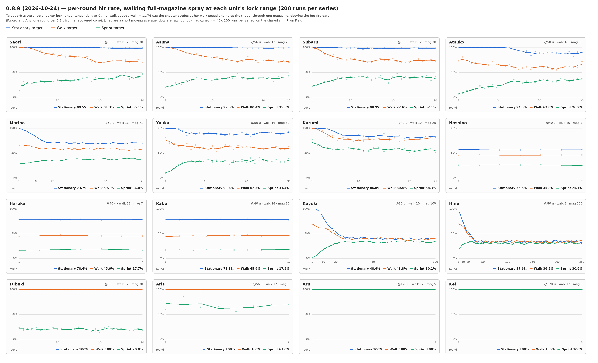

# Gun VS Gun

A fast-paced 1v1 / 2v2 arena prototype with two main modes — **Duel** (single stock) and **Trio** (three-unit rosters). Auto-aim — no manual targeting. The fight is about resource management: when to sprint, when to dodge, when to break line of sight, when to fire.

## Modes

Two main modes, each playable **1v1 or 2v2**, offline and online:

- **Duel** — classic single stock: one unit per fighter; a team loses when all its fighters are down.
- **Trio** — three-unit stock: every slot (human or bot) fields an **ordered roster of three units**, repeats allowed. When a unit dies, the slot's next unit respawns at its original spawn point with the standard 3 s spawn immunity; the killer keeps position / HP / boost — no kill reward. A team loses when every roster on its side is spent. Each fighter's remaining units show as a row of small weapon renders under their side's HP bars (one line per team member; Duel shows its single unit the same way), and a small golden glow-bar marks each Trio line's currently fielded weapon.
- **Spectating (2v2, both modes)**: if you're out for good while your ally fights on, the camera follows the ally with your own-unit visual kit (rear art + through-wall X-ray); the lock reticle stays up and mirrors the ally's actual target (the TARGET button goes inert), and the boost bar and ammo readout follow the ally too (2026-09-29 — they used to stay frozen on your dead unit's numbers).

Orthogonal to all of the above, every player also picks a **view mode** — **Shooter** (the chase camera you pilot directly; named "Classic" until 2026-10-10) or **Command** (a commander's diorama view where your unit fights on its own bot brain and you give it orders). See the **Command mode** section below.

### Offline
- **1v1**: you vs one enemy bot.
- **2v2**: you + an ally bot vs two enemy bots. Friendly fire is off between teammates.
- **Trio picks**: you select your three units in order, then each bot's three — same selection grid, titles count up (1/3 → 3/3).
- Optional "Dummy" mode on the map-select screen — zeroes out damage from every bot (enemies and your ally), so you can practice movement and observe bot behaviour without dying.
- Optional "Spectator" mode beside it — a bot takes over your unit and you watch the match: **TARGET** cycles the camera across every unit on the field (both teams), the HUD (HP / boost / ammo) follows whoever you're watching, the edge arrows stay viewer-relative, and the end banner reads **TEAM 1 WINS / TEAM 2 WINS**. Stacks with Dummy: the bot driving your slot still deals damage exactly as you would, and every other bot's shots are blanks (2026-10-03 — before that the combination zeroed everyone for a no-deaths exhibition).
- The main menu also carries a **Guide** button (a popup summarising controls, mechanics and the command-mode gestures) and a **Server Boot-up** button that opens the online debug panel.

### Online
- **Mode selection**: the host picks **Duel or Trio**, then **1v1 or 2v2**; joiners inherit the lobby's modes.
- **1v1**: the host presses **Start Match** when ready. The opponent slot holds a bot (default **Saori / Unit 1**) until a second human queues in and takes it — start early to play the bot, or wait for a player.
- **2v2**: the host presses **Start Match** when ready; empty player slots fill with bots (2v2 rooms open as Saori / Hoshino / Aru / Atsuko by slot; Trio bots field three copies of that unit unless the host picks otherwise). Up to four humans can play (any split between teams); bots fill any remaining slots.
- **Bot unit selection**: in the lobby, the host can tap any bot slot to pick which unit that bot plays — in Trio, its three units in order (default: three copies of the slot's usual unit). A human joining the slot always overrides the bot.
- **Trio queue room**: every slot's roster is shown in three lines and updates live as picks land.
- **View mode**: each player picks Shooter or Command in the queue room; the pick is final once the match starts and is never shown to the other team (teammates see it as a gold **[CMD]** tag on the roster line). Details in the Command mode section.
- **Slot-colored corner HUD** (online, 2026-08-22): the corner HP bars follow the **server slot** — left column team A (p1 top / p3 bottom), right column team B (p2 top / p4 bottom), each bar tinted its slot color (p1 blue / p2 pink / p3 green / p4 orange), the same picture for every viewer and spectator (1v1: p1 left, p2 right); your own bar wears a thin **white rim**. The command diorama's markers, cards, rings and lock triangles use the same slot colors online (offline keeps the role palette).
- **Host migration**: if the host leaves in the lobby or at the end menu, the longest-waiting player is promoted to host (their unit picks carry over; the lobby keeps its Duel / Trio and 1v1 / 2v2 settings and the new host re-chooses the map).
- Multi-lobby — when an existing lobby is full or running, new joiners spawn their own lobby and become host.
- Team swap in 2v2: any non-host player can `Join` an empty slot to switch teams (e.g. two humans want to co-op on one side against two bots).

### Unit profile card

The first tap on a unit card opens its profile beside the grid (tap the same card again to confirm, anywhere else to cancel): the character art on the left and the **weapon panel** on the right — the gun's real-world name, its render, and since 2026-09-22 a **3×2 stat grid** under the render (owner pick "C" from three in-game samples: a third plate beside the panel and a label/value row list were the other two; the demo line carries the same stats as a row list). The six cells read live from the unit data:

- **Mag**, **RPM** and **Reload** (seconds) as plain numbers.
- **Dmg** shows every tier where a gun has them: Aru's PSG1 `50/35/20` (far / mid / near), Kei's Railgun `30/20` (quick / charged), the shotguns per pellet `3 ×8`.
- **Movement** is the walk-speed tier word (walk speeds retuned 2026-09-24): **Fast** (walk 16 — Atsuko, Marina, Yuuka, Hoshino, Haruka, Rabu), **Medium** (12 — Saori, Asuna, Subaru, Fubuki, Aris, Aru, Kei), **Slow** (Koyuki and Kurumi at 10, Hina at 8).
- The **Spread picture** is a seeded mini-simulation of a **walking spray at a common 60-unit reference** (the shotguns at their own 40): the ring is a standing target's half-width at that distance, the orange dots are up to 30 rounds — magazine-limited — each leaving on the cone the sim gives that round (base + bloom, per-round bloom up to the cap, and the between-round recovery of the no-delay marksman rifles), fading with round order so the first rounds read brightest. The spray stops at the first round whose cone no longer fits the frame (2026-09-22, owner pick from samples — pinning spilled rounds to the frame's edge had piled Fubuki's 27 out-of-frame rounds into a rectangle), so nothing is drawn outside the frame: Saori's whole 30-round spray stays inside the ring, Koyuki's and Hina's pictures end a few rounds short of the magazine with their late rounds at the frame's edge, and Fubuki's and Aris's show their first three quick rounds — one on the ring's centre, two at its edge — because the fourth already flies wider than the frame; the shotguns show their 8-pellet pattern (the Beretta 1301 with its 1.4× horizontal stretch — Hoshino's since the two shotguns swapped patterns on 2026-10-10).

The grid keeps the same sizes on phones (checked at 390 px: nothing wraps or spills).

### Random & All Random cards

Both offline and online pickers carry them:

- Every unit grid has a gray **Random** card (question-mark thumbnail): it rolls a unit the roster being built doesn't already contain (different players can still land on the same unit). The map picker is two sections, each with a Random card of its own: **Scene Maps** — the maps cut from modelled scenes (Town, Spacecraft) — over **Concept Maps**, the hand-made arenas; a section's Random rolls among that section alone and skips **Shooting Range** and **Plain Field** (`noRandom` in the map table; user 2026-10-19). A map's row may say which part of its card picture the wide thumb shows (`thumb: 'top' | 'bottom'`; the thumb box cuts a square picture to a band, the centre by default) — Backrooms and Warehouse show their upper part, Spacecraft its lower; the profile shows the whole picture (user 2026-10-24).
- Every unit grid also carries a golden **All Random** card: one confirm fills every remaining unit slot of the current flow at once and advances it (offline: the rest of your roster, then every bot picker that follows — Duel included; online: the rest of your roster). The map picker deliberately has no All Random.

## Sudden Death

Picked as the **rules mode** beside the view mode (**Health Point** is the normal game; the two were named Normal / Classic until 2026-10-10). Everyone fights at **1 HP** — one landed round decides — and Trio respawns arrive at 1 HP too. The two snipers (Aru, Kei) are out of the pickers and the Random cards. The match opens on a full-width **SUDDEN DEATH** banner with the simulation frozen behind it; the 3 s spawn immunity and every bot slot's 650 ms first-shot delay count from the banner's end (the server holds the same way online).

**The Sudden Death bot brain** — one module for both hosts, `shared/src/sim/sdbrain.js`: the server's `tickBot` and the offline client's `updateEnemy` each build a small host and call `sdBrainTick` once a tick, for every bot slot offline and online, 1v1, 2v2, Trio and the spectated player slot; there is no second copy and no switch. Rewritten on 2026-10-16 (b1017a–h) as **one rule in four parts, each written once**, after the earlier brain had grown to 3,000 lines and 144 knobs of special cases: the unit stands only where it is hidden; it is exposed only to buy something — a firing line, a better cell, the way back; every exposure is priced the same way, and the cheapest one that buys the most is taken. 1,000 lines, 44 knobs (`BOT_SD`), nothing per weapon or per map; the enemy's magazine is never read, its shots are.

1. **Hidden** — one test of the body's silhouette (the front of the capsule, both shoulders, the four shoulder corners, the top) against every **eye**: each enemy where it stands, where its run takes it in the next 0.5 s, and where it fired **every round still in the air** (a shot log per enemy, each shot kept for a round's life — a sprinting sprayer has three or four rounds in the air at once, each from a different place). Hidden means no eye reaches any point of the silhouette.
2. **The price** — the chance of dying in an exposure of a given length at a given distance, moving across the line, under the enemy's reaction: none while its stream is on, 250 ms while its gun is aimed (it fired within 2 s), 600 ms when it is not, or the median of its last five measured reactions, whichever is faster; with its live bloom and cadence, the shotguns by their real cloud. Against it, the chance the unit's own rounds land in the same window. An attack is taken when the deaths it costs to land one hit stay under the one cap, **0.15**; a route, when its death chance does.
3. **The plan** — hidden with nothing under way, the unit prices **the Engage Run** (a straight run across the line through a firing point to a hidden end), **the Stand Peek** (a leg to a firing point, the window, the way back: inside **30 u** the leg is the dodge itself, **the Close Peek**, beyond it a sprint with the dodge kept for the way out) and a **relocation** (a hidden cell by a priced route: closer while beyond the unit's reach, a line-capable cell inside it, else any cell nearer), and takes the cheapest under the cap. Every option refused, it asks what it is waiting for, priced once more with what time brings back — the gun gone quiet, the dodge in hand, the tank full: something under the cap then makes the plan **the Wait** (pacing its cell inside a 6 u leash, priced again every 250–500 ms); nothing makes it **the Approach**, the pathfinder's route to the enemy, priced like any route. The cell it waits in is read at the horizon as well: seen by then, **the Escape** — the nearest cell hidden through the horizon, by a priced route, before the line opens. Caught exposed with no plan, **the Reaction**: the dodge across the line on the tick the line opens, then the sprint to the nearest hidden cell.
4. **The legs** — hidden, along the route; exposed, the crossing legs, always across the line, the side flipped only by a wall (physics' note of the face it pushed the body out of). A peek's window runs across the line away from its cover and ends the tick its way out would cost the cap. The brain and the gun keep running through the dodge; only the body's velocity stands down for the step.

**The unit's own reaction** (b1017f–g): the trigger opens **250 ms** after the unit *knew* — an attack's take (the Stand Peek and the Engage Run walk it into sight: a leg longer than the reaction fires the tick its line opens, a shorter one waits out the rest), else the first sighting of its silhouette. The hosts take this trigger as the Sudden Death bot's only trigger — the plain brain's bloom gate does not apply — and the own-hit price counts rounds from the same moment, so a window too short for its first round is refused rather than walked.

**The tank** (b1017d, b1017h): a reserve of **86** (a dodge, 48, and half a second of lateral sprint) is kept through every planned exposure, which starts only with its own cost on top of it; the body exposed spends to the floor, 8. Hidden legs sprint through **the valve** — the tank is spent in one draught and refilled in one: the valve shuts when the gauge is down to the reserve plus the longest peek's sprint and opens again only at a full gauge. (A hidden leg used to sprint a tick every few hundred ms as the gauge refilled, each tick resetting the 500 ms refill pause, so the gauge never rose while the unit walked and attacks went out on a third of a tank.) Defensive spending — the dodge, the crossing legs, the retreat, the escape — does not pass the valve.

**Reach** — the one per-unit number the brain still reads: how far the unit's own gun lands every round on a standing target (the base cone's footprint fits the hit radius; a shotgun's lock range stands in; `sdReach` in the unit data overrides the formula). Attacks are searched inside the reach plus 10 u of slack; beyond it the relocation closes in. The engage floor and the band of the earlier brain are gone: a route's or an attack's safety is its price, not a distance.

| Unit | Reach |
|---|---|
| Saori | 80 (set) |
| Asuna, Koyuki, Subaru | 80 (set) |
| Atsuko, Yuuka, Kurumi | 107 |
| Fubuki | 160 |
| Hina | 80 |
| Aris | 160 |
| Marina | 53 |
| Hoshino, Haruka, Rabu | 40 |

**Measured** (headless, the shared sim driven tick by tick): against the brain it replaced, 63% of decided duels at b1017e and about 50% once the unit's own reaction was in (the old brain reacts in 0 ms); the wall-hugger scan on flashpoint (the human 1.2 u off every obstacle face) 29–30 of 31 kills in 40 s; 10 ms of CPU per bot per second (was 14). The equivalence test (`shared/test/sdbrain_equiv.test.js`) plays the live brain against a frozen copy tick for tick on seeded matches, so a port between lines changes nothing. **F9** in the client prints the Sudden Death report to the console — the plans taken, the pricings refused, the rounds fired, and the last five seconds as a tape — and a bot's death prints the same with the killing round's geometry.

**Open observations** (2026-10-17, from playtest death reports; none changed yet — a single report never justifies a change, and every change must be a rule, not a patch):

- **The Reaction priced, not ordered.** Caught exposed, the unit always dodges and then runs to the nearest hidden cell; it never chooses to stand and fire. Three deaths in narrow corridors came at the turn-around right after the dodge, the body passing back through the point the gun was already on. The run and the stand should be priced by the same function (the route's exposure against the trade, deaths per hit) and the cheaper taken; a fixed order would fight where three steps reach cover.
- **The dodge's side and the run's side.** The dodge takes the side with the longer open run; the escape search then finds the nearest hidden cell, usually back where the unit came from, so the body reverses. Candidate: among the sides with room, the one toward the cell it last stood hidden in.
- **A gun is aimed when it has seen the unit, not only when it has fired.** A hunter who sprints without firing reads as a cold gun (600 ms), so escape routes with exposed stretches price low; he fires the moment the unit lands. The brain already knows when it was last seen.
- **A route under way keeps its first price.** Only the Approach is re-priced at the cadence; a relocation's exposed stretches are priced once, and a sprinting enemy changes them within a second. Candidate: every route re-priced from where the body is, at the cadence, like the Approach.
- **The Approach's route and the price of waiting.** When every option is refused, the Approach prices the shortest path, which crosses the open; the safest path (the exposure-weighted search the relocations already use) would pass more often. If stalemates remain, waiting needs a price of its own — the longer the duel stays undecided, the dearer the wait — compared against the safest route by the same function. Needs a stuck report (F9) first.
- **The crossing legs lean 45° toward their goal** (`reactDriftDeg`), against the rule that every sprint runs across the line. Held on the owner's word.
- **The jump walks the whole route ahead of it** regardless of the tank; a route with a jump link is walked while the gauge is full.
- **The dead-end pocket** on flashpoint, N(112, 81.35): the grid has no cell there and the Approach's straight last leg clips a corner. A map change, held.
- Two guards that cannot fire (`taken ?? now`, `Array.isArray` on the shot log) to be deleted with the next change; one report with a geometry the tape cannot explain (a perpendicular dodge whose ends both sit 1.1 u from the killing round's line).

**The one-brain experiment** (2026-10-17): the Sudden Death brain priced in life — a hit costs damage / HP of a life, so one brain and one price serve both modes — replaced the plain brain, was measured (against the plain brain: 69% wins, a 30.8 s median kill against 16.3 s, five times the CPU) and was shelved the same day: the plain brain is cheap, predictable and the easier game. It is archived on branch `Testing_0.9.0_New-BOT-Brain` (`docs/NEW_BOT_BRAIN.md` there: the principle, the structure, the reports, the pending designs). The plain brain here is that work's first two steps: its dead code deleted and one module for both hosts (`shared/src/sim/nbrain.js`), behaviour unchanged.


## Command mode

The alternative to the classic chase camera (2026-08-21): a tilt-shift **diorama overview** of the whole map where the units fight on the standard bot brain and you play the commander — observe, select, order. The picker is a Shooter / Command chip in the menus; like Duel / 1v1 the choice is session-only — every site open starts Shooter. Offline, `V` or the pause menu also toggles it mid-match, and solo 2v2 play commands **both** of team one's units; online the pick happens in the queue room, is final once the match starts, and commands your own unit **plus a bot-filled teammate slot** (2026-08-22 — human teammates are never commandable; details in Command mode online below).

**Orders** — three kinds, layered on top of the bot rather than replacing it:

- **Move order** — tap your unit (selection glow), then tap anywhere on the map; or drag from the unit and release. Where floors stack (a bridge deck over ground), **hold** the tap to cycle the vertical layer — the stack lists only standable floors, and the preview auto-picks the lowest reachable one. The unit pathfinds to the spot, **fighting along the way but never abandoning the destination** — travel is **pathfinder-guided the whole way** (2026-08-22): the route re-plans from the unit's current position after every combat reflex and on a 1.5 s cadence, and the unit **vaults the route's jump-links** (raised platforms, fence gaps) instead of grinding at the ledge. On arrival it holds the area in an Engage-style orbit anchored on a **radius-12 ring** for **40 s**, then returns to full autonomy; the orbit **turns around at walls** (a ring straddling a fence — Airport's rim glass, say — patrols the reachable arc instead of grinding the pane), and a unit knocked out of the area by a Defense escape **returns as a fresh pathfinder-guided travel leg**, resuming whatever remains of the 40 s window. An unreachable spot draws a red **"Area is not available"** note at the tap and keeps your selection for an immediate retry. The standing ring is also a live handle (2026-08-27, nothing selected): **grab it anywhere on its disc and drag** to move the order (the whole circle plus a finger-sized margin counts at any zoom — a tap inside the area still orders a *selected* unit there, since ring grabs only engage with nothing selected) — the ring brightens in its unit's color the moment you pick it up (overlapping rings resolve to the nearer center; a dead tie hands it to your own unit), the same preview / validation / layer rules apply, and releasing re-issues the order with a **fresh 40 s window** (any drag counts, even released back where it started — there is no in-place cancel; an unreachable release just draws the red note and leaves the old order untouched) — or **double-tap the ring** to withdraw the move order alone (a standing force lock survives).
- **Force lock** — with your unit selected, tap an enemy: the unit locks that target until **either party dies**, then falls back to its own target-finding. The pinned enemy wears corner **triangles in the commanding unit's color** (the X layout; when two allied commanders pin the same enemy, the later lock wears the **+** edge-midpoint layout instead of splitting corners). Tapping the same enemy again cancels the lock; with **nothing selected**, tapping the pinned enemy's marker or card releases **every lock your units hold on it** at once (2026-08-27 — covers the bot teammate without selecting it; a human teammate's lock is never yours to drop).
- **Hide** (2026-09-26) — **select** your unit (tap its marker or its card — the selection glow) and a shield appears centred just above its **info card** (below it at the top edge) for as long as the selection stands; **tap the shield** to hide. It reads lit while the unit already hides. No hold anywhere. **Hide** wipes the unit's move and lock orders; **any new move or lock order releases it** (the order then stands as usual), as does a double-tap on the unit. A manual reload of 3 s or more enters Hide on its own for the reload (see *Reload hide* under the bot brain) — unless a move order stands, in which case it runs a Cover Hide and keeps the order. A hiding unit's first priority is line of sight: every tick it checks whether **both live enemies** can see it; if they can, it walks the shortest route (a walk-only Dijkstra over the nav grid, no distance cap, capped at 600 cells per search, at most one search per 0.5 s per unit and one per tick per match) to the nearest cell hidden from both. Once hidden it never stands still (owner: a statue looks awful): it **paces** its cover at walk speed on short legs that are verified hidden *before* they are taken (a 2.5 u look-ahead eye test against every enemy eye plus the walk rule), on a 6 u leash around the spot, biased away from the nearest enemy, re-picking its heading every 0.35 s. It also **watches the enemies move**: each is projected 0.5 s ahead on its live velocity, and an eye that would see the unit from there — or a nearest enemy inside 26 u closing at more than 2 u/s — triggers a **slip** to a cell hidden from the live *and* predicted eyes (when closing, one at least 6 u farther from that enemy), before the unit is ever seen. Searches run one attempt per tick (the fallback tiers follow on the next ticks) on the same 0.5 s cadence, so the per-tick cost stays at a handful of sight tests. It **does fire back** whenever a shot exists from where it stands, and never moves for a shot. Being hit does **not** trigger Defense while hiding (hit-stun still applies; the anti-glint dodge and the sniper charge rules are untouched) — **unless no spot hidden from both enemies exists within the search budget** (2026-09-27: the nearest-enemy-only fallback is gone — a walking target hidden from one enemy measured worse than Defense): then it fights on its pursue legs, a fresh hit runs the plain Defense escape, and it keeps searching every 0.5 s until such a spot appears. Sprints on the way are latched: a dash arms only above **50 boost** and may spend down to the **8-boost** hard floor. Released, the unit is plain autonomy again — no badge. Online the order travels as `order:stance` (same per-unit 0.5 s rate limit), lives in the team-scoped command side-table like the other two, and never reaches the enemy; a landed `order:move` / `order:lock` releases it server-side.
- One command per selection — the glow drops as soon as an order lands. **Double-tap** your unit to clear both orders at once; a slow re-tap just deselects.
- **Cover Hide** (2026-09-26, reload-only since 2026-09-27) — a unit under a move order spends a **long manual reload (3 s+)** in a hide **bound to the order**: it looks for cover from **both** enemies **inside the order's area first** (14 u around the ordered point; a unit still travelling has no area yet and skips that tier), then the nearest such cover anywhere, sprints there like Defense (down to the 8-boost floor, no arming), paces once hidden, and ends with the reload — after which the order resumes as after any reflex (travel replans, an anchored unit walks back to its ring; the 40 s hold clock keeps running). No cover anywhere: the reload is spent on the order's legs and Cover Hide is not retried for 0.5 s. No badge, the move order stands throughout, and a new move order landing mid-reload takes over at once. **A fresh hit under a move order runs plain Defense** — the hit-triggered Cover Hide measured about half of Defense's survival time in bot duels on Factory, Streets and Airport (the hidden unit paces at walk speed, stops firing back, and two routing enemies re-acquire it within seconds), so it was retired on 2026-09-27.
- **Reflexes always preempt orders**: Defense escapes, the anti-sniper dodge, the reload hide, hit-stun and the rest interrupt exactly as in autonomous play, and the route replans from wherever the unit ends up.

**Commanded travel dashes on the normal stamina economy** — no speed cheat. Dash segments are *latched*: a segment only starts once boost reaches **125** (or the unit's cap if lower), spends down to a **50-boost reserve floor**, then the unit walks until the gauge re-arms. Route jumps fund at the flat **mandated tier — 60 boost** (2026-08-22, shared with the Defense survival hop; the bot's discretionary jumps fund from its 200 travel floor since 2026-09-29 — 250 before — which the 50↔125 dash cycle could never reach), and while a jump lies ahead on the route the dash floor rises to **70** so the unit always arrives at the ledge able to afford the hop. Cap, drain and regen are the human values throughout; combat reflexes keep their own funding rules (Defense may still spend through the floor to survive).

**Status icons** — gold, on both the unit's marker and its info card: **`!`** while a move order stands (en route plus the 40 s anchor), an **eye** while force-locking (pairing with the colored triangles on the enemy); both side by side when both are active, a **shield** while hiding (which by construction has neither; on the marker it sits centred above the square, or above the diamond's top point), no icon when the unit is autonomous. On the info card the icons are 14×12 px (11×9.5 compact) since 2026-09-26 — the 20×17 originals hung below the card frame once the portrait grew the name row.

**Camera & HUD** — free camera: drag empty ground to pan, pinch / wheel to zoom, `Q`/`E` / right-mouse drag / two-finger twist to rotate about the screen centre; the tilt-shift blur keeps the miniature look with a clear pocket around every unit. Info cards dock in fixed corners — your team bottom-left, enemies bottom-right — each carrying HP and a **stamina bar** (the enemy's stamina bar is hidden online). The joystick, action buttons and the bottom-center stamina bar are gone: fire / dodge / jump / sprint are bot decisions, and each unit's stamina lives on its info card. On Factory, Lobby, Station, Airport and Flashpoint the tall airborne dressing (pipes, trusses, signage, ceiling grids) hides while command mode stands and returns in classic — visual only, nothing collidable.

### Command mode online

- **Queue-room pick, hidden from opponents.** The Shooter / Command chip sits above the roster in the waiting room; the pick locks when the match starts (no mid-match toggle online) and is never sent to the other team — only teammates see it, as the gold **[CMD]** roster tag. Behavior will still hint it; accepted.
- **Your unit — and your bot teammate (2026-08-22).** A commander drives their own unit and, when the teammate slot was **bot-filled at match start**, that bot too (same tap/drag orders; the bot's lock triangles wear its own slot color; each unit has its own 0.5 s order rate limit). Human teammates are never commandable, and the commandable set freezes at match start — a mid-match disconnect turns that human's unit into a plain bot, but it is not adopted.
- **Server-authoritative orders.** The commander's client sends dedicated order messages; the server re-validates each one against the same pathfind checks (with a 500 ms rate limit per ordered unit — your own unit and the bot teammate throttle separately, and clears are never rate-limited) and answers with an ack the selection glow waits for. Commander clients skip movement prediction entirely — the unit is server-driven like any bot, and command timers run on the server clock.
- **Teammate share (2v2).** A command teammate sees your full annotations (destination ring, icons, lock triangles) in their own diorama. A **classic** teammate gets an in-world render: a ground ring in the commander's slot color standing at your unit's ordered destination, plus your lock triangles framing just outside their own crosshair when they face the pinned enemy. Both indicators die with the commander's unit.
- **Information hiding.** Snapshots are filtered per team: the enemy's boost value, standing orders and bot-intent state never reach your client. Boost-inference tells (overheat, sprint-lock, thruster effects) deliberately stay visible. Spectators watch in classic view with no command overlays.
- **Disconnects.** 1v1 keeps the instant forfeit; in 2v2 a disconnected commander's orders clear and the unit fights on as a plain bot.

## Units

Sixteen pickable units, near-identical base stats (100 HP, 250 boost, 11.76 sprint base; walk speeds since 2026-09-24: 16 for the SMGs and shotguns, 12 for the assault rifles, rifles and snipers, 10 for Unit 12, 8 for Unit 5; Unit 7 flies):

**Weapons:**

| | Mag | Damage | Fire rate | Projectile speed | Lock range (1v1 / 2v2) | Reload |
|---|---|---|---|---|---|---|
| Unit 1 — Assault Rifle (Saori) | 30 | 4 / shot | ~700 RPM | 600 | 56 / 60 | 1.5 s |
| Unit 9 — Assault Rifle (Asuna) | 25 | 4 / shot | ~900 RPM | 600 | 56 / 60 | 1.5 s |
| Unit 14 — Assault Rifle (Subaru) | 30 | 4 / shot | ~700 RPM | 600 | 56 / 60 | 1.5 s |
| Unit 4 — Submachine Gun (Atsuko) | 30 | 3.5 / shot | ~1100 RPM | 600 | 50 / 55 | 1.5 s |
| Unit 13 — Submachine Gun (Marina) | 71 | 2.5 / shot | ~1250 RPM | 600 | 50 / 55 | 2 s |
| Unit 15 — Submachine Gun (Yuuka) | 30 | 3.5 / shot | ~850 RPM | 600 | 50 / 55 | 1.5 s |
| Unit 17 — Submachine Gun (Kurumi) | 25 | 3.5 / shot | ~600 RPM | 600 | 40 / 50 | 2 s |
| Unit 2 — Shotgun (Hoshino) | 7 | 4 × 8 pellets | ~250 RPM | 350 | 40 / 50 | 1.2 s (auto, per round) |
| Unit 11 — Shotgun (Haruka) | 7 | 4 × 8 pellets | ~250 RPM | 350 | 40 / 50 | 1.2 s (auto, per round) |
| Unit 18 — Shotgun (Rabu) | 10 | 4 × 8 pellets | ~250 RPM | 350 | 40 / 50 | 2 s (magazine) |
| Unit 12 — Machine Gun (Koyuki) | 100 | 4.5 / shot | ~600 RPM | 600 | 80 / 65 | 5 s |
| Unit 5 — Machine Gun (Hina) | 250 | 4 / shot | ~1250 RPM | 600 | 80 / 65 | 7 s |
| Unit 10 — Rifle (Fubuki) | 30 | 13 / shot | ~180 RPM | 600 | 56 / 65 | 2 s |
| Unit 7 — Rifle (Aris) | 8 | 12 / bolt | ~180 RPM | 600 | 56 / 65 | 1.2 s (auto, per round) |
| Unit 3 — Sniper Rifle (Aru) | 5 | 50 / 35 / 20 by range | 60 RPM | 4000 | 120 / 70 | 2.5 s + 1 s charge |
| Unit 6 — Sniper Rifle (Kei) | 5 | 30 / beam (charged sweep: 20) | 60 RPM | instant (hitscan) | 120 / 70 | 2.5 s + 1 s charge |

**Theoretical DPS** (every shot landing; cadences are the real 16 ms tick slots, not label RPM):

| Unit | Real cadence | Dmg/shot | Burst DPS | Sustained (incl. reload) |
|---|---|---|---|---|
| Hoshino / Haruka | 4.17 blasts/s | 32 (8×4, point-blank) | **133.3** | ~26.7 (shell-regen limited) |
| Rabu | 4.17 blasts/s | 32 (8×4, point-blank) | **133.3** | ~76.9 (10-shell magazine, 2 s reload) |
| Hina | 20.8/s (48 ms) | 4 | **83.3** | 52.8 |
| Atsuko | 15.6/s (64 ms) | 3.5 | **54.7** | 31.3 |
| Marina | 20.8/s (48 ms) | 2.5 | **52.1** | 33.1 |
| Asuna | 12.5/s (80 ms) | 4 | **50.0** | 29.2 |
| Yuuka | 12.5/s (80 ms) | 3.5 | **43.8** | 27.5 |
| Saori / Subaru | 10.4/s (96 ms) | 4 | **41.7** | 28.0 |
| Koyuki | 8.9/s (112 ms) | 4.5 | **40.2** | 28.0 |
| Fubuki | 2.98/s (336 ms) | 13 | **38.7** | 33.2 |
| Aris | 2.98/s (336 ms) | 12 / bolt | **35.7** | ~10.0 (bolt-regen limited) |
| Aru | 1 per ~1.5 s (snap cycle) | 50 / 35 / 20 by range | **~33.3** (full-damage snaps) | ~33.3 |
| Kei | 1 per ~1.5 s | 30 quick beam | **~20.0** | ~20.0 |
| Kurumi | 8.9/s (112 ms) | 3.5 | **31.3** | 18.7 |

Reading the DPS table: the shotgun row is the most theoretical — all 8 pellets only land point-blank, and the 7-shell magazine burns in ~1.7 s before per-shell regen throttles the long run. Aris's burst is real for his 8-bolt spike (96 damage in ~2.4 s), then collapses to the worst sustained figure in the game. The sniper rows use cycle math (cooldown + floor charge) at full range-tier damage. The tight 40–55 spread across five mid-table guns is deliberate — fights are decided by accuracy curves, uptime, and positioning rather than raw DPS. The two 180 RPM rifles (Aris, Fubuki) sit under that band on purpose: their 336 ms slot trades cadence for the heaviest per-shot chunks among the autos.

**Handling (stun + spread):**

| | Stun | Base SA | Bloom / shot | SA cap | Recovery | Sure-hit base → cap |
|---|---|---|---|---|---|---|
| Unit 1 — Saori | 100 ms @ 0.25 | 0.02 | +0.002 | 0.06 | 0.035/s, 200 ms after the last shot | 160 → 53 |
| Unit 9 — Asuna | 100 ms @ 0.25 | 0.02 | +0.003 | 0.06 | 0.035/s, 200 ms | 160 → 53 |
| Unit 14 — Subaru | 100 ms @ 0.25 | 0.02 | +0.005 | 0.06 | 0.035/s, 200 ms | 160 → 53 |
| Unit 4 — Atsuko | 50 ms @ 0.50 | 0.03 | +0.003 | 0.08 | 0.05/s, 200 ms | 107 → 40 |
| Unit 13 — Marina | 50 ms @ 0.50 | 0.06 | +0.003 | 0.11 | 0.05/s, 200 ms | 53 → 29 |
| Unit 15 — Yuuka | 50 ms @ 0.50 | 0.03 | +0.01 | 0.08 | 0.05/s, 200 ms | 107 → 40 |
| Unit 17 — Kurumi | 100 ms @ 0.25 | 0.03 | +0.015 | 0.11 | 0.05/s, 200 ms | 107 → 29 |
| Unit 2 — Hoshino | 100 ms @ 0.25 | pattern, 1.4× wide (see below) | — | — | — | pattern |
| Unit 11 — Haruka | 100 ms @ 0.25 | pattern (see below) | — | — | — | pattern |
| Unit 18 — Rabu | 100 ms @ 0.25 | pattern (Haruka's) | — | — | — | pattern |
| Unit 12 — Koyuki | 100 ms @ 0.25 | 0.02 | +0.004 | 0.12 | 0.03/s, 200 ms | 160 → 27 |
| Unit 5 — Hina | 50 ms @ 0.85 | 0.04 | +0.003 | 0.14 | 0.03/s, 200 ms | 80 → 23 |
| Unit 10 — Fubuki | 100 ms @ 0.25 | 0.02 | +0.10 | 0.30 | 0.17/s, no delay | 160 → 11 |
| Unit 7 — Aris | 100 ms @ 0.25 | 0.02 | +0.10 | 0.20 | 0.17/s, no delay | 160 → 16 |
| Unit 3 — Aru | 100 ms @ 0.25 | 0.02 | — | — | — | 160 |
| Unit 6 — Kei | 100 ms @ 0.25 | — (beam) | — | — | — | instant |

Unit 13 is the lightest bullet in the game on Hina's cadence: the 48 ms tick slot (20.8 shots/s) in an SMG chassis and a 71-round drum — ~3.4 s of continuous fire (≈178 damage per drum) behind a 2 s reload. Suppression-first: her value is steady chip on the longest trigger in the SMG class, plus the boost her stream forces targets to burn escaping; the kill usually needs cross-fire or a second drum. Since 0.5.9 the SMG spread profiles follow the real guns, and since the 2026-09-22 bloom port they do it through the base cone: the WWII PPSh hoses wide (Marina keeps her 0.06 base and blooms to 0.11), the modern EVO3 shoots tight (Atsuko's base came down to 0.03, blooming to 0.08).

Units 14 and 15 (user 2026-10-22) are Saori's and Atsuko's chassis with guns of their own. Subaru's HK33 is the M4 with 0.005 bloom per shot: the cap at the 9th round where the M4 reaches it at the 21st (standing still adds no bloom, so a planted shooter has the M4 exactly). Yuuka's MPX is the evo3 with 850 label RPM and 0.01 bloom per shot: a 70.6 ms cooldown lands on the 80 ms tick slot, Asuna's cadence — 64 and 80 ms are the only slots near — so she fires 12.5/s to Atsuko's 15.6, and her cone reaches the cap at the 6th round where the evo3's takes 18. Both sit at the bottom of the picker.

Unit 17 (user 2026-10-23): Kurumi is the shield bearer, the only unit off the 100 HP base — **120 HP** (125 until 2026-10-24), her bars as long as her HP (the corner bar, the overhead pill and the command card are 1.2 of the 100 HP base length: `hpBarScale`, a unit's `hp` over the base; user 2026-10-24), and she is **never stunned** (`stunImmune`, a unit field read by the one hit-stun routine, `applyHitStun`: the hit's damage and momentum cut stand, the slow does not). The price is the UMP45's kit: a walk of 10 (Koyuki's tier), the shotguns' 40 / 50 reach, 600 RPM on the 112 ms slot (8.9 rounds/s) with Atsuko's 3.5 bullet (31.3 burst DPS, 18.7 sustained — still the lowest of the automatics), a 25-round magazine on a 2 s reload, and a cone of 0.03 that opens by 0.015 a round to Marina's 0.11 (sure-hit 107 → 29), recovering at 0.3/s with no delay — the fastest recovery of any gun, between the rounds of a burst too, so a round every 112 ms nets +0.015 − 0.034 and the cone sits at its base while she sprays (the SMGs' 0.05/s after 200 ms until 2026-10-24, then 0.17/s the same day). (The **reload hold** — `reloadHolds`, a unit field: no walk and no sprint while the magazine is changed, the dodge and the jump open, the same for a player and for the bot — came and went twice the same day; the field stays for any unit to carry.) Her rounds stun as the rifles' do (100 ms at 0.25). Sudden Death puts her at 1 HP like everyone, so she still dies to the first hit there. (Her HP and bullet were tuned through the day of 2026-10-23 — 150 / 3.5, 100, 150 / 2.5 — on player feedback, "a bloody tank" at 150, and settled at 125 / 3.5: a 30-round rifle magazine, 120 damage, still falls 5 short of her, and she kills a 100 HP target in one magazine with 4 rounds to spare.) Her pictures are the user's. (Unit 16, Rio's M1911, was added and removed the same day; the key is left unused.)

Unit 18 (user 2026-10-23): Rabu's M590 is Haruka's SDASS — the concentrated pattern, the 250 RPM, the 40 / 50 reach — on a **10-shell box magazine** that reloads as one in 2 s where the other shotguns load shell by shell: ten blasts in 2.2 s (320 damage point-blank, 76.9 sustained DPS against the shell-loaders' 26.7), then a 2 s gap with nothing in the gun. The bot empties the magazine in one pull (`botFireCap` 10, as Marina's drum; the shell-loaders fire 4 and rest). The only shotgun on the magazine rule; the key after Kurumi's. Her pictures are the user's.

**Reading the stun column** (`duration @ move-scale`): every landed hit slows the victim's movement to *move-scale* for *duration* — e.g. `100 ms @ 0.25` means crawling at 25% speed for 100 ms. Each new hit refreshes it; when two stuns compete, the heavier slow (lower scale) wins. **In practice the slow itself is a minor stat**: sprinting pays straight through it (and everyone sprints away from fire anyway, stun or not), while a walking target was already highly hittable — so the currencies that actually decide fights are the damage actually landed and the boost the target burns escaping, not the movement penalty.

**Reading the spread columns (2026-09-22, spread bloom — ported from the demo line, owner questionnaire):** every cone angle is in radians and describes the FULL cone — a shot deviates from the aim line by at most half of it. Horizontal spread (HA) is gone from every unit. Instead each shot **blooms** the cone: firing adds *Bloom / shot* to the gun's spread, up to *SA cap*, and once the *Recovery* delay has passed since the last shot the extra spread drains back at the listed rate (the two 180 RPM rifles recover between the shots of a burst too — *no delay* — which is what shapes them: Fubuki's or Aris's second quick shot leaves at 0.063 rather than 0.02). Since angular error grows with distance, a cone has a **sure-hit distance** against a standing target — 3.2 ÷ spread, 3.2 being the hit capsule's width — inside which every shot lands; beyond it, hit chance falls off roughly as sure-hit ÷ distance. The table gives it at the base cone and at the cap: a fresh trigger pull is pin-point, a long spray is not, and tapping keeps a gun near its base numbers. **Standing still is the other way to stay pin-point**: a shooter that has stood on the ground at under 1 unit/s for 200 ms fires without adding bloom, and whatever bloom it carried drains at the gun's recovery rate even while it keeps firing — the price is being a stationary target. The shotguns ignore the cones entirely: their pellets fly a fixed 8-point pattern that opens toward ~5.8 wide over the first 70 units of flight — at lock range it is still a tight ~3.3-wide cluster; Hoshino's pattern is additionally stretched 1.4× horizontally (details below).

**Preferred engage distance:** every unit's fighting range is its **lock range ± 7** — the band where bots hold position, orbit, and fire (in 1v1: shotgun 33–47, SMGs 43–57, snipers 113–127). One rule for all weapons: retune a lock range and the combat distance follows. **In 2v2 every bot switches to its 2v2 lock value** (the second number in the weapons table): the team's fighting bands compress into 50–70 so long-lock units stop hanging back — and letting a teammate die alone at the front — while short-lock units step up slightly. 1v1 keeps the classic values, and the change is bot-behavior only: the player-side lock reticle always reads the 1v1 number. Every pickable unit carries a 2v2 value; a unit without one would simply fall back to its 1v1 lock range.

**Measured hit rates** (2026-09-26 — remeasured for the spread bloom; the pre-bloom Shooting Range lanes are retired). Once a cone grows with every round, one percentage no longer describes a gun: what matters is **how the hit chance decays across a magazine while the shooter is on the move**. So the new protocol is a walking full-magazine spray, run on the shared sim (the code the server runs) on Plain Field, 200 runs per series:

- **Shooter:** strafes sideways at her own walk speed (16 or 12 u/s; Koyuki 10, Hina 8), reversing every 400 ms so she is never still and every round blooms, and holds the trigger through **one whole magazine** (tap-fired for the shotguns and snipers; a charging sniper is rooted by the sim, as in play), **obeying the bot fire gate** (`botMayFire`): only the marksman rifles' line — the 100% sure-hit line — ever closes inside their own lock range, so Fubuki and Aris fire one round per 0.6 s from a fully recovered cone, exactly as their bots do; every other gun's line sits beyond its lock range even at the cap, and the gate never trips. Every unit fires from **her own lock range** only.
- **Target:** a real unit — the 3.2-wide hit capsule, not the Range's signs — ping-ponging on a ±35° arc at lock range around the shooter, so it always moves across the line of fire, at three speeds: standing, the shooter's own walk speed, and that walk speed + 11.76 (the sprint boost). Reversal at the arc ends is instant, so the speed never dips. Shots aim at the target's current position, exactly as the game does (no lead).
- **Scoring:** every round is a hit or a miss (shotguns: pellets landed ÷ 8 per blast; Kei's beam counts as a round). Each curve is the hit chance of the *n*-th round of the magazine, averaged over the 200 runs; the numbers in the table are the mean over the whole magazine and, in brackets, the mean of its first third → last third.



| @ own lock · magazine | Still target | Walking target | Sprinting target |
|---|---|---|---|
| Saori @56 · 30 rds | 100% (100→99) | 81% (93→73) | 35% (28→39) |
| Asuna @56 · 25 rds | 100% (100→99) | 80% (92→73) | 34% (27→40) |
| Atsuko @50 · 30 rds | 95% (100→90) | 65% (71→60) | 29% (21→34) |
| Marina @50 · 71 rds | 73% (82→69) | 59% (60→58) | 36% (34→38) |
| Hoshino @40 · 7 rds | 59% (58→59) | 47% (46→47) | 25% (25→25) |
| Haruka @40 · 7 rds | 83% (82→83) | 46% (45→47) | 17% (16→17) |
| Koyuki @80 · 100 rds | 49% (65→41) | 44% (52→40) | 29% (23→32) |
| Hina @80 · 250 rds | 38% (45→34) | 37% (41→34) | 31% (31→31) |
| Fubuki @56 · 30 rds | 100% (100→100) | 100% (100→100) | 19% (18→20) |
| Aris @56 · 8 rds | 100% (100→100) | 100% (100→100) | 62% (60→62) |
| Aru @120 · 5 rds | 100% (100→100) | 100% (100→100) | 89% (90→93) |
| Kei @120 · 5 rds | 100% (100→100) | 100% (100→100) | 100% (100→100) |

*Shotgun rows (2026-10-10):* the two shotguns swapped pellet patterns that day — Hoshino now fires the 1.4× wide fan, Haruka the concentrated cloud — and since the pattern is the only thing that differs between them, their two rows swapped with it (the series were not rerun). The picture above predates the swap: its two shotgun curves are labelled the old way round.

*Reading it:* the first→last gap is the bloom. The 900 RPM rifles open a magazine at 100% on a walking target and close it in the low 70s; Atsuko slips 100→90 even on a standing target: her capped cone's sure-hit line is 40 u, inside her 50 u lock, and a 30-round spray gets there by round 20; Koyuki's 100-round belt and Hina's 250 reach their capped cone inside the first third and sit there (~40% and ~34%), which is why their bots fire ungated. A flat pair means the gun never leaves its resting cone: the shotguns (7 blasts, a fixed pattern), and Hina and Koyuki from round ~40 on. The marksman rifles are flat for the opposite reason: on their 100% gate they never fire bloomed, so every round is a 0.02-cone shot — 100% on anything walking, and against a sprinter only the flight-time drift is left: Fubuki 19%, Aris 62%, her laser bolt hitting with a 0.4 wider radius and its whole 64-long trailing body, which forgives more of the drift than Fubuki's point bullet. (Held down through the magazine instead, ignoring the gate, they spray at their caps — Fubuki 35 / 33 / 28%, Aris 71 / 74 / 56% — which is what the gate is for.) The walk column is no longer one target speed for everyone — the 16 u/s SMG targets are harder than the 12 u/s rifle targets — so compare it as "each unit against her own peer". Sprint is no longer untouchable: crossing the line of fire at 24–28 u/s still gets clipped a quarter to a third of the time, and the assault rifles' sprint curve *rises* through the magazine (28→39) as the widening cone starts to cover the flight-time lead. The snipers are the flat lines at the top: Aru's 2,500 u/s bolt crosses 120 u in under 50 ms, so even a sprinter drifts about one unit before impact, and Kei's beam is instant.

Projectiles fly straight (homing is zeroed universally). The targeting reticle is an **enemy-firing indicator**, not a range indicator: green by default, it flashes red while your current target is firing and stays red for the whole time a sniper is mid-charge with you as the target (see the sniper section). Being inside lock range is not signalled to players at all — the number only shapes bot behavior (bots hold their engage band around it). A faint in-lock tracer tint that once keyed to it was removed 2026-08-01.

### Units 2 & 11 — the shotgun blast

- A trigger pull fires **one flying pellet cluster** carrying a fixed 8-point pattern (randomly rotated each shot, so no two blasts look alike while the spacing geometry never clumps). Each pellet keeps its **own hitbox** and dies individually on walls or the target; damage = pellets landed × 4 (all 8 point-blank = 32, both shotguns; was × 5 / 40 before 2026-09-24).
- The pattern leaves the muzzle bunched and grows toward full width (~5.8 across) over the first **70 units** of flight. At lock range (40) it is ~57% open (~3.3 across), so locked-fire blasts land as a concentrated cluster rather than a full spread.
- **Hoshino's wide fan (Unit 2):** her pattern is stretched **1.4× horizontally** after the per-shot rotation — the cloud is 1.4× wider and exactly as tall as Haruka's (at lock 40: ~4.6 × 3.3; fully open: ~8.1 × 5.8). More graze coverage along the dodge axis — the dodge-catcher to Haruka's concentrated slug. (The fan was Haruka's from 2026-07-14 until the owner swapped the two patterns on 2026-10-10; nothing else differs between the two shotguns.)
- One blast = one simulated/networked object instead of 8 — the wire-cost half of the old online "shotgun lag" fix; the projectile broadphase (see Implementation notes) removed the other half, the dense-map CPU cost.

### Aris (Unit 7) — flight & laser bolts

- **Flight kit**: a jump tap in the air re-fires the jump impulse (12 boost per pop, no cooldown); *holding* jump sustains a climb at sprint speed; air-sprint flies **level** (dedicated fly art); the air-dodge holds altitude. Boost does not regen while airborne — altitude is a spent resource.
- Sprinting into a jump **carries the sprint momentum** through the air.
- Her shot is a **64-unit-long laser bolt**: the thin cyan cylinder you see *is* the hitbox (both derive from one spec entry). It grows out of the muzzle — the body never reaches behind the spawn point — and hits with its whole length, so a dodge must clear the entire passing beam, not just its nose.

### Sniper charge & sprint-cancel

- Both snipers hold their shot on a **1 s charge** (locked in place). Holding sprint cancels the charge and fires early — but never before a **0.5 s floor** (costs ½ a dodge's boost). So the shooter picks any release point in the **0.5–1 s** window, and the target always gets at least that much glint-to-bullet warning.
- **Online floating unlock:** against a human defender the 0.5 s floor counts from the moment their client *actually rendered* the glint — the defender's client acks the glint's first frame and the server slides the earliest release to that ack + 0.5 s — the defender's half-second of SEEN warning is absolute. If the ack never arrives (defender's tab backgrounded, client stalled; the server waits up to 0.5 s), the earliest release becomes press + 1.0 s — exactly a normal full charge, so the attacker's worst case is simply losing the fast cancel for that shot. Offline play and bot defenders (who see server truth instantly) are unchanged.

**Sniper timing at a glance** (worked example: defender's network delay 0.05 s each way; projectile flight and 16 ms tick rounding excluded). Column definitions — *release time*: server clock, from processing the attacker's FIRE input to creating the projectile; *glint duration*: on each player's own display, from the frame the glint is first drawn to the frame the shot is drawn; *read & decide*: on the defender's side, from the glint's first drawn frame to the latest DODGE press that still reaches the server before the projectile exists.

| Release time | Glint duration (attacker's screen) | Glint duration (defender's screen) | Read & decide time |
|---|---|---|---|
| 0.60 (earliest the server permits) | 0.60 | 0.60 | **0.50** |
| 0.70 | 0.70 | 0.70 | 0.60 |
| 0.80 | 0.80 | 0.80 | 0.70 |
| 0.90 | 0.90 | 0.90 | 0.80 |
| 1.00 (server auto-fires) | 1.00 | 1.00 | **0.90** |

Three properties the table encodes: glint duration equals the release time on **every** screen (both endpoints of the interval shift by the same delivery delay, so its length is preserved for any observer); the defender's read & decide time is always the release time minus their round trip (one delivery lost at each end); and the earliest-release fence sits at ack + 0.5 s precisely so the read & decide column can never fall below 0.50 — the guarantee is produced by *placing the fence*, not by adjusting any clock. The full charge is the one release with no fence involvement: it fires at press + 1.0 s flat, so its read & decide time shrinks with the defender's round trip (lag-taxed like every ordinary attack), while the fast cancel's 0.50 is lag-proof.
- The **dodge** is the counter: a step grants **0.3 s** of i-frame immunity, so a well-timed dodge passes through the shot. Aru's bullet speed is **4000 u/s** (user 2026-10-22, 2500 before: near-hitscan — 0.03 s of flight even at max range, two ticks); Kei's beam is instant.

### Aru (Unit 3) — range zones & the lock reticle

- Damage is tiered by distance, **locked at fire time**: under 15 units → **20**, 15–50 → **35**, beyond 50 → **50**. Rushing a sniper is real counterplay; long range stays lethal.
- The lock reticle shows the current zone — plain brackets (<15), **+ cross ticks** (15–50), **+ inner bars** (50+). It appears both when *you* play Aru (your tier on the target) and when your lock target *is* an Aru (which of her zones you're standing in).
- The reticle turns **red** not just when your target fires, but for the whole time a sniper (Aru **or** Kei) is **mid-charge with you as the target** — a continuous danger signal from glint to shot. Kei's live sweep channel also holds it red for the whole channel, whoever it is aimed at — the beam can hit anyone.

### Kei (Unit 6) — Railgun (照射ビーム beam)

- Fires an instant **hitscan beam** (30 damage, one hit per enemy per beam, blocked by walls, ~0.5 s fade) instead of a bullet. The beam also **deletes projectiles** it touches. The hit volume stops one combined body-width (beam radius + target radius) short of the wall it ends on (2026-09-10), so neither the quick beam nor the sweep channel registers on a unit standing just behind cover — before, the end cap reached up to ~3.2 u (channel ~4 u) through the wall.
- Holding the charge to the full **1 s** fires a **sweep channel**: a 1 s locked, steerable beam (1.5× width, **20 damage**, one hit per enemy for the whole channel). The stick steers it — horizontal and vertical — at ~10°/s; sprint cancels the channel. The fire cooldown is paused during the channel and starts when it ends.
- Her glint grows toward **2×** size as the charge fills, telegraphing a full-charge sweep.

**Bots vs. the sniper.**
- **As the shooter:** both sniper bots flip a **50/50 coin** per shot — release at the **0.5 s floor** (a fast snap; for Kei, the quick beam) or hold to the **full 1 s charge** (for Kei, the sweep channel). No in-between releases.
- **On defense:** when a glint aimed at it appears — from **any** enemy, locked or not (mirroring the human's edge-indicator awareness; earliest active charge wins) — the bot **rolls its reaction per charge**, and the slow roll is charger-aware:
  - **Anti-Aru** (bullet snipers): **50% at 0.4 s** (i-frames open ahead of the earliest possible cancel, covering **every floor snap at any range** — but a full hold sails in after they end) / **50% at 0.8 s** (deliberately late: a snap lands first and cancels the pending dodge, but the i-frames ~0.8–1.1 s sit exactly on the **full hold's** impact). Against the shooter's 50/50 snap/hold flip neither side can be read; equilibrium **~50% of charges convert** (snaps beat slow rolls, holds beat fast rolls).
  - **Anti-Kei** (beam snipers): **50% at 0.4 s** (covers the instant quick beam) / **50% at 0.9 s** — the dodge starts just ahead of the **sweep channel's** aimed opening (i-frames ~0.9–1.2 s blanket it) and the follow-up sprint outruns the beam's steering at normal fighting ranges. (An 0.8 s roll would be dead weight here: the quick beam pre-empts it and the sweep outlives it.)

  Either way it's one dodge (0.3 s i-frames) plus a **0.52 s** committed sprint, both perpendicular to that sniper's line of fire; lock and return fire stay on the current target throughout. Mid-charge hits still cancel a pending dodge, and a cooldown- or boost-blocked defender still eats the shot. After the committed sprint expires the bot has no awareness of a still-live sweep — it can wander back into the channel.

**Bot trigger discipline.** A bot fires in continuous bursts of a fixed per-unit length (`botFireCap` — the "fire cap"), resting ~0.8–1.5 s between bursts. This rhythm is the bottom layer; the **bloom gate** (Bot logic below, 2026-09-22) sits on top of it and only shapes the machine guns' and the marksman rifles' fire inside their bands. Shots inside a burst pace at the weapon's own RPM-derived cooldown, so retuning a fire rate retunes the bot with it. Every auto's cap equals its **full magazine** — an auto bot fires until the mag runs dry and rolls straight into the reload; the shotguns are burst-gated at 4 blasts per pull; the snipers run their charge cycle instead of bursting.

| Unit | Fire cap | Meaning |
|---|---|---|
| Saori | 30 | full mag |
| Asuna | 25 | full mag |
| Atsuko | 30 | full mag |
| Marina | 71 | full drum |
| Fubuki | 30 | full mag |
| Koyuki | 100 | full mag |
| Hina | 250 | full drum (~12 s of continuous fire) |
| Hoshino / Haruka | 4 | 4 blasts per trigger pull |
| Aris | 4 | legacy formula (half mag) |
| Aru / Kei | — | charge cycle, no bursts |

A burst ends early if the mag runs dry (straight into the reload), if line of sight breaks (re-checked every 0.22 s; the burst then restarts from full), or if the target is **spawn-immune** — bots hold fire at immune targets and wake the moment immunity lapses. A bot's OWN spawn immunity does **not** hold its fire: a freshly spawned bot shoots from behind its protection window, same as a player would.

### Fubuki (Unit 10) & Aru (Unit 3) — ribbon tracers

Fubuki's Ruger rounds draw a **camera-facing ribbon trail** (2026-09-19, the demo line's marksman-rifle treatment): a real quad of world half-width 0.06 that re-aims at the camera every frame — live and while fading — so it reads as a thicker, smoke-like streak that thins with range like a physical object. Aru's PSG1 rounds carry the same ribbon at the demo line's deliberately fatter sniper width, half-width 0.10, fading over the sniper's 1 s — since 2026-10-15 the rifle's tail stays at the muzzle for 1 s (the whole flight) and fades over 1 s, the snipers' over 1.5 s — (2026-09-22, owner: "use the 0.8.3 trails" — with that the BA line's trails match the demo line gun for gun: the six autos on the 1-pixel line, the rifle on the 0.06 ribbon, the sniper on the 0.10 ribbon). **Both ribbons glow** (2026-09-23, owner pick "C" from four in-game samples): the core at the gun's own width sits over a second quad 3.2× wider and much fainter as a soft edge; the fade scales both quads. The samples were additive amber; the owner then asked for the autos' per-map ink (2026-09-23) and, because additive light can never match an alpha-blended line (it read white on the dark maps and as a pale highlight on the bright ones, where the autos' line is a dark stroke), finally for the same **visual** colour (2026-09-24): both quads now blend normally in the autos' ink — light grey `0xbbbbbb` on the dark maps, dark slate `0x3a3f4a` on Lobby, Airport and the Shooting Range — with the core's alpha set so that core over halo composites to exactly the line's 0.55. The streak reads as the same grey as the autos' line, wider and soft-edged. The cost is one extra quad (one draw call) per ribbon trail and the same per-frame re-aim the ribbon already did — no post-processing, nothing on the network. It runs on every map: the three bright-ground maps (Lobby, Airport, Shooting Range) were first left on the plain slate ribbon because additive light cannot darken, but the owner chose the same additive glow there too (2026-09-23, seen beside four normal-blend alternatives). The six autos carry **no trail at all** since 2026-10-14 (owner: the smoky streak stays on the semi-automatic rifles and the snipers — the unit data's `bulletTrail` flag, set in both the client's and the shared copy because online rounds are built from the shared sim data; 2026-10-15, after Fubuki's online trail went missing with the flag in the client copy only); shotgun pellets have none, Aris's bolt is its own trail and Kei's beam is hitscan. Since the same day **every single-round gun flies the same spindle tracer** — the sniper's, at six times its old length (20.4 u) and a 0.15 u mid radius (was 3.4 / 0.18, with the autos at half size), its body clipped to the distance flown so it grows out of the muzzle and never reaches back over the shooter; the shotgun pellets stay small spheres and the laser bolt its cylinder. Online (2026-10-15, owner: "a circle-like bullet visual near the firing character") the client flies each bullet on along its last snapshot velocity between snapshots (capped at 300 ms), and measures the spindle's body and the trail's start from the shooter's muzzle — the shooter's position in the same snapshot plus the sim's muzzle height, since a normal round's snapshot carries no spawn point — instead of from where the client first saw the round; measured from there the spindle began as a 1 u stub, a 0.3 u disc seen from behind, for one frame on every shot. The first frame now draws the distance already flown, like the offline first frame. The local player's **own rounds go further** (2026-10-15, owner: "the bullet visual spawns away from the firing character, it gives a laggy feel"): the client's prediction already fires them at the muzzle the moment the key goes down, so their spindle and trail are drawn from there at once and fly on, dying on walls and decks like an offline round; the server's copy of the round is never drawn on the shooter's screen: the local round keeps flying its own line to its own end — wall, deck, the drawn enemy's hit capsule, or the copy's going — and, since the **shared spread seed** (2026-10-15, owner: "implement seed"), on the very line the server's round flies: the server draws one random number per match and sends it once in `match:start`, and both the server and the client's prediction sample each round's direction inside its cone from a stream keyed by that seed, the fighter and the shot number (shared `spawnProjectiles`; shotgun volleys the same). The distribution is unchanged and a fresh seed every match keeps matches apart; nothing rides in the snapshots. What remains between the shooter's picture and the judgement is the enemy's movement over one round trip in the aim (0 standing, about 1 u walking, 3 u sprinting), against a hit capsule 1.6 u in radius. A first cut handed the mesh over to the copy and slid it onto the server's line, which read as the bullet swerving mid-flight (owner 2026-10-15). Hits, damage and what the other players see are the server's as before; a local round the server never fired is dropped once the server has run four inputs past it (or after a second); shotgun volleys stay on the server path. Because the prediction's clock is re-based on every snapshot, a late snapshot can make the forward ticks fire a held trigger's round a second time (owner 2026-10-15: "two parallel trails"), so the sim now counts trigger pulls per fighter (`shotsFired`) and stamps each round with its number (`shot`): a predicted round with the number of a local round already drawn is the same shot and is not drawn, the server's copy claims exactly the local round with its number, and a local round whose number the server has fired past without its copy showing is dropped (a plain time window let re-fires through — a protocol model of the prediction showed two to seven ghost rounds per three seconds of held fire at a 100 to 240 ms round trip — and the magazine count cannot serve where autoReload refills it between shots); rounds the replay fires that the forward ticks never did are drawn back-dated. A local round that dies on a wall before the server's copy shows (any wall within a round trip's flight, 60 u at a 100 ms round trip — the tally from the owner's match read 97 copies, 9 claimed, 88 drawn fresh) leaves a record, and the copy bearing its number claims the record and is never drawn, instead of flying the same shot a second time from mid-air. The client prints a tally to the browser console every five seconds while rounds are in flight (`[own-shots <build tag>] …`), and shows its build tag in the tab title. Visual only — hit detection is untouched.

## Bot logic

One bot brain drives every bot — all maps, all modes, offline and online (one module since 2026-10-17, `shared/src/sim/nbrain.js`: the server's `tickBot` and the offline client's `updateEnemy` each build a small host and call `nbBrainTick` once a tick, exactly as the Sudden Death brain is called; every bot slot in 1v1 / 2v2 / Trio / spectator uses the identical body). In **Sudden Death** the cover brain described in that section replaces Pursue / Engage; everything below is the Health Point brain.

**State machine** — `Defense > Maze > Engage > Pursue`, re-evaluated every tick:

- **Pursue** — closes to (or backs off to) the fighting band, **lock range ± 7**. Sprints in **latched legs** (2026-09-29): a leg arms only from a **full tank (250)** and runs down to **200**, then the bot walks until the tank is full again — roughly 0.7 s of sprint per 0.7 s of walk, and Maze routing shares the latch. (Both bounds used to sit on the 250 reserve: in Pursue the release won at exactly 250, so it never sprinted; in Maze the dispatch floor let one dash tick through every half second — the flickering sprint pose.) Elevation aids: jump up toward a higher target when close, hop off ledges toward a lower one, and on low ground hop onto any mountable ledge it brushes within jump reach.
- **Engage** — the in-band fight: orbits the target with a range correction toward the sweet spot, flips orbit direction to stay inside sight, and runs the peek-cover rhythm (tuck behind cover while the weapon cycles, drift out exactly when it's ready to fire). Two consecutive ticks of driving into a wall also flip the orbit — the tangent is perpendicular to the aim line, so reversing it always points away from the face just hit, and the bot unsticks itself inside the fight instead of breaking off to re-route. Opportunistically hops onto reachable ledges — high ground is the better vantage.
- **Defense** — triggered by a fresh hit (read off `lastHitAt`, which every landed hit stamps whether or not it stuns — until 2026-10-23 the brain read the stun window rising, so a `stunImmune` unit's bot never knew it was hit, and a hit landing inside a running stun of the same weight went unseen; the references were re-frozen at b1023n): a committed straight cover-sprint (may spend boost to the hard floor — survival overrides the reserve), then a tuck-and-peek once cover breaks line of sight. A jumpable ledge lying **dead ahead** on the committed escape line (within ~37°) is hopped without breaking stride — never while a sniper dodge is scheduled (airborne can't dodge), and funded at the flat **mandated-jump tier (60 boost**, 2026-08-22 — shared with command-mode route jumps; discretionary travel jumps fund from the 200 travel floor since 2026-09-29, 250 before**)**. If the escape wedges anyway, a wider-angle vault, then a direction flip.
- **Maze** — the router. Asks the nav grid for a real walk route (waypoint-followed, cut at the first spot that can already fire) and retries it on every stall signal; when no route exists it keeps moving on a minimal steer biased away from the last spot it got pinned at (a short back-out frees a truly wedged body first). Entered **proactively**: the moment the straight walk toward an out-of-band target is blocked (instantly when sightless; after 0.25 s when the target is visible over a low obstacle), plus the classic stuck detectors (a 1 s wedged/spinning window, a 1.5 s no-progress clock) and a 2 s no-line-of-sight clock. "Wedged" is judged on **net** movement — under 1.7 units in a second is stuck no matter how much wall the bot rubbed getting nowhere, which is what catches a slow slide along a face rather than only a dead stop.

**Cover Defense — measured and shelved (2026-09-27).** The owner asked whether Defense should take cover into account: a *Cover Defense* that, on a fresh hit, picks a spot hidden from **both** enemies (8 headings × 6 / 12 u rings, straight-walkable, scored cover-from-both > cover-from-whoever-sees-me-now > any, plus crossing the aim line; reach budgeted by boost — 80+ for the 12 u ring, 45+ for 6 u), sprints there committed until arrival (cap 1.2 s, no 400 ms re-perpendicularization on the way), counts as *in cover* only when hidden from every live enemy, keeps Defense's tuck-and-peek, re-picks when the second enemy regains sight and lands a hit, and spends to the same 8-boost floor. It was built on a scratchpad copy of the shared sim and measured against plain Defense in 2v2 bot duels on Factory, Streets and Airport (40 runs per cell, 45 s cap, Saori and Koyuki as the observed unit, both under a standing move order and in full autonomy): **worse in every cell** — mean survival 30.1 → 22.4 s, survived 38% → 12%, wins 38% → 11%, damage dealt down a fifth (enemy HP lost 156 → 125). The mechanism itself worked (most picks were double-cover spots, over 90% reached, no run hit the cap), so the loss is the behaviour: the unit takes about the same 16 hits per life, only faster — the straight run to cover is more predictable than Defense's 400 ms re-perpendicularized strafe, the 300 ms tuck is a standing target, the run points the gun away or out of sight, and two routing enemies turn a re-used cover spot into a flank. Same verdict as the hit-triggered Cover Hide (see Command mode): in this sim, sprinting across the aim line while firing back beats running to cover. Not adopted — nothing shipped, Defense unchanged, the Cover Hide plan left as it stands. Two variants were left untried should it be revisited: the 6 u ring only, and no tuck (peek and fire on arrival).

**Steering** — each tick, a moving bot's direction is the sum of two pulls: "toward where it's going" plus "away from any wall it's about to touch"; the second pull is what makes bots slide around obstacles instead of walking into them. Invisible unit-only fences (the kind bullets fly through) get sorted by height: a fence low enough to jump (Station's / Flashpoint's 4-high platform edges) gives **no push at all**, so the bot can walk right up to it and the hop is fired by the jump reflexes above; a fence too tall to jump (Square's 14-high fountain colonnade, the tall panes flanking Streets' bridge slopes) pushes like any solid wall. And a fence the bot is already standing **above** pushes nothing — it passes over freely.

**What counts as a ledge** (all three perch behaviors share one test): the top has to sit **1.7–4.8** above the bot's floor — lower is walked onto, higher needs a ramp — the lip must be unfenced, and the surface must be at least **6 wide**. A jump carries 12–17 units horizontally, so anything thinner gets sailed clean over instead of mounted. Game-wide the width floor excludes exactly four surfaces — Factory's 4-wide conveyors and Scrapyard's 4-wide shack-row roofs; every other climbable surface is 10 or more across.

**Sight** — a bot "sees" its target only along lines a bullet could actually fly: the sight ray is blocked by every solid obstacle, and by walkable **ramps and elevated decks** too — a ramp is solid fill, so nothing sees through the wedge; a bridge deck on open pillars blocks only rays that cross the deck plane, so two units both *under* the bridge still see each other. The eye sits **1.6 above the body centre** (`BOT_LOS_EYE_HEIGHT`) on both hosts; until 2026-10-17 the offline client read it from the root + 1.6, 2.35 higher than online, so offline bots saw over cover that online bots did not.

**Seeing vs shooting** — those are two separate questions, asked from two different heights. *Sight* is the eye line, and it drives awareness: target choice, routing, cover, when to break off. *Firing* is gated on the **muzzle** line instead — the exact line the bullet will take, tested with the bullet's own rules. The two are not interchangeable: a bullet leaves the chest, not the eye, so anything sitting in the gap between them (a slope's guard rail, a deck's underside, the slope surface itself) used to let a bot hold a picture-perfect sight line into a shot that died on the geometry. The gate now *is* the shot test, so a bot that pulls the trigger always has a path — and it will also take a shot through an invisible unit-only fence, because bullets genuinely pass through those. Sight treats such a fence as opaque only where it is flagged `blocksBotSight` (Streets' under-slope bars and slope gates — see-through walls the bot must route around); every other unit-only fence is as transparent to sight as it is to bullets.

**Sniper play** — covered in the sniper section above: 50/50 snap-or-hold as the shooter; as the defender, a per-charge dodge roll timed against the charger's kit, one committed perpendicular dodge + sprint.

**Bloom gate and suppressing fire** (ported from the demo line 2026-09-22) — a bot fires freely only while its target sits inside the gun's *current* **gate line**, re-checked every tick from the live distance: one closed-form division, run before the obstacle scan so an out-of-range poll costs nothing. The line is a fixed width divided by the bloomed cone: for the **auto weapons it is 8.84 ÷ cone — the distance where the cone still lands one round in three on a standing target** (the 3.2 × 6.4 capsule is a third of the cone's disc at radius 4.42; 2.76× the sure-hit line); for the **marksman rifles (Fubuki, Aris) it is the sure-hit line itself, 3.2 ÷ cone** (`botGateWidth: 3.2`); **the machine guns (Koyuki, Hina) have no line at all** (`botGateWidth: 0`, owner 2026-09-25 — a 0% threshold in both modes: they spray on the burst / rest rhythm alone, and for them a burst is the whole magazine — `botFireCap` equals the mag for every auto — so the reload is the rest). At their caps the other autos' lines sit at 147 (Saori, Asuna), 110 (Atsuko) and 80 (Marina), so inside the rifles' and SMGs' 43–63 bands the gate never trips and what you see there is the plain **burst / rest rhythm** of the trigger discipline above. When a line does close on a target (an auto pushed out past its capped line), the bot **holds until the cone has fully recovered** (200 ms + the bloom ÷ recovery) — the line drifting back out past a standing target does not release the hold, so there is no one-round trickle — and opens up again from the base cone. A target that **closes in** past where the line stood when the hold began releases it at once. Beyond the base cone's line (442 for the 0.02 guns, 295 for Atsuko, 221 for Hina, 147 for Marina) a recovered auto fires a committed **suppress burst** (five rounds for the rifles and machine guns, ten for the SMGs) and repeats. The **marksman rifles** live on the gate: each shot adds 0.10 of bloom and 0.17/s takes 0.59 s to shed it, so at their band they settle at one shot per ~0.6 s; their suppress burst is a single round (`botSuppressBurst: 1`). Shotguns (fixed pattern) and the snipers (their cone out-reaches lock range) are never gated. Offline and online run the same rule (shared `bloom.js`, `botMayFire` / `botGateDistance`). The demo line measured the gate line's effect over 6,336 bot duels (see that branch's README); this line has not been re-measured.

**Bot fire-gate thresholds** — the hit rate on a standing target below which the bot stops firing (the line is *width ÷ current cone*; 33% = width 8.84, 100% = the 3.2 sure-hit width, 0% = no line):

| Unit | 1v1 | 2v2 |
|---|---|---|
| Saori, Asuna, Atsuko, Marina | 33% | 33% |
| Koyuki, Hina | 0% (no gate) | 0% (no gate) |
| Fubuki, Aris | 100% | 100% |
| Hoshino, Haruka, Aru, Kei | never gated | never gated |

**Reload hide** (the 2026-08-08 cover reload, re-based on the Hide stance 2026-09-26) — weapons with a manual reload of 3 s or more (Hina's 7 s drum, Koyuki's 5 s) spend it in the **Hide** stance: the unit enters Hide the tick the reload starts and leaves it the tick the reload completes, with every Hide rule — out of every enemy's sight, pacing its cover, slipping away from a closing enemy, no Defense on a hit, firing back only from where it stands. Every bot does it (enemies too); on your own units in command mode the shield badge shows, entering **wipes a standing force lock**, and a new order during the reload releases the hide for the rest of that reload, exactly as it would any Hide (a Hide you set yourself is not released by the reload ending). **A unit under a move order keeps it**: its reload runs as a *Cover Hide* bound to the order instead (2026-09-26 — cover inside the order's area first, for the whole reload, no badge), and the unit resumes its post when the reload completes; a new move order landing mid-reload takes over at once. Per-shell and auto reloaders (Hoshino, Haruka, Aris) are excluded by design — they're always mid-reload, so they'd never come out. The counterplay is to push: hiding beats a stationary opponent, not a committed one.

**Map-agnostic by design.** The bot rules that shipped carry no per-map special cases; a set of Station-only behaviors was built and field-tested, then deleted once repositioning Station's spawns solved the same problem more cleanly.

## Controls

| | |
|---|---|
| **Mobile** | On-screen joystick + buttons |
| **PC** | `WASD` move · `J` fire · `K` sprint · `L` dodge · `Space` jump · `U` switch target (2v2; cycles lanes on the Shooting Range and the watched unit in Spectator mode) |
| **Command mode** | Tap unit → tap map = move order (hold to pick the floor) · drag from unit = move order · tap enemy = force lock · select unit → tap the shield above its card = Hide (any new order releases it) · double-tap unit = clear · nothing selected: tap pinned enemy = drop your locks on it · drag ring = move the order (40 s restarts) · double-tap ring = drop move order · drag pan · pinch / wheel zoom · `Q`/`E` / right-drag / two-finger twist rotate · `V` toggle (offline) |

Double-tap `K` (or the sprint button) while holding a movement direction to lock sprint. The lock releases only after the stick/keys stay **neutral for a sustained 0.18 s** — flipping direction through the joystick center (left→right) or swapping movement keys keeps the locked sprint alive; letting go still stops it almost instantly. Dodge (step) grants 0.3 s of damage immunity (i-frames) — the full duration holds even when the dodge runs into a wall (the unit stops at the wall; the animation and i-frames don't cut short).

## HUD & unit displays

- **Overhead HP bar** above every unit (ported 2026-08-06): bright cyan `#7fe9ff` for the camera unit's team (2026-09-22, owner pick from in-game samples — settled on `#7fe9ff` after an hour on the paler `#a5f1ff`; the 2026-09-19 soft cyan read too dim, the near-white before it read as plain white), orange for its opponents — spectate-relative, so the watched unit's side always reads cyan. **Edged like the edge arrows** (2026-09-22, owner pick "E" from six in-game samples): a dark outline in the arrows' stroke colour `#0b1622`, ~2.9 px on the ~92 × 12 px on-screen bar (the arrow's stroke is ~2.7 px), rings the track pill, and the track is laid over a pill of the team ink so its empty part carries a faint cast of the team colour (its rounded corners keep a hairline of it) — the tint that set sample E apart from the plain-outline sample. The outline sits outside the pill, so the fill and track keep their old size; the old 2 px steel hairline is gone. **Portrait** (2026-09-26): the unit's picker thumbnail sits left of the bar in the same dark rounded frame (44 texture px, ~25 px on screen, the bar's outline width as its border), and the whole "portrait + bar" group stays centred over the unit's head with the bar at its old height — the portrait overhangs the bar evenly above and below, with a clear gap between its frame and the bar's outline. Constant on-screen size at any distance (compensated by true view depth) and visible through cover; teammates' bars ride the head at a fixed screen gap, the **locked** enemy's group sits just above the crosshair **as drawn right now** (2026-09-26, was a fixed 3 rs above the reticle's centre and read far too high): above the bracket square, or above Aru's mid / far tier marks when her reticle shows them, at the bracket's current bloom-grown size, and above the sniper-charge glint while one is showing — a screen-constant ~5–10 px gap, floored at the head anchor. Hidden while the command diorama runs (its info cards carry HP and stamina), and on the **Shooting Range** (owner 2026-09-28: no portrait, no bar on the lanes or the player).
- **Team indicators (2v2)**: screen-edge arrows only — the friendly-bar cyan (the same `#7fe9ff`) pointing at the teammate, orange at the **unlocked enemy** — whenever that unit is off-frame; the floating chevrons that used to hover over both units in frame were removed on 2026-09-19 because they sat right on top of the overhead HP bars. Both edge arrows carry a glint halo while that unit is a sniper mid-charge.
- **Lock bracket bloom** (2026-09-22): the crosshair brackets around your target are drawn at half their former base size (owner call, matching the demo line) and grow with your *own* current spread bloom on **one universal scale** — ×1 with no bloom, growing at the same rate on every unit up to a ceiling of ×4.5, reached at 0.19 of bloom (the reference is 0.38, the demo SVD's full cap, with the growth run at twice that rate). Saori at her 0.06 cap shows about ×1.74, Marina ×1.92, Koyuki at 0.12 ×2.84, Aris ×4.32, Fubuki pins at ×4.5 from her 4th quick shot on. The commander's lock-share triangles and the command-mode markers keep their size.
- **Corner HUD**: HP bars per team member with the Trio weapon rows underneath (the fielded weapon marked in gold). Online the bars follow the server slot with a white rim on your own — see the Online section. In spectator mode the watched unit's corner bar wears a white glow rim.
- **Command mode** hides the joystick, the action buttons and the bottom-center stamina bar; the diorama's info cards show each unit's HP and stamina instead.

## Maps

Fifteen arenas: Plain Field, Streets, Factory, Scrapyard, Square, Lobby, Station, Flashpoint, Airport, Town, Spacecraft, Dust, Warehouse, Backrooms, Backrooms (Anomaly). Every one of them is online; only the Shooting Range is offline (`offlineOnly` in the client's MAP_DATA hides it from the online picker — until 2026-10-22 a hand-kept list said which maps were online, and Dust and Warehouse had been left off it). Each has its own cover layout and elevation; Station has raised platforms players jump up onto, and Airport centers on a raised security plateau — glass-fenced rims, four ramp entrances, and a metal-detector checkpoint as the only way across the middle. On Streets, the storefront towers are solid to their full height (they block movement, fire, and bot sight) and their **rooftops are standable** — only flight gets up there, making them Aris's high ground. Streets' footbridge is **double width** and has two distinct spaces underneath, which behave differently: the lane under the **deck** is open ground — the deck stands on pillars, so you walk and shoot through it freely — while the wedge under each **slope** is solid. Nothing crosses a slope from below: no walking, no bot sight, no bullets. The four bridge approaches are screened by full-height **bastion hoardings** (8-tall panels on the deck at z ±16..±28 on both rail lines — true cover for the whole unit) that fade in step with the bridge itself. Each ramp foot is **road-blocked** (2026-10-02): one scaled-up concrete Jersey barrier 10 u out from the mouth on the street, 20 long, covering 20 of the 32-wide approach with a 2 u overlap past the centre line and a 12 u lane left open on the other side, so a unit coming straight at the ramp steps round it. The north barrier is the south one rotated 180° about the map centre. It stands to the vending machines' top (y 8, full cover: it blocks movement, fire and bot sight) and fades like the bridge when it comes between the camera and a unit. A second barrier at the plaza lip, making the pair a chicane, shipped first and was removed the same day: it blocked part of the ramp mouth itself. Chosen through sample rounds: a staggered pair over a side-by-side gate, cover height over a hop-able low barrier, and a plain barrier over striped, railed or two-tier dressings. The offline map list also carries the **Shooting Range** — the no-opponent practice map (target sliders, per-lane score screens) behind the pre-bloom hit-rate tables; the current tables above are measured in the shared sim; the map Random card never rolls it. On Streets the footbridge group (deck, slopes, rails, gates, pillars) fades whenever it hides **any living unit** from the camera — your ally included (2026-09-11), which is what keeps a teammate ordered under the deck visible in the command view.

**Town** (2026-10-18) — the first modelled map, cut from a glTF scene: *Invasion Map - miniroyale.io* by zct_33 on Sketchfab, licensed CC Attribution ([the model](https://sketchfab.com/3d-models/invasion-map-miniroyaleio)), served as `client/public/maps/invasion.glb` (13 MB, downloaded once per session from the map card's first tap). The scene is a town in a valley in metres; the characters are human-sized, so it is placed at **4 units per metre** (a 6.4-unit body is 1.6 m), and only the flat town is playable: **Town** is the block around the central square and its three-storey building, 135 × 100 m (540 × 400 units), with the ring of buildings and the streets, the raised terrace to the west and the plateau to the east. The spinning UFO is left out. The collision is generated, not modelled, by one rule: **what a body can stand on is floor; what stands in its way is a box on it.** `shared/tools/glb_collision.mjs` rasterises the scene's triangles into 0.25 m columns. A column may hold several floors: every stack of surfaces (surfaces within a step of each other are one floor: a kerb, a slab) with 2 m of surface-free air above it, so doorways, garages and the underpass are floor and their roofs are ceiling boxes; a floor sloping down from the street is read to 3 m below it (a sunken road or yard is a floor, the rims around it are its walls), while the model's hidden underside (terrain plates more than 0.12 m under the street) is not read at all. Which floor a body walks is decided by the flood: a road under a bridge and the bridge are two floors of one column, and where both are walked the upper one is a **slab** — a surface with a body reaching down only to the passage's roof — while a lone plane over a walked space (the plate under a raised yard) is the model's hidden interior and stands on the ground. What stands on a floor (a wall, a fence, a car's side — with whatever is above it that a body cannot fit under, so a car's sides and its roof are one thing) is a box on it; what hangs over it low enough to hit a body and has an edge to it (a gate arm, a bench) is a box in the air that a body hops; a lone plane hanging there is a ceiling. From the street the floor is flooded over steps of 0.65 m (the sim's step height, raised from 0.4 m to the model's tallest kerb, so a kerb is no obstacle and needs no collision of its own) and 45-degree rises, through columns a body passes: a **slope** is a sloped stretch in any direction (3–25°, the model's roads and ramps), at least three cells long and rising at least 0.15 m, one fitted plane — a `plane` surface, so a diagonal ramp is one surface and not a staircase of decks — skirted where its side stands more than a step above the floor beside it; a stretch steeper than that, up to 50°, is a **flight of steps**, and a plane too: a body climbs it smoothly, where treads at their own heights stepped it (a column's floor is the highest walked floor over it with no headroom beneath — a stair's treads over the hidden plate under them, a raised bed's top over its plate — so stairs and beds are floors, not things standing on the plate); a **deck** is any other raised or sunken floor, each stretch of cells within 6 cm of its first cell one region written at its own mean height — the terrace at 2.35–2.40 m is one floor, not a patchwork of 0.25 m classes with one-unit steps between them (a flat surface, a box beneath it); **low cover** is a thing a body hops onto from what it stands on beside it — the floor, or low cover it already hopped onto, so a car is climbed bonnet first, then roof — no more than 1.5 m per hop and 3 m in all (a thing wider than 3 m both ways, a plaza or a roof, is stepped onto from a floor only); everything else that stands is a **wall**, in 1 m height classes up to the 7 m flight ceiling so a merged box stands at most 1 m above the model's — except a thick thing no more than 6 m above the floor beside it (a kiosk, a garage, a truck, a tree's crown), which is **standable**: a floor on top at the thing's own height, for a body that lands on it from the air; buildings are taller, and nothing stands on a building. Any step between two walked floors up to 1.5 m (a kerb, a raised pavement's edge, a platform's) is climbed on the step itself: the high floor's first cell at the line is a ramp from the low floor to the high, and the high floor's body starts a cell further in, so a body below is never lifted before the line and a body above sinks into the floor only within the cell at its edge (a 45-degree ramp laid on the low floor, as long as the step was tall, stretched the walk beside a 1.5 m edge through the air) — the edges between the roads and the pavements are visual only; ground beyond such a step, a flat floor 2 m across and more than 9 m² (a raised pavement, a platform), is walked too, where an object's top that narrow (a car's bonnet, a hedge, a planter) is hopped, never walked. A kerb's own face is its floor's edge, not a thing standing on the road; a thing on a raised floor stands from that floor, so its box starts there and its height is its own; a post under a tree's crown is the post, not the crown. A thing no thicker than 0.35 m and no taller than 2 m over the floor beside it (a fence, a railing, a post) stops a body and passes rounds and sight; a slim thing taller than that (a bus's side, a wall's plane) is a wall. A slim run no taller than 3 m that rises from under the floor beside it with that same floor on both of its sides is a seam of the model's terrain tiles (their edges meeting under a street) and nothing stands there. A column no floor of which a body reaches, with nothing standing in it, is outside the model: narrower than 1.5 m it is a gap between the model's tiles (a 25 cm slot across the west terrace, which used to be a 2.35 m hole) and takes the floor beside it; wider, it is no floor and a 25 m wall — the world's edge, so a body on the terrace's north rim or the town's slab meets a wall where the model has nothing (it used to read as the street, and a body walked off into nothing). A flat face more than 12 cm under the street is the model's hidden plate — the ground plane around the town's slab, the plate under the whole map, the tiles' bottoms — and is not read, but a sloped face there is a ramp going down and is read however deep: the garage ramps beside the south buildings, which start 13 cm under the street and run 2 m down to the garage floors, used to be cut off by depth, so a body stood on air over them and then met the void's wall. A box with a floor on top lets a body pass once its feet are within a step of that top — the ground rule steps it onto the floor — so a half-metre step onto a deck is a step and not a wall. Equal-height columns merge into boxes, and only what touches the crop is written: Town 7278 boxes and 6554 floors. **Spawn places** (user 2026-10-18): six set by hand on the generator's json (`spawn_pick.mjs`, each on a metre of walkable floor each way at its own height — the grid's node already fits the body, and a ship's corridor is 3.5 m wide) — the homes on the west terrace (2.35 m) and the east terrace (3.9 m), and four more (the north-west terrace, the north street, the south-west street, the south-east terrace). A Trio respawn picks among all six (`shared/src/sim/spawn.js`, the one call the server and the offline client both make): with a living teammate, a place the teammate sees, the nearest to it; without one, a place no living enemy sees, the farthest from the nearest enemy — sight by the bots' own rule at eye height; a place within 8 units of a living body is passed over. Maps without `more` places keep the slot's own start. The served model is the original minus the billboards' logo (`glb_delogo.mjs`: the one material that carried it, flattened to the board's blue). In command mode the stand's plate and plinth sit under the map's lowest floor, as the model's streets run a few centimetres under its reference and its garages metres under. Whatever stands taller than a body beyond the arena's edge — the wall along the south edge (8.3 m) and the buildings beyond it, the houses past the west, north and east limits — goes translucent while it hides a unit from the camera: a body at an edge has the camera outside the arena, behind whatever stands there (the Streets buildings' rule on each thing's own hull, a rule of every modelled map; a hand-set box used to name the south-edge wall and a stretch of the buildings behind it, and the buildings east and west of the box still hid a body on the garage roofs — user 2026-10-19). Known costs: a round trip for the model on the first play; things hanging above head height (signs, awnings, tree canopies) are not boxes, so rounds and a flying Aris pass them as before. The flood starts from **the street** — the one connected street-level floor that is largest — not from every street-level plane the model has (2026-10-24): the plate inside the west pavement's kerb skin was a street-level floor too, so the sealed 0.9 m slot between the pavement's edge wall and its skin counted as a walked passage, the slab over it was left hollow, and a body that hopped the 0.4 m wall beside the pavement ramp fell 2.4 m in with no way out; the plaza's slot of 2026-10-22 was the same cavity, lidded by hand then. The lid is gone, the one rule covers both, and what the flood does not reach is solid; with it, a guard reads an edge by the sim's own box window — a thing whose top is less than 0.41 m over the floor and carries no top to stand on is walked over onto air, so the drop beyond it is to whatever lies under the thing (the slab's end over the filled slot read as level ground until then) — and a thing over columns no body walks stands from the ground (every modelled map regenerated; what a body can reach from its spawn is unchanged on Backrooms and Warehouse, Dust gains 11 m² of its east basin's floor, and Spacecraft's two sunken engine bays — 1.85 m pits a hop over their rim dropped a body into — are solid too).

**Spacecraft** (2026-10-19) — the second modelled map: *Among Us - Map "The Skeld"* by Pablopcb on Sketchfab, licensed CC-BY-4.0 ([the model](https://sketchfab.com/3d-models/among-us-map-the-skeld-59a93886f9e74ff6836dff0c269da45f)), served as `client/public/maps/spacecraft.glb` (11.8 MB: the vertex normals dropped, `glb_strip.mjs`, so three shades it flat; the whole scene scaled by 14 in the copy, `glb_rescale.mjs`). The model's own unit is tiny (the ship 8.4 × 5 units, its walls 0.16 tall), so the scale is set by its chairs: at **14 m per model unit** a chair is 1.75 m tall and 1.1 m wide, the walls 2.0–2.2 m, the corridors 3.5 m, the ship 118 × 69 m (472 × 277 units); the chairs alone would say 9, below 11 the walls fall under the body's hop height (1.5 m) and the ship stops being corridors, and 14 was chosen so the characters read smaller in it (user 2026-10-19). The same generator reads it with two parameters that are the map's own data, not rules: `UNDER_STREET` 3 (only space lies under its floors, where Town's terrain plates lie 12 cm under the street) and `CEIL` 1.3 — the map's ceiling: no face at or above it is read as a floor and nothing's top at or above it is stood on (the wall tops used to be walked as platforms, the crates climbed), a slim thing reaching it is a wall, not a fence (the ship's thin partitions are under the 2 m fence height), and the sim caps every body's feet at it (the ceiling rule), so nothing jumps onto or over a wall, Aris included; and a thing whose top is at or over the ceiling is a wall, not a standable thing — no hop passes over it (a body at the top of its hop used to sail over the 1.4–1.8 m parts of a machine and come down wedged among them). The two engine pits (2 m down, no ramp in the model) and a few floored slivers between walls stay unreachable. The crate the model left floating over Storage is culled from the served copy (`glb_strip.mjs --cull`). Whatever stands taller than its walls — over 2.4 m (`fadeTall` in `GLB_MAPS`): the two engines, the reactor core, Storage's crate pile, a post by Shields — goes translucent only while it hides a unit from the camera, the Streets buildings' rule (`updateWallFade`) run on the pieces' own hulls: touching metre cells with geometry that high are one thing, split off the model at load, a stack counted by its top and faded whole (user 2026-10-19). The scene takes Factory's tone — the dark background and fog, the warm key light (`tone` in `GLB_MAPS`; user 2026-10-19). **Spawn places** (user 2026-10-19): nine set by hand from the user's marked render — the homes in navigation (p1) and the reactor room (p2), and seven more (the central junction, the room beside MedBay, the small room west of it, admin, MedBay's floor, communications, the shields corridor). After the first spawn every Trio respawn, 1v1 and 2v2 alike, is a random pick among the nine (`pick: 'random'` in the map's spawns), where Town picks by sight; a place with a living body on it is still passed over. The ship's hull confines the map, so it draws no red edge line (`edge: false`; the boundary walls stay). In command mode the scene around the ship is pure black, the stand included (`cmd_dark`: the plate's grid flickered against the hull; user 2026-10-19).

**Backrooms** (2026-10-19) — the fourth modelled map, the first indoors: *Original Backrooms* by Huuxloc on Sketchfab, licensed CC-BY-4.0 ([the model](https://sketchfab.com/3d-models/original-backrooms-e5c6b30995ff442d9852a1dd697aaef1)), served as `client/public/maps/backrooms.glb` (4.5 MB, as modelled; its materials are unlit, the light baked in). The model is in metres — a hall 27 m across under a 2.7 m ceiling, a few partition walls — and small for a match, so it is served at **2 m per model unit** (`glb_rescale.mjs`; a guess, until the user tries the PT site's map scale test): a 55 × 57 m hall (219 × 229 units) under a 5.4 m ceiling. The generator reads it with `CEIL` 3.8 — the ceiling less a body's height: nothing stands at or over it, and the sim caps every body's feet there, so a jumping head stays under the tiles. Indoors the camera stands behind a wall most of the time, so every wall fades while it hides the player's own character (`fade_tall` 'body', `fade_own`); as every wall touches every other, a thing is a straight wall (`fade_walls`: the run of touching cells whose faces face the same way — the model's long faces cut into two-cell pieces first, so a 27 m wall is seeded along its whole length), and a wall crossed by the line from the camera to the character fades whole, the walls around it not; the ceiling tiles, lights and vents never fade (`never_fade`: the camera stays under them, and they would join every wall into one thing). The hall's own walls confine the map (`edge: false`). The hall is two cards (user 2026-10-19): **Backrooms**, with the usual HUD and rules, and **Backrooms (Anomaly)**, the same hall and data under the anomaly rules (`anomaly` in its row): no lock bracket, no edge arrows, no portraits and no other unit's bars — only the player's own, the floating one a pill alone, centred over the head — and the invincibility glow hidden by the walls, where elsewhere it shows through them; command mode untouched. Backrooms is listed first; the Anomaly is never a Random card's roll (`noRandom`). In command mode the roof hides (`roof`: the ceiling nodes) and the scene around the map is pure black, the stand included (`cmd_dark`). **Spawn places** (user 2026-10-19, marked on the plan): the homes at the north-west and south-east corners, two more — north of the closed room, the west aisle — and respawns at random among the four, as Spacecraft's. Known cost: the ceiling reads as one box over the hall, and the feet cap holds every body under 3.8 m — nothing flies higher, Aris included; the raised room at the south-west and the closed room at the centre are sealed by the model's own walls.

**Dust** (2026-10-19) — the fifth modelled map: *Dust2-short* by frostychaos144 on Sketchfab, licensed CC-BY-4.0 ([the model](https://sketchfab.com/3d-models/dust2-short-211b9b2535e144fb9d1021228cc93d53)), served as `client/public/maps/dust.glb` (4.3 MB: the piece cut to its own box and 12 m around it — a few stray props lie far off in the model — and its ten 2 MB textures re-encoded at 1024 px as JPEG; 19 MB → under 5). The model is a thumbnail — the piece 0.7 × 1.1 units, its walls 0.11–0.14 tall — so it is served at **142.23 m per model unit** (the user's pick with the PT site's map scale test, 2026-10-19): the walls 16–20 m, the piece 114 × 178 m (455 × 711 units), its floor at y 0.59 (`ground` 83.92 m). The generator reads it with Town's parameters but `UNDER_STREET` 3.6 (a floor lies 1.4 m under the main one). The model is a game rip: every material is double-sided and its gates are shut — the long path to the north and the yard to the south-west lie behind closed gates, walls to a body, so the arena is the middle (the site on its plateau, the pit, the roofed hall, the lower yards); the rest stands as background. Reading it taught the generator rules it now applies to every model (2026-10-19): a one-sided face seen only from below (a roof's underside, a lintel) is a ceiling, never a floor, while a double-sided material's face is seen from both sides; the model's own sloped faces (1 degree or more, 3 m² or more) are read as ramps with their exact plane, so a street's long gentle grade is one slope and not a stair of 5 cm bands; the void's wall stands from the street whatever floor lies beside it; a slope's skirt stands only where a walked floor lies more than a step under its edge; and a ceiling nothing stands on merges by its own height class alone. A maze of walls like the Backrooms, it takes the same fade rules: every wall fades while it hides the player's own character, a straight wall at a time (`fade_tall` 'body', `fade_own`, `fade_walls`). The piece's own walls confine the map (`edge: false`). Listed before Backrooms in the picker (user 2026-10-19). **Spawn places**: the user's eight (2026-10-19) — the homes at the long path's gate and the lower yard's south end, six more around the middle; a Trio respawn picks among them by sight, as Town's.

**Warehouse** (2026-10-22) — the sixth modelled map: *Map 79 (Void)* by Elite Big Speakerman on Sketchfab, licensed CC-BY-4.0 ([the model](https://sketchfab.com/3d-models/map-79-void-9faa9374c3794950994ab5dee79c42db)): the container cluster at the middle of its empty plain, cut 38 × 38 m, and a copy of it turned 180° about the yard's middle and set end to end, 38 × 62 m, after the user's sketch (the single cluster was the map for a day, then the doubled yard took its name). The model is the cluster's file with the copy's objects added as nodes that share its meshes and textures (`shared/tools/maps/glb_clone.mjs`; the textures to 1024 px by `glb_slim.cjs`, 11.6 MB), served as `client/public/maps/warehouse.glb`; the collision data is read off the joined model by the generator; the fade is by the model's objects (`fadeNodes`), each container, machine or crate fading whole when it hides the player's own unit. The homes at the yard's south-west and north-east corners and eight more places from the user's marked plan. Six of the containers — the three on the ground at each cluster's inner row, the plan's red lines (user 2026-10-22, "C: both ends") — are open at both ends (`glb_open_ends.mjs`): 7.5 m tunnels 1.5 m wide, the floor slab 0.2 m up, the roof a lid as before; each cluster's lengthwise container stands across the two diagonal ones' inner mouths, so a route through a diagonal turns once into the pocket beside it. The data was regenerated from the opened model (798 boxes, 676 floors).

**What the modelled map brought to the sim** (b1021b–z) — rules written for Town's glTF geometry, in force on every map:

**Broadphase everywhere** (b1021b–c, i–j) — the plain brain's perch search, every segment and point test against the map's boxes and floors (sight, projectiles, steering), the ground lookups (`groundHeightAt`, `surfaceHeightAtXZ`) and the body's own box tests (`unitOverlapsObstacle`, `resolveUnitObstacleCollisions`, the nav grid's floors at a point) read only the boxes whose cells the query touches. The broadphase hands back a superset and the exact test decides, so every answer is the same as the full scan's; a dense modelled map (7,000 boxes) costs what a hand-made one did.

**Bounded wall field** (b1021g) — the steering's boxes around a body push at most as hard as the nearest one would alone, so a wall cut into twenty boxes weighs what one wall weighs. The offline client's perimeter is its boundary boxes alone; the fixed cannon walls at 138 units are gone.

**The ground under a point** (b1021h) — the highest surface a body can step onto under the point, the street (0) only where no surface covers it: a floor below the street (a sunken yard, a garage ramp) is the ground there. The sim and the offline client's mirror.

**Step height 0.65 m** (b1021o) — `SURFACE_STEP_HEIGHT` moved to `constants.js` and raised from 1.6 to 2.6 units: a body walks onto any floor no more than 0.65 m higher, the modelled maps' tallest kerb, so a pavement's edge is purely visual. The nav grid's `MAX_STEP` and the bots' `BOT_CLIMB_MIN_RISE` are that constant plus the old 0.1 of slack; the offline client's mirror of `groundHeightAt` imports it. Boxes are untouched: a low wall, a crate or a car's side still stops a body at its old height (`topBuffer`), so only floors without a box beneath them — pavements, low decks, ramps — change. Known cost: on the older maps a surface between 1.6 and 2.6 units above its neighbour with no box under it is now stepped onto; none was found that mattered.

**Nav grid ground rule** (b1021p) — `candidateFloors` in `navgrid.js` lists the street (0) only where no surface lies within `SURFACE_STEP_HEIGHT` of it, as `groundHeightAt` does; before, 0 was always a candidate, and at a ramp's foot dipping under the street the grid's level (0) and the sim's ground (the ramp) disagreed by more than the edge test's 0.05, so the cell had no edges and the bots could not enter the region beyond (Town's west terrace). A floor over a passage keeps the street beneath it as a level (a slab above the step is no floor for a body on the street).

**Plane surfaces** (b1021p) — a surface of type `plane` (`y0`, `gx`, `gz`: the height at the rectangle's (minX, minZ) corner and the rise per unit along x and z) is a sloped floor in any direction; `materializeSurface` gives it its `heightAt`, and `sightHitsSurface` treats it as a ramp (linear along the ray). The glTF generator writes every slope and kerb as a plane, so a diagonal ramp is one surface instead of a staircase of decks. The axis `ramp` stays for the hand-made maps.

**Box lid follows the step** (b1021q) — `boxHoldsAt(o, y)` in `physics.js` is the one vertical window for a box (the movement's push-out, `unitOverlapsObstacle`, `walkSegmentBlocked` and the bots' steering all use it). A box whose top is a floor — a surface lies on it, marked once per arena as `floorTop` in `arena.js` — no longer holds a body whose feet are within `SURFACE_STEP_HEIGHT` of that top: the ground rule will step the body onto the floor, so the box lets it come. Before, `topBuffer 0.8` held the body until its feet were within 1.65 units of the top, so a half-metre step onto a deck's body was a wall. Walls, fences and belts (no floor on top) hold as before.

**One jump threshold** (b1021r) — `JUMP_RISE_MIN` (`constants.js`, `SURFACE_STEP_HEIGHT + 0.1`) is the rise above which a body needs a jump; the nav grid's walkable step and jump links, the path smoother and both bot brains read it. They used to carry the old step as a literal 1.7 in five places, so after the step grew to 2.6 the bots jumped at kerbs the body walks.

**Landing plant** (2026-10-22, user: "make the containers standable") — a body that lands on a thing's lid (the generator marks a crate's, a container's, a roof's top `lid`) at another level than the floor it left — up onto it, or down onto it from a taller thing — is planted there: its momentum is dropped and the stick it still holds is ignored until it is let go or `LAND_PLANT_MS` (600 ms) pass; `LAND_PLANT_LEVEL` (0.1 m) is how much the level must change. A sprint-jump from Warehouse's 3.2 m crate onto a 2.5 m container's 2.4 m roof crossed it in a third of a second and fell off the far side while the player still held the stick. A landing on the street or a plateau, a hop along the same roof, a step down to the street plant nothing. The rule lives in the shared sim (`integrateVertical` raises the flag and drops the momentum, `applyInput` holds the body) and is mirrored in the client's `updateTransforms` / `updatePlayer` for the local player; `physics.js groundSurfaceAt` names the surface a body stands on. Tests: `shared/test/plant.test.js`.

**Walk rule** (b1021s) — `walkFloorTo` in `physics.js` walks a segment with the step rule every unit, as movement does every tick, and returns the floor the body arrives on. The nav grid's walk edges ask it (both ways must arrive on each other's floor), the path builders flag a node reached by a jump link (`jump`), and the bots (`nbrain.js`, `sdbrain.js`) vault at a flagged waypoint only. Before, edges and vaults went by the floor difference between two nodes four units apart (`JUMP_RISE_MIN`), so a kerb's 45-degree ramp or a flight of steps — which the body walks — was a jump link, and the bot hopped and hovered over every such edge.

**Spawn places** (b1021x) — a map's spawn places are its data: the homes `p1`/`p2` and, on a map that names them, `more` places (Town: six, user 2026-10-18; Dust, Backrooms and Warehouse: ten each from the user's marked plans, 2026-10-22). `pickRespawnSpawn` in `spawn.js` is the one rule for where a Trio respawn stands, asked by the server's Trio step and the offline client's `respawnSlotMech` alike (user 2026-10-22, "keep the respawned unit's contact with the enemy as late as possible"): a place no living enemy sees — sight by the bots' own test at a metre over the floor, the enemies where they stand at the moment of the death — drawn at random; none unseen, the farthest from the nearest enemy (a first tier of unseen places 12 m or more away was tried and dropped the same day: it left places never drawn). Teammates count for nothing (until 2026-10-22 a respawn joined a living teammate). A place within 8 units of a living body is passed over while another remains. A map may instead draw at random among its places (`pick: 'random'` in its spawns — Spacecraft alone, user 2026-10-19), a place with a living body on it still passed over. A map without `more` places keeps the slot's own start.

**What the second modelled map brought** (b1022a–g) — rules written for Spacecraft's geometry, in force on every map:

**Dead floor** (b1022e) — in the generator (`shared/tools/glb_collision.mjs`): a slot a body cannot stand in is not floor. A body centred in a cell covers the cells around it; a cell is stood in when none of those holds a thing more than a step over the floor, and a floor cell no stood-in cell covers is dead — a slot between two parts of a machine, the strip behind a railing set against a wall — and joins the tallest thing beside it (the railing against the wall is the wall), so no body comes down into it from the air to be pushed from one thing into the other. Town regenerated under it: 7192 → 7425 boxes, 7323 → 7415 floors (then 7278 and 6554 under the narrow-floor and parapet rules); Spacecraft's walk components 120 → 28. Known cost: such a slot blocks rounds and sight too. The same for a floor the narrow-floor rule took back with nothing standing on it (b1022r): the ledge outside the south-east terrace's parapet, a cell wide between the parapet and the rim's drop, stayed a thing at its own height, its box standing from the terrace floor beside it (higher than its top), and a body walked onto it from the terrace's corner, fell into the slot and hung between the rim and the parapet (user 2026-10-19); joined to the parapet, the slot is parapet. And a thing no higher than the lowest walked floor beside it stands from the ground, never from that floor: no box whose bottom is over its top.

**Narrow floor, parapet** (b1022n) — in the generator too: a floor a body cannot stand on is not floor. Town's east terrace has a parapet along its south and west edges (a metre thick, 0.9 m up, a 3.5 m drop beyond); the flood stepped onto its corner block by a 0.6 m lip and along the parapet's top, the kerb rule laid ramps onto it, and a body walked up and off the terrace. Now a reached floor cell is stood in only when every cell a body's radius around it has a reached floor within a step of its height, and one no stood-in cell covers gives its reach back (a railing's top, a ledge a hand wide: what stands there is a thing again). And a **parapet** — a reached floor cell no cell GROUND_MIN/2 (0.75 m) wide around it at its height covers, standing a hop over a walked floor within 1.5 m on one side and over a drop of more than 1.5 m on another — gives its reach back and is low cover without a top: a body walking stops at it, a hop crosses it (a low wall is jumped, user 2026-10-19), nothing stands on it, so no one walks off the terrace by it and no bot perches on it. The same for a parapet the flood never reached — a thick low thing a hop up (the south-east terrace's rim), which used to carry a top a body hopped onto and walked off: a thing narrower than GROUND_MIN, with a walked floor a hop under it within GROUND_MIN on one side and a floor more than KERB_MAX under it on another, carries no top. A planter a step up on every side and a catwalk over drops on both sides are what they were. Both maps regenerated.

**A roof's slab over a passage** (b1022q) — in the generator: a ceiling over a walked passage whose top lies within SLAB of a standable top or a deck beside it is that roof's slab over the passage — the model's height (a ceiling box used to top out a metre class above it: an invisible lip to a body on the roof beside it), a floor on it (there was none: a hole), hopped like the roof, the passage walked under it. Town's south-edge garages: open ground floors under roofs a body hops onto from the terrace beside them (user 2026-10-19).

**A slope's body** (b1022s) — in the generator: a slope (a road's ramp, a flight of steps, a kerb's ramp, a pitched roof) has a body beneath it as a deck has, from the ground — or the roof of a walked passage under it — up to the plane's lowest corner, when that is a step or more. A slope used to be a surface in the air with its skirts the only solid under it; the model's houses are hollow shells, and a body that walked under a hip roof's eave from the ledge beside it (the south-edge garages' house) fell into the house and hung there (user 2026-10-19). A skirt now reads the plane on the rectangle's edge, not a cell beyond it, where a steep eave read a step shorter than it was and went unskirted. Town 7330 → 8804 boxes, Spacecraft 3341 → 3373.

**A parapet's two sides, a slim thing's seam** (b1022x) — in the generator: a parapet stands between the floor and the drop, so the hop is on one side and the drop on the side opposite (both the cell rule and the thing rule; the thing rule reads the drop from what stands beside the thing — a neighbouring thing's top, else the walked floor — a roof's top being no layer of the raster). A strip of the west terrace's pavilion roof, with the stair's landing a hop under it on one side and the terrace far below beyond its end, read as a parapet and lost its top; a body crossing the roof fell through it to the ground under the pavilion (user 2026-10-19). And a slim thing whose top lies within a step of a floor beside it — a roof's ridge, the step between two roof slopes, a quarter of a metre wide — is that floor's seam and carries the floor across at its own top; it used to carry none, as a railing's top carries none (a railing stands beside no floor at its height: still no top). Town 6595 → 7499 floors.

**The map's ceiling** (b1022b) — a modelled map may carry a ceiling (`ceil` in `MAP_BOUNDARY`, from the generator's `CEIL`): `integrateFighter` caps a body's feet at it — a jump stops there and Aris's flight holds there — in the shared sim and the offline client's mirror alike, so nothing lands on or crosses a wall taller than the ceiling. Spacecraft's is 1.3 m (the walls are 1.6–1.76 m); Town and the hand-made maps have none and are untouched. Known cost: a jump on Spacecraft peaks at 1.3 m instead of 1.4 m.

**A body never rests in a box** (b1022e) — `resolveUnitObstacleCollisions` (physics.js, and the offline client's mirror) puts a body back where the tick began when its pushes leave it still overlapping a box by more than a twentieth of a unit: in a slot narrower than the body (two parts of a machine a hand apart, the strip behind a railing set against a wall) the pushes used to conflict, land the body inside a thin box, and the push to that box's nearest face flung it on through the next — a body wedged in a wall. Now it hangs at the slot's lip until its input takes it elsewhere. Where the tick began must have been clear itself (a body already in a box keeps the old pushes). `shared/test/rest.test.js` drops a body into a slot.

**The floor after the walls** (b1022x) — in the shared tick (`shared/src/sim/tick.js`): the horizontal move, the walls' push-out, then the vertical step — gravity, landing, the floor under the body (`integrateHorizontal` / `integrateVertical`, `movement.js`). Read before the walls, the floor was looked up where the body tried to go: a body walking into the wall at a roof's edge stood with its centre a hair inside the wall's footprint, where no floor lies, was marked airborne and fell a little, the wall pushed it back, and the next tick the same again — it sank through the roof while standing still (user 2026-10-19). The offline client has always stepped the physics, resolved the walls, then read the floor; the tick now agrees.

**Spawns:** Station spawns sit in the platforms' far corners (±128, ±112 on the decks — the old track-corridor spawns anchored every fight to the railway axis), and Streets spawns sit at the diagonal corners (±126, ±82). Airport spawns sit on the ground at the mouth of a corner ramp (±130, ±56 — ramp feet at |z| 50), close enough that every bot climbs to the security plateau within seconds and the fight happens up top. 2v2 teammates offset along **X** on Station, Airport and Flashpoint so both members start side by side and equidistant from the objective; Streets and Factory offset along Z toward the map centre (a plain +Z would bury the teammate in the boundary wall). Keeping the pair equidistant is what matters: an offset that leaves one team nearer the objective hands that team the opening and pins the loser on the ground for the match. Lobby spawns sit against the side walls (±83, 38; teammates +12 along Z), each pair screened by its own **spawn counter** — a 9.4-tall check-in island 13u toward the centre that blocks every cross-map spawn sightline, so engagements start with an approach around either end instead of an instant stare-down.

**Scrapyard** (the scrapyard retheme of Factory 2 — internal key stays `factory2`) keeps the industrial remake's bones on Airport's design philosophy: one central organizing anchor — a raised **scrap-plank terrace** with four walk-up ramps plus jump-through fence openings (two 16-wide mid-side gaps and four corner notches) that bots use too, via the pathfinder's shortcut links — surrounded by dense, trustworthy cover (shanty huts, lived-in containers, upright cargo hulks, sheet-metal fences, market stalls) that passes the sizing rules everywhere: true cover is 8+ tall with real depth, vault clutter stays under 2.5. Two low walkable shack-row roofs (a jump up — no ramp) flank the terrace; the terrace itself is ramp-accessible from all four sides and nothing on the map is flight-only. The layout is point-symmetric, the retheme is visual-only (collision boxes are byte-identical to Factory 2, checksum-verified against the shared export), and its online collision data is exported from the offline builder with the `__exportArenaCollision('factory2')` console hook (re-run after any geometry change) so both modes stay identical.

## Project layout

- `client/` — Three.js + cannon-es + Vite frontend. Both offline match runtime and online client live here (`src/online/` holds the socket connection and the debug panel).
- `server/` — Node + Socket.IO authoritative game server. Multi-lobby, runs the shared simulation per match.
- `shared/` — pure-JS game logic that the server (and the online prediction layer in the client) consumes. State, physics, AI, projectile system.
- `render.yaml` — Render blueprint (free-tier deploy of both services).
- `PLAN.md` — implementation history / phased roadmap.
- `DIORAMA_PLAN.md` — design record for the diorama / command mode (offline phases and the online migration).
- `docs/img/` — the lock-range and weapon renders embedded above.
- `shared/test/` — the `node --test` suites CI runs.
- `.github/workflows/ci.yml` — `npm ci` + `npm test` on every push / PR.

## Local development

Install workspace dependencies from the repo root:

```
npm install
```

Run the server (terminal 1):

```
npm run dev:server
```

Run the client (terminal 2):

```
npm run dev:client
```

Run the shared-sim tests (what CI runs on every push / PR):

```
npm test
```

Open <http://localhost:5173>. The offline menu lets you pick a unit and play immediately. **Online (vs Player)** connects to the server you started in terminal 1.

## Deployment (Render)

The repo ships with `render.yaml` defining two free-tier services:

- `gvg-server` — Node web service (the Socket.IO server)
- `gvg-client` — static site (the Vite-built client)

After the first deploy, set the client's `VITE_SERVER_URL` environment variable in the Render dashboard to your server's public URL (e.g. `https://gvg-server-xxxx.onrender.com`) and redeploy the client. Both services are `autoDeploy: true`, the server exposes `/health` for Render's health check, and `render.yaml` bakes a placeholder `VITE_SERVER_URL` into the static build — the dashboard value overrides it.

> Free-tier services spin down after ~15 min idle. First connection to a cold server takes 30–60 s. Acceptable for prototype testing, not for production.

## Implementation notes

- **Server authoritative.** Shared sim runs on the server at ~62.5 Hz; clients predict their own local fighter and reconcile against snapshots.
- **Lag compensation (2026-10-17).** A human's shot is judged in the world their screen showed. Every input frame carries `viewAt`, the `serverTime` of the snapshot the client had drawn when the frame was made; the server turns it into the shooter's lag (0–100 ms, `LAG_COMP_MAX_MS`; 200 for its first day, 100 on the owner's call) and keeps the last 144 ms of every body — position and the two immunity clocks — in `shared/src/sim/history.js`, recorded each tick after the bodies move. A round, pellet, beam or sweep fired with a lag aims at and is tested against the target's body of that many milliseconds ago, over its whole flight; the damage lands on the live body. Bots, offline and older clients carry no `viewAt` and read the live body, unchanged (the Health Point and Sudden Death equivalence tests still pass tick for tick). The cost is the usual one — favor the shooter: a hit can land up to 100 ms after the target reached cover on its own screen, and bots, who see the present, give a laggy human that much. Before this the server judged every shot in its present while the shooter's own round was drawn against the enemy as last seen, one network leg behind, so a round seen to land could do nothing and a round seen to miss could hit. The line as it stood before this change is commit f5c2755 (2026-10-17).
- **Bot AI** has one logical state machine (Defense > Maze > Engage > Pursue) in one module, `shared/src/sim/nbrain.js`. The online server (`tickBot` in `shared/src/sim/ai.js`) and the offline client (`updateEnemy` in `client/src/main.js`) are its two hosts: each supplies the enemy views, the command entry and the physics epilogue, and holds no rule of its own.
- **Universal pathfinder.** Maze is route-first: a nav grid is derived from each map's collision data (4-unit cells, A* plus a firing-position search), with jump-links bridging separated walk islands (e.g. Station's raised platforms) so bots climb instead of grinding walls. The old heuristic wall-following was retired once the grid covered every map; no-route ticks now run a minimal steer with a stuck-memory bias, re-planned on every stall signal. The grid is **multi-layer**: a cell can carry several stacked floors (the Streets bridge deck and the road beneath it are different nodes), so bots route under an overpass instead of treating the whole column as one surface. Cells are graded by how much room a body actually has, and A* pays extra to enter a tight one — a price, never a ban, so a genuinely narrow chokepoint costs more and still gets used. Planned routes are then **smoothed into diagonals** where it's provably safe: a run of grid legs collapses into one straight leg only when a swept corridor test passes. Doorways, ramps, jump-links and clutter alleys fail that test by design and keep their grid legs; open-field staircases become the diagonal you'd expect. Bots hold a per-weapon range band centered on their lock range (sweet spot ±7) — one rule for every weapon; in 2v2 the band derives from the compressed `lockRange2v2` value instead.
- **Bullets vs decks and ramps** (humans and bots alike). A walkable surface stops any round that **crosses** it — a shot fired under a bridge deck stays under it, and one fired into a slope dies on the slope. The test is exact: the segment is clipped to the surface's footprint and its height compared against the surface's at the two clipped ends, which is complete because both vary linearly along the ray. It replaced an 8-sample sign-flip walk that was blind to any crossing falling between samples — and a round covers ~34 units in a single tick at 2000 u/s, so fast shots used to pass straight through the Streets bridge slope and hit whoever stood on it. Surfaces are still judged one at a time over their own footprint, so a level shot passing OVER a sidewalk and UNDER the bridge deck cannot "flip" across two unrelated slabs.
- **Stamina economy** is shared by humans and bots — same cap (250), drain (1.1/tick), regen (4.59/tick), and empty-recovery lockout. Bot decisions layer a **travel sprint latch** on top (2026-09-29): a Pursue / Maze sprint leg **arms only from a full tank (250)** and **runs down to 200**, then the bot walks until the tank is full again; discretionary jumps (the pursue elevation aids, Maze route jumps) fund from the same 200 line, so at least 200 stays banked for the survival reflexes. Until then the arm and the release both sat on the 250 reserve, which in practice meant a one-tick dash every half second in Maze (the flickering sprint pose) and no travel sprint at all in Pursue. Two survival exemptions spend through the reserve — Defense escapes under live fire (down to the hard floor of 8) and the anti-glint dodge (gated only by the unit's raw step cost — 48 by default; step cost/duration/cooldown/distance are per-unit tunable like the jump family). **Mandated jumps** — the Defense hop/vault and command-mode route jumps — fire from a flat **60 boost** (2026-08-22) rather than the reserve; every other jump keeps the 200 gate. The latch is purely a decision threshold; the mechanics underneath stay human-identical.
- **Friendly fire** in 2v2 is off — bullets pass through teammates.
- **Per-team snapshot filtering (2026-08-21).** The server builds each snapshot in two team variants (plus a spectator view) and emits per socket: enemy fighters ship with the boost value redacted and every bot-intent field stripped, and each team's variant carries only its **own** commanders' standing orders for teammate rendering. Command state lives in a side-table off the fighter objects, so it cannot leak into a snapshot by construction.
- **Command layer (shared).** The order validation, latched dash travel, anchor orbit and force-lock rules live once in `shared/src/sim/command.js` with their tunables in `shared/src/sim/constants.js` (`CMD_*`) — the offline client and the server authority read the same source, and the client uses the same pathfind checks for its instant order preview/deny. Orders travel on dedicated messages (`order:move` / `order:lock` / `order:stance` / `order:clear`) that the server re-validates and acks, rate-limited to one per 500 ms per ordered unit (a commander driving a bot teammate can order both units back-to-back); `order:clear` is exempt. Travel is pathfinder-guided end to end (2026-08-22): the route re-plans from the current position at every reflex exit and on a 1.5 s cadence (each refresh re-passing the full order validation), and the driver executes the path's jump-links itself — vaulting at the mandated 60-boost tier, banking dash spend to 70 when a jump lies ahead, and steering its own jump arcs toward the waypoint until landing.
- **Map collision data** for the online server is exported from the offline arena builder by hand — `__exportArenaCollision('<mapKey>')` in the browser console, pasted over that map's entry in `GENERATED_ARENA_COLLISION_DATA` (`shared/src/sim/arena.js`) — and must be re-run after any geometry change. Visual mesh is always rendered by the offline arena-build code on the client.
- **Pre-game loading.** Every unit visible in a pick (offline pickers) or in the lobby config (online queue room) starts its sprite-art downloads immediately — menu dead time absorbs the network wait — and GPU uploads are drip-fed one texture per frame. At match load, each Trio slot's 2nd/3rd roster units are additionally pre-built as complete (hidden) mechs, so a mid-match respawn is a pure swap-in: no construction, no decode, no upload during the fight.
- **Projectile broadphase (online sim).** Each map's obstacle boxes are indexed once into a 24-unit ground grid; every tick, each projectile (bullets, sniper rounds, laser bolts, every shotgun pellet) tests only the obstacles near its own flight segment for that tick instead of the whole map. The precise sweep test stays the final authority, so hit results are bit-identical to a full scan (differential-verified on all maps) — but dense maps (Factory: 400 boxes, 404 with the boundary walls) now cost the same as open ones, which removed the server-side lag during shotgun / high-RPM fights. Kei's hitscan beams and all non-weapon scans (bot sight, pathfinding, movement) deliberately keep the plain full scan.

## Status

Prototype. Phases 0–3 from `PLAN.md` are landed in code (boot, sim extraction, networking, prediction & interpolation — PLAN.md's own status lines for phases 2–4 were never updated); Phase 4's robustness checklist is still open. 2v2 mode and the Duel / Trio main-mode split (Trio = three-unit stock rosters with in-place respawns) have been added on top of the original 1v1 scope, both offline and online. The Command view mode (see its section above) is playable offline and online per `DIORAMA_PLAN.md`.
